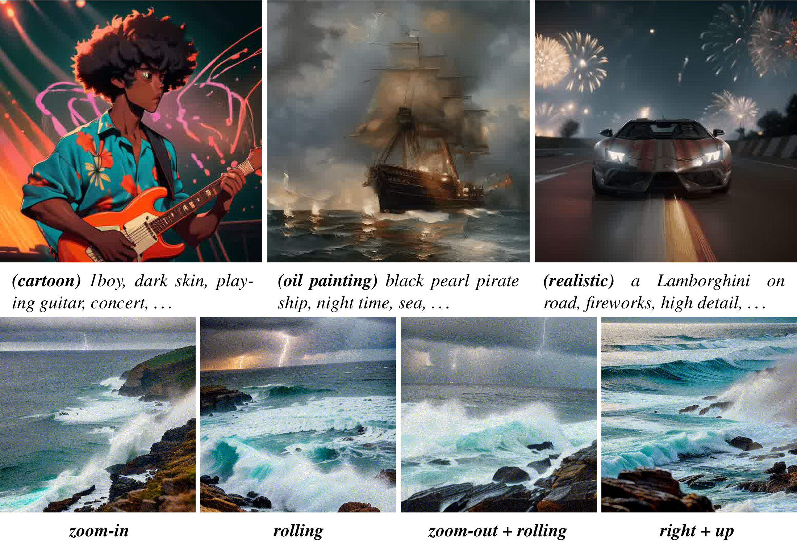
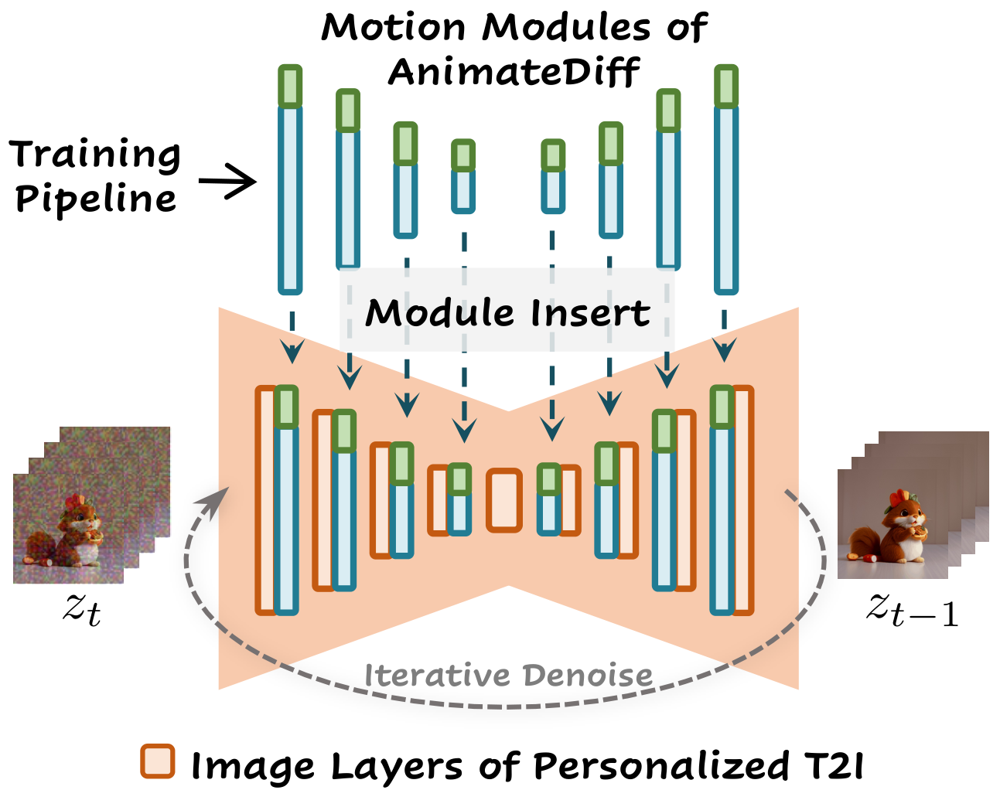
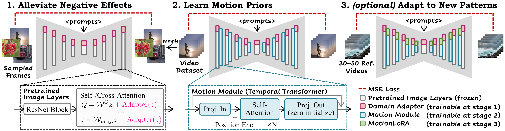
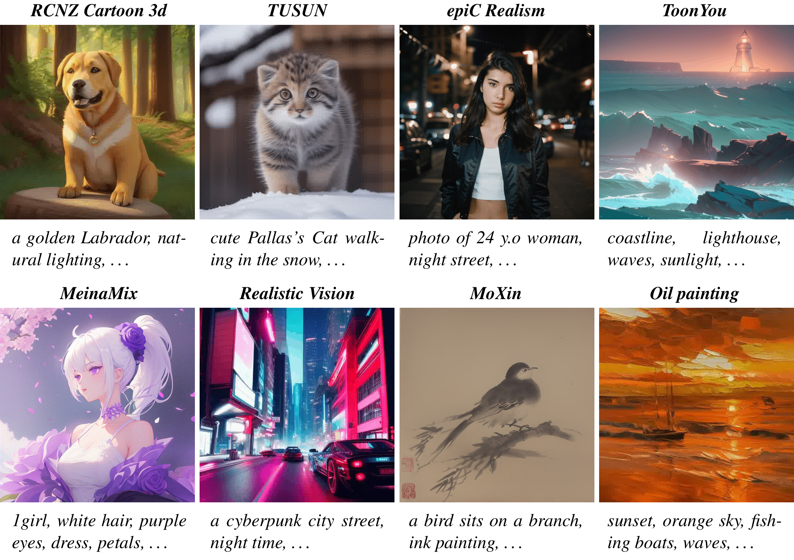
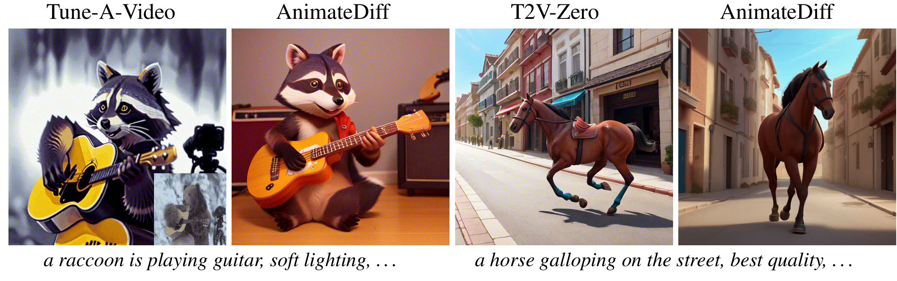
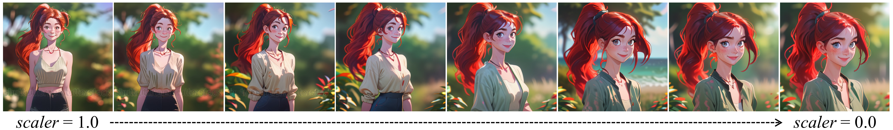
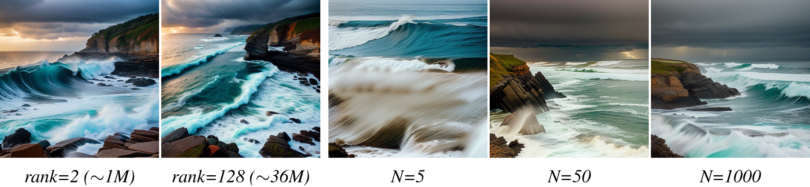
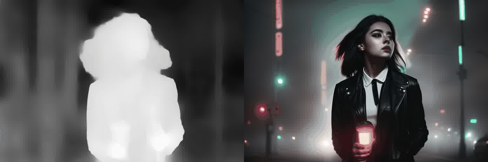

# AnimateDiff：无需特定微调，让个性化文本到图像扩散模型动起来

**作者：** Yuwei Guo、Ceyuan Yang、Anyi Rao、Zhengyang Liang、Yaohui Wang、Yu Qiao、Maneesh Agrawala、Dahua Lin、Bo Dai

**单位：** 香港中文大学、上海人工智能实验室、斯坦福大学

**原论文：** AnimateDiff: Animate Your Personalized Text-to-Image Diffusion Models without Specific Tuning（ICLR 2024）

**版本：** arXiv:2307.04725v2

**源码：** `main.tex`（arXiv LaTeX 源码包，非 PDF 转换；正文分 `sections/*.tex` 六个文件）

> 译稿按原文句子顺序逐句展开，一句原文对应一行中文译句；公式、图、表与正文引用的编号均与原文一致（图 1–8、表 1、式 (1)–(7)、第 4.1–4.4 节），正文中的引用编号保留原形式，文献条目请查阅原论文。
> 术语遵循 `animdiffwork/glossary.md` 的既定译法；人名、模型名、数据集名、代码标识（Stable Diffusion、DreamBooth、LoRA、MotionLoRA、WebVid-10M、ControlNet 等）保留原形式。论文自定义宏 `method` / `methodlora`（LaTeX 中带反斜杠）分别展开为 AnimateDiff / MotionLoRA。
> 插图为源码包中的原始图件。原文有 19 处使用 `\animategraphics` 嵌入可点击播放的视频片段（论文 PDF 中需用 Acrobat Reader 播放），译文一律取其**首帧静帧**，并在图注后标明。静帧保留源文件的原始分辨率，以 PNG 无损保存；图 2、图 3 从原始 PDF 以 600 dpi 重新渲染，图 6 以 300 dpi 重新渲染。
> 图片布局按原 PDF 保留相对尺寸与排列：图 1 为上排 3 张、下排 4 张，图 4 为两排各 4 张，图 5 为一排 4 张，图 7 为一排 5 张；图 2 与图 8 分别占正文宽度的约 43% 和 50%，靠右与正文并排。图组保留原图中的标签，中文说明见图注。点击图组可查看高清大图。
> 原文中的笔误（如 `forword diffusion`、`latent wrapping`）如实保留，并以 `译注` 标出，不擅自改动正文。
> 本文新增的 **阅读注释** 用于解释术语、公式和方法动机，不属于原论文正文；与核对原文措辞的“译注”区分。初读时可重点阅读第 3 节和第 4 节中的注释。

  

**图 1：** AnimateDiff 借助一个预训练的运动模块，直接把现有的个性化文本到图像（T2I）模型转变为相应的动画生成器。*第一行*：将 AnimateDiff 与三个不同领域的个性化 T2I 结合所得的结果；*第二行*：进一步将 AnimateDiff 与 MotionLoRA 结合以实现镜头类型控制的结果。*最好使用 Acrobat Reader 观看。点击图像即可播放动画片段。*
*（原文此处为可播放的动画片段，PDF 中点击播放；译文取首帧静帧。）*
*图中文字：* 第一行（从左到右）（cartoon）1boy, dark skin, playing guitar, concert, …；（oil painting）black pearl pirate ship, night time, sea, …；（realistic）a Lamborghini on road, fireworks, high detail, …；第二行（从左到右）zoom-in（放大）；rolling（滚动）；zoom-out + rolling（缩小 + 滚动）；right + up（向右 + 向上）。

## 摘要

随着文本到图像（T2I）扩散模型（*例如* Stable Diffusion）以及 DreamBooth、LoRA 等相应个性化技术的进步，每个人都能以可负担的成本将自己的想象呈现为高质量图像。
然而，为现有的高质量个性化 T2I 添加运动动态，并使它们能够生成动画，仍然是一个尚未解决的挑战。
在本文中，我们提出 AnimateDiff，一个无需针对特定模型进行调优即可为个性化 T2I 模型赋予动画能力的实用框架。
我们框架的核心是一个即插即用的运动模块，它只需训练一次，便能无缝集成到源自同一基础 T2I 的任何个性化 T2I 中。
通过我们提出的训练策略，该运动模块能够有效地从真实世界视频中学习可迁移的运动先验。
一旦训练完成，该运动模块便可插入个性化 T2I 模型，构成个性化动画生成器。
我们进一步提出 MotionLoRA，一种面向 AnimateDiff 的轻量级微调技术，它使预训练的运动模块能够以较低的训练和数据收集成本适应新的运动模式，例如不同的镜头类型。
我们在从社区收集的若干公开且具有代表性的个性化 T2I 模型上评估了 AnimateDiff 和 MotionLoRA。
结果表明，我们的方法能帮助这些模型生成时间上平滑的动画片段，同时保持视觉质量和运动多样性。
代码与预训练权重见 <https://github.com/guoyww/AnimateDiff>。

> **阅读注释｜这篇论文究竟解决什么问题？** 已有的个性化图像模型会画某种风格或某个角色，但如果独立生成多张图片再拼成视频，人物外观、背景和姿势可能在帧间突然变化。AnimateDiff 为图像模型加入让不同帧交换信息的运动模块，学习连续变化的规律。“运动先验”就是从训练视频中学到的这类规律，并不一定表现为显式的速度、轨迹或物理方程。“无需特定微调”指模块训练完成后，用户通常不用再针对自己的图像模型训练一次；它不意味着运动模块本身无需训练，适用范围也限定在来自同一基础模型、结构兼容的个性化模型中。

## 1 引言

文本到图像（T2I）扩散模型 [32, 38, 43, 39] 极大地赋能了艺术家和业余爱好者使用文本提示来创作视觉内容。

为了进一步激发现有 T2I 模型的创造力，人们提出了轻量级的个性化方法，例如 DreamBooth [42] 和 LoRA [20]。

这些方法使得在诸如配备 RTX3080 的笔记本电脑等消费级硬件上，能够在小数据集上进行定制化微调，从而让用户以相对较低的成本将基础 T2I 模型适配到新的领域并提升视觉质量。

因此，庞大的 AI 艺术家与业余爱好者社区在 [5] 和 [21] 等模型分享平台上贡献了大量个性化模型。

尽管这些个性化 T2I 模型能够生成出色的视觉质量，但它们的输出仅限于静态图像。

另一方面，生成动画的能力在现实世界的制作中更为可取，例如在电影和卡通产业中。

在这项工作中，我们旨在直接将现有的高质量个性化 T2I 模型转化为动画生成器，而无需针对特定模型进行微调，因为对业余用户而言，这在计算和数据收集成本上往往并不现实。

我们提出了 AnimateDiff，一个有效的流程，用于解决在保持个性化 T2I 的视觉质量与领域知识的同时为其赋予动画能力的问题。

AnimateDiff 的核心是一种训练即插即用运动模块的方法，该模块从视频数据集（例如 WebVid-10M [1]）中学习合理的运动先验。

在推理时，训练好的运动模块可以直接集成到个性化 T2I 中，并在无需特定调优的情况下生成平滑且视觉上吸引人的动画。

AnimateDiff 中运动模块的训练包含三个阶段。

首先，我们在基础 T2I 上微调一个域适配器，以与目标视频数据集的视觉分布对齐。

这一预备步骤保证了运动模块专注于学习运动先验，而不是从训练视频中学习像素级细节。

其次，我们将基础 T2I 与域适配器一起膨胀，并引入一个新初始化的运动模块用于运动建模。

随后我们在视频上优化该模块，同时保持域适配器和基础 T2I 的权重固定。

通过这样做，运动模块学习到泛化的运动先验，并且能够通过模块插入，使其他个性化 T2I 生成与其个性化领域一致的平滑且吸引人的动画。

AnimateDiff 的第三阶段也被称为 MotionLoRA，旨在用少量参考视频和训练迭代，将预训练的运动模块适配到特定的运动模式。

我们通过借助低秩适配（LoRA）[20] 微调运动模块来实现这一点。

值得注意的是，仅用 50 个参考视频即可完成对新运动模式的适配。

此外，一个 MotionLoRA 模型仅需要大约 30M 的额外存储空间，进一步提升了模型分享的效率。

这种效率对于那些无法承担昂贵的预训练成本、但希望为特定效果微调运动模块的用户来说尤其有价值。

> **阅读注释｜三个阶段分别学什么？** 可以将它们理解为：域适配器学习“训练视频的画面有什么特点”，运动模块学习“画面中的内容怎样连续变化”，MotionLoRA 再学习“怎样产生指定的镜头运动”。前两个阶段用于准备通用运动模块，第三阶段按需进行。文中的“冻结”表示某些参数仍参与计算，但训练时不更新；“推理”表示使用训练好的模型生成结果。

我们在从模型分享平台 [5, 21] 上收集的多种个性化 T2I 模型上评估了 AnimateDiff 和 MotionLoRA 的性能。

这些模型涵盖了广泛的领域，从 2D 卡通到写实照片，从而为我们的评估构成了一个全面的基准。

我们的实验结果展示了令人期待的效果。

在实践中，我们还发现，沿时间轴的 Transformer [48] 架构足以捕获合适的运动先验。

我们还证明，我们的运动模块可以无缝地集成到现有的内容控制方法 [54, 31]（例如 ControlNet）中，而无需额外的训练，从而使 AnimateDiff 能够进行可控的动画生成。

总之，（1）我们提出了 AnimateDiff，一个实用的流程，能够在无需特定微调的情况下为任何个性化 T2I 赋予动画生成能力；

（2）我们验证了 Transformer 架构足以对运动先验进行建模，这为视频生成提供了有价值的见解；

（3）我们提出了 MotionLoRA，一种轻量级的微调技术，用于将预训练的运动模块适配到新的运动模式；

（4）我们用具有代表性的社区模型全面评估了我们的方法，并将其与学术基线以及商业工具（例如 [13] 和 [33]）进行了比较。

此外，我们展示了其与现有可控生成工作的兼容性。

## 2 相关工作

**文本到图像扩散模型。**

扩散模型 [16, 6, 47] 用于文本到图像（T2I）生成 [14, 30, 34, 7, 56, 37, 26]，近来在学术界与非学术界都获得了显著关注。

GLIDE [32] 引入了文本条件，并证明引入分类器引导能带来更令人满意的结果。

DALL-E2 [38] 通过利用 CLIP [35] 的联合特征空间来改进文本–图像对齐。

Imagen [43] 结合了一个大语言模型 [36] 与级联架构，以实现照片级真实的结果。

潜在扩散模型 [39]，也称为 Stable Diffusion，将扩散过程移到自编码器的潜空间中以提升效率。

eDiff-I [2] 采用了一组针对不同生成阶段专门化的扩散模型集成。

**个性化 T2I 模型。**

为了便于使用预训练 T2I 进行创作，许多工作关注高效的模型个性化 [45, 27, 8, 25]，即使用参考图像向基础 T2I 引入概念或风格。

实现这一目标最直接的方法是对模型进行完全微调。

尽管这种做法有可能显著提升整体质量，但当参考图像集很小时，它可能导致灾难性遗忘 [24, 10]。

与之相反，DreamBooth [42] 使用保持损失对整个网络进行微调，并且只使用少量图像。

Textual Inversion [11] 为每个新概念优化一个 token 嵌入。

低秩适配（LoRA）[20] 通过向基础 T2I 引入额外的 LoRA 层并仅优化权重残差，为上述微调过程提供便利。

也有一些基于编码器的方法来解决个性化问题 [12, 22]。

在我们的工作中，我们关注基于微调的方法，包括整体微调、DreamBooth [42] 和 LoRA [20]，因为它们保留了基础 T2I 的原始特征空间。

> **阅读注释｜个性化、遗忘和特征空间。** “个性化”既可以学习某个具体人物或物体，也可以学习水墨、卡通等画风。“灾难性遗忘”是指模型学习新概念时，原先的通用生成能力受到破坏；DreamBooth 的先验保持损失用于缓解这种变化。“保留原始特征空间”强调这些模型仍建立在共同的图像网络和可复用的内部表示之上，便于接入同一种运动模块，不能理解成微调前后的所有特征数值完全相同。

**为个性化 T2I 制作动画。**

关于为个性化 T2I 制作动画的现有工作并不多。

Text2Cinemagraph [29] 提出通过流预测来生成电影摄影。

在视频生成领域，用时序结构扩展预训练的 T2I 是常见做法。

现有工作 [9, 55, 46, 18, 17, 41, 28, 53, 52, 50, 19, 28] 大多更新所有参数并改变原始 T2I 的特征空间，因而与个性化的 T2I 不兼容。

Align-Your-Latents [3] 表明，通用视频生成器中冻结的图像层可以被个性化。

最近，一些视频生成方法在为个性化 T2I 模型制作动画方面展现了有前景的结果。

Tune-a-Video [51] 在单个视频上微调少量参数。

Text2Video-Zero [23] 提出了一种免训练方法，通过基于预定义仿射矩阵的潜码包裹来为预训练 T2I 制作动画。

> **译注：** 原文 "latent wrapping" 疑为 "latent warping"（潜码变形）之笔误，此处如实保留原文措辞，未予改动。

## 3 预备知识

我们介绍 Stable Diffusion [39] 的预备知识，它是我们工作中所使用的基础 T2I 模型，以及低秩适配（LoRA）[20]，这有助于理解 AnimateDiff 中的域适配器（第 4.1 节）和 MotionLoRA（第 4.3 节）。

**Stable Diffusion。**

我们选择 Stable Diffusion（SD）作为本文的基础 T2I 模型，因为它是开源的，并且拥有一个发展完善的社区，提供了许多高质量的个性化 T2I 模型可供评估。

SD 在预训练自编码器 $\mathcal{E}(\cdot)$ 和 $\mathcal{D}(\cdot)$ 的潜空间中执行扩散过程。

> **阅读注释｜潜空间是什么？** $\mathcal{E}(\cdot)$ 表示编码器（Encoder），将图像压缩为较小的特征张量，称为潜码，即 $z_0=\mathcal{E}(x_0)$；$\mathcal{D}(\cdot)$ 表示解码器（Decoder），将潜码还原为图像，即 $\hat{x}_0=\mathcal{D}(z_0)$，其中 $\hat{x}_0$ 表示重建图像。括号中的 $\cdot$ 是输入的占位符，表示“将某个输入交给这个函数”。编码器与解码器共同构成自编码器。SD 先将图像编码成潜码，在潜码上进行加噪和去噪，再将得到的潜码解码成图像。它类似“在压缩后的图像表示上作画”，但潜码是模型学习到的特征，不是普通图片文件。扩散网络在这个较小的表示上计算，通常比直接处理全部像素更省资源。这里的 $x_0$ 是干净图像，$z_0$ 是它的干净潜码，下标 $0$ 表示尚未加噪。

在训练中，编码后的图像 $z_0 = \mathcal{E}(x_0)$ 通过前向扩散被扰动为 $z_t$：

$$ z_t = \sqrt{\bar{\alpha_t}}z_0 + \sqrt{1-\bar{\alpha_t}}\epsilon,~\epsilon\sim\mathcal{N}(0, \mathit{I}), \tag{1} $$

对于 $t = 1,\ldots, T$，其中预定义的 $\bar{\alpha_t}$ 决定第 $t$ 步的噪声强度。

> **阅读注释｜如何读式 (1)？** $\epsilon$ 是与潜码形状相同的随机高斯噪声，$\mathcal{N}(0,I)$ 表示零均值、单位协方差的高斯分布。式子将原始潜码和噪声按两个系数混合：通常随着扩散步 $t$ 增大，$\bar{\alpha_t}$ 减小，原图信息减少、噪声占比增加。$\bar{\alpha_t}$ 通常是前 $t$ 步信号保留系数的累计乘积；用这个公式可以直接采样任意一步的 $z_t$，训练时不必真的连续加噪 $t$ 次。注意：这里的 $t$ 是“加噪／去噪的步数”，不是视频的第几帧。

去噪网络 $\epsilon_\theta(\cdot)$ 学习通过预测所添加的噪声来逆转这一过程，并由 MSE 损失所驱动：

$$ \mathcal{L} = \mathbb{E}_{\mathcal{E}(x_0), y, \epsilon\sim\mathcal{N}(0, \mathit{I}), t}\left\lbrack \lVert \epsilon - \epsilon_\theta(z_t, t, \tau_\theta(y)) \rVert_2^2 \right\rbrack, \tag{2} $$

其中 $y$ 是对应于 $x_0$ 的文本提示；$\tau_\theta(\cdot)$ 是一个将提示映射为向量序列的文本编码器。

> **阅读注释｜为什么预测噪声就能生成图像？** 训练时，噪声是程序自己加入的，因此知道正确答案。网络接收 $z_t$、扩散步 $t$ 和文本特征，预测加入的噪声；式 (2) 的平方误差要求预测尽量接近真实噪声，$\mathbb{E}$ 表示对不同样本、噪声和扩散步取平均。推理时没有真实图像作为答案，而是从随机噪声开始，反复利用网络预测和采样算法更新潜码，最后解码成图像。它不是一次调用网络就把全部噪声直接去掉。

在 SD 中，$\epsilon_\theta(\cdot)$ 被实现为一个 UNet [40]，它由四个分辨率层级上的下采样／上采样块对以及一个中间块构成。

每个网络块由 ResNet [15]、空间自注意力层以及引入文本条件的交叉注意力层组成。

> **阅读注释｜这些网络层怎样分工？** UNet 通过下采样学习较大范围的结构，再通过上采样恢复细节，并借助跳跃连接利用不同尺度的特征。ResNet 块负责特征变换；空间自注意力让同一帧中的不同位置交换信息；交叉注意力让图像特征参考文本特征，决定应当生成什么。原来的这些图像层主要处理一帧内部的信息，后面新增的时序注意力才负责跨帧交流。

**低秩适配（LoRA）。**

LoRA [20] 是一种加速大模型微调的方法，最初是为语言模型适配而提出的。

LoRA 不重新训练所有模型参数，而是添加成对的秩分解矩阵，并且只优化这些新引入的权重。

通过限制可训练参数并保持原始权重冻结，LoRA 更不容易导致灾难性遗忘 [24]。

具体而言，秩分解矩阵充当预训练模型权重 $\mathcal{W} \in \mathbb{R}^{m \times n}$ 的残差。

加入 LoRA 后的新模型权重为

$$ \mathcal{W}' = \mathcal{W} + \Delta \mathcal{W} = \mathcal{W} + AB^T, \tag{3} $$

其中 $A \in \mathbb{R}^{m \times r}$，$B \in \mathbb{R}^{n \times r}$ 是一对秩分解矩阵，$r$ 是一个超参数，被称为 LoRA 层的秩。

在实践中，LoRA 仅被应用于注意力层，进一步降低了模型微调的成本和存储开销。

> **阅读注释｜式 (3) 为什么能减少参数？** 原权重 $W$ 有 $mn$ 个参数，两个小矩阵 $A$、$B$ 共只有 $r(m+n)$ 个参数；当 $r$ 远小于 $m,n$ 时，训练增量明显更小。例如，$1024\times1024$ 的矩阵有 1,048,576 个参数，使用 $r=4$ 的 LoRA 只新增 8,192 个参数。$AB^T$ 是加到原权重上的低秩修正，实际秩至多为 $r$。“低秩”限制了更新的自由度，但不表示图像分辨率低。这里的“仅应用于注意力层”是论文采用的配置，并非 LoRA 在所有模型中的通用限制。

> **译注：** 原文 "forword diffusion" 系 "forward diffusion" 的笔误，译文如实按前向扩散理解，未改动原文。

## 4 AnimateDiff

<table width="100%" border="0" cellspacing="0" cellpadding="0" style="width:100%;border:0;border-collapse:collapse;table-layout:fixed;">
<tr style="border:0;background:transparent;">
<td width="57%" valign="top" style="width:57%;border:0;padding:0 16px 0 0;vertical-align:top;">

我们方法的核心是从视频数据中学习可迁移的运动先验，这些运动先验无需特定调优即可应用于个性化 T2I。

如图 2 所示，在推理时，我们的运动模块（蓝色）和<em>可选</em>的 MotionLoRA（绿色）可以直接插入到个性化 T2I 中，构成动画生成器，随后该生成器通过迭代去噪过程生成动画。

我们通过训练 AnimateDiff 的三个组件来实现这一点，即域适配器、运动模块和 MotionLoRA。

</td>
<td width="43%" valign="top" style="width:43%;border:0;padding:0;vertical-align:top;">

<strong>图 2：</strong> 推理流程。

</td>
</tr>
</table>

第 4.1 节中的域适配器仅在训练中使用，以缓解基础 T2I 预训练数据与我们的视频训练数据之间的视觉分布差异所造成的负面影响；
第 4.2 节中的运动模块用于学习运动先验；
而第 4.3 节中的 MotionLoRA（在通用动画的情况下是*可选*的）用于将预训练的运动模块适配到新的运动模式。

第 4.4 节详细阐述了 AnimateDiff 的训练（图 3）和推理。

> **阅读注释｜先看清训练与推理的区别。** 通用运动模块的训练使用“基础图像模型 + 域适配器 + 新增运动模块”；普通用户生成动画时，通常使用“个性化图像模型 + 已训练的运动模块”，需要特定镜头效果时再加 MotionLoRA。域适配器通常移除，因此生成端保留的是用户自己的画风，而不是刻意保留训练视频的水印、压缩风格等外观特点。下面几节分别说明这三类组件如何实现。

*图中文字：* 个性化 T2I 的图像层（Image Layers of Personalized T2I）；迭代去噪（Iterative Denoise）；AnimateDiff 的运动模块（Motion Modules of AnimateDiff）；训练流水线（Training Pipeline）；模块插入（Module Insert）；$z_t$、$z_{t-1}$。
> **译注：** 该图图注为"推理流程"（Inference pipeline），但图内自带的标题文字写的是"训练流水线"（Training Pipeline），系原文图件本身的标签，译文照录未改。

### 4.1 用域适配器缓解训练数据带来的负面影响

由于收集困难，公开可用的视频训练数据集的视觉质量远低于相应的图像数据集。

例如，视频数据集 WebVid [1] 的内容大多是真实世界的录像，而图像数据集 LAION-Aesthetic [44] 则包含更高质量的内容，包括艺术绘画和专业摄影。

此外，当把每一视频帧单独视为图像时，它可能包含运动模糊、压缩伪影和水印。

因此，用于训练基础 T2I 的高质量图像数据集与我们用于学习运动先验的目标视频数据集之间存在不可忽视的质量域差异。

> **阅读注释｜“域差异”为什么会影响运动学习？** “域”指数据的分布，包括内容、风格和画面质量。训练视频既包含运动，也带有模糊、压缩痕迹、水印等外观特点；噪声预测损失不会自动区分哪些特点值得保留。如果冻结图像模型后直接训练运动模块，后者可能同时学习帧间变化和对视频外观的适应，进而影响生成质量。这里比较的是论文使用的两类数据，并非所有视频都比图片质量差。

我们认为，当直接在原始视频数据上训练时，这种差异会限制动画生成流水线的质量。

为了避免将这种质量差异作为我们运动模块的一部分来学习并保留基础 T2I 的知识，我们提出**将域信息拟合到一个单独的网络**中，称之为域适配器。

我们在推理时丢弃域适配器，并表明这种做法有助于减少上述域差异所造成的负面影响。

> **阅读注释｜为什么要学习一个最后又丢掉的适配器？** 先用域适配器让图像模型适应训练视频的单帧外观；随后冻结图像模型和适配器，只训练运动模块，减轻后者同时学习外观差异的负担。生成时通常移除适配器，让个性化图像模型提供画风、运动模块提供帧间变化，减少训练视频外观的影响。例如，希望把真实录像中的“转头动作”迁移给动漫人物，而尽量不带入录像的压缩痕迹。适配器并不负责修复训练视频，这种训练分工也不保证外观与运动完全分离。

我们用 LoRA [20] 实现域适配器层，并将其插入基础 T2I 的自注意力／交叉注意力层中，如图 3 所示。

以查询（Q）投影为例。
投影后的内部特征 $z$ 变为

$$ Q = \mathcal{W}^Qz + \text{AdapterLayer}(z) = \mathcal{W}^Qz + \alpha \cdot AB^Tz, \tag{4} $$

其中 $\alpha = 1$ 是一个标量，可在推理时调整为其他值（设为 $0$ 以完全消除域适配器的影响）。

然后，我们在从视频数据集中随机采样的静态帧上，以式 (2) 中的相同目标仅优化域适配器的参数。

> **阅读注释｜如何读式 (4)？** $z$ 是进入注意力层的内部特征，不应直接等同于模型输入的加噪潜码 $z_t$；$Q$ 是注意力机制的查询。第一项 $\mathcal{W}^Qz$ 是原模型的投影，第二项 $\alpha AB^Tz$ 是适配器提供的修正。训练时固定原权重 $\mathcal{W}^Q$，只更新低秩矩阵 $A,B$；式子以 $Q$ 为例，并非整个适配器只修改这一处。$\alpha$ 控制修正强度：为 $1$ 时使用完整修正，为 $0$ 时消除适配器贡献，也可用中间值调节。它与式 (1) 控制加噪强度的 $\bar{\alpha_t}$ 不同，最终画面效果也不一定随 $\alpha$ 线性变化。

> **阅读注释｜域适配器具体怎样训练？** 从视频中随机抽取单帧，编码为潜码，再随机选择扩散步并加入已知噪声；“基础图像模型 + 域适配器”预测噪声，用式 (2) 的平方误差反向传播，仅更新适配器。基础模型被冻结，但仍参与计算。训练没有提供无水印或高清版本作为答案，因此学的是视频帧的外观分布，而非去水印或画质修复；由于不联合查看连续帧，也不直接学习帧间运动。

  

**图 3：** **AnimateDiff 的训练流水线。**
AnimateDiff 针对相应的组件模块包含三个训练阶段。
首先，训练一个域适配器（第 4.1 节）以缓解训练视频所造成的负面影响。
其次，插入一个运动模块（第 4.2 节）并在视频上训练，以学习通用运动先验。
最后，在少量参考视频上训练 MotionLoRA（第 4.3 节），以将预训练的运动模块适配到新的运动模式。
*图中文字：* 1. 缓解负面影响（1. Alleviate Negative Effects）；2. 学习运动先验（2. Learn Motion Priors）；3.（可选）适配新的运动模式（3. (optional) Adapt to New Patterns）；视频数据集（Video Dataset）；20~50 个参考视频（20~50 Ref. Videos）；样本（sample）；<提示词>（<prompts>）；预训练图像层（Pretrained Image Layers）；MSE 损失（MSE Loss）；预训练图像层（冻结）（Pretrained Image Layers (frozen)）；域适配器（Domain Adapter）；运动模块（Motion Module）；MotionLoRA；（第 1 阶段可训练）（trainable at stage 1）；（第 2 阶段可训练）；（第 3 阶段可训练）；投影输入（Proj. In）；投影输出（Proj. Out）；（零初始化）（(zero initialize)）；运动模块（时序 Transformer）（Motion Module (Temporal Transformer)）；自注意力（Self-Attention）；×N；位置编码（Position Enc.）；自注意力／交叉注意力（Self-/Cross-Attention）；$Q = W^Q z + \mathrm{Adapter}(z)$；$z = W_{\mathrm{proj.}} z + \mathrm{Adapter}(z)$；…；ResNet 块（ResNet Block）；采样帧（Sampled Frames）。

### 4.2 用运动模块学习运动先验

为了在预训练 T2I 之上沿时间维度对运动动态建模，我们必须 1）将二维扩散模型膨胀以处理三维视频数据，2）设计一个子模块以沿时间轴实现高效的信息交换。

**网络膨胀。**
基础 T2I 模型中的预训练图像层捕获了高质量的内容先验。
为了利用这些知识，网络膨胀的一种更可取方式是让这些图像层独立地处理视频帧。
为此，我们采用与近期工作 [18, 51, 3] 类似的做法，并修改模型，使其接受 5D 视频张量 $x \in \mathbb{R}^{b \times c \times f \times h \times w}$ 作为输入，其中 $b$ 和 $f$ 分别表示批轴和帧-时间轴。
当内部特征图经过图像层时，时间轴 $f$ 通过被重塑到 $b$ 轴而被忽略，从而使网络能够独立地处理每一帧。
随后我们在图像层之后将特征图重塑回 5D 张量。
另一方面，我们新插入的运动模块通过将 $h, w$ 重塑到 $b$ 来忽略空间轴，并在该模块之后重塑回来。

> **阅读注释｜“膨胀”和“重塑”究竟做了什么？** 这里的“三维视频”指高度、宽度和时间，不是三维场景重建；加上批次和通道后，张量共有五个维度。图像层将 $(b,c,f,h,w)$ 调整为 $(bf,c,h,w)$，把所有帧当作独立图片处理；运动模块则将它调整为 $(bhw,f,c)$，把每个空间位置在各帧中的特征看作一条时间序列。例如，一段 16 帧、特征尺寸为 $64\times64$ 的视频，在运动模块里对应 4,096 条长度为 16 的序列。重塑需要配合维度排列，既不丢掉帧，也不丢掉空间信息。“忽略空间轴”指不在该模块内直接做空间注意力，不等于整个模型不处理空间关系。

**模块设计。**
近期关于视频生成的工作探索了许多用于时序建模的设计。
在 AnimateDiff 中，我们采用 Transformer [48] 架构作为我们的运动模块设计，并做了小幅修改以使其能够沿时间轴运行，我们在后续章节中将其称为“时序 Transformer”。
我们通过实验发现，这一设计足以对运动先验建模。
如图 3 所示，时序 Transformer 由若干沿时间轴的自注意力块组成，并使用正弦位置编码来编码动画中每一帧的位置。
如上所述，运动模块的输入是空间维度被合并到批轴的重塑后的特征图。
当我们沿时间轴切分重塑后的特征图时，它可以被视为长度为 $f$ 的向量序列，即 $\{z_1, ..., z_f; z_i \in \mathbb{R}^{(b \times h \times w) \times c}\}$。
这些向量随后将被投影并经过若干自注意力块，即

$$ z_{out} = \text{Attention}(Q,K,V)=\text{Softmax}(QK^T / \sqrt{c})\cdot V, \tag{5} $$

其中 $Q = W^Qz$、$K = W^Kz$、$V=W^Vz$ 是三个独立的投影。

> **阅读注释｜如何读式 (5) 的时序注意力？** 对某个空间位置，输入可以看作 $f\times c$ 的特征矩阵。$Q$（查询）表示当前帧要寻找的信息，$K$（键）用于比较各帧的相关程度，$V$（值）提供实际汇入的特征；$QK^T$ 得到一个 $f\times f$ 的帧间关联矩阵。Softmax 将关联分数变成权重，再对各帧的 $V$ 加权求和。这样，生成某一帧时便能参考其他帧。除以 $\sqrt{c}$ 用于控制分数尺度；具体多头注意力实现通常按每个头的特征维度缩放。这些运算发生在特征空间，并不是直接把不同帧的像素取平均。

注意力机制使得当前帧的生成能够融入来自其他帧的信息。
因此，与逐帧单独生成不同，用我们的运动模块膨胀后的 T2I 模型学会捕捉视觉内容随时间的变化，这些变化构成了动画片段中的运动动态。
注意，在自注意力之前加入的正弦位置编码是必要的；否则，该模块无法感知动画中的帧顺序。

> **阅读注释｜位置编码为什么重要？** 单靠自注意力，模型能比较各帧内容，却没有明确的“第 1 帧、第 2 帧……”标签。位置编码为每帧加入表示其序号的向量，使模块能够利用先后顺序，而不只是把视频当作一组无序图片。时序模块直接交流的是同一特征位置在不同帧的信息；物体移动后会出现在不同位置，因此还需要原有空间网络与时序模块共同建模。它不是一个显式跟踪每个物体轨迹的模块。

为避免额外模块可能引入的任何有害影响，我们对时序 Transformer 的输出投影层进行零初始化 [54]，并加入残差连接，使运动模块在训练开始时是恒等映射。

> **阅读注释｜“零初始化 + 残差连接”有什么用？** 可将新增模块理解为 $z_{\mathrm{new}}=z+F(z)$。输出投影初始为零时，新增分支的输出 $F(z)$ 为零，于是 $z_{\mathrm{new}}=z$，原有图像特征能够直接通过；训练随后逐渐学出有用的修正。这能避免随机初始化的新增模块一开始就大幅扰动预训练图像模型。“恒等映射”指输入与输出相同，并不表示训练完成后模块仍然不发挥作用。

### 4.3 用 MotionLoRA 适配新的运动模式

虽然预训练的运动模块捕获了通用运动先验，但当我们需要用少量参考视频和训练迭代将其有效适配到诸如相机变焦、平移和旋转等新的运动模式时，就会出现一个问题。
这种效率对于无法承担昂贵预训练成本但希望针对特定效果微调运动模块的用户而言至关重要。
接下来是 AnimateDiff 的最后一个阶段，也被称为 MotionLoRA（图 3），一种面向**运动个性化**的高效微调方法。
考虑到运动模块的架构和有限的参考视频数量，我们在第 4.2 节所述膨胀模型中的运动模块的自注意力层上添加 LoRA 层，然后在新的运动模式的参考视频上训练这些 LoRA 层。

> **阅读注释｜MotionLoRA 与画风 LoRA 有何区别？** 两者都采用低秩权重修正，但作用位置和训练目的不同：画风或角色 LoRA 通常修改图像模型，影响“画什么、画成什么样”；MotionLoRA 修改运动模块的时序注意力，影响“怎样变化、镜头怎样运动”。这里是在已有通用运动能力上追加一种运动偏好，图像模型和预训练运动权重保持冻结，仅更新新增的 LoRA 参数。

我们试验了若干镜头类型，并通过基于规则的数据增强获得参考视频。
例如，为了获得具有变焦效果的视频，我们通过沿时间轴逐渐缩小（放大）或扩大（缩小）视频帧的裁剪区域来增强视频。
我们证明，即使只有 $20\sim50$ 个参考视频、2,000 次训练迭代（约 $1\sim2$ 小时）以及约 30M 的存储空间，我们的 MotionLoRA 也能取得令人满意的结果，从而实现高效的模型调优和用户间的共享。
得益于低秩性质，MotionLoRA 还具有组合能力。
也就是说，单独训练的 MotionLoRA 模型可以在推理时组合起来，以实现组合后的运动效果。

> **阅读注释｜变焦数据与运动组合怎样理解？** 如果每一帧的裁剪窗口逐渐缩小，再把裁剪结果缩放到相同输出尺寸，画面中的主体就会越来越大，形成类似镜头推近的效果。组合两个 MotionLoRA 时，可将权重修正理解为 $\Delta W=\lambda_1\Delta W_1+\lambda_2\Delta W_2$，例如混合“放大”和“旋转”的修正。权重增量可以线性相加，但整个生成网络是非线性的，最终运动不保证严格按比例叠加；论文展示的是实验中的组合效果。

### 4.4 AnimateDiff 实践

我们在此详细阐述训练与推理，并将详细配置放在补充材料中。

**训练。**
如图 3 所示，AnimateDiff 由三个可训练的组件模块组成，以学习可迁移的运动先验。
它们的训练目标略有不同。
域适配器使用式 (2) 中的原始目标进行训练。
运动模块和 MotionLoRA 作为动画生成器的一部分，使用类似的目标，并做小幅修改以适配更高维的视频数据。
具体而言，一个视频数据批次 $x_0^{1:f} \in \mathbb{R}^{b \times c \times f \times h \times w}$ 首先通过 SD 的预训练自编码器逐帧编码为潜码 $z_0^{1:f}$。
然后按照式 (1) 中定义的前向扩散调度对潜码加噪：

$$ z_t^{1:f} = \sqrt{\bar{\alpha_t}}z_0^{1:f} + \sqrt{1-\bar{\alpha_t}}\epsilon^{1:f}. \tag{6} $$

膨胀后的模型输入加噪的潜码和相应的文本提示，并预测所加入的噪声。
我们运动建模模块的最终训练目标为：

$$ \mathcal{L} = \mathbb{E}_{\mathcal{E}(x_0^{1:f}), y, \epsilon^{1:f}\sim\mathcal{N}(0, \mathit{I}), t}\left\lbrack \lVert \epsilon - \epsilon_\theta(z_t^{1:f}, t, \tau_\theta(y)) \rVert_2^2 \right\rbrack. \tag{7} $$

值得注意的是，在训练域适配器、运动模块和 MotionLoRA 时，可训练部分之外的参数保持冻结。

> **阅读注释｜视频训练目标与图像目标有什么不同？** 式 (6) 和式 (7) 延续了“加噪后预测噪声”的做法，只是输入由一张图的潜码变成整段视频的潜码。上标 $1{:}f$ 表示第 1 帧到第 $f$ 帧，$t$ 仍表示扩散步；同一视频片段按同一个 $t$ 的噪声强度加噪，并不意味着把同一张噪声复制到全部帧。网络联合查看这些帧，用时序模块帮助预测视频噪声。论文列出的目标没有额外的光流损失或“相邻帧必须一样”的损失，运动规律主要通过视频数据和跨帧结构学到。
>
> **各阶段更新范围：** 第 1 阶段仅更新域适配器；第 2 阶段冻结图像模型和已训练的域适配器，仅更新运动模块；第 3 阶段仅更新 MotionLoRA。冻结参数仍参与前向计算，并且会影响训练结果。

**推理。**
在推理时（图 2），个性化 T2I 模型将首先按照第 4.2 节中讨论的相同方式进行膨胀，然后注入用于通用动画生成的运动模块，以及用于生成具有个性化运动的动画的*可选* MotionLoRA。
至于域适配器，除了在推理时直接丢弃它之外，在实践中我们也可以将其注入个性化 T2I 模型，并通过改变式 (4) 中的缩放因子 $\alpha$ 来调整其贡献。
我们在实验中进行了关于 $\alpha$ 取值的消融研究。
最后，通过执行反向扩散过程并解码潜码即可获得动画帧。

> **阅读注释｜生成时实际发生什么？** 先准备包含多帧的随机噪声潜码，再执行多步去噪。每一步中，图像层处理各帧的内容和风格，运动模块让各帧交换信息，逐步得到连贯的视频潜码；最后自编码器的解码器将各帧潜码转换成图像。因此，视频时间轴 $f$ 和去噪过程的步数 $t$ 同时存在：每一个去噪步都处理整段视频，而不是去噪一次就生成一帧。

## 5 实验
我们在 Stable Diffusion V1.5 上实现 AnimateDiff，并使用 WebVid-10M [1] 数据集训练运动模块。
详细配置见补充材料。
### 5.1 定性结果
**在社区模型上评估。**
我们使用从 [5] 收集的一组多样且具有代表性的个性化 T2I 来评估 AnimateDiff。
这些个性化 T2I 涵盖广泛的领域，因而构成了一个全面的基准。
由于这些 T2I 中的个性化域只对特定的“触发词”作出响应，我们不采用常见的文本提示词，而是参考模型主页来构造评估提示词。
在图 4 中，我们展示了 AnimateDiff 的八个定性结果。
每个样本对应一个不同的个性化 T2I。
在图 1 的第二行，我们展示了将 AnimateDiff 与 MotionLoRA 集成以实现镜头类型控制所得到的结果。
最后两个样本展示了 MotionLoRA 的组合能力，这是通过线性组合各自单独训练的权重实现的。

> **阅读注释｜为什么评估提示词也要个性化？** 一些社区模型需要特定词语才能激活它们学到的角色或画风，这类词语称为“触发词”。如果评估时不用这些词，模型可能没有表现出它的个性化能力，便难以判断加入运动模块后是否保留了这种能力。这里的“域”主要指画风、视觉内容或模型擅长的图像分布，并不是网站域名。

  

**图 4：** **定性结果。** 每个样本对应一个不同的个性化 T2I。*建议使用 Acrobat Reader 查看。点击图片可播放动画片段。*
*图中文字：* RCNZ Cartoon 3d；TUSUN；epiC Realism；ToonYou；一只金色拉布拉多犬，自然光，……；在雪中行走的可爱兔狲，……；24 岁女性的照片，夜晚街道，……；海岸线，灯塔，海浪，阳光，……；MeinaMix；Realistic Vision；MoXin；Oil painting；1girl，白发，紫瞳，连衣裙，花瓣，……；赛博朋克城市街道，夜晚，……；一只鸟停在枝头，水墨画，……；日落，橙色天空，渔船，海浪，……
*（原文此处为可播放的动画片段，PDF 中点击播放；译文取首帧静帧。）*
**与基线比较。**
由于目前没有专门为个性化 T2I 制作动画而设计的现有方法，我们将我们的方法与两项近期可适配该任务的视频生成工作进行比较：**1) Text2Video-Zero** [23] 和 **2) Tune-a-Video** [51]。
我们还将 AnimateDiff 与两个商业工具进行比较：用于文本到视频生成的 **3) [13]**，以及用于图像动画的 **4) [33]**。
结果如图 5 所示。

  

**图 5：** **定性比较。** *建议使用 Acrobat Reader 查看。点击图片可播放动画片段。*
*图中文字：* Tune-A-Video；AnimateDiff；T2V-Zero；AnimateDiff；一只浣熊在弹吉他，柔和光照，……；一匹马在街道上疾驰，最佳质量，……
*（原文此处为可播放的动画片段，PDF 中点击播放；译文取首帧静帧。）*
### 5.2 定量比较
我们通过用户研究和 CLIP 指标进行定量比较。
比较聚焦于三个关键方面：*文本对齐*、*域相似度*和*运动平滑度*。
结果如表 1 所示。
详细实现见补充材料。
**用户研究。**
在用户研究中，我们基于相同的个性化 T2I 模型，使用全部三种方法生成动画。
随后要求参与者根据上述三个方面分别对结果进行排名。
我们使用平均用户排名（AUR）作为偏好指标，得分越高表示性能越优。
注意，我们提供了相应的提示词和图像，供文本对齐与域相似度评估参考。
**CLIP 指标。**
我们还采用了 CLIP [35] 指标，遵循先前研究 [51, 23] 的做法。
在评估域相似度时，需要注意 CLIP 得分是在动画帧与使用个性化 T2I 生成的参考图像之间计算的。
| 方法 | | 用户研究（$\uparrow$）文本 | 用户研究（$\uparrow$）域 | 用户研究（$\uparrow$）平滑 | | CLIP 指标（$\uparrow$）文本 | CLIP 指标（$\uparrow$）域 | CLIP 指标（$\uparrow$）平滑 |
| --- | --- | --- | --- | --- | --- | --- | --- | --- |
| Text2Video-Zero | | 1.620 | **2.620** | 1.560 | | 32.04 | 84.84 | 96.57 |
| Tune-a-Video | | 2.180 | 1.100 | 1.615 | | **35.98** | 80.68 | 97.42 |
| **我们的方法** | | **2.210** | 2.280 | **2.825** | | 31.39 | **87.29** | **98.00** |
**表 1：** 定量比较。得分越高表示性能越优。

> **阅读注释｜怎样解读这张比较表？** “文本对齐”看生成内容是否符合提示词；“域相似度”看动画是否保留个性化图像模型的视觉特点；“运动平滑度”看帧间变化是否连贯。CLIP 将图像和文本映射到可比较的特征空间，而此处的域相似度比较的是动画帧与个性化模型生成的参考图像。不同列衡量不同目标，不能直接比较数值大小，也不能据此认为 AnimateDiff 在所有方面都最佳：它的平滑度指标领先，但 CLIP 文本分数低于两个基线，用户研究的域相似度也低于 Text2Video-Zero。文中的 AUR 按作者定义为越高越好，不要套用“名次数字越小越好”的通常习惯。
>
> 帧间特征相似度较高也可能来自画面几乎静止，因此“平滑”与“有合理、丰富的运动”需要结合观看视频来判断。译文中的首帧静图只能帮助比较外观，无法直接验证运动效果。

### 5.3 消融研究

  

**图 6：** **关于域适配器的消融。** 我们将适配器的缩放系数从 $1$ 调整到 $0$，以逐步移除其影响。在此图中，我们展示了生成动画的首帧。
**域适配器。**
为考察 AnimateDiff 中域适配器的影响，我们通过推理期间调整适配器层中的缩放系数开展研究，其取值从 $1$（完全影响）到 $0$（完全移除）。
如图 6 所示，随着适配器缩放系数减小，整体视觉质量有所提升，同时从视频数据集学到的视觉内容分布（在 WebVid [1] 的情况下即水印）也随之减少。
这些结果表明，域适配器通过减轻运动模块学习视觉分布差异的负担，成功地提升了 AnimateDiff 的视觉质量。
**运动模块设计。**
我们将采用时序 Transformer 的运动模块设计与其全卷积对应设计进行比较，其动机在于这两种设计都被近期视频生成工作广泛采用。
我们用一维时序卷积替换时序注意力，并确保两种模型的参数量尽可能接近。
如补充材料所示，与 Transformer 架构相比，卷积运动模块将所有帧对齐为完全相同的帧，但并未引入任何运动。

> **阅读注释｜消融实验验证了什么？** 消融实验通过改变一个组件或设置，观察结果怎样变化，以判断该设计的作用。这里调整域适配器的贡献，观察画质和水印变化；再以参数量相近的时序卷积替换注意力，比较时序结构。后一个结果说明论文测试的卷积方案没有学到有效运动，不能扩展为“所有时序卷积都不能生成视频”。特别要区分“所有帧一致”和“帧间运动连贯”：复制同一帧很一致，却没有动画。

  

**图 7：** **关于 MotionLoRA 效率的消融。** *左侧两个样本*：不同的网络秩；*右侧三个样本*：不同数量的参考视频。*建议使用 Acrobat Reader 查看。点击图片可播放动画片段。*
*图中文字：* rank=2（$\sim$1M）；rank=128（$\sim$36M）；N=5；N=50；N=1000
*（原文此处为可播放的动画片段，PDF 中点击播放；译文取首帧静帧。）*
**MotionLoRA 的效率。**
我们从*参数效率*和*数据效率*两方面考察 AnimateDiff 中 MotionLoRA 的效率。
参数效率对于高效的模型训练和用户间共享至关重要，而数据效率对于现实应用同样关键，因为在其中为特定运动模式收集足够数量的参考视频可能具有挑战性。
为考察这些方面，我们训练了多个具有不同参数规模和参考视频数量的 MotionLoRA 模型。
在图 7 中，前两个样本表明，MotionLoRA 能够以较小的参数规模学习新的相机运动（*例如*，放大），同时保持相当的运动质量。
此外，即使参考视频数量不多（*例如*，$N=50$），模型也能成功学习到期望的运动模式。
然而，当参考视频数量极度有限时（*例如*，$N=5$），可以观察到质量显著下降，这表明 MotionLoRA 在学习共享运动模式时遇到困难，转而依赖从参考视频中捕捉纹理信息。

> **阅读注释｜样本太少为什么反而学到纹理？** 模型需要从不同内容的视频中辨认共同的运动模式。如果视频太少，“某种纹理／场景”和“某种运动”总是一起出现，就容易把训练样本的外观当成解决任务的线索，产生过拟合。因此，LoRA 参数少并不自动保证只学习运动，也不能完全消除对数据数量和多样性的需求。图 7 分别考察秩 $r$ 和视频数量 $N$：前者影响更新自由度，后者影响学习到共同规律所需的证据。

### 5.4 可控生成。
<table width="100%" border="0" cellspacing="0" cellpadding="0" style="width:100%;border:0;border-collapse:collapse;table-layout:fixed;">
<tr style="border:0;background:transparent;">
<td width="50%" valign="top" style="width:50%;border:0;padding:0 16px 0 0;vertical-align:top;">

AnimateDiff 中视觉内容与运动先验的分离学习，使得可以直接应用现有的内容控制方法来实现可控生成。
为展示这一能力，我们将 AnimateDiff 与 ControlNet [54] 结合，用提取的深度图序列来控制生成。
与近期采用 DDIM [47] 反演来获得平滑潜码序列的视频编辑技术 [4, 49] 不同，我们从随机采样的噪声生成动画。
如图 8 所示，我们的结果展现出细致的运动细节（如头发和面部表情）以及高视觉质量。

</td>
<td width="50%" valign="top" style="width:50%;border:0;padding:0;vertical-align:top;">

<strong>图 8：</strong> <strong>可控生成。</strong> <em>建议使用 Acrobat Reader 查看。点击图片可播放动画片段。</em>

</td>
</tr>
</table>

*图中文字：* 城市街道，霓虹，雾，身着深色衣服的年轻女性特写人像，……
*（原文此处为可播放的动画片段，PDF 中点击播放；译文取首帧静帧。）*

> **阅读注释｜深度图控制与 DDIM 反演有什么区别？** 深度图描述画面中不同位置距离相机的远近；深度图序列为各帧提供场景结构，ControlNet 将这些结构作为额外条件，文本提示和个性化模型则影响具体内容与画风。它不是让模型照抄深度图的颜色。DDIM 反演通常从已有图像或视频出发，寻找对应的噪声潜码，便于在保留原结构的基础上编辑；这里则从随机噪声出发，在深度条件约束下生成新动画。“从随机噪声生成”仍然可以有文本和深度条件，并不等于完全无条件生成。

## 6 结论
在本文中，我们提出了 AnimateDiff，这是一条实用的流水线，能够一劳永逸地把个性化文本到图像（T2I）模型直接转变为用于动画生成，同时不损害质量，也不丢失预学习的域知识。
为实现这一点，我们在 AnimateDiff 中设计了三个组件模块，用于学习有意义的运动先验，同时缓解视觉质量退化，并借助一种名为 MotionLoRA 的轻量级微调技术实现运动个性化。
一旦训练完成，我们的运动模块就可以集成到其他个性化 T2I 中，生成具有自然且连贯运动的动画图像，同时保持对个性化域的忠实。
在各种个性化 T2I 模型上开展的大量评估也验证了我们的 AnimateDiff 与 MotionLoRA 的有效性和泛化性。
此外，我们展示了我们的方法与现有内容控制方法的兼容性，能够在无需额外训练成本的情况下实现可控生成。
总体而言，AnimateDiff 为个性化动画提供了一个有效的基线，并在广泛的应用中具有巨大潜力。

## 7 伦理声明

我们强烈谴责滥用生成式 AI 来创建伤害个人或传播错误信息的内容。

然而，我们承认我们的方法有可能被滥用，因为它主要关注动画，并且能够生成与人类相关的内容。

同样重要的是要强调，我们的方法整合了由其他艺术家开发的个性化文本到图像（T2I）模型。

这些模型可能包含不当内容，并且可以与我们的方法一起使用。

为了解决这些担忧，我们在研究中秉持最高的伦理标准，包括遵守法律框架、尊重隐私权，以及鼓励生成积极正面的内容。

此外，我们认为，引入一个额外的内容安全检查器——类似于 Stable Diffusion [39] 中的那个——有可能解决这一问题。

## 8 可复现性声明

我们在补充材料中提供了本方法训练与推理的完整实现细节，以增强我们方法的可复现性。

我们还将代码与预训练权重一并开源，以便于进一步的研究与探索。

## 致谢

本项目部分由上海人工智能实验室（P23KS00020，2022ZD0160201）、香港中文大学交叉学科人工智能研究所，以及感知与交互智能中心（CPIl）有限公司在创新科技署（ITC）的 InnoHK 计划下资助。
