# ControlNet：为文本到图像扩散模型添加条件控制

**原文标题：** Adding Conditional Control to Text-to-Image Diffusion Models  
**作者：** Lvmin Zhang、Anyi Rao、Maneesh Agrawala  
**单位：** 斯坦福大学（Stanford University）  
**邮箱：** `{lvmin, anyirao, maneesh}@cs.stanford.edu`  
**原文版本：** arXiv:2302.05543v3，2023 年 11 月 26 日  
**翻译来源：** 本目录中的 [ControlNet.pdf](ControlNet.pdf)，共 12 页。

> 本译稿按原论文结构翻译全部正文、图注、表格与致谢，保留公式编号及文献引用编号。插图从本地 PDF 裁切并以 PNG 保存，图内英文标签保留，中文释义见相应图注；参考文献保留英文书目信息，便于检索。原文提到的补充材料不包含在此 PDF 中，因此不在本译稿范围内。少量原文内部不一致之处以“译注”标明。

> **阅读注释说明：** 下文的“阅读注释”是为辅助理解而新增的解释，不属于原论文正文；其中的公式推导和结论边界分析也属于阅读辅助。原有“译注”用于说明原文措辞或排版问题。初读可重点关注第 3 节关于零卷积、梯度传播、多尺度连接与 CFG 的注释。

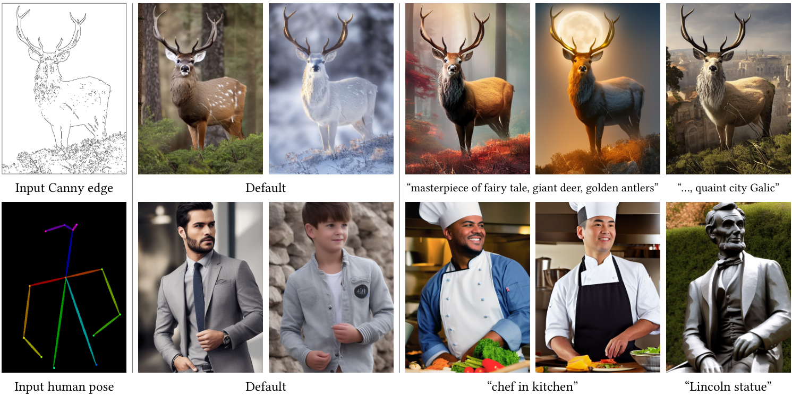

**图 1：通过学习到的条件控制 Stable Diffusion。** ControlNet 允许用户加入 Canny 边缘（上排）、人体姿态（下排）等条件，控制大型预训练扩散模型的图像生成。默认结果使用提示词“一幅高质量、细节丰富且专业的图像”。用户也可以选择提供诸如“厨房里的厨师”等提示词。

*图中文字：* Input Canny edge：输入 Canny 边缘；Input human pose：输入人体姿态；Default：默认；“masterpiece of fairy tale, giant deer, golden antlers”：童话杰作，巨鹿，金色鹿角；“…, quaint city Galic”：…，古朴的 Galic 城市；“chef in kitchen”：厨房里的厨师；“Lincoln statue”：林肯雕像。

## 摘要

我们提出 ControlNet，一种为大型预训练文本到图像扩散模型添加空间条件控制的神经网络架构。ControlNet 冻结已经可以用于实际应用的大型扩散模型，并复用其在数十亿张图像上预训练得到的深层、稳健的编码层，将这些编码层作为学习多种条件控制的强大骨干网络。该神经网络架构通过“零卷积”（以零初始化的卷积层）连接，使参数从零开始逐步增长，并确保有害噪声不会影响微调。

我们在 Stable Diffusion 上测试了边缘、深度、分割、人体姿态等多种条件控制，涵盖单个或多个条件，以及有无提示词的设置。我们表明，无论使用小规模（少于 5 万个样本）还是大规模（超过 100 万个样本）数据集，ControlNet 的训练都具有稳健性。大量结果表明，ControlNet 有望推动对图像扩散模型进行控制的更广泛应用。

> **阅读注释｜ControlNet 解决的问题。** 文本可以描述“一个人在跳舞”，姿态图则能进一步指定手臂和腿的位置；边缘图、深度图等也能提供文本难以精确表达的空间信息。ControlNet 让已有图像生成模型学习如何利用这些信息。论文展示的不同条件通常对应各自训练的 ControlNet；不能据此理解为一个权重文件天然支持所有类型的条件。

## 1 引言

我们许多人都曾有过一闪而过的视觉灵感，希望将其捕捉为一幅独特的图像。随着文本到图像扩散模型 [54, 62, 72] 的出现，如今只需输入一段文本提示，我们就能创作视觉效果出色的图像。然而，文本到图像模型对图像空间构图提供的控制仍然有限；仅凭文本提示，很难准确表达复杂的布局、姿态、形状和形态。要生成与脑海中的画面准确一致的图像，通常需要反复试错：修改提示词、查看生成图像，然后再次修改提示词。

能否让用户提供额外的图像，直接指定所需的图像构图，从而实现更精细的空间控制？在计算机视觉和机器学习中，这类额外图像，例如边缘图、人体姿态骨架、分割图、深度图和法线图等，通常被视为图像生成过程的条件。图像到图像转换模型 [34, 98] 学习从条件图像到目标图像的映射。研究界还尝试通过空间掩码 [6, 20]、图像编辑指令 [10]、微调实现的个性化 [21, 75] 等方式来控制文本到图像模型。少数问题，例如生成图像变体和图像修补，可以通过约束去噪扩散过程或编辑注意力层的激活值等无需训练的技术解决；但深度图到图像、姿态到图像等更广泛的问题，仍需要端到端学习和数据驱动的解决方案。

以端到端方式为大型文本到图像扩散模型学习条件控制颇具挑战。针对某种特定条件的训练数据量，可能远小于通用文本到图像训练所能获得的数据量。例如，物体形状／法线、人体姿态提取等特定问题，即使使用最大的数据集，其规模通常也只有约 10 万，而用于训练 Stable Diffusion [82] 的 LAION-5B [79] 数据集是其 50,000 倍。在有限数据上直接微调或继续训练大型预训练模型，可能导致过拟合和灾难性遗忘 [31, 75]。研究人员已经表明，限制可训练参数的数量或秩，可以缓解这种遗忘 [14, 25, 31, 92]。对于我们的问题，为了处理具有复杂形状和丰富高层语义的真实场景条件图像，可能需要设计更深或更具针对性的神经网络架构。

> **阅读注释｜为什么要冻结原模型。** 过拟合指模型过度适应有限训练样本；灾难性遗忘指学习新任务时损失原有能力。冻结原模型可以保留其参数中已有的生成知识，再由新增分支学习条件控制。不过，新增分支训练后会改变最终输出，因此“原参数没变”并不等于“所有生成结果的质量都有保证”。

本文提出 ControlNet，一种为大型预训练文本到图像扩散模型学习条件控制的端到端神经网络架构；在我们的实现中，基础模型为 Stable Diffusion。ControlNet 通过冻结大型模型的参数，并为其编码层创建一个可训练副本，保留原模型的质量和能力。该架构将大型预训练模型作为学习多种条件控制的强大骨干网络。可训练副本与原始冻结模型通过零卷积层连接，这些层的权重初始化为零，并在训练过程中逐步增长。这样的架构确保，在训练开始时，不会向大型扩散模型的深层特征中加入有害噪声，同时也保护可训练副本中的大规模预训练骨干网络，使其不受这类噪声破坏。

我们的实验表明，ControlNet 能够通过 Canny 边缘、Hough 直线、用户涂鸦、人体关键点、分割图、形状法线、深度图等多种条件输入来控制 Stable Diffusion（图 1）。我们在有无文本提示的情况下测试了单张条件图像，并展示了该方法如何支持多个条件的组合。此外，我们还报告了 ControlNet 在不同规模数据集上训练的稳健性与可扩展性。对于深度图到图像等任务，在单张 NVIDIA RTX 3090Ti GPU 上训练的 ControlNet，就能达到可与在大型计算集群上训练的工业模型相竞争的效果。最后，我们通过消融研究分析模型各个组成部分的贡献，并通过用户研究，将模型与多个强大的条件图像生成基线进行比较。

概括而言，我们的贡献如下：

1. 提出 ControlNet，一种通过高效微调，为预训练文本到图像扩散模型添加空间局部输入条件的神经网络架构。
2. 提供控制 Stable Diffusion 的预训练 ControlNet，支持 Canny 边缘、Hough 直线、用户涂鸦、人体关键点、分割图、形状法线、深度图和卡通线稿等条件。
3. 通过与多种替代架构比较的消融实验验证该方法，并围绕不同任务中的多个已有基线开展用户研究。

## 2 相关工作

### 2.1 神经网络微调

微调神经网络的一种方法，是使用额外的训练数据直接继续训练。然而，这种方法可能导致过拟合、模式坍塌和灾难性遗忘。已有大量研究致力于开发能够避免这些问题的微调策略。

**超网络（HyperNetwork）。** 这种方法起源于自然语言处理（NLP）研究领域 [25]，其目标是训练一个小型循环神经网络，以影响更大神经网络的权重。它已被应用于基于生成对抗网络（GAN）的图像生成 [4, 18]。Heathen 等人 [26] 和 Kurumuz [43] 为 Stable Diffusion [72] 实现了超网络，用于改变输出图像的艺术风格。

**适配器方法（Adapter）。** 这类方法广泛用于 NLP，通过在预训练 Transformer 模型中嵌入新的模块层，将模型适配到其他任务 [30, 84]。在计算机视觉领域，适配器被用于增量学习 [74] 和领域适应 [70]。这种技术经常与 CLIP [66] 结合，将预训练骨干模型迁移到不同任务 [23, 66, 85, 94]。近期，适配器在视觉 Transformer [49, 50] 和 ViT-Adapter [14] 中也取得了成功。在与我们同期的工作中，T2I-Adapter [56] 将 Stable Diffusion 适配到外部条件。

**加性学习（Additive Learning）。** 通过冻结原始模型权重，并利用学习到的权重掩码 [51, 74]、剪枝 [52] 或硬注意力 [80] 增加少量新参数，这类方法能够避免遗忘。Side-Tuning [92] 使用侧分支模型学习额外功能，按照预先定义的混合权重调度，将冻结模型与新增网络的输出进行线性混合。

**低秩适配（LoRA）。** 基于许多过参数化模型实际上位于低内在维度子空间这一观察 [2, 47]，低秩适配使用低秩矩阵学习参数偏移，从而防止灾难性遗忘 [31]。

> **阅读注释｜与 LoRA 的区别。** LoRA 通过低秩矩阵表示已有权重的增量，主要限制参数更新的自由度；本文的 ControlNet 则复制预训练编码器，并通过额外分支处理空间条件。理解这两种方法时，应分别关注“如何表示参数变化”和“条件信息从哪里进入网络”。ControlNet 的可训练分支也可以相当大，冻结基础模型不代表新增参数很少。

**零初始化层。** ControlNet 使用零初始化层连接网络模块。神经网络研究已经广泛讨论了网络权重的初始化和操控 [36, 37, 44, 45, 46, 76, 83, 95]。例如，相比零初始化，使用高斯分布初始化权重的风险可能更低 [1]。近期，Nichol 等人 [59] 讨论了如何通过缩放扩散模型中卷积层的初始权重来改善训练；他们实现的“zero module”是将权重缩放为零的极端情况。Stability 的模型卡 [83] 也提到了在神经网络层中使用零权重。ProGAN [36]、StyleGAN [37] 和 Noise2Noise [46] 中同样讨论了对卷积初始权重的处理。

### 2.2 图像扩散

**图像扩散模型。** 图像扩散模型最早由 Sohl-Dickstein 等人 [81] 提出，近期已应用于图像生成 [17, 42]。潜在扩散模型（LDM）[72] 在图像潜在空间 [19] 中执行扩散步骤，从而降低计算成本。文本到图像扩散模型通过 CLIP [66] 等预训练语言模型，将文本输入编码为潜在向量，取得了先进的图像生成效果。GLIDE [58] 是一种支持图像生成与编辑的文本引导扩散模型。Disco Diffusion [5] 使用 CLIP 引导处理文本提示。Stable Diffusion [82] 是潜在扩散 [72] 的大规模实现。Imagen [78] 使用金字塔结构直接对像素进行扩散，而不使用潜在图像。商业产品包括 DALL-E2 [62] 和 Midjourney [54]。

**图像扩散模型的控制。** 控制图像扩散模型能够支持个性化、定制化或面向特定任务的图像生成。图像扩散过程本身就提供了对颜色变化 [53] 和图像修补 [67, 7] 的一定控制。文本引导的控制方法主要关注调整提示词、操控 CLIP 特征和修改交叉注意力 [7, 10, 20, 27, 40, 41, 58, 64, 67]。MakeAScene [20] 将分割掩码编码为词元，以控制图像生成。SpaText [6] 将分割掩码映射为局部词元嵌入。GLIGEN [48] 在扩散模型的注意力层中学习新参数，以实现具有空间定位约束的生成。Textual Inversion [21] 和 DreamBooth [75] 使用用户提供的少量示例图像微调图像扩散模型，从而对生成图像中的内容进行个性化定制。基于提示词的图像编辑 [10, 33, 86] 提供了实用工具，用提示词操控图像。Voynov 等人 [88] 提出一种优化方法，使扩散过程拟合草图。同期工作 [8, 9, 32, 56] 探索了多种控制扩散模型的方法。

### 2.3 图像到图像转换

条件 GAN [15, 34, 63, 90, 93, 97, 98, 99] 和 Transformer [13, 19, 68] 能够学习不同图像域之间的映射。例如，Taming Transformer [19] 是一种基于视觉 Transformer 的方法；Palette [77] 是从头训练的条件扩散模型；PITI [89] 是一种基于预训练的图像到图像转换条件扩散模型。通过操控预训练 GAN，也可以处理特定的图像到图像任务，例如使用额外编码器控制 StyleGAN [71]，更多应用见 [3, 22, 38, 39, 55, 60, 65, 71]。

## 3 方法

ControlNet 是一种神经网络架构，能够为大型预训练文本到图像扩散模型增加具有空间局部性的、面向特定任务的图像条件。我们首先在第 3.1 节介绍 ControlNet 的基本结构，然后在第 3.2 节说明如何将其应用于图像扩散模型 Stable Diffusion [72]。第 3.3 节介绍训练方法，第 3.4 节详细说明推理时的一些额外考虑，例如组合多个 ControlNet。

### 3.1 ControlNet

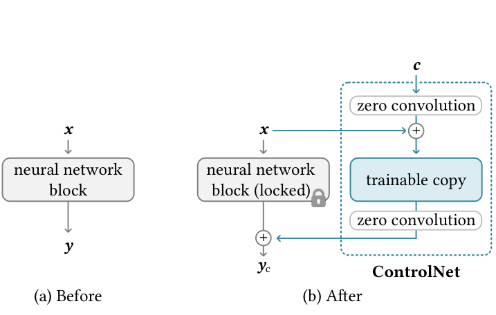

**图 2：** 如图 (a) 所示，一个神经网络模块以特征图 $\mathbf{x}$ 为输入，并输出另一张特征图 $\mathbf{y}$。为了给该模块添加 ControlNet，我们冻结原始模块，创建一个可训练副本，并使用零卷积层将它们连接起来。零卷积即权重和偏置都初始化为零的 $1\times1$ 卷积。图 (b) 中的 $\mathbf{c}$ 是我们希望添加到网络中的条件向量。

*图中文字：* neural network block：神经网络模块；locked：冻结；trainable copy：可训练副本；zero convolution：零卷积；Before / After：添加前／添加后。

ControlNet 将额外条件注入神经网络的模块中（图 2）。这里的“网络模块”指通常组合在一起、构成神经网络单个单元的一组神经网络层，例如 ResNet 模块、conv-bn-relu 模块、多头注意力模块或 Transformer 模块等。设 $\mathcal{F}(\cdot;\Theta)$ 是一个已经训练好的神经网络模块，参数为 $\Theta$，它将输入特征图 $\mathbf{x}$ 转换为另一张特征图 $\mathbf{y}$：

$$
\mathbf{y}=\mathcal{F}(\mathbf{x};\Theta).
\tag{1}
$$

在我们的设置中，$\mathbf{x}$ 和 $\mathbf{y}$ 通常是二维特征图，即 $\mathbf{x}\in\mathbb{R}^{h\times w\times c}$，其中 $h$、$w$、$c$ 分别表示特征图的高度、宽度与通道数（图 2a）。

为向这样的预训练神经网络模块添加 ControlNet，我们冻结原始模块的参数 $\Theta$，同时克隆该模块，得到参数为 $\Theta_c$ 的可训练副本（图 2b）。可训练副本以外部条件向量 $\mathbf{c}$ 为输入。当这种结构应用于 Stable Diffusion 等大型模型时，冻结参数能够保留在数十亿张图像上训练、已经可用于实际应用的模型；可训练副本则复用这种大规模预训练模型，建立深层、稳健且强大的骨干网络，以处理多样的输入条件。

> **阅读注释｜“零卷积”中的“零”。** “零”描述的是初始化时的权重和偏置，训练后它们可以变为非零。$1\times1$ 卷积在每个空间位置对通道进行线性组合，自身不聚合相邻像素；复杂空间结构主要由可训练的深层副本处理。这也不同于把整个深层网络的全部参数初始化为零。

可训练副本通过零卷积层连接到冻结模型，零卷积记为 $\mathcal{Z}(\cdot;\cdot)$。具体而言，$\mathcal{Z}(\cdot;\cdot)$ 是权重和偏置都初始化为零的 $1\times1$ 卷积层。为构建 ControlNet，我们使用两个零卷积，参数分别为 $\Theta_{z1}$ 和 $\Theta_{z2}$。完整的 ControlNet 计算为：

$$
\mathbf{y}_c
=\mathcal{F}(\mathbf{x};\Theta)
+\mathcal{Z}\!\left(
\mathcal{F}\!\left(\mathbf{x}+\mathcal{Z}(\mathbf{c};\Theta_{z1});\Theta_c\right);
\Theta_{z2}\right).
\tag{2}
$$

> **阅读注释｜如何拆解式 (2)。** 第一项 $\mathcal{F}(\mathbf{x};\Theta)$ 是冻结模块的原始输出；第二项是可学习的附加输出。内侧零卷积把条件接入可训练副本，外侧零卷积控制该副本向主网络注入的特征。这里相加的是中间特征，最终仍由扩散模型完成去噪与生成。

其中，$\mathbf{y}_c$ 为 ControlNet 模块的输出。在第一个训练步骤中，由于零卷积层的权重和偏置参数都初始化为零，式 (2) 中两个 $\mathcal{Z}(\cdot;\cdot)$ 项的值均为零，因此：

$$
\mathbf{y}_c=\mathbf{y}.
\tag{3}
$$

这样，在训练开始时，有害噪声就无法影响可训练副本中神经网络层的隐藏状态。此外，由于 $\mathcal{Z}(\mathbf{c};\Theta_{z1})=0$，且可训练副本同样接收输入图像 $\mathbf{x}$，可训练副本仍能完整运作，保留大型预训练模型的能力，从而作为进一步学习的强大骨干网络。在初始训练步骤中，零卷积通过消除作为梯度传播的随机噪声来保护这一骨干网络。我们在补充材料中详细给出了零卷积的梯度计算。

> **阅读注释｜输出为零，为什么还能学到东西？** 用单个位置的线性形式 $\mathbf{r}=W\mathbf{u}+\mathbf{b}$ 表示外侧零卷积，其中 $\mathbf{u}$ 是可训练副本输出，$\mathbf{g}=\partial\mathcal{L}/\partial\mathbf{r}$ 是上游梯度。即使 $W=0$、$\mathbf{b}=0$，仍有 $\partial\mathcal{L}/\partial W=\mathbf{g}\mathbf{u}^{\mathsf T}$，它不必为零；卷积参数的完整梯度还要对空间位置和批次求和。与此同时，$\partial\mathcal{L}/\partial\mathbf{u}=W^{\mathsf T}\mathbf{g}=0$，因此第一步会阻断这条路径对深层副本和内侧零卷积的梯度。外侧权重更新为非零后，后续步骤便可能向内部传递梯度。预训练副本提供的非零特征，是理解这一启动过程的关键。

### 3.2 用于文本到图像扩散的 ControlNet

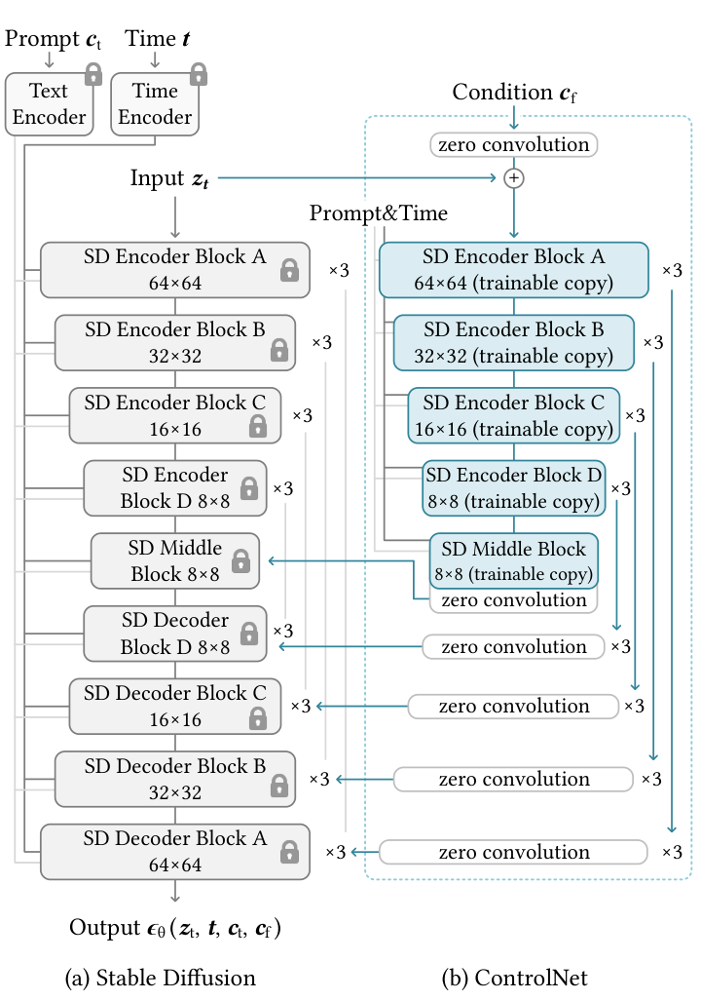

**图 3：** 在 Stable Diffusion 的 U-Net 编码器模块和中间模块上连接 ControlNet。灰色的冻结模块展示了 Stable Diffusion V1.5 的结构；V2.1 也适用，因为它们采用相同的 U-Net 架构。蓝色的可训练模块和白色的零卷积层是为构建 ControlNet 而新增的部分。

*图中文字：* Prompt：提示词；Time：时间；Text Encoder：文本编码器；Time Encoder：时间编码器；Condition：条件；Input / Output：输入／输出；SD Encoder / Decoder / Middle Block：Stable Diffusion 编码器／解码器／中间模块；trainable copy：可训练副本；$\times3$：重复三次。

我们以 Stable Diffusion [72] 为例，说明 ControlNet 如何为大型预训练扩散模型添加条件控制。Stable Diffusion 本质上是一个 U-Net [73]，包含编码器、中间模块和带跳跃连接的解码器。编码器和解码器各包含 12 个模块，加上中间模块，完整模型共有 25 个模块。其中，8 个模块是下采样或上采样卷积层，其余 17 个为主要模块，每个主要模块包含 4 个 ResNet 层和 2 个视觉 Transformer（ViT）。每个 ViT 包含若干交叉注意力和自注意力机制。例如，图 3a 中的“SD Encoder Block A”包含 4 个 ResNet 层和 2 个 ViT，“$\times3$”表示该模块重复三次。文本提示使用 CLIP 文本编码器 [66] 编码，扩散时间步则由采用位置编码的时间编码器进行编码。

ControlNet 结构应用于 U-Net 编码器的每个层级（图 3b）。具体而言，我们为 Stable Diffusion 的 12 个编码模块和 1 个中间模块创建可训练副本。12 个编码模块分布在 4 种分辨率上，即 $64\times64$、$32\times32$、$16\times16$ 和 $8\times8$，每种分辨率重复 3 次。其输出被加到 U-Net 的 12 个跳跃连接和 1 个中间模块上。由于 Stable Diffusion 采用典型的 U-Net 结构，这种 ControlNet 架构也可能适用于其他模型。

> **阅读注释｜为什么连接多个分辨率。** 可以把这理解为在不同尺度上提供结构线索：较低分辨率的特征有助于表达整体布局，较高分辨率的特征保留更多局部位置细节。条件通过跳跃连接和中间模块进入生成过程，而不仅在输入端出现一次。这里复制的是编码器和中间模块，无需再复制一整套解码器。

我们连接 ControlNet 的方式在计算上很高效：由于冻结副本的参数保持不变，微调时不需要在原始冻结编码器中计算梯度。这加快了训练速度，并节省 GPU 显存。在单张 NVIDIA A100 PCIE 40GB 上的测试表明，相比不使用 ControlNet 而直接优化 Stable Diffusion，优化带 ControlNet 的 Stable Diffusion 只需增加约 23% 的 GPU 显存，以及每次训练迭代约 34% 的时间。

> **阅读注释｜“冻结”与计算成本。** 冻结指参数不参与优化，相关模块通常仍需前向计算。对于位于可训练分支之后的冻结解码器，还需要将损失梯度传回分支的输出，才能训练 ControlNet。因此不能把整个冻结模型都视为无需梯度传播。23% 和 34% 是论文特定硬件及训练配置下、相对直接微调 Stable Diffusion 的测量值，不能直接换算成任意设备的推理开销。

图像扩散模型学习逐步对图像去噪，并生成属于训练数据域的样本。去噪过程既可以发生在像素空间，也可以发生在由训练数据编码得到的潜在空间中。Stable Diffusion 将潜在图像作为训练域，因为已有研究表明，在这一空间中工作能够稳定训练过程 [72]。具体而言，Stable Diffusion 使用类似 VQ-GAN [19] 的预处理方法，将像素空间中 $512\times512$ 的图像转换为更小的 $64\times64$ 潜在图像。

为向 Stable Diffusion 添加 ControlNet，我们首先将每张输入条件图像，例如边缘、姿态、深度图等，从 $512\times512$ 的输入尺寸转换为 $64\times64$ 的特征空间向量，以匹配 Stable Diffusion 的尺寸。具体而言，我们使用一个小型网络 $\mathcal{E}(\cdot)$，由四个卷积层构成，卷积核为 $4\times4$、步长为 $2\times2$，使用 ReLU 激活，通道数分别为 16、32、64、128；权重采用高斯初始化，并与完整模型联合训练。它将图像空间中的条件 $\mathbf{c}_i$ 编码为特征空间中的条件向量 $\mathbf{c}_f$：

$$
\mathbf{c}_f=\mathcal{E}(\mathbf{c}_i).
\tag{4}
$$

条件向量 $\mathbf{c}_f$ 随后传入 ControlNet。

> **阅读注释｜条件编码器与图像潜在编码。** 原图压缩为潜在图像，是为了让扩散模型在较小的空间中工作；式 (4) 的 $\mathcal{E}$ 则专门把边缘、姿态等条件转换为可注入网络的特征。两者承担不同任务。空间尺寸相同有助于位置对齐，但不表示潜在图像与条件特征的通道含义也相同。

> **译注：** 原文同时给出“四个卷积层、步长均为 $2\times2$”及“$512\times512$ 转换为 $64\times64$”这两项描述，两者按常规卷积尺寸计算并不一致。此处保留原文参数，不据此改写网络实现。

### 3.3 训练

给定输入图像 $\mathbf{z}_0$，图像扩散算法逐步向图像添加噪声，得到含噪图像 $\mathbf{z}_t$，其中 $t$ 表示添加噪声的次数。给定一组条件，包括时间步 $t$、文本提示 $\mathbf{c}_t$ 和任务特定条件 $\mathbf{c}_f$，图像扩散算法学习网络 $\epsilon_\theta$，以预测添加到含噪图像 $\mathbf{z}_t$ 中的噪声：

$$
\mathcal{L}
=\mathbb{E}_{\mathbf{z}_0,t,\mathbf{c}_t,\mathbf{c}_f,\epsilon\sim\mathcal{N}(0,1)}
\left[
\left\|\epsilon-\epsilon_\theta(\mathbf{z}_t,t,\mathbf{c}_t,\mathbf{c}_f)\right\|_2^2
\right].
\tag{5}
$$

其中，$\mathcal{L}$ 是整个扩散模型的总体学习目标。该目标直接用于通过 ControlNet 微调扩散模型。

> **译注：** 原 PDF 的式 (5) 在预测网络参数列表末尾多出一个右括号；此处规范化括号配对，数学含义不变。

> **阅读注释｜式 (5) 监督什么。** 训练时先采样已知噪声 $\epsilon$，构造含噪潜在图像 $\mathbf{z}_t$，再让网络预测这份噪声；平方误差衡量预测与真实噪声的差距。$t$ 表示当前噪声水平，文本和空间条件帮助模型判断如何去噪。ControlNet 沿用扩散模型的噪声预测目标，新增的是条件输入路径及其可训练参数，并没有在这里另写一项“边缘必须完全相同”的损失。推理时则从噪声出发，反复调用去噪网络生成图像。

训练过程中，我们随机将 50% 的文本提示 $\mathbf{c}_t$ 替换为空字符串。这种做法增强了 ControlNet 直接从输入条件图像，例如边缘、姿态和深度图中识别语义、以替代提示词的能力。

> **阅读注释｜为什么丢弃一半提示词。** 如果每次都有完整文字描述，模型可能过度依赖文本。随机使用空提示词，会增加模型必须利用条件图像完成任务的训练机会。空提示词时，空间条件仍然存在，因此这里的“无提示词生成”依然是一种有条件生成；条件中的歧义也不会因此自动消失。

在训练过程中，由于零卷积不会向网络添加噪声，模型应当始终能够预测高质量图像。我们观察到，模型并不是逐渐学会控制条件，而是突然开始成功遵循输入条件图像；这通常发生在不足 10,000 个优化步骤内。如图 4 所示，我们将这一现象称为“突然收敛现象”。

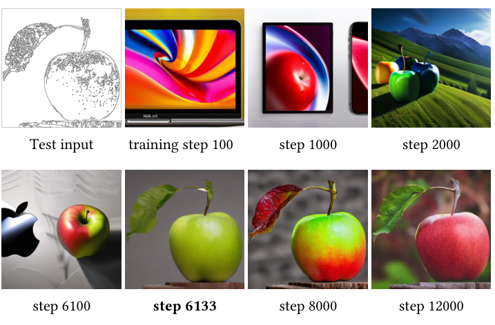

**图 4：突然收敛现象。** 由于使用零卷积，ControlNet 在整个训练过程中始终能够预测高质量图像。在训练过程中的某一步，例如加粗标出的第 6133 步，模型突然学会遵循输入条件。

*图中文字：* Test input：测试输入；training step：训练步数。依次展示第 100、1000、2000、6100、6133、8000 和 12000 步的输出。

> **阅读注释｜如何理解“突然收敛”。** 图 4 强调的是生成结果在某个阶段突然明显遵循输入结构。它不表示所有参数或训练损失在这一刻发生了数学上的不连续，也不是保证每次训练都会在第 6133 步或 10,000 步内达到相同效果。判断训练进展时，可以分别观察画面质量与条件遵循程度：模型可能已经能生成清晰图像，却尚未学会按条件构图。

### 3.4 推理

我们可以通过几种方式，进一步控制 ControlNet 的额外条件对去噪扩散过程的影响。

**无分类器引导的分辨率加权。** Stable Diffusion 依赖无分类器引导（Classifier-Free Guidance，CFG）[29] 生成高质量图像。CFG 的公式为：

$$
\epsilon_{\mathrm{prd}}
=\epsilon_{\mathrm{uc}}
+\beta_{\mathrm{cfg}}\left(\epsilon_c-\epsilon_{\mathrm{uc}}\right),
$$

其中，$\epsilon_{\mathrm{prd}}$、$\epsilon_{\mathrm{uc}}$、$\epsilon_c$ 和 $\beta_{\mathrm{cfg}}$ 分别是模型最终输出、无条件输出、有条件输出及用户指定的权重。

> **阅读注释｜CFG 比较的两条分支。** 在这里，$\epsilon_{\mathrm{uc}}$ 通常指使用空文本的预测，$\epsilon_c$ 指使用文本提示的预测；两者之差提供引导方向。“无条件”主要是相对于文本而言，这条分支仍可能接收 ControlNet 图像条件。当文本为空、两条分支又接收完全相同的图像条件时，它们的预测相同，差值为零，CFG 就失去额外引导作用。只给有条件分支加入图像条件，会让两条分支产生差异，但也可能使空间控制被过度放大。

通过 ControlNet 加入条件图像时，可以同时将其加入 $\epsilon_{\mathrm{uc}}$ 和 $\epsilon_c$，也可以只加入 $\epsilon_c$。在一些具有挑战性的情况下，例如没有提供提示词时，同时加入 $\epsilon_{\mathrm{uc}}$ 和 $\epsilon_c$ 会完全消除 CFG 引导（图 5b）；仅加入 $\epsilon_c$ 又会使引导过强（图 5c）。我们的解决方案是，先将条件图像加入 $\epsilon_c$，再根据各模块的分辨率，为 Stable Diffusion 与 ControlNet 之间的每条连接乘以一个权重 $w_i$：

$$
w_i=\frac{64}{h_i},
$$

其中，$h_i$ 是第 $i$ 个模块的尺寸，例如 $h_1=8$、$h_2=16$、$\ldots$、$h_{13}=64$。通过降低 CFG 引导强度，我们能够得到图 5d 所示的结果。我们将这一方法称为 CFG 分辨率加权（CFG Resolution Weighting，CFG-RW）。

> **阅读注释｜如何读分辨率权重。** 按本文公式，$8\times8$、$16\times16$、$32\times32$、$64\times64$ 的连接权重依次为 8、4、2、1。因此，该公式让低分辨率连接相对于高分辨率连接获得更大的权重，本身并不是将所有连接都缩小。原文同时讨论了降低 CFG 引导强度；阅读时应区分“各尺度之间的相对权重”与“CFG 的整体引导强度”。

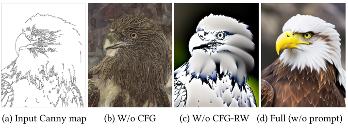

**图 5：** 无分类器引导（CFG）与所提出的 CFG 分辨率加权（CFG-RW）的影响。

*图中四列：* (a) 输入 Canny 图；(b) 不使用 CFG；(c) 不使用 CFG-RW；(d) 完整方法，不使用提示词。

**组合多个 ControlNet。** 为向同一个 Stable Diffusion 实例应用多个条件图像，例如 Canny 边缘和姿态，我们可以直接将相应 ControlNet 的输出相加并加入 Stable Diffusion 模型（图 6）。这样的组合不需要额外加权或线性插值。

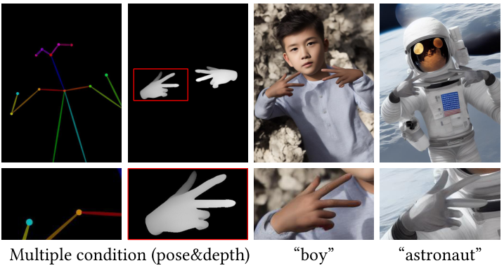

**图 6：多个条件的组合。** 我们展示了同时使用深度和姿态的应用。

*图中文字：* Multiple condition (pose & depth)：多条件，姿态与深度；“boy”：男孩；“astronaut”：宇航员。

> **阅读注释｜多个条件如何协作。** 姿态图可以指定关节位置，深度图可以补充前后关系与形体信息。各 ControlNet 先输出与主网络对应层匹配的特征，再将这些输出相加；不是把原始条件图像直接相加。论文示例表明这种组合可以工作，但条件若互相矛盾，例如姿态与深度对应不同的手部位置，仍可能产生折中或错误结果。这里的“无需额外加权”应结合论文展示的实验理解。

## 4 实验

我们基于 Stable Diffusion 实现 ControlNet，测试多种条件，包括 Canny 边缘 [11]、深度图 [69]、法线图 [87]、M-LSD 线段 [24]、HED 软边缘 [91]、ADE20K 分割 [96]、OpenPose [12] 和用户草图。各条件的示例，以及详细的训练和推理参数，见补充材料。

### 4.1 定性结果

图 1 展示了几种提示词设置下的生成图像。图 7 展示了没有提示词时、使用不同条件得到的结果；ControlNet 能够稳健地理解各种输入条件图像中的内容语义。

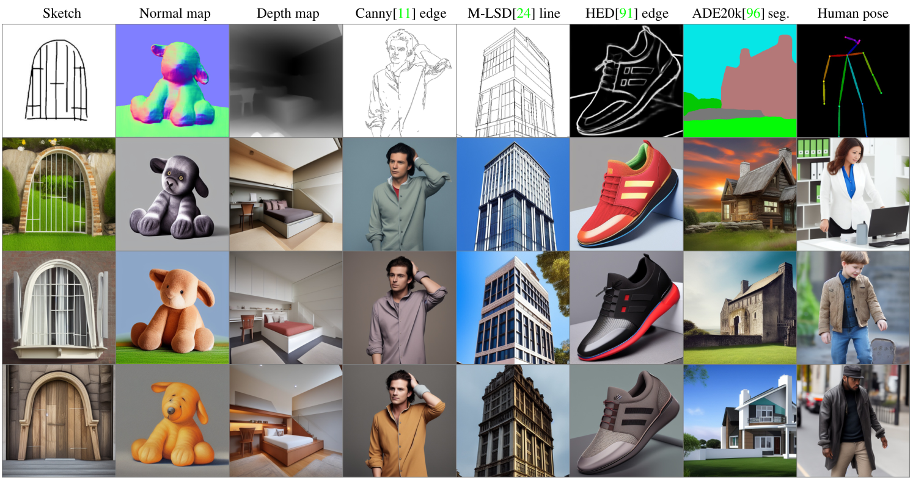

**图 7：在没有提示词时，使用多种条件控制 Stable Diffusion。** 最上排是输入条件，其余各排均为输出。我们使用空字符串作为输入提示词。所有模型都在通用领域数据上训练。模型必须识别输入条件图像中的语义内容，才能生成图像。

*图中各列从左到右：* 草图、法线图、深度图、Canny [11] 边缘、M-LSD [24] 线段、HED [91] 边缘、ADE20K [96] 分割、人体姿态。

> **阅读注释｜不同条件保留的信息。** 边缘主要描述轮廓与局部线条；姿态图主要描述人体关键点；深度图描述远近关系；法线图描述表面朝向；语义分割图描述不同类别的空间区域。这些条件通常没有唯一确定颜色、材质、光照和背景，所以同一条件能够生成多种合理图像。条件类型应与希望约束的内容相匹配。

### 4.2 消融研究

我们研究 ControlNet 的替代结构：(1) 将零卷积替换为采用高斯权重初始化的标准卷积层；(2) 将每个模块的可训练副本替换为单个卷积层，并将这种结构称为 ControlNet-lite。这些消融结构的完整细节见补充材料。

为了测试真实用户可能出现的使用方式，我们设置了四种提示词情形：

1. **无提示词。**
2. **不充分的提示词：** 没有完整涵盖条件图像中的物体，例如本文的默认提示词“一幅高质量、细节丰富且专业的图像”。
3. **冲突的提示词：** 改变条件图像的语义。
4. **完善的提示词：** 描述必要的内容语义，例如“一栋漂亮的房子”。

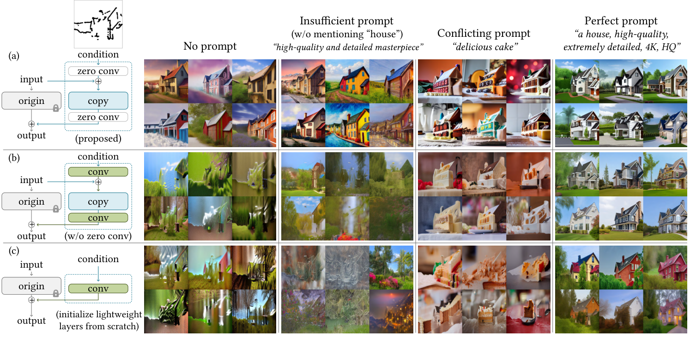

**图 8：** 在草图条件与不同提示词设置下，对不同架构进行消融研究。对于每种设置，我们展示随机生成的一批 6 个样本，未进行挑选。图像分辨率为 $512\times512$，放大查看效果最佳。左侧绿色“conv”模块是使用高斯权重初始化的标准卷积层。

*图中三行：* (a) 本文方法；(b) 不使用零卷积；(c) 从头初始化轻量网络层。  
*图中四组提示词：* 无提示词；不充分的提示词，未提及“房子”（“高质量、细节丰富的杰作”）；冲突的提示词（“美味的蛋糕”）；完善的提示词（“一栋房子，高质量，极其丰富的细节，4K，HQ”）。

图 8a 表明，ControlNet 在全部四种设置下都能成功。轻量的 ControlNet-lite（图 8c）没有足够的能力理解条件图像，在提示词不充分和没有提示词的情况下会失败。将零卷积替换后，ControlNet 的性能下降到与 ControlNet-lite 大致相同的水平，这表明可训练副本中的预训练骨干网络在微调过程中遭到了破坏（图 8b）。

> **阅读注释｜消融实验支持的核心判断。** 完整方法同时使用预训练的深层副本与零初始化连接。移除其中一个设计后，模型在弱提示或无提示时表现下降，支持“已有语义特征与稳定接入方式都很重要”的解释。不过，这些结果针对本文测试的替代结构与训练配置，不能据此断言所有轻量结构都会失败。“骨干网络遭到破坏”也是作者对观察结果的解释，不是仅凭示例图就能严格证明的内部机制。

### 4.3 定量评估

**用户研究。** 我们选取 20 张此前未见过的手绘草图，然后分别使用五种方法处理每张草图：PITI [89] 的草图模型、采用默认边缘引导强度（$\beta=1.6$）的 Sketch-Guided Diffusion（SGD）[88]、采用较高边缘引导强度（$\beta=3.2$）的 SGD [88]、上述 ControlNet-lite，以及 ControlNet。我们邀请 12 位用户，针对这 20 组、每组 5 个结果，分别按“所展示图像的质量”和“对草图的忠实程度”进行排序。通过这种方式，我们获得了 100 项结果质量排名和 100 项条件忠实度排名。我们采用平均人工排名（Average Human Ranking，AHR）作为偏好指标，用户将每个结果排在 1 至 5 的位置上，数值越低表示越差。平均排名见表 1。

**表 1：结果质量与条件忠实度的平均用户排名（AUR）。** 我们报告用户对不同方法的偏好排名，1 至 5 分别表示最差到最好，越高越好。

| 方法 | 结果质量 ↑ | 条件忠实度 ↑ |
| --- | ---: | ---: |
| PITI [89]（草图） | $1.10\pm0.05$ | $1.02\pm0.01$ |
| Sketch-Guided [88]（$\beta=1.6$） | $3.21\pm0.62$ | $2.31\pm0.57$ |
| Sketch-Guided [88]（$\beta=3.2$） | $2.52\pm0.44$ | $3.28\pm0.72$ |
| ControlNet-lite | $3.93\pm0.59$ | $4.09\pm0.46$ |
| ControlNet | **$4.22\pm0.43$** | **$4.28\pm0.45$** |

> **译注：** 原文正文将该指标称为 AHR，表 1 图注则称为 AUR，译文分别保留原缩写。原文“12 位用户”与“100 项排名”的统计口径没有进一步说明，译文亦保留其表述。

> **阅读注释｜画得好与符合条件需要分别评价。** 图像可能很漂亮，却偏离草图；也可能准确遵循轮廓，但视觉质量较差，因此表 1 分开评估两项。这里的 1 至 5 是本次五种方法之间的相对名次，4.22 不能理解为适用于所有模型的绝对质量分数。表中的“$\pm$”也不应在缺少统计定义时直接当作置信区间。

**与工业模型比较。** Stable Diffusion V2 Depth-to-Image（SDv2-D2I）[83] 使用大型 NVIDIA A100 集群、数千 GPU 小时和超过 1200 万张训练图像完成训练。我们针对 SD V2 训练了一个采用相同深度条件的 ControlNet，但只使用 20 万个训练样本、单张 NVIDIA RTX 3090Ti，训练了 5 天。我们使用 SDv2-D2I 和 ControlNet 各生成的 100 张图像，教 12 位用户区分这两种方法。随后，我们生成 200 张图像，请用户判断每张图像由哪个模型生成。用户的平均判别精确率为 $0.52\pm0.17$，表明两种方法生成的结果几乎无法区分。

> **阅读注释｜接近 0.5 的判别结果意味着什么。** 在类别均衡的二选一判断中，随机猜测的正确率约为 0.5。这里的结果支持“这些用户在本次测试中难以区分两种方法”，并不证明两者在所有场景、控制精度或速度上完全等价。此外，ControlNet 的低训练成本建立在复用已有预训练模型的基础上，并未包含基础模型最初的预训练成本。

**条件重建与 FID 分数。** 我们使用 ADE20K [96] 测试集评估条件忠实度。先进的分割方法 OneFormer [35] 在真实图像集上达到 0.58 的交并比（Intersection-over-Union，IoU）。我们使用不同方法，根据 ADE20K 分割图生成图像，然后再次应用 OneFormer 检测分割，计算重建后的 IoU（表 2）。此外，我们使用 Fréchet Inception Distance（FID）[28] 衡量不同分割条件方法随机生成的 $512\times512$ 图像集合之间的分布距离，并在表 3 中报告文本与图像的 CLIP 分数 [66] 和 CLIP 美学分数 [79]。详细设置见补充材料。

**表 2：语义分割标签重建评估。** 使用 ADE20K，通过交并比（IoU）评估，越高越好。

| 方法 | IoU ↑ |
| --- | ---: |
| ADE20K（真实数据，GT） | $0.58\pm0.10$ |
| VQGAN [19] | $0.21\pm0.15$ |
| LDM [72] | $0.31\pm0.09$ |
| PITI [89] | $0.26\pm0.16$ |
| ControlNet-lite | $0.32\pm0.12$ |
| ControlNet | **$0.35\pm0.14$** |

**表 3：以语义分割为条件的图像生成评估。** 报告本文方法和其他基线的 FID、CLIP 文本与图像分数，以及 CLIP 美学分数；同时报告不使用分割条件的 Stable Diffusion 性能。标有“\*”的方法从头训练。FID 越低越好，其余两项越高越好。

| 方法 | FID ↓ | CLIP 分数 ↑ | CLIP 美学分数 ↑ |
| --- | ---: | ---: | ---: |
| Stable Diffusion（无分割条件） | 6.09 | 0.26 | 6.32 |
| VQGAN [19]（分割）\* | 26.28 | 0.17 | 5.14 |
| LDM [72]（分割）\* | 25.35 | 0.18 | 5.15 |
| PITI [89]（分割） | 19.74 | 0.20 | 5.77 |
| ControlNet-lite | 17.92 | 0.26 | 6.30 |
| ControlNet | 15.27 | 0.26 | 6.31 |

> **阅读注释｜结合表 2 与表 3 看效果。** IoU 衡量生成图像重新分割后与输入标签的吻合程度，但也受分割器误差影响；真实图像的 0.58 是本次评估参照，并非理论上限。FID 衡量图像集合的分布差异，不直接衡量某张图是否遵循输入条件；CLIP 分数侧重文本与图像匹配，美学分数来自相应评分模型。无分割条件的 Stable Diffusion 虽然 FID 更低，却没有承担相同的空间约束任务。综合来看，ControlNet 在本文条件生成基线中取得较好的条件忠实度与图像质量，但不能用任意单项指标代表全部能力。

### 4.4 与已有方法比较

图 9 对基线方法与我们的方法（Stable Diffusion + ControlNet）进行了视觉比较。具体而言，我们展示了 PITI [89]、Sketch-Guided Diffusion [88] 和 Taming Transformers [19] 的结果。需要说明的是，PITI 的骨干网络是 OpenAI GLIDE [57]，其视觉质量和性能有所不同。我们观察到，ControlNet 能够稳健地处理多种条件图像，并获得清晰、干净的结果。

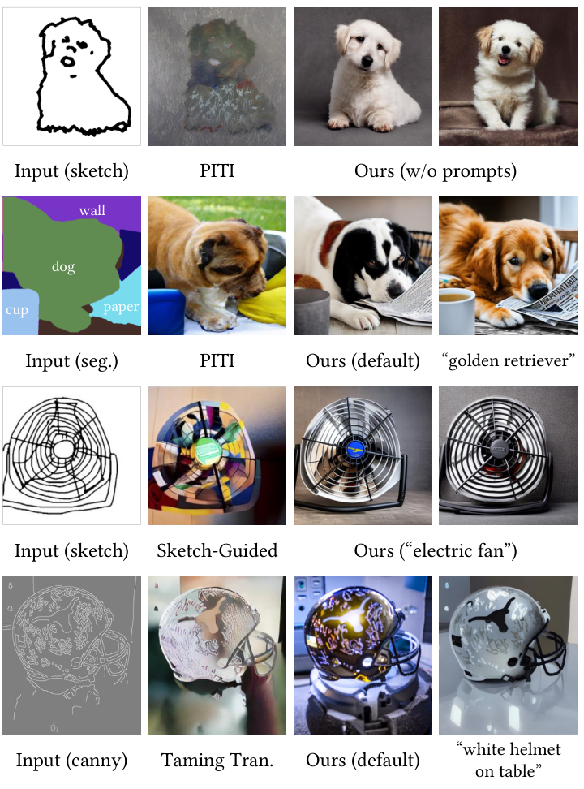

**图 9：与已有方法比较。** 我们展示了与 PITI [89]、Sketch-Guided Diffusion [88] 和 Taming Transformers [19] 的定性比较。

*图中文字：* Input (sketch / seg. / canny)：输入，分别为草图／分割／Canny 边缘；Ours (w/o prompts)：本文方法，无提示词；Ours (default)：本文方法，默认提示词；“golden retriever”：金毛寻回犬；“electric fan”：电风扇；“white helmet on table”：桌上的白色头盔。分割图中的 wall、dog、cup、paper 分别表示墙、狗、杯子和纸。

### 4.5 讨论

**训练数据集规模的影响。** 图 10 展示了 ControlNet 训练的稳健性。即使只有 1000 张图像，训练也不会坍塌，模型仍能生成可辨认的狮子。提供更多数据时，学习过程能够随之扩展。

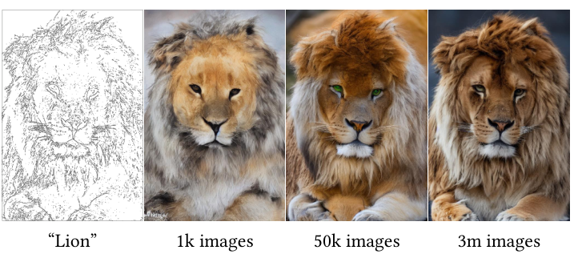

**图 10：不同训练数据集规模的影响。** 更多示例见补充材料。

*图中文字：* “Lion”：狮子；1k images / 50k images / 3m images：1000 张／5 万张／300 万张图像。

> **阅读注释｜小数据可训练的边界。** 1000 张图像的示例说明，在该实验设置中模型仍能学习并生成可辨认内容；它不证明任意条件任务只需 1000 张图像，就能获得充分的泛化能力和多样性。样本覆盖范围、条件与目标图像的对应质量，以及原模型已掌握的知识，都会影响实际效果。

**理解内容的能力。** 图 11 展示了 ControlNet 从输入条件图像中捕捉语义的能力。

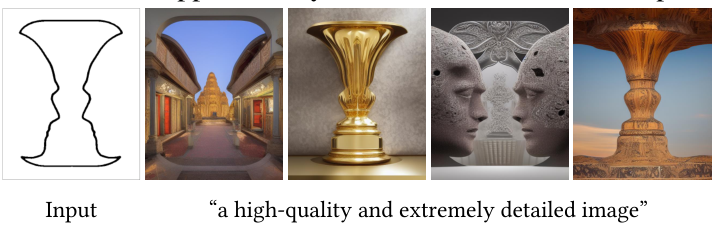

**图 11：理解内容。** 如果输入存在歧义，而用户又未在提示词中说明物体内容，结果看起来就像模型在尝试理解输入形状。

*图中文字：* Input：输入；“a high-quality and extremely detailed image”：一幅高质量、细节极其丰富的图像。

> **阅读注释｜有歧义的条件仍需要语义提示。** 图 11 的轮廓既可能被解释成花瓶，也可能被解释为两张相对的人脸。条件图提供几何线索，预训练模型的知识和文本提示共同影响最终解释。因此，“能从条件识别内容”不等于“能唯一还原用户心中的物体”；需要指定内容时，明确的文本提示仍然有帮助。

**迁移到社区模型。** 由于 ControlNet 不改变预训练 Stable Diffusion 模型的网络拓扑，它可以直接应用于 Stable Diffusion 社区中的各种模型，例如图 12 中的 Comic Diffusion [61] 和 Protogen 3.4 [16]。

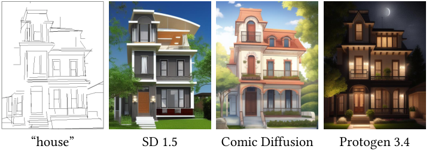

**图 12：** 将预训练 ControlNet 迁移到社区模型 [16, 61]，无需重新训练神经网络。

*图中文字：* “house”：房子；其余标签为模型名称 SD 1.5、Comic Diffusion 和 Protogen 3.4。

> **阅读注释｜迁移为什么可行，以及需要什么前提。** 基于同一基础模型微调得到的社区模型，可能保留相容的网络接口，使 ControlNet 能继续在对应层注入特征，而社区模型提供不同的视觉风格。实际兼容性还取决于网络结构、通道和条件接口等因素。论文展示了特定模型间的迁移，不能据此推断任意 Stable Diffusion 版本或其他扩散架构都能直接共用同一套 ControlNet 权重。

## 5 结论

ControlNet 是一种为大型预训练文本到图像扩散模型学习条件控制的神经网络结构。它复用源模型中经过大规模预训练的网络层，构建深层且强大的编码器，以学习特定条件。原始模型与可训练副本通过“零卷积”层连接，这些层在训练过程中消除有害噪声。

大量实验验证了，ControlNet 能够在单个或多个条件下、有无提示词的情况下，有效控制 Stable Diffusion。多种条件数据集上的结果表明，ControlNet 结构有望适用于更广泛的条件，并推动相关应用的发展。

## 致谢

本研究得到斯坦福以人为本人工智能研究院（Stanford Institute for Human-Centered AI）和布朗媒体创新研究所（Brown Institute for Media Innovation）的部分支持。

## 参考文献

以下保留原论文的英文书目信息及编号；省略仅用于标识该文献在原论文何处被引用的末尾页码。

[1] Sadia Afrin. Weight initialization in neural network, inspired by andrew ng, https://medium.com/@safrin1128/weight-initialization-in-neural-network-inspired-by-andrew-ng-e0066dc4a566, 2020.

[2] Armen Aghajanyan, Sonal Gupta, and Luke Zettlemoyer. Intrinsic dimensionality explains the effectiveness of language model fine-tuning. In Proceedings of the 59th Annual Meeting of the Association for Computational Linguistics and the 11th International Joint Conference on Natural Language Processing, pages 7319–7328, Online, Aug. 2021. Association for Computational Linguistics.

[3] Yuval Alaluf, Or Patashnik, and Daniel Cohen-Or. Only a matter of style: Age transformation using a style-based regression model. ACM Transactions on Graphics (TOG), 40(4), 2021.

[4] Yuval Alaluf, Omer Tov, Ron Mokady, Rinon Gal, and Amit Bermano. Hyperstyle: Stylegan inversion with hypernetworks for real image editing. In Proceedings of the IEEE/CVF Conference on Computer Vision and Pattern Recognition, pages 18511–18521, 2022.

[5] Alembics. Disco diffusion, https://github.com/alembics/disco-diffusion, 2022.

[6] Omri Avrahami, Thomas Hayes, Oran Gafni, Sonal Gupta, Yaniv Taigman, Devi Parikh, Dani Lischinski, Ohad Fried, and Xi Yin. Spatext: Spatio-textual representation for controllable image generation. arXiv preprint arXiv:2211.14305, 2022.

[7] Omri Avrahami, Dani Lischinski, and Ohad Fried. Blended diffusion for text-driven editing of natural images. In Proceedings of the IEEE/CVF Conference on Computer Vision and Pattern Recognition, pages 18208–18218, 2022.

[8] Omer Bar-Tal, Lior Yariv, Yaron Lipman, and Tali Dekel. Multidiffusion: Fusing diffusion paths for controlled image generation. arXiv preprint arXiv:2302.08113, 2023.

[9] Dina Bashkirova, Jose Lezama, Kihyuk Sohn, Kate Saenko, and Irfan Essa. Masksketch: Unpaired structure-guided masked image generation. arXiv preprint arXiv:2302.05496, 2023.

[10] Tim Brooks, Aleksander Holynski, and Alexei A Efros. Instructpix2pix: Learning to follow image editing instructions. arXiv preprint arXiv:2211.09800, 2022.

[11] John Canny. A computational approach to edge detection. IEEE Transactions on Pattern Analysis and Machine Intelligence, (6):679–698, 1986.

[12] Z. Cao, G. Hidalgo Martinez, T. Simon, S. Wei, and Y. A. Sheikh. Openpose: Realtime multi-person 2d pose estimation using part affinity fields. IEEE Transactions on Pattern Analysis and Machine Intelligence, 2019.

[13] Hanting Chen, Yunhe Wang, Tianyu Guo, Chang Xu, Yiping Deng, Zhenhua Liu, Siwei Ma, Chunjing Xu, Chao Xu, and Wen Gao. Pre-trained image processing transformer. In Proceedings of the IEEE/CVF Conference on Computer Vision and Pattern Recognition, pages 12299–12310, 2021.

[14] Zhe Chen, Yuchen Duan, Wenhai Wang, Junjun He, Tong Lu, Jifeng Dai, and Yu Qiao. Vision transformer adapter for dense predictions. International Conference on Learning Representations, 2023.

[15] Yunjey Choi, Minje Choi, Munyoung Kim, Jung-Woo Ha, Sunghun Kim, and Jaegul Choo. Stargan: Unified generative adversarial networks for multi-domain image-to-image translation. In Proceedings of the IEEE/CVF Conference on Computer Vision and Pattern Recognition, pages 8789–8797, 2018.

[16] darkstorm2150. Protogen x3.4 (photorealism) official release, https://civitai.com/models/3666/protogen-x34-photorealism-official-release, 2022.

[17] Prafulla Dhariwal and Alexander Nichol. Diffusion models beat gans on image synthesis. Advances in Neural Information Processing Systems, 34:8780–8794, 2021.

[18] Tan M. Dinh, Anh Tuan Tran, Rang Nguyen, and Binh-Son Hua. Hyperinverter: Improving stylegan inversion via hypernetwork. In Proceedings of the IEEE/CVF Conference on Computer Vision and Pattern Recognition, pages 11389–11398, 2022.

[19] Patrick Esser, Robin Rombach, and Bjorn Ommer. Taming transformers for high-resolution image synthesis. In Proceedings of the IEEE/CVF Conference on Computer Vision and Pattern Recognition, pages 12873–12883, 2021.

[20] Oran Gafni, Adam Polyak, Oron Ashual, Shelly Sheynin, Devi Parikh, and Yaniv Taigman. Make-a-scene: Scene-based text-to-image generation with human priors. In European Conference on Computer Vision (ECCV), pages 89–106. Springer, 2022.

[21] Rinon Gal, Yuval Alaluf, Yuval Atzmon, Or Patashnik, Amit H Bermano, Gal Chechik, and Daniel Cohen-Or. An image is worth one word: Personalizing text-to-image generation using textual inversion. arXiv preprint arXiv:2208.01618, 2022.

[22] Rinon Gal, Or Patashnik, Haggai Maron, Amit H Bermano, Gal Chechik, and Daniel Cohen-Or. Stylegan-nada: Clip-guided domain adaptation of image generators. ACM Transactions on Graphics (TOG), 41(4):1–13, 2022.

[23] Peng Gao, Shijie Geng, Renrui Zhang, Teli Ma, Rongyao Fang, Yongfeng Zhang, Hongsheng Li, and Yu Qiao. Clip-adapter: Better vision-language models with feature adapters. arXiv preprint arXiv:2110.04544, 2021.

[24] Geonmo Gu, Byungsoo Ko, SeoungHyun Go, Sung-Hyun Lee, Jingeun Lee, and Minchul Shin. Towards light-weight and real-time line segment detection. In Proceedings of the AAAI Conference on Artificial Intelligence, 2022.

[25] David Ha, Andrew M. Dai, and Quoc V. Le. Hypernetworks. In International Conference on Learning Representations, 2017.

[26] Heathen. Hypernetwork style training, a tiny guide, stable-diffusion-webui, https://github.com/automatic1111/stable-diffusion-webui/discussions/2670, 2022.

[27] Amir Hertz, Ron Mokady, Jay Tenenbaum, Kfir Aberman, Yael Pritch, and Daniel Cohen-Or. Prompt-to-prompt image editing with cross attention control. arXiv preprint arXiv:2208.01626, 2022.

[28] Martin Heusel, Hubert Ramsauer, Thomas Unterthiner, Bernhard Nessler, and Sepp Hochreiter. Gans trained by a two time-scale update rule converge to a local nash equilibrium. In I. Guyon, U. Von Luxburg, S. Bengio, H. Wallach, R. Fergus, S. Vishwanathan, and R. Garnett, editors, Advances in Neural Information Processing Systems, volume 30. Curran Associates, Inc., 2017.

[29] Jonathan Ho and Tim Salimans. Classifier-free diffusion guidance, 2022.

[30] Neil Houlsby, Andrei Giurgiu, Stanislaw Jastrzebski, Bruna Morrone, Quentin De Laroussilhe, Andrea Gesmundo, Mona Attariyan, and Sylvain Gelly. Parameter-efficient transfer learning for nlp. In International Conference on Machine Learning, pages 2790–2799, 2019.

[31] Edward J Hu, Yelong Shen, Phillip Wallis, Zeyuan Allen-Zhu, Yuanzhi Li, Shean Wang, Lu Wang, and Weizhu Chen. Lora: Low-rank adaptation of large language models. arXiv preprint arXiv:2106.09685, 2021.

[32] Lianghua Huang, Di Chen, Yu Liu, Shen Yujun, Deli Zhao, and Zhou Jingren. Composer: Creative and controllable image synthesis with composable conditions. 2023.

[33] Nisha Huang, Fan Tang, Weiming Dong, Tong-Yee Lee, and Changsheng Xu. Region-aware diffusion for zero-shot text-driven image editing. arXiv preprint arXiv:2302.11797, 2023.

[34] Phillip Isola, Jun-Yan Zhu, Tinghui Zhou, and Alexei A Efros. Image-to-image translation with conditional adversarial networks. In Proceedings of the IEEE Conference on Computer Vision and Pattern Recognition, pages 1125–1134, 2017.

[35] Jitesh Jain, Jiachen Li, MangTik Chiu, Ali Hassani, Nikita Orlov, and Humphrey Shi. OneFormer: One Transformer to Rule Universal Image Segmentation. 2023.

[36] Tero Karras, Timo Aila, Samuli Laine, and Jaakko Lehtinen. Progressive growing of gans for improved quality, stability, and variation. International Conference on Learning Representations, 2018.

[37] Tero Karras, Samuli Laine, and Timo Aila. A style-based generator architecture for generative adversarial networks. In Proceedings of the IEEE/CVF Conference on Computer Vision and Pattern Recognition, pages 4401–4410, 2019.

[38] Tero Karras, Samuli Laine, and Timo Aila. A style-based generator architecture for generative adversarial networks. IEEE Transactions on Pattern Analysis, 2021.

[39] Oren Katzir, Vicky Perepelook, Dani Lischinski, and Daniel Cohen-Or. Multi-level latent space structuring for generative control. arXiv preprint arXiv:2202.05910, 2022.

[40] Bahjat Kawar, Shiran Zada, Oran Lang, Omer Tov, Huiwen Chang, Tali Dekel, Inbar Mosseri, and Michal Irani. Imagic: Text-based real image editing with diffusion models. arXiv preprint arXiv:2210.09276, 2022.

[41] Gwanghyun Kim, Taesung Kwon, and Jong Chul Ye. Diffusionclip: Text-guided diffusion models for robust image manipulation. In Proceedings of the IEEE/CVF Conference on Computer Vision and Pattern Recognition, pages 2426–2435, 2022.

[42] Diederik Kingma, Tim Salimans, Ben Poole, and Jonathan Ho. Variational diffusion models. Advances in Neural Information Processing Systems, 34:21696–21707, 2021.

[43] Kurumuz. Novelai improvements on stable diffusion, https://blog.novelai.net/novelai-improvements-on-stable-diffusion-e10d38db82ac, 2022.

[44] Yann LeCun, Yoshua Bengio, and Geoffrey Hinton. Deep learning. Nature, 521(7553):436–444, May 2015.

[45] Y. Lecun, L. Bottou, Y. Bengio, and P. Haffner. Gradient-based learning applied to document recognition. Proceedings of the IEEE, 86(11):2278–2324, 1998.

[46] Jaakko Lehtinen, Jacob Munkberg, Jon Hasselgren, Samuli Laine, Tero Karras, Miika Aittala, and Timo Aila. Noise2noise: Learning image restoration without clean data. Proceedings of the 35th International Conference on Machine Learning, 2018.

[47] Chunyuan Li, Heerad Farkhoor, Rosanne Liu, and Jason Yosinski. Measuring the intrinsic dimension of objective landscapes. International Conference on Learning Representations, 2018.

[48] Yuheng Li, Haotian Liu, Qingyang Wu, Fangzhou Mu, Jianwei Yang, Jianfeng Gao, Chunyuan Li, and Yong Jae Lee. Gligen: Open-set grounded text-to-image generation. 2023.

[49] Yanghao Li, Hanzi Mao, Ross Girshick, and Kaiming He. Exploring plain vision transformer backbones for object detection. arXiv preprint arXiv:2203.16527, 2022.

[50] Yanghao Li, Saining Xie, Xinlei Chen, Piotr Dollar, Kaiming He, and Ross Girshick. Benchmarking detection transfer learning with vision transformers. arXiv preprint arXiv:2111.11429, 2021.

[51] Arun Mallya, Dillon Davis, and Svetlana Lazebnik. Piggyback: Adapting a single network to multiple tasks by learning to mask weights. In European Conference on Computer Vision (ECCV), pages 67–82, 2018.

[52] Arun Mallya and Svetlana Lazebnik. Packnet: Adding multiple tasks to a single network by iterative pruning. In Proceedings of the IEEE/CVF Conference on Computer Vision and Pattern Recognition, pages 7765–7773, 2018.

[53] Chenlin Meng, Yutong He, Yang Song, Jiaming Song, Jiajun Wu, Jun-Yan Zhu, and Stefano Ermon. Sdedit: Guided image synthesis and editing with stochastic differential equations. In International Conference on Learning Representations, 2021.

[54] Midjourney. https://www.midjourney.com/, 2023.

[55] Ron Mokady, Omer Tov, Michal Yarom, Oran Lang, Inbar Mosseri, Tali Dekel, Daniel Cohen-Or, and Michal Irani. Self-distilled stylegan: Towards generation from internet photos. In ACM SIGGRAPH 2022 Conference Proceedings, pages 1–9, 2022.

[56] Chong Mou, Xintao Wang, Liangbin Xie, Jian Zhang, Zhongang Qi, Ying Shan, and Xiaohu Qie. T2i-adapter: Learning adapters to dig out more controllable ability for text-to-image diffusion models. arXiv preprint arXiv:2302.08453, 2023.

[57] Alex Nichol, Prafulla Dhariwal, Aditya Ramesh, Pranav Shyam, Pamela Mishkin, Bob McGrew, Ilya Sutskever, and Mark Chen. GLIDE: towards photorealistic image generation and editing with text-guided diffusion models. CoRR, 2021.

[58] Alex Nichol, Prafulla Dhariwal, Aditya Ramesh, Pranav Shyam, Pamela Mishkin, Bob McGrew, Ilya Sutskever, and Mark Chen. Glide: Towards photorealistic image generation and editing with text-guided diffusion models. 2022.

[59] Alexander Quinn Nichol and Prafulla Dhariwal. Improved denoising diffusion probabilistic models. In International Conference on Machine Learning, pages 8162–8171. PMLR, 2021.

[60] Yotam Nitzan, Kfir Aberman, Qiurui He, Orly Liba, Michal Yarom, Yossi Gandelsman, Inbar Mosseri, Yael Pritch, and Daniel Cohen-Or. Mystyle: A personalized generative prior. arXiv preprint arXiv:2203.17272, 2022.

[61] ogkalu. Comic-diffusion v2, trained on 6 styles at once, https://huggingface.co/ogkalu/comic-diffusion, 2022.

[62] OpenAI. Dall-e-2, https://openai.com/product/dall-e-2, 2023.

[63] Taesung Park, Ming-Yu Liu, Ting-Chun Wang, and Jun-Yan Zhu. Semantic image synthesis with spatially-adaptive normalization. In Proceedings of the IEEE/CVF Conference on Computer Vision and Pattern Recognition, pages 2337–2346, 2019.

[64] Gaurav Parmar, Krishna Kumar Singh, Richard Zhang, Yijun Li, Jingwan Lu, and Jun-Yan Zhu. Zero-shot image-to-image translation. arXiv preprint arXiv:2302.03027, 2023.

[65] Or Patashnik, Zongze Wu, Eli Shechtman, Daniel Cohen-Or, and Dani Lischinski. Styleclip: Text-driven manipulation of stylegan imagery. In Proceedings of the IEEE/CVF International Conference on Computer Vision (ICCV), pages 2085–2094, October 2021.

[66] Alec Radford, Jong Wook Kim, Chris Hallacy, Aditya Ramesh, Gabriel Goh, Sandhini Agarwal, Girish Sastry, Amanda Askell, Pamela Mishkin, Jack Clark, et al. Learning transferable visual models from natural language supervision. In International Conference on Machine Learning, pages 8748–8763. PMLR, 2021.

[67] Aditya Ramesh, Prafulla Dhariwal, Alex Nichol, Casey Chu, and Mark Chen. Hierarchical text-conditional image generation with clip latents. arXiv preprint arXiv:2204.06125, 2022.

[68] Aditya Ramesh, Mikhail Pavlov, Gabriel Goh, Scott Gray, Chelsea Voss, Alec Radford, Mark Chen, and Ilya Sutskever. Zero-shot text-to-image generation. In International Conference on Machine Learning, pages 8821–8831. PMLR, 2021.

[69] René Ranftl, Katrin Lasinger, David Hafner, Konrad Schindler, and Vladlen Koltun. Towards robust monocular depth estimation: Mixing datasets for zero-shot cross-dataset transfer. IEEE Transactions on Pattern Analysis and Machine Intelligence, 44(3):1623–1637, 2020.

[70] Sylvestre-Alvise Rebuffi, Hakan Bilen, and Andrea Vedaldi. Efficient parametrization of multi-domain deep neural networks. In Proceedings of the IEEE/CVF Conference on Computer Vision and Pattern Recognition, pages 8119–8127, 2018.

[71] Elad Richardson, Yuval Alaluf, Or Patashnik, Yotam Nitzan, Yaniv Azar, Stav Shapiro, and Daniel Cohen-Or. Encoding in style: a stylegan encoder for image-to-image translation. In Proceedings of the IEEE/CVF Conference on Computer Vision and Pattern Recognition, 2021.

[72] Robin Rombach, Andreas Blattmann, Dominik Lorenz, Patrick Esser, and Björn Ommer. High-resolution image synthesis with latent diffusion models. In Proceedings of the IEEE/CVF Conference on Computer Vision and Pattern Recognition, pages 10684–10695, 2022.

[73] Olaf Ronneberger, Philipp Fischer, and Thomas Brox. U-net: Convolutional networks for biomedical image segmentation. In Medical Image Computing and Computer-Assisted Intervention MICCAI International Conference, pages 234–241, 2015.

[74] Amir Rosenfeld and John K Tsotsos. Incremental learning through deep adaptation. IEEE Transactions on Pattern Analysis and Machine Intelligence, 42(3):651–663, 2018.

[75] Nataniel Ruiz, Yuanzhen Li, Varun Jampani, Yael Pritch, Michael Rubinstein, and Kfir Aberman. Dreambooth: Fine tuning text-to-image diffusion models for subject-driven generation. arXiv preprint arXiv:2208.12242, 2022.

[76] David E. Rumelhart, Geoffrey E. Hinton, and Ronald J. Williams. Learning representations by back-propagating errors. Nature, 323(6088):533–536, Oct. 1986.

[77] Chitwan Saharia, William Chan, Huiwen Chang, Chris Lee, Jonathan Ho, Tim Salimans, David Fleet, and Mohammad Norouzi. Palette: Image-to-image diffusion models. In ACM SIGGRAPH 2022 Conference Proceedings, SIGGRAPH ’22, New York, NY, USA, 2022. Association for Computing Machinery.

[78] Chitwan Saharia, William Chan, Saurabh Saxena, Lala Li, Jay Whang, Emily Denton, Seyed Kamyar Seyed Ghasemipour, Burcu Karagol Ayan, S Sara Mahdavi, Rapha Gontijo Lopes, et al. Photorealistic text-to-image diffusion models with deep language understanding. arXiv preprint arXiv:2205.11487, 2022.

[79] Christoph Schuhmann, Romain Beaumont, Richard Vencu, Cade W Gordon, Ross Wightman, Mehdi Cherti, Theo Coombes, Aarush Katta, Clayton Mullis, Mitchell Wortsman, Patrick Schramowski, Srivatsa R Kundurthy, Katherine Crowson, Ludwig Schmidt, Robert Kaczmarczyk, and Jenia Jitsev. LAION-5b: An open large-scale dataset for training next generation image-text models. In Thirty-sixth Conference on Neural Information Processing Systems Datasets and Benchmarks Track, 2022.

[80] Joan Serra, Didac Suris, Marius Miron, and Alexandros Karatzoglou. Overcoming catastrophic forgetting with hard attention to the task. In International Conference on Machine Learning, pages 4548–4557. PMLR, 2018.

[81] Jascha Sohl-Dickstein, Eric Weiss, Niru Maheswaranathan, and Surya Ganguli. Deep unsupervised learning using nonequilibrium thermodynamics. In International Conference on Machine Learning, pages 2256–2265. PMLR, 2015.

[82] Stability. Stable diffusion v1.5 model card, https://huggingface.co/runwayml/stable-diffusion-v1-5, 2022.

[83] Stability. Stable diffusion v2 model card, stable-diffusion-2-depth, https://huggingface.co/stabilityai/stable-diffusion-2-depth, 2022.

[84] Asa Cooper Stickland and Iain Murray. Bert and pals: Projected attention layers for efficient adaptation in multi-task learning. In International Conference on Machine Learning, pages 5986–5995, 2019.

[85] Yi-Lin Sung, Jaemin Cho, and Mohit Bansal. Vl-adapter: Parameter-efficient transfer learning for vision-and-language tasks. arXiv preprint arXiv:2112.06825, 2021.

[86] Narek Tumanyan, Michal Geyer, Shai Bagon, and Tali Dekel. Plug-and-play diffusion features for text-driven image-to-image translation. arXiv preprint arXiv:2211.12572, 2022.

[87] Igor Vasiljevic, Nick Kolkin, Shanyi Zhang, Ruotian Luo, Haochen Wang, Falcon Z Dai, Andrea F Daniele, Mohammadreza Mostajabi, Steven Basart, Matthew R Walter, et al. Diode: A dense indoor and outdoor depth dataset. arXiv preprint arXiv:1908.00463, 2019.

[88] Andrey Voynov, Kfir Abernan, and Daniel Cohen-Or. Sketch-guided text-to-image diffusion models. 2022.

[89] Tengfei Wang, Ting Zhang, Bo Zhang, Hao Ouyang, Dong Chen, Qifeng Chen, and Fang Wen. Pretraining is all you need for image-to-image translation. 2022.

[90] Ting-Chun Wang, Ming-Yu Liu, Jun-Yan Zhu, Andrew Tao, Jan Kautz, and Bryan Catanzaro. High-resolution image synthesis and semantic manipulation with conditional gans. In Proceedings of the IEEE/CVF Conference on Computer Vision and Pattern Recognition, pages 8798–8807, 2018.

[91] Saining Xie and Zhuowen Tu. Holistically-nested edge detection. In Proceedings of the IEEE International Conference on Computer Vision (ICCV), pages 1395–1403, 2015.

[92] Jeffrey O. Zhang, Alexander Sax, Amir Zamir, Leonidas J. Guibas, and Jitendra Malik. Side-tuning: Network adaptation via additive side networks. In European Conference on Computer Vision (ECCV), pages 698–714. Springer, 2020.

[93] Pan Zhang, Bo Zhang, Dong Chen, Lu Yuan, and Fang Wen. Cross-domain correspondence learning for exemplar-based image translation. In Proceedings of the IEEE/CVF Conference on Computer Vision and Pattern Recognition, pages 5143–5153, 2020.

[94] Renrui Zhang, Rongyao Fang, Peng Gao, Wei Zhang, Kunchang Li, Jifeng Dai, Yu Qiao, and Hongsheng Li. Tip-adapter: Training-free clip-adapter for better vision-language modeling. arXiv preprint arXiv:2111.03930, 2021.

[95] Jiawei Zhao, Florian Schäfer, and Anima Anandkumar. Zero initialization: Initializing residual networks with only zeros and ones. arXiv, 2021.

[96] Bolei Zhou, Hang Zhao, Xavier Puig, Sanja Fidler, Adela Barriuso, and Antonio Torralba. Scene parsing through ade20k dataset. In Proceedings of the IEEE Conference on Computer Vision and Pattern Recognition, pages 633–641, 2017.

[97] Xingran Zhou, Bo Zhang, Ting Zhang, Pan Zhang, Jianmin Bao, Dong Chen, Zhongfei Zhang, and Fang Wen. Cocosnet v2: Full-resolution correspondence learning for image translation. In Proceedings of the IEEE/CVF Conference on Computer Vision and Pattern Recognition, pages 11465–11475, 2021.

[98] Jun-Yan Zhu, Taesung Park, Phillip Isola, and Alexei A Efros. Unpaired image-to-image translation using cycle-consistent adversarial networks. In Computer Vision (ICCV), 2017 IEEE International Conference on, 2017.

[99] Jun-Yan Zhu, Richard Zhang, Deepak Pathak, Trevor Darrell, Alexei A Efros, Oliver Wang, and Eli Shechtman. Toward multimodal image-to-image translation. Advances in Neural Information Processing Systems, 30, 2017.
