# 去噪扩散隐式模型

**英文标题：** Denoising Diffusion Implicit Models  
**作者：** Jiaming Song、Chenlin Meng、Stefano Ermon  
**机构：** 斯坦福大学（Stanford University）  
**联系方式：** `{tsong,chenlin,ermon}@cs.stanford.edu`  
**版本：** arXiv:2010.02502v4 [cs.LG]，2022 年 10 月 5 日；ICLR 2021 会议论文。  
**原文件：** [DDIM.pdf](DDIM.pdf)（共 22 页；正文第 1–10 页，参考文献第 10–12 页，附录第 13–22 页）。

> 译稿按原文句子顺序逐句展开，只保留中文译句；包含摘要、正文、致谢与附录 A–D，保留公式 1–67、图 1–13、表 1–3 及原文的作者—年份引用。参考文献条目请查阅原 PDF 第 10–12 页。
> 术语沿用仓库既有译稿：denoising diffusion probabilistic model 译为“去噪扩散概率模型”（DDPM），denoising diffusion implicit model 译为“去噪扩散隐式模型”（DDIM），score 译为“得分”，inference process 译为“推断过程”，generative process 译为“生成过程”，marginal 译为“边缘”，surrogate objective 译为“替代目标”，probability flow ODE 译为“概率流 ODE”。作者姓名、模型名、数据集名及代码标识保留原形式。
> **符号约定：本文的 $\alpha_t$ 对应 DDPM 论文中的累计量 $\bar\alpha_t$，而不是 DDPM 的单步 $\alpha_t$。** 附录 C.2 中，原文用青色区分 Ho 等人（2020）的记号；译稿用 ${\color{teal}\alpha_t}$、${\color{teal}\beta_t}$ 保留这一差别，并在文字中说明。
> 全部 13 幅插图直接从本地 PDF 按版面裁切，存放于 `DDIM_译文图像/`；图注译为中文，图内标签在图注下说明。表格重排为 Markdown。论文中的性能比较和“最先进”等判断均指论文发表时。
> 原文中若干公式存在疑似排印或记号问题，译稿保留原式，并在相邻位置用“译注”说明。新增的“阅读注释”只帮助理解，不属于原论文内容。

> **阅读注释：** 本文的主线是“训练目标可以相同，采样路径可以不同”。训练时仍让网络预测带噪图像中的噪声；生成时则可选择每一步是否再加入随机噪声，以及跳过哪些时间步。DDIM 的确定性指：给定初始噪声和采样轨迹后，生成结果由这些条件确定；初始噪声本身仍是随机采样的。

## 摘要

去噪扩散概率模型（DDPM）无需对抗训练就实现了高质量图像生成，但为了产生一个样本，它们需要模拟一条包含许多步骤的马尔可夫链。
为了加快采样，我们提出去噪扩散隐式模型（DDIM）：这是一类效率更高的迭代式隐式概率模型，采用与 DDPM 相同的训练过程。
在 DDPM 中，生成过程被定义为某个特定马尔可夫扩散过程的逆过程。
我们通过一类非马尔可夫扩散过程推广 DDPM，这些过程会导出相同的训练目标。
这些非马尔可夫过程可以对应于确定性的生成过程，从而得到能够以快得多的速度产生高质量样本的隐式模型。
我们通过实验表明，与 DDPM 相比，DDIM 以实际运行时间衡量可以快 10–50 倍地产生高质量样本，允许在计算量和样本质量之间进行权衡，能够直接在潜空间中进行具有语义意义的图像插值，并能以非常低的误差重构观测数据。

## 1 引言

深度生成模型已经展现出在许多领域产生高质量样本的能力（Karras et al., 2020；van den Oord et al., 2016a）。
在图像生成方面，生成对抗网络（GAN；Goodfellow et al., 2014）目前展现出的样本质量，高于变分自编码器（Kingma & Welling, 2013）、自回归模型（van den Oord et al., 2016b）和归一化流（Rezende & Mohamed, 2015；Dinh et al., 2016）等基于似然的方法。
然而，GAN 需要对优化方法和架构作出非常特定的选择才能稳定训练（Arjovsky et al., 2017；Gulrajani et al., 2017；Karras et al., 2018；Brock et al., 2018），而且可能无法覆盖数据分布的各个模态（Zhao et al., 2018）。

近期关于迭代生成模型（Bengio et al., 2014）的工作，例如去噪扩散概率模型（DDPM；Ho et al., 2020）和噪声条件得分网络（NCSN；Song & Ermon, 2019），已经展现出无需进行对抗训练就能产生可与 GAN 相媲美的样本的能力。
为此，研究者训练了许多去噪自编码模型，对受不同水平高斯噪声破坏的样本进行去噪。
随后，通过一条从白噪声出发、逐步将其去噪成图像的马尔可夫链来产生样本。
这一生成马尔可夫链过程要么基于朗之万动力学（Song & Ermon, 2019），要么通过逆转一个逐步把图像变成噪声的前向扩散过程得到（Sohl-Dickstein et al., 2015）。

这些模型的一个关键缺点是，它们需要多次迭代才能产生一个高质量样本。
对于 DDPM，这是因为生成过程（从噪声到数据）近似了前向扩散过程（从数据到噪声）的逆过程，而前向扩散过程可能有数千步；产生单个样本需要遍历所有步骤，这比只需让数据通过网络一次的 GAN 慢得多。
例如，在一块 Nvidia 2080 Ti GPU 上，从 DDPM 采样 5 万张 $32\times32$ 图像大约需要 20 小时，而从 GAN 完成同样的采样只需不到一分钟。
对于更大的图像，这个问题更加严重，因为在同一块 GPU 上采样 5 万张 $256\times256$ 图像可能需要近 1000 小时。

为了缩小 DDPM 与 GAN 之间的这一效率差距，我们提出去噪扩散隐式模型（DDIM）。
DDIM 是隐式概率模型（Mohamed & Lakshminarayanan, 2016），并且与 DDPM 密切相关，因为两者采用相同的目标函数进行训练。

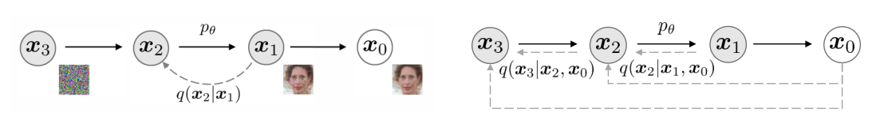

**图 1：** 扩散推断模型（左）与非马尔可夫推断模型（右）的图模型。
*图中文字：* $\mathbf{x}_0$ 为观测图像，$\mathbf{x}_1,\mathbf{x}_2,\mathbf{x}_3$ 为潜变量；$p_\theta$ 表示生成方向；左图标出 $q(\mathbf{x}_2\mid \mathbf{x}_1)$，右图标出依赖原始观测的 $q(\mathbf{x}_3\mid \mathbf{x}_2,\mathbf{x}_0)$ 和 $q(\mathbf{x}_2\mid \mathbf{x}_1,\mathbf{x}_0)$。

在第 3 节中，我们将 DDPM 所用的马尔可夫前向扩散过程推广到非马尔可夫过程，并且仍然能够为其设计合适的反向生成马尔可夫链。
我们证明，所得到的变分训练目标具有一个共同的替代目标，而这个替代目标恰好就是用于训练 DDPM 的目标。
因此，只需选择不同的非马尔可夫扩散过程（第 4.1 节）及其对应的反向生成马尔可夫链，我们就可以使用同一个神经网络，在一个庞大的生成模型族中自由选择。
特别地，我们能够使用非马尔可夫扩散过程，得到可用少量步骤模拟的“短”生成马尔可夫链（第 4.2 节）。
这可以仅以较小的样本质量损失为代价，大幅提高采样效率。

在第 5 节中，我们通过实验展示 DDIM 相对 DDPM 的若干优势。
首先，当我们使用所提出的方法将采样加速 10–100 倍时，DDIM 的样本生成质量优于 DDPM。
其次，DDIM 样本具有以下 DDPM 所没有的“一致性”性质：如果从相同的初始潜变量出发，并用不同长度的马尔可夫链生成多个样本，那么这些样本会具有相似的高层特征。
第三，由于 DDIM 具有这种“一致性”，我们可以通过操纵 DDIM 中的初始潜变量来进行具有语义意义的图像插值；而 DDPM 由于生成过程具有随机性，只能在靠近图像空间的位置进行插值。

## 2 背景

给定来自数据分布 $q(\mathbf{x}_0)$ 的样本，我们希望学习一个近似 $q(\mathbf{x}_0)$ 且易于采样的模型分布 $p_\theta(\mathbf{x}_0)$。
去噪扩散概率模型（DDPM；Sohl-Dickstein et al., 2015；Ho et al., 2020）是具有以下形式的潜变量模型：

$$
p_\theta(\mathbf{x}_0)=\int p_\theta(\mathbf{x}_{0:T})\,dx_{1:T},\qquad
\text{其中}\quad p_\theta(\mathbf{x}_{0:T}):=p_\theta(\mathbf{x}_T)\prod_{t=1}^{T}p_\theta^{(t)}(\mathbf{x}_{t-1}\mid \mathbf{x}_t)
\tag{1}
$$

其中，$\mathbf{x}_1,\ldots,\mathbf{x}_T$ 是与 $\mathbf{x}_0$ 处于同一样本空间（记为 $\mathcal X$）中的潜变量。
通过最大化一个变分下界来学习参数 $\theta$，以拟合数据分布 $q(\mathbf{x}_0)$：

$$
\max_\theta\mathbb E_{q(\mathbf{x}_0)}[\log p_\theta(\mathbf{x}_0)]
\leq\max_\theta\mathbb E_{q(\mathbf{x}_0,\mathbf{x}_1,\ldots,\mathbf{x}_T)}
[\log p_\theta(\mathbf{x}_{0:T})-\log q(\mathbf{x}_{1:T}\mid \mathbf{x}_0)]
\tag{2}
$$

> **译注：** 原 PDF 式（2）使用了 $\leq$，这里按原式保留。按通常的变分下界关系，右侧 ELBO 不应超过左侧对数似然，其方向应为 $\geq$；分别取最大值后仍保持这一方向。

其中，$q(\mathbf{x}_{1:T}\mid \mathbf{x}_0)$ 是潜变量上的某个推断分布。
与典型的潜变量模型（例如变分自编码器；Rezende et al., 2014）不同，DDPM 使用固定的、而非可训练的推断过程 $q(\mathbf{x}_{1:T}\mid \mathbf{x}_0)$ 来学习，而且潜变量的维度相对较高。
例如，Ho 等人（2020）考虑了以下具有高斯转移的马尔可夫链，其参数由递减序列 $\alpha_{1:T}\in(0,1]^T$ 给出：

$$
q(\mathbf{x}_{1:T}\mid \mathbf{x}_0):=\prod_{t=1}^{T}q(\mathbf{x}_t\mid \mathbf{x}_{t-1}),\qquad
q(\mathbf{x}_t\mid \mathbf{x}_{t-1}):=\mathcal N\!\left(
\sqrt{\frac{\alpha_t}{\alpha_{t-1}}}\,\mathbf{x}_{t-1},
\left(1-\frac{\alpha_t}{\alpha_{t-1}}\right)I\right)
\tag{3}
$$

其中，协方差矩阵的对角元素保证为正。
由于采样过程（从 $\mathbf{x}_0$ 到 $\mathbf{x}_T$）具有自回归性质，这被称为**前向过程**。
我们将潜变量模型 $p_\theta(\mathbf{x}_{0:T})$ 称为**生成过程**；它是一条从 $\mathbf{x}_T$ 向 $\mathbf{x}_0$ 采样的马尔可夫链，因为它近似了难以处理的反向过程 $q(\mathbf{x}_{t-1}\mid \mathbf{x}_t)$。
直观而言，前向过程逐步向观测 $\mathbf{x}_0$ 加入噪声，而生成过程逐步对带噪观测进行去噪（图 1 左）。

前向过程的一个特殊性质是

$$
q(\mathbf{x}_t\mid \mathbf{x}_0):=\int q(\mathbf{x}_{1:t}\mid \mathbf{x}_0)\,dx_{1:(t-1)}
=\mathcal N(\mathbf{x}_t;\sqrt{\alpha_t}\mathbf{x}_0,(1-\alpha_t)I);
$$

因此，我们可以把 $\mathbf{x}_t$ 表示为 $\mathbf{x}_0$ 与噪声变量 $\epsilon$ 的线性组合：

$$
\mathbf{x}_t=\sqrt{\alpha_t}\mathbf{x}_0+\sqrt{1-\alpha_t}\,\epsilon,
\qquad\text{其中}\quad\epsilon\sim\mathcal N(0,I).
\tag{4}
$$

当我们把 $\alpha_T$ 设为足够接近 0 时，对所有 $\mathbf{x}_0$，$q(\mathbf{x}_T\mid \mathbf{x}_0)$ 都趋近于标准高斯分布，因此很自然地令 $p_\theta(\mathbf{x}_T):=\mathcal N(0,I)$。
如果所有条件分布都建模为均值函数可训练、方差固定的高斯分布，那么式（2）中的目标可以简化为以下形式¹：

$$
L_\gamma(\epsilon_\theta):=\sum_{t=1}^{T}\gamma_t
\mathbb E_{\mathbf{x}_0\sim q(\mathbf{x}_0),\epsilon_t\sim\mathcal N(0,I)}
\left[\left\|\epsilon_\theta^{(t)}\!\left(\sqrt{\alpha_t}\mathbf{x}_0+
\sqrt{1-\alpha_t}\,\epsilon_t\right)-\epsilon_t\right\|_2^2\right]
\tag{5}
$$

其中，$\epsilon_\theta:=\{\epsilon_\theta^{(t)}\}_{t=1}^{T}$ 是 $T$ 个函数组成的集合，每个 $\epsilon_\theta^{(t)}:\mathcal X\to\mathcal X$（用 $t$ 索引）都是一个带有可训练参数 $\theta^{(t)}$ 的函数，而 $\gamma:=[\gamma_1,\ldots,\gamma_T]$ 是目标中的正系数向量，取决于 $\alpha_{1:T}$。
在 Ho 等人（2020）中，为了尽可能提高训练后模型的生成表现，实际优化的是 $\gamma=\mathbf 1$ 时的目标；这也与基于得分匹配（Hyvärinen, 2005；Vincent, 2011）的噪声条件得分网络（Song & Ermon, 2019）所使用的目标相同。
对于训练好的模型，先从先验 $p_\theta(\mathbf{x}_T)$ 采样 $\mathbf{x}_T$，再迭代地从生成过程采样 $\mathbf{x}_{t-1}$，即可得到 $\mathbf{x}_0$。

前向过程的长度 $T$ 是 DDPM 中一个重要的超参数。
从变分角度看，较大的 $T$ 能使反向过程接近高斯分布（Sohl-Dickstein et al., 2015），从而让采用高斯条件分布建模的生成过程成为良好的近似；这促使人们选择较大的 $T$，例如 Ho 等人（2020）中的 $T=1000$。
然而，为了得到一个样本 $\mathbf{x}_0$，全部 $T$ 次迭代都必须顺序执行，而不能并行执行，因此 DDPM 的采样速度远慢于其他深度生成模型，使其难以用于计算资源有限且对延迟要求严格的任务。

*原文脚注 1：详情请参阅附录 C.2。*

> **阅读注释：** 式（4）让训练无需逐步执行前向链：随机选一个 $t$，用一张真实图像和一份标准高斯噪声直接构造 $\mathbf{x}_t$，再用式（5）训练网络预测这份噪声。DDIM 复用的就是这一噪声预测网络；后文改变的是如何调用它来生成图像。

## 3 非马尔可夫前向过程的变分推断

由于生成模型近似的是推断过程的逆过程，为减少生成模型所需的迭代次数，我们需要重新思考推断过程。
我们的关键观察是：$L_\gamma$ 形式的 DDPM 目标只依赖边缘分布² $q(\mathbf{x}_t\mid \mathbf{x}_0)$，而不直接依赖联合分布 $q(\mathbf{x}_{1:T}\mid \mathbf{x}_0)$。
由于存在许多具有相同边缘分布的推断分布（联合分布），我们探索了其他非马尔可夫推断过程，由此得到新的生成过程（图 1 右）。
正如下面将展示的，这些非马尔可夫推断过程会导出与 DDPM 相同的替代目标函数。
在附录 A 中，我们表明这一非马尔可夫视角也适用于高斯情形之外的情况。

### 3.1 非马尔可夫前向过程

考虑一个推断分布族 $\mathcal Q$，用实向量 $\sigma\in\mathbb R_{\geq0}^{T}$ 索引：

$$
q_\sigma(\mathbf{x}_{1:T}\mid \mathbf{x}_0):=q_\sigma(\mathbf{x}_T\mid \mathbf{x}_0)
\prod_{t=2}^{T}q_\sigma(\mathbf{x}_{t-1}\mid \mathbf{x}_t,\mathbf{x}_0)
\tag{6}
$$

其中 $q_\sigma(\mathbf{x}_T\mid \mathbf{x}_0)=\mathcal N(\sqrt{\alpha_T}\mathbf{x}_0,(1-\alpha_T)I)$，且对所有 $t>1$，

$$
q_\sigma(\mathbf{x}_{t-1}\mid \mathbf{x}_t,\mathbf{x}_0)=\mathcal N\!\left(
\sqrt{\alpha_{t-1}}\mathbf{x}_0+\sqrt{1-\alpha_{t-1}-\sigma_t^2}\,
\frac{\mathbf{x}_t-\sqrt{\alpha_t}\mathbf{x}_0}{\sqrt{1-\alpha_t}},\ \sigma_t^2I\right).
\tag{7}
$$

选择这样的均值函数，是为了保证对所有 $t$ 都有 $q_\sigma(\mathbf{x}_t\mid \mathbf{x}_0)=\mathcal N(\sqrt{\alpha_t}\mathbf{x}_0,(1-\alpha_t)I)$（见附录 B 的引理 1），从而定义一个按要求匹配“边缘分布”的联合推断分布。
前向过程³可以由贝叶斯法则导出：

$$
q_\sigma(\mathbf{x}_t\mid \mathbf{x}_{t-1},\mathbf{x}_0)=
\frac{q_\sigma(\mathbf{x}_{t-1}\mid \mathbf{x}_t,\mathbf{x}_0)q_\sigma(\mathbf{x}_t\mid \mathbf{x}_0)}
{q_\sigma(\mathbf{x}_{t-1}\mid \mathbf{x}_0)},
\tag{8}
$$

它也是高斯分布（不过本文后续并不使用这一事实）。
与式（3）中的扩散过程不同，这里的前向过程不再具有马尔可夫性，因为每个 $\mathbf{x}_t$ 都可能同时依赖 $\mathbf{x}_{t-1}$ 和 $\mathbf{x}_0$。
$\sigma$ 的大小控制前向过程的随机程度；当 $\sigma\to0$ 时，我们达到一种极端情形：只要观测到 $\mathbf{x}_0$ 和某个时刻 $t$ 的 $\mathbf{x}_t$，$\mathbf{x}_{t-1}$ 就是已知且固定的。

*原文脚注 2：这里对“边缘分布”一词（以及“联合分布”一词）的使用略有不严谨，因为仍然以 $\mathbf{x}_0$ 为条件。*  
*原文脚注 3：对于推断模型并非扩散的情形，我们也沿用“前向过程”这一术语。*

> **阅读注释：** “每个时刻的边缘分布相同”并不要求“各时刻之间的关联方式相同”。式（7）改变这些关联，却保持给定 $\mathbf{x}_0$ 时每个 $\mathbf{x}_t$ 的分布不变，因此网络看到的训练输入和噪声目标可以保持相同。式中还隐含合法性条件 $\sigma_t^2\leq1-\alpha_{t-1}$，以保证平方根为实数；退化情形按极限理解。

### 3.2 生成过程与统一的变分推断目标

接下来，我们定义一个可训练的生成过程 $p_\theta(\mathbf{x}_{0:T})$，其中每个 $p_\theta^{(t)}(\mathbf{x}_{t-1}\mid \mathbf{x}_t)$ 都利用了关于 $q_\sigma(\mathbf{x}_{t-1}\mid \mathbf{x}_t,\mathbf{x}_0)$ 的知识。
直观而言，给定带噪观测 $\mathbf{x}_t$，我们先预测⁴其对应的 $\mathbf{x}_0$，再利用这个预测，通过已经定义好的反向条件分布 $q_\sigma(\mathbf{x}_{t-1}\mid \mathbf{x}_t,\mathbf{x}_0)$ 得到一个样本 $\mathbf{x}_{t-1}$。

对于某个 $\mathbf{x}_0\sim q(\mathbf{x}_0)$ 和 $\epsilon_t\sim\mathcal N(0,I)$，可以用式（4）得到 $\mathbf{x}_t$。
随后，模型 $\epsilon_\theta^{(t)}(\mathbf{x}_t)$ 尝试在不知道 $\mathbf{x}_0$ 的情况下，从 $\mathbf{x}_t$ 预测 $\epsilon_t$。
通过改写式（4），就可以预测去噪后的观测，也就是给定 $\mathbf{x}_t$ 时对 $\mathbf{x}_0$ 的预测：

$$
f_\theta^{(t)}(\mathbf{x}_t):=
\frac{\mathbf{x}_t-\sqrt{1-\alpha_t}\,\epsilon_\theta^{(t)}(\mathbf{x}_t)}{\sqrt{\alpha_t}}.
\tag{9}
$$

于是，可以用固定先验 $p_\theta(\mathbf{x}_T)=\mathcal N(0,I)$ 以及下式定义生成过程：

$$
p_\theta^{(t)}(\mathbf{x}_{t-1}\mid \mathbf{x}_t)=
\begin{cases}
\mathcal N(f_\theta^{(1)}(\mathbf{x}_1),\sigma_1^2I),&t=1,\\
q_\sigma(\mathbf{x}_{t-1}\mid \mathbf{x}_t,f_\theta^{(t)}(\mathbf{x}_t)),&\text{其他情况},
\end{cases}
\tag{10}
$$

其中，$q_\sigma(\mathbf{x}_{t-1}\mid \mathbf{x}_t,f_\theta^{(t)}(\mathbf{x}_t))$ 按式（7）定义，只需把 $\mathbf{x}_0$ 替换成 $f_\theta^{(t)}(\mathbf{x}_t)$。
对于 $t=1$，我们加入一些高斯噪声（协方差为 $\sigma_1^2I$），以确保生成过程在整个空间上都有支撑。

我们通过以下变分推断目标来优化 $\theta$（该目标是关于 $\epsilon_\theta$ 的泛函）：

$$
\begin{aligned}
J_\sigma(\epsilon_\theta)
&:=\mathbb E_{\mathbf{x}_{0:T}\sim q_\sigma(\mathbf{x}_{0:T})}
[\log q_\sigma(\mathbf{x}_{1:T}\mid \mathbf{x}_0)-\log p_\theta(\mathbf{x}_{0:T})]\\
&=\mathbb E_{\mathbf{x}_{0:T}\sim q_\sigma(\mathbf{x}_{0:T})}\!\left[
\log q_\sigma(\mathbf{x}_T\mid \mathbf{x}_0)+\sum_{t=2}^{T}\log q_\sigma(\mathbf{x}_{t-1}\mid \mathbf{x}_t,\mathbf{x}_0)
-\sum_{t=1}^{T}\log p_\theta^{(t)}(\mathbf{x}_{t-1}\mid \mathbf{x}_t)-\log p_\theta(\mathbf{x}_T)\right]
\end{aligned}
\tag{11}
$$

其中，我们按式（6）分解 $q_\sigma(\mathbf{x}_{1:T}\mid \mathbf{x}_0)$，按式（1）分解 $p_\theta(\mathbf{x}_{0:T})$。

从 $J_\sigma$ 的定义来看，似乎每一种 $\sigma$ 的选择都必须训练一个不同的模型，因为它对应一个不同的变分目标（以及不同的生成过程）。
然而，正如下面将展示的，对于某些权重 $\gamma$，$J_\sigma$ 与 $L_\gamma$ 是等价的。

**定理 1。** 对所有 $\sigma>0$，存在 $\gamma\in\mathbb R_{>0}^{T}$ 和 $C\in\mathbb R$，使得 $J_\sigma=L_\gamma+C$。

变分目标 $L_\gamma$ 的特殊之处在于：如果模型 $\epsilon_\theta^{(t)}$ 的参数 $\theta$ 不在不同 $t$ 之间共享，那么 $\epsilon_\theta$ 的最优解将不依赖权重 $\gamma$（因为可以分别最大化求和中的每一项来达到全局最优）。
$L_\gamma$ 的这一性质有两个含义。
一方面，这为在 DDPM 中使用 $L_{\mathbf1}$ 作为变分下界的替代目标函数提供了依据；另一方面，由于定理 1 表明 $J_\sigma$ 等价于某个 $L_\gamma$，$J_\sigma$ 的最优解也与 $L_{\mathbf1}$ 的最优解相同。
因此，如果模型 $\epsilon_\theta$ 的参数不在不同 $t$ 之间共享，那么 Ho 等人（2020）所使用的 $L_{\mathbf1}$ 目标，也可以作为变分目标 $J_\sigma$ 的替代目标。

*原文脚注 4：也可以学习预测结果上的分布，不过我们在实验中发现这样做益处不大。*

> **译注：** 上段原文使用“最大化每一项”，此处忠实保留其表述；式（5）是非负平方误差，作为损失应当最小化各项。定理 1 说明两类目标相差与网络无关的常数；不同正权重下最优解相同，还需要上述“不跨时间共享参数”等条件，不能据此断言任意共享网络的加权训练都完全等价。

## 4 从广义生成过程采样

以 $L_{\mathbf1}$ 为目标，我们学习到的不仅是对应于 Sohl-Dickstein 等人（2015）和 Ho 等人（2020）所考虑的马尔可夫推断过程的生成过程，也包括前面描述的、由 $\sigma$ 参数化的许多非马尔可夫前向过程所对应的生成过程。
因此，我们实际上可以把预训练 DDPM 模型用作这些新目标的解，并专注于通过改变 $\sigma$，寻找更符合我们采样需求的生成过程。

### 4.1 去噪扩散隐式模型

根据式（10）中的 $p_\theta(\mathbf{x}_{1:T})$，可以由样本 $\mathbf{x}_t$ 通过下式生成样本 $\mathbf{x}_{t-1}$：

$$
\mathbf{x}_{t-1}=\sqrt{\alpha_{t-1}}\,
\underbrace{\left(\frac{\mathbf{x}_t-\sqrt{1-\alpha_t}\,\epsilon_\theta^{(t)}(\mathbf{x}_t)}{\sqrt{\alpha_t}}\right)}_{\text{“预测的 }\mathbf{x}_0\text{”}}
+\underbrace{\sqrt{1-\alpha_{t-1}-\sigma_t^2}\,\epsilon_\theta^{(t)}(\mathbf{x}_t)}_{\text{“指向 }\mathbf{x}_t\text{ 的方向”}}
+\underbrace{\sigma_t\epsilon_t}_{\text{随机噪声}}
\tag{12}
$$

其中，$\epsilon_t\sim\mathcal N(0,I)$ 是独立于 $\mathbf{x}_t$ 的标准高斯噪声，并定义 $\alpha_0:=1$。
对 $\sigma$ 取不同的值会得到不同的生成过程，而所有过程都使用同一个模型 $\epsilon_\theta$，因此无需重新训练模型。
当对所有 $t$ 都有 $\sigma_t=\sqrt{(1-\alpha_{t-1})/(1-\alpha_t)}\sqrt{1-\alpha_t/\alpha_{t-1}}$ 时，前向过程成为马尔可夫过程，而生成过程成为 DDPM。

我们注意到另一个特殊情形：对所有 $t$ 都有 $\sigma_t=0$⁵；除了 $t=1$ 外，给定 $\mathbf{x}_{t-1}$ 和 $\mathbf{x}_0$ 后，前向过程成为确定性的；在生成过程中，随机噪声 $\epsilon_t$ 前面的系数变成 0。
所得到的模型成为一个隐式概率模型（Mohamed & Lakshminarayanan, 2016），其中样本通过固定的过程（从 $\mathbf{x}_T$ 到 $\mathbf{x}_0$）由潜变量生成。
我们将其命名为**去噪扩散隐式模型**（DDIM，读作 /d:Im/），因为它是用 DDPM 目标训练的隐式概率模型（尽管前向过程已经不再是扩散）。

> **阅读注释：** 式（12）可按三部分理解：先根据当前输入预测干净图像，再保留与下一时刻噪声水平相符的方向项，最后按需要加入新噪声。DDIM 令最后一项为零，但中间的方向项仍存在；它不是直接把预测图像当作每一步输出。末步 $\alpha_0=1$ 时，方向项与随机项都消失，得到最终的 $\mathbf{x}_0$ 预测。

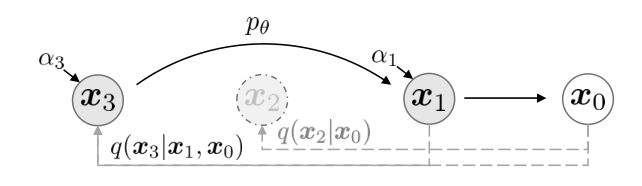

**图 2：** 加速生成的图模型，其中 $\tau=[1,3]$。
*图中文字：* 生成链通过 $\mathbf{x}_3\to \mathbf{x}_1\to \mathbf{x}_0$ 跳过 $\mathbf{x}_2$；$\alpha_3$、$\alpha_1$ 标记对应噪声水平；虚线给出 $q(\mathbf{x}_3\mid \mathbf{x}_1,\mathbf{x}_0)$ 和 $q(\mathbf{x}_2\mid \mathbf{x}_0)$。

### 4.2 加速生成过程

在前面的各节中，生成过程被视为对反向过程的近似；由于前向过程有 $T$ 步，生成过程也被迫采样 $T$ 步。
然而，只要 $q_\sigma(\mathbf{x}_t\mid \mathbf{x}_0)$ 固定，去噪目标 $L_{\mathbf1}$ 就不依赖具体的前向过程，因此我们也可以考虑长度小于 $T$ 的前向过程，从而加速相应的生成过程，而不必训练另一个模型。

现在考虑把前向过程定义在潜变量的一个子集 $\{\mathbf{x}_{\tau_1},\ldots,\mathbf{x}_{\tau_S}\}$ 上，而非全部潜变量 $\mathbf{x}_{1:T}$ 上，其中 $\tau$ 是 $[1,\ldots,T]$ 的长度为 $S$ 的递增子序列。
具体而言，我们在 $\mathbf{x}_{\tau_1},\ldots,\mathbf{x}_{\tau_S}$ 上定义顺序前向过程，使 $q(\mathbf{x}_{\tau_i}\mid \mathbf{x}_0)=\mathcal N(\sqrt{\alpha_{\tau_i}}\mathbf{x}_0,(1-\alpha_{\tau_i})I)$ 匹配这些“边缘分布”（示意见图 2）。
此时，生成过程按照 $\operatorname{reversed}(\tau)$ 来采样潜变量，我们将其称为（采样）轨迹。
当采样轨迹的长度远小于 $T$ 时，由于采样过程具有迭代性质，我们可以显著提高计算效率。

利用与第 3 节相似的论证，我们可以说明使用以 $L_{\mathbf1}$ 为目标训练的模型是合理的，因此训练无需作任何修改。
我们表明，只需对式（12）的更新作很小的修改，就能得到新的、更快的生成过程；这适用于 DDPM、DDIM，以及式（10）中考虑的全部生成过程。
这些细节见附录 C.1。

原则上，这意味着我们可以使用任意数量的前向步骤训练模型，但在生成过程中只从其中一些步骤采样。
因此，训练好的模型可以考虑比 Ho 等人（2020）更多的步骤，甚至考虑连续时间变量 $t$（Chen et al., 2020）。
我们将这一方面的实验研究留作未来工作。

*原文脚注 5：虽然定理 1 不涵盖这一情形，但我们总可以通过令 $\sigma_t$ 非常小来近似它。*

### 4.3 与神经 ODE 的联系

此外，我们可以根据式（12）改写 DDIM 的迭代，从而更清楚地看到它与求解常微分方程（ODE）的欧拉积分之间的相似性：

$$
\frac{\mathbf{x}_{t-\Delta t}}{\sqrt{\alpha_{t-\Delta t}}}
=\frac{\mathbf{x}_t}{\sqrt{\alpha_t}}+
\left(\sqrt{\frac{1-\alpha_{t-\Delta t}}{\alpha_{t-\Delta t}}}
-\sqrt{\frac{1-\alpha_t}{\alpha_t}}\right)\epsilon_\theta^{(t)}(\mathbf{x}_t)
\tag{13}
$$

为了推导相应的 ODE，可以把 $\sqrt{1-\alpha}/\sqrt\alpha$ 重参数化为 $\sigma$，把 $\mathbf{x}/\sqrt\alpha$ 重参数化为 $\bar{\mathbf{x}}$。
在连续情形下，$\sigma$ 和 $\mathbf{x}$ 都是 $t$ 的函数，其中 $\sigma:\mathbb R_{\geq0}\to\mathbb R_{\geq0}$ 连续、递增，且 $\sigma(0)=0$。
式（13）可以视为针对以下 ODE 的欧拉方法：

$$
d\bar{\mathbf{x}}(t)=\epsilon_\theta^{(t)}\!\left(\frac{\bar{\mathbf{x}}(t)}{\sqrt{\sigma^2+1}}\right)d\sigma(t),
\tag{14}
$$

其中，对于非常大的 $\sigma(T)$，初始条件为 $\mathbf{x}(T)\sim\mathcal N(0,\sigma(T))$（对应于 $\alpha\approx0$ 的情形）。
这表明，如果离散化步数足够多，我们也可以逆转生成过程（从 $t=0$ 到 $T$），将 $\mathbf{x}_0$ 编码为 $\mathbf{x}_T$，并模拟式（14）中 ODE 的逆向演化。
这说明，与 DDPM 不同，我们可以使用 DDIM 得到观测的编码（形式为 $\mathbf{x}_T$），这可能有助于需要模型潜表示的其他下游应用。

> **译注：** 原文此处的初始条件确实写作 $\mathbf{x}(T)\sim\mathcal N(0,\sigma(T))$。依本节重参数化及附录 B 的完整证明，应区分 $\mathbf{x}(T)\approx\mathcal N(0,I)$ 与 $\bar{\mathbf{x}}(T)\approx\mathcal N(0,\sigma^2(T)I)$；这里存在变量及方差记号不一致，原句予以保留。

在一项同期工作中，Song 等人（2020）提出了“概率流 ODE”，旨在根据得分恢复随机微分方程（SDE）的边缘密度，从中可以得到类似的采样调度。
这里，我们指出，我们的 ODE 等价于他们方法的一个特殊情形（对应于 DDPM 的连续时间类似形式）。

**命题 1。** 使用最优模型 $\epsilon_\theta^{(t)}$ 时，式（14）中的 ODE 存在一个等价的概率流 ODE，它对应于 Song 等人（2020）的“方差爆炸”（Variance-Exploding）SDE。

证明见附录 B。
虽然这些 ODE 等价，但采样过程并不等价，因为概率流 ODE 的欧拉方法会进行如下更新：

$$
\frac{\mathbf{x}_{t-\Delta t}}{\sqrt{\alpha_{t-\Delta t}}}
=\frac{\mathbf{x}_t}{\sqrt{\alpha_t}}+
\frac12\left(\frac{1-\alpha_{t-\Delta t}}{\alpha_{t-\Delta t}}
-\frac{1-\alpha_t}{\alpha_t}\right)
\sqrt{\frac{\alpha_t}{1-\alpha_t}}\,\epsilon_\theta^{(t)}(\mathbf{x}_t)
\tag{15}
$$

如果 $\alpha_t$ 与 $\alpha_{t-\Delta t}$ 足够接近，这与我们的方法等价。
然而，在采样步数较少时，这些选择就会造成差异；我们相对于 $d\sigma(t)$ 取欧拉步（它对“时间”$t$ 的尺度依赖更间接），而 Song 等人（2020）相对于 $dt$ 取欧拉步。

> **阅读注释：** 此处的标量函数 $\sigma(t)=\sqrt{(1-\alpha(t))/\alpha(t)}$ 是重参数化后的噪声尺度，不是式（7）、（12）中控制每步新增随机噪声的 $\sigma_t$。即使 DDIM 取每步 $\sigma_t=0$，连续描述中的 $\sigma(t)$ 仍会随噪声水平变化。

## 5 实验

本节表明，在考虑较少迭代次数时，DDIM 在图像生成方面优于 DDPM，相比原始 DDPM 生成过程可加速 10–100 倍。
此外，与 DDPM 不同，一旦固定初始潜变量 $\mathbf{x}_T$，DDIM 就会保留图像的高层特征，而不受生成轨迹影响，因此能够直接在潜空间中进行插值。
DDIM 还可以用于对样本进行编码，并从潜在编码重构样本；由于采样过程具有随机性，DDPM 无法做到这一点。

对于每个数据集，我们都使用同一个在 $T=1000$ 下训练的模型，其目标为式（5）中 $\gamma=\mathbf1$ 时的 $L_\gamma$；正如第 3 节所论证的，训练过程无需作任何修改。
我们唯一改变的是如何从模型产生样本；为此，我们控制 $\tau$（控制得到样本的速度）和 $\sigma$（在确定性的 DDIM 与随机性的 DDPM 之间插值）。

我们考虑 $[1,\ldots,T]$ 的不同子序列 $\tau$，以及由 $\tau$ 中元素索引的不同方差超参数 $\sigma$。
为了简化比较，我们考虑具有以下形式的 $\sigma$：

$$
\sigma_{\tau_i}(\eta)=\eta
\sqrt{\frac{1-\alpha_{\tau_{i-1}}}{1-\alpha_{\tau_i}}}
\sqrt{1-\frac{\alpha_{\tau_i}}{\alpha_{\tau_{i-1}}}},
\tag{16}
$$

其中，$\eta\in\mathbb R_{\geq0}$ 是我们可以直接控制的超参数。
当 $\eta=1$ 时，这包含原始 DDPM 的生成过程；当 $\eta=0$ 时，则为 DDIM。
我们还考虑随机噪声标准差大于 $\sigma(1)$ 的 DDPM，并将其记为 $\hat\sigma$：$\hat\sigma_{\tau_i}=\sqrt{1-\alpha_{\tau_i}/\alpha_{\tau_{i-1}}}$。
Ho 等人（2020）的实现只用这种设置获得 CIFAR10 样本，而没有将其用于其他数据集的样本。
更多细节见附录 D。

> **阅读注释：** 下标 $\tau_{i-1}$ 表示所选采样序列中的前一个时刻，不一定是 $\tau_i-1$。例如选 $\tau=[1,3]$ 时，从 $\mathbf{x}_3$ 直接生成 $\mathbf{x}_1$，公式里使用的是 $\alpha_1$ 与 $\alpha_3$。步数由 $S=\dim(\tau)$ 决定，随机性由 $\eta$ 决定，二者可以分别选择。

**表 1：** 以 FID 衡量的 CIFAR10 和 CelebA 图像生成结果。$\eta=1.0$ 和 $\hat\sigma$ 是 DDPM 的情形（不过 Ho 等人（2020）只考虑了 $T=1000$ 步，而 $S<T$ 可以视为模拟以 $S$ 步训练的 DDPM），$\eta=0.0$ 表示 DDIM。粗体保留原表中每个数据集、每个步数下的最佳值。

| 噪声设置 | CIFAR10 $32\times32$，$S=10$ | $S=20$ | $S=50$ | $S=100$ | $S=1000$ | CelebA $64\times64$，$S=10$ | $S=20$ | $S=50$ | $S=100$ | $S=1000$ |
| --- | ---: | ---: | ---: | ---: | ---: | ---: | ---: | ---: | ---: | ---: |
| $\eta=0.0$ | **13.36** | **6.84** | **4.67** | **4.16** | 4.04 | **17.33** | **13.73** | **9.17** | **6.53** | 3.51 |
| $\eta=0.2$ | 14.04 | 7.11 | 4.77 | 4.25 | 4.09 | 17.66 | 14.11 | 9.51 | 6.79 | 3.64 |
| $\eta=0.5$ | 16.66 | 8.35 | 5.25 | 4.46 | 4.29 | 19.86 | 16.06 | 11.01 | 8.09 | 4.28 |
| $\eta=1.0$ | 41.07 | 18.36 | 8.01 | 5.78 | 4.73 | 33.12 | 26.03 | 18.48 | 13.93 | 5.98 |
| $\hat\sigma$ | 367.43 | 133.37 | 32.72 | 9.99 | **3.17** | 299.71 | 183.83 | 71.71 | 45.20 | **3.26** |

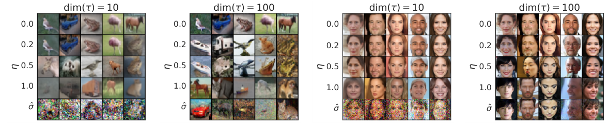

**图 3：** $\dim(\tau)=10$ 和 $\dim(\tau)=100$ 时的 CIFAR10 与 CelebA 样本。
*图中文字：* 左两组为 CIFAR10，右两组为 CelebA；每个数据集分别展示 10 步和 100 步；各行依次为 $\eta=0.0,0.2,0.5,1.0$ 及 $\hat\sigma$。

### 5.1 样本质量与效率

表 1 报告了在 CIFAR10 和 CelebA 上训练的模型所生成样本的质量，以 Fréchet Inception 距离（FID；Heusel et al., 2017）衡量；我们改变了生成一个样本所用的时间步数（$\dim(\tau)$）以及过程的随机程度（$\eta$）。
正如预期，随着 $\dim(\tau)$ 增加，样本质量提高，体现出样本质量与计算成本之间的权衡。
我们观察到，$\dim(\tau)$ 较小时，DDIM（$\eta=0$）取得最佳样本质量；在相同的 $\dim(\tau)$ 下，DDPM（$\eta=1$ 和 $\hat\sigma$）的样本质量通常不如随机性较低的对应模型，只有 Ho 等人（2020）报告的 $\dim(\tau)=1000$ 且采用 $\hat\sigma$ 的情形例外，此时 DDIM 略差。
然而，当 $\dim(\tau)$ 较小时，$\hat\sigma$ 的样本质量会差得多，这表明它不适合较短的轨迹。
相比之下，DDIM 能更稳定地取得较高的样本质量。

图 3 展示了在采样步数相同而 $\sigma$ 不同的情况下，CIFAR10 和 CelebA 上的样本。
对于 DDPM，当采样轨迹只有 10 步时，样本质量迅速下降。
对于 $\hat\sigma$，较短轨迹下的生成图像似乎具有更多噪声扰动；这解释了为什么其 FID 分数远差于其他方法，因为 FID 对这类扰动非常敏感（Jolicoeur-Martineau et al., 2020 对此有讨论）。

图 4 表明，产生一个样本所需的时间随采样轨迹长度线性增长。
这说明 DDIM 有助于更高效地产生样本，因为它可以用少得多的步骤生成样本。
值得关注的是，DDIM 用 20–100 步就能产生质量可与 1000 步模型相媲美的样本，相比原始 DDPM 加速 10–50 倍。
即使 DDPM 也能用 $100\times$ 步取得合理的样本质量，DDIM 达到这一质量所需的步数也少得多；在 CelebA 上，100 步 DDPM 的 FID 分数与 20 步 DDIM 相近。

> **译注：** 上句原 PDF 写作 “with $100\times$ steps”，其后直接比较 100 步 DDPM 与 20 步 DDIM；结合上下文，这里应是“100 步”，原文多出的乘号按原样保留并说明。

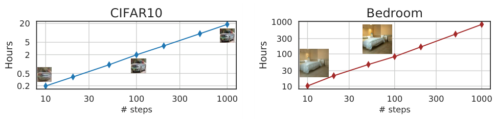

**图 4：** 使用一块 Nvidia 2080 Ti GPU 采样 5 万张图像所需的小时数，以及不同步数下的样本。
*图中文字：* 左图为 CIFAR10，右图为 Bedroom（卧室）；横轴“# steps”表示步数，纵轴“Hours”表示小时数。

### 5.2 DDIM 中的样本一致性

对于 DDIM，生成过程是确定性的，$\mathbf{x}_0$ 只依赖初始状态 $\mathbf{x}_T$。
图 5 展示了从相同初始 $\mathbf{x}_T$ 出发、在不同生成轨迹（即不同 $\tau$）下生成的图像。
有趣的是，对于具有相同初始 $\mathbf{x}_T$ 的生成图像，无论生成轨迹如何，大部分高层特征都是相似的。
许多情况下，仅用 20 步生成的样本，在高层特征上就已经非常接近用 1000 步生成的样本，只在细节上有少量差异。
因此，看起来单独的 $\mathbf{x}_T$ 就是图像的一种信息丰富的潜在编码；而影响样本质量的细微细节则编码在参数中，因为较长的采样轨迹能得到质量更好的样本，却不会显著影响高层特征。
附录 D.4 展示了更多样本。

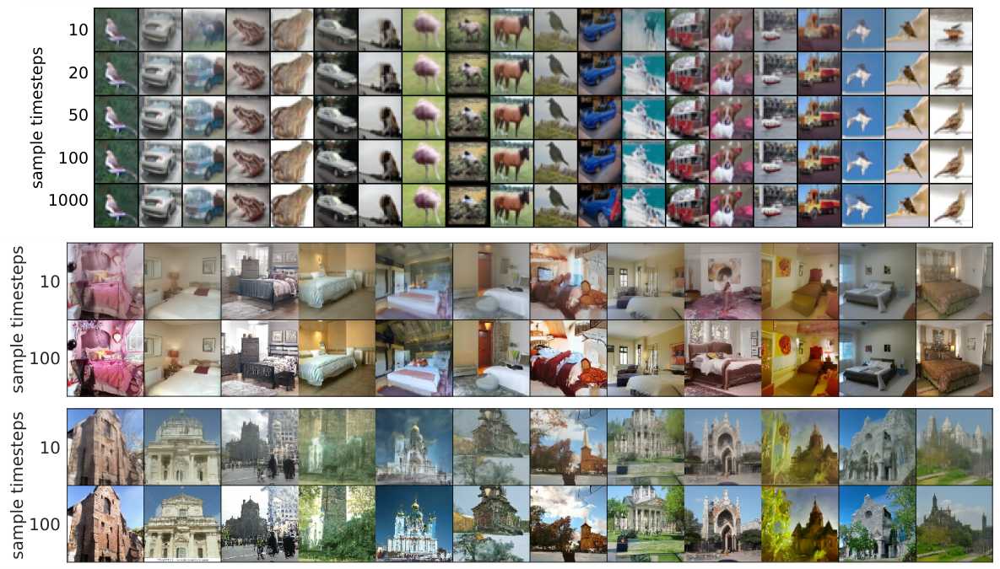

**图 5：** 使用相同的随机 $\mathbf{x}_T$、不同步数得到的 DDIM 样本。
*图中文字：* “sample timesteps”表示采样步数；上组依次为 10、20、50、100、1000 步，下方两组分别比较 10 步与 100 步。

### 5.3 确定性生成过程中的插值

由于 DDIM 样本的高层特征由 $\mathbf{x}_T$ 编码，我们希望了解，它是否会展现出类似于 GAN（Goodfellow et al., 2014）等其他隐式概率模型中观察到的语义插值效果。
这与 Ho 等人（2020）中的插值过程不同，因为在 DDPM 中，由于生成过程具有随机性，同一个 $\mathbf{x}_T$ 会产生高度多样化的 $\mathbf{x}_0$⁶。
图 6 表明，在 $\mathbf{x}_T$ 中进行简单插值，就能得到两个样本之间具有语义意义的插值。
更多细节和样本见附录 D.5。
这使 DDIM 能够直接通过潜变量在高层次上控制生成图像，而 DDPM 无法做到这一点。

**图 6：** $\dim(\tau)=50$ 时 DDIM 样本之间的插值。

*原文脚注 6：不过，如果对全部 $T$ 个噪声都进行插值，就像 Song & Ermon（2020）所做的那样，也可能实现这一点。*

### 5.4 从潜空间重构

由于 DDIM 是某个特定 ODE 的欧拉积分，我们希望了解，它能否从 $\mathbf{x}_0$ 编码到 $\mathbf{x}_T$（式（14）的逆向过程），并从得到的 $\mathbf{x}_T$ 重构 $\mathbf{x}_0$（式（14）的正向过程）⁷。
我们使用 CIFAR-10 模型，在 CIFAR-10 测试集上进行编码和解码，两个过程均使用 $S$ 步；表 2 报告了每个维度上的均方误差（数值缩放到 $[0,1]$）。
结果表明，$S$ 越大，DDIM 的重构误差越低，并具有类似于神经 ODE 和归一化流的性质。
由于 DDPM 本身具有随机性，它不具备相同的性质。

**表 2：** DDIM 在 CIFAR-10 测试集上的重构误差，四舍五入到 $10^{-4}$。

| $S$ | 10 | 20 | 50 | 100 | 200 | 500 | 1000 |
| --- | ---: | ---: | ---: | ---: | ---: | ---: | ---: |
| 误差 | 0.014 | 0.0065 | 0.0023 | 0.0009 | 0.0004 | 0.0001 | 0.0001 |

*原文脚注 7：由于 $\mathbf{x}_T$ 与 $\mathbf{x}_0$ 具有相同维度，它们的压缩质量并非我们当前关注的重点。*

## 6 相关工作

我们的工作建立在一大类已有方法之上，这些方法把生成模型学习为马尔可夫链的转移算子（Sohl-Dickstein et al., 2015；Bengio et al., 2014；Salimans et al., 2014；Song et al., 2017；Goyal et al., 2017；Levy et al., 2017）。
其中，去噪扩散概率模型（DDPM；Ho et al., 2020）和噪声条件得分网络（NCSN；Song & Ermon, 2019；2020）最近已经实现了可与 GAN（Brock et al., 2018；Karras et al., 2018）相媲美的高样本质量。
DDPM 优化对数似然的一个变分下界，而 NCSN 则针对数据的非参数 Parzen 密度估计器，优化得分匹配目标（Hyvärinen, 2005；Vincent, 2011；Raphan & Simoncelli, 2011）。

尽管出发点不同，DDPM 与 NCSN 仍然密切相关。
两者都使用针对多个噪声水平的去噪自编码器目标，也都使用类似朗之万动力学的过程来产生样本（Neal et al., 2011）。
由于朗之万动力学是一种梯度流的离散化（Jordan et al., 1998），DDPM 和 NCSN 都需要很多步才能取得良好的样本质量。
这与以下观察相一致：DDPM 和现有 NCSN 方法难以在少量迭代中生成高质量样本。

相比之下，DDIM 是一种隐式生成模型（Mohamed & Lakshminarayanan, 2016），其样本由潜变量唯一确定。
因此，DDIM 具有某些类似于 GAN（Goodfellow et al., 2014）和可逆流（Dinh et al., 2016）的性质，例如能够产生具有语义意义的插值。
我们完全从变分角度推导 DDIM，这里不涉及朗之万动力学的限制；这或许可以部分解释，为何在较少迭代次数下，我们观察到 DDIM 的样本质量优于 DDPM。
DDIM 的采样过程也让人联想到具有连续深度的神经网络（Chen et al., 2018；Grathwohl et al., 2018），因为无论具体采样轨迹如何，它从相同潜变量产生的样本都具有相似的高层视觉特征。

## 7 讨论

我们完全从变分角度提出了 DDIM——一种用去噪自编码／得分匹配目标训练的隐式生成模型。
DDIM 能够以远高于现有 DDPM 和 NCSN 的效率生成高质量样本，并能在潜空间中进行有意义的插值。
这里提出的非马尔可夫前向过程似乎表明，可以构造高斯之外的连续前向过程（这在原始扩散框架中无法做到，因为高斯分布是唯一具有有限方差的稳定分布）。
我们还在附录 A 中展示了前向过程采用多项分布的离散情形，对于其他组合结构研究类似的替代方案也很有意义。

此外，由于 DDIM 的采样过程类似于神经 ODE，我们希望了解，减少 ODE 离散化误差的方法，包括 Adams–Bashforth 等多步方法（Butcher & Goodwin, 2008），是否有助于用更少的步骤进一步提高样本质量（Queiruga et al., 2020）。
研究 DDIM 是否展现出现有隐式模型的其他性质（Bau et al., 2019），同样值得关注。

## 致谢

作者感谢 Yang Song 和 Shengjia Zhao 就相关想法进行的有益讨论，感谢 Kuno Kim 审阅论文早期草稿，并感谢 Sharvil Nanavati 和 Sophie Liu 指出排印错误。
本研究得到 NSF（#1651565、#1522054、#1733686）、ONR（N00014-19-1-2145）、AFOSR（FA9550-19-1-0024）以及 Amazon AWS 的支持。

## 参考文献

原文参考文献共 41 条，列于原 PDF 第 10–12 页；正文及附录中的作者—年份引用均予保留，便于对照查阅，此处不逐条翻译文献条目。

## 附录 A 离散情形下的非马尔可夫前向过程

本节描述一种用于离散数据的非马尔可夫前向过程及其对应的变分目标。
由于本文重点是加速与高斯扩散对应的反向模型，我们将实验评估留作未来工作。

对于一个具有 $K$ 个可能取值、表示为独热向量的类别观测 $\mathbf{x}_0$，我们按如下方式定义前向过程。
首先，将 $q(\mathbf{x}_t\mid \mathbf{x}_0)$ 定义为以下类别分布：

$$
q(\mathbf{x}_t\mid \mathbf{x}_0)=\operatorname{Cat}(\alpha_tx_0+(1-\alpha_t)\mathbf1_K)
\tag{17}
$$

其中，$\mathbf1_K\in\mathbb R^K$ 是所有分量都为 $1/K$ 的向量，$\alpha_t$ 从 $t=0$ 时的 $\alpha_0=1$ 递减到 $t=T$ 时的 $\alpha_T=0$。
随后，将 $q(\mathbf{x}_{t-1}\mid \mathbf{x}_t,\mathbf{x}_0)$ 定义为以下混合分布：

$$
q(\mathbf{x}_{t-1}\mid \mathbf{x}_t,\mathbf{x}_0)=
\begin{cases}
\operatorname{Cat}(\mathbf{x}_t),&\text{概率为 }\sigma_t,\\
\operatorname{Cat}(\mathbf{x}_0),&\text{概率为 }\alpha_{t-1}-\sigma_t\alpha_t,\\
\operatorname{Cat}(\mathbf1_K),&\text{概率为 }(1-\alpha_{t-1})-(1-\alpha_t)\sigma_t,
\end{cases}
\tag{18}
$$

或者等价地，

$$
q(\mathbf{x}_{t-1}\mid \mathbf{x}_t,\mathbf{x}_0)=\operatorname{Cat}\!\left(
\sigma_tx_t+(\alpha_{t-1}-\sigma_t\alpha_t)\mathbf{x}_0+
\big((1-\alpha_{t-1})-(1-\alpha_t)\sigma_t\big)\mathbf1_K\right),
\tag{19}
$$

这与我们对 $q(\mathbf{x}_t\mid \mathbf{x}_0)$ 的定义一致。

类似地，可以将反向过程 $p_\theta(\mathbf{x}_{t-1}\mid \mathbf{x}_t)$ 定义为

$$
p_\theta(\mathbf{x}_{t-1}\mid \mathbf{x}_t)=\operatorname{Cat}\!\left(
\sigma_tx_t+(\alpha_{t-1}-\sigma_t\alpha_t)f_\theta^{(t)}(\mathbf{x}_t)+
\big((1-\alpha_{t-1})-(1-\alpha_t)\sigma_t\big)\mathbf1_K\right),
\tag{20}
$$

其中，$f_\theta^{(t)}(\mathbf{x}_t)$ 把 $\mathbf{x}_t$ 映射为一个 $K$ 维向量。
当 $(1-\alpha_{t-1})-(1-\alpha_t)\sigma_t\to0$ 时，采样过程会变得不那么随机，也就是说，它将以较高概率选择 $\mathbf{x}_t$ 或预测的 $\mathbf{x}_0$。
KL 散度

$$
D_{\mathrm{KL}}\!\left(q(\mathbf{x}_{t-1}\mid \mathbf{x}_t,\mathbf{x}_0)\,\|\,p_\theta(\mathbf{x}_{t-1}\mid \mathbf{x}_t)\right)
\tag{21}
$$

是良好定义的，而且就是两个类别分布之间的 KL 散度。
因此，得到的变分目标函数也应该易于优化。
此外，由于 KL 散度具有凸性，我们有以下上界（当右侧趋于零时，该上界是紧的）：

$$
D_{\mathrm{KL}}\!\left(q(\mathbf{x}_{t-1}\mid \mathbf{x}_t,\mathbf{x}_0)\,\|\,p_\theta(\mathbf{x}_{t-1}\mid \mathbf{x}_t)\right)
\leq(\alpha_{t-1}-\sigma_t\alpha_t)
D_{\mathrm{KL}}\!\left(\operatorname{Cat}(\mathbf{x}_0)\,\|\,\operatorname{Cat}(f_\theta^{(t)}(\mathbf{x}_t))\right).
$$

右侧只是一个多类别分类损失（忽略常数），因此我们可以得到类似的论证，说明 $\sigma_t$ 的变化如何不影响目标（除重新加权之外）。

> **阅读注释：** 此处 $\operatorname{Cat}(v)$ 中的 $v$ 是类别概率向量；$\mathbf{x}_t$、$\mathbf{x}_0$ 是独热向量，所以 $\operatorname{Cat}(\mathbf{x}_t)$、$\operatorname{Cat}(\mathbf{x}_0)$ 分别集中于对应类别。为构成合法分布，式（18）的混合权重必须非负，$f_\theta^{(t)}(\mathbf{x}_t)$ 也应输出归一化的非负类别概率；这里的离散 $\sigma_t$ 是混合权重，不是高斯噪声标准差。

## 附录 B 证明

**引理 1。** 对于式（6）定义的 $q_\sigma(\mathbf{x}_{1:T}\mid \mathbf{x}_0)$ 和式（7）定义的 $q_\sigma(\mathbf{x}_{t-1}\mid \mathbf{x}_t,\mathbf{x}_0)$，有

$$
q_\sigma(\mathbf{x}_t\mid \mathbf{x}_0)=\mathcal N(\sqrt{\alpha_t}\mathbf{x}_0,(1-\alpha_t)I)
\tag{22}
$$

**证明。** 假设对任意 $t\leq T$，$q_\sigma(\mathbf{x}_t\mid \mathbf{x}_0)=\mathcal N(\sqrt{\alpha_t}\mathbf{x}_0,(1-\alpha_t)I)$ 成立，如果

$$
q_\sigma(\mathbf{x}_{t-1}\mid \mathbf{x}_0)=\mathcal N(\sqrt{\alpha_{t-1}}\mathbf{x}_0,(1-\alpha_{t-1})I)
\tag{23}
$$

也成立，那么由于基础情形（$t=T$）已经成立，我们就可以通过从 $T$ 到 1 的归纳论证证明该结论。

首先，我们有

$$
q_\sigma(\mathbf{x}_{t-1}\mid \mathbf{x}_0):=\int_{\mathbf{x}_t}
q_\sigma(\mathbf{x}_t\mid \mathbf{x}_0)q_\sigma(\mathbf{x}_{t-1}\mid \mathbf{x}_t,\mathbf{x}_0)\,dx_t
$$

以及

$$
q_\sigma(\mathbf{x}_t\mid \mathbf{x}_0)=\mathcal N(\sqrt{\alpha_t}\mathbf{x}_0,(1-\alpha_t)I)
\tag{24}
$$

$$
q_\sigma(\mathbf{x}_{t-1}\mid \mathbf{x}_t,\mathbf{x}_0)=\mathcal N\!\left(
\sqrt{\alpha_{t-1}}\mathbf{x}_0+\sqrt{1-\alpha_{t-1}-\sigma_t^2}\,
\frac{\mathbf{x}_t-\sqrt{\alpha_t}\mathbf{x}_0}{\sqrt{1-\alpha_t}},\ \sigma_t^2I\right).
\tag{25}
$$

根据 Bishop（2006）的式（2.115），$q_\sigma(\mathbf{x}_{t-1}\mid \mathbf{x}_0)$ 是高斯分布，记为 $\mathcal N(\mu_{t-1},\Sigma_{t-1})$，其中

$$
\mu_{t-1}=\sqrt{\alpha_{t-1}}\mathbf{x}_0+\sqrt{1-\alpha_{t-1}-\sigma_t^2}\,
\frac{\sqrt{\alpha_t}\mathbf{x}_0-\sqrt{\alpha_t}\mathbf{x}_0}{\sqrt{1-\alpha_t}}
\tag{26}
$$

$$
\phantom{\mu_{t-1}}=\sqrt{\alpha_{t-1}}\mathbf{x}_0
\tag{27}
$$

以及

$$
\Sigma_{t-1}=\sigma_t^2I+
\frac{1-\alpha_{t-1}-\sigma_t^2}{1-\alpha_t}(1-\alpha_t)I
=(1-\alpha_{t-1})I
\tag{28}
$$

因此，$q_\sigma(\mathbf{x}_{t-1}\mid \mathbf{x}_0)=\mathcal N(\sqrt{\alpha_{t-1}}\mathbf{x}_0,(1-\alpha_{t-1})I)$，从而可以应用归纳论证。$\square$

**定理 1。** 对所有 $\sigma>0$，存在 $\gamma\in\mathbb R_{>0}^{T}$ 和 $C\in\mathbb R$，使得 $J_\sigma=L_\gamma+C$。

**证明。** 根据 $J_\sigma$ 的定义，

$$
\begin{aligned}
J_\sigma(\epsilon_\theta)
&:=\mathbb E_{\mathbf{x}_{0:T}\sim q(\mathbf{x}_{0:T})}\!\left[
\log q_\sigma(\mathbf{x}_T\mid \mathbf{x}_0)+\sum_{t=2}^{T}\log q_\sigma(\mathbf{x}_{t-1}\mid \mathbf{x}_t,\mathbf{x}_0)
-\sum_{t=1}^{T}\log p_\theta^{(t)}(\mathbf{x}_{t-1}\mid \mathbf{x}_t)\right]\\
&\equiv\mathbb E_{\mathbf{x}_{0:T}\sim q(\mathbf{x}_{0:T})}\!\left[
\sum_{t=2}^{T}D_{\mathrm{KL}}\!\left(q_\sigma(\mathbf{x}_{t-1}\mid \mathbf{x}_t,\mathbf{x}_0)\,\|\,
p_\theta^{(t)}(\mathbf{x}_{t-1}\mid \mathbf{x}_t)\right)-\log p_\theta^{(1)}(\mathbf{x}_0\mid \mathbf{x}_1)\right]
\end{aligned}
\tag{29}
$$

其中，用 $\equiv$ 表示“相等，忽略一个不依赖于 $\epsilon_\theta$（但可能依赖于 $q_\sigma$）的量”。
对于 $t>1$，

$$
\begin{aligned}
&\mathbb E_{\mathbf{x}_0,\mathbf{x}_t\sim q(\mathbf{x}_0,\mathbf{x}_t)}\!\left[
D_{\mathrm{KL}}\!\left(q_\sigma(\mathbf{x}_{t-1}\mid \mathbf{x}_t,\mathbf{x}_0)\,\|\,
p_\theta^{(t)}(\mathbf{x}_{t-1}\mid \mathbf{x}_t)\right)\right]\\
&=\mathbb E_{\mathbf{x}_0,\mathbf{x}_t\sim q(\mathbf{x}_0,\mathbf{x}_t)}\!\left[
D_{\mathrm{KL}}\!\left(q_\sigma(\mathbf{x}_{t-1}\mid \mathbf{x}_t,\mathbf{x}_0)\,\|\,
q_\sigma(\mathbf{x}_{t-1}\mid \mathbf{x}_t,f_\theta^{(t)}(\mathbf{x}_t))\right)\right]\\
&\equiv\mathbb E_{\mathbf{x}_0,\mathbf{x}_t\sim q(\mathbf{x}_0,\mathbf{x}_t)}\!\left[
\frac{\|\mathbf{x}_0-f_\theta^{(t)}(\mathbf{x}_t)\|_2^2}{2\sigma_t^2}\right]
\end{aligned}
\tag{30}
$$

$$
=\mathbb E_{\substack{\mathbf{x}_0\sim q(\mathbf{x}_0),\epsilon\sim\mathcal N(0,I),\\
\mathbf{x}_t=\sqrt{\alpha_t}\mathbf{x}_0+\sqrt{1-\alpha_t}\epsilon}}
\!\left[\frac{
\left\|\dfrac{\mathbf{x}_t-\sqrt{1-\alpha_t}\epsilon}{\sqrt{\alpha_t}}
-\dfrac{\mathbf{x}_t-\sqrt{1-\alpha_t}\epsilon_\theta^{(t)}(\mathbf{x}_t)}{\sqrt{\alpha_t}}\right\|_2^2}
{2\sigma_t^2}\right]
\tag{31}
$$

$$
=\mathbb E_{\substack{\mathbf{x}_0\sim q(\mathbf{x}_0),\epsilon\sim\mathcal N(0,I),\\
\mathbf{x}_t=\sqrt{\alpha_t}\mathbf{x}_0+\sqrt{1-\alpha_t}\epsilon}}
\!\left[\frac{\|\epsilon-\epsilon_\theta^{(t)}(\mathbf{x}_t)\|_2^2}{2d\sigma_t^2\alpha_t}\right]
\tag{32}
$$

其中，$d$ 是 $\mathbf{x}_0$ 的维度。
对于 $t=1$，

$$
\mathbb E_{\mathbf{x}_0,\mathbf{x}_1\sim q(\mathbf{x}_0,\mathbf{x}_1)}[-\log p_\theta^{(1)}(\mathbf{x}_0\mid \mathbf{x}_1)]
\equiv\mathbb E_{\mathbf{x}_0,\mathbf{x}_1\sim q(\mathbf{x}_0,\mathbf{x}_1)}
\!\left[\frac{\|\mathbf{x}_0-f_\theta^{(t)}(\mathbf{x}_1)\|_2^2}{2\sigma_1^2}\right]
\tag{33}
$$

$$
=\mathbb E_{\substack{\mathbf{x}_0\sim q(\mathbf{x}_0),\epsilon\sim\mathcal N(0,I),\\
\mathbf{x}_1=\sqrt{\alpha_1}\mathbf{x}_0+\sqrt{1-\alpha_t}\epsilon}}
\!\left[\frac{\|\epsilon-\epsilon_\theta^{(1)}(\mathbf{x}_1)\|_2^2}{2d\sigma_1^2\alpha_1}\right]
\tag{34}
$$

因此，当所有 $t\in\{1,\ldots,T\}$ 都有 $\gamma_t=1/(2d\sigma_t^2\alpha_t)$ 时，

$$
J_\sigma(\epsilon_\theta)\equiv
\sum_{t=1}^{T}\frac{1}{2d\sigma_t^2\alpha_t}
\mathbb E\!\left[\|\epsilon_\theta^{(t)}(\mathbf{x}_t)-\epsilon_t\|_2^2\right]
=L_\gamma(\epsilon_\theta)
\tag{35}
$$

对所有 $\epsilon_\theta$ 成立。
根据“$\equiv$”的定义，得到 $J_\sigma=L_\gamma+C$。$\square$

> **译注：** 式（29）第一行相对于式（11）漏写了固定先验项 $-\log p_\theta(\mathbf{x}_T)$；它不依赖去噪网络，可并入后续常数。式（30）把式（7）中两高斯均值的差直接化为 $\mathbf{x}_0-f_\theta^{(t)}(\mathbf{x}_t)$，漏掉了时间相关系数；该系数应为 $c_t=\sqrt{\alpha_{t-1}}-\sqrt{1-\alpha_{t-1}-\sigma_t^2}\sqrt{\alpha_t}/\sqrt{1-\alpha_t}$，对应平方误差权重还应乘 $c_t^2$。此外，单看式（31）到式（32）的代数化简，分子应出现因子 $1-\alpha_t$，原式却在分母写了 $d$，式（34）也有同类问题。按式（7）、（9）、（10）及通常的欧氏平方范数直接计算，$t>1$ 时权重应为 $c_t^2(1-\alpha_t)/(2\sigma_t^2\alpha_t)$，$t=1$ 时应为 $(1-\alpha_1)/(2\sigma_1^2\alpha_1)$。原文式（30）–（35）在这里均予保留，不能直接把其中给出的权重作为实现依据。式（33）的 $f_\theta^{(t)}$ 此时取 $t=1$；式（34）条件中的 $\sqrt{1-\alpha_t}$ 也应相应理解为 $\sqrt{1-\alpha_1}$。

**命题 1。** 使用最优模型 $\epsilon_\theta^{(t)}$ 时，式（14）中的 ODE 存在一个等价的概率流 ODE，它对应于 Song 等人（2020）的“方差爆炸”（Variance-Exploding）SDE。

**证明。** 在本证明中，把 $t$ 视为连续、独立的“时间”变量，把 $\mathbf{x}$ 和 $\alpha$ 视为 $t$ 的函数。
首先，通过引入变量 $\bar{\mathbf{x}}$ 和 $\sigma$，考虑 DDIM 与 VE-SDE⁸ 之间的一种重参数化：

$$
\bar{\mathbf{x}}(t)=\bar{\mathbf{x}}(0)+\sigma(t)\epsilon,\qquad\epsilon\sim\mathcal N(0,I),
\tag{36}
$$

其中 $t\in[0,\infty)$，$\sigma:\mathbb R_{\geq0}\to\mathbb R_{\geq0}$ 是递增连续函数，且 $\sigma(0)=0$。

随后，可以定义与 DDIM 情形相对应的 $\alpha(t)$ 和 $\mathbf{x}(t)$：

$$
\bar{\mathbf{x}}(t)=\frac{\mathbf{x}(t)}{\sqrt{\alpha(t)}}
\tag{37}
$$

$$
\sigma(t)=\sqrt{\frac{1-\alpha(t)}{\alpha(t)}}.
\tag{38}
$$

这也意味着

$$
\mathbf{x}(t)=\frac{\bar{\mathbf{x}}(t)}{\sqrt{\sigma^2(t)+1}}
\tag{39}
$$

$$
\alpha(t)=\frac{1}{1+\sigma^2(t)},
\tag{40}
$$

从而在 $(\mathbf{x},\alpha)$ 与 $(\bar{\mathbf{x}},\sigma)$ 之间建立双射。
根据式（4），有（注意 $\alpha(0)=1$）

$$
\frac{\mathbf{x}(t)}{\sqrt{\alpha(t)}}=\frac{\mathbf{x}(0)}{\sqrt{\alpha(0)}}
+\sqrt{\frac{1-\alpha(t)}{\alpha(t)}}\,\epsilon,
\qquad\epsilon\sim\mathcal N(0,I)
\tag{41}
$$

它可以重参数化为与 VE-SDE 一致的形式：

$$
\bar{\mathbf{x}}(t)=\bar{\mathbf{x}}(0)+\sigma(t)\epsilon.
\tag{42}
$$

现在，我们推导 DDIM 与 VE-SDE 各自的 ODE 形式，并证明二者等价。

**DDIM 的 ODE 形式。** 这里再次写出式（13）：

$$
\frac{\mathbf{x}_{t-\Delta t}}{\sqrt{\alpha_{t-\Delta t}}}
=\frac{\mathbf{x}_t}{\sqrt{\alpha_t}}+
\left(\sqrt{\frac{1-\alpha_{t-\Delta t}}{\alpha_{t-\Delta t}}}
-\sqrt{\frac{1-\alpha_t}{\alpha_t}}\right)\epsilon_\theta^{(t)}(\mathbf{x}_t),
\tag{43}
$$

它等价于

$$
\bar{\mathbf{x}}(t-\Delta t)=\bar{\mathbf{x}}(t)+
(\sigma(t-\Delta t)-\sigma(t))\cdot\epsilon_\theta^{(t)}(\mathbf{x}(t))
\tag{44}
$$

两边除以 $-\Delta t$，并令 $\Delta t\to0$，得到

$$
\frac{d\bar{\mathbf{x}}(t)}{dt}=\frac{d\sigma(t)}{dt}\,
\epsilon_\theta^{(t)}\!\left(\frac{\bar{\mathbf{x}}(t)}{\sqrt{\sigma^2(t)+1}}\right),
\tag{45}
$$

这恰好就是式（14）。
注意，对于最优模型，$\epsilon_\theta^{(t)}$ 是以下问题的极小化解：

$$
\epsilon_\theta^{(t)}=\arg\min_{f_t}
\mathbb E_{\mathbf{x}(0)\sim q(\mathbf{x}),\epsilon\sim\mathcal N(0,I)}
[\|f_t(\mathbf{x}(t))-\epsilon\|_2^2]
\tag{46}
$$

其中，$\mathbf{x}(t)=\sqrt{\alpha(t)}\mathbf{x}(t)+\sqrt{1-\alpha(t)}\epsilon$。

> **译注：** 原文这句等式的右侧写作 $\mathbf{x}(t)$，按式（4）、（41）及期望中的 $\mathbf{x}(0)$，应为 $\mathbf{x}(0)$，即 $\mathbf{x}(t)=\sqrt{\alpha(t)}\mathbf{x}(0)+\sqrt{1-\alpha(t)}\epsilon$。另外，从式（44）推导式（45）前，需先把 $\bar{\mathbf{x}}(t)$ 移到左侧，形成差商。

*原文脚注 8：关于 VE-SDE 的更多细节，请参阅 Song 等人（2020）。*

**VE-SDE 的 ODE 形式。** 将 $p_t(\bar{\mathbf{x}})$ 定义为由方差为 $\sigma^2(t)$ 的高斯噪声扰动后的数据分布。
VE-SDE 的概率流按 Song 等人（2020）定义为

$$
d\bar{\mathbf{x}}=-\frac12g(t)^2\nabla_{\bar{\mathbf{x}}}\log p_t(\bar{\mathbf{x}})\,dt
\tag{47}
$$

其中，$g(t)=\sqrt{d\sigma^2(t)/dt}$ 是扩散系数，$\nabla_{\bar{\mathbf{x}}}\log p_t(\bar{\mathbf{x}})$ 是 $p_t$ 的得分。

受 $\sigma(t)$ 扰动的得分函数 $\nabla_{\bar{\mathbf{x}}}\log p_t(\bar{\mathbf{x}})$ 也是以下问题的极小化解（由去噪得分匹配得到；Vincent, 2011）：

$$
\nabla_{\bar{\mathbf{x}}}\log p_t=\arg\min_{g_t}
\mathbb E_{\mathbf{x}(0)\sim q(\mathbf{x}),\epsilon\sim\mathcal N(0,I)}
[\|g_t(\bar{\mathbf{x}})+\epsilon/\sigma(t)\|_2^2]
\tag{48}
$$

其中，$\bar{\mathbf{x}}(t)=\bar{\mathbf{x}}(t)+\sigma(t)\epsilon$。

> **译注：** 这里原文再次把等式右侧的初始状态写成了当前状态；根据式（36）、（42），应为 $\bar{\mathbf{x}}(t)=\bar{\mathbf{x}}(0)+\sigma(t)\epsilon$。

由于 $\mathbf{x}(t)$ 与 $\bar{\mathbf{x}}(t)$ 之间存在等价关系，根据式（46）与式（48），有

$$
\nabla_{\bar{\mathbf{x}}}\log p_t(\bar{\mathbf{x}})=
-\frac{\epsilon_\theta^{(t)}\!\left(\dfrac{\bar{\mathbf{x}}(t)}{\sqrt{\sigma^2(t)+1}}\right)}{\sigma(t)}
\tag{49}
$$

将式（49）以及 $g(t)$ 的定义代入式（47），得到

$$
d\bar{\mathbf{x}}(t)=\frac12\frac{d\sigma^2(t)}{dt}\,
\frac{\epsilon_\theta^{(t)}\!\left(\dfrac{\bar{\mathbf{x}}(t)}{\sqrt{\sigma^2(t)+1}}\right)}{\sigma(t)}\,dt,
\tag{50}
$$

整理各项，得到

$$
\frac{d\bar{\mathbf{x}}(t)}{dt}=\frac{d\sigma(t)}{dt}\,
\epsilon_\theta^{(t)}\!\left(\frac{\bar{\mathbf{x}}(t)}{\sqrt{\sigma^2(t)+1}}\right)
\tag{51}
$$

它与式（45）等价。
两种情形的初始条件都是 $\bar{\mathbf{x}}(T)\sim\mathcal N(0,\sigma^2(T)I)$，因此所得到的 ODE 相同。$\square$

> **阅读注释：** 证明比较的是重参数化后、使用最优噪声预测器的连续 ODE。有限步采样仍有离散化误差；因此，“ODE 等价”与“给定少量步数时，两种数值更新产生完全相同的图像”是不同的判断，这也正是正文比较式（13）与式（15）的原因。

## 附录 C 补充推导

### C.1 加速采样过程

在加速情形下，可以考虑把推断过程分解为

$$
q_{\sigma,\tau}(\mathbf{x}_{1:T}\mid \mathbf{x}_0)=q_{\sigma,\tau}(\mathbf{x}_{\tau_S}\mid \mathbf{x}_0)
\prod_{i=1}^{S}q_{\sigma,\tau}(\mathbf{x}_{\tau_{i-1}}\mid \mathbf{x}_{\tau_i},\mathbf{x}_0)
\prod_{t\in\bar\tau}q_{\sigma,\tau}(\mathbf{x}_t\mid \mathbf{x}_0)
\tag{52}
$$

其中，$\tau$ 是 $[1,\ldots,T]$ 的长度为 $S$ 的子序列，满足 $\tau_S=T$；令 $\bar\tau:=\{1,\ldots,T\}\setminus\tau$ 为其补集。
直观而言，$\{\mathbf{x}_{\tau_i}\}_{i=1}^{S}$ 与 $\mathbf{x}_0$ 的图模型形成一条链，而 $\{\mathbf{x}_t\}_{t\in\bar\tau}$ 与 $\mathbf{x}_0$ 的图模型形成一个星形图。
定义

$$
q_{\sigma,\tau}(\mathbf{x}_t\mid \mathbf{x}_0)=\mathcal N(\sqrt{\alpha_t}\mathbf{x}_0,(1-\alpha_t)I),
\qquad\forall t\in\bar\tau\cup\{T\}
\tag{53}
$$

$$
q_{\sigma,\tau}(\mathbf{x}_{\tau_{i-1}}\mid \mathbf{x}_{\tau_i},\mathbf{x}_0)=\mathcal N\!\left(
\sqrt{\alpha_{\tau_{i-1}}}\mathbf{x}_0+
\sqrt{1-\alpha_{\tau_{i-1}}-\sigma_{\tau_i}^2}\,
\frac{\mathbf{x}_{\tau_i}-\sqrt{\alpha_{\tau_i}}\mathbf{x}_0}{\sqrt{1-\alpha_{\tau_i}}},
\ \sigma_{\tau_i}^2I\right),\qquad\forall i\in[S]
$$

其中，系数的选择使得

$$
q_{\sigma,\tau}(\mathbf{x}_{\tau_i}\mid \mathbf{x}_0)=
\mathcal N(\sqrt{\alpha_{\tau_i}}\mathbf{x}_0,(1-\alpha_{\tau_i})I),
\qquad\forall i\in[S]
\tag{54}
$$

也就是匹配“边缘分布”。

对应的“生成过程”定义为

$$
p_\theta(\mathbf{x}_{0:T}):=
\underbrace{p_\theta(\mathbf{x}_T)\prod_{i=1}^{S}
p_\theta^{(\tau_i)}(\mathbf{x}_{\tau_{i-1}}\mid \mathbf{x}_{\tau_i})}_{\text{用于产生样本}}
\times\underbrace{\prod_{t\in\bar\tau}p_\theta^{(t)}(\mathbf{x}_0\mid \mathbf{x}_t)}_{\text{用于变分目标}}
\tag{55}
$$

其中，实际用于产生样本的只是部分模型。
这些条件分布为

$$
p_\theta^{(\tau_i)}(\mathbf{x}_{\tau_{i-1}}\mid \mathbf{x}_{\tau_i})=
q_{\sigma,\tau}(\mathbf{x}_{\tau_{i-1}}\mid \mathbf{x}_{\tau_i},
f_\theta^{(\tau_i)}(\mathbf{x}_{\tau_{i-1}})),
\qquad\text{若 }i\in[S],\ i>1
\tag{56}
$$

$$
p_\theta^{(t)}(\mathbf{x}_0\mid \mathbf{x}_t)=\mathcal N(f_\theta^{(t)}(\mathbf{x}_t),\sigma_t^2I),
\qquad\text{其他情况},
\tag{57}
$$

这里，我们利用了作为推断过程一部分的 $q_{\sigma,\tau}(\mathbf{x}_{\tau_{i-1}}\mid \mathbf{x}_{\tau_i},\mathbf{x}_0)$（类似于第 3 节中的做法）。
得到的变分目标为（为简洁起见，定义 $\mathbf{x}_{\tau_{L+1}}=\varnothing$）

$$
J(\epsilon_\theta)=\mathbb E_{\mathbf{x}_{0:T}\sim q_{\sigma,\tau}(\mathbf{x}_{0:T})}
[\log q_{\sigma,\tau}(\mathbf{x}_{1:T}\mid \mathbf{x}_0)-\log p_\theta(\mathbf{x}_{0:T})]
\tag{58}
$$

$$
\begin{aligned}
=\mathbb E_{\mathbf{x}_{0:T}\sim q_{\sigma,\tau}(\mathbf{x}_{0:T})}\!\Bigg[
&\sum_{t\in\bar\tau}D_{\mathrm{KL}}\!\left(
q_{\sigma,\tau}(\mathbf{x}_t\mid \mathbf{x}_0)\,\|\,p_\theta^{(t)}(\mathbf{x}_0\mid \mathbf{x}_t)\right)\\
&+\sum_{i=1}^{L}D_{\mathrm{KL}}\!\left(
q_{\sigma,\tau}(\mathbf{x}_{\tau_{i-1}}\mid \mathbf{x}_{\tau_i},\mathbf{x}_0)\,\|\,
p_\theta^{(\tau_i)}(\mathbf{x}_{\tau_{i-1}}\mid \mathbf{x}_{\tau_i})\right)\Bigg]
\end{aligned}
\tag{59}
$$

其中，每个 KL 散度都是两个方差与 $\theta$ 无关的高斯分布之间的 KL 散度。
采用与定理 1 的证明类似的论证，可以表明变分目标 $J$ 也可以转化为 $L_\gamma$ 形式的目标。

> **译注：** 本节原文存在几处相互关联的记号问题，以上保留其写法：（1）式（52）乘积从 $i=1$ 开始，会在以 $\mathbf{x}_0$ 为条件的分布中再次出现 $\mathbf{x}_{\tau_0}=\mathbf{x}_0$；若采用式（6）同类的非退化条件密度分解，该乘积应从 $i=2$ 开始。（2）式（56）网络输入写为 $\mathbf{x}_{\tau_{i-1}}$，而网络在生成这一步时可见的是 $\mathbf{x}_{\tau_i}$，与式（9）、（10）和附录 D.3 一致的输入应为后者。（3）原文突然使用了未定义的长度 $L$，包括 $\mathbf{x}_{\tau_{L+1}}=\varnothing$ 和式（59）的求和上限；本节此前的长度记号是 $S$。（4）式（55）把多个预测同一 $\mathbf{x}_0$ 的条件分布直接相乘，通常并不能直接得到归一化的联合分布；式（59）第一组 KL 的两侧则分别以 $\mathbf{x}_t$ 和 $\mathbf{x}_0$ 为随机变量，不能直接视为通常意义上同一变量上的 KL。（5）端点的重构项以及固定先验项也需要单独处理。因此，这些公式应结合正文第 4.2 节及附录 D.3 的实际采样更新理解，不宜直接视为完整、严格的变分分解。

### C.2 DDPM 去噪目标的推导

注意，Ho 等人（2020）先引入扩散超参数 ${\color{teal}\beta_t}$⁹，再定义相关变量 ${\color{teal}\alpha_t}:=1-{\color{teal}\beta_t}$ 与 ${\color{teal}\bar\alpha_t}=\prod_{t=1}^{T}{\color{teal}\alpha_t}$。
本文用记号 $\alpha_t$ 表示 Ho 等人（2020）中的变量 ${\color{teal}\bar\alpha_t}$，原因有三。
首先，这样更清楚地表明我们只需要选择一组超参数，减少了对派生变量可能的交叉引用。
其次，由于推断过程不再以扩散为出发点，这使我们更容易引入推广形式和加速情形。
第三，$\alpha_{1:T}$ 与 $1,\ldots,T$ 之间存在同构，而 ${\color{teal}\beta_t}$ 不具有这一性质。

本节使用 ${\color{teal}\beta_t}$ 和 ${\color{teal}\alpha_t}$，以便更好地与 Ho 等人（2020）的推导保持一致，其中

$$
{\color{teal}\alpha_t}=\frac{\alpha_t}{\alpha_{t-1}}
\tag{60}
$$

$$
{\color{teal}\beta_t}=1-\frac{\alpha_t}{\alpha_{t-1}}
\tag{61}
$$

可以由 $\alpha_t$（即 ${\color{teal}\bar\alpha_t}$）唯一确定。

> **译注：** 本节开头的累计乘积在原文写为 $\prod_{t=1}^{T}{\color{teal}\alpha_t}$，但左侧下标为 $t$；按累计量的定义，应为 ${\color{teal}\bar\alpha_t}=\prod_{s=1}^{t}{\color{teal}\alpha_s}$。本节公式中的青色 $\alpha_t$ 是单步保留系数，黑色 $\alpha_t$ 是累计保留系数；两者不可混同。

首先，根据扩散前向过程，

$$
q(\mathbf{x}_{t-1}\mid \mathbf{x}_t,\mathbf{x}_0)=\mathcal N\!\left(
\underbrace{
\frac{\sqrt{\alpha_{t-1}}{\color{teal}\beta_t}}{1-\alpha_t}\mathbf{x}_0+
\frac{\sqrt{{\color{teal}\alpha_t}}(1-\alpha_{t-1})}{1-\alpha_t}\mathbf{x}_t
}_{\color{teal}\tilde\mu(\mathbf{x}_t,\mathbf{x}_0)},
\ \frac{1-\alpha_{t-1}}{1-\alpha_t}{\color{teal}\beta_t}I\right)
$$

Ho 等人（2020）考虑了以下特定类型的 $p_\theta^{(t)}(\mathbf{x}_{t-1}\mid \mathbf{x}_t)$：

$$
p_\theta^{(t)}(\mathbf{x}_{t-1}\mid \mathbf{x}_t)=\mathcal N({\color{teal}\mu_\theta(\mathbf{x}_t,t)},\sigma_tI)
\tag{62}
$$

它导出以下变分目标：

$$
\begin{aligned}
{\color{teal}L}:=&\ \mathbb E_{\mathbf{x}_{0:T}\sim q(\mathbf{x}_{0:T})}\!\left[
q(\mathbf{x}_T\mid \mathbf{x}_0)+\sum_{t=2}^{T}\log q(\mathbf{x}_{t-1}\mid \mathbf{x}_t,\mathbf{x}_0)
-\sum_{t=1}^{T}\log p_\theta^{(t)}(\mathbf{x}_{t-1}\mid \mathbf{x}_t)\right]\\
\equiv&\ \mathbb E_{\mathbf{x}_{0:T}\sim q(\mathbf{x}_{0:T})}\!\left[
\sum_{t=2}^{T}\underbrace{D_{\mathrm{KL}}\!\left(
q(\mathbf{x}_{t-1}\mid \mathbf{x}_t,\mathbf{x}_0)\,\|\,p_\theta^{(t)}(\mathbf{x}_{t-1}\mid \mathbf{x}_t)\right)}_{\color{teal}L_{t-1}}
-\log p_\theta^{(1)}(\mathbf{x}_0\mid \mathbf{x}_1)\right]
\end{aligned}
\tag{63}
$$

可以写成

$$
{\color{teal}L_{t-1}}=\mathbb E_q\!\left[
\frac{1}{2\sigma_t^2}\|{\color{teal}\mu_\theta(\mathbf{x}_t,t)-\tilde\mu(\mathbf{x}_t,\mathbf{x}_0)}\|_2^2\right]
\tag{64}
$$

Ho 等人（2020）选择参数化

$$
{\color{teal}\mu_\theta(\mathbf{x}_t,t)}=\frac{1}{\sqrt{{\color{teal}\alpha_t}}}
\left(\mathbf{x}_t-\frac{{\color{teal}\beta_t}}{\sqrt{1-\alpha_t}}
{\color{teal}\epsilon_\theta(\mathbf{x}_t,t)}\right)
\tag{65}
$$

它可以简化为

$$
{\color{teal}L_{t-1}}=\mathbb E_{\mathbf{x}_0,\epsilon}\!\left[
\frac{{\color{teal}\beta_t}^2}{2\sigma_t^2(1-\alpha_t){\color{teal}\alpha_t}}
\left\|\epsilon-{\color{teal}\epsilon_\theta(\sqrt{\alpha_t}\mathbf{x}_0+
\sqrt{1-\alpha_t}\epsilon,t)}\right\|_2^2\right]
\tag{66}
$$

> **译注：** 原文式（62）的协方差写作 $\sigma_tI$，后续式（64）、（66）却使用 $\sigma_t^2$，这里保留原式并提示这一不一致。式（63）第一行的 $q(\mathbf{x}_T\mid \mathbf{x}_0)$ 漏写了 $\log$，且未列出固定先验项；它们对网络而言属于常数，但严格的变分目标定义仍应与式（11）对齐。式（64）作为训练平方误差项，通常还应理解为忽略与网络无关的加法项。

*原文脚注 9：本节用青色标示 Ho 等人（2020）所使用的记号。*

## 附录 D 实验细节

### D.1 数据集与架构

我们考虑了四个具有不同分辨率的图像数据集：CIFAR10（$32\times32$，无条件）、CelebA（$64\times64$）、LSUN Bedroom（$256\times256$）和 LSUN Church（$256\times256$）。
对于所有数据集，我们都按照 Ho 等人（2020）的启发式规则设置超参数 $\alpha$，以便直接比较结果。
我们对每个数据集都使用同一个模型，只比较不同生成过程的性能。
对于 CIFAR10、Bedroom 和 Church，我们从原始 DDPM 实现中取得预训练检查点；对于 CelebA，我们使用去噪目标 $L_{\mathbf1}$ 训练了自己的模型。

$\epsilon_\theta^{(t)}(\mathbf{x}_t)$ 的架构沿用 Ho 等人（2020），即基于 Wide ResNet（Zagoruyko & Komodakis, 2016）的 U-Net（Ronneberger et al., 2015）。
对于 CIFAR10、Bedroom 和 Church，我们使用 Ho 等人（2020）的预训练模型，而对于 CelebA $64\times64$ 模型则自行训练（因为没有提供预训练模型）。
我们的 CelebA 模型具有从 $64\times64$ 到 $4\times4$ 的五种特征图分辨率，并使用原始 CelebA 数据集（而非 CelebA-HQ），采用 StyleGAN（Karras et al., 2018）仓库中的预处理方法。

**表 3：** 以 FID 衡量的 LSUN Bedroom 与 Church 图像生成结果。对于 1000 步 DDPM，Bedroom 的 FID 为 6.36，Church 的 FID 为 7.89。粗体保留原表中每个数据集、每个步数下的最佳值。

| 模型 | Bedroom $256\times256$，$\dim(\tau)=10$ | 20 | 50 | 100 | Church $256\times256$，$\dim(\tau)=10$ | 20 | 50 | 100 |
| --- | ---: | ---: | ---: | ---: | ---: | ---: | ---: | ---: |
| DDIM（$\eta=0.0$） | **16.95** | **8.89** | **6.75** | **6.62** | **19.45** | **12.47** | **10.84** | 10.58 |
| DDPM（$\eta=1.0$） | 42.78 | 22.77 | 10.81 | 6.81 | 51.56 | 23.37 | 11.16 | **8.27** |

### D.2 反向过程子序列的选择

给定所需的 $\dim(\tau)<T$，我们考虑两种选择 $\tau$ 的方式：

- **线性：** 选择时间步，使得对某个 $c$ 有 $\tau_i=\lfloor ci\rfloor$；
- **二次：** 选择时间步，使得对某个 $c$ 有 $\tau_i=\lfloor ci^2\rfloor$。

常数 $c$ 的选择使 $\tau_{-1}$ 接近 $T$。
我们对 CIFAR10 使用二次方式，对其余数据集使用线性方式。
在各自的数据集上，这些选择取得的 FID 略好于另一种方式。

> **译注：** 原文此处写作 $\tau_{-1}$，应是按程序语言的负索引表示序列末项，即前文数学记号中的 $\tau_S$，而非噪声时间步为 $-1$。

### D.3 每个采样步骤的闭式方程

根据式（12）的一般采样方程，有以下更新方程：

$$
\begin{aligned}
\mathbf{x}_{\tau_{i-1}}(\eta)=&\ \sqrt{\alpha_{\tau_{i-1}}}
\left(\frac{\mathbf{x}_{\tau_i}-\sqrt{1-\alpha_{\tau_i}}\,
\epsilon_\theta^{(\tau_i)}(\mathbf{x}_{\tau_i})}{\sqrt{\alpha_{\tau_i}}}\right)\\
&+\sqrt{1-\alpha_{\tau_{i-1}}-\sigma_{\tau_i}(\eta)^2}\,
\epsilon_\theta^{(\tau_i)}(\mathbf{x}_{\tau_i})+\sigma_{\tau_i}(\eta)\epsilon
\end{aligned}
$$

其中

$$
\sigma_{\tau_i}(\eta)=\eta
\sqrt{\frac{1-\alpha_{\tau_{i-1}}}{1-\alpha_{\tau_i}}}
\sqrt{1-\frac{\alpha_{\tau_i}}{\alpha_{\tau_{i-1}}}}
$$

对于 $\hat\sigma$（具有更大方差的 DDPM）这一情形，更新方程变为

$$
\begin{aligned}
\mathbf{x}_{\tau_{i-1}}=&\ \sqrt{\alpha_{\tau_{i-1}}}
\left(\frac{\mathbf{x}_{\tau_i}-\sqrt{1-\alpha_{\tau_i}}\,
\epsilon_\theta^{(\tau_i)}(\mathbf{x}_{\tau_i})}{\sqrt{\alpha_{\tau_i}}}\right)\\
&+\sqrt{1-\alpha_{\tau_{i-1}}-\sigma_{\tau_i}(1)^2}\,
\epsilon_\theta^{(\tau_i)}(\mathbf{x}_{\tau_i})+\hat\sigma_{\tau_i}\epsilon
\end{aligned}
$$

与 $\eta=1$ 时的更新相比，它使用不同的 $\epsilon$ 系数，但非随机部分使用相同的系数。
这种更新比 $\eta=1$ 的更新更具随机性，这解释了为什么它在 $\dim(\tau)$ 较小时表现更差。

### D.4 样本与一致性

我们在图 7（CIFAR10）、图 8（CelebA）、图 10（Church）中展示更多样本，并在图 9（CelebA）中展示 DDIM 的一致性结果。

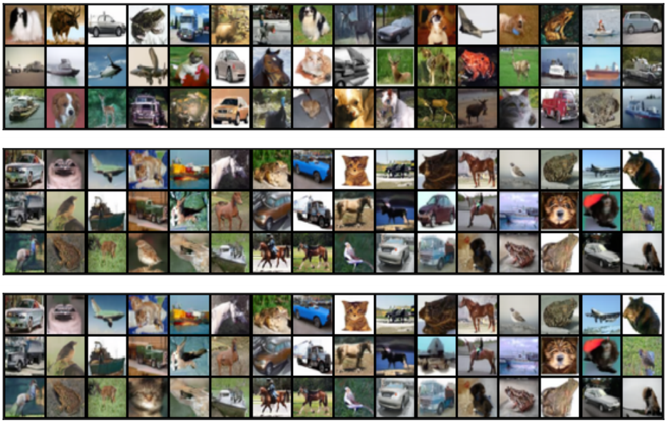

**图 7：** 来自 1000 步 DDPM、1000 步 DDIM 和 100 步 DDIM 的 CIFAR10 样本。
*图中排列：* 三组从上到下依次对应图注中的三种设置。

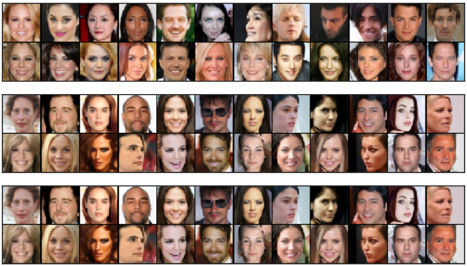

**图 8：** 来自 1000 步 DDPM、1000 步 DDIM 和 100 步 DDIM 的 CelebA 样本。
*图中排列：* 三组从上到下依次对应图注中的三种设置。

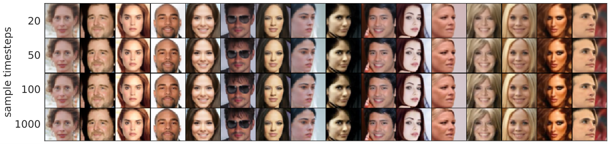

**图 9：** 从相同的随机 $\mathbf{x}_T$ 出发、采用不同步数得到的 DDIM CelebA 样本。
*图中文字：* “sample timesteps”表示采样步数；各行依次为 20、50、100、1000 步。

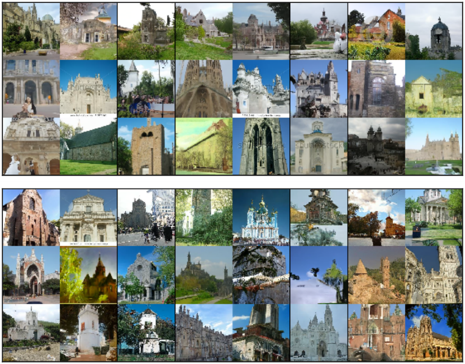

**图 10：** 来自 100 步 DDPM 和 100 步 DDIM 的 Church 样本。
*图中排列：* 上组为 100 步 DDPM，下组为 100 步 DDIM。

### D.5 插值

为了生成沿一条线的插值，我们从标准高斯分布随机采样两个初始 $\mathbf{x}_T$ 值，使用球面线性插值（Shoemake, 1985）在两者之间进行插值，再使用 DDIM 得到 $\mathbf{x}_0$ 样本。

$$
\mathbf{x}_T^{(\alpha)}=\frac{\sin((1-\alpha)\theta)}{\sin\theta}\mathbf{x}_T^{(0)}
+\frac{\sin(\alpha\theta)}{\sin\theta}\mathbf{x}_T^{(1)}
\tag{67}
$$

其中，$\theta=\arccos\!\left(\dfrac{(\mathbf{x}_T^{(0)})^\top \mathbf{x}_T^{(1)}}{\|\mathbf{x}_T^{(0)}\|\,\|\mathbf{x}_T^{(1)}\|}\right)$。
这些值用于产生 DDIM 样本。

为了生成网格上的插值，我们采样四个潜变量，将它们分为两对；随后，在相同 $\alpha$ 下，对这两对分别使用 slerp，再对两对得到的插值样本使用 slerp（使用独立选择的插值系数）。
图 11（CelebA）、图 12（Bedroom）和图 13（Church）展示了更多网格插值结果。

> **阅读注释：** 本节式（67）中的 $\alpha$ 是插值系数，$\theta$ 是两个潜向量的夹角；它们与前文的噪声调度 $\alpha_t$ 和网络参数 $\theta$ 含义不同。slerp 是 spherical linear interpolation 的缩写，即球面线性插值。

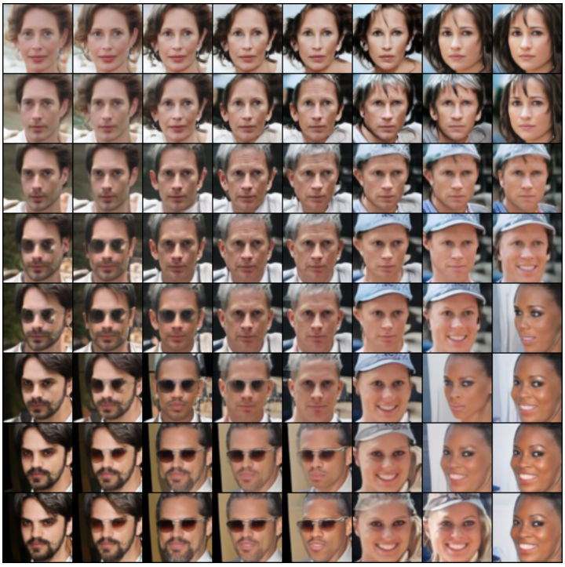

**图 11：** $\dim(\tau)=50$ 时，CelebA DDIM 的更多插值结果。

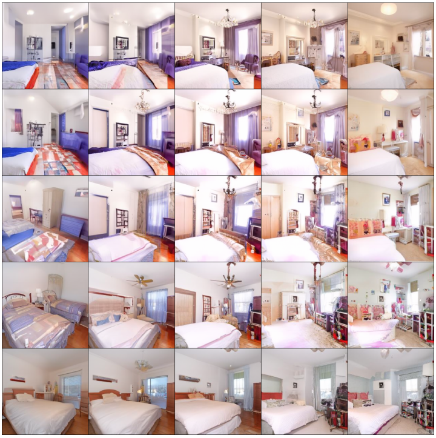

**图 12：** $\dim(\tau)=50$ 时，Bedroom DDIM 的更多插值结果。

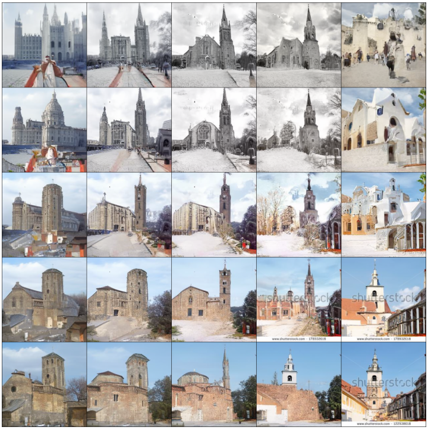

**图 13：** $\dim(\tau)=50$ 时，Church DDIM 的更多插值结果。
