# 去噪扩散概率模型

**作者：** Jonathan Ho、Ajay Jain、Pieter Abbeel
**机构：** 加州大学伯克利分校（UC Berkeley）
**版本：** arXiv:2006.11239v2 [cs.LG]，2020 年 12 月 16 日；NeurIPS 2020。
**原文件：** `DDPM.pdf`（共 25 页；正文第 1–9 页，参考文献第 9–12 页，附录第 13–25 页）。

> 译稿按原文句子顺序逐句展开，一句原文对应一行中文译句；公式、图、表、算法与正文引用的编号均与原文一致（公式 1–26，图 1–19，表 1–4，算法 1–4），正文中的引用编号保留原形式，文献条目请查阅原 PDF 第 9–12 页。
> 术语：diffusion probabilistic model 译为“扩散概率模型”，forward process / diffusion process 译为“前向过程／扩散过程”，reverse process 译为“反向过程”，variational bound 译为“变分界”，denoising score matching 译为“去噪得分匹配”，annealed Langevin dynamics 译为“退火朗之万动力学”，progressive lossy decompression 译为“渐进式有损解压”，bits/dim 译为“比特/维”，rate-distortion 译为“率失真”。作者姓名、模型名、数据集名与代码标识保留原形式。
> **关于“变分界”的方向：** 原文把式（3）定义的 $L$ 称为“负对数似然的变分界”，即 $\mathbb{E}_q[-\log p_\theta(\mathbf{x}_0)]\le L$，所以 $L$ 是负对数似然的上界，等价地 $-L$ 是对数似然的证据下界（ELBO）。这句方向说明只是为了帮助理解；正文对 “variational bound” 一词一律译作“变分界”，不再附加“上界／下界”这类原文没有的措辞。
> 原文有两处细节值得说明，译稿如实保留并以“译注”标出：式（5）在 $L_{t-1}$ 项与 $L_0$ 项之间漏印了加号；算法 2 中写的是 $(1-\alpha_t)/\sqrt{1-\bar\alpha_t}$，而正文同一处写的是 $\beta_t/\sqrt{1-\bar\alpha_t}$，两者因 $\alpha_t=1-\beta_t$ 而完全等价。
> 全文 19 幅插图取自论文的原始图件（arXiv 源码包中的 `images/` 目录），其中图 2、图 9 由矢量 PDF 重新渲染，图 5、图 6、图 10 由 pgfplots 生成的纯矢量图在原 PDF 上按版面裁切；算法 1–4 是文本描述，译稿按原文的行号以编号列表给出。

> **阅读注释（符号总览）：** $\mathbf{x}_0$ 是真实图像，$\mathbf{x}_t$ 是第 $t$ 步加噪后的图像，$\mathbf{x}_T$ 通常已经接近纯高斯噪声；$q$ 表示真实数据及其前向加噪过程所定义的分布，本文的加噪规则固定；$p_\theta$ 表示由模型参数决定的生成分布，其中反向转移需要神经网络学习。$t$ 是时间步，$T$ 是总步数。训练时可以看到真实 $\mathbf{x}_0$，采样时从 $\mathbf{x}_T$ 出发，因此网络必须学会在没有真实图像的情况下逐步生成。$p$、$q$ 的详细说明见第 2 节式（2）后的阅读注释。

## 摘要

我们使用扩散概率模型给出了高质量的图像合成结果；扩散概率模型是一类受非平衡热力学启发的潜变量模型。
我们的最佳结果来自训练一个加权变分界，该变分界是依据扩散概率模型与“去噪得分匹配＋朗之万动力学”之间的一个新联系设计出来的；此外，我们的模型天然允许一种渐进式有损解压方案，可以把它解释为自回归解码的推广。
在无条件 CIFAR10 数据集上，我们得到 9.46 的 Inception 分数与 3.17 的当时最先进 FID 分数。
在 256×256 的 LSUN 上，我们得到的样本质量与 ProgressiveGAN 相近。
我们的实现见 <https://github.com/hojonathanho/diffusion>。

## 1 引言

近来，各种深度生成模型在多种数据模态上都展现出了高质量样本。
生成对抗网络（GAN）、自回归模型、流模型与变分自编码器（VAE）已经合成出引人注目的图像与音频样本[14, 27, 3, 58, 38, 25, 10, 32, 44, 57, 26, 33, 45]，而能量模型与得分匹配方面也取得了显著进展，其生成的图像已可与 GAN 相媲美[11, 55]。

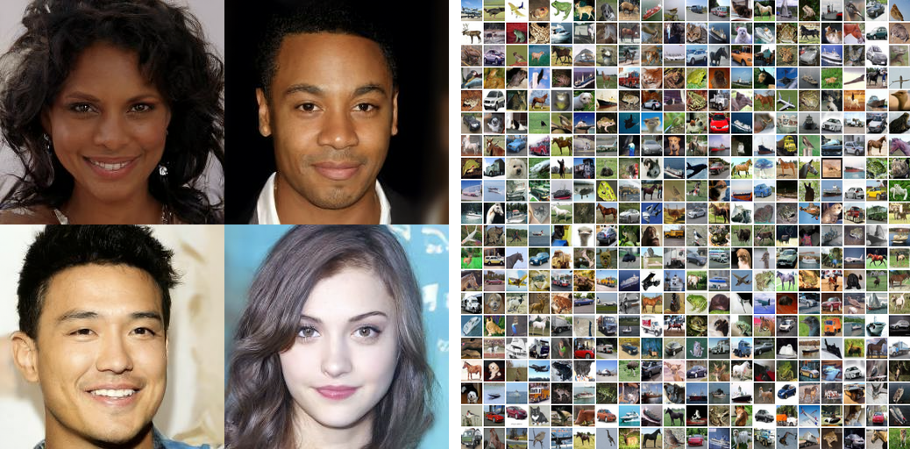

**图 1：** CelebA-HQ 256×256（左）与无条件 CIFAR10（右）上的生成样本。

本文在扩散概率模型[53]方面取得进展。
扩散概率模型（下文简称为“扩散模型”）是一条经过参数化的马尔可夫链，用变分推断训练，使其在有限时间之后产生与数据匹配的样本。
这条链的转移被学习为对一个扩散过程的逆转；该扩散过程是一条马尔可夫链，沿着与采样相反的方向逐步向数据加入噪声，直到信号被破坏。
当扩散过程中加入的是少量高斯噪声时，把采样链的转移同样设为条件高斯分布就足够了，这允许一种特别简单的神经网络参数化。

扩散模型定义直接、训练高效，但据我们所知，此前没有任何工作表明它们能够生成高质量的样本。
我们证明扩散模型确实能够生成高质量样本，有时甚至优于其他类型生成模型已发表的结果（第 4 节）。
此外，我们证明扩散模型的某种特定参数化，在训练时揭示了它与多个噪声水平上的去噪得分匹配之间的等价性，在采样时揭示了它与退火朗之万动力学之间的等价性（第 3.2 节）[55, 61]。
我们使用这种参数化得到了最好的样本质量结果（第 4.2 节），因此把这一等价性视为我们的主要贡献之一。

尽管样本质量很高，与其他基于似然的模型相比，我们的模型并没有具有竞争力的对数似然（不过，与文献中通过退火重要性采样为能量模型和得分匹配报告出的那些很大的估计值相比，我们模型的对数似然更好[11, 55]）。
我们发现，我们模型的绝大部分无损编码长度都花在描述人眼无法察觉的图像细节上（第 4.3 节）。
我们用有损压缩的语言对这种现象做了更精细的分析，并表明扩散模型的采样过程是一种渐进式解码：它类似自回归解码，但沿着一种远比自回归模型通常所能表达的范围更为一般的比特顺序进行。

## 2 背景

扩散模型[53]是形如 $p_\theta(\mathbf{x}_0) := \int p_\theta(\mathbf{x}_{0:T})\,d\mathbf{x}_{1:T}$ 的潜变量模型，其中 $\mathbf{x}_1,\dotsc,\mathbf{x}_T$ 是与数据 $\mathbf{x}_0\sim q(\mathbf{x}_0)$ 同维度的潜变量。
联合分布 $p_\theta(\mathbf{x}_{0:T})$ 称为**反向过程**，它被定义为一条从 $p(\mathbf{x}_T)=\mathcal N(\mathbf{x}_T;\mathbf{0},\mathbf{I})$ 出发、带有学习得到的高斯转移的马尔可夫链：

$$
p_\theta(\mathbf{x}_{0:T}) := p(\mathbf{x}_T)\prod_{t=1}^T p_\theta(\mathbf{x}_{t-1}|\mathbf{x}_t), \qquad
p_\theta(\mathbf{x}_{t-1}|\mathbf{x}_t) := \mathcal{N}(\mathbf{x}_{t-1}; \boldsymbol{\mu}_\theta(\mathbf{x}_t, t), \boldsymbol{\Sigma}_\theta(\mathbf{x}_t, t))
\tag{1}
$$

> **阅读注释：** 式（1）描述的是“生成时”的方向：先从标准正态分布取一个 $\mathbf{x}_T$，再依次生成 $\mathbf{x}_{T-1},\ldots,\mathbf{x}_0$。网络并不直接输出一张图，而是根据当前的 $\mathbf{x}_t$ 和时间步 $t$，输出下一步高斯分布的均值（以及可能的方差）。

扩散模型区别于其他类型潜变量模型的地方在于：它的近似后验 $q(\mathbf{x}_{1:T}|\mathbf{x}_0)$ 称为**前向过程**或**扩散过程**，被固定为一条按照方差调度 $\beta_1,\dotsc,\beta_T$ 逐步向数据加入高斯噪声的马尔可夫链：

$$
q(\mathbf{x}_{1:T} \mid \mathbf{x}_0) := \prod_{t=1}^T q(\mathbf{x}_t \mid \mathbf{x}_{t-1} ), \qquad
q(\mathbf{x}_t|\mathbf{x}_{t-1}) := \mathcal{N}(\mathbf{x}_t;\sqrt{1-\beta_t}\mathbf{x}_{t-1},\beta_t \mathbf{I})
\tag{2}
$$

> **阅读注释：** 式（2）是“加噪实验”，不是需要学习的模型。每一步先把旧图像缩小为 $\sqrt{1-\beta_t}\mathbf{x}_{t-1}$，再加入方差为 $\beta_t$ 的高斯噪声。$\beta_t$ 越小，单步变化越轻；经过很多步后，图像信息逐渐消失。

> **阅读注释：DDPM 中的 $p$ 和 $q$ 是什么意思？**
>
> **$q$ 表示真实数据及其加噪过程的分布，$p$ 表示模型用来生成数据的分布。** 两者都是概率分布的记号，用不同字母区分两套过程；字母本身没有“加噪”或“去噪”的固定数学含义，这是本文采用的约定。对于连续图像变量，公式中的这些函数通常表示概率密度，而不是某张图像的单点概率。
>
> **① $q$：从真实图像出发，逐步加噪。**
>
> $$
> \mathbf{x}_0\xrightarrow{q}\mathbf{x}_1\xrightarrow{q}\cdots\xrightarrow{q}\mathbf{x}_T.
> $$
>
> $\mathbf{x}_0$ 是干净图像，越往后噪声越多。$q(\mathbf{x}_t\mid\mathbf{x}_{t-1})$ 读作：“**已知上一步图像 $\mathbf{x}_{t-1}$，加噪后得到 $\mathbf{x}_t$ 的条件分布**。”竖线 $\mid$ 表示“在给定右侧变量的条件下”。式（2）将这个转移规定为高斯分布，其均值为 $\sqrt{1-\beta_t}\mathbf{x}_{t-1}$，协方差为 $\beta_t\mathbf{I}$。本文使用固定的加噪调度，这个转移不需要网络学习。
>
> **② $p$：从噪声出发，逐步生成图像。**
>
> $$
> \mathbf{x}_T\xrightarrow{p_\theta}\mathbf{x}_{T-1}\xrightarrow{p_\theta}\cdots\xrightarrow{p_\theta}\mathbf{x}_0.
> $$
>
> $p_\theta(\mathbf{x}_{t-1}\mid\mathbf{x}_t)$ 读作：“**已知当前带噪图像 $\mathbf{x}_t$，模型认为上一步、噪声更少的图像 $\mathbf{x}_{t-1}$ 应服从什么分布**。”下标 $\theta$ 表示这个分布由模型参数决定。式（1）用神经网络参数化它的均值，方差则可以固定或学习。生成时先从 $p(\mathbf{x}_T)=\mathcal{N}(\mathbf{0},\mathbf{I})$ 采样，再反复使用学到的反向转移，最终得到图像。
>
> | 论文中的写法 | 含义 |
> | --- | --- |
> | $q(\mathbf{x}_0)$ | 真实数据的分布；训练图像从这里取得，不是人为设定的高斯噪声分布 |
> | $q(\mathbf{x}_t\mid\mathbf{x}_{t-1})$ | 规定好的前向加噪分布，见式（2） |
> | $q(\mathbf{x}_{t-1}\mid\mathbf{x}_t,\mathbf{x}_0)$ | 已知当前带噪图像和真实原图时，上一步状态的条件后验；可写成高斯分布，用于训练推导，见式（6） |
> | $p(\mathbf{x}_T)=\mathcal{N}(\mathbf{0},\mathbf{I})$ | 生成的起点：固定的标准高斯噪声分布 |
> | $p_\theta(\mathbf{x}_{t-1}\mid\mathbf{x}_t)$ | 模型学习的反向生成分布，见式（1） |
> | $p_\theta(\mathbf{x}_0)$ | 模型最终生成图像的分布；训练希望它接近真实数据分布 $q(\mathbf{x}_0)$ |
>
> **不要仅靠字母判断方向或是否需要学习。** $q$ 也可以表示由前向过程推导出的反向条件后验；$p$ 也不一定都需要学习，例如起点 $p(\mathbf{x}_T)$ 就是固定的。此外，已知前向高斯转移，不代表真实数据分布 $q(\mathbf{x}_0)$ 或所有带噪边缘分布都容易显式计算。理解公式时，要结合括号里的变量、条件和下标。

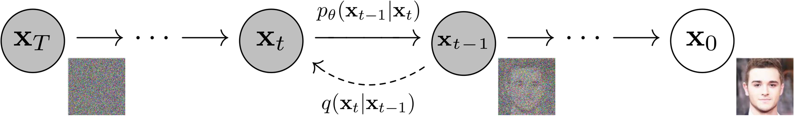

**图 2：** 本文考虑的有向图模型。
*图中文字：* $\mathbf{x}_T \to \cdots \to \mathbf{x}_t \to \mathbf{x}_{t-1} \to \cdots \to \mathbf{x}_0$；由 $\mathbf{x}_t$ 指向 $\mathbf{x}_{t-1}$ 的箭头标注 $p_\theta(\mathbf{x}_{t-1}|\mathbf{x}_t)$，由 $\mathbf{x}_{t-1}$ 指回 $\mathbf{x}_t$ 的箭头标注 $q(\mathbf{x}_t|\mathbf{x}_{t-1})$。

训练通过优化负对数似然的通常变分界来完成：

$$
\mathbb{E}\left[-\log p_\theta(\mathbf{x}_0)\right] \leq \mathbb{E}_q\left[ - \log \frac{p_\theta(\mathbf{x}_{0:T})}{q(\mathbf{x}_{1:T} \mid \mathbf{x}_0)}\right]
  = \mathbb{E}_q\bigg[ -\log p(\mathbf{x}_T) - \sum_{t \geq 1} \log \frac{p_\theta(\mathbf{x}_{t-1} \mid \mathbf{x}_t)}{q(\mathbf{x}_t|\mathbf{x}_{t-1})} \bigg] =: L
\tag{3}
$$

> **阅读注释：** 真实目标是让模型给训练图像较高概率，即最小化 $-\log p_\theta(\mathbf{x}_0)$。但 $p_\theta(\mathbf{x}_0)$ 要对所有中间变量积分，直接算很困难，所以引入已知的 $q$，得到容易估计的上界 $L$。优化这个上界，就能间接训练反向过程。

前向过程的方差 $\beta_t$ 可以通过重参数化学习[33]，也可以作为超参数保持为常数；而反向过程的表达能力在一定程度上由 $p_\theta(\mathbf{x}_{t-1}|\mathbf{x}_t)$ 中选取高斯条件分布来保证，因为当 $\beta_t$ 很小时两个过程具有相同的函数形式[53]。
前向过程有一个值得注意的性质：它允许以闭式形式在任意时间步 $t$ 采样 $\mathbf{x}_t$。采用记号 $\alpha_t := 1-\beta_t$ 与 $\bar\alpha_t := \prod_{s=1}^t \alpha_s$，我们有

$$
q(\mathbf{x}_t|\mathbf{x}_0) = \mathcal{N}(\mathbf{x}_t; \sqrt{\bar\alpha_t}\mathbf{x}_0, (1-\bar\alpha_t)\mathbf{I})
\tag{4}
$$

> **阅读注释：** 这是 DDPM 训练高效的关键。它把连续执行 $t$ 次加噪改成一次采样：直接取一个标准高斯噪声 $\boldsymbol{\epsilon}$，即可写成 $\mathbf{x}_t=\sqrt{\bar\alpha_t}\mathbf{x}_0+\sqrt{1-\bar\alpha_t}\boldsymbol{\epsilon}$。其中 $\bar\alpha_t$ 控制信号保留比例；$t$ 较小时图像清晰，$t$ 较大时噪声占主导。

因此，只要用随机梯度下降优化 $L$ 的随机项，就能高效地训练。
进一步的改进来自方差缩减：把 $L$（式 3）改写为

$$
\mathbb{E}_q \bigg[ \underbrace{D_{\mathrm{KL}}\!\left(q(\mathbf{x}_T|\mathbf{x}_0) \,\|\, p(\mathbf{x}_T)\right)}_{L_T} + \sum_{t > 1} \underbrace{D_{\mathrm{KL}}\!\left(q(\mathbf{x}_{t-1}|\mathbf{x}_t,\mathbf{x}_0) \,\|\, p_\theta(\mathbf{x}_{t-1}|\mathbf{x}_t)\right)}_{L_{t-1}} \underbrace{-\log p_\theta(\mathbf{x}_0|\mathbf{x}_1)}_{L_0} \bigg]
\tag{5}
$$

> **译注：** 原文式（5）在 $L_{t-1}$ 项与 $L_0$ 项之间漏印了加号；三项之和才是完整的分解，译稿按原文排版保留该处，读者应按求和理解。

> **阅读注释：** 这三个部分各有明确含义：$L_T$ 让最终的噪声分布接近标准正态；$L_{t-1}$ 让网络学会每一个反向去噪步骤；$L_0$ 负责把最后的连续变量还原成离散像素。实际实现中 $q$ 固定，因此 $L_T$ 是常数，主要优化中间的去噪项。

（细节见附录 A。各项的标签在第 3 节中使用。）式（5）用 KL 散度直接比较 $p_\theta(\mathbf{x}_{t-1}|\mathbf{x}_t)$ 与前向过程的后验，而后者在给定 $\mathbf{x}_0$ 的条件下是可解的：

$$
q(\mathbf{x}_{t-1}|\mathbf{x}_t,\mathbf{x}_0) = \mathcal{N}(\mathbf{x}_{t-1}; \tilde{\boldsymbol{\mu}}_t(\mathbf{x}_t, \mathbf{x}_0), \tilde\beta_t \mathbf{I}),
\tag{6}
$$

$$
\text{其中}\quad \tilde{\boldsymbol{\mu}}_t(\mathbf{x}_t, \mathbf{x}_0) := \frac{\sqrt{\bar\alpha_{t-1}}\beta_t }{1-\bar\alpha_t}\mathbf{x}_0 + \frac{\sqrt{\alpha_t}(1- \bar\alpha_{t-1})}{1-\bar\alpha_t} \mathbf{x}_t \quad \text{以及} \quad
\tilde\beta_t := \frac{1-\bar\alpha_{t-1}}{1-\bar\alpha_t}\beta_t
\tag{7}
$$

于是，式（5）中的所有 KL 散度都是高斯分布之间的比较，可以用闭式表达式以 Rao–Blackwell 化的方式算出，而不必使用高方差的蒙特卡洛估计。

> **阅读注释：** 注意后验写成了 $q(\mathbf{x}_{t-1}|\mathbf{x}_t,\mathbf{x}_0)$，它额外依赖真实图像 $\mathbf{x}_0$，所以只能在训练推导中使用。采样时没有 $\mathbf{x}_0$，模型要用 $p_\theta(\mathbf{x}_{t-1}|\mathbf{x}_t)$ 去近似这个后验。

## 3 扩散模型与去噪自编码器

扩散模型表面上或许像是一类受限的潜变量模型，但它们在实现上允许大量的自由度。
人们必须选择前向过程的方差 $\beta_t$，以及反向过程的模型架构与高斯分布参数化方式。
为了指导这些选择，我们在扩散模型与去噪得分匹配之间建立了一个新的显式联系（第 3.2 节），由此得到扩散模型的一个简化且加权的变分界目标（第 3.4 节）。
归根结底，我们的模型设计由简洁性与实验结果来证明其合理性（第 4 节）。
我们的讨论按式（5）中的各项来划分。

### 3.1 前向过程与 $L_T$

我们忽略前向过程方差 $\beta_t$ 可以通过重参数化学习这一事实，转而把它们固定为常数（细节见第 4 节）。
因此，在我们的实现中，近似后验 $q$ 没有可学习参数，于是 $L_T$ 在训练期间是常数，可以忽略。

> **阅读注释：** “忽略 $L_T$”不是说它不存在，而是说它不含 $\theta$。固定噪声调度后，改变网络参数不会改变 $L_T$，因此它不会产生梯度。

### 3.2 反向过程与 $L_{1:T-1}$

> **阅读注释（式 8–12 的推导路线）：** 这一组公式回答的问题是：为什么一个用于生成图像的概率模型，最后可以用“预测噪声的平方误差”来训练？请先固定一个时间步 $t>1$，把 $\mathbf{x}_t$ 看成网络已经收到的输入。式（8）把 KL 损失写成均值误差；式（9）、（10）把目标均值改写成“已知输入＋真实噪声”的形式；式（11）规定网络输出预测噪声，并据此计算模型均值；式（12）代回损失，发现均值误差等于一个系数乘以噪声误差。这些编号表示推导的先后顺序，不是五个去噪时间步。
>
> **先分清两个均值。** $\tilde{\boldsymbol{\mu}}_t(\mathbf{x}_t,\mathbf{x}_0)$ 是给定真实图像后，按式（7）计算出来的后验均值，可以用作训练目标；$\boldsymbol{\mu}_\theta(\mathbf{x}_t,t)$ 是模型给出的反向均值，只能依赖当前带噪图像和时间步。带波浪号的均值是目标，不带波浪号且带 $\theta$ 的均值是模型预测。二者都描述下一步 $\mathbf{x}_{t-1}$ 的分布均值，不等于下一步随机采样的结果。

现在我们讨论 $p_\theta(\mathbf{x}_{t-1}|\mathbf{x}_t) = \mathcal{N}(\mathbf{x}_{t-1}; \boldsymbol{\mu}_\theta(\mathbf{x}_t, t), \boldsymbol{\Sigma}_\theta(\mathbf{x}_t, t))$ 在 $1 < t \leq T$ 上的选择。
首先，我们把 $\boldsymbol{\Sigma}_\theta(\mathbf{x}_t, t) = \sigma_t^2 \mathbf{I}$ 设为不参与训练、只依赖时间步的常数。
实验上，$\sigma_t^2 = \beta_t$ 与 $\sigma_t^2 = \tilde\beta_t = \frac{1-\bar\alpha_{t-1}}{1-\bar\alpha_t}\beta_t$ 给出的结果相近。
第一种选择对 $\mathbf{x}_0 \sim \mathcal{N}(\mathbf{0}, \mathbf{I})$ 是最优的，第二种选择对把 $\mathbf{x}_0$ 确定性地设为某一个点是最优的。
对于各坐标单位方差的数据，这两个极端选择分别对应反向过程熵的上界与下界[53]。

其次，为了表示均值 $\boldsymbol{\mu}_\theta(\mathbf{x}_t, t)$，我们在下面关于 $L_t$ 的分析的启发下提出一种特定的参数化方式。
取 $p_\theta(\mathbf{x}_{t-1} | \mathbf{x}_t) = \mathcal{N}(\mathbf{x}_{t-1}; \boldsymbol{\mu}_\theta(\mathbf{x}_t, t), \sigma_t^2\mathbf{I})$，我们可以写出：

$$
L_{t-1} = \mathbb{E}_q\left[ \frac{1}{2\sigma_t^2} \|\tilde{\boldsymbol{\mu}}_t(\mathbf{x}_t,\mathbf{x}_0) - \boldsymbol{\mu}_\theta(\mathbf{x}_t, t)\|^2 \right] + C
\tag{8}
$$

> **阅读注释（式 8：先确定要学什么）：** 式（5）的中间项原本比较两个分布：
>
> $$D_{\mathrm{KL}}\!\left(\mathcal N(\tilde{\boldsymbol{\mu}}_t,\tilde\beta_t\mathbf I)\,\|\,\mathcal N(\boldsymbol{\mu}_\theta,\sigma_t^2\mathbf I)\right).$$
>
> 因为两边的方差都固定、不依赖网络参数，KL 中所有方差相关项都可以放进常数 $C$；与 $\theta$ 有关的部分只剩下 $\frac{1}{2\sigma_t^2}\|\tilde{\boldsymbol{\mu}}_t-\boldsymbol{\mu}_\theta\|^2$。这里不要求两边的方差相等。于是原先的“拟合一个分布”，变成了“让预测均值接近目标均值”。后面的式（9）到（12）都在改写这个平方误差。

其中 $C$ 是不依赖于 $\theta$ 的常数。
于是我们看到，$\boldsymbol{\mu}_\theta$ 最直接的参数化方式，是让模型去预测前向过程的后验均值 $\tilde{\boldsymbol{\mu}}_t$。
不过，我们可以把式（4）重参数化为 $\mathbf{x}_t(\mathbf{x}_0, \boldsymbol{\epsilon}) = \sqrt{\bar\alpha_t}\mathbf{x}_0 + \sqrt{1-\bar\alpha_t}\boldsymbol{\epsilon}$（其中 $\boldsymbol{\epsilon} \sim \mathcal{N}(\mathbf{0}, \mathbf{I})$），再套用前向过程后验公式（式 7），从而把式（8）进一步展开：

$$
L_{t-1} - C = \mathbb{E}_{\mathbf{x}_0, \boldsymbol{\epsilon}}\left[ \frac{1}{2\sigma_t^2} \left\| \tilde{\boldsymbol{\mu}}_t\!\left(\mathbf{x}_t(\mathbf{x}_0, \boldsymbol{\epsilon}), \frac{1}{\sqrt{\bar\alpha_t}} (\mathbf{x}_t(\mathbf{x}_0, \boldsymbol{\epsilon}) - \sqrt{1-\bar\alpha_t}\boldsymbol{\epsilon}) \right) - \boldsymbol{\mu}_\theta(\mathbf{x}_t(\mathbf{x}_0, \boldsymbol{\epsilon}), t) \right\|^2 \right]
\tag{9}
$$

> **阅读注释（式 9：把原图用噪声表示）：** 式（4）的采样写法是 $\mathbf{x}_t=\sqrt{\bar\alpha_t}\mathbf{x}_0+\sqrt{1-\bar\alpha_t}\boldsymbol{\epsilon}$。移项得到
>
> $$\mathbf{x}_0=\frac{\mathbf{x}_t-\sqrt{1-\bar\alpha_t}\boldsymbol{\epsilon}}{\sqrt{\bar\alpha_t}}.$$
>
> 把这个表达式替换进式（8）中 $\tilde{\boldsymbol{\mu}}_t$ 的第二个输入，就是式（9）。虽然公式变长了，但它只做了“替换 $\mathbf{x}_0$”这一件事，尚未更改损失或引入新的网络。$\mathbf{x}_t(\mathbf{x}_0,\boldsymbol{\epsilon})$ 只是强调带噪图像由原图和随机噪声构造，并不是另一个模型；$\mathbb E_{\mathbf{x}_0,\boldsymbol{\epsilon}}$ 则表示先取原图和噪声，再构造 $\mathbf{x}_t$，与前向分布下的期望一致。

$$
L_{t-1} - C = \mathbb{E}_{\mathbf{x}_0, \boldsymbol{\epsilon}}\left[ \frac{1}{2\sigma_t^2} \left\| \frac{1}{\sqrt{\alpha_t}}\left( \mathbf{x}_t(\mathbf{x}_0,\boldsymbol{\epsilon}) - \frac{\beta_t}{\sqrt{1-\bar\alpha_t}}\boldsymbol{\epsilon} \right) - \boldsymbol{\mu}_\theta(\mathbf{x}_t(\mathbf{x}_0,\boldsymbol{\epsilon}), t) \right\|^2 \right]
\tag{10}
$$

> **阅读注释（式 10：展开目标均值，看清未知量）：** 将式（9）中的替换结果代入式（7），利用 $\bar\alpha_t=\alpha_t\bar\alpha_{t-1}$ 合并系数，可以得到
>
> $$\tilde{\boldsymbol{\mu}}_t=\frac{1}{\sqrt{\alpha_t}}\left(\mathbf{x}_t-\frac{\beta_t}{\sqrt{1-\bar\alpha_t}}\boldsymbol{\epsilon}\right).$$
>
> 因而式（10）依然是式（8）的均值误差，只是目标均值已经展开了。现在关键结构很清楚：$\mathbf{x}_t$ 是网络已有的输入，各个系数由固定噪声调度决定，训练时已知而采样时未知的量是 $\boldsymbol{\epsilon}$。作者于是想到：可以让网络预测噪声，再通过这套固定运算得到均值。这里的 $\boldsymbol{\epsilon}$ 是从原图构造 $\mathbf{x}_t$ 时使用的等效噪声，不是每一步采样新加的 $\mathbf z$。

式（10）表明，给定 $\mathbf{x}_t$ 时，$\boldsymbol{\mu}_\theta$ 必须预测 $\frac{1}{\sqrt{\alpha_t}}\left( \mathbf{x}_t - \frac{\beta_t}{\sqrt{1-\bar\alpha_t}}\boldsymbol{\epsilon} \right)$。
由于 $\mathbf{x}_t$ 已经作为输入提供给模型，我们可以选择如下参数化

$$
\boldsymbol{\mu}_\theta(\mathbf{x}_t, t) = \tilde{\boldsymbol{\mu}}_t\!\left(\mathbf{x}_t, \frac{1}{\sqrt{\bar\alpha_t}} (\mathbf{x}_t - \sqrt{1-\bar\alpha_t}\boldsymbol{\epsilon}_\theta(\mathbf{x}_t)) \right) = \frac{1}{\sqrt{\alpha_t}}\left( \mathbf{x}_t - \frac{\beta_t}{\sqrt{1-\bar\alpha_t}} \boldsymbol{\epsilon}_\theta(\mathbf{x}_t, t) \right)
\tag{11}
$$

其中 $\boldsymbol{\epsilon}_\theta$ 是一个用于从 $\mathbf{x}_t$ 预测 $\boldsymbol{\epsilon}$ 的函数逼近器。

> **阅读注释（式 11：决定让网络输出什么）：** 式（10）用真实噪声计算目标均值，式（11）则用网络预测的噪声 $\boldsymbol{\epsilon}_\theta(\mathbf{x}_t,t)$ 计算模型均值。两者使用完全相同的固定系数。式（11）是作者选择的“参数化方式”：网络直接输出噪声预测，均值由一个固定公式计算，不需要另一个均值预测网络。
>
> 为了看清这件事，暂记 $a_t=1/\sqrt{\alpha_t}$、$b_t=\beta_t/\sqrt{1-\bar\alpha_t}$，则
>
> $$\text{目标均值：}\quad\tilde{\boldsymbol{\mu}}_t=a_t(\mathbf{x}_t-b_t\boldsymbol{\epsilon}),\qquad
> \text{模型均值：}\quad\boldsymbol{\mu}_\theta=a_t(\mathbf{x}_t-b_t\boldsymbol{\epsilon}_\theta).$$
>
> 两式唯一需要学习的差别，是把真实噪声换成了预测噪声。如果预测噪声接近训练标签，由它算出的模型均值也就接近对应的目标均值。

要从 $p_\theta(\mathbf{x}_{t-1}|\mathbf{x}_t)$ 采样 $\mathbf{x}_{t-1}$，就是计算

$$
\mathbf{x}_{t-1} = \frac{1}{\sqrt{\alpha_t}}\left( \mathbf{x}_t - \frac{\beta_t}{\sqrt{1-\bar\alpha_t}} \boldsymbol{\epsilon}_\theta(\mathbf{x}_t, t) \right) + \sigma_t \mathbf{z}, \quad \text{其中}\ \mathbf{z} \sim \mathcal{N}(\mathbf{0}, \mathbf{I})
$$

完整的采样流程见算法 2，它类似朗之万动力学，其中 $\boldsymbol{\epsilon}_\theta$ 充当数据密度的学习到的梯度。

> **阅读注释：** 每一步并不是简单地“减噪后复制”，还会加入 $\sigma_t\mathbf z$ 这一随机项。它让模型能够从同一个噪声状态产生不同的合理图像；最后一步令噪声为零，是为了输出稳定的最终结果。

此外，在式（11）的参数化下，式（10）简化为：

$$
\mathbb{E}_{\mathbf{x}_0, \boldsymbol{\epsilon}}\left[ \frac{\beta_t^2}{2\sigma_t^2 \alpha_t (1-\bar\alpha_t)} \left\| \boldsymbol{\epsilon} - \boldsymbol{\epsilon}_\theta(\sqrt{\bar\alpha_t} \mathbf{x}_0 + \sqrt{1-\bar\alpha_t}\boldsymbol{\epsilon}, t) \right\|^2 \right]
\tag{12}
$$

> **阅读注释（式 12：证明训练噪声预测就能训练反向均值）：** 把式（11）代回式（10）的平方误差。沿用刚才的 $a_t,b_t$，两个均值相减时，已有输入 $\mathbf{x}_t$ 会抵消：
>
> $$\tilde{\boldsymbol{\mu}}_t-\boldsymbol{\mu}_\theta
> =a_t(\mathbf{x}_t-b_t\boldsymbol{\epsilon})-a_t(\mathbf{x}_t-b_t\boldsymbol{\epsilon}_\theta)
> =a_tb_t(\boldsymbol{\epsilon}_\theta-\boldsymbol{\epsilon}).$$
>
> 因此
>
> $$\frac{1}{2\sigma_t^2}\|\tilde{\boldsymbol{\mu}}_t-\boldsymbol{\mu}_\theta\|^2
> =\underbrace{\frac{\beta_t^2}{2\sigma_t^2\alpha_t(1-\bar\alpha_t)}}_{\text{时间步权重 }w_t}
> \|\boldsymbol{\epsilon}-\boldsymbol{\epsilon}_\theta\|^2.$$
>
> 这就是式（12）中那个较长系数的来历：它是均值变换的系数平方，再乘以式（8）的 $1/(2\sigma_t^2)$。前后使用的是同一个训练目标，只换了网络输出的表达方式，并去掉了与 $\theta$ 无关的常数 $C$。网络不必直接预测一个复杂的高斯后验均值，而可以用已知的随机噪声作为标签训练。
>
> **和式（14）的区别。** 式（12）仍保留每个时间步不同的 $w_t$，因此等价于相应的变分界中间项；第 3.4 节的式（14）进一步去掉这些权重，才得到算法 1 使用的简单噪声平方误差。这一步会改变不同时间步对训练的相对贡献，属于训练目标的重新加权，而不只是代数整理。

它类似按 $t$ 索引的多个噪声尺度上的去噪得分匹配[55]。

> **阅读注释：** 得分匹配通常训练网络估计 $\nabla_{\mathbf{x}}\log p(\mathbf{x})$。在 DDPM 中，噪声预测与这个梯度在数学上可以互相换算，因此 DDPM 既可以看作变分潜变量模型，也可以看作一个多噪声尺度的得分模型。

由于式（12）等于类朗之万反向过程（式 11）变分界中的一项，我们看到：优化一个类似去噪得分匹配的目标，等价于用变分推断去拟合一条类似朗之万动力学的采样链的有限时间边缘分布。

总之，我们可以训练反向过程均值函数逼近器 $\boldsymbol{\mu}_\theta$ 去预测 $\tilde{\boldsymbol{\mu}}_t$；或者通过修改它的参数化方式，训练它去预测 $\boldsymbol{\epsilon}$。
（也可以选择预测 $\mathbf{x}_0$，但在我们早期的实验中发现这会导致更差的样本质量。）
我们已经表明，$\boldsymbol{\epsilon}$ 预测参数化既与朗之万动力学相似，又把扩散模型的变分界简化成一个类似去噪得分匹配的目标。
尽管如此，它只是 $p_\theta(\mathbf{x}_{t-1}|\mathbf{x}_t)$ 的另一种参数化，因此我们将在第 4 节通过一项消融实验来验证它的有效性，把预测 $\boldsymbol{\epsilon}$ 与预测 $\tilde{\boldsymbol{\mu}}_t$ 作对比。

**算法 1：** 训练

1. 重复
2. $\quad \mathbf{x}_0 \sim q(\mathbf{x}_0)$
3. $\quad t \sim \mathrm{Uniform}(\{1, \dotsc, T\})$
4. $\quad \boldsymbol{\epsilon}\sim\mathcal{N}(\mathbf{0},\mathbf{I})$
5. $\quad$ 对下式取一步梯度下降：$\nabla_\theta \left\| \boldsymbol{\epsilon} - \boldsymbol{\epsilon}_\theta(\sqrt{\bar\alpha_t} \mathbf{x}_0 + \sqrt{1-\bar\alpha_t}\boldsymbol{\epsilon}, t) \right\|^2$
6. 直到收敛

> **阅读注释：算法 1 的任务——学会预测不同噪声水平下的噪声。**
>
> **输入与输出。** 输入是训练集中的真实图像，以及预先设定的噪声调度 $\beta_1,\ldots,\beta_T$；训练得到的是网络参数 $\theta$。网络 $\boldsymbol{\epsilon}_\theta(\mathbf{x}_t,t)$ 接收“带噪图像＋时间步”，输出与图像形状相同的噪声预测。例如输入一张 $32\times32\times3$ 的图像，输出也是一个 $32\times32\times3$ 的数组。
>
> **第 1、6 行：重复更新网络。** 每次迭代都重新选择图像、时间步和噪声，再用损失更新参数。这里“直到收敛”表示训练到预定步数或合适的停止条件，并不要求每次预测误差都变成零。
>
> **第 2 行：取真实图像 $\mathbf{x}_0$。** $\mathbf{x}_0\sim q(\mathbf{x}_0)$ 可以理解为从训练集中随机取图像，不需要先知道真实数据分布的数学表达式。论文将像素缩放到 $[-1,1]$；实际训练通常一次取一批图像，而不是只取一张。
>
> **第 3 行：随机选择时间步 $t$。** 从 $\{1,\ldots,T\}$ 中等概率选一个整数，用它决定这次训练的噪声水平。小 $t$ 通常意味着图像保留较多信息，大 $t$ 通常意味着图像受到较强破坏。这里不需要把每张图像从第 1 步加噪到第 $T$ 步；只训练随机抽到的那个时间步即可。同一个网络在不同迭代中学习所有时间步，参数在时间步之间共享。
>
> **第 4 行：生成已知的监督标签 $\boldsymbol{\epsilon}$。** 从标准正态分布采样一个与图像形状相同的噪声数组，各坐标独立采样。因为噪声是我们自己生成的，所以它的数值完全已知，可以直接作为训练目标。这不是额外标注的图像类别或文本标签。
>
> **第 5 行，第一步：直接构造带噪图像。** 先预计算 $\alpha_t=1-\beta_t$ 和 $\bar\alpha_t=\prod_{s=1}^t\alpha_s$，再使用式（4）：
>
> $$\mathbf{x}_t=\sqrt{\bar\alpha_t}\mathbf{x}_0+\sqrt{1-\bar\alpha_t}\boldsymbol{\epsilon}.$$
>
> 两项分别是“缩小后的原图”和“按当前噪声强度缩放的噪声”。例如，若某个时间步满足 $\bar\alpha_t=0.25$，就有 $\mathbf{x}_t=0.5\mathbf{x}_0+\sqrt{0.75}\boldsymbol{\epsilon}$。这里的 $\boldsymbol{\epsilon}$ 是把前 $t$ 步噪声合并后的等效标准高斯噪声；它不是仅在第 $t$ 步新加入的那一小份噪声。这个闭式公式让我们一次就能得到 $\mathbf{x}_t$。
>
> **第 5 行，第二步：预测噪声并计算损失。** 将 $\mathbf{x}_t$ 和 $t$ 输入网络，得到 $\hat{\boldsymbol{\epsilon}}=\boldsymbol{\epsilon}_\theta(\mathbf{x}_t,t)$，再计算 $\|\boldsymbol{\epsilon}-\hat{\boldsymbol{\epsilon}}\|^2$。真实图像 $\mathbf{x}_0$ 用来构造训练样本，但不会作为额外输入交给这个噪声预测网络。论文写的是平方误差之和；实现中也常对像素、通道和批次取平均，在维度与批大小固定时只相差一个常数比例。
>
> **第 5 行，第三步：反向传播更新 $\theta$。** 算法中的 $\nabla_\theta$ 表示计算损失对网络参数的梯度，然后由优化器更新参数。更新的是网络参数，不是原图、随机噪声或固定的噪声调度。随机抽样的图像、$t$ 和噪声，使这一批次的损失成为式（14）期望损失的随机估计。
>
> **为什么只训练预测噪声，就能生成图像？** 式（11）已经把反向分布的均值写成了噪声预测的函数；因此，只要学到 $\boldsymbol{\epsilon}_\theta$，就能计算每一步的反向均值。需要注意，给定一张带噪图像，通常无法唯一确定原图和噪声；平方误差下理想的预测是条件均值 $\mathbb{E}[\boldsymbol{\epsilon}\mid\mathbf{x}_t,t]$，不是保证精确找回每次加入的噪声。
>
> **一次训练迭代的流程：** 取真实图像 → 抽取 $t$ 和噪声 → 直接构造 $\mathbf{x}_t$ → 网络预测噪声 → 计算平方误差 → 更新网络。一次迭代通常只需一次网络前向计算，以及对应的反向传播。

**算法 2：** 采样

1. $\mathbf{x}_T \sim \mathcal{N}(\mathbf{0}, \mathbf{I})$
2. 对 $t = T, \dotsc, 1$ 做
3. $\quad \mathbf{z} \sim \mathcal{N}(\mathbf{0}, \mathbf{I})$，若 $t > 1$；否则 $\mathbf{z} = \mathbf{0}$
4. $\quad \mathbf{x}_{t-1} = \frac{1}{\sqrt{\alpha_t}}\left( \mathbf{x}_t - \frac{1-\alpha_t}{\sqrt{1-\bar\alpha_t}} \boldsymbol{\epsilon}_\theta(\mathbf{x}_t, t) \right) + \sigma_t \mathbf{z}$
5. 结束循环
6. 返回 $\mathbf{x}_0$

> **阅读注释：算法 2 的任务——使用训练好的网络，从随机噪声生成一张新图像。**
>
> **输入与输出。** 输入是训练好的网络参数、与训练一致的噪声调度，以及选定的反向方差 $\sigma_t^2$；输出是生成图像。采样期间网络参数固定，不计算训练损失，也不更新参数。此时没有真实图像 $\mathbf{x}_0$，也没有用于监督的真实噪声标签。
>
> **第 1 行：生成起点 $\mathbf{x}_T$。** 按希望生成的图像尺寸，从标准正态分布采样一个数组，例如 $32\times32\times3$。它看起来像随机噪点。训练时的前向过程已经让末端分布接近标准正态，所以生成时可以直接从这个简单分布出发，不需要先找一张真实图像。
>
> **第 2 行：按相反方向逐步去噪。** 时间步依次取 $T,T-1,\ldots,1$。当前状态是 $\mathbf{x}_t$，这一步要生成的是 $\mathbf{x}_{t-1}$。上一轮的输出会成为下一轮的输入；各步使用同一个网络，但传入不同的 $t$。原论文取 $T=1000$，因此生成一批图像通常需要 1000 次网络调用。
>
> **第 3 行：准备本次转移的新随机噪声 $\mathbf{z}$。** 当 $t>1$ 时，重新采样一个与图像形状相同的标准高斯数组；最后一步 $t=1$ 则令 $\mathbf{z}=0$。这里的 $\mathbf{z}$ 是采样时新引入的随机性，与训练时用于监督的 $\boldsymbol{\epsilon}$ 不同，也不需要知道它对应哪张原图。
>
> **第 4 行，第一步：预测当前状态中的等效噪声。** 计算 $\hat{\boldsymbol{\epsilon}}=\boldsymbol{\epsilon}_\theta(\mathbf{x}_t,t)$。网络输出的是噪声估计；接下来仍要用论文推导的系数，把它转换成反向高斯分布的均值。
>
> **第 4 行，第二步：计算反向均值。** 利用 $1-\alpha_t=\beta_t$，把更新式的确定性部分记为
>
> $$\boldsymbol{\mu}_\theta(\mathbf{x}_t,t)=\frac{1}{\sqrt{\alpha_t}}\left(\mathbf{x}_t-\frac{\beta_t}{\sqrt{1-\bar\alpha_t}}\hat{\boldsymbol{\epsilon}}\right).$$
>
> 其中，$\mathbf{x}_t$ 是当前图像；$\frac{\beta_t}{\sqrt{1-\bar\alpha_t}}\hat{\boldsymbol{\epsilon}}$ 是按单步反向转移系数计算的噪声修正；外层 $1/\sqrt{\alpha_t}$ 补偿前向过程中单步的信号缩小。整套系数来自高斯后验推导，不是随意选定的“减噪幅度”。这一步计算的是下一时刻 $\mathbf{x}_{t-1}$ 的均值，并不是一次就得到最终原图 $\mathbf{x}_0$。
>
> **第 4 行，第三步：从反向分布采样。** 再计算
>
> $$\mathbf{x}_{t-1}=\boldsymbol{\mu}_\theta(\mathbf{x}_t,t)+\sigma_t\mathbf{z}.$$
>
> 这正是从 $\mathcal{N}(\boldsymbol{\mu}_\theta,\sigma_t^2\mathbf{I})$ 采样的写法。$\sigma_t^2$ 是方差，而乘在标准噪声前面的 $\sigma_t$ 是标准差。论文讨论了 $\sigma_t^2=\beta_t$ 与 $\sigma_t^2=\tilde\beta_t$ 等固定选择。
>
> **为什么去噪时还要加随机噪声？** 因为反向任务有不确定性：同一个带噪状态可能对应多张合理图像。模型学习的是下一步的条件分布，而不只是一个确定的答案；加入 $\sigma_t\mathbf z$ 才是在按这个高斯分布采样。整体分布随着循环逐渐靠近数据分布，并不意味着每一步只能减少随机性。直接把所有步骤的 $\mathbf z$ 都置零，会改变这里定义的采样过程。
>
> **第 5、6 行：得到最终图像。** 重复上述步骤直到 $t=1$。这一轮的输出才叫 $\mathbf{x}_0$；由于最后一步没有额外随机项，算法返回的是 $\boldsymbol{\mu}_\theta(\mathbf{x}_1,1)$，与第 3.3 节的显示方式一致。训练前缩放到 $[-1,1]$ 的像素，显示时再映射回可显示的像素范围。
>
> **生成不是撤销某一次加噪。** 训练时，我们从真实图像出发制作带噪样本；生成时，起点是新采样的纯噪声，网络根据学到的数据规律逐步产生一张新图像。改变起始噪声或中间的随机噪声，会改变最终结果。
>
> **一次生成的流程：** 采样 $\mathbf{x}_T$ → 在每个 $t$ 预测噪声 → 计算反向均值 → 加入该步随机项 → 得到 $\mathbf{x}_{t-1}$ → 继续循环 → 返回 $\mathbf{x}_0$。

> **译注：** 算法 2 第 4 行中的 $\frac{1-\alpha_t}{\sqrt{1-\bar\alpha_t}}$，在正文同一处（式 11 与本节采样公式）写作 $\frac{\beta_t}{\sqrt{1-\bar\alpha_t}}$；由 $\alpha_t=1-\beta_t$ 可知两者完全等价，原文两种写法混用，译稿按原文如实保留。

### 3.3 数据缩放、反向过程解码器与 $L_0$

我们假设图像数据由 $\{0, 1, \dotsc, 255\}$ 中的整数构成，并线性缩放到 $[-1, 1]$。
这确保神经网络反向过程从标准正态先验 $p(\mathbf{x}_T)$ 出发时，始终作用在尺度一致的输入上。
为了得到离散数据的对数似然，我们把反向过程的最后一项设为一个各坐标独立的离散解码器，它由高斯分布 $\mathcal{N}(\mathbf{x}_0 ; \boldsymbol{\mu}_\theta(\mathbf{x}_1, 1), \sigma_1^2 \mathbf{I})$ 推导而来：

$$
p_\theta(\mathbf{x}_0 | \mathbf{x}_1) = \prod_{i=1}^D \int_{\delta_{-}(x_0^i)}^{\delta_{+}(x_0^i)} \mathcal{N}(x; \mu_\theta^i(\mathbf{x}_1, 1), \sigma_1^2) \, dx
\tag{13}
$$

$$
\delta_{+}(x) = \begin{cases} \infty & \text{若}\ x=1 \\ x+\frac{1}{255} & \text{若}\ x < 1 \end{cases}
\qquad
\delta_{-}(x) = \begin{cases} -\infty & \text{若}\ x=-1 \\ x-\frac{1}{255} & \text{若}\ x > -1 \end{cases}
$$

其中 $D$ 是数据维度，上标 $i$ 表示取出一个坐标。

> **阅读注释：** 网络内部使用连续高斯变量，但图像像素是离散整数。式（13）通过把某个像素值对应的离散区间上的高斯概率积分起来，得到该整数像素真正的概率，而不是把概率密度直接当成概率。

（改用更强的解码器，例如条件自回归模型，也是很容易做到的，但我们把它留作未来工作。）
与 VAE 解码器和自回归模型中所用的离散化连续分布[34, 52]类似，我们这里的选择确保变分界就是离散数据的无损编码长度，既不需要向数据添加噪声，也不需要在对数似然中引入缩放操作的雅可比。
在采样结束时，我们无噪声地显示 $\boldsymbol{\mu}_\theta(\mathbf{x}_1,1)$。

### 3.4 简化的训练目标

在如上定义反向过程与解码器之后，由式（12）与式（13）导出的各项所组成的变分界显然对 $\theta$ 可微，可以直接用于训练。
不过，我们发现用下面这个变分界的变体来训练对样本质量更有利（而且实现起来更简单）：

$$
L_\mathrm{simple}(\theta) := \mathbb{E}_{t, \mathbf{x}_0, \boldsymbol{\epsilon}}\left[ \left\| \boldsymbol{\epsilon} - \boldsymbol{\epsilon}_\theta(\sqrt{\bar\alpha_t} \mathbf{x}_0 + \sqrt{1-\bar\alpha_t}\boldsymbol{\epsilon}, t) \right\|^2 \right]
\tag{14}
$$

> **阅读注释：** 式（14）就是实践中最常见的 DDPM 损失：随机选 $t$，随机加噪，再用均方误差比较“真实噪声”和“预测噪声”。它看起来比变分界简单，但并不是凭空提出的，而是由式（12）去掉时间步权重后得到的加权变分目标。

其中 $t$ 在 1 与 $T$ 之间均匀取值。
$t=1$ 的情形对应 $L_0$，其中离散解码器定义（式 13）里的积分被近似为高斯概率密度函数乘以区间宽度，并忽略 $\sigma_1^2$ 与边界效应。
$t > 1$ 的情形对应式（12）的一个不加权版本，与 NCSN 去噪得分匹配模型所用的损失加权方式类似[55]。
（$L_T$ 之所以不出现，是因为前向过程的方差 $\beta_t$ 被固定了。）
算法 1 展示了使用这一简化目标的完整训练流程。

由于我们的简化目标（式 14）丢掉了式（12）中的加权，与标准变分界[18, 22]相比，它是一个强调了重建的不同方面的加权变分界。
特别地，我们在第 4 节中的扩散过程设置使简化目标降低了对应于较小 $t$ 的损失项的权重。
这些项训练网络去噪只含极少量噪声的数据，因此把它们降权是有益的，这样网络就能把注意力放在 $t$ 较大、更困难的那些去噪任务上。
我们将在实验中看到，这种重新加权带来了更好的样本质量。

> **阅读注释：** 小 $t$ 时图像几乎没有噪声，去噪任务很容易；大 $t$ 时图像接近纯噪声，任务更难但对生成能力更关键。简化目标相当于减少容易样本的影响，把训练重点放到困难噪声水平上。

## 4 实验

在所有实验中我们取 $T=1000$，使采样期间所需的神经网络求值次数与以往工作[53, 55]相匹配。
我们把前向过程的方差设为从 $\beta_1 = 10^{-4}$ 线性增加到 $\beta_T = 0.02$ 的常数。
相对于缩放到 $[-1, 1]$ 的数据，这些常数被取得很小，从而确保反向过程与前向过程具有近似相同的函数形式，同时让 $\mathbf{x}_T$ 处的信噪比尽可能小（在我们的实验中，$L_T = D_{\mathrm{KL}}\!\left(q(\mathbf{x}_T|\mathbf{x}_0) \,\|\, \mathcal{N}(\mathbf{0}, \mathbf{I})\right) \approx 10^{-5}$ 比特/维）。

> **阅读注释：** 这里的线性噪声调度是一个超参数选择，不是网络学出来的。$T=1000$ 意味着一次采样需要约 1000 次去噪；较小的 $\beta_t$ 让相邻状态变化平滑，便于用高斯分布近似每一步的反向转移；累积到最后又要保证 $\mathbf{x}_T$ 足够接近标准正态，才能从简单先验开始生成。

为了表示反向过程，我们使用一个 U-Net 主干网络，它类似于未加掩码的 PixelCNN++[52, 48]，并全程使用群归一化[66]。
参数在不同时间步之间共享；时间通过 Transformer 正弦位置嵌入指定给网络[60]。
我们在 $16 \times 16$ 的特征图分辨率上使用自注意力[63, 60]。
细节见附录 B。

> **阅读注释：** U-Net 的下采样路径提取全局结构，上采样路径恢复空间细节；残差块帮助训练深层网络；时间嵌入告诉网络当前噪声强度；自注意力让相距较远的图像区域交换信息。网络学习的是“在当前噪声水平下如何去噪”，而不是一个固定的去噪器。

### 4.1 样本质量

**表 1：** CIFAR10 结果。NLL 以比特/维计量。

| 模型 | IS | FID | NLL 测试（训练）|
|---|---|---|---|
| **条件模型** | | | |
| EBM [11] | 8.30 | 37.9 | |
| JEM [17] | 8.76 | 38.4 | |
| BigGAN [3] | 9.22 | 14.73 | |
| StyleGAN2 + ADA (v1) [29] | **10.06** | **2.67** | |
| **无条件模型** | | | |
| Diffusion (original) [53] | | | ≤ 5.40 |
| Gated PixelCNN [59] | 4.60 | 65.93 | 3.03 (2.90) |
| Sparse Transformer [7] | | | **2.80** |
| PixelIQN [43] | 5.29 | 49.46 | |
| EBM [11] | 6.78 | 38.2 | |
| NCSNv2 [56] | | 31.75 | |
| NCSN [55] | 8.87±0.12 | 25.32 | |
| SNGAN [39] | 8.22±0.05 | 21.7 | |
| SNGAN-DDLS [4] | 9.09±0.10 | 15.42 | |
| StyleGAN2 + ADA (v1) [29] | **9.74**±0.05 | 3.26 | |
| 本文（$L$，固定各向同性 $\boldsymbol{\Sigma}$） | 7.67±0.13 | 13.51 | ≤ 3.70 (3.69) |
| **本文（$L_\mathrm{simple}$）** | 9.46±0.11 | **3.17** | ≤ 3.75 (3.72) |

表 1 给出了 CIFAR10 上的 Inception 分数、FID 分数与负对数似然（无损编码长度）。
我们的 FID 分数为 3.17，这使我们的无条件模型取得了优于文献中大多数模型（包括类别条件模型）的样本质量。
按照惯例，我们的 FID 分数是相对训练集计算的；当我们相对测试集计算时，分数为 5.24，这仍然优于文献中许多训练集的 FID 分数。

我们发现，正如预期，在真正的变分界上训练我们的模型比在简化目标上训练得到更好的编码长度，但后者给出了最好的样本质量。

> **阅读注释：** 这里体现了两个评价目标的差别：NLL/bits-per-dim 衡量概率模型和压缩效率，FID/IS 更关注生成图像是否像真实数据。优化完整变分界更贴近似然，优化 $L_{\mathrm{simple}}$ 却可能产生视觉质量更好的样本；因此“似然最好”和“样本最好”不是同一个结论。

CIFAR10 与 CelebA-HQ $256 \times 256$ 的样本见图 1，LSUN $256 \times 256$ 的样本[71]见图 3 与图 4，更多样本见附录 D。

**图 3：** LSUN Church 样本。FID=7.89。

**图 4：** LSUN Bedroom 样本。FID=4.90。

### 4.2 反向过程参数化与训练目标消融

**表 2：** 无条件 CIFAR10 上反向过程参数化与训练目标的消融。空白项训练不稳定，生成的样本质量差且得分超出取值范围。

| 目标 | IS | FID |
|---|---|---|
| **$\tilde{\boldsymbol{\mu}}$ 预测（基线）** | | |
| $L$，学习对角 $\boldsymbol{\Sigma}$ | 7.28±0.10 | 23.69 |
| $L$，固定各向同性 $\boldsymbol{\Sigma}$ | 8.06±0.09 | 13.22 |
| $\lVert\tilde{\boldsymbol{\mu}} - \tilde{\boldsymbol{\mu}}_\theta \rVert^2$ | -- | -- |
| **$\boldsymbol{\epsilon}$ 预测（本文）** | | |
| $L$，学习对角 $\boldsymbol{\Sigma}$ | -- | -- |
| $L$，固定各向同性 $\boldsymbol{\Sigma}$ | 7.67±0.13 | 13.51 |
| $\lVert\tilde{\boldsymbol{\epsilon}} - \boldsymbol{\epsilon}_\theta \rVert^2$（$L_\mathrm{simple}$） | **9.46±0.11** | **3.17** |

> **译注：** 原文表 2 中该项写作 $\|\tilde{\boldsymbol{\epsilon}} - \boldsymbol{\epsilon}_\theta \|^2$，即用了 $\tilde{\boldsymbol{\epsilon}}$ 而不是噪声 $\boldsymbol{\epsilon}$；由表 1 的 $L_\mathrm{simple}$ 一行可知二者指同一个目标，这里很可能是原文的记号笔误。译稿按原文保留该记号。

在表 2 中，我们给出了反向过程参数化方式与训练目标对样本质量的影响（第 3.2 节）。
我们发现，预测 $\tilde{\boldsymbol{\mu}}$ 这一基线选项，只有在真正的变分界上训练时才表现良好；如果改用不加权的均方误差，也就是类似式（14）的简化目标，它就不行了。
我们还看到，学习反向过程的方差（把参数化的对角矩阵 $\boldsymbol{\Sigma}_\theta(\mathbf{x}_t)$ 引入变分界）会导致训练不稳定，且样本质量比固定方差更差。
我们提出的预测 $\boldsymbol{\epsilon}$ 的做法，在固定方差下用变分界训练时，表现与预测 $\tilde{\boldsymbol{\mu}}$ 大致相当；但用我们的简化目标训练时要好得多。

### 4.3 渐进式编码

表 1 也给出了我们 CIFAR10 模型的编码长度。
训练集与测试集之间的差距至多为 0.03 比特/维，这与其他基于似然的模型所报告的差距相当，说明我们的扩散模型没有过拟合（最近邻可视化见附录 D）。
尽管如此，虽然我们的无损编码长度优于通过退火重要性采样为能量模型和得分匹配报告出的那些很大的估计值[11]，但它们与其他类型的基于似然的生成模型相比并不具有竞争力[7]。

由于我们的样本质量仍然很高，我们得出结论：扩散模型具有一种归纳偏置，使它们成为出色的有损压缩器。
把变分界的各项 $L_1 + \cdots + L_T$ 视为率、把 $L_0$ 视为失真，我们样本质量最高的 CIFAR10 模型的率为 **1.78** 比特/维、失真为 **1.97** 比特/维，相当于在 0 到 255 的尺度上均方根误差为 0.95。

> **阅读注释：** “率”是为了传输潜变量需要的比特数，“失真”是接收方只拿到部分潜变量时重建图像的误差。扩散模型先传输最重要的粗粒度信息，后续比特主要补充细节，所以只接收一部分信息时也能得到一张大致可辨认的图像。

超过一半的无损编码长度描述的是无法察觉的失真。

**渐进式有损压缩。** 我们可以通过引入一个与式（5）形式相仿的渐进式有损编码，来进一步考察我们模型的率失真行为：见算法 3 与算法 4。
它们假定我们可以使用某种过程，例如最小随机编码[19, 20]；对于任意分布 $p$ 与 $q$（接收方事先只能获得 $p$），该过程能够以平均约 $D_{\mathrm{KL}}\!\left(q(\mathbf{x}) \,\|\, p(\mathbf{x})\right)$ 比特的代价传输一个样本 $\mathbf{x} \sim q(\mathbf{x})$。

**算法 3：** 发送 $\mathbf{x}_0$

1. 用 $p(\mathbf{x}_T)$ 发送 $\mathbf{x}_T \sim q(\mathbf{x}_T|\mathbf{x}_0)$
2. 对 $t = T-1, \dotsc, 2, 1$ 做
3. $\quad$ 用 $p_\theta(\mathbf{x}_t | \mathbf{x}_{t+1})$ 发送 $\mathbf{x}_t \sim q(\mathbf{x}_t|\mathbf{x}_{t+1}, \mathbf{x}_0)$
4. 结束循环
5. 用 $p_\theta(\mathbf{x}_0|\mathbf{x}_1)$ 发送 $\mathbf{x}_0$

**算法 4：** 接收

1. 用 $p(\mathbf{x}_T)$ 接收 $\mathbf{x}_T$
2. 对 $t = T-1, \dotsc, 1, 0$ 做
3. $\quad$ 用 $p_\theta(\mathbf{x}_t | \mathbf{x}_{t+1})$ 接收 $\mathbf{x}_t$
4. 结束循环
5. 返回 $\mathbf{x}_0$

当作用于 $\mathbf{x}_0 \sim q(\mathbf{x}_0)$ 时，算法 3 与算法 4 依次传输 $\mathbf{x}_T, \dotsc, \mathbf{x}_0$，总期望编码长度等于式（5）。
在任何时刻 $t$，接收方都完整地掌握部分信息 $\mathbf{x}_t$，并可以渐进地估计：

$$
\mathbf{x}_0 \approx \hat{\mathbf{x}}_0 = \left( \mathbf{x}_t - \sqrt{1-\bar\alpha_t}\boldsymbol{\epsilon}_\theta(\mathbf{x}_t) \right) / \sqrt{\bar\alpha_t}
\tag{15}
$$

这由式（4）得出。

> **阅读注释：** 由式（4）可得 $\mathbf{x}_t=\sqrt{\bar\alpha_t}\mathbf{x}_0+\sqrt{1-\bar\alpha_t}\boldsymbol\epsilon$。把网络预测的噪声代入并移项，就得到式（15）的 $\hat{\mathbf{x}}_0$。因此它是“根据当前带噪图像猜原图”的估计，不是额外训练的第二个网络。

（随机重建 $\mathbf{x}_0 \sim p_\theta(\mathbf{x}_0|\mathbf{x}_t)$ 也是可行的，但我们这里不考虑它，因为它使失真更难评估。）
图 5 给出了在 CIFAR10 测试集上得到的率失真图。
在每个时刻 $t$，失真按均方根误差 $\sqrt{\|\mathbf{x}_0 - \hat{\mathbf{x}}_0\|^2 / D}$ 计算，率按到时刻 $t$ 为止累计收到的比特数计算。
在率失真图的低率区域，失真急剧下降，说明大部分比特确实被分配给了无法察觉的失真。

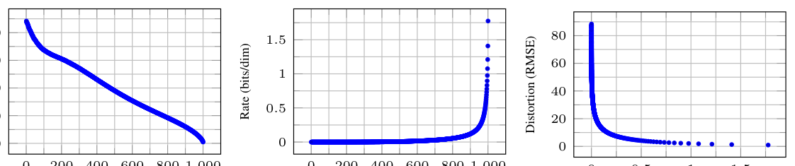

**图 5：** 无条件 CIFAR10 测试集的率失真随时间的变化。失真以 [0, 255] 尺度上的均方根误差度量。细节见表 4。
*图中文字：* 三幅子图的横轴分别为“反向过程步数（$T-t$）”“反向过程步数（$T-t$）”“率（比特/维）”，纵轴分别为“失真（RMSE）”“率（比特/维）”“失真（RMSE）”。

**渐进式生成。** 我们还运行了一个由随机比特渐进解压所给出的渐进式无条件生成过程。
换句话说，我们在用算法 2 从反向过程采样的同时，预测反向过程的结果 $\hat{\mathbf{x}}_0$。
图 6 与图 10 给出了在反向过程进行过程中 $\hat{\mathbf{x}}_0$ 的样本质量。
大尺度的图像特征最先出现，细节最后出现。

> **阅读注释：** 高层结构在强噪声下仍较容易判断，纹理和像素级细节需要在后面的低噪声阶段才恢复。因此反向扩散具有从粗到细的生成过程。

图 7 展示了在把 $\mathbf{x}_t$ 固定于不同 $t$ 时，$p_\theta(\mathbf{x}_0|\mathbf{x}_t)$ 的随机预测 $\mathbf{x}_0 \sim p_\theta(\mathbf{x}_0|\mathbf{x}_t)$。
当 $t$ 很小时，除精细细节之外的一切都被保留下来；当 $t$ 很大时，只有大尺度特征被保留。
这些或许正是概念压缩[18]的迹象。

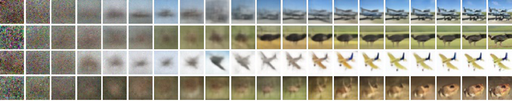

**图 6：** 无条件 CIFAR10 的渐进式生成（$\hat{\mathbf{x}}_0$ 随时间变化，从左到右）。更多样本与样本质量指标随时间的变化见附录（图 14 与图 10）。

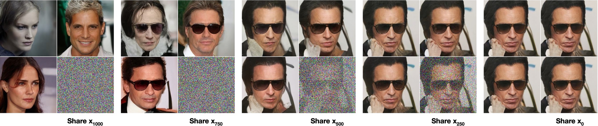

**图 7：** 当条件化在同一个潜变量上时，CelebA-HQ $256 \times 256$ 的样本共享高层属性。右下角象限是 $\mathbf{x}_t$，其他象限是来自 $p_\theta(\mathbf{x}_0 | \mathbf{x}_t)$ 的样本。

**与自回归解码的联系。** 注意，变分界（式 5）可以改写为：

$$
L = D_{\mathrm{KL}}\!\left(q(\mathbf{x}_T) \,\|\, p(\mathbf{x}_T)\right) + \mathbb{E}_{q}\Bigg[ \sum_{t \geq 1} D_{\mathrm{KL}}\!\left(q(\mathbf{x}_{t-1}|\mathbf{x}_t) \,\|\, p_\theta(\mathbf{x}_{t-1}|\mathbf{x}_t)\right) \Bigg] + H(\mathbf{x}_0)
\tag{16}
$$

（推导见附录 A。）
现在考虑把扩散过程长度 $T$ 设为数据的维度，定义前向过程使 $q(\mathbf{x}_t|\mathbf{x}_0)$ 把全部概率质量放在“前 $t$ 个坐标被掩蔽掉”的 $\mathbf{x}_0$ 上（即 $q(\mathbf{x}_t|\mathbf{x}_{t-1})$ 掩蔽掉第 $t$ 个坐标），令 $p(\mathbf{x}_T)$ 把全部质量放在一张空白图像上，并且为了论证起见，取 $p_\theta(\mathbf{x}_{t-1}|\mathbf{x}_t)$ 为一个表达能力完备的条件分布。
在这些选择下，$D_{\mathrm{KL}}\!\left(q(\mathbf{x}_T) \,\|\, p(\mathbf{x}_T)\right)=0$，而最小化 $D_{\mathrm{KL}}\!\left(q(\mathbf{x}_{t-1}|\mathbf{x}_t) \,\|\, p_\theta(\mathbf{x}_{t-1}|\mathbf{x}_t)\right)$ 会训练 $p_\theta$ 原样复制坐标 $t+1, \dotsc, T$，并在给定 $t+1, \dotsc, T$ 的条件下预测第 $t$ 个坐标。
因此，用这个特定的扩散来训练 $p_\theta$，就是在训练一个自回归模型。

因此我们可以把高斯扩散模型（式 2）解释为一种自回归模型，它具有一种无法通过重排数据坐标来表达的广义比特顺序。

> **阅读注释：** 普通自回归模型按像素或 token 的固定顺序逐个预测；扩散模型每一步同时处理整张图像，但噪声水平决定了信息被揭示的顺序。这里所说的“广义比特顺序”，是按信息粒度逐步恢复，而不是按固定坐标顺序恢复。

以往工作表明，这类重排会引入对样本质量有影响的归纳偏置[38]，所以我们推测高斯扩散起类似的作用，而且效果或许更大，因为与掩蔽噪声相比，向图像中加入高斯噪声可能更自然。
此外，高斯扩散的长度并不局限于等于数据维度；例如我们取 $T=1000$，小于我们实验中 $32 \times 32 \times 3$ 或 $256 \times 256 \times 3$ 图像的维度。
高斯扩散可以为了快速采样而变得更短，也可以为了模型表达能力而变得更长。

### 4.4 插值

我们可以用 $q$ 作为随机编码器，把源图像 $\mathbf{x}_0, \mathbf{x}'_0 \sim q(\mathbf{x}_0)$ 插值到潜空间：$\mathbf{x}_t, \mathbf{x}'_t \sim q(\mathbf{x}_t | \mathbf{x}_0)$，然后用反向过程把线性插值得到的潜变量 $\bar{\mathbf{x}}_t = (1-\lambda) \mathbf{x}_0 + \lambda \mathbf{x}'_0$ 解码回图像空间，$\bar{\mathbf{x}}_0 \sim p(\mathbf{x}_0 | \bar{\mathbf{x}}_t)$。

> **译注：** 原文此处把插值写成 $\bar{\mathbf{x}}_t = (1-\lambda)\mathbf{x}_0 + \lambda\mathbf{x}'_0$，但按上下文，参与插值的应是潜空间中的 $\mathbf{x}_t$ 与 $\mathbf{x}'_t$（即上式刚定义的 $q(\mathbf{x}_t|\mathbf{x}_0)$ 采样结果）；译稿按原文如实保留。
实际上，我们是用反向过程来消除“对源图像的加噪版本做线性插值”所引入的伪影，如图 8（左）所示。

> **阅读注释：** 插值时应先把两张图像加噪到同一个时间步，再在这个潜变量空间中混合，最后反向去噪。$t$ 较小时保留更多原图细节，插值更接近像素空间；$t$ 较大时原图信息被抹去，结果更像在模型分布中重新生成样本。

我们对不同的 $\lambda$ 固定了噪声，使 $\mathbf{x}_t$ 与 $\mathbf{x}'_t$ 保持不变。
图 8（右）展示了原始 CelebA-HQ $256 \times 256$ 图像（$t=500$）的插值与重建。
反向过程给出了高质量的重建，以及合理可信的插值：姿态、肤色、发型、表情与背景等属性平滑变化，但眼镜不会变化。
$t$ 越大，插值越粗糙、变化越多；在 $t=1000$ 时得到的是全新样本（附录图 9）。

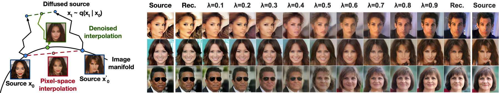

**图 8：** 对 CelebA-HQ 256×256 图像做 500 步扩散的插值。

## 5 相关工作

虽然扩散模型可能与流模型[9, 46, 10, 32, 5, 16, 23]和 VAE[33, 47, 37]相似，但扩散模型被设计成 $q$ 没有参数，并且顶层潜变量 $\mathbf{x}_T$ 与数据 $\mathbf{x}_0$ 的互信息几乎为零。
我们的 $\boldsymbol{\epsilon}$ 预测反向过程参数化，在扩散模型与“多个噪声水平上的去噪得分匹配＋用于采样的退火朗之万动力学”之间建立了联系[55, 56]。
不过，扩散模型允许直接进行对数似然评估，而且其训练过程显式地用变分推断来训练朗之万动力学采样器（细节见附录 C）。
这一联系反过来还意味着：某种加权形式的去噪得分匹配，等同于用变分推断去训练一个类朗之万采样器。
其他学习马尔可夫链转移算子的方法包括注入训练[2]、变分回走[15]、生成随机网络[1]以及其他方法[50, 54, 36, 42, 35, 65]。

由得分匹配与能量建模之间已知的联系，我们的工作可能对近期其他关于能量模型的工作有所启发[67, 68, 69, 12, 70, 13, 11, 41, 17, 8]。
我们的率失真曲线是在一次变分界评估中随时间计算出来的，这与“在一次退火重要性采样运行中按失真惩罚计算率失真曲线”的做法相似[24]。
我们的渐进式解码论点可以在卷积 DRAW 及相关模型中看到[18, 40]，它还可能为自回归模型的子尺度顺序或采样策略带来更一般的设计[38, 64]。

## 6 结论

我们使用扩散模型给出了高质量的图像样本，并发现了扩散模型与以下各项之间的联系：用于训练马尔可夫链的变分推断、去噪得分匹配与退火朗之万动力学（以及由此延伸的能量模型）、自回归模型，以及渐进式有损压缩。
由于扩散模型似乎对图像数据具有出色的归纳偏置，我们期待研究它们在其它数据模态中的用途，以及它们作为其他类型生成模型与机器学习系统组件的价值。

## 更广泛的影响

我们在扩散模型上的工作，与关于其他类型深度生成模型的既有工作范围相似，例如改进 GAN、流模型、自回归模型等样本质量的研究。
本文的贡献在于让扩散模型成为这一类技术中普遍有用的工具，因此它可能放大生成模型对更广大世界已经产生（以及将会产生）的各种影响。

遗憾的是，生成模型有许多众所周知的恶意用途。
样本生成技术可以被用来为政治目的制作知名人物的假图像与假视频。
尽管早在软件工具出现之前人们就已经手工制作假图像，但像我们这样的生成模型让这一过程变得更容易。
幸运的是，CNN 生成的图像目前还具有可供检测的细微瑕疵[62]，但生成模型的改进可能使检测变得更加困难。
生成模型还会反映其训练数据集中的偏见。
由于许多大型数据集是由自动化系统从互联网上收集的，要消除这些偏见可能很困难，尤其是在图像没有标注的情况下。
如果在这些数据集上训练出的生成模型的样本在互联网上大量传播，那么这些偏见只会被进一步强化。

另一方面，扩散模型可能对数据压缩有用；随着数据分辨率提高、全球互联网流量增长，数据压缩对于确保互联网对广大用户的可用性可能是至关重要的。
我们的工作可能有助于在无标注原始数据上为从图像分类到强化学习的大量下游任务做表示学习；扩散模型也可能在艺术、摄影与音乐等创作用途上变得可行。

## 致谢与经费披露

本工作由 ONR PECASE 以及 NSF 研究生研究奖学金（资助编号 DGE-1752814）支持。
Google 的 TensorFlow Research Cloud（TFRC）提供了 Cloud TPU。

## 参考文献

原文参考文献共 72 条，列于原 PDF 第 9–12 页；正文与附录中的引用编号（如 “[53]”“[55, 56]”）均保留原形式，此处不再逐条翻译。涉及的作者姓氏与文献标识与原文一致，便于对照原 PDF 检索。

## 附录：补充信息

**LSUN**

LSUN 数据集的 FID 分数见表 3。
标有 $^*$ 的分数由 StyleGAN2 作为基线报告，其他分数由其各自作者报告。

**表 3：** LSUN $256\times256$ 数据集的 FID 分数。

| 模型 | LSUN Bedroom | LSUN Church | LSUN Cat |
|---|---|---|---|
| ProgressiveGAN [27] | 8.34 | 6.42 | 37.52 |
| StyleGAN [28] | **2.65** | 4.21$^*$ | 8.53$^*$ |
| StyleGAN2 [30] | - | **3.86** | **6.93** |
| 本文（$L_\mathrm{simple}$） | 6.36 | 7.89 | 19.75 |
| 本文（$L_\mathrm{simple}$，大模型） | 4.90 | - | - |

**渐进式压缩**

我们在第 4.3 节中有损压缩的论证只是一个概念验证，因为算法 3 与算法 4 依赖于诸如最小随机编码[20]这样的过程，而它对高维数据是不可解的。
这些算法是对 Sohl-Dickstein 等[53]的变分界（式 5）的一种压缩解释，还称不上一个实用的压缩系统。

**表 4：** 无条件 CIFAR10 测试集的率失真数值（配合图 5）。

| 反向过程时刻（$T-t+1$） | 率（比特/维） | 失真（RMSE，$[0,255]$ 尺度） |
|---|---|---|
| 1000 | 1.77581 | 0.95136 |
| 900 | 0.11994 | 12.02277 |
| 800 | 0.05415 | 18.47482 |
| 700 | 0.02866 | 24.43656 |
| 600 | 0.01507 | 30.80948 |
| 500 | 0.00716 | 38.03236 |
| 400 | 0.00282 | 46.12765 |
| 300 | 0.00081 | 54.18826 |
| 200 | 0.00013 | 60.97170 |
| 100 | 0.00000 | 67.60125 |

## 附录 A 扩展推导

下面是扩散模型降低方差的变分界，即式（5）的推导。
这部分材料来自 Sohl-Dickstein 等[53]；我们收录于此仅为完整起见。

$$
L = \mathbb{E}_{q}\left[ - \log \frac{p_\theta(\mathbf{x}_{0:T})}{q(\mathbf{x}_{1:T} \mid \mathbf{x}_0)} \right]
\tag{17}
$$

$$
L = \mathbb{E}_{q}\left[ -\log p(\mathbf{x}_T) - \sum_{t \geq 1} \log \frac{p_\theta(\mathbf{x}_{t-1} \mid \mathbf{x}_t)}{q(\mathbf{x}_t|\mathbf{x}_{t-1})} \right]
\tag{18}
$$

$$
L = \mathbb{E}_{q}\left[ -\log p(\mathbf{x}_T) - \sum_{t > 1} \log \frac{p_\theta(\mathbf{x}_{t-1} \mid \mathbf{x}_t)}{q(\mathbf{x}_t|\mathbf{x}_{t-1})} - \log\frac{p_\theta(\mathbf{x}_0|\mathbf{x}_1)}{q(\mathbf{x}_1|\mathbf{x}_0)} \right]
\tag{19}
$$

$$
L = \mathbb{E}_{q}\left[ -\log p(\mathbf{x}_T) - \sum_{t > 1} \log \frac{p_\theta(\mathbf{x}_{t-1} \mid \mathbf{x}_t)}{q(\mathbf{x}_{t-1}|\mathbf{x}_t,\mathbf{x}_0)}\cdot\frac{q(\mathbf{x}_{t-1}|\mathbf{x}_0)}{q(\mathbf{x}_t|\mathbf{x}_0)} - \log\frac{p_\theta(\mathbf{x}_0|\mathbf{x}_1)}{q(\mathbf{x}_1|\mathbf{x}_0)} \right]
\tag{20}
$$

$$
L = \mathbb{E}_{q}\left[ -\log \frac{p(\mathbf{x}_T)}{q(\mathbf{x}_T|\mathbf{x}_0)} - \sum_{t > 1} \log \frac{p_\theta(\mathbf{x}_{t-1} \mid \mathbf{x}_t)}{q(\mathbf{x}_{t-1}|\mathbf{x}_t,\mathbf{x}_0)} - \log p_\theta(\mathbf{x}_0|\mathbf{x}_1) \right]
\tag{21}
$$

$$
L = \mathbb{E}_{q}\left[ D_{\mathrm{KL}}\!\left(q(\mathbf{x}_T|\mathbf{x}_0) \,\|\, p(\mathbf{x}_T)\right) + \sum_{t > 1} D_{\mathrm{KL}}\!\left(q(\mathbf{x}_{t-1}|\mathbf{x}_t,\mathbf{x}_0) \,\|\, p_\theta(\mathbf{x}_{t-1} | \mathbf{x}_t)\right) - \log p_\theta(\mathbf{x}_0|\mathbf{x}_1) \right]
\tag{22}
$$

> **译注：** 上面式（17）至式（22）在原排版中是同一个 `align` 环境里逐行编号的六行，某一行并非独立等式，而是承接上一行的连等式；译稿拆成六个公式块以保留原编号。

下面是 $L$ 的另一个版本。
它难以估计，但对我们第 4.3 节的讨论有用。

$$
L = \mathbb{E}_{q}\left[ -\log p(\mathbf{x}_T) - \sum_{t \geq 1} \log \frac{p_\theta(\mathbf{x}_{t-1} \mid \mathbf{x}_t)}{q(\mathbf{x}_t|\mathbf{x}_{t-1})} \right]
\tag{23}
$$

$$
L = \mathbb{E}_{q}\left[ -\log p(\mathbf{x}_T) - \sum_{t \geq 1} \log \frac{p_\theta(\mathbf{x}_{t-1} \mid \mathbf{x}_t)}{q(\mathbf{x}_{t-1}|\mathbf{x}_t)} \cdot \frac{q(\mathbf{x}_{t-1})}{q(\mathbf{x}_t)} \right]
\tag{24}
$$

$$
L = \mathbb{E}_{q}\left[ -\log \frac{p(\mathbf{x}_T)}{q(\mathbf{x}_T)} - \sum_{t \geq 1} \log \frac{p_\theta(\mathbf{x}_{t-1} \mid \mathbf{x}_t)}{q(\mathbf{x}_{t-1}|\mathbf{x}_t)} -\log q(\mathbf{x}_0) \right]
\tag{25}
$$

$$
L = D_{\mathrm{KL}}\!\left(q(\mathbf{x}_T) \,\|\, p(\mathbf{x}_T)\right) + \mathbb{E}_{q}\left[ \sum_{t \geq 1} D_{\mathrm{KL}}\!\left(q(\mathbf{x}_{t-1}|\mathbf{x}_t) \,\|\, p_\theta(\mathbf{x}_{t-1}|\mathbf{x}_t)\right) \right] + H(\mathbf{x}_0)
\tag{26}
$$

> **译注：** 上面式（23）至式（26）同样是原排版中同一 `align` 环境里的四行连等式，译稿拆成四个公式块以保留原编号。

## 附录 B 实验细节

我们的神经网络架构沿用 PixelCNN++[52] 的主干，后者是一个基于 Wide ResNet[72] 的 U-Net[48]。
为简化实现，我们用群归一化[66]替换了权重归一化[49]。
我们的 $32 \times 32$ 模型使用四个特征图分辨率（$32 \times 32$ 到 $4 \times 4$），$256 \times 256$ 模型使用六个。
所有模型在每个分辨率层级都有两个卷积残差块，并在 $16 \times 16$ 分辨率上、卷积块之间设置了自注意力块[6]。
扩散时间 $t$ 通过把 Transformer 正弦位置嵌入[60]加入每个残差块来指定。
我们的 CIFAR10 模型有 3570 万参数，LSUN 与 CelebA-HQ 模型有 1.14 亿参数。
我们还通过增加滤波器数量，训练了 LSUN Bedroom 模型的一个更大变体，参数量约为 2.56 亿。

所有实验都使用 TPU v3-8（大致相当于 8 块 V100 GPU）。
我们的 CIFAR 模型在批大小 128 下每秒训练 21 步（训练到 80 万步完成需要 10.6 小时），采样一批 256 张图像需要 17 秒。
我们的 CelebA-HQ/LSUN（$256^2$）模型在批大小 64 下每秒训练 2.2 步，采样一批 128 张图像需要 300 秒。
我们在 CelebA-HQ 上训练了 50 万步，LSUN Bedroom 240 万步，LSUN Cat 180 万步，LSUN Church 120 万步。
更大的 LSUN Bedroom 模型训练了 115 万步。

除了早期为了让网络规模适配内存限制而做的一次初始超参数选择之外，我们大部分的超参数搜索都是为了优化 CIFAR10 的样本质量，然后把得到的设置迁移到其他数据集：

- 我们从常数、线性与二次三类调度中选择 $\beta_t$ 调度，它们都被约束为满足 $L_T \approx 0$。我们未经扫描就取 $T=1000$，并选择从 $\beta_1=10^{-4}$ 到 $\beta_T=0.02$ 的线性调度。
- 我们在 $\{0.1, 0.2, 0.3, 0.4\}$ 上扫描，把 CIFAR10 的 dropout 率设为 $0.1$。在 CIFAR10 上不加 dropout 时，我们得到的样本较差，类似于未正则化的 PixelCNN++[52] 中的过拟合伪影。其他数据集的 dropout 率未经扫描直接设为零。
- 训练 CIFAR10 时我们使用了随机水平翻转；我们尝试了加翻转与不加翻转两种训练，发现翻转能略微改善样本质量。除 LSUN Bedroom 之外，我们对所有其他数据集也使用了随机水平翻转。
- 在实验过程的早期我们尝试了 Adam[31] 与 RMSProp，并选择了前者。我们把超参数保持为标准取值。我们未经任何扫描就把学习率设为 $2 \times 10^{-4}$；对于 $256\times256$ 图像我们把它降到 $2 \times 10^{-5}$，因为用较大的学习率训练似乎不稳定。
- 我们把 CIFAR10 的批大小设为 128，较大图像设为 64。我们没有对这些取值做扫描。
- 我们对模型参数使用衰减因子为 $0.9999$ 的 EMA。我们没有对该取值做扫描。

最终实验只训练一次，并在整个训练过程中评估样本质量。
样本质量分数与对数似然报告的是训练过程中 FID 最小的那个取值。
在 CIFAR10 上，我们分别在 50000 个样本上用 OpenAI[51] 与 TTUR[21] 仓库的原始代码计算了 Inception 与 FID 分数。
在 LSUN 上，我们用 StyleGAN2[30] 仓库的代码在 50000 个样本上计算了 FID 分数。
CIFAR10 与 CelebA-HQ 按 TensorFlow Datasets（<https://www.tensorflow.org/datasets>）提供的方式加载，LSUN 则用 StyleGAN 的代码准备。
数据集的划分（或不作划分）沿用那些首次在生成建模语境中使用它们的论文的标准做法。
所有细节都可以在发布的源代码中找到。

## 附录 C 相关工作的讨论

我们的模型架构、前向过程定义与先验，都在一些细微但重要的方面与 NCSN[55, 56] 不同，正是这些差异改善了样本质量；尤其值得注意的是，我们直接把采样器作为潜变量模型来训练，而不是在训练之后事后附加一个采样器。
更详细地说：

1. 我们使用带自注意力的 U-Net；NCSN 使用带空洞卷积的 RefineNet。我们通过加入 Transformer 正弦位置嵌入，让所有层都以 $t$ 为条件，而不是只在归一化层（NCSNv1）或只在输出处（v2）加入。
2. 扩散模型在每一步前向过程中把数据缩小（乘以 $\sqrt{1-\beta_t}$ 因子），使加入噪声时方差不增长，从而为神经网络反向过程提供尺度一致的输入。NCSN 省略了这个缩放因子。
3. 与 NCSN 不同，我们的前向过程会破坏信号（$D_{\mathrm{KL}}\!\left(q(\mathbf{x}_T|\mathbf{x}_0) \,\|\, \mathcal{N}(\mathbf{0},\mathbf{I})\right) \approx 0$），从而确保 $\mathbf{x}_T$ 的先验与其聚合后验紧密吻合。同样与 NCSN 不同，我们的 $\beta_t$ 非常小，这确保前向过程可以被一条带条件高斯分布的马尔可夫链逆转。这两个因素都能防止采样时的分布偏移。
4. 我们的类朗之万采样器的系数（学习率、噪声尺度等）都是严格地由前向过程中的 $\beta_t$ 推导出来的。因此，我们的训练过程直接训练采样器，使其在 $T$ 步之后匹配数据分布：它用变分推断把采样器作为潜变量模型来训练。相比之下，NCSN 的采样器系数是事后手工设定的，其训练过程并不保证直接优化采样器的某个质量指标。

## 附录 D 样本

**额外样本**
图 11、图 13、图 16、图 17、图 18 与图 19 展示了在 CelebA-HQ、CIFAR10 与 LSUN 数据集上训练的扩散模型的未经筛选样本。

**潜在结构与反向过程的随机性**
在采样过程中，先验 $\mathbf{x}_T \sim \mathcal{N}(\mathbf{0}, \mathbf{I})$ 与朗之万动力学都是随机的。
为了理解第二个噪声来源的重要性，我们针对 CelebA $256 \times 256$ 数据集，在同一个中间潜变量的条件下采样了多张图像。
图 7 展示了多组来自反向过程 $p_\theta(\mathbf{x}_0 | \mathbf{x}_t)$ 的采样，它们共享同一个潜变量 $\mathbf{x}_t$，其中 $t \in \{1000, 750, 500, 250\}$。
为此，我们从先验的一次初始采样出发运行单条反向链。
在中间时间步，把这条链分叉以采样多张图像。
当这条链在 $\mathbf{x}_{T=1000}$ 处的先验采样之后立即分叉时，样本之间差异显著。
然而，当链在更多步之后才分叉时，样本会共享性别、发色、眼镜、饱和度、姿态与面部表情等高层属性。
这表明像 $\mathbf{x}_{750}$ 这样的中间潜变量编码了这些属性，尽管它们无法被察觉。

**从粗到细的插值**
图 9 展示了当我们改变“潜空间插值之前所走的扩散步数”时，一对 CelebA $256\times256$ 源图像之间的插值。
增加扩散步数会破坏源图像中更多的结构，而模型会在反向过程中把这些结构补全。
这使我们既能做细粒度的插值，也能做粗粒度的插值。
在 0 步扩散的极限情形下，插值是在像素空间中对源图像做混合。
另一方面，在 1000 步扩散之后，源信息已经丢失，插值结果是全新的样本。

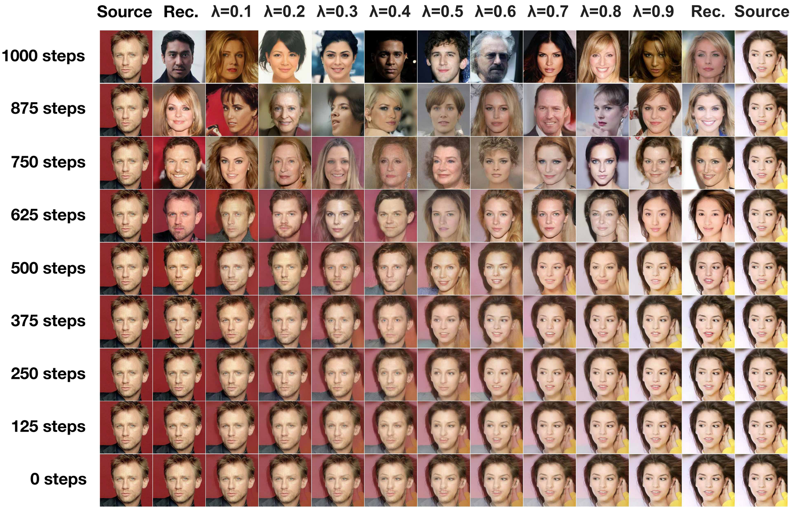

**图 9：** 改变潜空间混合之前扩散步数的从粗到细插值。

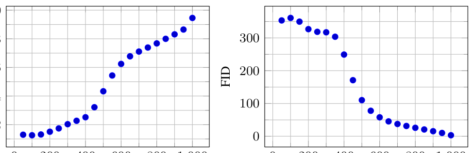

**图 10：** 无条件 CIFAR10 的渐进式采样质量随时间的变化。
*图中文字：* 横轴为反向过程步数（$T-t$），两幅子图的纵轴分别为 Inception 分数与 FID。

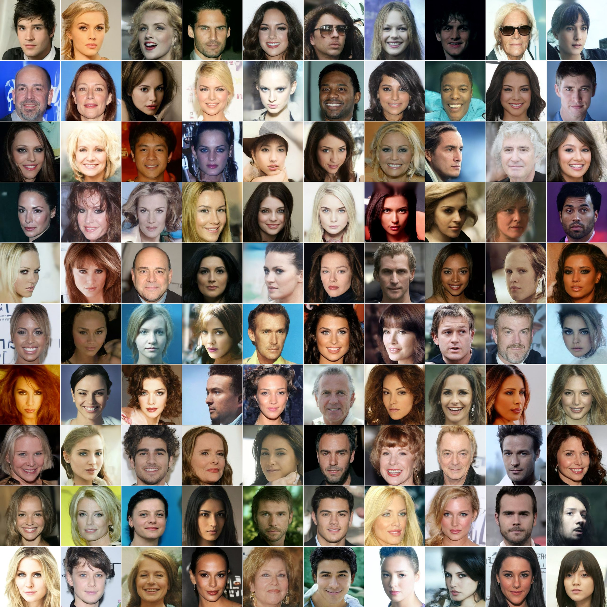

**图 11：** CelebA-HQ $256 \times 256$ 生成样本。

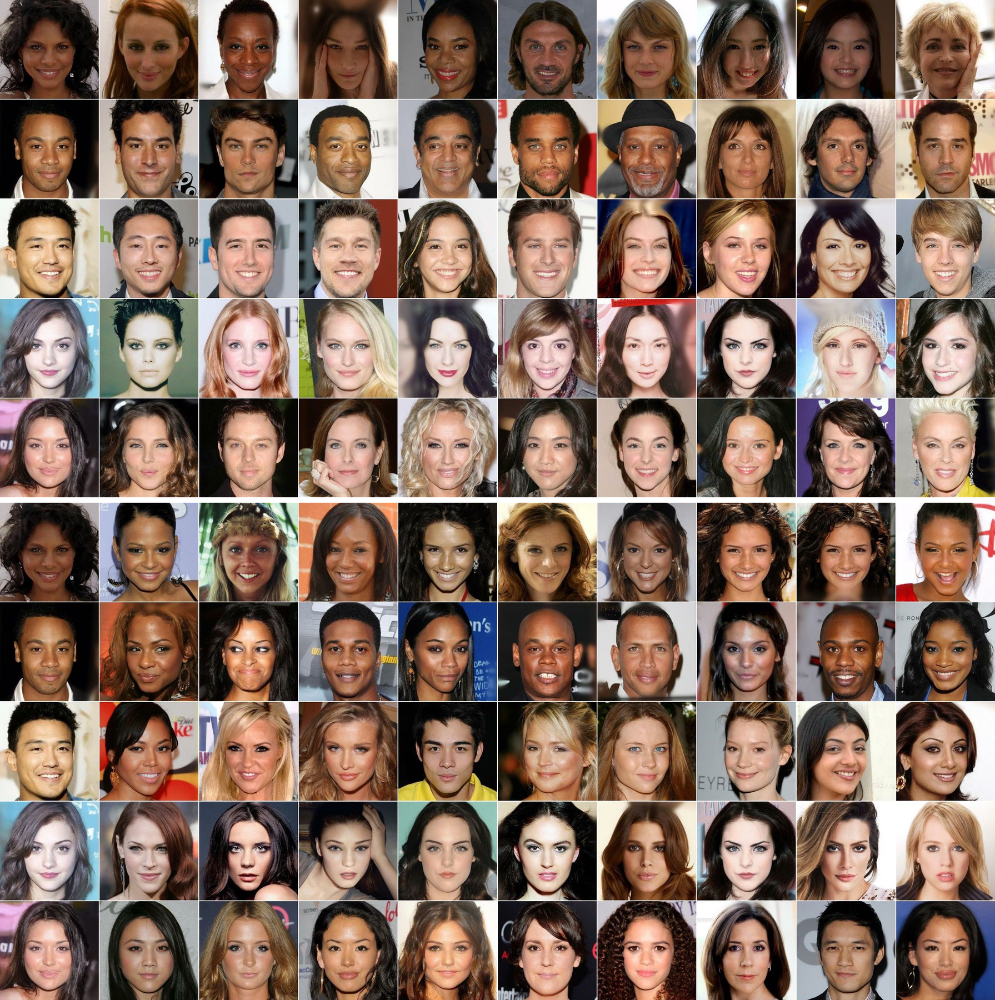

**图 12：** CelebA-HQ $256 \times 256$ 的最近邻，在环绕人脸的 $100\times100$ 裁剪区域上计算。生成样本位于最左列，训练集最近邻位于其余各列。
*图中文字：* 上图为像素空间最近邻，下图为 Inception 特征空间最近邻。

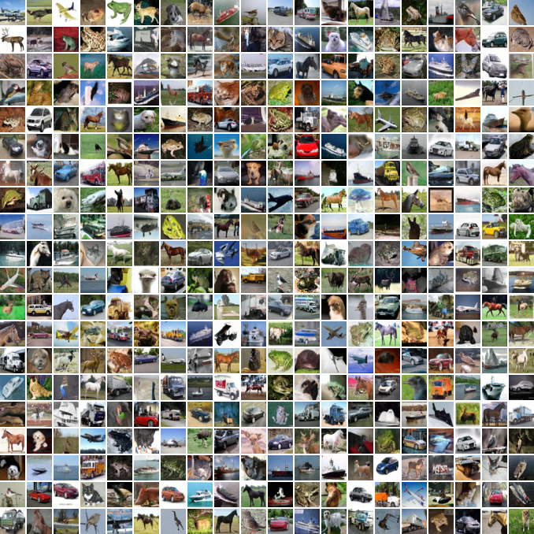

**图 13：** 无条件 CIFAR10 生成样本。

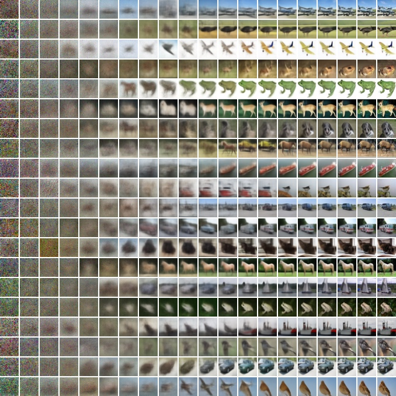

**图 14：** 无条件 CIFAR10 渐进式生成。

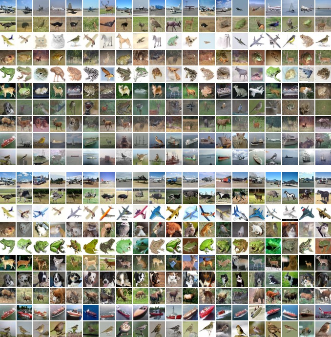

**图 15：** 无条件 CIFAR10 的最近邻。生成样本位于最左列，训练集最近邻位于其余各列。
*图中文字：* 上图为像素空间最近邻，下图为 Inception 特征空间最近邻。

**图 16：** LSUN Church 生成样本。FID=$7.89$。

**图 17：** LSUN Bedroom 生成样本，大模型。FID=$4.90$。

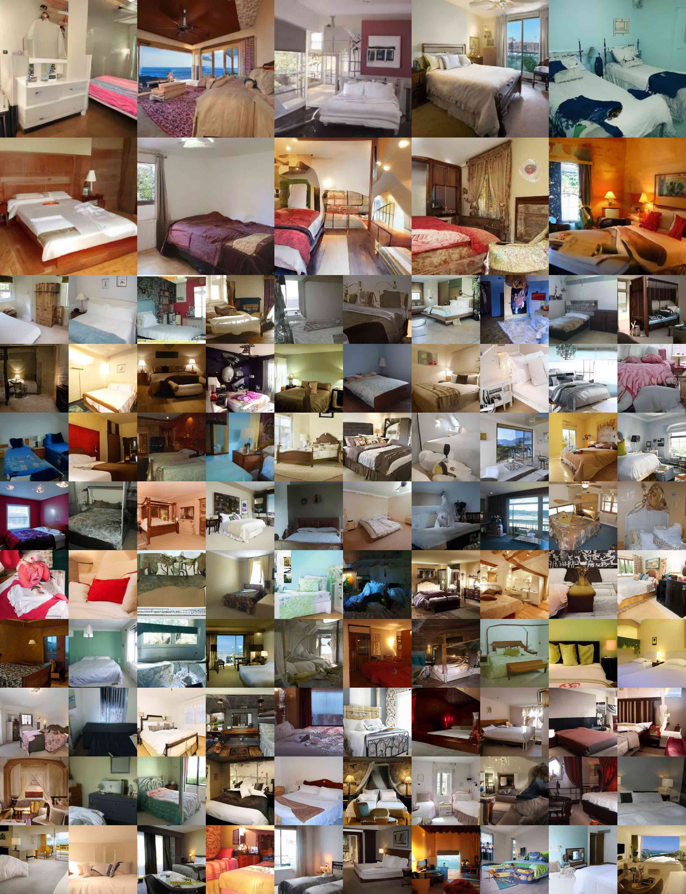

**图 18：** LSUN Bedroom 生成样本，小模型。FID=$6.36$。

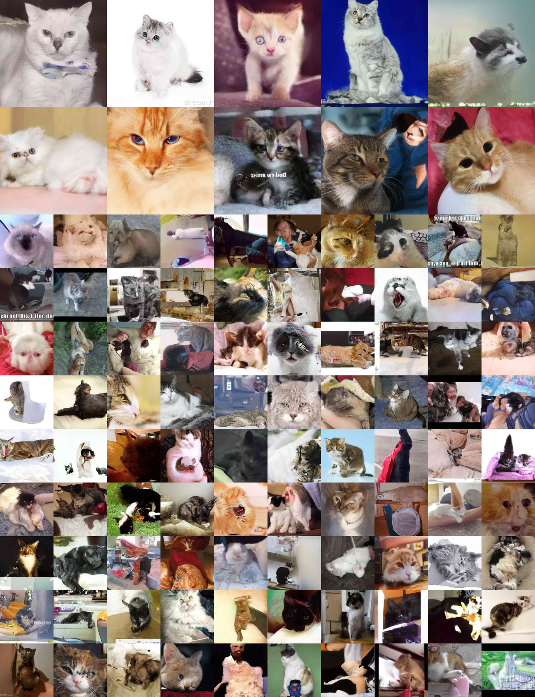

**图 19：** LSUN Cat 生成样本。FID=$19.75$。
