# 使用 Transformer 构建可扩展的扩散模型

**英文标题：** Scalable Diffusion Models with Transformers  
**作者：** William Peebles、Saining Xie（谢赛宁）  
**机构：** 加州大学伯克利分校、纽约大学  
**原文件：** [DiT.pdf](DiT.pdf)，共 25 页；正文第 1–9 页，参考文献第 10–11 页，附录第 12–25 页。  
**项目与代码页面：** <https://www.wpeebles.com/DiT.html>

> 本译稿包含正文、参考文献与附录，保留原文的章节、文献引用、图 1–33 和表 1–6 的编号。插图直接从原 PDF 裁切，图中的英文标签保留；图注译为中文，表格重新排为 Markdown，公式使用 LaTeX。原文中的“最先进”“此前所有工作”等表述均指论文发表时的比较结果。
>
> 术语约定：Diffusion Transformer 译为“扩散 Transformer”（DiT）；patch 译为“图块”；token 译为“词元”；backbone 译为“骨干网络”；latent diffusion model 译为“潜空间扩散模型”（LDM）；adaptive layer norm 译为“自适应层归一化”（adaLN）；classifier-free guidance 译为“无分类器引导”。Gflops 表示十亿次浮点运算，Tflops 表示万亿次浮点运算；文中这些量度用于描述运算量。作者姓名、模型名、代码标识和数据集名称保留原文。

*作者注：William Peebles 的相关工作在 Meta AI 的 FAIR 团队实习期间完成。*

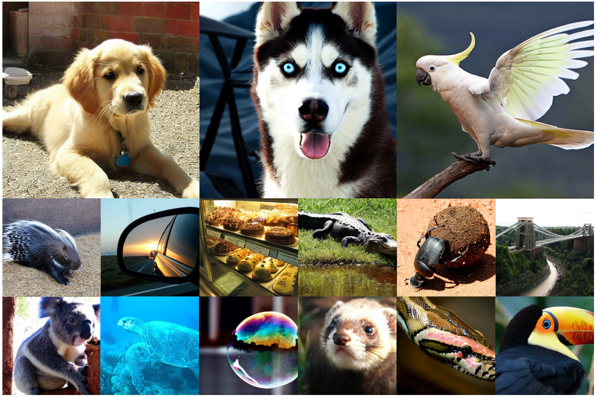

**图 1：以 Transformer 为骨干网络的扩散模型达到了最先进的图像质量。** 这里展示了两个类别条件 DiT-XL/2 模型的部分精选样例；这两个模型分别在 512×512 和 256×256 分辨率的 ImageNet 上训练。

## 摘要

我们探索了一类基于 Transformer 架构的新型扩散模型。
我们训练图像的潜空间扩散模型，用一个在潜表示图块上运行的 Transformer，替换通常采用的 U-Net 骨干网络。
我们以前向传播的复杂度为切入点，使用 Gflops 衡量复杂度，分析扩散 Transformer（DiT）的可扩展性。
我们发现，具有更高 Gflops 的 DiT，无论其计算量增加来自 Transformer 深度／宽度的增大，还是输入词元数量的增多，都能持续取得更低的 FID。
除了具备良好的可扩展性，我们最大的 DiT-XL/2 模型还在类别条件 ImageNet 512×512 和 256×256 基准上优于此前所有扩散模型，并在后者上取得了当时最先进的 2.27 FID。

## 1 引言

机器学习正经历一场由 Transformer 推动的复兴。
过去五年里，自然语言处理[8,42]、视觉[10]以及其他若干领域的神经网络架构，大体上都被 Transformer 所统一[60]。
不过，许多图像级生成模型仍未跟上这一趋势：尽管 Transformer 已广泛应用于自回归模型[3,6,43,47]，但在其他生成建模框架中的采用程度仍然较低。
例如，扩散模型一直处于图像级生成模型近期进展的前沿[9,46]，但它们都将卷积 U-Net 架构作为事实上的骨干网络选择。

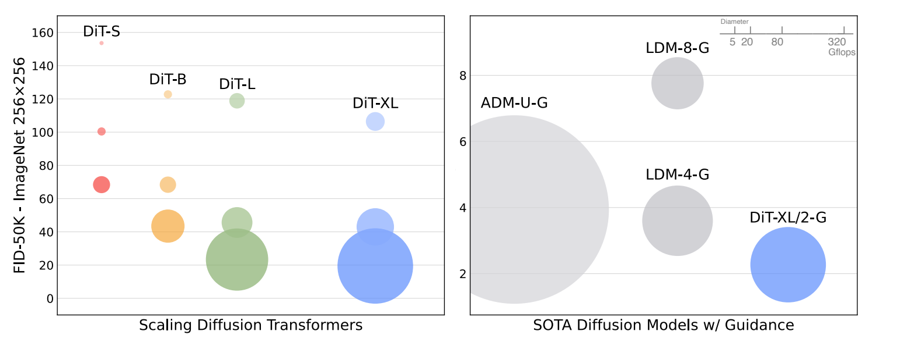

**图 2：使用扩散 Transformer（DiT）进行 ImageNet 生成。** 气泡面积表示扩散模型的浮点运算量。**左：** DiT 模型训练 40 万次迭代后的 FID-50K，数值越低越好。随着模型运算量增加，FID 持续改善。**右：** 我们的最佳模型 DiT-XL/2 具有较高的计算效率，并优于此前所有基于 U-Net 的扩散模型，包括 ADM 和 LDM。

Ho 等人的开创性工作[19]首次将 U-Net 骨干网络引入扩散模型。
U-Net 最初在像素级自回归模型和条件 GAN[23]中取得成功，随后经过少量修改，从 PixelCNN++[52,58]沿用到了扩散模型中。
这一模型是卷积网络，主要由 ResNet[15]模块构成。
与标准 U-Net[49]不同，它在较低分辨率处穿插了额外的空间自注意力模块，而自注意力也是 Transformer 的核心组成部分。
Dhariwal 和 Nichol[9]对 U-Net 的若干架构选择进行了消融研究，例如使用自适应归一化层[40]注入条件信息，以及卷积层的通道数。
但 Ho 等人所用 U-Net 的高层设计总体上保持不变。

在这项工作中，我们希望厘清架构选择对扩散模型的意义，并为今后的生成建模研究提供实证基线。
我们证明，U-Net 的归纳偏置并非扩散模型取得良好性能的关键；使用 Transformer 等标准设计，就可以直接替换它。
因此，扩散模型能够充分受益于近期架构统一的趋势，例如继承其他领域的最佳实践和训练方案，同时保留可扩展性、鲁棒性和效率等优良性质。
统一的架构还将为跨领域研究打开新的可能性。

本文关注一类基于 Transformer 的新型扩散模型。
我们将其称为 Diffusion Transformers，简称 DiT。
DiT 遵循视觉 Transformer（ViT）[10]的最佳实践；已有研究表明，在视觉识别任务中，ViT 比传统卷积网络（例如 ResNet[15]）具有更好的规模扩展能力。

更具体地说，我们研究 Transformer 的网络复杂度与样本质量之间的规模扩展关系。
我们在潜空间扩散模型（LDM）[48]框架下构建 DiT 的设计空间并进行基准评估；在该框架中，扩散模型在 VAE 的潜空间内训练。
我们由此表明，可以成功地用 Transformer 替换 U-Net 骨干网络。
我们进一步证明，DiT 是一种适合扩散模型进行规模扩展的架构：网络复杂度（以 Gflops 衡量）与样本质量（以 FID 衡量）存在很强的相关性。
只需扩大 DiT 的规模，并使用高容量骨干网络（118.6 Gflops）训练 LDM，我们就能在类别条件 256×256 ImageNet 生成基准上取得当时最先进的 2.27 FID。

## 2 相关工作

**Transformer。** Transformer[60]已经在语言、视觉[10]、强化学习[5,25]和元学习[39]等领域，替换了各领域专用的架构。
在语言领域[26]、通用自回归建模[17]以及 ViT[63]中，随着模型规模、训练计算量和数据量增加，Transformer 均表现出出色的规模扩展性质。
在语言之外，Transformer 也被用于训练像素的自回归预测模型[6,7,38]。
研究者还在离散码本[59]上训练了自回归模型[11,47]和掩码生成模型[4,14]；其中，自回归模型在扩展到 200 亿参数时依然表现出优异的规模扩展行为[62]。
此外，Transformer 已被用于 DDPM，以合成非空间数据，例如在 DALL·E 2 中生成 CLIP 图像嵌入[41,46]。
本文研究的是：将 Transformer 作为图像扩散模型的骨干网络时，它具有怎样的规模扩展性质。

**去噪扩散概率模型（DDPM）。** 扩散模型[19,54]和基于得分的生成模型[22,56]在图像生成中取得了显著成功[35,46,48,50]，在许多情况下超越了此前最先进的生成对抗网络（GAN）[12]。
过去两年中，DDPM 的改进主要来自更好的采样技术[19,27,55]，其中最突出的是无分类器引导[21]；还包括将扩散模型重新表述为预测噪声而非像素[19]，以及采用级联 DDPM 流水线，使低分辨率基础扩散模型与上采样器并行训练[9,20]。
对于上述所有扩散模型，卷积 U-Net[49]都是事实上的骨干架构选择。
同期工作[24]为 DDPM 提出了一种基于注意力的新型高效架构；我们探索的则是纯 Transformer。

**架构复杂度。** 在图像生成文献中，使用参数量评估架构复杂度相当常见。
一般而言，参数量可能无法很好地代表图像模型的复杂度，因为它没有考虑图像分辨率等因素，而这些因素会显著影响性能[44,45]。
因此，本文对模型复杂度的分析主要基于理论 Gflops。
这与架构设计领域的做法一致，该领域广泛使用 Gflops 衡量复杂度。
在实践中，究竟哪种复杂度指标最合适仍有争议，因为答案往往取决于具体应用场景。
Nichol 和 Dhariwal 关于改进扩散模型的开创性工作[9,36]与本文最为相关：他们分析了 U-Net 架构族的可扩展性和 Gflops 性质。
本文则聚焦于 Transformer 架构族。

## 3 扩散 Transformer

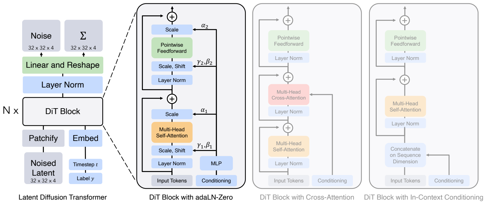

**图 3：扩散 Transformer（DiT）架构。** **左：** 我们训练带条件的潜空间 DiT 模型。输入潜表示先被划分为图块，再经过多个 DiT 模块处理。**右：** DiT 模块的细节。我们试验了标准 Transformer 模块的不同变体，分别通过自适应层归一化、交叉注意力和额外输入词元融入条件信息。自适应层归一化的效果最好。

### 3.1 预备知识

**扩散的形式化描述。** 在介绍架构之前，我们先简要回顾理解扩散模型（DDPM）[19,54]所需的一些基本概念。
高斯扩散模型假定一个逐步向真实数据 $x_0$ 添加噪声的前向过程：

$$
q(x_t\mid x_0)=\mathcal N\!\left(x_t;\sqrt{\bar\alpha_t}x_0,(1-\bar\alpha_t)I\right),
$$

其中，常数 $\bar\alpha_t$ 是超参数。
运用重参数化技巧，可以通过下式采样：

$$
x_t=\sqrt{\bar\alpha_t}x_0+\sqrt{1-\bar\alpha_t}\,\epsilon_t,
\qquad \epsilon_t\sim\mathcal N(0,I).
$$

扩散模型通过训练学习一个反向过程，以逆转前向过程对数据的破坏：

$$
p_\theta(x_{t-1}\mid x_t)
=\mathcal N\!\left(\mu_\theta(x_t),\Sigma_\theta(x_t)\right),
$$

其中，用神经网络预测 $p_\theta$ 的统计量。
反向过程模型通过 $x_0$ 对数似然的变分下界[30]进行训练。
去掉一个与训练无关的附加项后，原文将目标写为：

$$
\mathcal L(\theta)
=-p(x_0\mid x_1)
+\sum_t D_{\mathrm{KL}}\!\left(
q^*(x_{t-1}\mid x_t,x_0)\,\|\,p_\theta(x_{t-1}\mid x_t)
\right).
$$

> **译注：** 上式按原 PDF 保留。第一项在原文中写作 $-p(x_0\mid x_1)$；按 DDPM 的标准负变分下界目标，这里应为负对数似然 $-\log p_\theta(x_0\mid x_1)$。因此，式中 $\mathcal L$ 应理解为需要最小化的负变分下界目标。

由于 $q^*$ 与 $p_\theta$ 都是高斯分布，可以利用两个分布的均值与协方差计算 $D_{\mathrm{KL}}$。
将 $\mu_\theta$ 重参数化为噪声预测网络 $\epsilon_\theta$ 后，可以使用预测噪声 $\epsilon_\theta(x_t)$ 与实际采样的高斯噪声 $\epsilon_t$ 之间的简单均方误差来训练模型：

$$
\mathcal L_{\mathrm{simple}}(\theta)
=\left\|\epsilon_\theta(x_t)-\epsilon_t\right\|_2^2.
$$

但是，如果要让扩散模型学习反向过程的协方差 $\Sigma_\theta$，就需要优化完整的 $D_{\mathrm{KL}}$ 项。
我们遵循 Nichol 和 Dhariwal 的方法[36]：使用 $\mathcal L_{\mathrm{simple}}$ 训练 $\epsilon_\theta$，并使用完整的 $\mathcal L$ 训练 $\Sigma_\theta$。
训练好 $p_\theta$ 后，先初始化 $x_{t_{\max}}\sim\mathcal N(0,I)$，再利用重参数化技巧从 $x_{t-1}\sim p_\theta(x_{t-1}\mid x_t)$ 逐步采样，就可以生成新图像。

**无分类器引导。** 条件扩散模型会将额外信息作为输入，例如类别标签 $c$。
此时，反向过程变为 $p_\theta(x_{t-1}\mid x_t,c)$，其中 $\epsilon_\theta$ 和 $\Sigma_\theta$ 都以 $c$ 为条件。
在这种设定下，可以使用无分类器引导，促使采样过程找到使 $\log p(c\mid x)$ 较大的 $x$[21]。
根据贝叶斯法则，原文写道：

$$
\log p(c\mid x)\propto\log p(x\mid c)-\log p(x),
$$

因此：

$$
\nabla_x\log p(c\mid x)
\propto\nabla_x\log p(x\mid c)-\nabla_x\log p(x).
$$

将扩散模型的输出解释为得分函数，可以通过以下方式引导 DDPM 采样过程，使其采样得到具有较高 $p(x\mid c)$ 的 $x$。原文给出的写法为：

$$
\begin{aligned}
\hat\epsilon_\theta(x_t,c)
&=\epsilon_\theta(x_t,\varnothing)+s\cdot\nabla_x\log p(c\mid x)\\
&\propto\epsilon_\theta(x_t,\varnothing)
+s\cdot\bigl(\epsilon_\theta(x_t,c)-\epsilon_\theta(x_t,\varnothing)\bigr).
\end{aligned}
$$

这里，$s>1$ 表示引导强度；注意，$s=1$ 时恢复为标准采样。
要在 $c=\varnothing$ 的情况下评估扩散模型，需要在训练中随机丢弃 $c$，并用一个学习得到的“空”嵌入 $\varnothing$ 替代它。
众所周知，与一般采样技术相比，无分类器引导能够显著提升样本质量[21,35,46]，而这一趋势在 DiT 模型中同样成立。

> **译注：** 上述推导保留了原文的 $\propto$ 和得分／噪声混合写法。严格地说，贝叶斯关系中的对数等式相差一个与 $x$ 无关的常数，求梯度后为等式；得分函数与噪声预测之间还包含与时间有关的负比例因子。实际使用的噪声预测引导公式是 $\hat\epsilon_\theta(x_t,c)=\epsilon_\theta(x_t,\varnothing)+s\bigl(\epsilon_\theta(x_t,c)-\epsilon_\theta(x_t,\varnothing)\bigr)$。

**潜空间扩散模型。** 直接在高分辨率像素空间训练扩散模型，计算开销可能高到难以承受。
潜空间扩散模型（LDM）[48]通过两阶段方法解决这一问题：（1）学习一个自编码器，利用学习得到的编码器 $\mathcal E$，将图像压缩成空间尺寸更小的表示；（2）冻结 $\mathcal E$，训练表示 $z=\mathcal E(x)$ 的扩散模型，而不是直接训练图像 $x$ 的扩散模型。
随后，可以先从扩散模型采样表示 $z$，再使用学习得到的解码器将其解码为图像 $x=\mathcal D(z)$，从而生成新图像。

如图 2 所示，LDM 只需要 ADM 等像素空间扩散模型的一小部分 Gflops，就能取得良好性能。
由于我们关注计算效率，这使 LDM 成为探索架构的理想起点。
本文将 DiT 应用于潜空间，不过也可以不作修改，直接将其用于像素空间。
这使我们的图像生成流水线成为一种混合方法：使用现成的卷积 VAE，以及基于 Transformer 的 DDPM。

### 3.2 扩散 Transformer 的设计空间

我们提出扩散 Transformer（DiT），一种用于扩散模型的新架构。
我们希望尽可能忠实于标准 Transformer 架构，以保留其规模扩展性质。
由于我们关注图像 DDPM 的训练，更准确地说是图像空间表示的 DDPM，DiT 以处理图块序列的视觉 Transformer（ViT）架构[10]为基础。
DiT 保留了 ViT 的许多最佳实践。
图 3 给出了完整 DiT 架构的概览。
本节介绍 DiT 的前向传播，以及 DiT 架构族设计空间中的各个组成部分。

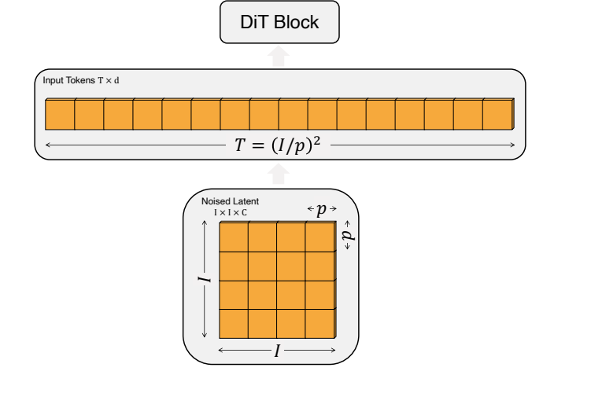

**图 4：DiT 的输入规格。** 给定图块尺寸 $p\times p$，形状为 $I\times I\times C$ 的空间表示，即来自 VAE 的带噪潜表示，被划分为长度 $T=(I/p)^2$、隐藏维度为 $d$ 的序列。较小的图块尺寸 $p$ 会产生更长的序列，因此需要更多 Gflops。

**图块化（Patchify）。** DiT 的输入是一个空间表示 $z$；对于 $256\times256\times3$ 的图像，$z$ 的形状为 $32\times32\times4$。
DiT 的第一层是图块化层：通过对输入中的每个图块进行线性嵌入，将空间输入转换为由 $T$ 个词元组成的序列，每个词元的维度均为 $d$。
完成图块化后，我们为所有输入词元加入标准 ViT 的基于频率的位置嵌入，采用正弦—余弦版本。
图块化产生的词元数 $T$ 由图块尺寸超参数 $p$ 决定。
如图 4 所示，将 $p$ 减半会使 $T$ 变为四倍，因此 Transformer 的总 Gflops 至少也会变为四倍。
尽管 $p$ 对 Gflops 有显著影响，但改变它不会对后续网络的参数量产生实质影响。

我们将 $p\in\{2,4,8\}$ 纳入 DiT 的设计空间。

**DiT 模块设计。** 图块化之后，输入词元由一系列 Transformer 模块处理。
除了带噪图像输入，扩散模型有时还需要处理额外条件信息，例如噪声时间步 $t$、类别标签 $c$、自然语言等。
我们探索四种 Transformer 模块变体，它们采用不同方式处理条件输入。
这些设计对标准 ViT 模块作了幅度不大但十分关键的修改。
图 3 展示了各模块的设计。

- **上下文内条件化（In-context conditioning）。** 直接将 $t$ 和 $c$ 的向量嵌入作为两个额外词元，追加到输入序列中，并与图像词元同等对待。这类似于 ViT 中的 `cls` 词元，使我们无需修改即可使用标准 ViT 模块。最后一个模块之后，从序列中移除条件词元。这种方法增加的 Gflops 可以忽略不计。

- **交叉注意力模块。** 将 $t$ 与 $c$ 的嵌入拼接成一个长度为 2 的序列，与图像词元序列分开。修改 Transformer 模块，在多头自注意力模块之后增加一个多头交叉注意力层。这类似于 Vaswani 等人[60]的原始设计，也类似于 LDM 用于类别标签条件化的设计。交叉注意力增加的 Gflops 最多，额外开销约为 15%。

- **自适应层归一化（adaLN）模块。** 自适应归一化层[40]已经广泛用于 GAN[2,28]以及采用 U-Net 骨干网络的扩散模型[9]。受此启发，我们尝试将 Transformer 模块中的标准层归一化替换为自适应层归一化。我们不直接学习逐维缩放参数 $\gamma$ 和偏移参数 $\beta$，而是将 $t$ 与 $c$ 的嵌入向量相加，再从中回归这些参数。在上述三种模块设计中，adaLN 增加的 Gflops 最少，因此计算效率最高。它也是唯一一种对所有词元施加同一函数的条件机制。

- **adaLN-Zero 模块。** 以往关于 ResNet 的研究发现，将每个残差模块初始化为恒等函数是有益的。例如，Goyal 等人发现，在监督学习设定中，将每个模块最后一个批归一化层的缩放因子 $\gamma$ 初始化为零，可以加速大规模训练[13]。扩散 U-Net 也采用类似的初始化策略：将每个模块在残差连接之前的最后一个卷积层初始化为零。我们探索对 adaLN DiT 模块作相同思路的修改。除了回归 $\gamma$ 和 $\beta$，我们还回归逐维缩放参数 $\alpha$，并将它们施加于 DiT 模块内每个残差连接紧前的位置。我们将 MLP 初始化为对所有 $\alpha$ 都输出零向量，从而使整个 DiT 模块初始化为恒等函数。与普通 adaLN 模块一样，adaLN-Zero 增加的 Gflops 可以忽略不计。

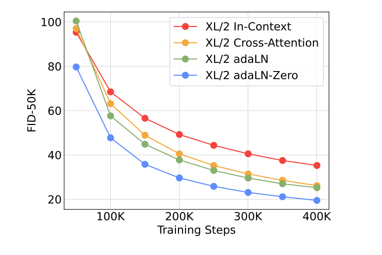

**图 5：比较不同的条件化策略。** 在训练的所有阶段，adaLN-Zero 都优于交叉注意力和上下文内条件化。

我们将上下文内条件化、交叉注意力、自适应层归一化和 adaLN-Zero 模块全部纳入 DiT 的设计空间。

**模型规模。** 我们依次应用 $N$ 个 DiT 模块，每个模块都在隐藏维度 $d$ 上运行。
遵循 ViT 的做法，我们采用联合扩展 $N$、$d$ 和注意力头数的标准 Transformer 配置[10,63]。
具体而言，使用四种配置：DiT-S、DiT-B、DiT-L 和 DiT-XL。
它们覆盖了广泛的模型规模与运算量范围，从约 0.3 到 118.6 Gflops，使我们能够评估规模扩展表现。
表 1 给出了具体配置。

**表 1：DiT 模型细节。** Small（S）、Base（B）和 Large（L）变体沿用 ViT[10]的模型配置；另外引入 XLarge（XL）配置，作为我们的最大模型。

| 模型 | 层数 $N$ | 隐藏维度 $d$ | 注意力头数 | Gflops（$I=32,p=4$） |
| --- | ---: | ---: | ---: | ---: |
| DiT-S | 12 | 384 | 6 | 1.4 |
| DiT-B | 12 | 768 | 12 | 5.6 |
| DiT-L | 24 | 1024 | 16 | 19.7 |
| DiT-XL | 28 | 1152 | 16 | 29.1 |

我们将 S、B、L 和 XL 配置纳入 DiT 的设计空间。

**Transformer 解码器。** 在最后一个 DiT 模块之后，需要将图像词元序列解码为预测噪声和预测对角协方差。
这两个输出的形状都与原始空间输入一致。
我们使用标准线性解码器完成这一操作：先应用最后一个层归一化层；如果使用 adaLN，则此处也采用自适应层归一化；随后将每个词元线性解码为一个 $p\times p\times2C$ 张量，其中 $C$ 是 DiT 空间输入的通道数。
最后，将解码后的词元重新排列到原始空间布局，得到预测噪声与协方差。

我们探索的完整 DiT 设计空间包括图块尺寸、Transformer 模块架构和模型规模。

## 4 实验设置

我们探索 DiT 的设计空间，并研究这一模型族的规模扩展性质。
模型根据配置和潜表示图块尺寸 $p$ 命名；例如，DiT-XL/2 表示 XLarge 配置、$p=2$。

**训练。** 我们在 ImageNet 数据集[31]上，以 256×256 和 512×512 图像分辨率训练类别条件潜空间 DiT 模型。
ImageNet 是一个竞争非常激烈的生成建模基准。
我们将最终线性层初始化为零，其他部分采用 ViT 的标准权重初始化技术。
所有模型均使用 AdamW[29,33]训练。
我们采用恒定学习率 $1\times10^{-4}$，不使用权重衰减，批大小为 256。
唯一采用的数据增强是水平翻转。
与许多此前关于 ViT 的工作[57,61]不同，我们没有发现学习率预热或正则化是将 DiT 训练到高性能所必需的。
即使不采用这些技术，所有模型配置的训练仍然非常稳定，没有观察到训练 Transformer 时常见的损失突增。
遵循生成建模文献中的常见做法，我们在训练期间维护 DiT 权重的指数移动平均（EMA），衰减系数为 0.9999。
所有报告结果均使用 EMA 模型。
对于所有 DiT 模型规模和图块尺寸，使用完全相同的训练超参数。
训练超参数几乎全部沿用 ADM。
我们没有调节学习率、衰减／预热调度、Adam 的 $\beta_1/\beta_2$ 或权重衰减。

**扩散。** 我们使用 Stable Diffusion[48]中现成的预训练变分自编码器（VAE）[30]。
VAE 编码器的下采样倍数为 8：给定形状为 $256\times256\times3$ 的 RGB 图像 $x$，$z=\mathcal E(x)$ 的形状为 $32\times32\times4$。
本节所有实验中的扩散模型都在这个 $\mathcal Z$ 空间内运行。
从扩散模型采样一个新的潜表示后，使用 VAE 解码器 $x=\mathcal D(z)$ 将其解码为像素。
我们沿用 ADM[9]的扩散超参数；具体包括 $t_{\max}=1000$、范围为 $1\times10^{-4}$ 至 $2\times10^{-2}$ 的线性方差调度、ADM 对协方差 $\Sigma_\theta$ 的参数化，以及它对输入时间步与标签进行嵌入的方法。

**评估指标。** 我们使用 Fréchet Inception Distance（FID）[18]衡量规模扩展性能，这是评估图像生成模型的标准指标。
与以往工作比较时，我们遵循惯例，报告采用 250 个 DDPM 采样步的 FID-50K。
已知 FID 对细小的实现差异很敏感[37]；为保证比较准确，本文报告的所有数值都通过导出样本，并使用 ADM 的 TensorFlow 评估套件[9]获得。
除非特别说明，本节报告的 FID 不使用无分类器引导。
此外，还将 Inception Score[51]、sFID[34]和精确率／召回率[32]作为辅助指标。

**计算资源。** 所有模型均使用 JAX[1]实现，并在 TPU-v3 Pod 上训练。
计算开销最大的 DiT-XL/2 在 TPU v3-256 Pod 上、全局批大小为 256 时，训练速度约为每秒 5.7 次迭代。

## 5 实验

### DiT 模块设计

我们训练四个计算量最高的 DiT-XL/2 模型，分别采用不同的模块设计：上下文内条件化（119.4 Gflops）、交叉注意力（137.6 Gflops）、自适应层归一化（adaLN，118.6 Gflops）和 adaLN-Zero（118.6 Gflops）。
我们测量训练过程中的 FID。
图 5 展示了结果。
adaLN-Zero 模块的 FID 低于交叉注意力和上下文内条件化，同时计算效率最高。
在训练 40 万次迭代后，adaLN-Zero 模型的 FID 接近上下文内条件化模型的一半，表明条件机制对模型质量具有决定性影响。
初始化也很重要：将每个 DiT 模块初始化为恒等函数的 adaLN-Zero，显著优于普通 adaLN。
在本文其余部分，所有模型都使用 adaLN-Zero DiT 模块。

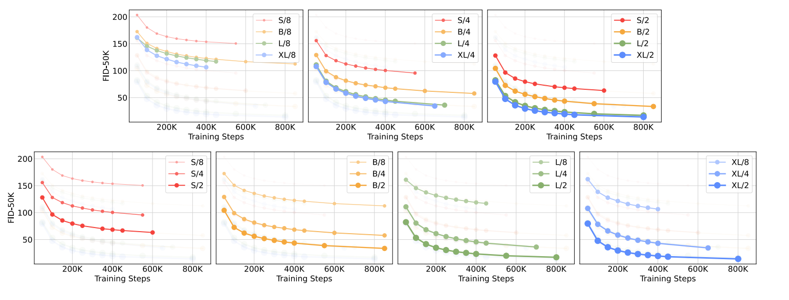

**图 6：扩大 DiT 模型规模，可以改善训练所有阶段的 FID。** 图中展示了 12 个 DiT 模型的 FID-50K 随训练迭代次数的变化。**上排：** 固定图块尺寸，比较 FID。**下排：** 固定模型规模，比较 FID。对于所有模型规模和图块尺寸，扩大 Transformer 骨干网络都能获得更好的生成模型。

### 扩展模型规模与图块尺寸

我们训练 12 个 DiT 模型，遍历模型配置 S、B、L、XL，以及图块尺寸 8、4、2。
注意，与其他配置相比，DiT-L 和 DiT-XL 的相对 Gflops 更接近。
图 2 左侧概览了各模型的 Gflops，以及训练 40 万次迭代后的 FID。
在所有情况下，我们都发现，扩大模型规模并减小图块尺寸，会显著改善扩散模型。

图 6 上排展示了固定图块尺寸、增大模型规模时 FID 的变化。
对于全部四种配置，加深、加宽 Transformer 都能在训练的所有阶段显著改善 FID。
类似地，图 6 下排展示了固定模型规模、减小图块尺寸时的 FID。
我们再次观察到，只需增加 DiT 处理的词元数，在参数量近似不变的情况下，就能在整个训练过程中显著改善 FID。

**DiT 的 Gflops 对提升性能至关重要。** 图 6 的结果表明，参数量并不能唯一决定 DiT 模型的质量。
当固定模型规模、减小图块尺寸时，Transformer 的总参数量基本不变，实际上还会略有下降，增加的只有 Gflops。
这些结果说明，扩大模型 Gflops 才是提升性能的关键。
为进一步研究这一点，我们在图 8 中绘制了训练 40 万步后的 FID-50K 与模型 Gflops 的关系。
结果表明，当总 Gflops 相近时，不同 DiT 配置会获得相近的 FID，例如 DiT-S/2 和 DiT-B/4。
我们发现模型 Gflops 与 FID-50K 存在很强的负相关，说明增加模型计算量是改进 DiT 的关键因素。
附录图 12 表明，这一趋势也适用于 Inception Score 等其他指标。

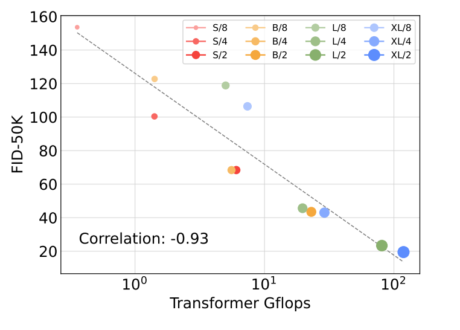

**图 8：Transformer 的 Gflops 与 FID 高度相关。** 我们绘制了每个 DiT 模型的 Gflops，以及训练 40 万步后的 FID-50K。

**更大的 DiT 模型具有更高的计算效率。** 图 9 将所有 DiT 模型的 FID 表示为总训练计算量的函数。
我们使用“模型 Gflops × 批大小 × 训练步数 × 3”估算训练计算量，其中因子 3 来自粗略近似：反向传播的计算量约为前向传播的两倍。
我们发现，即使延长小型 DiT 模型的训练，它们最终仍会比训练步数更少的大型 DiT 模型更缺乏计算效率。
类似地，即使控制训练 Gflops，仅图块尺寸不同的模型仍然表现出不同的性能曲线。
例如，总训练计算量达到约 $10^{10}$ Gflops 后，XL/2 的表现就超过了 XL/4。

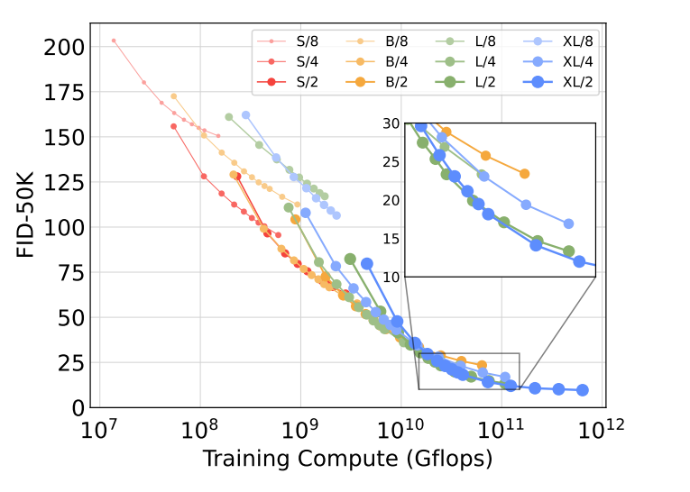

**图 9：较大的 DiT 模型能更高效地利用大量计算资源。** 图中将 FID 表示为总训练计算量的函数。

**可视化规模扩展。** 图 7 将规模扩展对样本质量的影响可视化。
训练 40 万步后，我们使用完全相同的初始噪声 $x_{t_{\max}}$、采样噪声和类别标签，从 12 个 DiT 模型中各采样一张图像。
这样就可以直观理解规模扩展如何影响 DiT 的样本质量。
结果确实表明，无论增大模型规模还是增加词元数量，都会明显提升视觉质量。

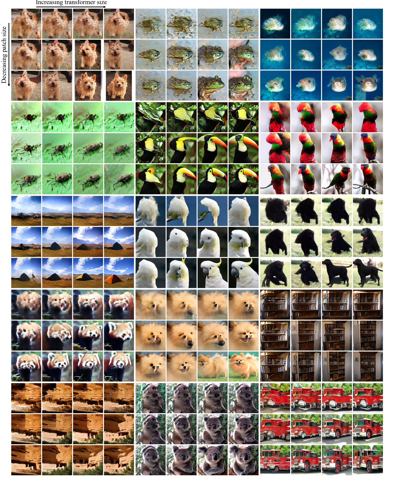

**图 7：增加 Transformer 前向传播的 Gflops，可以提高样本质量。** 建议放大查看。对训练 40 万步后的全部 12 个 DiT 模型，使用相同的输入潜噪声与类别标签进行采样。无论通过加深／加宽 Transformer，还是增加输入词元数量来提高模型 Gflops，都能显著改善视觉保真度。

### 5.1 最先进的扩散模型

**256×256 ImageNet。** 根据规模扩展分析，我们将 Gflops 最高的 DiT-XL/2 继续训练至 700 万步。
图 1 展示了模型样例，我们还将其与最先进的类别条件生成模型进行了比较。
表 2 给出了结果。
使用无分类器引导时，DiT-XL/2 优于此前所有扩散模型，将此前 LDM 取得的最佳 FID-50K 从 3.60 降低到 2.27。
图 2 右侧表明，与 LDM-4（103.6 Gflops）等潜空间 U-Net 模型相比，DiT-XL/2（118.6 Gflops）具有较高的计算效率；与 ADM（1120 Gflops）或 ADM-U（742 Gflops）等像素空间 U-Net 模型相比，其计算效率更是显著提高。
我们的方法取得了低于此前所有生成模型的 FID，包括此前最先进的 StyleGAN-XL[53]。
最后，我们还观察到，在所有测试的无分类器引导强度下，DiT-XL/2 的召回率都高于 LDM-4 和 LDM-8。
即使仅训练 235 万步，与 ADM 大致相当，XL/2 仍以 2.55 的 FID 优于此前所有扩散模型。

**表 2：ImageNet 256×256 类别条件图像生成基准。** DiT-XL/2 达到当时最先进的 FID。$\downarrow$ 表示越低越好，$\uparrow$ 表示越高越好；`cfg` 为无分类器引导强度，模型名称沿用原表。

| 模型 | FID ↓ | sFID ↓ | IS ↑ | 精确率 ↑ | 召回率 ↑ |
| --- | ---: | ---: | ---: | ---: | ---: |
| BigGAN-deep[2] | 6.95 | 7.36 | 171.4 | 0.87 | 0.28 |
| StyleGAN-XL[53] | 2.30 | **4.02** | 265.12 | 0.78 | 0.53 |
| ADM[9] | 10.94 | 6.02 | 100.98 | 0.69 | 0.63 |
| ADM-U | 7.49 | 5.13 | 127.49 | 0.72 | 0.63 |
| ADM-G | 4.59 | 5.25 | 186.70 | 0.82 | 0.52 |
| ADM-G, ADM-U | 3.94 | 6.14 | 215.84 | 0.83 | 0.53 |
| CDM[20] | 4.88 | — | 158.71 | — | — |
| LDM-8[48] | 15.51 | — | 79.03 | 0.65 | 0.63 |
| LDM-8-G | 7.76 | — | 209.52 | 0.84 | 0.35 |
| LDM-4 | 10.56 | — | 103.49 | 0.71 | 0.62 |
| LDM-4-G（cfg=1.25） | 3.95 | — | 178.22 | 0.81 | 0.55 |
| LDM-4-G（cfg=1.50） | 3.60 | — | 247.67 | **0.87** | 0.48 |
| DiT-XL/2 | 9.62 | 6.85 | 121.50 | 0.67 | **0.67** |
| DiT-XL/2-G（cfg=1.25） | 3.22 | 5.28 | 201.77 | 0.76 | 0.62 |
| DiT-XL/2-G（cfg=1.50） | **2.27** | 4.60 | **278.24** | 0.83 | 0.57 |

**512×512 ImageNet。** 我们在 512×512 分辨率的 ImageNet 上训练一个新的 DiT-XL/2 模型，共训练 300 万次迭代，超参数与 256×256 模型完全相同。
图块尺寸为 2 时，该 XL/2 模型将 $64\times64\times4$ 的输入潜表示图块化为总计 1024 个词元，运算量为 524.6 Gflops。
表 3 展示了与最先进方法的比较。
在这一分辨率下，XL/2 再次优于此前所有扩散模型，将此前 ADM 取得的最佳 FID 从 3.85 改善到 3.04。
即使词元数增加，XL/2 仍然具有较高的计算效率。
例如，ADM 需要 1983 Gflops，ADM-U 需要 2813 Gflops，而 XL/2 只需要 524.6 Gflops。
图 1 和附录展示了高分辨率 XL/2 模型的样例。

**表 3：ImageNet 512×512 类别条件图像生成基准。** 注意，以往工作[9]在 512×512 分辨率下使用 1000 个真实样本计算精确率和召回率；为保持一致，我们也采用相同做法。

| 模型 | FID ↓ | sFID ↓ | IS ↑ | 精确率 ↑ | 召回率 ↑ |
| --- | ---: | ---: | ---: | ---: | ---: |
| BigGAN-deep[2] | 8.43 | 8.13 | 177.90 | **0.88** | 0.29 |
| StyleGAN-XL[53] | **2.41** | **4.06** | **267.75** | 0.77 | 0.52 |
| ADM[9] | 23.24 | 10.19 | 58.06 | 0.73 | 0.60 |
| ADM-U | 9.96 | 5.62 | 121.78 | 0.75 | **0.64** |
| ADM-G | 7.72 | 6.57 | 172.71 | 0.87 | 0.42 |
| ADM-G, ADM-U | 3.85 | 5.86 | 221.72 | 0.84 | 0.53 |
| DiT-XL/2 | 12.03 | 7.12 | 105.25 | 0.75 | **0.64** |
| DiT-XL/2-G（cfg=1.25） | 4.64 | 5.77 | 174.77 | 0.81 | 0.57 |
| DiT-XL/2-G（cfg=1.50） | 3.04 | 5.02 | 240.82 | 0.84 | 0.54 |

### 5.2 扩展模型计算量与采样计算量的比较

扩散模型有一个独特之处：训练结束后，还能通过增加生成一张图像时的采样步数来使用额外计算资源。
鉴于模型 Gflops 对样本质量的影响，本节研究模型计算量更小的 DiT，能否通过使用更多采样计算量超越较大的模型。
我们对训练 40 万步后的全部 12 个 DiT 模型计算 FID，每张图像分别使用 16、32、64、128、256、1000 个采样步。
主要结果见图 10。
考虑使用 1000 个采样步的 DiT-L/2，与使用 128 个采样步的 DiT-XL/2 的比较。
此时，L/2 生成每张图像需要 80.7 Tflops；XL/2 生成每张图像只需要 15.2 Tflops，计算开销约为前者的五分之一。
尽管如此，XL/2 的 FID-10K 仍然更好，分别为 23.7 和 25.9。
总体而言，增加采样计算量无法弥补模型计算量的不足。

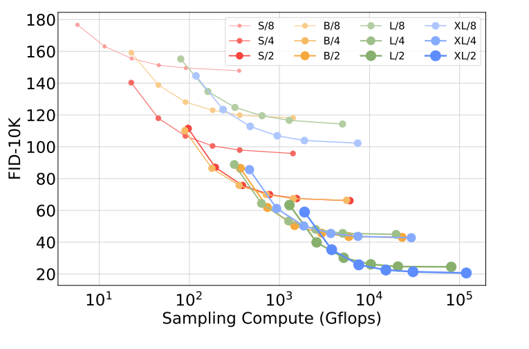

**图 10：增加采样计算量无法弥补模型计算量的不足。** 对训练 40 万次迭代后的每个 DiT 模型，我们分别使用 16、32、64、128、256、1000 个采样步计算 FID-10K。对于每种步数，图中同时给出 FID 和生成每张图像所需的 Gflops。即使小模型在测试时用于采样的 Gflops 超过大模型，它们也无法消除与大模型之间的性能差距。

## 6 结论

我们提出了扩散 Transformer（DiT），一种用于扩散模型的简单 Transformer 骨干网络。
它优于此前的 U-Net 模型，并继承了 Transformer 模型族出色的规模扩展性质。
鉴于本文呈现的可观扩展结果，未来工作应继续将 DiT 扩展到更大的模型规模与更多的词元数量。
还可以探索将 DiT 作为 DALL·E 2 和 Stable Diffusion 等文本生成图像模型中可直接替换的骨干网络。

**致谢。** 感谢 Kaiming He、Ronghang Hu、Alexander Berg、Shoubhik Debnath、Tim Brooks、Ilija Radosavovic 和 Tete Xiao 提供的有益讨论。
William Peebles 获得美国国家科学基金会研究生研究奖学金（NSF GRFP）支持。

## 参考文献

以下保留原文编号，题名译为中文，作者姓名与发表载体保留原文；略去原 PDF 中用于回指正文的页码。

[1] James Bradbury, Roy Frostig, Peter Hawkins, Matthew James Johnson, Chris Leary, Dougal Maclaurin, George Necula, Adam Paszke, Jake VanderPlas, Skye Wanderman-Milne, Qiao Zhang. **JAX：Python+NumPy 程序的可组合变换**。2018。

[2] Andrew Brock, Jeff Donahue, Karen Simonyan. **面向高保真自然图像合成的大规模 GAN 训练**。ICLR，2019。

[3] Tom B Brown, Benjamin Mann, Nick Ryder, Melanie Subbiah, Jared Kaplan, Prafulla Dhariwal, Arvind Neelakantan, Pranav Shyam, Girish Sastry, Amanda Askell 等。**语言模型是少样本学习器**。NeurIPS，2020。

[4] Huiwen Chang, Han Zhang, Lu Jiang, Ce Liu, William T Freeman. **MaskGIT：掩码生成式图像 Transformer**。CVPR，第 11315–11325 页，2022。

[5] Lili Chen, Kevin Lu, Aravind Rajeswaran, Kimin Lee, Aditya Grover, Misha Laskin, Pieter Abbeel, Aravind Srinivas, Igor Mordatch. **Decision Transformer：通过序列建模实现强化学习**。NeurIPS，2021。

[6] Mark Chen, Alec Radford, Rewon Child, Jeffrey Wu, Heewoo Jun, David Luan, Ilya Sutskever. **从像素进行生成式预训练**。ICML，2020。

[7] Rewon Child, Scott Gray, Alec Radford, Ilya Sutskever. **使用稀疏 Transformer 生成长序列**。arXiv 预印本 arXiv:1904.10509，2019。

[8] Jacob Devlin, Ming-Wei Chang, Kenton Lee, Kristina Toutanova. **BERT：用于语言理解的深度双向 Transformer 预训练**。NAACL-HCT，2019。

[9] Prafulla Dhariwal, Alexander Nichol. **扩散模型在图像合成上超越 GAN**。NeurIPS，2021。

[10] Alexey Dosovitskiy, Lucas Beyer, Alexander Kolesnikov, Dirk Weissenborn, Xiaohua Zhai, Thomas Unterthiner, Mostafa Dehghani, Matthias Minderer, Georg Heigold, Sylvain Gelly 等。**一张图像相当于 16×16 个词：用于大规模图像识别的 Transformer**。ICLR，2020。

[11] Patrick Esser, Robin Rombach, Björn Ommer. **驾驭 Transformer，实现高分辨率图像合成**。2020。

[12] Ian Goodfellow, Jean Pouget-Abadie, Mehdi Mirza, Bing Xu, David Warde-Farley, Sherjil Ozair, Aaron Courville, Yoshua Bengio. **生成对抗网络**。NIPS，2014。

[13] Priya Goyal, Piotr Dollár, Ross Girshick, Pieter Noordhuis, Lukasz Wesolowski, Aapo Kyrola, Andrew Tulloch, Yangqing Jia, Kaiming He. **准确的大批量 SGD：在 1 小时内训练 ImageNet**。arXiv:1706.02677，2017。

[14] Shuyang Gu, Dong Chen, Jianmin Bao, Fang Wen, Bo Zhang, Dongdong Chen, Lu Yuan, Baining Guo. **用于文本生成图像的向量量化扩散模型**。CVPR，第 10696–10706 页，2022。

[15] Kaiming He, Xiangyu Zhang, Shaoqing Ren, Jian Sun. **用于图像识别的深度残差学习**。CVPR，2016。

[16] Dan Hendrycks, Kevin Gimpel. **高斯误差线性单元（GELU）**。arXiv 预印本 arXiv:1606.08415，2016。

[17] Tom Henighan, Jared Kaplan, Mor Katz, Mark Chen, Christopher Hesse, Jacob Jackson, Heewoo Jun, Tom B Brown, Prafulla Dhariwal, Scott Gray 等。**自回归生成建模的规模扩展定律**。arXiv 预印本 arXiv:2010.14701，2020。

[18] Martin Heusel, Hubert Ramsauer, Thomas Unterthiner, Bernhard Nessler, Sepp Hochreiter. **采用双时间尺度更新规则训练的 GAN 收敛到局部纳什均衡**。2017。

[19] Jonathan Ho, Ajay Jain, Pieter Abbeel. **去噪扩散概率模型**。NeurIPS，2020。

[20] Jonathan Ho, Chitwan Saharia, William Chan, David J Fleet, Mohammad Norouzi, Tim Salimans. **用于高保真图像生成的级联扩散模型**。arXiv:2106.15282，2021。

[21] Jonathan Ho, Tim Salimans. **无分类器扩散引导**。NeurIPS 2021 深度生成模型及下游应用研讨会，2021。

[22] Aapo Hyvärinen, Peter Dayan. **通过得分匹配估计非归一化统计模型**。Journal of Machine Learning Research，6(4)，2005。

[23] Phillip Isola, Jun-Yan Zhu, Tinghui Zhou, Alexei A Efros. **使用条件对抗网络进行图像到图像的转换**。IEEE Conference on Computer Vision and Pattern Recognition 论文集，第 1125–1134 页，2017。

[24] Allan Jabri, David Fleet, Ting Chen. **面向迭代生成的可扩展自适应计算**。arXiv 预印本 arXiv:2212.11972，2022。

[25] Michael Janner, Qiyang Li, Sergey Levine. **将离线强化学习视为一个完整的序列建模问题**。NeurIPS，2021。

[26] Jared Kaplan, Sam McCandlish, Tom Henighan, Tom B Brown, Benjamin Chess, Rewon Child, Scott Gray, Alec Radford, Jeffrey Wu, Dario Amodei. **神经语言模型的规模扩展定律**。arXiv:2001.08361，2020。

[27] Tero Karras, Miika Aittala, Timo Aila, Samuli Laine. **厘清基于扩散的生成模型设计空间**。NeurIPS 论文集，2022。

[28] Tero Karras, Samuli Laine, Timo Aila. **用于生成对抗网络的基于风格的生成器架构**。CVPR，2019。

[29] Diederik Kingma, Jimmy Ba. **Adam：一种随机优化方法**。ICLR，2015。

[30] Diederik P Kingma, Max Welling. **自编码变分贝叶斯**。arXiv 预印本 arXiv:1312.6114，2013。

[31] Alex Krizhevsky, Ilya Sutskever, Geoffrey E Hinton. **使用深度卷积神经网络进行 ImageNet 分类**。NeurIPS，2012。

[32] Tuomas Kynkäänniemi, Tero Karras, Samuli Laine, Jaakko Lehtinen, Timo Aila. **用于评估生成模型的改进精确率与召回率指标**。NeurIPS，2019。

[33] Ilya Loshchilov, Frank Hutter. **解耦权重衰减正则化**。arXiv:1711.05101，2017。

[34] Charlie Nash, Jacob Menick, Sander Dieleman, Peter W Battaglia. **利用稀疏表示生成图像**。arXiv 预印本 arXiv:2103.03841，2021。

[35] Alex Nichol, Prafulla Dhariwal, Aditya Ramesh, Pranav Shyam, Pamela Mishkin, Bob McGrew, Ilya Sutskever, Mark Chen. **GLIDE：迈向利用文本引导扩散模型进行逼真图像生成与编辑**。arXiv:2112.10741，2021。

[36] Alexander Quinn Nichol, Prafulla Dhariwal. **改进的去噪扩散概率模型**。ICML，2021。

[37] Gaurav Parmar, Richard Zhang, Jun-Yan Zhu. **关于产生混叠的缩放操作，以及 GAN 评估中令人意外的细微问题**。CVPR，2022。

[38] Niki Parmar, Ashish Vaswani, Jakob Uszkoreit, Lukasz Kaiser, Noam Shazeer, Alexander Ku, Dustin Tran. **图像 Transformer**。International Conference on Machine Learning，第 4055–4064 页，PMLR，2018。

[39] William Peebles, Ilija Radosavovic, Tim Brooks, Alexei Efros, Jitendra Malik. **利用神经网络检查点的生成模型学习如何学习**。arXiv 预印本 arXiv:2209.12892，2022。

[40] Ethan Perez, Florian Strub, Harm De Vries, Vincent Dumoulin, Aaron Courville. **FiLM：利用通用条件层进行视觉推理**。AAAI，2018。

[41] Alec Radford, Jong Wook Kim, Chris Hallacy, Aditya Ramesh, Gabriel Goh, Sandhini Agarwal, Girish Sastry, Amanda Askell, Pamela Mishkin, Jack Clark 等。**从自然语言监督中学习可迁移的视觉模型**。ICML，2021。

[42] Alec Radford, Karthik Narasimhan, Tim Salimans, Ilya Sutskever. **通过生成式预训练改善语言理解**。2018。

[43] Alec Radford, Jeffrey Wu, Rewon Child, David Luan, Dario Amodei, Ilya Sutskever 等。**语言模型是无监督多任务学习器**。2019。

[44] Ilija Radosavovic, Justin Johnson, Saining Xie, Wan-Yen Lo, Piotr Dollár. **论视觉识别的网络设计空间**。ICCV，2019。

[45] Ilija Radosavovic, Raj Prateek Kosaraju, Ross Girshick, Kaiming He, Piotr Dollár. **设计网络设计空间**。CVPR，2020。

[46] Aditya Ramesh, Prafulla Dhariwal, Alex Nichol, Casey Chu, Mark Chen. **利用 CLIP 潜表示进行分层文本条件图像生成**。arXiv:2204.06125，2022。

[47] Aditya Ramesh, Mikhail Pavlov, Gabriel Goh, Scott Gray, Chelsea Voss, Alec Radford, Mark Chen, Ilya Sutskever. **零样本文本生成图像**。ICML，2021。

[48] Robin Rombach, Andreas Blattmann, Dominik Lorenz, Patrick Esser, Björn Ommer. **使用潜空间扩散模型进行高分辨率图像合成**。CVPR，2022。

[49] Olaf Ronneberger, Philipp Fischer, Thomas Brox. **U-Net：用于生物医学图像分割的卷积网络**。International Conference on Medical Image Computing and Computer-Assisted Intervention，第 234–241 页，Springer，2015。

[50] Chitwan Saharia, William Chan, Saurabh Saxena, Lala Li, Jay Whang, Emily Denton, Seyed Kamyar Seyed Ghasemipour, Burcu Karagol Ayan, S. Sara Mahdavi, Rapha Gontijo Lopes, Tim Salimans, Jonathan Ho, David J Fleet, Mohammad Norouzi. **具备深层语言理解能力的逼真文本生成图像扩散模型**。arXiv:2205.11487，2022。

[51] Tim Salimans, Ian Goodfellow, Wojciech Zaremba, Vicki Cheung, Alec Radford, Xi Chen, Xi Chen. **改进的 GAN 训练技术**。NeurIPS，2016。

[52] Tim Salimans, Andrej Karpathy, Xi Chen, Diederik P Kingma. **PixelCNN++：通过离散化逻辑斯蒂混合似然及其他修改改进 PixelCNN**。arXiv 预印本 arXiv:1701.05517，2017。

[53] Axel Sauer, Katja Schwarz, Andreas Geiger. **StyleGAN-XL：将 StyleGAN 扩展到大型多样化数据集**。SIGGRAPH，2022。

[54] Jascha Sohl-Dickstein, Eric Weiss, Niru Maheswaranathan, Surya Ganguli. **利用非平衡热力学进行深度无监督学习**。ICML，2015。

[55] Jiaming Song, Chenlin Meng, Stefano Ermon. **去噪扩散隐式模型**。arXiv:2010.02502，2020。

[56] Yang Song, Stefano Ermon. **通过估计数据分布的梯度进行生成建模**。NeurIPS，2019。

[57] Andreas Steiner, Alexander Kolesnikov, Xiaohua Zhai, Ross Wightman, Jakob Uszkoreit, Lucas Beyer. **如何训练你的 ViT？视觉 Transformer 中的数据、增强与正则化**。TMLR，2022。

[58] Aaron Van den Oord, Nal Kalchbrenner, Lasse Espeholt, Oriol Vinyals, Alex Graves 等。**使用 PixelCNN 解码器进行条件图像生成**。Advances in Neural Information Processing Systems，第 29 卷，2016。

[59] Aaron Van Den Oord, Oriol Vinyals 等。**神经离散表示学习**。Advances in Neural Information Processing Systems，第 30 卷，2017。

[60] Ashish Vaswani, Noam Shazeer, Niki Parmar, Jakob Uszkoreit, Llion Jones, Aidan N Gomez, Łukasz Kaiser, Illia Polosukhin. **注意力就是你所需要的一切**。NeurIPS，2017。

[61] Tete Xiao, Piotr Dollar, Mannat Singh, Eric Mintun, Trevor Darrell, Ross Girshick. **早期卷积帮助 Transformer 更好地“看”**。NeurIPS，2021。

[62] Jiahui Yu, Yuanzhong Xu, Jing Yu Koh, Thang Luong, Gunjan Baid, Zirui Wang, Vijay Vasudevan, Alexander Ku, Yinfei Yang, Burcu Karagol Ayan 等。**扩展自回归模型，实现内容丰富的文本生成图像**。arXiv:2206.10789，2022。

[63] Xiaohua Zhai, Alexander Kolesnikov, Neil Houlsby, Lucas Beyer. **扩展视觉 Transformer 的规模**。CVPR，2022。

## 附录 A 更多实现细节

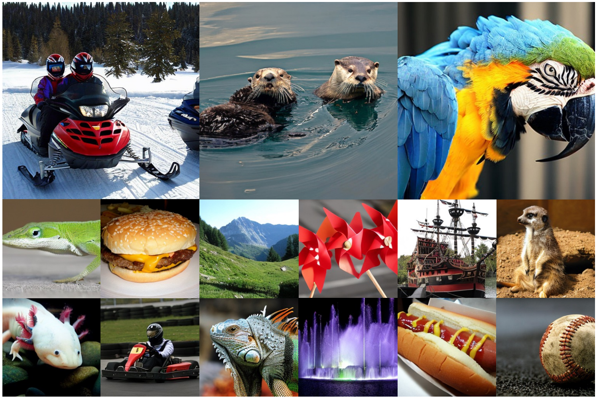

**图 11：来自 512×512 和 256×256 分辨率 DiT-XL/2 模型的更多精选样例。** 512×512 模型的无分类器引导强度为 6.0，256×256 模型为 4.0。两个模型都使用 ft-EMA VAE 解码器。

表 4 给出了所有 DiT 模型的详细信息，包括 256×256 和 512×512 模型。
图 13 展示了 DiT 的训练损失曲线。
此外，表 6 还给出了 ADM 与 LDM 中 DDPM U-Net 模型的 Gflops。

**DiT 模型细节。** 为嵌入输入时间步，我们先使用 256 维的频率嵌入[9]，再通过一个两层 MLP，其维度等于 Transformer 的隐藏维度，并使用 SiLU 激活函数。
每个 adaLN 层将时间步嵌入与类别嵌入之和，送入 SiLU 非线性和一个线性层；该线性层的输出神经元数，对于 adaLN 为 Transformer 隐藏维度的 4 倍，对于 adaLN-Zero 则为 6 倍。
Transformer 主体使用 GELU 非线性函数，并以 tanh 进行近似[16]。

**仅对部分通道施加无分类器引导。** 在采用无分类器引导的实验中，我们只对潜表示的前三个通道施加引导，而不是全部四个通道。
进一步研究发现，只需调整缩放因子，三通道引导和四通道引导就能取得相近的 FID 结果。
具体而言，引导强度为 $(1+x)$ 的三通道引导，可以用引导强度为 $(1+\tfrac34x)$ 的四通道引导作较好的近似。
例如，强度为 1.5 的三通道引导得到 2.27 的 FID-50K，而强度为 1.375 的四通道引导得到 2.20 的 FID-50K。
只对一部分元素施加引导，仍能取得良好性能，这一点颇为有趣；我们将对这一现象的进一步探索留给未来工作。

**表 4：所有 DiT 模型的详细信息。** 这里的 FID-50K 均不使用无分类器引导。参数量和运算量不包含 VAE；VAE 的编码器与解码器合计包含 8400 万参数。对于 256×256 和 512×512 两个 DiT-XL/2 模型，我们始终没有观察到 FID 饱和，因此尽可能延长了训练。表中数值使用 ft-MSE VAE 解码器。

| 模型 | 图像分辨率 | 运算量（G） | 参数量（M） | 训练步数（K） | 批大小 | 学习率 | DiT 模块 | FID-50K（无引导） |
| --- | --- | ---: | ---: | ---: | ---: | --- | --- | ---: |
| DiT-S/8 | 256×256 | 0.36 | 33 | 400 | 256 | $1\times10^{-4}$ | adaLN-Zero | 153.60 |
| DiT-S/4 | 256×256 | 1.41 | 33 | 400 | 256 | $1\times10^{-4}$ | adaLN-Zero | 100.41 |
| DiT-S/2 | 256×256 | 6.06 | 33 | 400 | 256 | $1\times10^{-4}$ | adaLN-Zero | 68.40 |
| DiT-B/8 | 256×256 | 1.42 | 131 | 400 | 256 | $1\times10^{-4}$ | adaLN-Zero | 122.74 |
| DiT-B/4 | 256×256 | 5.56 | 130 | 400 | 256 | $1\times10^{-4}$ | adaLN-Zero | 68.38 |
| DiT-B/2 | 256×256 | 23.01 | 130 | 400 | 256 | $1\times10^{-4}$ | adaLN-Zero | 43.47 |
| DiT-L/8 | 256×256 | 5.01 | 459 | 400 | 256 | $1\times10^{-4}$ | adaLN-Zero | 118.87 |
| DiT-L/4 | 256×256 | 19.70 | 458 | 400 | 256 | $1\times10^{-4}$ | adaLN-Zero | 45.64 |
| DiT-L/2 | 256×256 | 80.71 | 458 | 400 | 256 | $1\times10^{-4}$ | adaLN-Zero | 23.33 |
| DiT-XL/8 | 256×256 | 7.39 | 676 | 400 | 256 | $1\times10^{-4}$ | adaLN-Zero | 106.41 |
| DiT-XL/4 | 256×256 | 29.05 | 675 | 400 | 256 | $1\times10^{-4}$ | adaLN-Zero | 43.01 |
| DiT-XL/2 | 256×256 | 118.64 | 675 | 400 | 256 | $1\times10^{-4}$ | adaLN-Zero | 19.47 |
| DiT-XL/2 | 256×256 | 119.37 | 449 | 400 | 256 | $1\times10^{-4}$ | in-context | 35.24 |
| DiT-XL/2 | 256×256 | 137.62 | 598 | 400 | 256 | $1\times10^{-4}$ | cross-attention | 26.14 |
| DiT-XL/2 | 256×256 | 118.56 | 600 | 400 | 256 | $1\times10^{-4}$ | adaLN | 25.21 |
| DiT-XL/2 | 256×256 | 118.64 | 675 | 2352 | 256 | $1\times10^{-4}$ | adaLN-Zero | 10.67 |
| DiT-XL/2 | 256×256 | 118.64 | 675 | 7000 | 256 | $1\times10^{-4}$ | adaLN-Zero | 9.62 |
| DiT-XL/2 | 512×512 | 524.60 | 675 | 1301 | 256 | $1\times10^{-4}$ | adaLN-Zero | 13.78 |
| DiT-XL/2 | 512×512 | 524.60 | 675 | 3000 | 256 | $1\times10^{-4}$ | adaLN-Zero | 11.93 |

## 附录 B 模型样例

我们展示了两个 DiT-XL/2 模型的样例：512×512 分辨率模型训练了 300 万步，256×256 分辨率模型训练了 700 万步。
图 1 和图 11 展示了两个模型的精选样例。
图 14–33 则展示了在不同无分类器引导强度和输入类别标签下，两个模型生成的未经筛选的样例；这些样例均使用 250 个 DDPM 采样步和 ft-EMA VAE 解码器生成。
与此前采用引导的工作一样，我们观察到，更高的引导强度会增加视觉保真度，同时降低样本多样性。

> 图 14–33 依照原 PDF 的顺序放在附录末尾，便于连续阅读下面的分析。

## 附录 C 更多规模扩展结果

**规模扩展对 FID 之外指标的影响。** 图 12 展示了 DiT 规模对一组评估指标的影响，包括 FID、sFID、Inception Score、精确率和召回率。
我们发现，正文中以 FID 为依据的分析同样适用于其他指标：在每项指标上，更大规模的 DiT 模型都具有更高的计算效率，而且模型 Gflops 与性能高度相关。
其中，Inception Score 和精确率尤其受益于模型规模的增加。

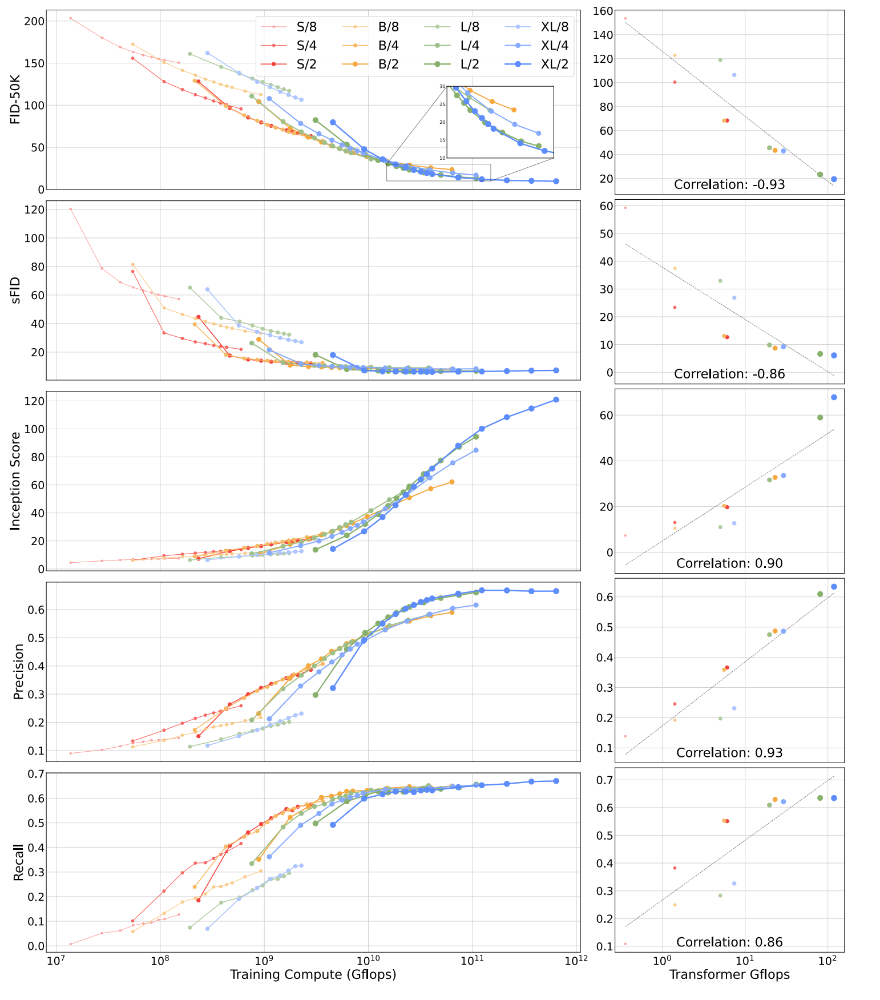

**图 12：DiT 在若干生成建模指标上的规模扩展行为。** **左：** 将 FID、sFID、Inception Score、精确率和召回率表示为总训练计算量的函数。**右：** 将 12 个 DiT 变体训练 40 万步后的模型性能与 Transformer Gflops 对照绘制，发现所有指标都具有很强的相关性。所有数值均使用 ft-MSE VAE 解码器计算。

**规模扩展对训练损失的影响。** 我们还在图 13 中考察了规模扩展对训练损失的影响。
无论通过增大 Transformer 规模，还是增加输入词元数量来提高 DiT 的 Gflops，都会使训练损失下降得更快，并在更低的数值处趋于饱和。
这一现象与语言模型中的趋势一致：更大规模的 Transformer 不仅有更好的损失曲线，在下游评估任务中也表现更好[26]。

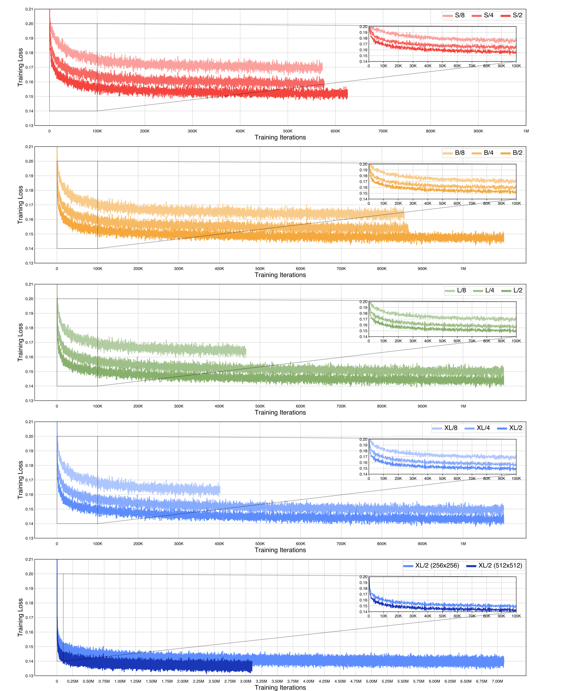

**图 13：所有 DiT 模型的训练损失曲线。** 图中展示了所有 DiT 模型的损失随训练过程的变化，损失为噪声预测均方误差与 $D_{\mathrm{KL}}$ 之和。同时突出展示了训练早期的行为。注意，更大规模的 DiT 模型具有更低的训练损失。

## 附录 D VAE 解码器消融实验

我们的所有实验都使用现成的预训练 VAE。
VAE 模型 ft-MSE 与 ft-EMA 是原始 LDM“f8”模型的微调版本，只有解码器权重经过微调。
在第 5 节的规模扩展分析中，我们使用 ft-MSE 解码器监测指标，而表 2 和表 3 中的最终指标使用 ft-EMA 解码器。
本节对三种 VAE 解码器进行消融：LDM 使用的原始解码器，以及 Stable Diffusion 使用的两个微调解码器。
由于这些模型的编码器完全相同，因此可以直接替换解码器，无需重新训练扩散模型。
表 5 展示了结果：即使使用 LDM 解码器，XL/2 仍然优于此前所有扩散模型。

**表 5：解码器消融实验。** 我们测试了 <https://huggingface.co/stabilityai/sd-vae-ft-mse> 提供的不同预训练 VAE 解码器权重。在 ImageNet 256×256 上，不同预训练解码器权重取得了相近结果。以下模型均为类别条件 DiT-XL/2-G，`cfg=1.5`。

| 解码器 | FID ↓ | sFID ↓ | IS ↑ | 精确率 ↑ | 召回率 ↑ |
| --- | ---: | ---: | ---: | ---: | ---: |
| original（原始版） | 2.46 | 5.18 | 271.56 | 0.82 | 0.57 |
| ft-MSE | 2.30 | 4.73 | 276.09 | 0.83 | 0.57 |
| ft-EMA | 2.27 | 4.60 | 278.24 | 0.83 | 0.57 |

**表 6：采用 U-Net 骨干网络的基线扩散模型的 Gflops。** 注意，我们只计算 DDPM 部分的浮点运算量。

| 模型 | 图像分辨率 | 基础模型运算量（G） | 上采样器运算量（G） | 总运算量（G） |
| --- | --- | ---: | ---: | ---: |
| ADM | 128×128 | 307 | — | 307 |
| ADM | 256×256 | 1120 | — | 1120 |
| ADM | 512×512 | 1983 | — | 1983 |
| ADM-U | 256×256 | 110 | 632 | 742 |
| ADM-U | 512×512 | 307 | 2506 | 2813 |
| LDM-4 | 256×256 | 104 | — | 104 |
| LDM-8 | 256×256 | 57 | — | 57 |

## 附录图集：未经筛选的生成样例（图 14–33）

### 512×512 分辨率

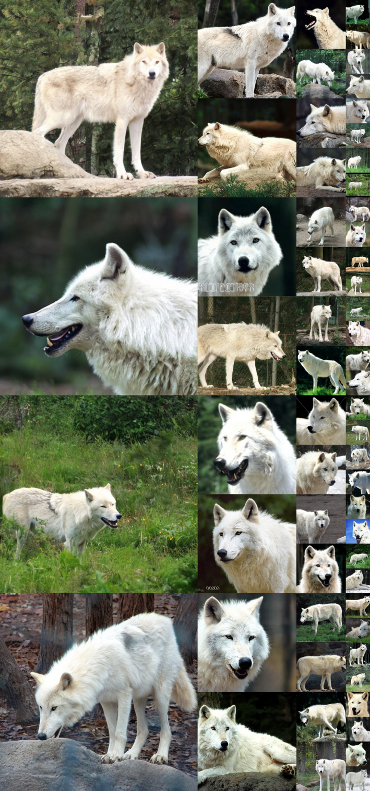

**图 14：未经筛选的 512×512 DiT-XL/2 样例。** 无分类器引导强度为 4.0；类别标签为“北极狼”（arctic wolf，270）。

**图 15：未经筛选的 512×512 DiT-XL/2 样例。** 无分类器引导强度为 4.0；类别标签为“火山”（volcano，980）。

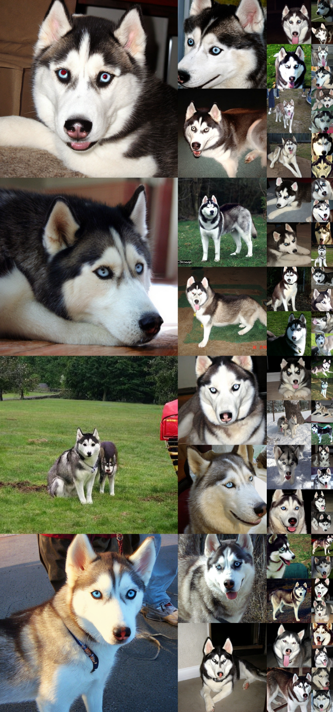

**图 16：未经筛选的 512×512 DiT-XL/2 样例。** 无分类器引导强度为 4.0；类别标签为“哈士奇”（husky，250）。

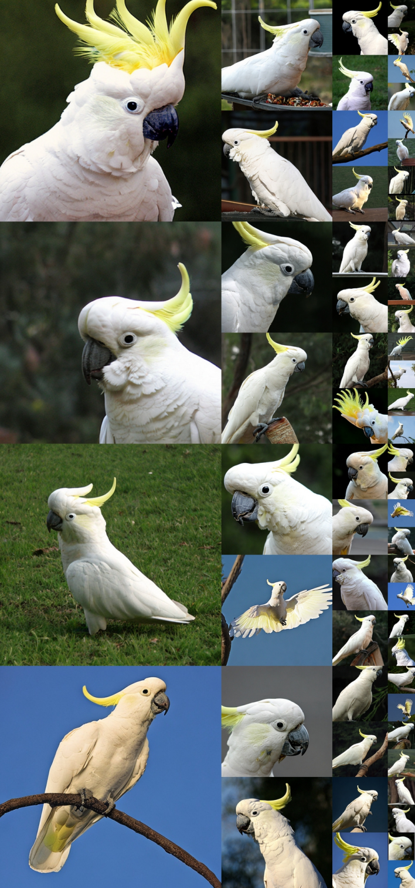

**图 17：未经筛选的 512×512 DiT-XL/2 样例。** 无分类器引导强度为 4.0；类别标签为“葵花凤头鹦鹉”（sulphur-crested cockatoo，89）。

**图 18：未经筛选的 512×512 DiT-XL/2 样例。** 无分类器引导强度为 4.0；类别标签为“悬崖”（cliff drop-off，972）。

**图 19：未经筛选的 512×512 DiT-XL/2 样例。** 无分类器引导强度为 4.0；类别标签为“气球”（balloon，417）。

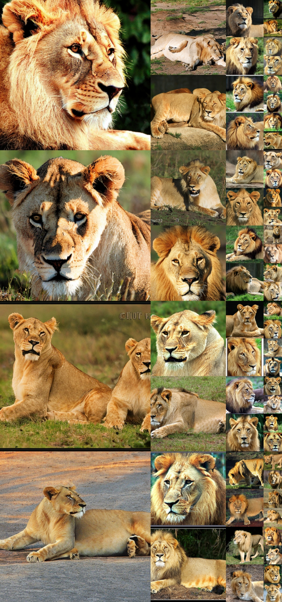

**图 20：未经筛选的 512×512 DiT-XL/2 样例。** 无分类器引导强度为 4.0；类别标签为“狮子”（lion，291）。

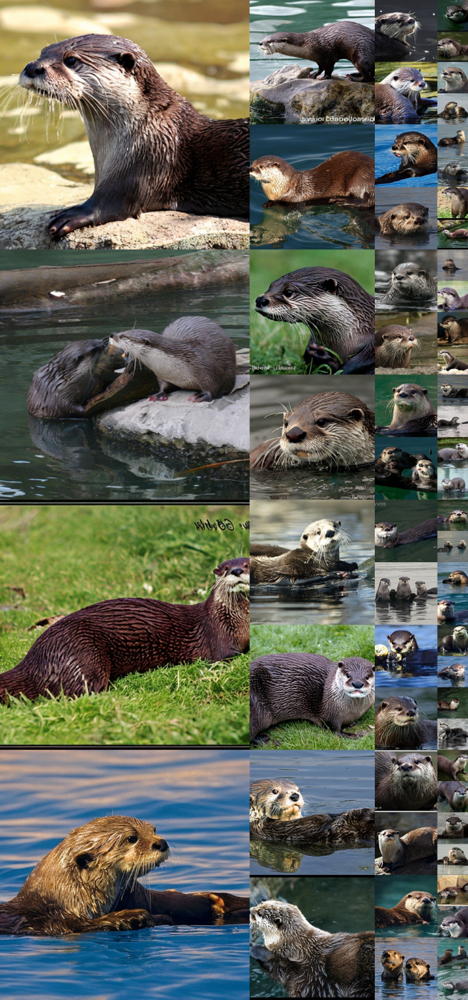

**图 21：未经筛选的 512×512 DiT-XL/2 样例。** 无分类器引导强度为 4.0；类别标签为“水獭”（otter，360）。

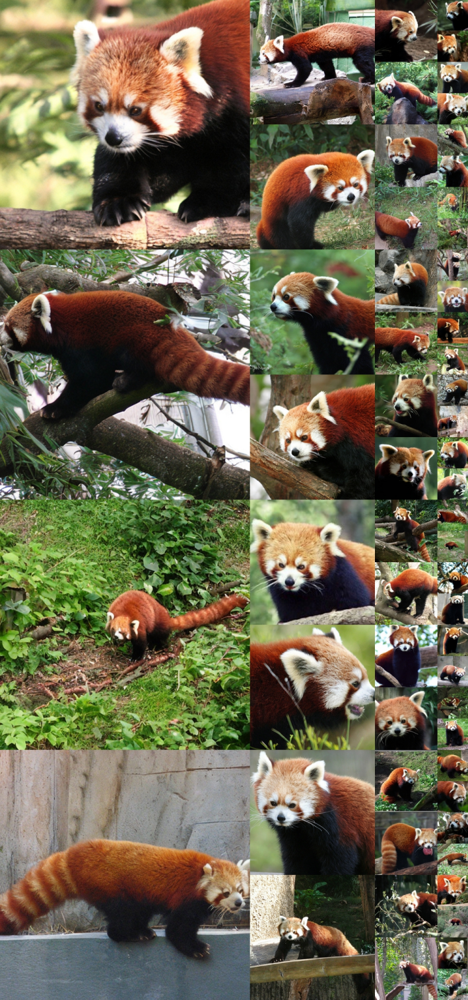

**图 22：未经筛选的 512×512 DiT-XL/2 样例。** 无分类器引导强度为 2.0；类别标签为“小熊猫”（red panda，387）。

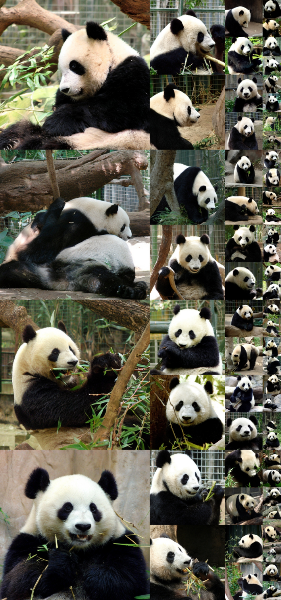

**图 23：未经筛选的 512×512 DiT-XL/2 样例。** 无分类器引导强度为 2.0；类别标签为“大熊猫”（panda，388）。

**图 24：未经筛选的 512×512 DiT-XL/2 样例。** 无分类器引导强度为 1.5；类别标签为“珊瑚礁”（coral reef，973）。

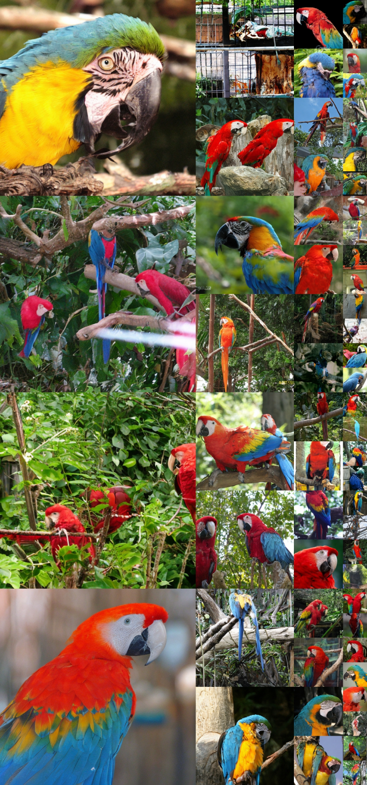

**图 25：未经筛选的 512×512 DiT-XL/2 样例。** 无分类器引导强度为 1.5；类别标签为“金刚鹦鹉”（macaw，88）。

### 256×256 分辨率

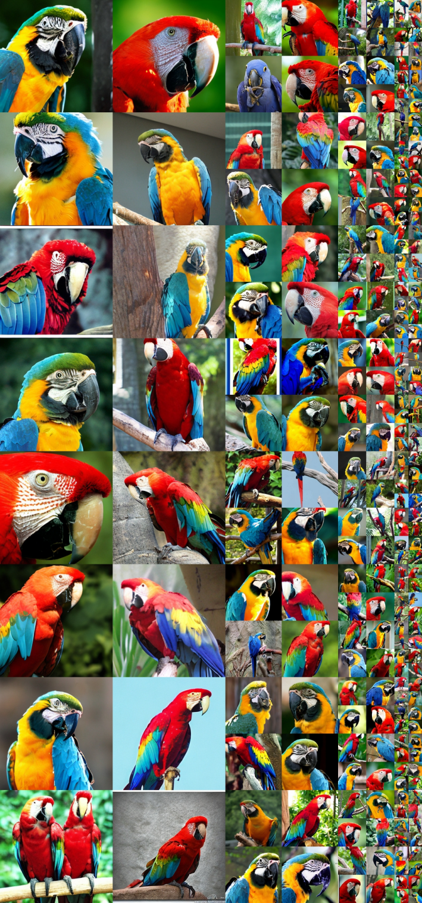

**图 26：未经筛选的 256×256 DiT-XL/2 样例。** 无分类器引导强度为 4.0；类别标签为“金刚鹦鹉”（macaw，88）。

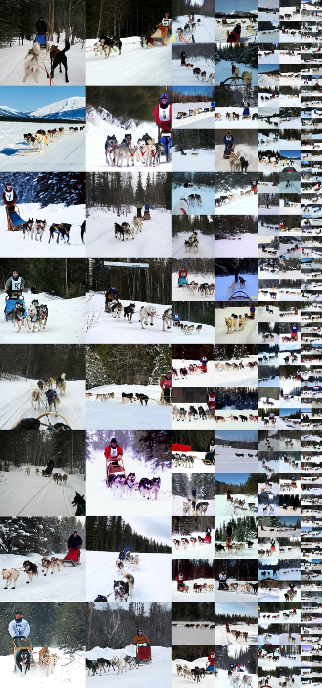

**图 27：未经筛选的 256×256 DiT-XL/2 样例。** 无分类器引导强度为 4.0；类别标签为“狗拉雪橇”（dog sled，537）。

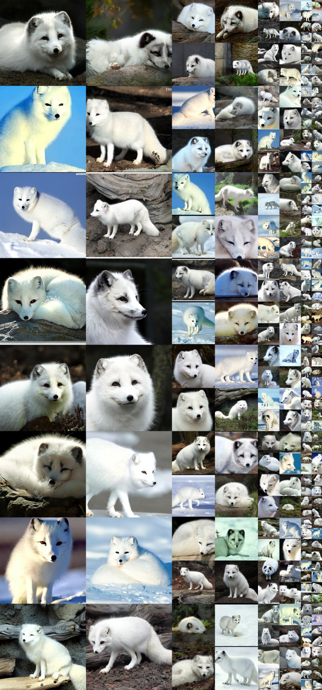

**图 28：未经筛选的 256×256 DiT-XL/2 样例。** 无分类器引导强度为 4.0；类别标签为“北极狐”（arctic fox，279）。

**图 29：未经筛选的 256×256 DiT-XL/2 样例。** 无分类器引导强度为 4.0；类别标签为“蠵龟”（loggerhead sea turtle，33）。

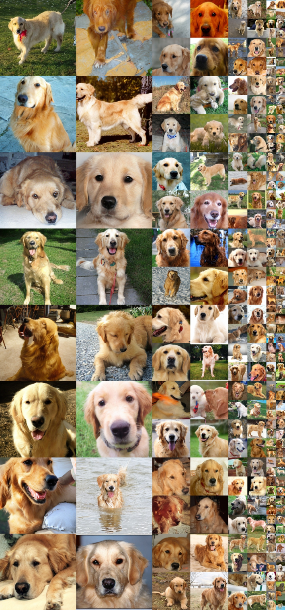

**图 30：未经筛选的 256×256 DiT-XL/2 样例。** 无分类器引导强度为 2.0；类别标签为“金毛寻回犬”（golden retriever，207）。

**图 31：未经筛选的 256×256 DiT-XL/2 样例。** 无分类器引导强度为 2.0；类别标签为“湖岸”（lake shore，975）。

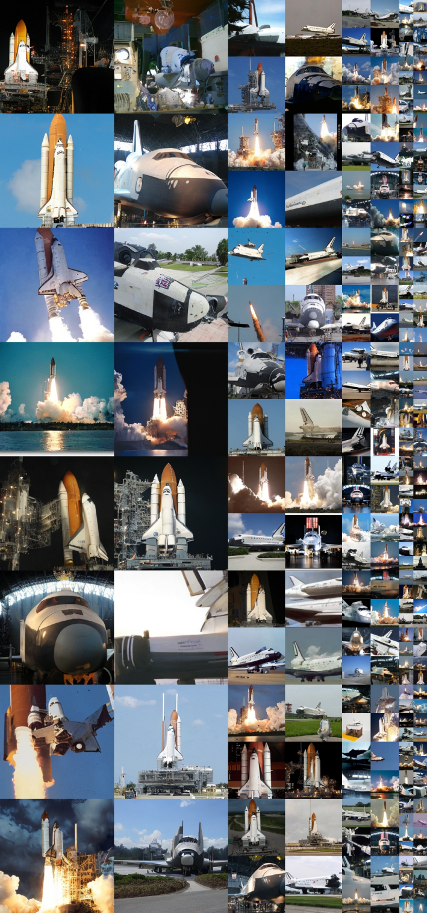

**图 32：未经筛选的 256×256 DiT-XL/2 样例。** 无分类器引导强度为 1.5；类别标签为“航天飞机”（space shuttle，812）。

**图 33：未经筛选的 256×256 DiT-XL/2 样例。** 无分类器引导强度为 1.5；类别标签为“冰淇淋”（ice cream，928）。
