# 面向生成建模的流匹配

**作者：** Yaron Lipman^1,2^、Ricky T. Q. Chen^1^、Heli Ben-Hamu^2^、Maximilian Nickel^1^、Matt Le^1^
**机构：** ^1^Meta AI (FAIR)；^2^魏茨曼科学研究所（Weizmann Institute of Science）
**版本：** arXiv:2210.02747v2 [cs.LG]，2023 年 2 月 8 日；预印本（Preprint）。
**原文件：** `Flow-matching.pdf`（共 28 页，正文第 1–10 页，参考文献第 10–13 页，附录第 14–28 页）。

> 译稿按原文句子顺序逐句展开，一句原文对应一行中文译句；公式、定理、引理、图、表与参考文献的编号均与原文一一对应，正文中的引用编号保留原样，文献条目请查阅原 PDF 第 10–13 页。
> 术语沿用同一工作区中既有译稿（`DDPM_中文翻译.md`、`SDE_中文翻译.md`）的译法：score 译为“得分”（即对数概率密度对数据的梯度），flow 译为“流”，probability path 译为“概率路径”，vector field 译为“向量场”，Continuous Normalizing Flow 译为“连续归一化流（CNF）”，Optimal Transport 译为“最优传输（OT）”，marginal 译为“边缘”。作者姓名、模型名、数据集名、文献检索标识与代码标识保留原形式。
> 原文中有几处记号笔误（例如式（16）左边写作 $p_t(x)$、式（20）中把 $\mu_t(x_1),\sigma_t(x_1)$ 写作 $\mu_t(x),\sigma_t(x)$），译稿按原文如实保留，并在相应位置以“译注”说明。
> 原文的判断均指论文发表时；“最先进”等说法未经改写。
> 全文 17 幅插图按原 PDF 版面裁切后存放在 `Flow-matching_译文图像/` 目录，并嵌在对应图注上方；图内文字的中文对应说明列在图注下方（以“图中文字”标出）。

> **阅读说明：** 下文新增的“注释”只用于解释直觉、符号和公式之间的关系，不是原论文内容。建议先看注释理解整体逻辑，再回看相邻的原文和公式。

## 摘要

我们提出一种建立在连续归一化流（CNF）之上的生成建模范式，它使我们能够以前所未有的规模训练 CNF。
具体而言，我们提出流匹配（Flow Matching，FM）这一概念：它是一种免模拟（simulation-free）的训练 CNF 的方法，其做法是回归固定的条件概率路径所对应的向量场。

> **注释：什么叫“免模拟”？** 训练时不必先把 ODE 从 \(t=0\) 数值积分到 \(t=1\)，再根据最终结果计算损失。只要能直接采样某个时刻的 \(x_t\)，并计算该时刻应该具有的速度 \(u_t\)，就可以像训练普通回归网络一样训练 \(v_t\)。ODE 数值求解主要留到生成样本或计算似然时使用。

流匹配与一大类用于在噪声与数据样本之间进行变换的高斯概率路径兼容，而现有的扩散路径只是其中的特例。
有趣的是，我们发现把 FM 用于扩散路径，可以为训练扩散模型提供一种更稳健、更稳定的替代方案。
此外，流匹配还为使用其他非扩散概率路径来训练 CNF 打开了大门。
其中特别值得关注的一个例子，是用最优传输（OT）位移插值来定义条件概率路径。
这些路径比扩散路径更高效，训练和采样更快，并且带来更好的泛化性能。
在 ImageNet 上使用流匹配训练 CNF，无论从似然还是样本质量来看都稳定优于其他基于扩散的方法，并且能够借助现成的数值 ODE 求解器实现快速而可靠的样本生成。

## 1 引言

深度生成模型是一类深度学习算法，其目标是对未知的数据分布进行估计并从中采样。
近来生成建模领域涌现出大量令人瞩目的进展（例如图像生成 Ramesh et al. (2022); Rombach et al. (2022)），这主要得益于基于扩散的模型 Ho et al. (2020); Song et al. (2020b) 可扩展且相对稳定的训练。
然而，局限于简单扩散过程会使可用的采样概率路径空间相当狭窄，从而导致训练时间极长，并且需要采用专门方法（例如 Song et al. (2020a); Zhang & Chen (2022)）才能实现高效采样。
在这项工作中，我们考虑连续归一化流（CNF；Chen et al. (2018)）这一通用且确定性的框架。
CNF 能够对任意的概率路径建模，尤其已知它涵盖了扩散过程所建模的那些概率路径（Song et al., 2021）。
然而，除了可以通过去噪得分匹配（Vincent, 2011）等方式高效训练的扩散之外，此前并不知道有任何可扩展的 CNF 训练算法。
事实上，最大似然训练（例如 Grathwohl et al. (2018)）需要昂贵的数值 ODE 模拟，而现有的免模拟方法要么涉及难以处理的积分（Rozen et al., 2021），要么存在有偏梯度（Ben-Hamu et al., 2022）。
本文的目标是提出流匹配（FM）：一种高效、免模拟的 CNF 模型训练方法，它允许采用一般性的概率路径来监督 CNF 训练。
重要的是，FM 打破了在扩散之外进行可扩展 CNF 训练的障碍，并且绕开了对扩散过程的推理，直接与概率路径打交道。

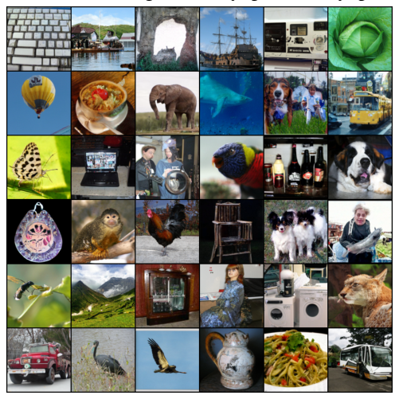

**图 1：** 使用带最优传输概率路径的流匹配所训练出的 CNF，其在无条件 ImageNet-128 上的样本。

具体来说，我们提出流匹配目标（第 3 节）：一个简单而直观的训练目标，用于回归到能够生成所需概率路径的目标向量场。
我们首先说明，可以通过逐样本（即条件）的表述来构造这样的目标向量场。
随后，受去噪得分匹配的启发，我们说明一个称为条件流匹配（CFM）的逐样本训练目标能够给出等价的梯度，并且不需要显式地知道那个难以处理的目标向量场。
此外，我们讨论可用于流匹配的一整类逐样本概率路径（第 4 节），它把现有的扩散路径作为特例包含在内。
即使是在扩散路径上，我们也发现使用 FM 能带来更稳健、更稳定的训练，并取得优于得分匹配的性能。
此外，这一概率路径族还包含一个特别有意思的情形：对应于最优传输（OT）位移插值（McCann, 1997）的向量场。
我们发现条件 OT 路径比扩散路径更简单：它们形成直线轨迹，而扩散路径则产生弯曲路径。
这些性质在经验上似乎转化为更快的训练、更快的生成以及更好的性能。
我们在 ImageNet——一个规模庞大且高度多样的图像数据集——上，对流匹配以及基于最优传输路径的构造进行了实证验证。
我们发现，可以轻松地训练模型，使其在同类基于扩散方法中，于似然估计与样本质量两方面都取得有竞争力的表现。
此外，我们发现与先前方法相比，我们的模型在计算开销与样本质量之间给出了更好的折中。
图 1 展示了从我们的模型中挑选出的无条件 ImageNet 128×128 样本。

## 2 预备知识：连续归一化流

设 $\mathbb{R}^d$ 表示数据空间，其中数据点 $x=(x_1,\ldots,x_d)\in\mathbb{R}^d$。
本文用到两个重要对象：一是概率密度路径 $p:[0,1]\times\mathbb{R}^d\to\mathbb{R}_{>0}$，它是一个随时间变化的概率密度函数，即 $\int p_t(x)\,dx=1$；二是随时间变化的向量场 $v:[0,1]\times\mathbb{R}^d\to\mathbb{R}^d$。
向量场 $v_t$ 可用于构造一个随时间变化的微分同胚映射，称为流，记作 $\varphi:[0,1]\times\mathbb{R}^d\to\mathbb{R}^d$，它由如下常微分方程（ODE）定义：

$$\frac{d}{dt}\varphi_t(x)=v_t(\varphi_t(x))\tag{1}$$

$$\varphi_0(x)=x\tag{2}$$

> **注释：如何理解式（1）？** 把 \(x\) 想象成一颗粒子。粒子在时刻 \(t\) 的位置是 \(\varphi_t(x)\)，而 \(v_t(\varphi_t(x))\) 是该位置处的瞬时速度。给定初始位置后，沿着速度场求解 ODE，就得到粒子从噪声到数据的运动轨迹。

此前，Chen et al. (2018) 提出用神经网络 $v_t(x;\theta)$ 来建模向量场 $v_t$，其中 $\theta\in\mathbb{R}^p$ 是其可学习参数；这进而给出流 $\varphi_t$ 的一个深层参数化模型，称为连续归一化流（CNF）。
CNF 通过推前方程把简单的先验密度 $p_0$（例如纯噪声）重塑为更复杂的密度 $p_1$：

$$p_t=[\varphi_t]_{*}p_0\tag{3}$$

> **注释：推前（pushforward）是什么意思？** 先从 \(p_0\) 抽取一个样本 \(x_0\)，再用映射 \(x_t=\varphi_t(x_0)\) 变换它；所有变换后样本的分布就是 \(p_t\)。因此，CNF 的生成过程是“先采样简单噪声，再用可逆流变换”。

其中推前（或变量替换）算子 $*$ 定义为

$$[\varphi_t]_{*}p_0(x)=p_0(\varphi_t^{-1}(x))\det\!\left[\frac{\partial\varphi_t^{-1}}{\partial x}(x)\right].\tag{4}$$

如果向量场 $v_t$ 的流 $\varphi_t$ 满足式（3），则称 $v_t$ 生成概率密度路径 $p_t$。
检验一个向量场是否生成某条概率路径的一个实用方法是使用连续性方程，它是我们证明中的关键组成部分，见附录 B。
我们在附录 C 中回顾了更多关于 CNF 的信息，特别是如何计算任意点 $x\in\mathbb{R}^d$ 处的概率 $p_1(x)$。

## 3 流匹配

设 $x_1$ 表示服从某个未知数据分布 $q(x_1)$ 的随机变量。
我们假设只能获取来自 $q(x_1)$ 的数据样本，而无法获取密度函数本身。
此外，设 $p_t$ 为一条概率路径，使得 $p_0=p$ 是一个简单分布，例如标准正态分布 $p(x)=\mathcal{N}(x|0,I)$，并设 $p_1$ 在分布上近似等于 $q$。
我们稍后将讨论如何构造这样的路径。
流匹配目标的设计目的就是匹配这一目标概率路径，从而使我们能够从 $p_0$ 流到 $p_1$。

> **脚注 1：** 我们用下标表示时间参数，例如 $p_t(x)$。

给定目标概率密度路径 $p_t(x)$ 以及生成它的相应向量场 $u_t(x)$，我们把流匹配（FM）目标定义为

$$\mathcal{L}_{\mathrm{FM}}(\theta)=\mathbb{E}_{t,p_t(x)}\|v_t(x)-u_t(x)\|^2,\tag{5}$$

其中 $\theta$ 表示 CNF 向量场 $v_t$ 的可学习参数（如第 2 节所定义），$t\sim\mathcal{U}[0,1]$（均匀分布），且 $x\sim p_t(x)$。
简单来说，FM 损失是用神经网络 $v_t$ 去回归向量场 $u_t$。
当损失降到零时，学到的 CNF 模型将生成 $p_t(x)$。

> **注释：FM 实际在回归什么？** \(u_t(x)\) 是“在位置 \(x\)、时间 \(t\) 应该往哪里移动”的真实速度，\(v_t(x;\theta)\) 是神经网络给出的速度预测。训练并不是直接让网络预测最终图像，而是让它学会每一个中间时刻的运动方向。

流匹配是一个简单而有吸引力的目标，但若仅按字面直接使用，它在实践中是难以处理的，因为我们事先并不知道什么样的 $p_t$ 和 $u_t$ 才是合适的。
有许多概率路径都能满足 $p_1(x)\approx q(x)$，而更重要的是，我们通常无法获得能生成所需 $p_t$ 的 $u_t$ 的闭式表达。
在本节中，我们说明可以用仅在逐样本意义上定义的概率路径和向量场来构造 $p_t$ 和 $u_t$，并通过对它们做恰当的聚合来得到所需的 $p_t$ 和 $u_t$。
此外，这一构造使我们能够为流匹配建立一个容易处理得多的目标。

### 3.1 由条件概率路径与条件向量场构造 $p_t$、$u_t$

构造目标概率路径的一个简单办法，是把更简单的概率路径混合起来：
给定一个具体的数据样本 $x_1$，我们用 $p_t(x|x_1)$ 表示一条条件概率路径，它满足在时刻 $t=0$ 时 $p_0(x|x_1)=p(x)$；并且我们设计在 $t=1$ 时的 $p_1(x|x_1)$ 为一个集中在 $x=x_1$ 附近的分布，例如 $p_1(x|x_1)=\mathcal{N}(x|x_1,\sigma^2 I)$，即以 $x_1$ 为均值、标准差 $\sigma>0$ 足够小的正态分布。
把条件概率路径对 $q(x_1)$ 求边缘化，就得到边缘概率路径

$$p_t(x)=\int p_t(x|x_1)q(x_1)\,dx_1,\tag{6}$$

> **注释：为什么要引入条件路径？** 对每个真实样本 \(x_1\)，都可以单独设计一条“噪声 \(\rightarrow x_1\)”的简单路径。式（6）把所有训练样本对应的路径混合起来，形成整体的生成路径。实际训练时只需随机取一个样本 \(x_1\)，不需要计算这个高维积分。

特别地，在时刻 $t=1$，边缘概率 $p_1$ 是一个紧密近似数据分布 $q$ 的混合分布，

$$p_1(x)=\int p_1(x|x_1)q(x_1)\,dx_1\approx q(x).\tag{7}$$

有趣的是，我们还可以按如下方式对条件向量场做“边缘化”，从而定义边缘向量场（我们假设对所有 $t$ 和 $x$ 都有 $p_t(x)>0$）：

$$u_t(x)=\int u_t(x|x_1)\frac{p_t(x|x_1)q(x_1)}{p_t(x)}\,dx_1,\tag{8}$$

> **注释：式（8）的权重是什么？**
>
> \(\frac{p_t(x|x_1)q(x_1)}{p_t(x)}\) 就是给定当前状态 \(x_t=x\) 后，样本来源为 \(x_1\) 的后验权重。也就是说，边缘速度是所有可能条件速度的后验加权平均，而不是简单的算术平均。

其中 $u_t(\cdot|x_1):\mathbb{R}^d\to\mathbb{R}^d$ 是生成 $p_t(\cdot|x_1)$ 的条件向量场。
这一点或许并不显然，但以这种方式聚合条件向量场，确实能得到建模边缘概率路径所需的正确向量场。
我们的第一个关键观察是：

**边缘向量场（式 8）生成边缘概率路径（式 6）。**

这在条件向量场（即生成条件概率路径的那些向量场）与边缘向量场（即生成边缘概率路径的那个向量场）之间建立了一个出人意料的联系。
这一联系使我们能把未知且难以处理的边缘向量场分解为更简单的条件向量场；后者定义起来要简单得多，因为它们只依赖于单个数据样本。
我们在下面的定理中把这一点形式化。

**定理 1.** 给定生成条件概率路径 $p_t(x|x_1)$ 的向量场 $u_t(x|x_1)$，则对任意分布 $q(x_1)$，式（8）中的边缘向量场 $u_t$ 生成式（6）中的边缘概率路径 $p_t$；也就是说，$u_t$ 与 $p_t$ 满足连续性方程（式 26）。

我们所有定理的完整证明都放在附录 A 中。
定理 1 也可以由 Peluchetti (2021) 中的扩散混合表示定理推出，该定理给出了扩散 SDE 中边缘漂移系数与扩散系数的公式。

### 3.2 条件流匹配

遗憾的是，由于边缘概率路径与边缘向量场的定义中（式 6 与式 8）含有难以处理的积分，计算 $u_t$ 依然难以处理；因此，直接计算原始流匹配目标的无偏估计量也是难以处理的。
作为替代，我们提出一个更简单的目标，而它出人意料地会得到与原始目标相同的最优解。
具体来说，我们考虑条件流匹配（CFM）目标

$$\mathcal{L}_{\mathrm{CFM}}(\theta)=\mathbb{E}_{t,q(x_1),p_t(x|x_1)}\bigl\|v_t(x)-u_t(x|x_1)\bigr\|^2,\tag{9}$$

其中 $t\sim\mathcal{U}[0,1]$，$x_1\sim q(x_1)$，而此处 $x\sim p_t(x|x_1)$。
与 FM 目标不同，CFM 目标允许我们轻松地抽取无偏估计，只要我们能高效地从 $p_t(x|x_1)$ 中采样并计算出 $u_t(x|x_1)$ 即可；而这两件事都很容易做到，因为它们是在逐样本的基础上定义的。

> **注释：为什么 CFM 可以替代 FM？** FM 的目标 \(u_t(x)\) 包含式（8）中的积分，训练时难以直接计算；CFM 改为先随机抽取 \(x_1\)，再从已知的 \(p_t(x|x_1)\) 采样。定理 2 说明两者对网络参数的梯度相同，所以 CFM 虽然看起来改变了目标，优化方向却没有改变。
因此，我们的第二个关键观察是：

**FM 目标（式 5）与 CFM 目标（式 9）关于 $\theta$ 的梯度完全相同。**

也就是说，优化 CFM 目标在期望意义下等价于优化 FM 目标。
因此，这使我们能够训练一个 CNF 去生成边缘概率路径 $p_t$——它在 $t=1$ 时特别地近似未知的数据分布 $q$——而全程都不需要访问边缘概率路径或边缘向量场。
我们只需设计合适的条件概率路径与条件向量场。
我们在下面的定理中把这一性质形式化。

**定理 2.** 假设对所有 $x\in\mathbb{R}^d$ 和 $t\in[0,1]$ 都有 $p_t(x)>0$，则在不计一个与 $\theta$ 无关的常数的意义下，$\mathcal{L}_{\mathrm{CFM}}$ 与 $\mathcal{L}_{\mathrm{FM}}$ 相等。因此，$\nabla_\theta\mathcal{L}_{\mathrm{FM}}(\theta)=\nabla_\theta\mathcal{L}_{\mathrm{CFM}}(\theta)$。

## 4 条件概率路径与条件向量场

条件流匹配目标对条件概率路径与条件向量场的选择没有任何限制。
在本节中，我们讨论在一大类高斯条件概率路径下 $p_t(x|x_1)$ 与 $u_t(x|x_1)$ 的构造。
具体而言，我们考虑如下形式的条件概率路径

$$p_t(x|x_1)=\mathcal{N}\bigl(x\mid\mu_t(x_1),\sigma_t(x_1)^2I\bigr),\tag{10}$$

> **注释：式（10）的含义。** 在给定数据样本 \(x_1\) 后，时刻 \(t\) 的状态 \(x_t\) 是一个高斯随机变量。\(\mu_t\) 控制它的中心从噪声位置移动到数据位置，\(\sigma_t\) 控制噪声强弱从大变小。

其中 $\mu:[0,1]\times\mathbb{R}^d\to\mathbb{R}^d$ 是该高斯分布随时间变化的均值，而 $\sigma:[0,1]\times\mathbb{R}\to\mathbb{R}_{>0}$ 描述一个随时间变化的标量标准差（std）。
我们设 $\mu_0(x_1)=0$、$\sigma_0(x_1)=1$，使得所有条件概率路径在 $t=0$ 时都收敛到同一个标准高斯噪声分布 $p(x)=\mathcal{N}(x|0,I)$。
然后我们设 $\mu_1(x_1)=x_1$、$\sigma_1(x_1)=\sigma_{\min}$，其中 $\sigma_{\min}$ 取得足够小，使 $p_1(x|x_1)$ 成为以 $x_1$ 为中心的集中高斯分布。
生成任何一条特定概率路径的向量场都有无穷多个（例如，在连续性方程中加入一个无散度分量，见式 26），但其中绝大多数源于那些使底层分布保持不变的分量——例如当分布具有旋转不变性时的旋转分量——这会带来不必要的额外计算。
我们决定采用对应于高斯分布规范变换的最简单向量场。
具体来说，考虑（以 $x_1$ 为条件的）流

$$\psi_t(x)=\sigma_t(x_1)x+\mu_t(x_1).\tag{11}$$

当 $x$ 服从标准高斯分布时，$\psi_t(x)$ 是一个仿射变换，它把 $x$ 映为均值为 $\mu_t(x_1)$、标准差为 $\sigma_t(x_1)$ 的正态随机变量。
也就是说，根据式（4），$\psi_t$ 把噪声分布 $p_0(x|x_1)=p(x)$ 推到 $p_t(x|x_1)$，即

$$[\psi_t]_{*}p(x)=p_t(x|x_1).\tag{12}$$

这个流随即给出一个生成该条件概率路径的向量场：

$$\frac{d}{dt}\psi_t(x)=u_t(\psi_t(x)|x_1).\tag{13}$$

把 $p_t(x|x_1)$ 只用 $x_0$ 重新参数化，并把式（13）代入 CFM 损失，我们得到

$$\mathcal{L}_{\mathrm{CFM}}(\theta)=\mathbb{E}_{t,q(x_1),p(x_0)}\left\|v_t(\psi_t(x_0))-\frac{d}{dt}\psi_t(x_0)\right\|^2.\tag{14}$$

由于 $\psi_t$ 是一个简单的（可逆）仿射映射，我们可以用式（13）以闭式解出 $u_t$。
对随时间变化的函数 $f$，记 $f'$ 为对时间的导数，即 $f'=\frac{d}{dt}f$。

**定理 3.** 设 $p_t(x|x_1)$ 是如式（10）所示的高斯概率路径，$\psi_t$ 是其对应式（11）的流映射。则定义 $\psi_t$ 的向量场唯一，且具有如下形式：

$$u_t(x|x_1)=\frac{\sigma'_t(x_1)}{\sigma_t(x_1)}\bigl(x-\mu_t(x_1)\bigr)+\mu'_t(x_1).\tag{15}$$

> **注释：如何读式（15）？** 第二项 \(\mu'_t\) 是整体平移速度；第一项与 \(x-\mu_t\) 成正比，表示样本相对于当前高斯中心的偏离会被缩放。若标准差在减小，\(\sigma'_t<0\)，这一项会把粒子拉向高斯中心。

因此，$u_t(x|x_1)$ 生成高斯路径 $p_t(x|x_1)$。

### 4.1 高斯条件概率路径的特殊情形

我们的表述对任意的函数 $\mu_t(x_1)$ 与 $\sigma_t(x_1)$ 完全通用，我们可以把它们取为任何满足所需边界条件的可微函数。
我们首先讨论那些能够还原出与以往所用扩散过程相对应的概率路径的特殊情形。
由于我们直接与概率路径打交道，我们完全可以不再去推理扩散过程。
因此，在下面的第二个例子中，我们直接基于 Wasserstein-2 最优传输解构造一条概率路径，作为一个有意思的实例。

**例 I：扩散条件向量场。**
扩散模型从数据点出发，逐步加入噪声，直到其近似为纯噪声。

> **注释：这里的时间方向容易混淆。** 传统扩散文献通常把 \(t=0\) 设为数据、\(t=1\) 设为噪声；本文为了生成方便，采用相反的约定：\(t=0\) 是噪声，\(t=1\) 是数据。因此公式中经常出现 \(1-t\)，表示把传统扩散时间反过来使用。

这些过程可以被表述为随机过程，而这类过程为了在任意时刻 $t$ 获得闭式表示有着严格的要求，最终得到的是均值 $\mu_t(x_1)$ 与标准差 $\sigma_t(x_1)$ 取特定选择的高斯条件概率路径 $p_t(x|x_1)$（Sohl-Dickstein et al., 2015; Ho et al., 2020; Song et al., 2020b）。
例如，反向（噪声→数据）的方差爆炸（VE）路径具有如下形式

$$p_t(x)=\mathcal{N}\bigl(x\,|\,x_1,\sigma^2_{1-t}I\bigr),\tag{16}$$

其中 $\sigma_t$ 是递增函数，$\sigma_0=0$，且 $\sigma_1\gg1$。

> **译注：** 式（16）是条件概率路径，按上下文左边应为 $p_t(x|x_1)$，原文此处写作 $p_t(x)$；译稿保留原样，特此说明。

接下来，式（16）给出了 $\mu_t(x_1)=x_1$ 与 $\sigma_t(x_1)=\sigma_{1-t}$ 这两个选择。
把它们代入定理 3 的式（15），我们得到

$$u_t(x|x_1)=-\frac{\sigma'_{1-t}}{\sigma_{1-t}}(x-x_1).\tag{17}$$

反向（噪声→数据）的方差保持（VP）扩散路径具有如下形式

$$p_t(x|x_1)=\mathcal{N}\Bigl(x\;\Big|\;\alpha_{1-t}x_1,\;\bigl(1-\alpha^2_{1-t}\bigr)I\Bigr),\quad\text{其中}\ \ \alpha_t=e^{-\frac{1}{2}T(t)},\ \ T(t)=\int_0^t\beta(s)\,ds,\tag{18}$$

其中 $\beta$ 是噪声尺度函数。
式（18）给出了 $\mu_t(x_1)=\alpha_{1-t}x_1$ 与 $\sigma_t(x_1)=\sqrt{1-\alpha^2_{1-t}}$ 这两个选择。
把它们代入定理 3 的式（15），我们得到

$$u_t(x|x_1)=\frac{\alpha'_{1-t}}{1-\alpha^2_{1-t}}\bigl(\alpha_{1-t}x-x_1\bigr)=-\frac{T'(1-t)}{2}\left[\frac{e^{-T(1-t)}x-e^{-\frac{1}{2}T(1-t)}x_1}{1-e^{-T(1-t)}}\right].\tag{19}$$

当限定在这些条件扩散过程上时，我们对条件向量场 $u_t(x|x_1)$ 的构造确实与确定性概率流中所用的向量场（Song et al. (2020b)，式 13）一致；细节见附录 D。
尽管如此，把扩散条件向量场与流匹配目标结合起来，为现有的得分匹配方法提供了一种有吸引力的训练替代方案——在我们的实验中，我们发现它更稳定、更稳健。
另一个重要观察是：由于这些概率路径此前是作为扩散过程的解推导出来的，它们实际上并不会在有限时间内到达真正的噪声分布。

> **注释：这句话的实际含义。** 某些扩散噪声调度只有在时间趋于无穷时才会完全变成标准高斯；在有限区间 \([0,1]\) 内，\(p_0\) 只是对纯噪声的近似。流匹配直接指定 \(\mu_t,\sigma_t\)，所以可以把端点和整个路径设计得更加明确。

在实践中，人们只是用一个合适的高斯分布来近似 $p_0(x)$，用于采样与似然评估。
与此不同，我们的构造对概率路径提供了完全的控制，我们可以直接设定 $\mu_t$ 与 $\sigma_t$，正如我们接下来要做的。

**例 II：最优传输条件向量场。**
对条件概率路径而言，一个或许更自然的选择是让均值与标准差简单地随时间线性变化，即

$$\mu_t(x)=tx_1,\qquad\text{以及}\qquad\sigma_t(x)=1-(1-\sigma_{\min})t.\tag{20}$$

> **译注：** 按前文记号，这里的自变量应为数据样本 $x_1$，即 $\mu_t(x_1)$、$\sigma_t(x_1)$；原文此处写作 $\mu_t(x)$、$\sigma_t(x)$，译稿保留原样。

根据定理 3，这条路径由如下向量场生成

$$u_t(x|x_1)=\frac{x_1-(1-\sigma_{\min})x}{1-(1-\sigma_{\min})t},\tag{21}$$

与扩散条件向量场（式 19）不同，它在整个 $t\in[0,1]$ 上都有定义。
对应于 $u_t(x|x_1)$ 的条件流是

$$\psi_t(x)=\bigl(1-(1-\sigma_{\min})t\bigr)x+tx_1,\tag{22}$$

在这种情况下，CFM 损失（见式 9、式 14）具有如下形式：

$$\mathcal{L}_{\mathrm{CFM}}(\theta)=\mathbb{E}_{t,q(x_1),p(x_0)}\left\|v_t(\psi_t(x_0))-\Bigl(x_1-(1-\sigma_{\min})x_0\Bigr)\right\|^2.\tag{23}$$

让均值与标准差线性变化，不仅带来简单直观的路径，而且它在如下意义下还是最优的。
条件流 $\psi_t(x)$ 实际上正是两个高斯分布 $p_0(x|x_1)$ 与 $p_1(x|x_1)$ 之间的最优传输（OT）位移映射。

> **注释：为什么 OT 路径是直线？** 对一个噪声粒子 \(x_0\)，式（22）直接给出 \(x_t\) 随 \(t\) 的位置。均值平移和标准差缩放都按线性规律进行，因此粒子不会像扩散路径那样先偏离、再折返，而是沿着较简单的轨迹向目标区域移动。

OT 插值（它是一条概率路径）定义为（见 McCann (1997) 中的定义 1.1）：

$$p_t=[(1-t)\mathrm{id}+t\psi]_{\star}p_0\tag{24}$$

其中 $\psi:\mathbb{R}^d\to\mathbb{R}^d$ 是把 $p_0$ 推到 $p_1$ 的 OT 映射，$\mathrm{id}$ 表示恒等映射，即 $\mathrm{id}(x)=x$，而 $(1-t)\mathrm{id}+t\psi$ 称为 OT 位移映射。
McCann (1997) 中的例 1.7 表明，在我们这种两个高斯分布（其中第一个是标准高斯）的情形下，OT 位移映射具有式（22）的形式。
直观地说，OT 位移映射下的粒子总是沿直线轨迹、以恒定速度运动。
图 3 描绘了扩散条件向量场与 OT 条件向量场的采样路径。
有趣的是，我们发现从扩散路径出发的采样轨迹可能“冲过”最终样本，造成不必要的折返，而 OT 路径则保证保持笔直。

> **注释：为什么轨迹形状会影响采样？** 数值 ODE 求解器只能用有限步数近似真实轨迹。轨迹越弯曲，越需要更多时间步才能跟上局部方向；轨迹较直时，少量函数评估也能得到较小误差，这就是 OT 路径通常具有较低 NFE 的直觉原因。

图 2 把扩散条件得分函数（典型扩散方法中的回归目标），即 $\nabla\log p_t(x|x_1)$（其中 $p_t$ 如式 18 所定义），与 OT 条件向量场（式 21）做了对比。
两个例子中的起点（$p_0$）与终点（$p_1$）高斯分布完全相同。
一个有意思的观察是，OT 向量场在时间上方向恒定，这或许使得回归任务更简单。
这一性质也可以直接从式（21）验证，因为该向量场可以写成 $u_t(x|x_1)=g(t)h(x|x_1)$ 的形式。
附录中的图 8 给出了扩散向量场的可视化。
最后我们指出，尽管条件流是最优的，这绝不意味着边缘向量场也是最优传输解。
尽管如此，我们预期边缘向量场仍然会相对简单。

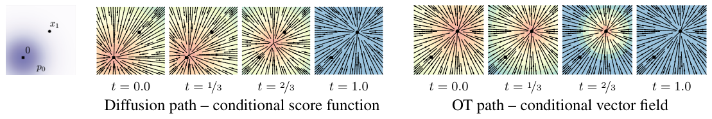

**图 2：** 与扩散路径的条件得分函数相比，OT 路径的条件向量场在时间上方向恒定，或许更容易用参数化模型拟合。注意蓝色表示较大的幅值，红色表示较小的幅值。
*图中文字：* 扩散路径——条件得分函数；OT 路径——条件向量场；$t=0.0$、$t=1/3$、$t=2/3$、$t=1.0$。

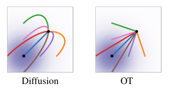

**图 3：** 扩散与 OT 轨迹。

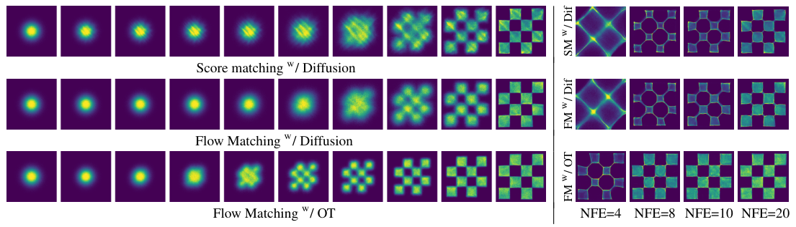

**图 4：**（左）在二维棋盘格数据上用不同目标训练出的 CNF 轨迹。OT 路径要早得多地引入棋盘格图案，而 FM 带来更稳定的训练。（右）FM 配合 OT 带来更高效的采样，此处用中点格式求解。
*图中文字：* 配合扩散的得分匹配（SM w/ Dif）；配合扩散的流匹配（FM w/ Dif）；配合 OT 的流匹配（FM w/ OT）；NFE=4、NFE=8、NFE=10、NFE=20。

## 5 相关工作

连续归一化流由 Chen et al. (2018) 提出，是归一化流的连续时间版本（综述可参见例如 Kobyzev et al. (2020); Papamakarios et al. (2021)）。
起初，CNF 用最大似然目标训练，但这涉及前向与反向传播中昂贵的 ODE 模拟；由于 ODE 模拟本质上是串行的，其时间复杂度很高。
尽管有工作展示了 CNF 生成模型在图像合成方面的能力（Grathwohl et al., 2018），但把它扩展到极高维图像本质上仍然困难。
有不少工作尝试对 ODE 做正则化以使其更易求解，例如使用增广（Dupont et al., 2019）、加入正则项（Yang & Karniadakis, 2019; Finlay et al., 2020; Onken et al., 2021; Tong et al., 2020; Kelly et al., 2020），或对积分区间做随机采样（Du et al., 2022）。
这些工作只是意在正则化 ODE，并未改变基本的训练算法。

为了加速 CNF 训练，一些工作通过显式设计目标概率路径与动力学，发展出免模拟的 CNF 训练框架。
例如，Rozen et al. (2021) 考虑先验密度与目标密度之间的线性插值，但其中包含在高维下难以估计的积分；而 Ben-Hamu et al. (2022) 考虑了与本文类似的通用概率路径，却在随机小批量机制下存在有偏梯度的问题。
相比之下，流匹配框架允许以无偏梯度进行免模拟训练，并且可以轻松扩展到极高维。
另一类免模拟训练方法依赖于构造一个扩散过程来间接定义目标概率路径（Sohl-Dickstein et al., 2015; Ho et al., 2020; Song & Ermon, 2019）。
Song et al. (2020b) 表明，扩散模型是用去噪得分匹配（Vincent, 2011）训练的，这是一个能够为得分匹配目标提供无偏梯度的条件目标。
条件流匹配从这一结果中获得启发，但推广为直接匹配向量场。
由于易于扩展，扩散模型受到越来越多的关注，并产生了多种改进，例如损失重缩放（Song et al., 2021）、加入分类器引导连同架构改进（Dhariwal & Nichol, 2021），以及学习噪声调度（Nichol & Dhariwal, 2021; Kingma et al., 2021）。
然而，(Nichol & Dhariwal, 2021) 与 (Kingma et al., 2021) 只考虑了一个受限的设定：由带单一参数的简单扩散过程所定义的高斯条件路径——特别地，它并不包含我们的条件 OT 路径。
在另一条研究线索中，(De Bortoli et al., 2021; Wang et al., 2021; Peluchetti, 2021) 通过扩散桥理论提出了有限时间的扩散构造，解决了无限时间去噪构造所带来的近似误差。
既有工作利用了扩散过程与具有相同概率路径的连续归一化流之间的联系（Maoutsa et al., 2020b; Song et al., 2020b; 2021），而我们的工作则使我们能够推广到简单扩散所建模的概率路径类之外。
借助我们的工作，可以完全绕开扩散过程的构造、直接对概率路径进行推理，同时仍然保持高效的训练与对数似然计算。
最后，与我们的工作同时，(Liu et al., 2022; Albergo & Vanden-Eijnden, 2022) 也得出了用于 CNF 免模拟训练的类似条件目标；而 Neklyudov et al. (2023) 在假设 $u_t$ 为梯度场时推导出一个隐式目标。

## 6 实验

我们在 CIFAR-10（Krizhevsky et al., 2009）以及分辨率为 32、64、128 的 ImageNet（Chrabaszcz et al., 2017; Deng et al., 2009）这些图像数据集上，探索使用流匹配所能带来的经验收益。
我们还对流匹配中扩散路径的选择做了消融，特别是在标准的方差保持扩散路径与最优传输路径之间进行比较。
我们讨论直接参数化生成向量场并使用流匹配目标如何改进样本生成。
最后我们表明，流匹配也可以用在条件生成的设定中。
除非另有说明，我们使用 dopri5（Dormand & Prince, 1980）在绝对容差与相对容差均为 1e-5 的条件下评估模型的似然与样本。
生成的样本见附录，所有实现细节见附录 E。

**表 1：** 同一模型用不同方法训练时的似然（BPD）、生成样本质量（FID）以及评估耗时（NFE）。

| 模型 | CIFAR-10 NLL↓ | FID↓ | NFE↓ | ImageNet 32×32 NLL↓ | FID↓ | NFE↓ | ImageNet 64×64 NLL↓ | FID↓ | NFE↓ |
|---|---|---|---|---|---|---|---|---|---|
| **消融** | | | | | | | | | |
| DDPM | 3.12 | 7.48 | 274 | 3.54 | 6.99 | 262 | 3.32 | 17.36 | 264 |
| 得分匹配（Score Matching） | 3.16 | 19.94 | 242 | 3.56 | 5.68 | 178 | 3.40 | 19.74 | 441 |
| ScoreFlow | 3.09 | 20.78 | 428 | 3.55 | 14.14 | 195 | 3.36 | 24.95 | 601 |
| **本文** | | | | | | | | | |
| FM w/ Diffusion（配合扩散的 FM） | 3.10 | 8.06 | 183 | 3.54 | 6.37 | 193 | 3.33 | 16.88 | 187 |
| FM w/ OT（配合 OT 的 FM） | 2.99 | 6.35 | 142 | 3.53 | 5.02 | 122 | 3.31 | 14.45 | 138 |

**表 1（续）：ImageNet 128×128**

| 模型 | NLL↓ | FID↓ |
|---|---|---|
| MGAN (Hoang et al., 2018) | – | 58.9 |
| PacGAN2 (Lin et al., 2018) | – | 57.5 |
| Logo-GAN-AE (Sage et al., 2018) | – | 50.9 |
| Self-cond. GAN (Lučić et al., 2019) | – | 41.7 |
| Uncond. BigGAN (Lučić et al., 2019) | – | 25.3 |
| PGMGAN (Armandpour et al., 2021) | – | 21.7 |
| FM w/ OT | 2.90 | 20.9 |

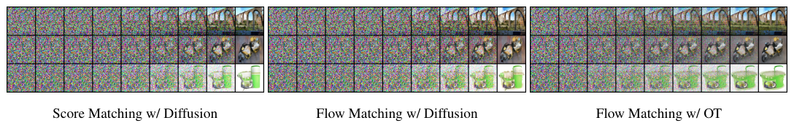

**图 6：** 在 ImageNet 64×64 上训练的模型，从同一初始噪声出发的采样路径。OT 路径大致线性地减少噪声，而扩散路径直到路径末端才明显地去除噪声。也请注意生成图像之间的差异。
*图中文字：* 配合扩散的得分匹配；配合扩散的流匹配；配合 OT 的流匹配。

### 6.1 ImageNet 上的密度建模与样本质量

我们首先比较同一个模型架构，即 Dhariwal & Nichol (2021) 的 U-Net 架构（仅做最小改动），在 CIFAR-10 与 ImageNet 32/64 上用几种流行的基于扩散的损失进行训练：来自 (Ho et al., 2020) 的 DDPM、得分匹配（SM）（Song et al., 2020b）以及 Score Flow（SF）（Song et al., 2021）；确切细节见附录 E.1。
表 1（左）总结了我们的结果以及这些基线，报告了以比特/维（BPD）为单位的负对数似然（NLL）、用 Frechet Inception 距离（FID；Heusel et al. (2017)）度量的样本质量，以及自适应求解器达到预设数值容差所需的平均函数求值次数（NFE，在 50k 个样本上取平均）。
所有模型都以相同的架构、超参数取值和训练迭代次数进行训练，其中基线被允许使用更多迭代以获得更好的收敛。
注意这些是无条件模型。
在 CIFAR-10 和 ImageNet 上，与竞争方法相比，FM-OT 在我们所有的定量指标上一致地取得最好结果。
我们注意到 CIFAR-10 上的 FID 表现比以往工作（Ho et al., 2020; Song et al., 2020b; 2021）要差一些，这可能是因为我们所用的架构并非针对 CIFAR-10 优化的。
其次，表 1（右）比较了一个在分辨率为 128×128 的 ImageNet 上使用流匹配配合 OT 路径训练的模型。
除 IC-GAN（Casanova et al., 2021）之外，我们的 FID 达到了最先进水平；IC-GAN 使用自监督 ResNet50 模型进行条件化，因此未列入本表。
附录中的图 11、12、13 展示了这些模型未经筛选的样本。

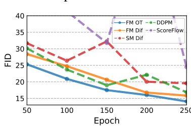

**图 5：** 训练过程中的图像质量，ImageNet 64×64。

**更快的训练。** 既有工作训练扩散模型时使用非常多的迭代次数（例如 Score Flow 和 VDM 分别报告了 1.3m 和 10m 次迭代），而我们发现流匹配总体上收敛得快得多。
图 5 展示了在 ImageNet 64×64 上训练时流匹配与所有基线的 FID 曲线；与这些替代方法相比，FM-OT 能够更快、更大幅度地降低 FID。
在 ImageNet-128 上，Dhariwal & Nichol (2021) 以批大小 256 训练了 4.36m 次迭代，而 FM（模型规模大 25%）只用了 500k 次迭代、批大小 1.5k，即图像吞吐量少 33%；确切细节见表 3。
此外，对得分匹配而言，从模型采样的开销在训练过程中可能剧烈变化；而用流匹配训练时，采样开销保持恒定（附录图 10）。

### 6.2 采样效率

采样时，我们首先抽取一个随机噪声样本 $x_0\sim\mathcal{N}(0,I)$，然后用 ODE 求解器在区间 $t\in[0,1]$ 上以训练好的向量场 $v_t$ 求解式（1），从而算出 $\varphi_1(x_0)$。

> **注释：训练和采样的分工。** 训练阶段随机选取 \(t\)，构造一个容易计算的 \(x_t\) 和目标速度；采样阶段固定一个噪声 \(x_0\)，让 ODE 求解器逐步调用网络 \(v_t\)，最终得到 \(x_1\)。因此“免模拟”并不代表生成阶段不需要 ODE，而是指训练阶段不需要反复模拟 ODE。
尽管扩散模型也可以通过 SDE 形式采样，但这样做可能非常低效，许多提出快速采样器的方法（例如 Song et al. (2020a); Zhang & Chen (2022)）都直接利用了 ODE 视角（见附录 D）。
部分原因在于 ODE 求解器效率高得多——在相近计算开销下给出更低的误差（Kloeden et al., 2012）——以及可用的 ODE 求解格式非常丰富。
与我们的消融模型相比，我们发现用流匹配配合 OT 路径训练的模型总能得到最高效的采样器，与所用 ODE 求解器无关，如下所示。

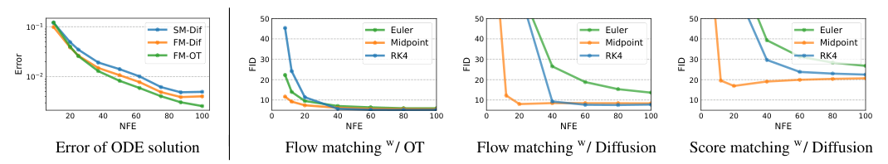

**图 7：** 流匹配（尤其是在使用 OT 路径时）允许我们在采样时使用更少的求值次数，同时保持相近的数值误差（左）与样本质量（右）。结果来自在 ImageNet 32×32 上训练的模型，数值误差对应中点格式。
*图中文字：* ODE 解的误差；配合 OT 的流匹配；配合扩散的流匹配；配合扩散的得分匹配；SM-Dif、FM-Dif、FM-OT；Euler（欧拉）、Midpoint（中点）、RK4。

**采样路径。** 我们首先定性地可视化扩散与 OT 之间采样路径的差异。
图 6 展示了使用相同随机种子时 ImageNet-64 模型的样本；我们发现 OT 路径模型比扩散路径模型更早开始生成图像，而后者的图像直到最后一个时间点仍由噪声主导。
我们另外描绘了二维棋盘格生成中的概率密度路径，见图 4（左），观察到类似的趋势。

**低成本采样。** 接下来我们改用固定步长求解器，并比较用表 1 中 ImageNet-32 模型计算得到的低（≤100）NFE 样本。
在图 7（左）中，我们把低 NFE 解与 1000 NFE 解做比较，计算逐像素 MSE（我们使用 256 个随机噪声种子）；我们注意到 FM 配合 OT 的模型给出了最好的“数值误差—计算开销”折中，达到与扩散模型相同误差阈值所需的 NFE 大约只有后者的 60%。
其次，图 7（右）展示了 FID 随计算开销的变化，我们发现 FM 配合 OT 即使在极低的 NFE 取值下也能取得不错的 FID，与消融模型相比在样本质量与开销之间给出了更好的折中。
图 4（右）展示了二维棋盘格实验中的低成本采样效果。

### 6.3 从低分辨率图像进行条件采样

最后，我们把流匹配用于条件图像生成的实验。
具体而言，是把图像从 64×64 上采样到 256×256。
我们遵循 (Saharia et al., 2022) 的评估流程，计算上采样后验证图像的 FID；基线包括参考值（原始验证集的 FID）与回归方法。
结果见表 2。
上采样图像样本见附录图 14、图 15。
FM-OT 取得了与 (Saharia et al., 2022) 相近的 PSNR 与 SSIM，同时在 FID 与 IS 上有相当大的改进；正如 (Saharia et al., 2022) 所论证的，这两个指标更能反映生成质量。

**表 2：** 在 ImageNet 验证集上的图像超分辨率。

| 模型 | FID↓ | IS↑ | PSNR↑ | SSIM↑ |
|---|---|---|---|---|
| 参考（Reference） | 1.9 | 240.8 | – | – |
| 回归（Regression） | 15.2 | 121.1 | 27.9 | 0.801 |
| SR3 (Saharia et al., 2022) | 5.2 | 180.1 | 26.4 | 0.762 |
| FM w/ OT | 3.4 | 200.8 | 24.7 | 0.747 |

## 7 结论

我们提出了流匹配：一个用于训练连续归一化流模型的新免模拟框架，它依靠条件构造轻松扩展到极高维。

> **注释：论文的核心贡献可以压缩成一句话。** 先设计一条从简单噪声到数据的概率路径，再计算这条路径上的真实速度，最后用神经网络回归速度。扩散路径和 OT 路径只是这套框架下的两种不同路径选择。
此外，FM 框架为扩散模型提供了另一种视角，并建议放弃随机/扩散的构造，转而更直接地指定概率路径，从而使我们能够例如构造允许更快采样和/或改善生成的路径。
我们通过实验展示了使用流匹配框架时训练与采样的便利性；展望未来，我们预期 FM 将为采用多种概率路径打开大门（例如非各向同性高斯，或更一般的核）。

## 8 社会责任

除了许多有益的应用之外，图像生成也可能被用于有害目的。
使用内容受控的训练集以及图像验证/分类，有助于减少这类用途。
此外，训练大型深度学习模型的能耗需求正在飞速增长（Amodei et al., 2018; Thompson et al., 2020），把注意力放在能以更少梯度更新／图像吞吐量完成训练的方法上，可以带来显著的时间与能源节约。

## 参考文献

原文参考文献共 52 条，列于原 PDF 第 10–13 页；正文与附录中的引用编号（如 “Song et al. (2020b)”“Ho et al. (2020)”）均保留原形式，此处不再逐条翻译。涉及的作者姓氏与文献标识与原文一致，便于对照原 PDF 检索。

## 附录 A 定理证明

**定理 1.** 给定生成条件概率路径 $p_t(x|x_1)$ 的向量场 $u_t(x|x_1)$，则对任意分布 $q(x_1)$，式（8）中的边缘向量场 $u_t$ 生成式（6）中的边缘概率路径 $p_t$；也就是说，$u_t$ 与 $p_t$ 满足连续性方程（式 26）。

**证明.** 为验证这一点，我们检查 $p_t$ 与 $u_t$ 满足连续性方程（式 26）：

$$
\frac{d}{dt}p_t(x)=\int\left(\frac{d}{dt}p_t(x|x_1)\right)q(x_1)\,dx_1
=-\int\mathrm{div}\Bigl(u_t(x|x_1)p_t(x|x_1)\Bigr)q(x_1)\,dx_1
$$
$$
=-\mathrm{div}\left(\int u_t(x|x_1)p_t(x|x_1)q(x_1)\,dx_1\right)
=-\mathrm{div}\Bigl(u_t(x)p_t(x)\Bigr),
$$

其中第二个等号用到了 $u_t(\cdot|x_1)$ 生成 $p_t(\cdot|x_1)$ 这一事实，最后一个等号用到了式（8）。
此外，第一个和第三个等号成立的前提是假设被积函数满足莱布尼茨法则的正则性条件（用于交换积分与求导）。$\square$

**定理 2.** 假设对所有 $x\in\mathbb{R}^d$ 和 $t\in[0,1]$ 都有 $p_t(x)>0$，则在不计一个与 $\theta$ 无关的常数的意义下，$\mathcal{L}_{\mathrm{CFM}}$ 与 $\mathcal{L}_{\mathrm{FM}}$ 相等。因此，$\nabla_\theta\mathcal{L}_{\mathrm{FM}}(\theta)=\nabla_\theta\mathcal{L}_{\mathrm{CFM}}(\theta)$。

**证明.** 为保证所有积分都存在，并允许在下面交换积分次序（依据富比尼定理），我们假设当 $\|x\|\to\infty$ 时 $q(x)$ 与 $p_t(x|x_1)$ 以足够快的速度衰减到零，并且 $u_t$、$v_t$、$\nabla_\theta v_t$ 有界。
首先，利用 2-范数的标准双线性性质，我们有

$$
\|v_t(x)-u_t(x)\|^2=\|v_t(x)\|^2-2\langle v_t(x),u_t(x)\rangle+\|u_t(x)\|^2
$$
$$
\|v_t(x)-u_t(x|x_1)\|^2=\|v_t(x)\|^2-2\langle v_t(x),u_t(x|x_1)\rangle+\|u_t(x|x_1)\|^2
$$

其次，记住 $u_t$ 与 $\theta$ 无关，并注意

$$
\mathbb{E}_{p_t(x)}\|v_t(x)\|^2=\int\|v_t(x)\|^2p_t(x)\,dx=\int\|v_t(x)\|^2p_t(x|x_1)q(x_1)\,dx_1\,dx
=\mathbb{E}_{q(x_1),p_t(x|x_1)}\|v_t(x)\|^2,
$$

其中第二个等号用到了式（6），第三个等号交换了积分次序。接下来，

$$
\mathbb{E}_{p_t(x)}\langle v_t(x),u_t(x)\rangle
=\int\left\langle v_t(x),\frac{\int u_t(x|x_1)p_t(x|x_1)q(x_1)\,dx_1}{p_t(x)}\right\rangle p_t(x)\,dx
$$
$$
=\int\left\langle v_t(x),\int u_t(x|x_1)p_t(x|x_1)q(x_1)\,dx_1\right\rangle dx
=\int\langle v_t(x),u_t(x|x_1)\rangle p_t(x|x_1)q(x_1)\,dx_1\,dx
$$
$$
=\mathbb{E}_{q(x_1),p_t(x|x_1)}\langle v_t(x),u_t(x|x_1)\rangle,
$$

其中最后一个等号再次交换了积分次序。$\square$

**定理 3.** 设 $p_t(x|x_1)$ 是如式（10）所示的高斯概率路径，$\psi_t$ 是其对应式（11）的流映射。则定义 $\psi_t$ 的向量场唯一，且具有如下形式：

$$u_t(x|x_1)=\frac{\sigma'_t(x_1)}{\sigma_t(x_1)}\bigl(x-\mu_t(x_1)\bigr)+\mu'_t(x_1).\tag{15}$$

因此，$u_t(x|x_1)$ 生成高斯路径 $p_t(x|x_1)$。

**证明.** 为记号简便，令 $w_t(x)=u_t(x|x_1)$。现在考虑式（1）：

$$\frac{d}{dt}\psi_t(x)=w_t(\psi_t(x)).$$

由于 $\psi_t$ 可逆（因为 $\sigma_t(x_1)>0$），令 $x=\psi^{-1}(y)$，得到

$$\psi'_t\bigl(\psi^{-1}(y)\bigr)=w_t(y),\tag{25}$$

这里用撇号表示导数，以强调 $\psi'_t$ 是在 $\psi^{-1}(y)$ 处取值的。
现在，对 $\psi_t(x)$ 求逆得到

$$\psi^{-1}_t(y)=\frac{y-\mu_t(x_1)}{\sigma_t(x_1)}.$$

对 $\psi_t$ 关于 $t$ 求导得到

$$\psi'_t(x)=\sigma'_t(x_1)x+\mu'_t(x_1).$$

把最后两式代入式（25），我们得到

$$w_t(y)=\frac{\sigma'_t(x_1)}{\sigma_t(x_1)}\bigl(y-\mu_t(x_1)\bigr)+\mu'_t(x_1)$$

即所求。$\square$

## 附录 B 连续性方程

检验向量场 $v_t$ 是否生成概率路径 $p_t$ 的一种方法是使用连续性方程（Villani, 2009）。
它是一个偏微分方程（PDE），给出了确保向量场 $v_t$ 生成 $p_t$ 的充分必要条件，

$$\frac{d}{dt}p_t(x)+\mathrm{div}\bigl(p_t(x)v_t(x)\bigr)=0,\tag{26}$$

其中散度算子 $\mathrm{div}$ 是对空间变量 $x=(x_1,\ldots,x_d)$ 定义的，即 $\mathrm{div}=\sum_{i=1}^{d}\frac{\partial}{\partial x_i}$。

> **注释：连续性方程的直觉。** \(p_t(x)v_t(x)\) 可以看作概率质量的“流量”。某个位置的密度随时间增加，意味着概率质量流入；随时间减少，意味着概率质量流出。式（26）就是概率质量守恒定律的微分形式。

## 附录 C 计算 CNF 模型的概率

给定任意数据点 $x_1\in\mathbb{R}^d$，我们需要计算该点处的模型概率，即 $p_1(x_1)$。
下面我们回顾如何做到这一点，涵盖相关的基本 ODE、散度计算的缩放、对数据变换（例如数据中心化）的考虑，以及比特/维的计算。

**用于计算 $p_1(x_1)$ 的 ODE**

连续性方程与式（1）一起给出瞬时变量替换公式（Chen et al., 2018; Ben-Hamu et al., 2022）：

$$\frac{d}{dt}\log p_t(\varphi_t(x))+\mathrm{div}\bigl(v_t(\varphi_t(x))\bigr)=0.$$

> **注释：为什么会出现散度？** 流沿途如果把局部空间拉伸，单位体积内的样本变少，密度下降；如果把空间压缩，密度上升。散度衡量这种局部体积变化，因此它可以用来累计计算密度的变化，而不必显式计算整个雅可比矩阵。

对 $t\in[0,1]$ 积分得到：

$$\log p_1(\varphi_1(x))-\log p_0(\varphi_0(x))=-\int_0^1\mathrm{div}\bigl(v_t(\varphi_t(x))\bigr)dt\tag{27}$$

因此，可以通过求解如下 ODE，把对数概率与流轨迹一并算出：

$$\frac{d}{dt}\begin{bmatrix}\varphi_t(x)\\ f(t)\end{bmatrix}=\begin{bmatrix}v_t(\varphi_t(x))\\ -\mathrm{div}(v_t(\varphi_t(x)))\end{bmatrix}\tag{28}$$

给定初始条件

$$\begin{bmatrix}\varphi_0(x)\\ f(0)\end{bmatrix}=\begin{bmatrix}x_0\\ c\end{bmatrix}.\tag{29}$$

解 $[\varphi_t(x),f(t)]^T$ 是唯一确定的（在对向量场 $v_t$ 的若干温和条件之下）。
记 $x_1=\varphi_1(x)$，根据式（27），

$$f(1)=c+\log p_1(x_1)-\log p_0(x_0).\tag{30}$$

现在，给定任意 $x_1$，我们想计算 $p_1(x_1)$。
为此，我们需要反向求解式（28）。即

$$\frac{d}{ds}\begin{bmatrix}\varphi_{1-s}(x)\\ f(1-s)\end{bmatrix}=\begin{bmatrix}-v_{1-s}(\varphi_{1-s}(x))\\ \mathrm{div}(v_{1-s}(\varphi_{1-s}(x)))\end{bmatrix}\tag{31}$$

我们在 $s\in[0,1]$ 上求解该方程，初始条件取在 $s=0$：

$$\begin{bmatrix}\varphi_1(x)\\ f(1)\end{bmatrix}=\begin{bmatrix}x_1\\ 0\end{bmatrix}.\tag{32}$$

由 ODE 的唯一性，其解将与式（28）在式（29）初始条件下（其中 $c=\log p_0(x_0)-\log p_1(x_1)$）的解完全相同。
这可以从式（30）并取 $f(1)=0$ 看出。因此我们得到

$$f(0)=\log p_0(x_0)-\log p_1(x_1)$$

从而

$$\log p_1(x_1)=\log p_0(x_0)-f(0).\tag{33}$$

总之，为计算 $p_1(x_1)$，我们先用式（32）的初始条件求解式（31）中的 ODE，然后计算式（33）。

**$p_1(x_1)$ 的无偏估计量**

求解式（31）需要计算 $\mathbb{R}^d$ 中向量场的散度，这代价高昂。
Grathwohl et al. (2018) 建议把散度替换为（无偏的）Skilling-Hutchinson 迹估计器（Skilling, 1989；Hutchinson, 1990），

$$\frac{d}{ds}\begin{bmatrix}\varphi_{1-s}(x)\\ \tilde{f}(1-s)\end{bmatrix}=\begin{bmatrix}-v_{1-s}(\varphi_{1-s}(x))\\ z^TDv_{1-s}(\varphi_{1-s}(x))z\end{bmatrix},\tag{34}$$

其中 $z\in\mathbb{R}^d$ 是取自某个随机变量的样本，满足 $\mathbb{E}\,zz^T=I$。

> **注释：Hutchinson 估计器解决什么问题？** 散度等于雅可比矩阵的迹，但直接构造高维雅可比矩阵很昂贵。对满足 \(\mathbb E[zz^\top]=I\) 的随机向量，有 \(\mathbb E[z^\top Jz]=\operatorname{tr}(J)\)，所以只需一次向量—雅可比乘积就能得到散度的无偏随机估计。
以式（32）为初始条件精确求解式（34）中的 ODE（实践中带有可控的小误差），可得

$$
\mathbb{E}_z\Bigl[\log p_0(x_0)-\tilde{f}(0)\Bigr]
=\log p_0(x_0)-\mathbb{E}_z\Bigl[\tilde{f}(0)-\tilde{f}(1)\Bigr]
=\log p_0(x_0)-\mathbb{E}_z\left[\int_0^1 z^TDv_{1-s}(\varphi_{1-s}(x))z\,ds\right]
$$
$$
=\log p_0(x_0)-\int_0^1\mathbb{E}_z\Bigl[z^TDv_{1-s}(\varphi_{1-s}(x))z\Bigr]ds
=\log p_0(x_0)-\int_0^1\mathrm{div}\bigl(v_{1-s}(\varphi_{1-s}(x))\bigr)ds
$$
$$
=\log p_0(x_0)-\bigl(f(0)-f(1)\bigr)
=\log p_0(x_0)-\bigl(\log p_0(x_0)-\log p_1(x_1)\bigr)
=\log p_1(x_1),
$$

其中第三个等号在假设富比尼定理的充分条件成立的前提下交换了积分次序，倒数第二个等号用到了式（30）。
因此随机变量

$$\log p_0(x_0)-\tilde{f}(0)\tag{35}$$

是 $\log p_1(x_1)$ 的无偏估计量。
总之，为了可扩展地无偏估计 $p_1(x_1)$，我们先用式（32）的初始条件求解式（34）中的 ODE，然后输出式（35）。

**变换后的数据**

通常在训练生成模型之前，我们会对数据做变换，例如对数据做缩放和/或平移。
这样的变换记作 $\phi^{-1}:\mathbb{R}^d\to\mathbb{R}^d$，我们的生成模型于是成为一个复合

$$\psi(x)=\phi\circ\varphi(x)$$

其中 $\varphi:\mathbb{R}^d\to\mathbb{R}^d$ 是我们训练的模型。
给定先验概率 $p_0$，该概率在 $\psi$ 下的推前（式 3 与式 4）具有如下形式

$$
p_1(x)=\psi_*p_0(x)=p_0\bigl(\varphi^{-1}(\phi^{-1}(x))\bigr)\det\bigl[D\varphi^{-1}(\phi^{-1}(x))\bigr]\det\bigl[D\phi^{-1}(x)\bigr]
=\Bigl(\varphi_*p_0\bigl(\phi^{-1}(x)\bigr)\Bigr)\det\bigl[D\phi^{-1}(x)\bigr]
$$

因此

$$\log p_1(x)=\log\varphi_*p_0\bigl(\phi^{-1}(x)\bigr)+\log\det\bigl[D\phi^{-1}(x)\bigr].$$

对图像有 $d=H\times W\times3$，我们考虑一个变换 $\phi$，它把每个像素值从 $[-1,1]$ 映射到 $[0,256]$。因此，

$$\phi(y)=2^7(y+1)\qquad\text{以及}\qquad\phi^{-1}(x)=2^{-7}x-1$$

> **译注：** 原文此处把该变换写作 $\varphi$，但其后两式以及式（36）中均写作 $\phi$；译稿按后者统一为 $\phi$。

在这种情况下我们有

$$\log p_1(x)=\log\varphi_*p_0\bigl(\phi^{-1}(x)\bigr)-7d\log2.\tag{36}$$

**比特/维（BPD）的计算**

BPD 定义为

$$\mathrm{BPD}=\mathbb{E}_{x_1}\left[\frac{-\log_2 p_1(x_1)}{d}\right]=\mathbb{E}_{x_1}\left[\frac{-\log p_1(x_1)}{d\log2}\right]\tag{37}$$

由式（36）我们得到

$$\mathrm{BPD}=\frac{-\log\varphi_*p_0(\phi^{-1}(x))}{d\log2}+7$$

其中 $\log\varphi_*p_0(\phi^{-1}(x))$ 通过在变换后的数据 $\phi^{-1}(x_1)$ 上使用式（35）的无偏估计量来近似。
在一个大的测试集 $x_1$ 上对该无偏估计量取平均，即可很好地近似测试集的 BPD。

> **译注：** 原文此处写作 “a large test test $x_1$”，其中 “test test” 应为“测试集”之误。

## 附录 D 扩散条件向量场

我们推导 VE 与 VP 扩散路径（式 18）所对应的概率流 ODE（Song et al. (2020b) 中的式 13）的支配向量场，并指出它与我们用定理 3 推导出的条件向量场一致，即式（17）与式（19）所定义的向量场。

> **译注：** 原文此处写作“式（16）与式（19）”；式（16）给出的是概率路径而非向量场，按上下文应为式（17）。

我们先用一小段内容介绍如何为Fokker-Planck 方程所描述的概率路径寻找条件向量场，然后把它具体化到 VE 与 VP 概率路径上。
由于在扩散文献中，扩散过程是从 $t=0$ 时刻的数据走向 $t=1$ 时刻的噪声，而我们的约定是 $t=0$ 对应噪声、$t=1$ 对应数据，因此我们需要下面的引理来做这一转换：

**引理 1.** 考虑由向量场 $u_t(x)$ 定义的流，它生成概率密度路径 $p_t(x)$。则向量场 $\tilde{u}_t(x)=-u_{1-t}(x)$ 在从 $\tilde{p}_0(x)=p_1(x)$ 出发时生成路径 $\tilde{p}_t(x)=p_{1-t}(x)$。

**证明.** 我们使用连续性方程（式 26）：

$$
\frac{d}{dt}\tilde{p}_t(x)=\frac{d}{dt}p_{1-t}(x)=-p'_{1-t}(x)
=\mathrm{div}\bigl(p_{1-t}(x)u_{1-t}(x)\bigr)
=-\mathrm{div}\bigl(\tilde{p}_t(x)(-u_{1-t}(x))\bigr)
$$

因此 $\tilde{u}_t(x)=-u_{1-t}(x)$ 生成 $\tilde{p}_t(x)$。$\square$

**Fokker-Planck 概率路径的条件向量场**

考虑如下标准形式的随机微分方程（SDE）

$$dy=f_tdt+g_tdw\tag{38}$$

其中 $t$ 是时间参数，$f_t$ 是漂移，$g_t$ 是扩散系数，$dw$ 是维纳过程。
SDE 的解 $y_t$ 是一个随机过程，即一个连续的时间相关随机变量，其概率密度 $p_t(y_t)$ 由Fokker-Planck 方程刻画：

$$\frac{dp_t}{dt}=-\mathrm{div}(f_tp_t)+\frac{g^2_t}{2}\Delta p_t\tag{39}$$

> **注释：SDE 与概率流 ODE 的关系。** SDE 中的 \(g_t\,dw\) 会引入随机扩散，Fokker–Planck 方程描述其整体密度如何变化。论文把扩散项改写进一个包含得分 \(\nabla\log p_t\) 的确定性向量场，从而得到具有相同边缘密度路径的概率流 ODE。

其中 $\Delta$ 表示（关于 $y$ 的）拉普拉斯算子，即 $\mathrm{div}\nabla$，而 $\nabla$ 是（同样关于 $y$ 的）梯度算子。
把该方程改写成连续性方程的形式可以这样做（Maoutsa et al., 2020a）：

$$
\frac{dp_t}{dt}=-\mathrm{div}\left(f_tp_t-\frac{g^2}{2}\frac{\nabla p_t}{p_t}p_t\right)
=-\mathrm{div}\left(\Bigl(f_t-\frac{g^2_t}{2}\nabla\log p_t\Bigr)p_t\right)
=-\mathrm{div}\bigl(w_tp_t\bigr)
$$

其中向量场

$$w_t=f_t-\frac{g^2_t}{2}\nabla\log p_t\tag{40}$$

与概率路径 $p_t$ 一起满足连续性方程，因此生成 $p_t$。

**方差爆炸（VE）路径**

VE 路径的 SDE 是

$$dy=\sqrt{\frac{d}{dt}\sigma^2_t}\,dw,$$

其中 $\sigma_0=0$，并在 $t\to1$ 时增大到无穷。
该 SDE 从 $t=0$ 的数据 $y_0$ 走向 $t=1$ 的噪声 $y_1$，其概率路径为

$$p_t(y|y_0)=\mathcal{N}(y|y_0,\sigma^2_tI).$$

根据式（40），其条件向量场为：

$$w_t(y|y_0)=\frac{\sigma'_t}{\sigma_t}(y-y_0)$$

使用引理 1，我们得到概率路径

$$\tilde{p}_t(y|y_0)=\mathcal{N}(y|y_0,\sigma^2_{1-t}I)$$

由下式生成

$$\tilde{w}_t(y|y_0)=-\frac{\sigma'_{1-t}}{\sigma_{1-t}}(y-y_0),$$

这与式（17）一致。

**方差保持（VP）路径**

VP 路径的 SDE 是

$$dy=-\frac{T'(t)}{2}y+\sqrt{T'(t)}\,dw,$$

其中 $T(t)=\int_0^t\beta(s)ds$，$t\in[0,1]$。因此 SDE 的系数为

$$f_s(y)=-\frac{T'(s)}{2}y,\qquad g_s=\sqrt{T'(s)}$$

以及

$$p_t(y|y_0)=\mathcal{N}\Bigl(y\,\Big|\,e^{-\frac{1}{2}T(t)}y_0,\;(1-e^{-T(t)})I\Bigr).$$

把这些选择代入式（40），我们得到条件向量场

$$w_t(y|y_0)=\frac{T'(t)}{2}\left(\frac{y-e^{-\frac{1}{2}T(t)}y_0}{1-e^{-T(t)}}-y\right)\tag{41}$$

使用引理 1 反转时间，我们得到反向概率路径的条件向量场：

$$
\tilde{w}_t(y|y_0)=-\frac{T'(1-t)}{2}\left(\frac{y-e^{-\frac{1}{2}T(1-t)}y_0}{1-e^{-T(1-t)}}-y\right)
=-\frac{T'(1-t)}{2}\left[\frac{e^{-T(1-t)}y-e^{-\frac{1}{2}T(1-t)}y_0}{1-e^{-T(1-t)}}\right],
$$

这与式（19）一致。

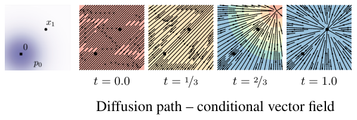

**图 8：** VP 扩散路径的条件向量场。可与图 2 对比。
*图中文字：* 扩散路径——条件向量场；$t=0.0$、$t=1/3$、$t=2/3$、$t=1.0$。

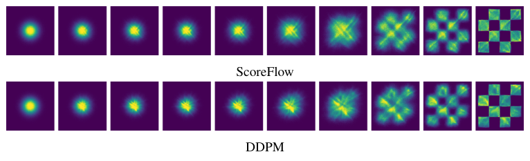

**图 9：** 在二维棋盘格数据上用 ScoreFlow (Song et al., 2021) 与 DDPM (Ho et al., 2020) 损失训练出的 CNF 轨迹，学习率与其他超参数与图 4 相同。

## 附录 E 实现细节

对于二维例子，我们使用了一个 5 层、每层 512 个神经元的 MLP；对于图像，我们使用了 Dhariwal & Nichol (2021) 的 UNet 架构。
对图像，我们做中心裁剪并缩放到合适的尺寸；对于 32×32 与 64×64 分辨率，我们使用与 (Chrabaszcz et al., 2017) 相同的预处理。
这三种方法（FM-OT、FM-Diffusion 与 SM-Diffusion）始终在相同架构、相同超参数下训练相同的轮数。

### E.1 扩散基线

**损失。** 我们考虑三种选择作为扩散基线，它们对应最流行的几种扩散损失参数化方式（Song & Ermon, 2019; Song et al., 2021; Ho et al., 2020; Kingma et al., 2021）。
我们假设式（10）的一般高斯路径形式，即

$$p_t(x|x_1)=\mathcal{N}\bigl(x|\mu_t(x_1),\sigma^2_t(x_1)I\bigr).$$

得分匹配损失为

$$
\mathcal{L}_{\mathrm{SM}}(\theta)=\mathbb{E}_{t,q(x_1),p_t(x|x_1)}\lambda(t)\left\|s_t(x)-\nabla\log p_t(x|x_1)\right\|^2\tag{42}
$$
$$
=\mathbb{E}_{t,q(x_1),p_t(x|x_1)}\lambda(t)\left\|s_t(x)-\frac{x-\mu_t(x_1)}{\sigma^2_t(x_1)}\right\|^2.\tag{43}
$$

取 $\lambda(t)=\sigma^2_t(x_1)$ 对应 Song & Ermon (2019) 的原始得分匹配（SM）损失；而取 $\lambda(t)=\beta(1-t)$（$\beta$ 的定义见下文）对应由 NLL 上界所启发的 Score Flow（SF）损失（Song et al., 2021）；$s_t$ 是可学习的得分函数。
Ho et al. (2020)（式 14）的 DDPM（噪声匹配）损失为

$$
\mathcal{L}_{\mathrm{NM}}(\theta)=\mathbb{E}_{t,q(x_1),p_t(x|x_1)}\left\|\epsilon_t(x)-\frac{x-\mu_t(x_1)}{\sigma_t(x_1)}\right\|^2\tag{44}
$$
$$
=\mathbb{E}_{t,q(x_1),p_0(x_0)}\left\|\epsilon_t\bigl(\sigma_t(x_1)x_0+\mu_t(x_1)\bigr)-x_0\right\|^2\tag{45}
$$

其中 $p_0(x)=\mathcal{N}(x|0,I)$ 是标准高斯分布，$\epsilon_t$ 是可学习的噪声函数。

**扩散路径。** 对扩散路径，我们使用标准的 VP 扩散（式 19），即

$$\mu_t(x_1)=\alpha_{1-t}x_1,\qquad\sigma_t(x_1)=\sqrt{1-\alpha^2_{1-t}},\qquad\text{其中}\ \ \alpha_t=e^{-\frac{1}{2}T(t)},\ \ T(t)=\int_0^t\beta(s)ds,$$

其中按 Song et al. (2020b) 的建议取 $\beta(s)=\beta_{\min}+s(\beta_{\max}-\beta_{\min})$，于是

$$T(s)=\int_0^s\beta(r)dr=s\beta_{\min}+\frac{1}{2}s^2(\beta_{\max}-\beta_{\min}),$$

其中 $\beta_{\min}=0.1$、$\beta_{\max}=20$，时间在 $[0,1-\epsilon]$ 内采样，训练与似然计算时 $\epsilon=10^{-5}$，采样时 $\epsilon=10^{-5}$。

> **译注：** 原文两处均写作 $\epsilon=10^{-5}$，与此前文献中常见做法（采样时取更小的 $\epsilon$）不同，译稿按原文如实保留。

**采样。** 得分匹配的样本通过以如下向量场求解 ODE（式 1）得到

$$u_t(x)=-\frac{T'(1-t)}{2}\left[s_t(x)-x\right].\tag{46}$$

DDPM 的样本则是在设 $s_t(x)=\epsilon_t(x)/\sigma_t$（其中 $\sigma_t=\sqrt{1-\alpha^2_{1-t}}$）之后用式（46）计算的。

### E.2 训练与评估细节

我们在表 3 中报告所用的超参数。
训练 CIFAR10 与 ImageNet-32 时我们使用完整 32 位精度，训练 ImageNet-64/128/256 时使用 16 位混合精度。
所有模型都用 Adam 优化器训练，参数为：$\beta_1=0.9$、$\beta_2=0.999$、权重衰减 $=0.0$、$\epsilon=$ 1e-8。
我们训练的所有方法（即 FM-OT、FM-Diffusion、SM-Diffusion）都使用相同的架构、相同的参数、相同的轮数（细节见表 3）。
我们使用恒定学习率调度或多项式衰减调度（见表 3）。
多项式衰减学习率调度包含一段指定训练步数的预热阶段。
在预热阶段，学习率从 1e-8 线性增加到峰值学习率（见表 3）。
达到峰值学习率之后，学习率线性衰减到 1e-8，直到最后一个训练步。
在报告负对数似然时，我们使用标准的均匀去量化。
我们报告的重要性加权估计为

$$\log\frac{1}{K}\sum_{k=1}^{K}p_t(x+u_k),\qquad\text{其中}\ \ u_k\sim\mathcal{U}(0,1),\tag{47}$$

其中 $x$ 取值于 $\{0,\ldots,255\}$，并在 $t=1$ 处用自适应步长求解器 dopri5（atol=rtol=1e-5）配合 torchdiffeq (Chen, 2018) 库求解。
不同 $K$ 取值下的估计值见表 4。

**表 3：** 训练各模型所用的超参数。

| 超参数 | CIFAR10 | ImageNet-32 | ImageNet-64 | ImageNet-128 |
|---|---|---|---|---|
| 通道数（Channels） | 256 | 256 | 192 | 256 |
| 深度（Depth） | 2 | 3 | 3 | 3 |
| 通道倍数（Channels multiple） | 1,2,2,2 | 1,2,2,2 | 1,2,3,4 | 1,1,2,3,4 |
| 注意力头数（Heads） | 4 | 4 | 4 | 4 |
| 每头通道数（Heads Channels） | 64 | 64 | 64 | 64 |
| 注意力分辨率（Attention resolution） | 16 | 16,8 | 32,16,8 | 32,16,8 |
| Dropout | 0.0 | 0.0 | 0.0 | 0.0 |
| 有效批大小（Effective Batch size） | 256 | 1024 | 2048 | 1536 |
| GPU 数 | 2 | 4 | 16 | 32 |
| 轮数（Epochs） | 1000 | 200 | 250 | 571 |
| 迭代次数（Iterations） | 391k | 250k | 157k | 500k |
| 学习率（Learning Rate） | 5e-4 | 1e-4 | 1e-4 | 1e-4 |
| 学习率调度 | 多项式衰减 | 多项式衰减 | 恒定 | 多项式衰减 |
| 预热步数（Warmup Steps） | 45k | 20k | - | 20k |

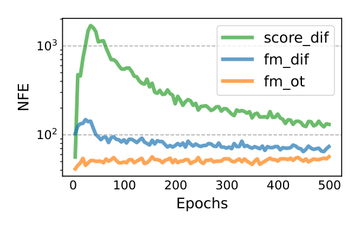

**图 10：** 训练期间采样所需的函数求值次数，模型在 CIFAR-10 上训练，使用 dopri5 求解器，容差 1e−5。
*图中文字：* 轮数（Epochs）；NFE；score_dif、fm_dif、fm_ot。

在计算 CIFAR10 与 ImageNet-32/64 的 FID/Inception 得分时，我们使用 TensorFlow GAN 库^2^。
为了与 Dhariwal & Nichol (2021) 在 ImageNet-128 上保持可比，我们使用他们在公开代码仓库中包含的评估脚本^3^。

> **脚注 2：** <https://github.com/tensorflow/gan>
> **脚注 3：** <https://github.com/openai/guided-diffusion>

## 附录 F 补充表格与图

**表 4：** 使用均匀去量化时，测试集上不同 $K$ 取值所对应的负对数似然（以比特/维计）。

| 模型 | CIFAR-10 K=1 | K=20 | K=50 | ImageNet 32×32 K=1 | K=5 | K=15 | ImageNet 64×64 K=1 | K=5 | K=10 |
|---|---|---|---|---|---|---|---|---|---|
| **消融** | | | | | | | | | |
| DDPM | 3.24 | 3.14 | 3.12 | 3.62 | 3.57 | 3.54 | 3.36 | 3.33 | 3.32 |
| 得分匹配 | 3.28 | 3.18 | 3.16 | 3.65 | 3.59 | 3.57 | 3.43 | 3.41 | 3.40 |
| ScoreFlow | 3.21 | 3.11 | 3.09 | 3.63 | 3.57 | 3.55 | 3.39 | 3.37 | 3.36 |
| **本文** | | | | | | | | | |
| FM w/ Diffusion | 3.23 | 3.13 | 3.10 | 3.64 | 3.58 | 3.56 | 3.37 | 3.34 | 3.33 |
| FM w/ OT | 3.11 | 3.01 | 2.99 | 3.62 | 3.56 | 3.53 | 3.35 | 3.33 | 3.31 |

**图 11：** 用 FM-OT 训练的 CNF 所生成的无条件 ImageNet-32 图像（未经筛选）。

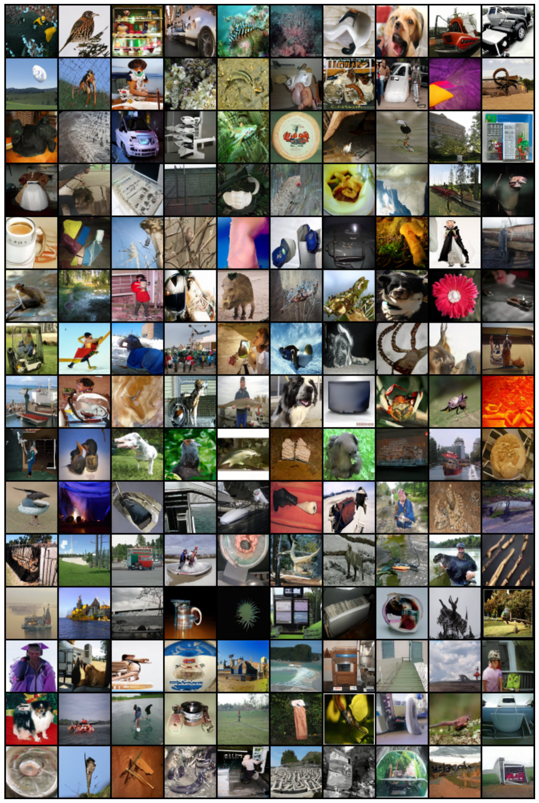

**图 12：** 用 FM-OT 训练的 CNF 所生成的无条件 ImageNet-64 图像（未经筛选）。

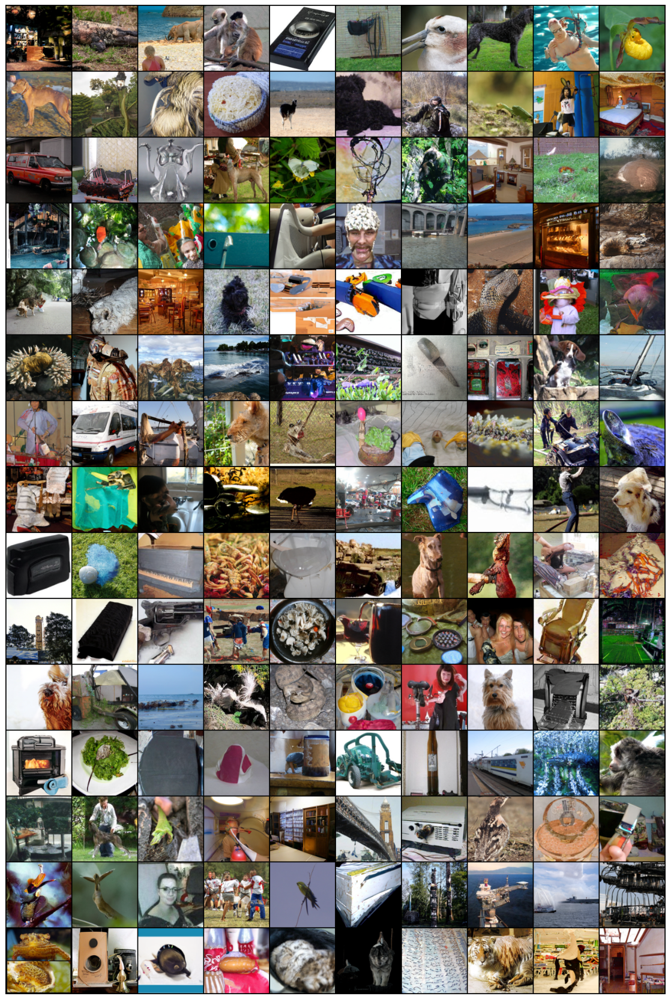

**图 13：** 用 FM-OT 训练的 CNF 所生成的无条件 ImageNet-128 图像（未经筛选）。

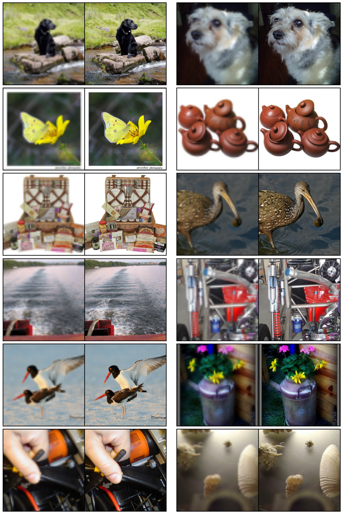

**图 14：** 条件生成 64×64→256×256。流匹配 OT 对验证集图像的上采样结果。

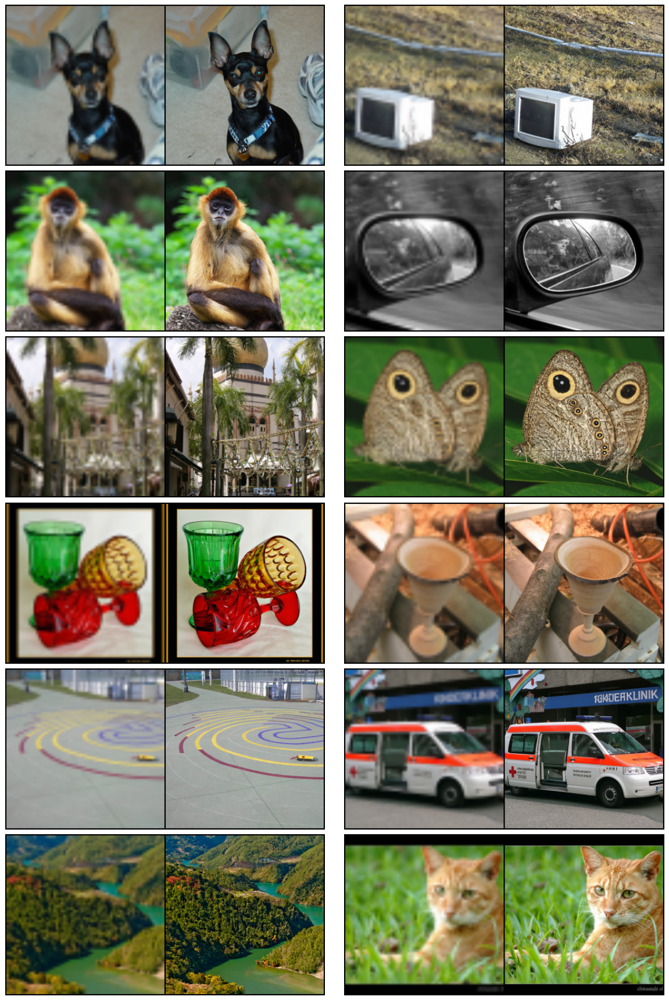

**图 15：** 条件生成 64×64→256×256。流匹配 OT 对验证集图像的上采样结果。

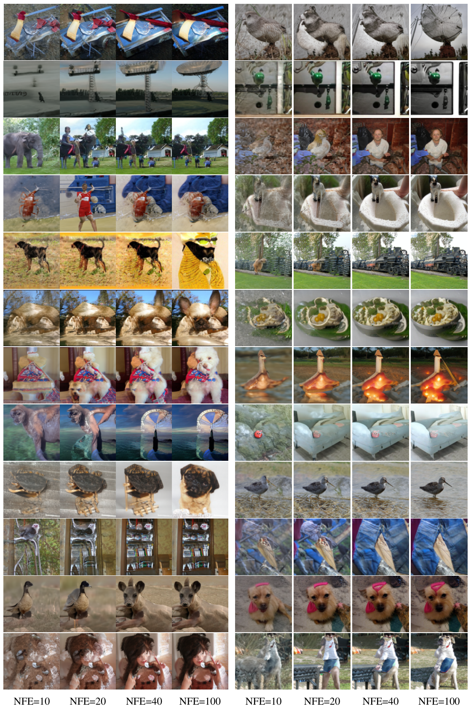

**图 16：** 从同一初始噪声生成、但函数求值次数（NFE）不同的样本。在 ImageNet-128 上训练的、配合 OT 路径的流匹配。
*图中文字：* NFE=10、NFE=20、NFE=40、NFE=100。

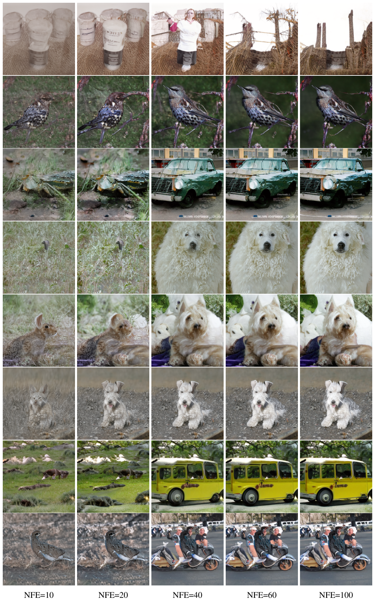

**图 17：** 从同一初始噪声生成、但函数求值次数（NFE）不同的样本。在 ImageNet 256×256 上训练的、配合 OT 路径的流匹配。
*图中文字：* NFE=10、NFE=20、NFE=40、NFE=60、NFE=100。
