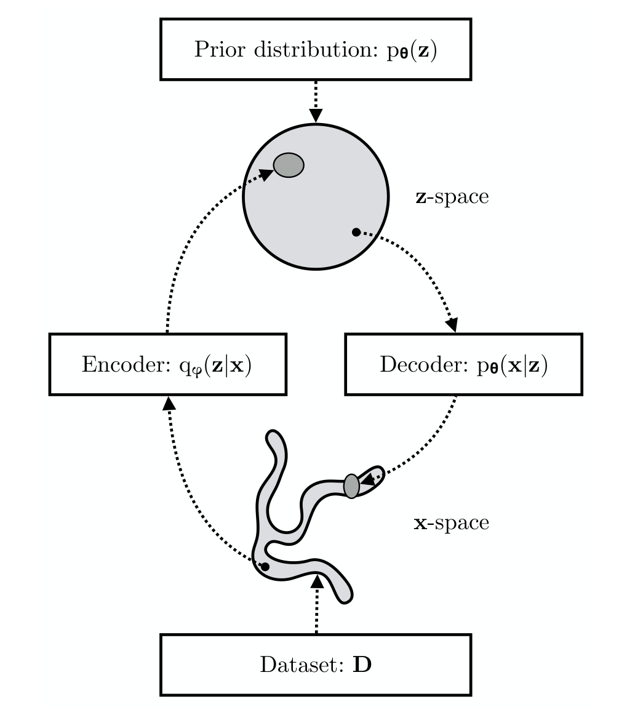
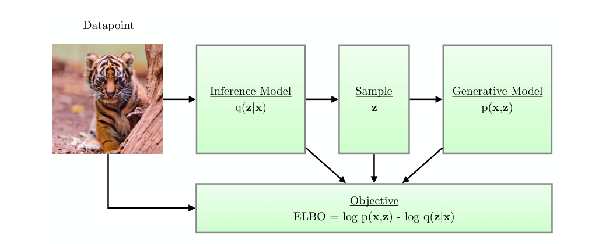
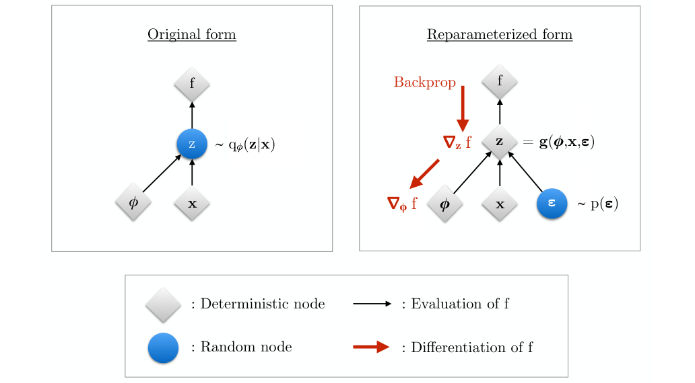
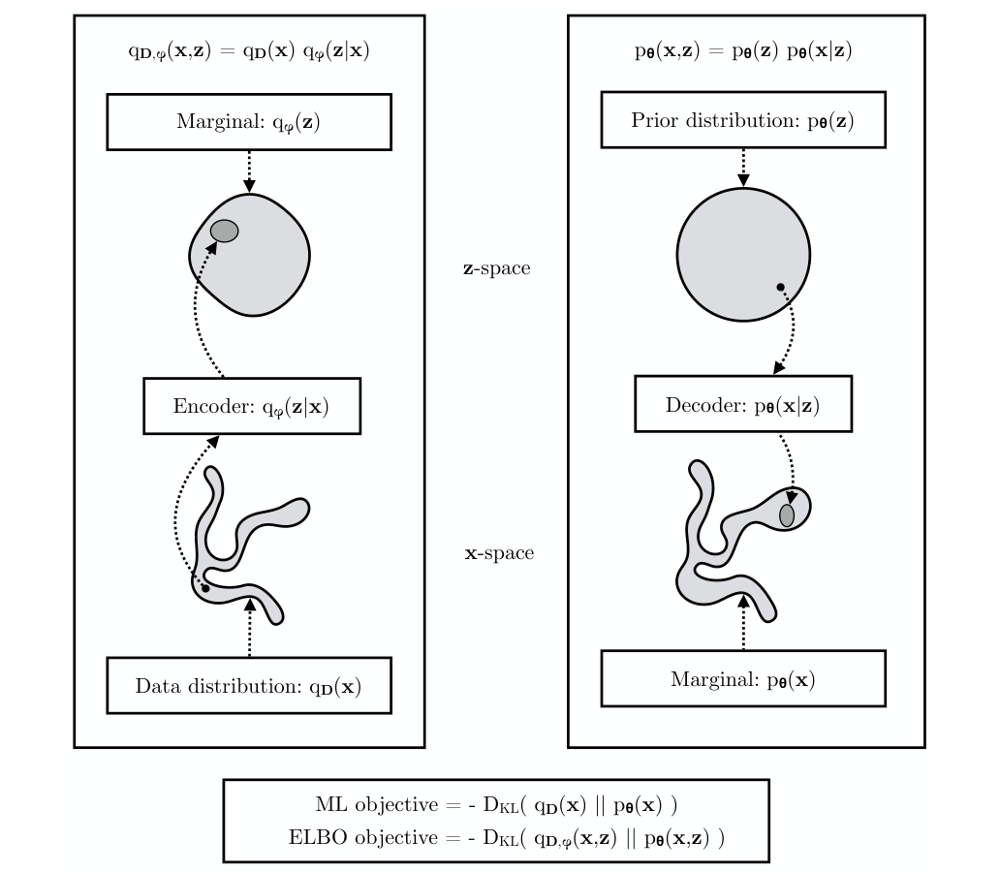
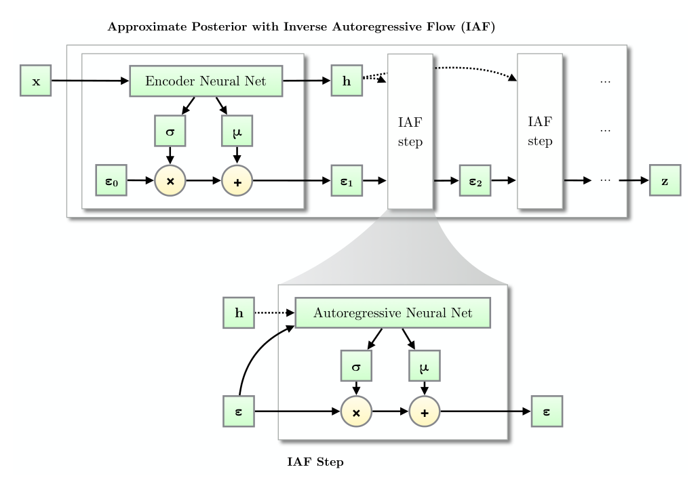
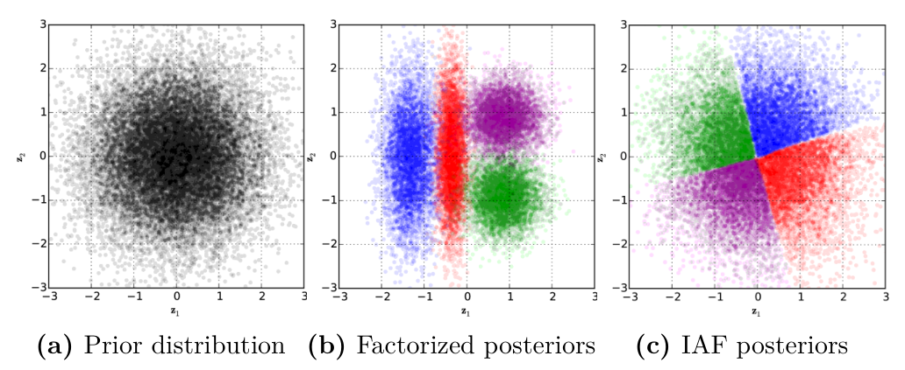
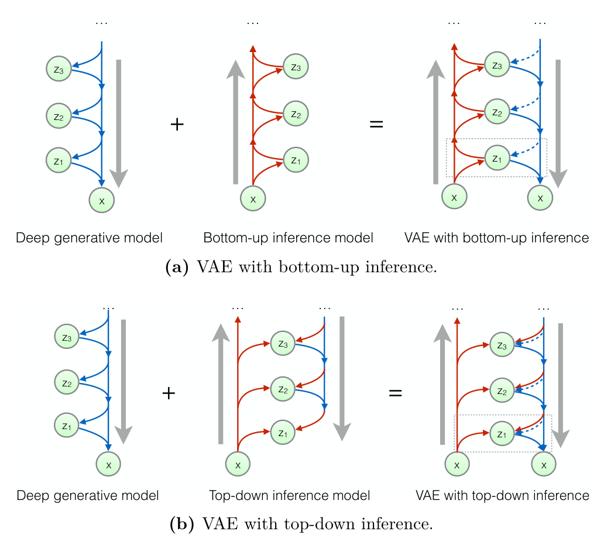
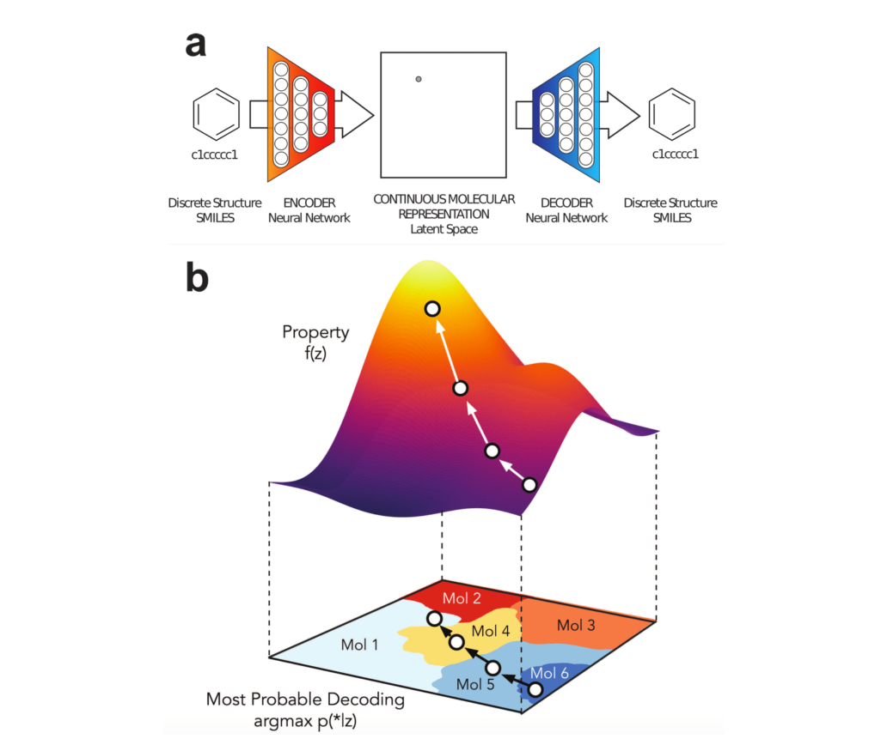
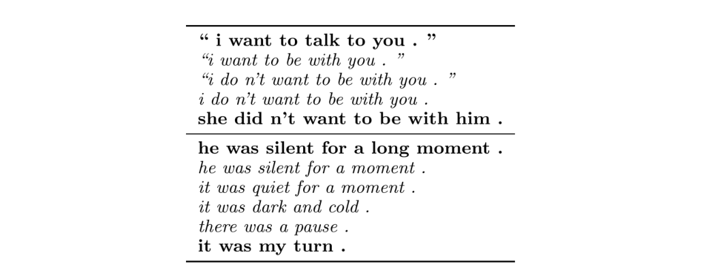
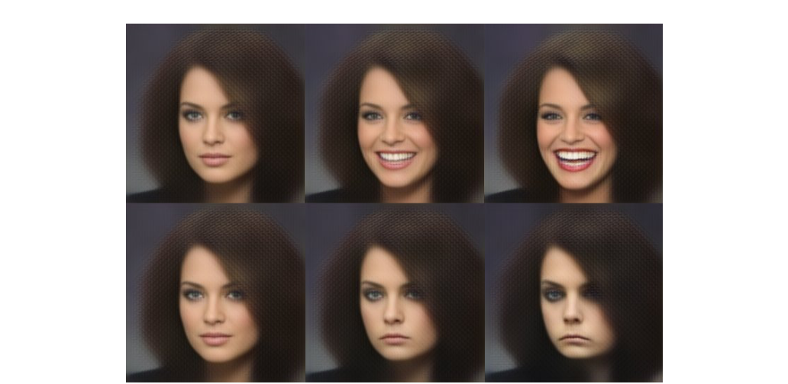

# 变分自编码器导论

**An Introduction to Variational Autoencoders**

| 作者 | 单位 | 邮箱 |
| --- | --- | --- |
| Diederik P. Kingma | Google | durk@google.com |
| Max Welling | 阿姆斯特丹大学、Qualcomm | mwelling@qti.qualcomm.com |

> 原文：[Introduction_VAE.pdf](Introduction_VAE.pdf)，arXiv:1906.02691v3，2019 年 12 月 11 日。原稿刊物标识为 *Foundations and Trends in Machine Learning*。
>
> 本文为全文中文翻译，保留原文章节、公式编号、算法、图注、附录和参考文献。公式采用 LaTeX；插图保留原图，图中英文可结合中文图注阅读。参考文献附中文题名，并保留英文原名与出版信息以便检索。原 PDF 的卷期、页码和 DOI 为出版模板占位信息，此处不将其作为正式书目信息。文中的研究进展和“目前”等时间表述均以原文写作时间为准。
>
> 原文版权说明：本文仅可用于研究、教学和／或个人学习。未经出版方明确许可，不得用于商业用途，也不得进行系统性下载（包括使用机器人或其他自动化程序）。

## 目录

- [摘要](#摘要)
- [1 引言](#1-引言)
  - 1.1 研究动机
  - 1.2 本文目标
  - 1.3 概率模型与变分推断
  - 1.4 用神经网络参数化条件分布
  - 1.5 有向图模型与神经网络
  - 1.6 使用神经网络的完全观测模型中的学习
  - 1.7 深度潜变量模型中的学习与推断
  - 1.8 难以处理的计算问题
- [2 变分自编码器](#2-变分自编码器)
  - 2.1 编码器或近似后验
  - 2.2 证据下界（ELBO）
  - 2.3 基于随机梯度优化 ELBO
  - 2.4 重参数化技巧
  - 2.5 因子化高斯后验
  - 2.6 边缘似然的估计
  - 2.7 将边缘似然与 ELBO 表示为 KL 散度
  - 2.8 挑战
  - 2.9 相关的先前与同期工作
- [3 超越高斯后验](#3-超越高斯后验)
  - 3.1 计算可处理性的要求
  - 3.2 提高推断模型的灵活性
  - 3.3 逆自回归变换
  - 3.4 逆自回归流（IAF）
  - 3.5 相关工作
- [4 更深的生成模型](#4-更深的生成模型)
  - 4.1 多个潜变量的推断与学习
  - 4.2 提高表达能力的其他方法
  - 4.3 自回归模型
  - 4.4 雅可比行列式易于计算的可逆变换
  - 4.5 后续工作
- [5 结论](#5-结论)
- [致谢](#致谢)
- [附录 A](#附录-a)
  - A.1 记号与定义
  - A.2 DLVM 的其他学习方法
  - A.3 随机梯度下降
- [参考文献](#参考文献)

## 摘要

变分自编码器为学习深度潜变量模型及其对应的推断模型提供了一个具有坚实理论依据的框架。本文介绍变分自编码器及其若干重要扩展。

## 1 引言

### 1.1 研究动机

机器学习的一个主要划分是生成式建模与判别式建模。判别式建模旨在根据观测学习一个预测器；生成式建模则试图解决一个更一般的问题：学习所有变量的联合分布。生成模型模拟数据在现实世界中产生的方式。几乎所有科学领域都将“建模”理解为：提出理论假设，并通过观测检验这些理论，从而揭示数据的生成过程。例如，气象学家对天气建模时，使用高度复杂的偏微分方程来描述天气背后的物理规律；天文学家对星系形成建模时，将天体相互作用所遵循的物理规律编码在运动方程中。生物学家、化学家、经济学家等也是如此。事实上，科学中的建模几乎总是生成式建模。

生成式建模有很多吸引人的地方。首先，我们可以将物理规律和约束纳入生成过程，同时将那些不了解或不关心的细节，即干扰变量，视为噪声。得到的模型通常非常直观且具有可解释性；将模型与观测进行比较，可以确认或否定我们关于世界如何运作的理论。

尝试理解数据生成过程的另一个原因是，它能自然地表达世界中的因果关系。因果关系的一大优势在于，与单纯的相关关系相比，它们能更好地泛化到新情境。例如，一旦理解了地震的生成过程，我们就可以将这些知识同时应用于加利福尼亚和智利。

要把生成模型转化为判别器，就需要使用贝叶斯法则。例如，我们分别为 A 类和 B 类地震建立生成模型，然后比较哪个模型能更好地描述数据，就可以计算发生的是 A 类还是 B 类地震的概率。然而，应用贝叶斯法则的计算代价往往很高。

判别式方法直接学习一个映射，其方向与未来进行预测的方向一致，与生成模型的方向相反。例如，可以认为，一幅图像在现实世界中是这样生成的：先确定物体，再在三维空间中生成该物体，最后将它投影到像素网格上。判别模型则直接以这些像素值为输入，并将它们映射到标签。虽然生成模型能够高效地从数据中学习，但与纯判别模型相比，它们通常会对数据作出更强的假设；当模型有误时，这往往会导致更大的渐近偏差（Banerjee，2007）。因此，如果模型有误——而它几乎总在某种程度上有误——并且我们只关心学习如何进行判别，同时又有足够多的数据，那么纯判别模型在判别任务中通常会产生更少的错误。不过，视可用数据量而定，研究数据生成过程仍可能有助于指导分类器等判别器的训练。例如，我们可能只有少量带标签样本，却有大量无标签样本。在这种半监督学习情境下，可以利用数据的生成模型改善分类效果（Kingma et al.，2014；Sønderby et al.，2016a）。

生成式建模还有更广泛的用途，可以将它看作一种辅助任务。例如，预测紧接着会发生什么，可能帮助我们构建对世界的有用抽象，并将其用于多个下游预测任务。寻找数据中解耦的、语义有意义的、统计独立的、具有因果性的变化因素，通常称为无监督表示学习，变分自编码器（variational autoencoder，VAE）已广泛用于这一目的。也可以将其视为一种隐式正则化：要求表示对数据生成有意义，会使反向过程——从输入映射到表示——偏向某种特定形式。预测世界这一辅助任务，有助于从抽象层面更好地理解世界，从而更好地进行下游预测。

VAE 可以看成两个相互耦合、但独立参数化的模型：编码器或识别模型，以及解码器或生成模型。两个模型彼此支持。识别模型为生成模型提供潜随机变量后验的近似，生成模型在“期望最大化”学习的一次迭代中更新参数时需要这一近似。反过来，生成模型为识别模型提供某种支架，帮助它学习有意义的数据表示，其中也可能包含类别标签。根据贝叶斯法则，识别模型是生成模型的近似逆过程。

相对于普通变分推断（variational inference，VI），VAE 框架的一项优势是：识别模型，也称推断模型，是输入变量的一个（随机）函数。普通 VI 则为每个数据样本分别设置一个变分分布，这对于大数据集效率很低。识别模型用同一组参数对输入与潜变量之间的关系进行建模，因此称为“摊销推断”。识别模型可以任意复杂，同时仍能保持合理的计算速度，因为按其构造，只需从输入到潜变量进行一次前向传播即可。不过，代价是采样会在学习所需的梯度中引入采样噪声。VAE 框架也许最大的贡献，就是认识到可以使用如今称为“重参数化技巧”的方法来抑制这种方差：通过一个简单步骤重新组织梯度计算，从而降低梯度方差。

VAE 受到 Helmholtz 机（Dayan et al.，1995）的启发，后者可能是第一个使用识别模型的模型。不过，它的醒眠算法效率较低，而且并不优化单一目标。VAE 的学习规则则来自对最大似然目标的同一个近似。

VAE 将图模型与深度学习结合起来。生成模型是形如 $p(\mathbf x\mid\mathbf z)p(\mathbf z)$ 的贝叶斯网络；如果有多个随机潜变量层，则是某种层次结构，例如 $p(\mathbf x\mid\mathbf z_L)p(\mathbf z_L\mid\mathbf z_{L-1})\cdots p(\mathbf z_1\mid\mathbf z_0)$。类似地，识别模型也是形如 $q(\mathbf z\mid\mathbf x)$ 的条件贝叶斯网络，或者形如 $q(\mathbf z_0\mid\mathbf z_1)\cdots q(\mathbf z_L\mid\mathbf x)$ 的层次结构。但每个条件分布内部都可能包含一个复杂的深度神经网络，例如 $\mathbf z\mid\mathbf x\sim f(\mathbf x,\boldsymbol\epsilon)$，其中 $f$ 是神经网络映射，$\boldsymbol\epsilon$ 是噪声随机变量。它的学习算法融合了经典的（摊销、变分）期望最大化方法，并通过重参数化技巧，最终在其中嵌入的多层深度神经网络上进行反向传播。

自提出以来，VAE 框架已沿多个方向扩展，例如动态模型（Johnson et al.，2016）、注意力模型（Gregor et al.，2015）、具有多层随机潜变量的模型（Kingma et al.，2016）等。事实证明，它是构建新模型的一个富有成果的框架。近来，另一种生成式建模范式引起了广泛关注：生成对抗网络（generative adversarial network，GAN）（Goodfellow et al.，2014）。VAE 与 GAN 似乎具有互补性质：GAN 可以生成主观感知质量很高的图像，但与基于似然的生成模型相比，它们往往不能完整覆盖数据的支持集（Grover et al.，2018）。VAE 与其他基于似然的模型一样，生成的样本更加分散，但按照似然准则衡量，它们是更好的密度模型。因此，人们提出了许多混合模型，试图兼得两者之长（Dumoulin et al.，2017；Grover et al.，2018；Rosca et al.，2018）。

机器学习共同体似乎已经接受这样一个事实：生成模型和无监督学习在构建智能机器方面具有重要作用。我们希望 VAE 能成为这幅拼图中有用的一块。

### 1.2 本文目标

变分自编码器（VAE）框架（Kingma and Welling，2014；Rezende et al.，2014）提供了一种具有坚实理论依据的方法，可以使用随机梯度下降，联合学习深度潜变量模型和对应的推断模型。该框架的应用十分广泛，涵盖生成式建模、半监督学习和表示学习。

本文是我们早期工作（Kingma and Welling，2014）的扩展版本，使我们能够更详细地解释这一主题，并讨论若干重要的后续研究。本文无意全面综述所有相关工作。我们假设读者具备代数、微积分和概率论的基础知识。

本章介绍背景知识：概率模型、有向图模型、有向图模型与神经网络的结合、完全观测模型中的学习，以及深度潜变量模型（deep latent-variable models，DLVM）。第 2 章解释 VAE 的基础，第 3 章介绍更高级的推断技术，第 4 章介绍更高级的生成模型。数学记号的进一步说明见 A.1 节。

### 1.3 概率模型与变分推断

在机器学习领域，我们经常希望从数据中学习各种自然现象和人工现象的概率模型。概率模型是对这些现象的数学描述，可用于理解现象、预测未来的未知量，以及各种辅助或自动决策。因此，概率模型将知识和技能的概念形式化，是机器学习与人工智能领域的核心构造。

概率模型包含未知量，而数据很少能完整揭示这些未知量，因此通常需要假定模型的某些方面存在一定程度的不确定性。这种不确定性的程度和性质由（条件）概率分布描述。模型可以同时包含连续变量和离散变量。从某种意义上说，最完整的概率模型以联合概率分布的形式，规定模型中各变量之间的全部相关性和高阶依赖关系。

用向量 $\mathbf x$ 表示我们想对其联合分布进行建模的全部观测变量。为简化记号、避免冗杂，本文使用小写粗体（例如 $\mathbf x$）表示底层观测随机变量的集合：将它们展平并拼接，以单个向量表示整个集合。更多记号说明见 A.1 节。

假设观测变量 $\mathbf x$ 是某个未知底层过程的随机样本，其真实（概率）分布 $p^*(\mathbf x)$ 未知。我们选择一个具有参数 $\boldsymbol\theta$ 的模型 $p_{\boldsymbol\theta}(\mathbf x)$ 来近似这一底层过程：

$$
\mathbf x\sim p_{\boldsymbol\theta}(\mathbf x).
\tag{1.1}
$$

学习通常就是寻找参数 $\boldsymbol\theta$，使模型给出的概率分布函数 $p_{\boldsymbol\theta}(\mathbf x)$ 近似数据的真实分布 $p^*(\mathbf x)$，从而对任意观测 $\mathbf x$ 都有：

$$
p_{\boldsymbol\theta}(\mathbf x)\approx p^*(\mathbf x).
\tag{1.2}
$$

自然地，我们希望 $p_{\boldsymbol\theta}(\mathbf x)$ 足够灵活，能够适应数据，才有机会得到足够准确的模型。同时，我们也希望能将事先已知的、有关数据分布的知识融入模型。

#### 1.3.1 条件模型

在分类或回归等问题中，我们通常不想学习无条件模型 $p_{\boldsymbol\theta}(\mathbf x)$，而是学习条件模型 $p_{\boldsymbol\theta}(\mathbf y\mid\mathbf x)$，用它近似真实条件分布 $p^*(\mathbf y\mid\mathbf x)$：在给定观测变量 $\mathbf x$ 的取值时，变量 $\mathbf y$ 的取值分布。这时，$\mathbf x$ 通常称为模型的输入。与无条件情形一样，我们选择一个模型 $p_{\boldsymbol\theta}(\mathbf y\mid\mathbf x)$，并优化它，使其接近未知的底层分布，从而对任意 $\mathbf x$ 和 $\mathbf y$ 都有：

$$
p_{\boldsymbol\theta}(\mathbf y\mid\mathbf x)\approx p^*(\mathbf y\mid\mathbf x).
\tag{1.3}
$$

图像分类是条件建模中一个常见而简单的例子：$\mathbf x$ 是图像，$y$ 是人类标注的图像类别，也是我们希望预测的量。这时，通常选择类别分布作为 $p_{\boldsymbol\theta}(y\mid\mathbf x)$，其参数由 $\mathbf x$ 计算得到。

当预测变量的维度很高，例如图像、视频或声音时，条件模型的学习会更加困难。一个例子是图像分类的逆问题：在给定类别标签的条件下，预测图像的分布。另一个输入和输出都具有高维度的例子是时间序列预测，例如文本预测或视频预测。

为避免记号冗杂，本文经常假设进行无条件建模，但应始终记住，文中介绍的方法几乎都同样适用于条件模型。作为条件的数据可以像模型参数一样视为模型输入，明显的区别在于，我们不优化这些条件数据的取值。

### 1.4 用神经网络参数化条件分布

可微的前馈神经网络，以下直接称为神经网络，是一类特别灵活、计算上可扩展的函数逼近器。学习具有多层人工神经元“隐藏层”的神经网络模型，通常称为深度学习（Goodfellow et al.，2016；LeCun et al.，2015）。一个特别有趣的应用是概率模型，即用神经网络表示概率模型中的概率密度函数（PDF）或概率质量函数（PMF）。基于神经网络的概率模型在计算上具有可扩展性，因为它们允许基于随机梯度进行优化；正如后文所述，这使其能够扩展到大型模型和大型数据集。本文用向量函数 $\operatorname{NeuralNet}(\cdot)$ 表示深度神经网络。

截至本文写作时，深度学习已被证明适用于多种分类与回归问题，相关总结见 LeCun et al.（2015）和 Goodfellow et al.（2016）。例如，在基于神经网络的图像分类中（LeCun et al.，1998），神经网络参数化给定图像 $\mathbf x$ 时类别标签 $y$ 的类别分布 $p_{\boldsymbol\theta}(y\mid\mathbf x)$：

$$
\mathbf p=\operatorname{NeuralNet}(\mathbf x),
\tag{1.4}
$$

$$
p_{\boldsymbol\theta}(y\mid\mathbf x)=\operatorname{Categorical}(y;\mathbf p).
\tag{1.5}
$$

其中 $\operatorname{NeuralNet}(\cdot)$ 的最后一步通常是 $\operatorname{softmax}(\cdot)$，从而保证 $\sum_i p_i=1$。

### 1.5 有向图模型与神经网络

本文使用有向概率模型，也称有向概率图模型（PGM）或贝叶斯网络。在这种概率模型中，所有变量按照拓扑关系组织成一个有向无环图。模型中各变量的联合分布可分解为先验分布与条件分布的乘积：

$$
p_{\boldsymbol\theta}(x_1,\ldots,x_M)
=\prod_{j=1}^{M}p_{\boldsymbol\theta}(x_j\mid\operatorname{Pa}(x_j)),
\tag{1.6}
$$

其中 $\operatorname{Pa}(x_j)$ 是有向图中节点 $j$ 的父变量集合。对于非根节点，分布以其父变量为条件；对于根节点，父变量集合为空，因此分布是无条件的。

传统上，每个条件概率分布 $p_{\boldsymbol\theta}(x_j\mid\operatorname{Pa}(x_j))$ 都参数化为查找表或线性模型（Koller and Friedman，2009）。如上所述，更灵活的方式是用神经网络参数化这些条件分布。此时，神经网络以有向图中某个变量的父变量为输入，输出该变量的分布参数 $\boldsymbol\eta$：

$$
\boldsymbol\eta=\operatorname{NeuralNet}(\operatorname{Pa}(\mathbf x)),
\tag{1.7}
$$

$$
p_{\boldsymbol\theta}(\mathbf x\mid\operatorname{Pa}(\mathbf x))
=p_{\boldsymbol\theta}(\mathbf x\mid\boldsymbol\eta).
\tag{1.8}
$$

下面讨论当数据中所有变量都被观测到时，如何学习这些模型的参数。

### 1.6 使用神经网络的完全观测模型中的学习

如果有向图模型中的所有变量都在数据中被观测到，就可以计算数据在模型下的对数概率并对其求导，从而相对直接地进行优化。

#### 1.6.1 数据集

我们通常收集一个包含 $N\geq1$ 个数据点的数据集 $\mathcal D$：

$$
\mathcal D=\{\mathbf x^{(1)},\mathbf x^{(2)},\ldots,\mathbf x^{(N)}\}
\equiv\{\mathbf x^{(i)}\}_{i=1}^{N}\equiv\mathbf x^{(1:N)}.
\tag{1.9}
$$

假设这些数据点是从一个保持不变的底层分布中独立采样得到的。也就是说，数据集包含对同一不变系统进行的、彼此独立的不同测量。这时称观测 $\mathcal D=\{\mathbf x^{(i)}\}_{i=1}^{N}$ 是独立同分布的（independently and identically distributed，i.i.d.）。在这一假设下，给定参数时所有数据点的概率可分解为各数据点概率的乘积。因此，模型赋予数据的对数概率为：

$$
\log p_{\boldsymbol\theta}(\mathcal D)
=\sum_{\mathbf x\in\mathcal D}\log p_{\boldsymbol\theta}(\mathbf x).
\tag{1.10}
$$

#### 1.6.2 最大似然与小批量 SGD

概率模型最常用的准则是最大对数似然（maximum log-likelihood，ML）。后文将说明，最大化对数似然等价于最小化数据分布与模型分布之间的 Kullback–Leibler 散度。

在 ML 准则下，我们尝试找到参数 $\boldsymbol\theta$，使模型赋予数据的对数概率之和最大，等价地，也使其平均值最大。对于大小为 $N_{\mathcal D}$ 的独立同分布数据集 $\mathcal D$，最大似然目标就是最大化式（1.10）的对数概率。

利用微积分中的链式法则和自动微分工具，可以高效计算该目标的梯度，也就是目标关于参数 $\boldsymbol\theta$ 的一阶导数。利用这些梯度，可以迭代地沿上升方向寻找 ML 目标的局部最优点。如果用全部数据点计算梯度 $\nabla_{\boldsymbol\theta}\log p_{\boldsymbol\theta}(\mathcal D)$，就称为批量梯度下降。但对于大型数据集，计算这一导数的代价很高，因为它随 $N_{\mathcal D}$ 线性增长。

更高效的优化方法是随机梯度下降（stochastic gradient descent，SGD；见 A.3 节），它使用随机抽取的、大小为 $N_{\mathcal M}$ 的小批量数据 $\mathcal M\subset\mathcal D$。利用小批量，可以构造 ML 准则的无偏估计量：

$$
\frac{1}{N_{\mathcal D}}\log p_{\boldsymbol\theta}(\mathcal D)
\simeq\frac{1}{N_{\mathcal M}}\log p_{\boldsymbol\theta}(\mathcal M)
=\frac{1}{N_{\mathcal M}}\sum_{\mathbf x\in\mathcal M}\log p_{\boldsymbol\theta}(\mathbf x).
\tag{1.11}
$$

符号 $\simeq$ 表示等式一侧是另一侧的无偏估计。因此，其中一侧——这里是右侧——由于某种噪声源而成为随机变量；对噪声分布取平均后，两侧相等。这里的噪声源是随机抽取的小批量数据 $\mathcal M$。无偏估计量 $\log p_{\boldsymbol\theta}(\mathcal M)$ 是可微的，因此可得到无偏随机梯度：

$$
\frac{1}{N_{\mathcal D}}\nabla_{\boldsymbol\theta}\log p_{\boldsymbol\theta}(\mathcal D)
\simeq\frac{1}{N_{\mathcal M}}\nabla_{\boldsymbol\theta}\log p_{\boldsymbol\theta}(\mathcal M)
=\frac{1}{N_{\mathcal M}}\sum_{\mathbf x\in\mathcal M}\nabla_{\boldsymbol\theta}\log p_{\boldsymbol\theta}(\mathbf x).
\tag{1.12}
$$

这些梯度可以传入基于随机梯度的优化器，进一步讨论见 A.3 节。简言之，通过反复沿随机梯度方向迈出小步，就可以优化目标函数。

#### 1.6.3 贝叶斯推断

从贝叶斯角度看，可以通过最大后验（maximum a posteriori，MAP）估计改进 ML（见 A.2.1 节）；更进一步，还可以推断参数的完整近似后验分布（见 A.1.4 节）。

### 1.7 深度潜变量模型中的学习与推断

#### 1.7.1 潜变量

可以将上一节讨论的完全观测有向模型扩展为包含潜变量的有向模型。潜变量属于模型的一部分，但没有被观测到，因此不包含在数据集中。通常用 $\mathbf z$ 表示这些潜变量。对于观测变量 $\mathbf x$ 的无条件建模，有向图模型将表示观测变量 $\mathbf x$ 与潜变量 $\mathbf z$ 的联合分布 $p_{\boldsymbol\theta}(\mathbf x,\mathbf z)$。观测变量的边缘分布 $p_{\boldsymbol\theta}(\mathbf x)$ 为：

$$
p_{\boldsymbol\theta}(\mathbf x)=\int p_{\boldsymbol\theta}(\mathbf x,\mathbf z)\,d\mathbf z.
\tag{1.13}
$$

将其视为 $\boldsymbol\theta$ 的函数时，也称为（单个数据点的）边缘似然或模型证据。

这种隐式定义的 $\mathbf x$ 分布可以非常灵活。如果 $\mathbf z$ 是离散变量，且 $p_{\boldsymbol\theta}(\mathbf x\mid\mathbf z)$ 是高斯分布，那么 $p_{\boldsymbol\theta}(\mathbf x)$ 就是高斯混合分布。对于连续 $\mathbf z$，$p_{\boldsymbol\theta}(\mathbf x)$ 可以看作无限混合，它可能比离散混合更强大。这类边缘分布也称为复合概率分布。

#### 1.7.2 深度潜变量模型

我们用深度潜变量模型（DLVM）表示其分布由神经网络参数化的潜变量模型 $p_{\boldsymbol\theta}(\mathbf x,\mathbf z)$。这类模型可以以某些上下文为条件，例如 $p_{\boldsymbol\theta}(\mathbf x,\mathbf z\mid\mathbf y)$。DLVM 的一个重要优势是：即使有向模型中的每个因子（先验或条件分布）都相对简单，例如条件高斯分布，边缘分布 $p_{\boldsymbol\theta}(\mathbf x)$ 仍可以非常复杂，包含几乎任意的依赖关系。这种表达能力使深度潜变量模型特别适合近似复杂的真实分布 $p^*(\mathbf x)$。

最简单、也最常见的 DLVM，可能就是具有如下分解结构的模型：

$$
p_{\boldsymbol\theta}(\mathbf x,\mathbf z)
=p_{\boldsymbol\theta}(\mathbf z)p_{\boldsymbol\theta}(\mathbf x\mid\mathbf z),
\tag{1.14}
$$

其中指定了 $p_{\boldsymbol\theta}(\mathbf z)$ 和／或 $p_{\boldsymbol\theta}(\mathbf x\mid\mathbf z)$。分布 $p(\mathbf z)$ 通常称为 $\mathbf z$ 的先验分布，因为它不以任何观测为条件。

#### 1.7.3 多元伯努利数据的 DLVM 示例

Kingma and Welling（2014）针对二值数据 $\mathbf x$ 使用的一个简单 DLVM，具有球形高斯潜空间和因子化的伯努利观测模型：

$$
p(\mathbf z)=\mathcal N(\mathbf z;\mathbf 0,\mathbf I),
\tag{1.15}
$$

$$
\mathbf p=\operatorname{DecoderNeuralNet}_{\boldsymbol\theta}(\mathbf z),
\tag{1.16}
$$

$$
\log p(\mathbf x\mid\mathbf z)
=\sum_{j=1}^{D}\log p(x_j\mid\mathbf z)
=\sum_{j=1}^{D}\log\operatorname{Bernoulli}(x_j;p_j)
\tag{1.17}
$$

$$
=\sum_{j=1}^{D}\left[x_j\log p_j+(1-x_j)\log(1-p_j)\right].
\tag{1.18}
$$

其中，对 $\mathbf p$ 中的每个 $p_j$，都有 $0\leq p_j\leq1$；例如，可在 $\operatorname{DecoderNeuralNet}_{\boldsymbol\theta}(\cdot)$ 的最后一层使用 sigmoid 非线性函数来实现。$D$ 是 $\mathbf x$ 的维数，$\operatorname{Bernoulli}(\cdot;p)$ 是伯努利分布的概率质量函数。

### 1.8 难以处理的计算问题

在 DLVM 中进行最大似然学习的主要困难是，数据在模型下的边缘概率通常难以计算。这是因为式（1.13）中计算边缘似然或模型证据的积分 $p_{\boldsymbol\theta}(\mathbf x)=\int p_{\boldsymbol\theta}(\mathbf x,\mathbf z)\,d\mathbf z$，既没有解析解，也没有高效的估计量。因此，无法像完全观测模型那样对它关于参数求导并优化。

$p_{\boldsymbol\theta}(\mathbf x)$ 难以计算，与后验分布 $p_{\boldsymbol\theta}(\mathbf z\mid\mathbf x)$ 难以处理是相关的。注意，联合分布 $p_{\boldsymbol\theta}(\mathbf x,\mathbf z)$ 可以高效计算，且这些密度之间有如下基本恒等关系：

$$
p_{\boldsymbol\theta}(\mathbf z\mid\mathbf x)
=\frac{p_{\boldsymbol\theta}(\mathbf x,\mathbf z)}{p_{\boldsymbol\theta}(\mathbf x)}.
\tag{1.19}
$$

因为 $p_{\boldsymbol\theta}(\mathbf x,\mathbf z)$ 易于计算，所以边缘似然 $p_{\boldsymbol\theta}(\mathbf x)$ 易于计算，就意味着后验 $p_{\boldsymbol\theta}(\mathbf z\mid\mathbf x)$ 易于计算，反之亦然。在 DLVM 中，两者都难以处理。

近似推断技术（另见 A.2 节）使我们能够近似 DLVM 中的后验 $p_{\boldsymbol\theta}(\mathbf z\mid\mathbf x)$ 和边缘似然 $p_{\boldsymbol\theta}(\mathbf x)$。传统推断方法的计算代价相对较高。例如，这些方法往往要求为每个数据点单独执行优化循环，或者得到的后验近似质量较差。我们希望避免这些昂贵的过程。

同样，神经网络参数化的有向模型，其参数后验 $p(\boldsymbol\theta\mid\mathcal D)$ 通常也难以精确计算，需要使用近似推断技术。

## 2 变分自编码器

本章介绍变分自编码器（VAE）的基础。

### 2.1 编码器或近似后验

上一章介绍了深度潜变量模型（DLVM），以及估计这类模型中的对数似然和后验分布的问题。VAE 框架提供了一种计算高效的方法，可以使用 SGD 将 DLVM 与相应的推断模型联合优化。

为了把 DLVM 中难以处理的后验推断与学习问题转化为可处理的问题，我们引入参数化推断模型 $q_{\boldsymbol\phi}(\mathbf z\mid\mathbf x)$。这一模型也称为编码器或识别模型。$\boldsymbol\phi$ 表示推断模型的参数，也称变分参数。我们优化 $\boldsymbol\phi$，使得：

$$
q_{\boldsymbol\phi}(\mathbf z\mid\mathbf x)\approx p_{\boldsymbol\theta}(\mathbf z\mid\mathbf x).
\tag{2.1}
$$

后文将说明，这一后验近似有助于优化边缘似然。

与 DLVM 一样，推断模型可以是几乎任意的有向图模型：

$$
q_{\boldsymbol\phi}(\mathbf z\mid\mathbf x)
=q_{\boldsymbol\phi}(z_1,\ldots,z_M\mid\mathbf x)
=\prod_{j=1}^{M}q_{\boldsymbol\phi}(z_j\mid\operatorname{Pa}(z_j),\mathbf x),
\tag{2.2}
$$

其中 $\operatorname{Pa}(z_j)$ 是有向图中变量 $z_j$ 的父变量集合。与 DLVM 类似，分布 $q_{\boldsymbol\phi}(\mathbf z\mid\mathbf x)$ 也可以用深度神经网络参数化。此时，变分参数 $\boldsymbol\phi$ 包含神经网络的权重和偏置。例如：

$$
(\boldsymbol\mu,\log\boldsymbol\sigma)
=\operatorname{EncoderNeuralNet}_{\boldsymbol\phi}(\mathbf x),
\tag{2.3}
$$

$$
q_{\boldsymbol\phi}(\mathbf z\mid\mathbf x)
=\mathcal N(\mathbf z;\boldsymbol\mu,\operatorname{diag}(\boldsymbol\sigma^2)).
\tag{2.4}
$$

> 译注：原文式（2.4）的协方差写为 $\operatorname{diag}(\boldsymbol\sigma)$；依照 2.5 节及其重参数化公式，此处应为 $\operatorname{diag}(\boldsymbol\sigma^2)$。本文以 $\boldsymbol\sigma$ 表示标准差。

通常，我们使用一个编码器神经网络，为数据集中的全部数据点执行后验推断。相比之下，传统变分推断往往不共享变分参数，而是为每个数据点分别迭代优化。VAE 中在数据点之间共享变分参数的策略，也称为摊销变分推断（Gershman and Goodman，2014）。通过摊销推断，可以避免每个数据点各自的优化循环，并利用 SGD 的高效率。

### 2.2 证据下界（ELBO）

与其他变分方法一样，VAE 的优化目标是证据下界（evidence lower bound，ELBO），也称变分下界。通常，ELBO 通过 Jensen 不等式推导。这里采用另一种不依赖 Jensen 不等式的推导，以更深入地理解这个下界的紧致程度。



**图 2.1：** VAE 在观测 $\mathbf x$ 空间与潜在 $\mathbf z$ 空间之间学习随机映射。前者的经验分布 $q_{\mathcal D}(\mathbf x)$ 通常很复杂，后者的分布则可以相对简单，例如图中的球形分布。生成模型学习联合分布 $p_{\boldsymbol\theta}(\mathbf x,\mathbf z)$，它通常（但并非总是）分解为 $p_{\boldsymbol\theta}(\mathbf z)p_{\boldsymbol\theta}(\mathbf x\mid\mathbf z)$，其中包含潜空间先验 $p_{\boldsymbol\theta}(\mathbf z)$ 和随机解码器 $p_{\boldsymbol\theta}(\mathbf x\mid\mathbf z)$。随机编码器 $q_{\boldsymbol\phi}(\mathbf z\mid\mathbf x)$ 也称推断模型，用来近似生成模型真实但难以处理的后验 $p_{\boldsymbol\theta}(\mathbf z\mid\mathbf x)$。

对于任意选择的推断模型 $q_{\boldsymbol\phi}(\mathbf z\mid\mathbf x)$，包括任意选择的变分参数 $\boldsymbol\phi$，都有：

$$
\log p_{\boldsymbol\theta}(\mathbf x)
=\mathbb E_{q_{\boldsymbol\phi}(\mathbf z\mid\mathbf x)}[\log p_{\boldsymbol\theta}(\mathbf x)]
\tag{2.5}
$$

$$
=\mathbb E_{q_{\boldsymbol\phi}(\mathbf z\mid\mathbf x)}
\left[\log\frac{p_{\boldsymbol\theta}(\mathbf x,\mathbf z)}{p_{\boldsymbol\theta}(\mathbf z\mid\mathbf x)}\right]
\tag{2.6}
$$

$$
=\mathbb E_{q_{\boldsymbol\phi}(\mathbf z\mid\mathbf x)}
\left[\log\left(\frac{p_{\boldsymbol\theta}(\mathbf x,\mathbf z)}{q_{\boldsymbol\phi}(\mathbf z\mid\mathbf x)}
\frac{q_{\boldsymbol\phi}(\mathbf z\mid\mathbf x)}{p_{\boldsymbol\theta}(\mathbf z\mid\mathbf x)}\right)\right]
\tag{2.7}
$$

$$
=\underbrace{\mathbb E_{q_{\boldsymbol\phi}(\mathbf z\mid\mathbf x)}
\left[\log\frac{p_{\boldsymbol\theta}(\mathbf x,\mathbf z)}{q_{\boldsymbol\phi}(\mathbf z\mid\mathbf x)}\right]}_{\mathcal L_{\boldsymbol\theta,\boldsymbol\phi}(\mathbf x)\;\text{（ELBO）}}
+\underbrace{\mathbb E_{q_{\boldsymbol\phi}(\mathbf z\mid\mathbf x)}
\left[\log\frac{q_{\boldsymbol\phi}(\mathbf z\mid\mathbf x)}{p_{\boldsymbol\theta}(\mathbf z\mid\mathbf x)}\right]}_{D_{\mathrm{KL}}(q_{\boldsymbol\phi}(\mathbf z\mid\mathbf x)\|p_{\boldsymbol\theta}(\mathbf z\mid\mathbf x))}.
\tag{2.8}
$$

式（2.8）的第二项是 $q_{\boldsymbol\phi}(\mathbf z\mid\mathbf x)$ 与 $p_{\boldsymbol\theta}(\mathbf z\mid\mathbf x)$ 之间的 Kullback–Leibler（KL）散度，它非负：

$$
D_{\mathrm{KL}}\!\left(q_{\boldsymbol\phi}(\mathbf z\mid\mathbf x)\|p_{\boldsymbol\theta}(\mathbf z\mid\mathbf x)\right)\geq0,
\tag{2.9}
$$

并且当且仅当 $q_{\boldsymbol\phi}(\mathbf z\mid\mathbf x)$ 等于真实后验分布时为零。

式（2.8）的第一项就是变分下界，也称证据下界：

$$
\mathcal L_{\boldsymbol\theta,\boldsymbol\phi}(\mathbf x)
=\mathbb E_{q_{\boldsymbol\phi}(\mathbf z\mid\mathbf x)}
[\log p_{\boldsymbol\theta}(\mathbf x,\mathbf z)-\log q_{\boldsymbol\phi}(\mathbf z\mid\mathbf x)].
\tag{2.10}
$$

由于 KL 散度非负，ELBO 是数据对数似然的下界：

$$
\mathcal L_{\boldsymbol\theta,\boldsymbol\phi}(\mathbf x)
=\log p_{\boldsymbol\theta}(\mathbf x)
-D_{\mathrm{KL}}\!\left(q_{\boldsymbol\phi}(\mathbf z\mid\mathbf x)\|p_{\boldsymbol\theta}(\mathbf z\mid\mathbf x)\right)
\tag{2.11}
$$

$$
\leq\log p_{\boldsymbol\theta}(\mathbf x).
\tag{2.12}
$$

有意思的是，KL 散度 $D_{\mathrm{KL}}(q_{\boldsymbol\phi}(\mathbf z\mid\mathbf x)\|p_{\boldsymbol\theta}(\mathbf z\mid\mathbf x))$ 同时决定了两种“距离”：

1. 按定义，它是近似后验相对于真实后验的 KL 散度。
2. 它也是 ELBO $\mathcal L_{\boldsymbol\theta,\boldsymbol\phi}(\mathbf x)$ 与对数边缘似然 $\log p_{\boldsymbol\theta}(\mathbf x)$ 之间的间隙，即下界的紧致程度。按照 KL 散度衡量，$q_{\boldsymbol\phi}(\mathbf z\mid\mathbf x)$ 越接近真实后验 $p_{\boldsymbol\theta}(\mathbf z\mid\mathbf x)$，这一间隙就越小。



**图 2.2：** VAE 计算流程的简单示意图。数据点输入推断模型 $q(\mathbf z\mid\mathbf x)$，从中得到样本 $\mathbf z$，随后在生成模型中计算 $p(\mathbf x,\mathbf z)$。图示目标为 $\log p(\mathbf x,\mathbf z)-\log q(\mathbf z\mid\mathbf x)$，即 ELBO 的单样本估计。

#### 2.2.1 一举两得

由式（2.11）可以看出，关于 $\boldsymbol\theta$ 和 $\boldsymbol\phi$ 最大化 ELBO，会同时优化我们关心的两件事：

1. 近似最大化边缘似然 $p_{\boldsymbol\theta}(\mathbf x)$，从而改善生成模型。
2. 最小化近似分布 $q_{\boldsymbol\phi}(\mathbf z\mid\mathbf x)$ 相对于真实后验 $p_{\boldsymbol\theta}(\mathbf z\mid\mathbf x)$ 的 KL 散度，从而改善近似后验。

### 2.3 基于随机梯度优化 ELBO

ELBO 的一个重要性质是，可以用随机梯度下降（SGD）联合优化全部参数（$\boldsymbol\phi$ 和 $\boldsymbol\theta$）。可以从随机初始值出发，随机优化这些参数直至收敛。

对于独立同分布数据集，ELBO 目标为各数据点 ELBO 的和或平均值：

$$
\mathcal L_{\boldsymbol\theta,\boldsymbol\phi}(\mathcal D)
=\sum_{\mathbf x\in\mathcal D}\mathcal L_{\boldsymbol\theta,\boldsymbol\phi}(\mathbf x).
\tag{2.13}
$$

一般而言，单个数据点的 ELBO 及其梯度 $\nabla_{\boldsymbol\theta,\boldsymbol\phi}\mathcal L_{\boldsymbol\theta,\boldsymbol\phi}(\mathbf x)$ 都难以精确计算。不过，后文将说明，可以得到良好的无偏估计量 $\widetilde\nabla_{\boldsymbol\theta,\boldsymbol\phi}\mathcal L_{\boldsymbol\theta,\boldsymbol\phi}(\mathbf x)$，因此仍可使用小批量 SGD。

关于生成模型参数 $\boldsymbol\theta$ 的 ELBO 无偏梯度很容易获得：

$$
\nabla_{\boldsymbol\theta}\mathcal L_{\boldsymbol\theta,\boldsymbol\phi}(\mathbf x)
=\nabla_{\boldsymbol\theta}\mathbb E_{q_{\boldsymbol\phi}(\mathbf z\mid\mathbf x)}
[\log p_{\boldsymbol\theta}(\mathbf x,\mathbf z)-\log q_{\boldsymbol\phi}(\mathbf z\mid\mathbf x)]
\tag{2.14}
$$

$$
=\mathbb E_{q_{\boldsymbol\phi}(\mathbf z\mid\mathbf x)}
[\nabla_{\boldsymbol\theta}(\log p_{\boldsymbol\theta}(\mathbf x,\mathbf z)-\log q_{\boldsymbol\phi}(\mathbf z\mid\mathbf x))]
\tag{2.15}
$$

$$
\simeq\nabla_{\boldsymbol\theta}(\log p_{\boldsymbol\theta}(\mathbf x,\mathbf z)-\log q_{\boldsymbol\phi}(\mathbf z\mid\mathbf x))
\tag{2.16}
$$

$$
=\nabla_{\boldsymbol\theta}\log p_{\boldsymbol\theta}(\mathbf x,\mathbf z).
\tag{2.17}
$$

最后一行是第二行的简单蒙特卡洛估计；最后两行中的 $\mathbf z$ 是从 $q_{\boldsymbol\phi}(\mathbf z\mid\mathbf x)$ 抽取的随机样本。

关于变分参数 $\boldsymbol\phi$ 的无偏梯度更难获得，因为 ELBO 中的期望是对 $q_{\boldsymbol\phi}(\mathbf z\mid\mathbf x)$ 取的，而这一分布本身依赖 $\boldsymbol\phi$。也就是说，一般情况下：

$$
\nabla_{\boldsymbol\phi}\mathcal L_{\boldsymbol\theta,\boldsymbol\phi}(\mathbf x)
=\nabla_{\boldsymbol\phi}\mathbb E_{q_{\boldsymbol\phi}(\mathbf z\mid\mathbf x)}
[\log p_{\boldsymbol\theta}(\mathbf x,\mathbf z)-\log q_{\boldsymbol\phi}(\mathbf z\mid\mathbf x)]
\tag{2.18}
$$

$$
\neq\mathbb E_{q_{\boldsymbol\phi}(\mathbf z\mid\mathbf x)}
[\nabla_{\boldsymbol\phi}(\log p_{\boldsymbol\theta}(\mathbf x,\mathbf z)-\log q_{\boldsymbol\phi}(\mathbf z\mid\mathbf x))].
\tag{2.19}
$$

对于连续潜变量，可以使用下面讨论的重参数化技巧，计算 $\nabla_{\boldsymbol\theta,\boldsymbol\phi}\mathcal L_{\boldsymbol\theta,\boldsymbol\phi}(\mathbf x)$ 的无偏估计。利用这一随机估计，就可以通过 SGD 优化 ELBO，见算法 1。离散潜变量的变分方法见 2.9.1 节。

### 2.4 重参数化技巧

对于连续潜变量，以及可微的编码器和生成模型，通过变量替换，也称重参数化技巧，可以直接对 ELBO 关于 $\boldsymbol\phi$ 和 $\boldsymbol\theta$ 求导（Kingma and Welling，2014；Rezende et al.，2014）。

#### 2.4.1 变量替换

首先，在给定 $\mathbf x$ 和 $\boldsymbol\phi$ 时，将随机变量 $\mathbf z\sim q_{\boldsymbol\phi}(\mathbf z\mid\mathbf x)$ 表示为另一个随机变量 $\boldsymbol\epsilon$ 的可微、可逆变换：

$$
\mathbf z=g(\boldsymbol\epsilon,\boldsymbol\phi,\mathbf x),
\tag{2.20}
$$

其中随机变量 $\boldsymbol\epsilon$ 的分布独立于 $\mathbf x$ 和 $\boldsymbol\phi$。

> 译注：原文此处写作“给定 $\mathbf z$ 和 $\boldsymbol\phi$”，依据公式应为“给定 $\mathbf x$ 和 $\boldsymbol\phi$”。原文后续偶尔调整 $g$ 的参数书写顺序，译文统一为 $g(\boldsymbol\epsilon,\boldsymbol\phi,\mathbf x)$。

**算法 1：ELBO 的随机优化。** 噪声既来自小批量采样，也来自 $p(\boldsymbol\epsilon)$ 的采样，因此这是一个双重随机优化过程，也称自编码变分贝叶斯（Auto-Encoding Variational Bayes，AEVB）算法。

```text
输入：数据集 D；推断模型 q_φ(z|x)；生成模型 p_θ(x,z)
输出：学习得到的参数 θ、φ

初始化 θ、φ
当 SGD 尚未收敛时：
    从 D 随机抽取一个小批量 M
    从 p(ε) 采样噪声，为 M 中每个数据点分别产生随机噪声
    计算 ELBO 估计 L̃_θ,φ(M,ε) 及其梯度 ∇_θ,φ L̃_θ,φ(M,ε)
    使用 SGD 优化器更新 θ 和 φ
```

#### 2.4.2 变量替换后的期望梯度

有了上述变量替换，就可以用 $\boldsymbol\epsilon$ 重写期望：

$$
\mathbb E_{q_{\boldsymbol\phi}(\mathbf z\mid\mathbf x)}[f(\mathbf z)]
=\mathbb E_{p(\boldsymbol\epsilon)}[f(\mathbf z)],
\tag{2.21}
$$

其中 $\mathbf z=g(\boldsymbol\epsilon,\boldsymbol\phi,\mathbf x)$。于是可以交换期望与梯度算子，并构造简单的蒙特卡洛估计：

$$
\nabla_{\boldsymbol\phi}\mathbb E_{q_{\boldsymbol\phi}(\mathbf z\mid\mathbf x)}[f(\mathbf z)]
=\nabla_{\boldsymbol\phi}\mathbb E_{p(\boldsymbol\epsilon)}[f(\mathbf z)]
\tag{2.22}
$$

$$
=\mathbb E_{p(\boldsymbol\epsilon)}[\nabla_{\boldsymbol\phi}f(\mathbf z)]
\tag{2.23}
$$

$$
\simeq\nabla_{\boldsymbol\phi}f(\mathbf z),
\tag{2.24}
$$

其中最后一行使用随机噪声样本 $\boldsymbol\epsilon\sim p(\boldsymbol\epsilon)$，并令 $\mathbf z=g(\boldsymbol\epsilon,\boldsymbol\phi,\mathbf x)$。图 2.3 给出示意和进一步说明；图 3.2 展示二维玩具问题中得到的后验。



**图 2.3：** 变分参数 $\boldsymbol\phi$ 通过随机变量 $\mathbf z\sim q_{\boldsymbol\phi}(\mathbf z\mid\mathbf x)$ 影响目标 $f$。我们希望计算 $\nabla_{\boldsymbol\phi}f$，以便使用 SGD 优化目标。在原始形式（左）中，无法直接通过随机变量 $\mathbf z$ 反向传播梯度，因此不能直接对 $f$ 关于 $\boldsymbol\phi$ 求导。将 $\mathbf z$ 重参数化为 $\boldsymbol\phi$、$\mathbf x$ 和新引入的随机变量 $\boldsymbol\epsilon$ 的确定性可微函数，就能将随机性“外置”，进而“穿过 $\mathbf z$ 反向传播”，计算梯度 $\nabla_{\boldsymbol\phi}f$。图中菱形为确定性节点，圆形为随机节点，箭头分别表示函数求值与求导。

#### 2.4.3 ELBO 的梯度

重参数化后，可以将关于 $q_{\boldsymbol\phi}(\mathbf z\mid\mathbf x)$ 的期望替换为关于 $p(\boldsymbol\epsilon)$ 的期望。ELBO 可重写为：

$$
\mathcal L_{\boldsymbol\theta,\boldsymbol\phi}(\mathbf x)
=\mathbb E_{q_{\boldsymbol\phi}(\mathbf z\mid\mathbf x)}
[\log p_{\boldsymbol\theta}(\mathbf x,\mathbf z)-\log q_{\boldsymbol\phi}(\mathbf z\mid\mathbf x)]
\tag{2.25}
$$

$$
=\mathbb E_{p(\boldsymbol\epsilon)}
[\log p_{\boldsymbol\theta}(\mathbf x,\mathbf z)-\log q_{\boldsymbol\phi}(\mathbf z\mid\mathbf x)],
\tag{2.26}
$$

其中 $\mathbf z=g(\boldsymbol\epsilon,\boldsymbol\phi,\mathbf x)$。

因此，只需从 $p(\boldsymbol\epsilon)$ 抽取一个噪声样本，就可以构造单个数据点 ELBO 的简单蒙特卡洛估计量 $\widetilde{\mathcal L}_{\boldsymbol\theta,\boldsymbol\phi}(\mathbf x)$：

$$
\boldsymbol\epsilon\sim p(\boldsymbol\epsilon),
\tag{2.27}
$$

$$
\mathbf z=g(\boldsymbol\epsilon,\boldsymbol\phi,\mathbf x),
\tag{2.28}
$$

$$
\widetilde{\mathcal L}_{\boldsymbol\theta,\boldsymbol\phi}(\mathbf x)
=\log p_{\boldsymbol\theta}(\mathbf x,\mathbf z)-\log q_{\boldsymbol\phi}(\mathbf z\mid\mathbf x).
\tag{2.29}
$$

这一系列运算可在 TensorFlow 等软件中表示为符号计算图，并方便地关于参数 $\boldsymbol\theta$ 和 $\boldsymbol\phi$ 求导。所得梯度 $\nabla_{\boldsymbol\phi}\widetilde{\mathcal L}_{\boldsymbol\theta,\boldsymbol\phi}(\mathbf x)$ 可用于通过小批量 SGD 优化 ELBO，见算法 1。Kingma and Welling（2014）最初将这一算法称为自编码变分贝叶斯（AEVB）算法。更一般地，重参数化的 ELBO 估计量称为随机梯度变分贝叶斯（Stochastic Gradient Variational Bayes，SGVB）估计量。它也可以用于估计模型参数的后验，详见 Kingma and Welling（2014）的附录。

**无偏性。** 该梯度是单个数据点精确 ELBO 梯度的无偏估计：对噪声 $\boldsymbol\epsilon\sim p(\boldsymbol\epsilon)$ 取平均后，它等于单个数据点的 ELBO 梯度：

$$
\mathbb E_{p(\boldsymbol\epsilon)}
[\nabla_{\boldsymbol\theta,\boldsymbol\phi}\widetilde{\mathcal L}_{\boldsymbol\theta,\boldsymbol\phi}(\mathbf x;\boldsymbol\epsilon)]
=\mathbb E_{p(\boldsymbol\epsilon)}
[\nabla_{\boldsymbol\theta,\boldsymbol\phi}(\log p_{\boldsymbol\theta}(\mathbf x,\mathbf z)-\log q_{\boldsymbol\phi}(\mathbf z\mid\mathbf x))]
\tag{2.30}
$$

$$
=\nabla_{\boldsymbol\theta,\boldsymbol\phi}\mathbb E_{p(\boldsymbol\epsilon)}
[\log p_{\boldsymbol\theta}(\mathbf x,\mathbf z)-\log q_{\boldsymbol\phi}(\mathbf z\mid\mathbf x)]
\tag{2.31}
$$

$$
=\nabla_{\boldsymbol\theta,\boldsymbol\phi}\mathcal L_{\boldsymbol\theta,\boldsymbol\phi}(\mathbf x).
\tag{2.32}
$$

#### 2.4.4 计算 $\log q_{\boldsymbol\phi}(\mathbf z\mid\mathbf x)$

计算 ELBO 或其估计量，需要在给定 $\mathbf x$ 和 $\mathbf z$（等价地，给定 $\boldsymbol\epsilon$）时计算密度 $\log q_{\boldsymbol\phi}(\mathbf z\mid\mathbf x)$。只要选择合适的变换 $g$，这一计算就很简单。

通常，我们知道 $p(\boldsymbol\epsilon)$，因为它是所选噪声分布的密度。只要 $g$ 可逆，$\boldsymbol\epsilon$ 和 $\mathbf z$ 的密度满足：

$$
\log q_{\boldsymbol\phi}(\mathbf z\mid\mathbf x)
=\log p(\boldsymbol\epsilon)-\log d_{\boldsymbol\phi}(\mathbf x,\boldsymbol\epsilon),
\tag{2.33}
$$

其中第二项是雅可比矩阵 $\partial\mathbf z/\partial\boldsymbol\epsilon$ 的行列式绝对值的对数：

$$
\log d_{\boldsymbol\phi}(\mathbf x,\boldsymbol\epsilon)
=\log\left|\det\frac{\partial\mathbf z}{\partial\boldsymbol\epsilon}\right|.
\tag{2.34}
$$

我们称其为从 $\boldsymbol\epsilon$ 到 $\mathbf z$ 变换的对数行列式。记作 $\log d_{\boldsymbol\phi}(\mathbf x,\boldsymbol\epsilon)$，是为了明确：它与 $g$ 一样，是 $\mathbf x$、$\boldsymbol\epsilon$ 和 $\boldsymbol\phi$ 的函数。雅可比矩阵包含该变换的全部一阶导数：

$$
\frac{\partial\mathbf z}{\partial\boldsymbol\epsilon}
=\frac{\partial(z_1,\ldots,z_k)}{\partial(\epsilon_1,\ldots,\epsilon_k)}
=\begin{pmatrix}
\frac{\partial z_1}{\partial\epsilon_1}&\cdots&\frac{\partial z_1}{\partial\epsilon_k}\\
\vdots&\ddots&\vdots\\
\frac{\partial z_k}{\partial\epsilon_1}&\cdots&\frac{\partial z_k}{\partial\epsilon_k}
\end{pmatrix}.
\tag{2.35}
$$

后文将说明，可以构建非常灵活的变换 $g$，同时保持 $\log d_{\boldsymbol\phi}(\mathbf x,\boldsymbol\epsilon)$ 易于计算，从而得到高度灵活的推断模型 $q_{\boldsymbol\phi}(\mathbf z\mid\mathbf x)$。

### 2.5 因子化高斯后验

一种常见选择是简单的因子化高斯编码器 $q_{\boldsymbol\phi}(\mathbf z\mid\mathbf x)=\mathcal N(\mathbf z;\boldsymbol\mu,\operatorname{diag}(\boldsymbol\sigma^2))$：

$$
(\boldsymbol\mu,\log\boldsymbol\sigma)=\operatorname{EncoderNeuralNet}_{\boldsymbol\phi}(\mathbf x),
\tag{2.36}
$$

$$
q_{\boldsymbol\phi}(\mathbf z\mid\mathbf x)
=\prod_iq_{\boldsymbol\phi}(z_i\mid\mathbf x)
=\prod_i\mathcal N(z_i;\mu_i,\sigma_i^2),
\tag{2.37}
$$

其中 $\mathcal N(z_i;\mu_i,\sigma_i^2)$ 是一元高斯分布的概率密度。重参数化后可写为：

$$
\boldsymbol\epsilon\sim\mathcal N(\mathbf0,\mathbf I),
\tag{2.38}
$$

$$
(\boldsymbol\mu,\log\boldsymbol\sigma)=\operatorname{EncoderNeuralNet}_{\boldsymbol\phi}(\mathbf x),
\tag{2.39}
$$

$$
\mathbf z=\boldsymbol\mu+\boldsymbol\sigma\odot\boldsymbol\epsilon,
\tag{2.40}
$$

其中 $\odot$ 表示逐元素乘积。从 $\boldsymbol\epsilon$ 到 $\mathbf z$ 的变换的雅可比矩阵为：

$$
\frac{\partial\mathbf z}{\partial\boldsymbol\epsilon}=\operatorname{diag}(\boldsymbol\sigma),
\tag{2.41}
$$

也就是以 $\boldsymbol\sigma$ 的元素为对角元素的对角矩阵。对角矩阵，或更一般的三角矩阵，其行列式等于对角元素的乘积。因此雅可比矩阵的对数行列式为：

$$
\log d_{\boldsymbol\phi}(\mathbf x,\boldsymbol\epsilon)
=\log\left|\det\frac{\partial\mathbf z}{\partial\boldsymbol\epsilon}\right|
=\sum_i\log\sigma_i,
\tag{2.42}
$$

后验密度则为：

$$
\log q_{\boldsymbol\phi}(\mathbf z\mid\mathbf x)
=\log p(\boldsymbol\epsilon)-\log d_{\boldsymbol\phi}(\mathbf x,\boldsymbol\epsilon)
\tag{2.43}
$$

$$
=\sum_i\left[\log\mathcal N(\epsilon_i;0,1)-\log\sigma_i\right],
\tag{2.44}
$$

其中 $\mathbf z=g(\boldsymbol\epsilon,\boldsymbol\phi,\mathbf x)$。

#### 2.5.1 全协方差高斯后验

可以将因子化高斯后验扩展为具有完整协方差矩阵的高斯分布：

$$
q_{\boldsymbol\phi}(\mathbf z\mid\mathbf x)=\mathcal N(\mathbf z;\boldsymbol\mu,\boldsymbol\Sigma).
\tag{2.45}
$$

该分布可重参数化为：

$$
\boldsymbol\epsilon\sim\mathcal N(\mathbf0,\mathbf I),
\tag{2.46}
$$

$$
\mathbf z=\boldsymbol\mu+\mathbf L\boldsymbol\epsilon,
\tag{2.47}
$$

其中 $\mathbf L$ 是下三角或上三角矩阵，且对角元素非零。非对角元素定义 $\mathbf z$ 各分量之间的相关性（协方差）。

采用这种参数化，是因为雅可比行列式特别容易计算。这时雅可比矩阵直接就是 $\partial\mathbf z/\partial\boldsymbol\epsilon=\mathbf L$。三角矩阵的行列式是对角元素的乘积，因此：

$$
\log\left|\det\frac{\partial\mathbf z}{\partial\boldsymbol\epsilon}\right|
=\sum_i\log|L_{ii}|.
\tag{2.48}
$$

后验的对数密度为：

$$
\log q_{\boldsymbol\phi}(\mathbf z\mid\mathbf x)
=\log p(\boldsymbol\epsilon)-\sum_i\log|L_{ii}|.
\tag{2.49}
$$

这一参数化对应于 $\mathbf z$ 协方差的 Cholesky 分解 $\boldsymbol\Sigma=\mathbf L\mathbf L^T$：

$$
\boldsymbol\Sigma
=\mathbb E[(\mathbf z-\mathbb E[\mathbf z])(\mathbf z-\mathbb E[\mathbf z])^T]
\tag{2.50}
$$

$$
=\mathbb E[\mathbf L\boldsymbol\epsilon(\mathbf L\boldsymbol\epsilon)^T]
=\mathbf L\mathbb E[\boldsymbol\epsilon\boldsymbol\epsilon^T]\mathbf L^T
\tag{2.51}
$$

$$
=\mathbf L\mathbf L^T.
\tag{2.52}
$$

注意，$\boldsymbol\epsilon\sim\mathcal N(\mathbf0,\mathbf I)$，所以 $\mathbb E[\boldsymbol\epsilon\boldsymbol\epsilon^T]=\mathbf I$。

要构造满足三角结构和对角元素非零要求的 $\mathbf L$，可以这样做：

$$
(\boldsymbol\mu,\log\boldsymbol\sigma,\mathbf L')
\leftarrow\operatorname{EncoderNeuralNet}_{\boldsymbol\phi}(\mathbf x),
\tag{2.53}
$$

$$
\mathbf L\leftarrow\mathbf L_{\mathrm{mask}}\odot\mathbf L'
+\operatorname{diag}(\boldsymbol\sigma),
\tag{2.54}
$$

然后如前所述，令 $\mathbf z=\boldsymbol\mu+\mathbf L\boldsymbol\epsilon$。掩码矩阵 $\mathbf L_{\mathrm{mask}}$ 的主对角线及以上元素为零，主对角线以下元素为一。由于掩码约束，雅可比矩阵是一个以 $\boldsymbol\sigma$ 为对角元素的三角矩阵，因此其对数行列式与因子化高斯情形完全相同：

$$
\log\left|\det\frac{\partial\mathbf z}{\partial\boldsymbol\epsilon}\right|
=\sum_i\log\sigma_i.
\tag{2.55}
$$

更一般地，可以用一串可微的非线性变换代替 $\mathbf z=\mathbf L\boldsymbol\epsilon+\boldsymbol\mu$。只要链中每一步的雅可比矩阵都是对角元素非零的三角矩阵，对数行列式就仍然易于计算。Kingma et al.（2016）提出、并将在第 3 章讨论的逆自回归流（IAF），就使用了这一原理。

**算法 2：单个数据点 ELBO 的无偏估计。** 示例 VAE 使用全协方差高斯推断模型和因子化伯努利生成模型。$\mathbf L_{\mathrm{mask}}$ 的对角线及以上为零，对角线以下为一。

```text
输入：数据点 x（以及可选的其他条件信息）；标准高斯噪声 ε；
      生成模型参数 θ；推断模型参数 φ；q_φ(z|x)；p_θ(x,z)
输出：单数据点 ELBO L_θ,φ(x) 的无偏估计 L̃

(μ, log σ, L′) ← EncoderNeuralNet_φ(x)
L ← L_mask ⊙ L′ + diag(σ)
ε ∼ N(0,I)
z ← Lε + μ
L̃_logqz ← -Σ_i [½(ε_i² + log(2π)) + log σ_i]    # log q_φ(z|x)
L̃_logpz ← -Σ_i ½(z_i² + log(2π))               # log p_θ(z)
p ← DecoderNeuralNet_θ(z)
L̃_logpx ← Σ_i [x_i log p_i + (1-x_i) log(1-p_i)] # log p_θ(x|z)
L̃ ← L̃_logpx + L̃_logpz - L̃_logqz
```

> 译注：原文算法 2 将 $\log\sigma_i$ 放进了乘以 $1/2$ 的括号中，与式（2.44）不一致。上面按正确的高斯对数密度写出；算法旁的 $q$、$p$ 注释也明确为其对数。

### 2.6 边缘似然的估计

训练 VAE 之后，可以使用 Rezende et al.（2014）最初提出的重要性采样技术，估计数据在模型下的概率。一个数据点的对数边缘似然可写为：

$$
\log p_{\boldsymbol\theta}(\mathbf x)
=\log\mathbb E_{q_{\boldsymbol\phi}(\mathbf z\mid\mathbf x)}
\left[\frac{p_{\boldsymbol\theta}(\mathbf x,\mathbf z)}{q_{\boldsymbol\phi}(\mathbf z\mid\mathbf x)}\right].
\tag{2.56}
$$

从 $q_{\boldsymbol\phi}(\mathbf z\mid\mathbf x)$ 随机抽样，得到蒙特卡洛估计：

$$
\log p_{\boldsymbol\theta}(\mathbf x)
\approx\log\left[\frac1L\sum_{l=1}^{L}
\frac{p_{\boldsymbol\theta}(\mathbf x,\mathbf z^{(l)})}{q_{\boldsymbol\phi}(\mathbf z^{(l)}\mid\mathbf x)}\right],
\tag{2.57}
$$

其中每个 $\mathbf z^{(l)}\sim q_{\boldsymbol\phi}(\mathbf z\mid\mathbf x)$ 都是推断模型中的随机样本。增大 $L$，可以得到更好的边缘似然估计；作为蒙特卡洛估计，当 $L\to\infty$ 时，它收敛到真实的对数边缘似然。

注意，$L=1$ 时，它就等于 VAE 的 ELBO 估计量。也可以直接将式（2.57）的估计量作为目标函数，这正是重要性加权自编码器（importance weighted autoencoder，IWAE；Burda et al.，2015）使用的目标。该论文还证明，随着 $L$ 增大，目标的下界会越来越紧。后来，Cremer et al.（2017）证明，IWAE 目标也可以重新解释为采用特定推断模型的 ELBO 目标。这些优化更紧下界的方法有一个缺点：重要性加权估计在高维潜空间中的扩展性通常很差。

### 2.7 将边缘似然与 ELBO 表示为 KL 散度

提高 ELBO 潜在紧致程度的一种方法，是提高生成模型的灵活性。这可以通过 ELBO 与 KL 散度的联系来理解。

对于大小为 $N_{\mathcal D}$ 的独立同分布数据集 $\mathcal D$，最大似然准则为：

$$
\frac1{N_{\mathcal D}}\log p_{\boldsymbol\theta}(\mathcal D)
=\frac1{N_{\mathcal D}}\sum_{\mathbf x\in\mathcal D}\log p_{\boldsymbol\theta}(\mathbf x)
\tag{2.58}
$$

$$
=\mathbb E_{q_{\mathcal D}(\mathbf x)}[\log p_{\boldsymbol\theta}(\mathbf x)],
\tag{2.59}
$$

其中 $q_{\mathcal D}(\mathbf x)$ 是经验（数据）分布，即混合分布：

$$
q_{\mathcal D}(\mathbf x)=\frac1N\sum_{i=1}^{N}q_{\mathcal D}^{(i)}(\mathbf x).
\tag{2.60}
$$

对于连续数据，每个分量 $q_{\mathcal D}^{(i)}(\mathbf x)$ 通常是集中在 $\mathbf x^{(i)}$ 的 Dirac delta 分布；对于离散数据，则是将全部概率质量集中在 $\mathbf x^{(i)}$ 的离散分布。数据分布与模型分布之间的 KL 散度，可以重写为负对数似然加上一个常数：

$$
D_{\mathrm{KL}}(q_{\mathcal D}(\mathbf x)\|p_{\boldsymbol\theta}(\mathbf x))
=-\mathbb E_{q_{\mathcal D}(\mathbf x)}[\log p_{\boldsymbol\theta}(\mathbf x)]
+\mathbb E_{q_{\mathcal D}(\mathbf x)}[\log q_{\mathcal D}(\mathbf x)]
\tag{2.61}
$$

$$
=-\frac1{N_{\mathcal D}}\log p_{\boldsymbol\theta}(\mathcal D)+\mathrm{constant},
\tag{2.62}
$$

其中 $\mathrm{constant}=-H(q_{\mathcal D}(\mathbf x))$。因此，最小化上述 KL 散度等价于最大化数据对数似然。

结合经验数据分布与推断模型，可得到数据 $\mathbf x$ 和潜变量 $\mathbf z$ 的联合分布：$q_{\mathcal D,\boldsymbol\phi}(\mathbf x,\mathbf z)=q_{\mathcal D}(\mathbf x)q_{\boldsymbol\phi}(\mathbf z\mid\mathbf x)$。

这一联合分布相对于 $p_{\boldsymbol\theta}(\mathbf x,\mathbf z)$ 的 KL 散度，可写为负 ELBO 加上一个常数：

$$
D_{\mathrm{KL}}(q_{\mathcal D,\boldsymbol\phi}(\mathbf x,\mathbf z)\|p_{\boldsymbol\theta}(\mathbf x,\mathbf z))
\tag{2.63}
$$

$$
=-\mathbb E_{q_{\mathcal D}(\mathbf x)}\left[
\mathbb E_{q_{\boldsymbol\phi}(\mathbf z\mid\mathbf x)}
[\log p_{\boldsymbol\theta}(\mathbf x,\mathbf z)-\log q_{\boldsymbol\phi}(\mathbf z\mid\mathbf x)]
-\log q_{\mathcal D}(\mathbf x)\right]
\tag{2.64}
$$

$$
=-\frac1{N_{\mathcal D}}\mathcal L_{\boldsymbol\theta,\boldsymbol\phi}(\mathcal D)+\mathrm{constant},
\tag{2.65}
$$

其中仍有 $\mathrm{constant}=-H(q_{\mathcal D}(\mathbf x))$。因此，最大化 ELBO 等价于最小化联合分布之间的这一 KL 散度。ML 与 ELBO 目标之间的关系可归纳为：

$$
D_{\mathrm{KL}}(q_{\mathcal D,\boldsymbol\phi}(\mathbf x,\mathbf z)\|p_{\boldsymbol\theta}(\mathbf x,\mathbf z))
\tag{2.66}
$$

$$
=D_{\mathrm{KL}}(q_{\mathcal D}(\mathbf x)\|p_{\boldsymbol\theta}(\mathbf x))
+\mathbb E_{q_{\mathcal D}(\mathbf x)}
[D_{\mathrm{KL}}(q_{\mathcal D,\boldsymbol\phi}(\mathbf z\mid\mathbf x)\|p_{\boldsymbol\theta}(\mathbf z\mid\mathbf x))]
\tag{2.67}
$$

$$
\geq D_{\mathrm{KL}}(q_{\mathcal D}(\mathbf x)\|p_{\boldsymbol\theta}(\mathbf x)).
\tag{2.68}
$$

> 译注：本节原文在“总和”与“平均值”之间切换，式（2.58）、（2.62）、（2.65）省略了部分归一化因子。上面按式（1.10）和（2.13）的总和定义补齐 $1/N_{\mathcal D}$，不改变优化结论。对于严格的连续经验点质量分布，涉及熵和 KL 的等式还需作平滑或离散化理解。

另一个视角是，将 ELBO 看作扩展空间中的最大似然目标。固定编码器 $q_{\boldsymbol\phi}(\mathbf z\mid\mathbf x)$ 后，可以把 $q_{\mathcal D,\boldsymbol\phi}(\mathbf x,\mathbf z)$ 看作扩展的经验分布：它同时包含原始数据 $\mathbf x$，以及与各数据点关联的随机辅助特征 $\mathbf z$。模型 $p_{\boldsymbol\theta}(\mathbf x,\mathbf z)$ 则定义原始数据与这些辅助特征的联合模型。见图 2.4。

> 译注：原文在上一段把“扩展的经验分布”误记为 $p_{\boldsymbol\theta}(\mathbf x,\mathbf z)$，这里依照上下文及图 2.4 改为 $q_{\mathcal D,\boldsymbol\phi}(\mathbf x,\mathbf z)$。

### 2.8 挑战

#### 2.8.1 优化问题

我们的研究与 Bowman et al.（2015）和 Sønderby et al.（2016a）的发现一致：直接使用未经修改的下界目标进行随机优化，可能陷入不理想的稳定平衡。训练初期，似然项 $\log p(\mathbf x\mid\mathbf z)$ 相对较弱，因此 $q(\mathbf z\mid\mathbf x)\approx p(\mathbf z)$ 是一个起初很有吸引力的状态，进而形成难以逃离的稳定平衡。上述两项研究提出的解决方案是采用一种优化调度：在多个训练轮次中，将潜变量代价 $D_{\mathrm{KL}}(q(\mathbf z\mid\mathbf x)\|p(\mathbf z))$ 的权重从 0 缓慢退火到 1。

Kingma et al.（2016）提出的另一种方法是自由比特（free bits）：修改 ELBO 目标，使每个潜变量或每组潜变量平均至少编码一定数量的信息比特。

将潜变量维度划分为 $K$ 组，使用以下小批量目标，使每个子集 $j$ 平均在小批量 $\mathcal M$ 中使用少于 $\lambda$ 纳特的信息不能带来优势：



**图 2.4：** 最大似然目标可看作最小化 $D_{\mathrm{KL}}(q_{\mathcal D}(\mathbf x)\|p_{\boldsymbol\theta}(\mathbf x))$；ELBO 目标则可看作最小化联合分布的 KL 散度 $D_{\mathrm{KL}}(q_{\mathcal D,\boldsymbol\phi}(\mathbf x,\mathbf z)\|p_{\boldsymbol\theta}(\mathbf x,\mathbf z))$，后者是前者的上界。由于 KL 散度的方向，如果无法完美拟合，$p_{\boldsymbol\theta}(\mathbf x,\mathbf z)$ 通常会具有比 $q_{\mathcal D,\boldsymbol\phi}(\mathbf x,\mathbf z)$ 更大的方差。

$$
\widetilde{\mathcal L}_{\lambda}
=\mathbb E_{\mathbf x\sim\mathcal M}
[\mathbb E_{q(\mathbf z\mid\mathbf x)}[\log p(\mathbf x\mid\mathbf z)]]
\tag{2.69}
$$

$$
-\sum_{j=1}^{K}\max\left(\lambda,
\mathbb E_{\mathbf x\sim\mathcal M}
[D_{\mathrm{KL}}(q(\mathbf z_j\mid\mathbf x)\|p(\mathbf z_j))]\right).
\tag{2.70}
$$

增加潜变量信息通常有利于目标中未受影响的第一项，该项常称为负重构误差。因此，在实践中，这会使所有 $j$ 都满足 $\mathbb E_{\mathbf x\sim\mathcal M}[D_{\mathrm{KL}}(q(\mathbf z_j\mid\mathbf x)\|p(\mathbf z_j))]\geq\lambda$。Kingma et al.（2016）发现，该方法在相当宽的一组取值 $\lambda\in\{0.125,0.25,0.5,1,2\}$ 上都表现良好，并显著改善了基准测试中的对数似然。

#### 2.8.2 生成模型的模糊性

2.7 节表明，优化 ELBO 等价于最小化 $D_{\mathrm{KL}}(q_{\mathcal D,\boldsymbol\phi}(\mathbf x,\mathbf z)\|p_{\boldsymbol\theta}(\mathbf x,\mathbf z))$。如果这两个联合分布无法完美匹配，$p_{\boldsymbol\theta}(\mathbf x,\mathbf z)$ 和 $p_{\boldsymbol\theta}(\mathbf x)$ 的方差通常会大于对应的 $q_{\mathcal D,\boldsymbol\phi}(\mathbf x,\mathbf z)$ 和数据分布 $q_{\mathcal D}(\mathbf x)$。这是由 KL 散度的方向造成的：如果某些 $(\mathbf x,\mathbf z)$ 在 $q_{\mathcal D,\boldsymbol\phi}$ 下概率很高，在 $p_{\boldsymbol\theta}$ 下却接近零，那么期望对数概率 $\mathbb E_{q_{\mathcal D,\boldsymbol\phi}(\mathbf x,\mathbf z)}[\log p_{\boldsymbol\theta}(\mathbf x,\mathbf z)]$ 会趋向负无穷，对应的 KL 惩罚趋向正无穷。反之却不成立：生成模型在 $q_{\mathcal D,\boldsymbol\phi}$ 没有支持的区域分配概率质量，只会受到较轻的惩罚。

> 译注：原文将上一段期望对数概率的极限写为“无穷”，这里明确其为负无穷；正无穷对应负对数似然或 KL 散度。

因此，选择足够灵活的推断模型和／或生成模型，可以缓解“模糊性”问题。接下来两章介绍构建灵活推断模型和生成模型的技术。

### 2.9 相关的先前与同期工作

这里简要讨论 Kingma and Welling（2014）之前和同期的相关文献。

醒眠算法（Hinton et al.，1995）是另一种在线学习方法，适用于同样一般的一类连续潜变量模型。与我们的方法一样，醒眠算法使用识别模型近似真实后验。它的缺点是需要同时优化两个目标函数，而这两个目标加在一起，并不对应于对边缘似然或其下界的优化。它的优点是也适用于包含离散潜变量的模型。醒眠算法与 AEVB 的每数据点计算复杂度相同。

变分推断在机器学习领域有悠久历史。关于指数族图模型中的变分推断，Wainwright and Jordan（2008）给出了全面综述与思想整合。该文展示的联系之一，是如何将期望传播、和积、最大积等多种推断算法理解为精确或近似的变分推断。

随机变分推断（Hoffman et al.，2013）越来越受到关注。Blei et al.（2012）引入控制变量方案，以降低得分函数梯度估计量的方差，并将该估计量用于后验的指数族近似。Ranganath et al.（2014）介绍了一些用于降低原始梯度估计量方差的一般方法，例如控制变量方案。Salimans and Knowles（2013）在一种高效的随机变分推断算法中使用了与本文类似的重参数化，以学习指数族近似分布的自然参数。

Graves（2011）介绍了类似的梯度估计量，但其中关于方差的估计并不是 ELBO 梯度的无偏估计。

VAE 训练算法揭示了用变分目标训练的有向概率模型与自编码器之间的联系。线性自编码器与某类生成式线性高斯模型之间的联系早已为人所知。Roweis（1998）证明，主成分分析（PCA）对应于线性高斯模型某个特例的最大似然解：先验为 $p(\mathbf z)=\mathcal N(\mathbf0,\mathbf I)$，条件分布为 $p(\mathbf x\mid\mathbf z)=\mathcal N(\mathbf x;\mathbf W\mathbf z,\epsilon\mathbf I)$，具体取 $\epsilon$ 无穷小的情形。在这个极限下，潜变量的后验是 Dirac delta 分布：$p(\mathbf z\mid\mathbf x)=\delta(\mathbf z-\mathbf W'\mathbf x)$，其中 $\mathbf W'=(\mathbf W^T\mathbf W)^{-1}\mathbf W^T$；也就是说，给定 $\mathbf W$ 和 $\mathbf x$ 后，潜变量 $\mathbf z$ 没有不确定性。随后，Roweis（1998）引入了一种学习 $\mathbf W$ 的 EM 类方法。更早的 Bourlard and Kamp（1988）表明，优化线性自编码器可以恢复数据的主成分，因此学习线性自编码器对应于学习上述特定线性高斯概率模型的一种方法。然而，这种线性自编码器方法仅限于线性高斯模型，而我们的方法适用于广泛得多的连续潜变量模型。

当推断模型和生成模型都使用神经网络时，两者结合形成一种具有特定正则化项的自编码器（Goodfellow et al.，2016）：

$$
\widetilde{\mathcal L}_{\boldsymbol\theta,\boldsymbol\phi}(\mathbf x;\boldsymbol\epsilon)
=\underbrace{\log p_{\boldsymbol\theta}(\mathbf x\mid\mathbf z)}_{\text{负重构误差}}
+\underbrace{\log p_{\boldsymbol\theta}(\mathbf z)-\log q_{\boldsymbol\phi}(\mathbf z\mid\mathbf x)}_{\text{正则化项}}.
\tag{2.71}
$$

对普通自编码器的分析（Vincent et al.，2010）表明，未正则化自编码器的训练准则对应于最大化输入 $X$ 与潜在表示 $Z$ 之间互信息的一个下界，参见信息最大化原则（Linsker，1989）。关于参数最大化互信息，可联系到条件熵；其相应下界由自编码模型下数据的期望对数似然，即负重构误差给出（Vincent et al.，2010）。然而，众所周知，单靠重构准则不足以学到有用的表示（Bengio et al.，2013）。为此，人们提出了去噪、收缩和稀疏自编码器等正则化方法。VAE 的正则化项由变分下界决定，不需要通常为学习有用表示而额外引入的正则化超参数。相关工作还包括预测稀疏分解（predictive sparse decomposition，PSD；Kavukcuoglu et al.，2008）等编码器—解码器结构，它们也为我们提供了一些启发。另一项相关工作是生成随机网络（Bengio et al.，2014）：带噪自编码器学习一个从数据分布中采样的马尔可夫链的转移算子。Salakhutdinov and Larochelle（2010）使用识别模型来高效学习深度玻尔兹曼机。这些方法要么面向未归一化模型，例如玻尔兹曼机这样的无向模型，要么局限于稀疏编码模型；我们提出的算法则用于学习一大类有向概率模型。

> 译注：原文此处直接称“最大化互信息等价于最大化条件熵”。在输入分布固定时，$I(X;Z)=H(X)-H(X\mid Z)$，因此应理解为最小化 $H(X\mid Z)$，即最大化其相反数。

DARN 方法（Gregor et al.，2014）也使用自编码结构学习有向概率模型，不过适用于二值潜变量。在同期工作中，Rezende et al.（2014）也使用 Kingma and Welling（2014）描述的重参数化技巧，建立了自编码器、有向概率模型与随机变分推断之间的联系。他们的工作独立于我们的研究，为 VAE 提供了另一种视角。

#### 2.9.1 得分函数估计量

ELBO 的另一种无偏随机梯度估计量是得分函数估计量（Kleijnen and Rubinstein，1996）：

$$
\nabla_{\boldsymbol\phi}\mathbb E_{q_{\boldsymbol\phi}(\mathbf z\mid\mathbf x)}[f(\mathbf z)]
=\mathbb E_{q_{\boldsymbol\phi}(\mathbf z\mid\mathbf x)}
[f(\mathbf z)\nabla_{\boldsymbol\phi}\log q_{\boldsymbol\phi}(\mathbf z\mid\mathbf x)]
\tag{2.72}
$$

$$
\simeq f(\mathbf z)\nabla_{\boldsymbol\phi}\log q_{\boldsymbol\phi}(\mathbf z\mid\mathbf x),
\tag{2.73}
$$

其中 $\mathbf z\sim q_{\boldsymbol\phi}(\mathbf z\mid\mathbf x)$。

这一方法也称为似然比估计量（Glynn，1990；Fu，2006）或 REINFORCE 梯度估计量（Williams，1992）。它已成功用于神经变分推断（Mnih and Gregor，2014）、黑盒变分推断（Ranganath et al.，2014）、自动化变分推断（Wingate and Weber，2013）、变分随机搜索（Paisley et al.，2012）等方法，通常结合各种新型控制变量技术（Glasserman，2013）来降低方差。似然比估计量的一项优势是适用于离散潜变量。

我们没有直接与这些方法比较，因为我们关注连续潜变量；在这一情形中，借助反向传播算法，可以用很低的计算代价获得梯度信息 $\nabla_{\mathbf z}\log p_{\boldsymbol\theta}(\mathbf x,\mathbf z)$。得分函数估计量只使用标量 $\log p_{\boldsymbol\theta}(\mathbf x,\mathbf z)$，忽略函数的梯度信息，通常会导致高得多的方差。例如，Kucukelbir et al.（2017）的实验发现，一种精心设计的得分函数估计量，需要多两个数量级的样本，才能达到重参数化估计量的同等方差。

重参数化梯度估计量与得分函数估计量的效率差异，可以直观地理解为：在利用当前参数 $\boldsymbol\theta$ 计算 ELBO 关于 $\boldsymbol\phi$ 的梯度时，前者移除了一个信息瓶颈。得分函数方法的信息瓶颈是标量 $\log p_{\boldsymbol\theta}(\mathbf x,\mathbf z)$；重参数化方法对应的则是信息通道宽得多的向量 $\nabla_{\mathbf z}\log p_{\boldsymbol\theta}(\mathbf x,\mathbf z)$。

## 3 超越高斯后验

本章讨论提高推断模型 $q_{\boldsymbol\phi}(\mathbf z\mid\mathbf x)$ 灵活性的技术。提高推断模型的灵活性与准确性，通常能够使变分下界 ELBO 更紧，更接近真实的边缘似然目标。

### 3.1 计算可处理性的要求

要高效优化 ELBO，推断模型必须满足两个要求：（1）能够高效计算其概率密度 $q_{\boldsymbol\phi}(\mathbf z\mid\mathbf x)$ 并求导；（2）能够高效地从中采样。因为在每次优化迭代中，小批量中的每个数据点都需要执行这两种运算。如果 $\mathbf z$ 是高维的，并希望充分利用 GPU 等并行计算资源，那么这些操作能否在 $\mathbf z$ 的不同维度之间并行化，就对效率具有重要影响。这限制了实际可用的近似后验 $q(\mathbf z\mid\mathbf x)$ 的种类，因此实践中经常采用简单的高斯后验。不过，如前所述，为得到紧的下界，还要求 $q(\mathbf z\mid\mathbf x)$ 足够灵活，能够匹配真实后验 $p(\mathbf z\mid\mathbf x)$。

### 3.2 提高推断模型的灵活性

下面回顾在基于梯度的变分推断中提高近似后验灵活性的两种一般技术：辅助潜变量和归一化流。

#### 3.2.1 辅助潜变量

提高推断模型灵活性的一种方法是引入辅助潜变量，相关研究见 Salimans et al.（2015）、Ranganath et al.（2016）和 Maaløe et al.（2016）。

这些方法通过一个连续辅助变量扩展推断模型和生成模型，这里将其记为 $\mathbf u$。

推断模型定义 $\mathbf u$ 与 $\mathbf z$ 的联合分布，例如可分解为：

$$
q_{\boldsymbol\phi}(\mathbf u,\mathbf z\mid\mathbf x)
=q_{\boldsymbol\phi}(\mathbf u\mid\mathbf x)
q_{\boldsymbol\phi}(\mathbf z\mid\mathbf u,\mathbf x).
\tag{3.1}
$$

扩展后的推断模型隐式定义了一个可能具有很强表达能力的边缘分布：

$$
q_{\boldsymbol\phi}(\mathbf z\mid\mathbf x)
=\int q_{\boldsymbol\phi}(\mathbf u,\mathbf z\mid\mathbf x)\,d\mathbf u.
\tag{3.2}
$$

类似地，在生成模型中引入一个额外分布，使生成模型变为联合分布 $p_{\boldsymbol\theta}(\mathbf x,\mathbf z,\mathbf u)$，例如：

$$
p_{\boldsymbol\theta}(\mathbf x,\mathbf z,\mathbf u)
=p_{\boldsymbol\theta}(\mathbf u\mid\mathbf x,\mathbf z)
p_{\boldsymbol\theta}(\mathbf x,\mathbf z).
\tag{3.3}
$$

给定经验分布 $q_{\mathcal D}(\mathbf x)$，带辅助变量的 ELBO 目标仍然等价于最小化某个 KL 散度。记该平均 ELBO 为：

$$
\mathcal L_{\mathrm{aux}}
=\mathbb E_{q_{\mathcal D}(\mathbf x)}
\left[\mathbb E_{q_{\boldsymbol\phi}(\mathbf u,\mathbf z\mid\mathbf x)}
[\log p_{\boldsymbol\theta}(\mathbf x,\mathbf z,\mathbf u)
-\log q_{\boldsymbol\phi}(\mathbf u,\mathbf z\mid\mathbf x)]\right].
\tag{3.4}
$$

它与 KL 散度的关系为：

$$
D_{\mathrm{KL}}(q_{\mathcal D,\boldsymbol\phi}(\mathbf x,\mathbf z,\mathbf u)
\|p_{\boldsymbol\theta}(\mathbf x,\mathbf z,\mathbf u))
=-\mathcal L_{\mathrm{aux}}-H(q_{\mathcal D}(\mathbf x)).
\tag{3.5}
$$

> 译注：原文式（3.5）直接将 ELBO 等同于 KL 散度，漏写负号和数据熵常数；这里依据 2.7 节的恒等关系补正。

回顾一下，不含辅助变量时，最大化原始 ELBO 等价于最小化 $D_{\mathrm{KL}}(q_{\mathcal D,\boldsymbol\phi}(\mathbf x,\mathbf z)\|p_{\boldsymbol\theta}(\mathbf x,\mathbf z))$；最大化期望对数边缘似然则等价于最小化 $D_{\mathrm{KL}}(q_{\mathcal D}(\mathbf x)\|p_{\boldsymbol\theta}(\mathbf x))$。以下等式进一步揭示这些目标之间的关系：

$$
\begin{aligned}
&D_{\mathrm{KL}}(q_{\mathcal D,\boldsymbol\phi}(\mathbf x,\mathbf z,\mathbf u)
\|p_{\boldsymbol\theta}(\mathbf x,\mathbf z,\mathbf u))\\
&=D_{\mathrm{KL}}(q_{\mathcal D,\boldsymbol\phi}(\mathbf x,\mathbf z)
\|p_{\boldsymbol\theta}(\mathbf x,\mathbf z))\\
&\quad+\mathbb E_{q_{\mathcal D,\boldsymbol\phi}(\mathbf x,\mathbf z)}
[D_{\mathrm{KL}}(q_{\mathcal D,\boldsymbol\phi}(\mathbf u\mid\mathbf x,\mathbf z)
\|p_{\boldsymbol\theta}(\mathbf u\mid\mathbf x,\mathbf z))]
\end{aligned}
\tag{3.6}
$$

$$
\geq D_{\mathrm{KL}}(q_{\mathcal D,\boldsymbol\phi}(\mathbf x,\mathbf z)
\|p_{\boldsymbol\theta}(\mathbf x,\mathbf z))
\tag{3.7}
$$

$$
=D_{\mathrm{KL}}(q_{\mathcal D}(\mathbf x)\|p_{\boldsymbol\theta}(\mathbf x))
+\mathbb E_{q_{\mathcal D}(\mathbf x)}
[D_{\mathrm{KL}}(q_{\mathcal D,\boldsymbol\phi}(\mathbf z\mid\mathbf x)
\|p_{\boldsymbol\theta}(\mathbf z\mid\mathbf x))]
\tag{3.8}
$$

$$
\geq D_{\mathrm{KL}}(q_{\mathcal D}(\mathbf x)\|p_{\boldsymbol\theta}(\mathbf x)).
\tag{3.9}
$$

依次对应带辅助变量的 ELBO 损失、原始 ELBO 损失，以及负对数边缘似然目标，均忽略与参数无关的常数。

从这些式子可以看出，从原则上讲，引入辅助变量 $\mathbf u$ 会使 ELBO 变差，因为扩展联合分布的 KL 不小于原始联合分布的 KL。然而，我们现在可以使用灵活得多的推断分布族 $q_{\boldsymbol\phi}(\mathbf z\mid\mathbf x)$，因此原始 ELBO 对应的联合 KL 可以改善，其收益可能超过额外的辅助变量 KL 代价。Salimans et al.（2015）、Ranganath et al.（2016）和 Maaløe et al.（2016）表明，辅助变量确实能够显著改善模型。

在图中引入辅助潜变量，是具有多层潜变量的 VAE 的一个特例，第 4 章将讨论这类模型。我们在 CIFAR-10 实验中使用了多层随机变量。

#### 3.2.2 归一化流

构建灵活近似后验的另一种方法是归一化流（normalizing flow，NF），由 Rezende and Mohamed（2015）引入随机梯度变分推断。归一化流通过迭代过程构建灵活的后验分布。基本思想是：从一个分布相对简单、概率密度已知且计算代价较低的初始随机变量出发，再依次施加一串可逆的参数化变换 $f_t$，使最终变量具有更灵活的分布：

$$
\boldsymbol\epsilon_0\sim p(\boldsymbol\epsilon),
\tag{3.10}
$$

$$
\text{对 }t=1,\ldots,T:
\tag{3.11}
$$

$$
\boldsymbol\epsilon_t=f_t(\boldsymbol\epsilon_{t-1},\mathbf x),
\tag{3.12}
$$

$$
\mathbf z=\boldsymbol\epsilon_T.
\tag{3.13}
$$

这里 $\mathbf x$ 是上下文，例如数据点的值。对于包含多层潜变量的模型，上下文还包括此前已经采样的潜变量值。

整个变换的雅可比矩阵可以分解为：

$$
\frac{d\mathbf z}{d\boldsymbol\epsilon_0}
=\prod_{t=1}^{T}\frac{d\boldsymbol\epsilon_t}{d\boldsymbol\epsilon_{t-1}},
\tag{3.14}
$$

其中矩阵乘积按链式法则的复合顺序排列。因此，其行列式也可以分解，对数行列式为：

$$
\log\left|\det\frac{d\mathbf z}{d\boldsymbol\epsilon_0}\right|
=\sum_{t=1}^{T}\log\left|\det\frac{d\boldsymbol\epsilon_t}{d\boldsymbol\epsilon_{t-1}}\right|.
\tag{3.15}
$$

只要每个变换 $f_t$ 的雅可比行列式可以计算，就仍能计算最终变量的概率密度：

$$
\log q_{\boldsymbol\phi}(\mathbf z\mid\mathbf x)
=\log p(\boldsymbol\epsilon_0)
-\sum_{t=1}^{T}\log\left|\det\frac{d\boldsymbol\epsilon_t}{d\boldsymbol\epsilon_{t-1}}\right|.
\tag{3.16}
$$

Rezende and Mohamed（2015）实验研究了如下形式的变换：

$$
f_t(\boldsymbol\epsilon_{t-1})
=\boldsymbol\epsilon_{t-1}
+\mathbf u\,h(\mathbf w^T\boldsymbol\epsilon_{t-1}+b),
\tag{3.17}
$$

其中 $\mathbf u$ 和 $\mathbf w$ 是向量，$\mathbf w^T$ 是转置，$b$ 为标量，$h$ 为非线性函数。因此，$\mathbf u\,h(\mathbf w^T\boldsymbol\epsilon_{t-1}+b)$ 可以看作一个隐藏瓶颈层仅有一个单元的多层感知机。这种流难以扩展到高维潜空间：信息必须经过单个瓶颈，因此需要很长的变换链才能捕获高维依赖关系。

### 3.3 逆自回归变换

为了寻找适合高维空间的归一化流，Kingma et al.（2016）考虑了 MADE（Germain et al.，2015）和 PixelCNN（Van Oord et al.，2016）等自回归自编码器的高斯版本。令 $\mathbf y$ 是这类模型建模的变量，其分量具有某种给定顺序，$\mathbf y=\{y_i\}_{i=1}^{D}$。使用 $[\boldsymbol\mu(\mathbf y),\boldsymbol\sigma(\mathbf y)]$ 表示将向量 $\mathbf y$ 映射到向量 $\boldsymbol\mu$ 和 $\boldsymbol\sigma$ 的函数。由于自回归结构，相应雅可比矩阵为对角线为零的三角结构：对于 $j\geq i$，$\partial[\mu_i,\sigma_i]/\partial y_j=[0,0]$。分量 $[\mu_i(y_{1:i-1}),\sigma_i(y_{1:i-1})]$ 是第 $i$ 个分量的预测均值和标准差，只依赖 $\mathbf y$ 中此前的分量。

从这类模型中采样，就是从噪声向量 $\boldsymbol\epsilon\sim\mathcal N(\mathbf0,\mathbf I)$ 到相应向量 $\mathbf y$ 的顺序变换：第一个分量由其固定均值和标准差生成，此后每个分量满足 $y_i=\mu_i(y_{1:i-1})+\sigma_i(y_{1:i-1})\epsilon_i$。这显然需要与维数 $D$ 成正比的顺序计算。由于变分推断要求从后验采样，这类模型不适合直接用于这一用途。然而，其逆变换很适合归一化流。只要所有 $\sigma_i>0$，上述采样变换就是一一映射，可以求逆：

$$
\epsilon_i=\frac{y_i-\mu_i(y_{1:i-1})}{\sigma_i(y_{1:i-1})}.
\tag{3.18}
$$

Kingma et al.（2016）提出了两个对归一化流十分重要的观察。第一，这一逆变换能够并行化，因为对于自回归自编码器，各个 $\epsilon_i$ 的计算彼此不依赖。向量形式为：

$$
\boldsymbol\epsilon=(\mathbf y-\boldsymbol\mu(\mathbf y))/\boldsymbol\sigma(\mathbf y),
\tag{3.19}
$$

其中减法与除法均逐元素进行。

第二，这一逆自回归操作的雅可比行列式很简单。由于自回归结构，对 $j\geq i$ 有 $\partial[\mu_i,\sigma_i]/\partial y_j=[0,0]$，因此变换的雅可比矩阵为下三角矩阵：$j>i$ 时 $\partial\epsilon_i/\partial y_j=0$，对角元素则为 $\partial\epsilon_i/\partial y_i=1/\sigma_i$。下三角矩阵的行列式等于对角元素的乘积，所以对数行列式特别容易计算：

$$
\log\left|\det\frac{d\boldsymbol\epsilon}{d\mathbf y}\right|
=-\sum_{i=1}^{D}\log\sigma_i(\mathbf y).
\tag{3.20}
$$

模型灵活性、跨维度并行性和简单的对数行列式相结合，使该变换非常适合构建高维潜空间上的归一化流。

下一节使用稍有不同、但具有同等灵活性的变换：

$$
\boldsymbol\epsilon=\boldsymbol\sigma(\mathbf y)\odot\mathbf y+\boldsymbol\mu(\mathbf y),
\tag{3.21}
$$

相应的对数行列式为：

$$
\log\left|\det\frac{d\boldsymbol\epsilon}{d\mathbf y}\right|
=\sum_{i=1}^{D}\log\sigma_i(\mathbf y).
\tag{3.22}
$$

### 3.4 逆自回归流（IAF）

Kingma et al.（2016）提出逆自回归流（inverse autoregressive flow，IAF），它由一串等价于式（3.19）和（3.21）的逆自回归变换组成。算法 3 给出使用这一流的近似后验伪代码。首先让编码器神经网络输出 $\boldsymbol\mu_0$、$\boldsymbol\sigma_0$，以及额外输出 $\mathbf h$；$\mathbf h$ 作为后续每一步流变换的附加输入。用因子化高斯 $q_{\boldsymbol\phi}(\mathbf z_0\mid\mathbf x)=\mathcal N(\boldsymbol\mu_0,\operatorname{diag}(\boldsymbol\sigma_0^2))$ 初始化变换链：

$$
\boldsymbol\epsilon_0\sim\mathcal N(\mathbf0,\mathbf I),
\tag{3.23}
$$

$$
(\boldsymbol\mu_0,\log\boldsymbol\sigma_0,\mathbf h)
=\operatorname{EncoderNeuralNet}(\mathbf x;\boldsymbol\phi),
\tag{3.24}
$$

$$
\mathbf z_0=\boldsymbol\mu_0+\boldsymbol\sigma_0\odot\boldsymbol\epsilon_0.
\tag{3.25}
$$

> 译注：本节原文交替使用 $\mathbf z_t$ 与 $\boldsymbol\epsilon_t$ 表示流中的中间状态，并用 $\boldsymbol\theta$ 表示编码器参数。译文统一用 $\boldsymbol\epsilon_0$ 表示标准高斯噪声，用 $\mathbf z_t$ 表示流状态，推断网络参数仍记为 $\boldsymbol\phi$，以免与生成模型参数混淆。

**算法 3：具有 IAF 的近似后验。** `EncoderNN` 是带额外输出 $\mathbf h$ 的编码器；`AutoregressiveNN` 关于 $\mathbf z$ 自回归，并额外接收 $\mathbf h$ 和步数 $t$；$T$ 是流的步数。

```text
输入：数据点 x（及可选的其他条件信息）、推断网络参数 φ、流步数 T
输出：近似后验 q(z|x) 的随机样本 z，以及该样本处的对数密度 l

[μ, σ, h] ← EncoderNN(x;φ)
ε ∼ N(0,I)
z ← σ ⊙ ε + μ
l ← -Σ_i [log σ_i + ½ε_i² + ½log(2π)]
对 t = 1,...,T：
    [m, s] ← AutoregressiveNN(z;h,t,φ)
    σ ← (1 + exp(-s))^(-1)
    z ← σ ⊙ z + (1-σ) ⊙ m
    l ← l - Σ_i log σ_i
```

IAF 随后执行 $T$ 次以下变换：

$$
(\boldsymbol\mu_t,\boldsymbol\sigma_t)
=\operatorname{AutoregressiveNeuralNet}_t(\mathbf z_{t-1},\mathbf h;\boldsymbol\phi),
\tag{3.26}
$$

$$
\mathbf z_t=\boldsymbol\mu_t+\boldsymbol\sigma_t\odot\mathbf z_{t-1}.
\tag{3.27}
$$

每一步都是式（3.19）或（3.21）类型的逆自回归变换，并使用单独的自回归神经网络。根据式（3.16），最终变量及其密度为：



**图 3.1：** 与其他归一化流一样，从带 IAF 的近似后验中采样（Kingma et al.，2016），先从一个密度易于计算的分布出发，例如对角协方差高斯分布，再对 $\mathbf z$ 施加一串非线性可逆变换，每个变换都有简单的雅可比行列式。最终变量具有灵活的分布。图上方是编码器和多个 IAF 步骤；下方展开单个 IAF 步骤，使用自回归网络输出缩放与平移参数。

$$
\mathbf z\equiv\mathbf z_T,
\tag{3.28}
$$

$$
\log q(\mathbf z\mid\mathbf x)
=-\sum_{i=1}^{D}\left(\frac12\epsilon_{0,i}^2+\frac12\log(2\pi)
+\sum_{t=0}^{T}\log\sigma_{t,i}\right).
\tag{3.29}
$$

最终变量 $\mathbf z_T$ 的分布灵活性及其拟合真实后验的能力，随着自回归模型的表达能力和变换链深度的提高而增强。计算过程见图 3.1。

受 LSTM 更新形式启发，可以采用数值更稳定的版本：让自回归网络输出两个不受约束的实值向量 $(\mathbf m_t,\mathbf s_t)$，然后计算：



**图 3.2：** 建议彩色查看。对一个只有四个数据点的玩具数据集，拟合具有球形高斯先验的 VAE，分别使用因子化高斯后验（b）和 IAF 后验（c）。（a）为先验分布。每个彩色簇对应一个数据点的后验分布。IAF 大幅提高后验分布的灵活性，使后验与先验之间的匹配显著改善。

$$
(\mathbf m_t,\mathbf s_t)
=\operatorname{AutoregressiveNeuralNet}_t(\mathbf z_{t-1},\mathbf h;\boldsymbol\phi),
\tag{3.30}
$$

$$
\boldsymbol\sigma_t=\operatorname{sigmoid}(\mathbf s_t),
\tag{3.31}
$$

$$
\mathbf z_t=\boldsymbol\sigma_t\odot\mathbf z_{t-1}
+(\mathbf1-\boldsymbol\sigma_t)\odot\mathbf m_t.
\tag{3.32}
$$

算法 3 展示了这一版本。它只是式（3.27）更新的一个特例，因此式（3.29）中简单的最终对数密度计算仍然适用。

研究发现，对每个自回归神经网络进行适当参数化或初始化，使其在优化前输出的 $\mathbf s_t$ 为足够大的正值，例如接近 $+1$ 或 $+2$，有利于改善结果。这样，IAF 在初始阶段每一步只会小幅更新状态。在 LSTM 中，这种参数化称为“遗忘门偏置”，相关研究见 Jozefowicz et al.（2015）。

容易看出，前面讨论的全协方差高斯后验，是仅有一步、采用线性自回归模型的 IAF 特例：它把对角协方差高斯变量变成具有线性依赖的变量，即全协方差高斯分布。

自回归神经网络为 IAF 提供了一大类非线性变换。对于非卷积模型，使用 Germain et al.（2015）提出的掩码自回归网络；对于更受益于高维潜空间的 CIFAR-10 实验，使用 Van Oord et al.（2016）和 Van den Oord et al.（2016）提出的卷积自回归自编码器。

研究还发现，在 IAF 链每一步后反转变量顺序，可以改善结果。这是保体积变换，因此式（3.29）的简单形式保持不变。

### 3.5 相关工作

如前所述，IAF 属于归一化流这一方法族。Rezende and Mohamed（2015）首先在随机变分推断背景下讨论归一化流，提出平面流，即式（3.17），以及径向流。这些流在潜空间维度相对较低的问题上有效。不过，如何将其扩展到更高维潜空间，例如较大图像生成模型的潜空间，以及如何像 IAF 一样利用潜空间的拓扑结构，仍不清楚。Deco and Brauer（1995）最早提出保体积神经网络结构，将其作为非线性独立成分分析的一种形式。

Dinh et al.（2014）提出的另一类归一化流 NICE，使用与 IAF 类似的变换。与 IAF 不同，NICE 直接作用于生成模型的观测变量。它每一步只更新一半变量 $\mathbf z_{1:D/2}$，加上一个由其余变量 $\mathbf z_{D/2+1:D}$ 通过神经网络计算的向量 $f(\mathbf z_{D/2+1:D})$。这种大块变换的优点是逆变换计算便宜，缺点是通常需要更长的变换链。Rezende and Mohamed（2015）在低维潜空间实验中发现，这类变换通常弱于其他归一化流。与我们的工作同期，Dinh et al.（2016）将 NICE 扩展到高维空间，得到 Real NVP。

另一种可能很强大的变换是哈密顿变分推断（Salimans et al.，2015）中的哈密顿流：通过模拟由潜变量 $\mathbf z$ 和一组辅助动量变量组成的哈密顿系统来生成变换。它的额外优势是受精确后验分布引导，并且在步长很小时保持该分布不变。因此，只要重复足够多次，原则上就能任意接近精确后验。然而，哈密顿变分推断在实践中计算要求很高，还需要一个辅助变分下界来处理辅助变量；如果这一界不够紧，就会妨碍改进。

提高变分推断灵活性的另一种方法是引入辅助潜变量（Salimans et al.，2015；Ranganath et al.，2016；Tran et al.，2015），以及相应的辅助推断模型，见 3.2.1 节。具有多层随机变量的潜变量模型，例如我们在实验中使用的模型，往往等价于这类辅助变量方法。在实验中，我们将深度潜变量模型与 IAF 结合，同时受益于这两种技术。

## 4 更深的生成模型

上一章介绍了改善推断模型的高级策略。本章回顾学习更深生成模型的策略，例如包含多个潜变量或观测变量时的推断与学习，以及提高生成模型 $p_{\boldsymbol\theta}(\mathbf x,\mathbf z)$ 灵活性的技术。

### 4.1 多个潜变量的推断与学习

生成模型 $p_{\boldsymbol\theta}(\mathbf x,\mathbf z)$ 及对应的推断模型 $q_{\boldsymbol\phi}(\mathbf z\mid\mathbf x)$，可以参数化为任意有向图。$\mathbf x$ 和 $\mathbf z$ 都可以由具有某种拓扑顺序的多个变量组成。如何在 VAE 框架中优化这些模型，乍看之下可能不明显，但实际上很直接。

令 $\mathbf z=\{\mathbf z_1,\ldots,\mathbf z_K\}$，$q_{\boldsymbol\phi}(\mathbf z\mid\mathbf x)=q_{\boldsymbol\phi}(\mathbf z_1,\ldots,\mathbf z_K\mid\mathbf x)$，下标对应各变量的拓扑顺序。给定数据点 $\mathbf x$，计算 ELBO 估计量包含两步。

第一步，从 $q_{\boldsymbol\phi}(\mathbf z\mid\mathbf x)$ 采样。存在多个潜变量时，按推断模型有向图定义的拓扑顺序，逐个进行祖先采样：

$$
\text{对 }i=1,\ldots,K:
\tag{4.1}
$$

$$
\mathbf z_i\sim q_{\boldsymbol\phi}(\mathbf z_i\mid\operatorname{Pa}(\mathbf z_i)),
\tag{4.2}
$$

其中 $\operatorname{Pa}(\mathbf z_i)$ 是推断模型中 $\mathbf z_i$ 的父变量，可能包括 $\mathbf x$。重参数化后的可微形式为：

$$
\text{对 }i=1,\ldots,K:
\tag{4.3}
$$

$$
\boldsymbol\epsilon_i\sim p(\boldsymbol\epsilon_i),
\tag{4.4}
$$

$$
\mathbf z_i=g_i(\boldsymbol\epsilon_i,\operatorname{Pa}(\mathbf z_i),\boldsymbol\phi).
\tag{4.5}
$$

第二步，在所得样本 $\mathbf z$ 和数据点 $\mathbf x$ 处，计算标量 $\log p_{\boldsymbol\theta}(\mathbf x,\mathbf z)-\log q_{\boldsymbol\phi}(\mathbf z\mid\mathbf x)$。它是 $\log p_{\boldsymbol\theta}(\mathbf x)$ 下界的无偏随机估计，而且可微，可以用 SGD 优化。

#### 4.1.1 顺序的选择

应注意，推断模型中潜变量的拓扑顺序，可以不同于生成模型中的拓扑顺序。

由于数据在推断模型中是根节点，在生成模型中是叶节点，因此一个在某种意义上合理的选择，是让推断模型中潜变量的顺序与生成模型相反。

不过，多项工作（Salimans，2016；Sønderby et al.，2016a；Kingma et al.，2016）表明，让生成模型与推断模型共享潜变量拓扑顺序可能更有利。图 4.1 展示这两种选择。共享顺序的一个优势是，可以方便地在两个模型之间共享参数，从而加快学习并得到更好的解。



**图 4.1：** 引自 Kingma et al.（2016），展示推断模型方向的两种选择。（a）使用自底向上推断的 VAE；（b）使用自顶向下推断的 VAE。像（b）这样与生成模型共享潜变量方向，便于在生成模型和推断模型之间共享参数。

为了理解这一点，注意潜变量的真实后验是先验的函数：

$$
p_{\boldsymbol\theta}(\mathbf z\mid\mathbf x)
\propto p_{\boldsymbol\theta}(\mathbf z)p_{\boldsymbol\theta}(\mathbf x\mid\mathbf z).
\tag{4.6}
$$

类似地，给定潜变量在生成模型中的父变量时，它的后验为：

$$
p_{\boldsymbol\theta}(\mathbf z_i\mid\mathbf x,\operatorname{Pa}(\mathbf z_i))
\propto p_{\boldsymbol\theta}(\mathbf z_i\mid\operatorname{Pa}(\mathbf z_i))
p_{\boldsymbol\theta}(\mathbf x\mid\mathbf z_i,\operatorname{Pa}(\mathbf z_i)).
\tag{4.7}
$$

优化生成模型会同时改变式中右侧的先验项和似然项。将推断模型 $q_{\boldsymbol\phi}(\mathbf z_i\mid\mathbf x,\operatorname{Pa}(\mathbf z_i))$ 与先验 $p_{\boldsymbol\theta}(\mathbf z_i\mid\operatorname{Pa}(\mathbf z_i))$ 耦合，可以让先验的变化直接反映为推断分布的变化。

当先验是高斯分布时，这种耦合尤其直接。推断模型可以指定为该高斯分布与一个学习得到的二次伪似然项的乘积：

$$
q_{\boldsymbol\phi}(\mathbf z_i\mid\operatorname{Pa}(\mathbf z_i),\mathbf x)
=\frac{p_{\boldsymbol\theta}(\mathbf z_i\mid\operatorname{Pa}(\mathbf z_i))
\widetilde l(\mathbf z_i;\mathbf x,\operatorname{Pa}(\mathbf z_i))}{Z},
$$

其中归一化常数 $Z$ 易于计算。Salimans（2016）和 Sønderby et al.（2016a）研究了这一思路。原则上，它可以推广到更一般的共轭先验，但截至本文写作时，我们尚不知道这方面的工作。

Kingma et al.（2016）研究了一种限制更少的变体：让参数化 $q_{\boldsymbol\phi}(\mathbf z_i\mid\operatorname{Pa}(\mathbf z_i),\mathbf x)$ 的神经网络，部分由参数化先验的神经网络来确定。一般而言，就是让两个分布共享参数。这允许使用归一化流或 IAF 等更复杂的后验。

### 4.2 提高表达能力的其他方法

通常，尤其在数据集较大时，我们希望选择表达能力强的有向模型族，使其有可能近似真实分布。常见策略包括：

- 在有向模型中引入潜变量，并通过本文介绍的摊销变分推断进行优化。
- 完全自回归：将分布分解为一元，或至少维度很低的条件分布，见 4.3 节。
- 用雅可比行列式易于计算的可逆变换定义分布，见 4.4 节。

从完全自回归模型中合成样本相对较慢，因为计算链的长度随数据维度线性增长；但计算其对数似然的计算链长度，不一定随数据维度增长。因此，当 $\mathbf x$ 维度很高时，通过引入潜变量提高表达能力尤其有吸引力。为高维变量构建各条件分布可分解为独立分布的有向模型，相对直接，而且由于可以并行，计算上也很有优势。例如，令 $p_{\boldsymbol\theta}(\mathbf x_j\mid\operatorname{Pa}(\mathbf x_j))=\prod_kp_{\boldsymbol\theta}(x_{j,k}\mid\operatorname{Pa}(\mathbf x_j))$，每个因子是一元高斯，其均值与方差是父变量的神经网络非线性函数，那么合成与对数似然求值都能在维度 $k$ 上完全并行。Kingma et al.（2016）的实验展示了约 100 倍的合成加速。

以测试数据对数似然衡量，当时最好的模型结合了上述三种方法。

### 4.3 自回归模型

对高维数据建模的一种有效策略，是把高维观测变量拆分为小部分，通常每部分为一维，或仅包含少量维度，再规定某种顺序，并用有向图模型描述其依赖关系。所得模型将联合分布分解为多个因子的乘积：

$$
p_{\boldsymbol\theta}(\mathbf x)
=p_{\boldsymbol\theta}(x_1,\ldots,x_D)
=p_{\boldsymbol\theta}(x_1)\prod_{j=2}^{D}
p_{\boldsymbol\theta}(x_j\mid\operatorname{Pa}(x_j)),
\tag{4.8}
$$

其中 $D$ 是数据的维度。这称为自回归（autoregressive，AR）模型。基于神经网络的自回归模型，使用神经网络参数化条件分布：

$$
p_{\boldsymbol\theta}(x_j\mid\mathbf x_{<j})
=p_{\boldsymbol\theta}\!\left(x_j\mid
\operatorname{NeuralNet}^{j}_{\boldsymbol\theta}(\operatorname{Pa}(x_j))\right).
\tag{4.9}
$$

> 译注：原文式（4.8）的乘积上限写作 $T$，此处根据数据维度 $D$ 统一为 $D$。

对于连续数据，自回归模型可以视为更一般方法的特例：学习一个从数据到简单已知分布，例如高斯分布或均匀分布的可逆变换，见 4.4 节。自回归模型和可逆变换可以自然地与 VAE 结合；截至本文写作时，最好的系统正是采用这种组合（Rezende and Mohamed，2015；Kingma et al.，2016；Gulrajani et al.，2017）。

与潜变量模型相比，自回归模型的一个缺点是，祖先采样是计算链长度为 $O(D)$ 的顺序操作，与数据维度成正比。它还要求选择输入元素的特定顺序。当不存在自然的一维顺序时，例如二维图像，这会带来有些别扭的归纳偏置。

### 4.4 雅可比行列式易于计算的可逆变换

对于连续数据，自回归模型可以理解为更一般方法的特例：学习一个雅可比行列式易于计算的可逆变换，也称归一化流，将数据变换到高斯分布或均匀分布等简单已知分布。如果用神经网络实现这些可逆映射，就能为连续数据概率建模和非线性独立成分分析提供强大而灵活的方法（Deco and Brauer，1995）。

这类归一化流迭代地更新变量，使其到达目标分布，但要求中间变量始终与数据具有相同维度。相比没有这一约束的方法，对中间状态维度的限制可能使优化更加困难。另一方面，一个明显优势是，似然及其梯度都易于计算。Dinh et al.（2014，2016）提出了特别有意思的 NICE 和 Real NVP：正反两个方向具有相同的计算成本和深度，因此优化和采样都相对便宜。截至本文写作时，尚无这类模型被证明能在数据对数似然方面达到纯自回归模型或基于 VAE 的模型的相近表现，但这仍是活跃的研究方向。

### 4.5 后续工作

深度生成模型和 VAE 的一些重要应用与动机包括：学习更好的数据表示，用于半监督学习等高数据效率学习任务，以及将数据可视化为低维流形；还包括人工创造力，即对数据进行合理的插值和外推。下面重点介绍这两个方面的一些具体应用。

#### 4.5.1 表示学习

在监督学习中，通常希望学习一个条件分布：给定某个变量的值，预测另一个变量可能取值的分布。图像分类就是例子：给定图像，预测可能类别标签的分布。每年举行的 ImageNet 竞赛（Russakovsky et al.，2015）表明，在拥有大量带标签图像时，深度卷积神经网络（CNN；LeCun et al.，1998；Goodfellow et al.，2016）非常擅长图像分类。基于残差网络的现代 CNN 版本——原文将其视为 LSTM 类型网络的一种变体（Hochreiter and Schmidhuber，1997）——在这项任务上可以说已经达到了人类水平的分类准确率（He et al.，2015，2016）。

带标签样本较少时，纯监督方法得到的解往往难以泛化到新数据。这时，生成模型可以充当有效的正则化。Kingma et al.（2014）提出的一种策略，是将分类模型与输入变量上的 VAE 联合优化，并在两者间共享参数。VAE 提供辅助目标，提高分类的样本利用效率。通过在建模问题之间共享统计信息，可以大幅降低监督分类误差。当时，基于 VAE 的技术已是半监督分类的领先方法之一（Maaløe et al.，2016）：在 MNIST 中，每类仅使用 10 张带标签图像，也就是移除训练集中超过 99.8% 的标签后，平均分类误差仍低于 1%。同期，Rezende et al.（2016a）表明，每类仅提供一个样本时，基于 VAE 的半监督学习也可以取得良好效果。

标准监督方法 GoogLeNet（Szegedy et al.，2015）通常在 ImageNet 验证集上接近当时最佳水平，但 Pu et al.（2016）表明，只使用 1% 的带标签图像训练时，其 top-1 分类准确率仅约 5%。相比之下，通过对标签、带标签图像及无标签图像进行联合建模，VAE 半监督方法在同一任务上可达到约 45% 的准确率。

#### 4.5.2 理解数据与人工创造力

具有潜空间的生成模型，使我们可以把数据映射到更简单的潜空间中进行探索，从而更好地理解数据。相关的另一类应用，是合成具有某些期望性质且看起来合理的伪数据，有时称为人工创造力。

**化学设计。** Gómez-Bombarelli et al.（2018）给出了人工创造力的一项科学应用：在数十万种已有化学结构上训练一个相当直接的 VAE，再利用得到的连续表示，即潜空间，针对某些性质进行基于梯度的优化。论文在类药物分子和有机发光二极管的设计上展示了这一方法，见图 4.2。



**图 4.2：**（a）Gómez-Bombarelli et al.（2018）将 VAE 用于化学设计，在大型分子数据集上学习分子的连续潜在表示 $\mathbf z$。（b）该连续表示支持通过梯度搜索新分子，使表示某种期望性质的 $f(\mathbf z)$ 最大。

**自然语言合成。** Bowman et al.（2015）使用类似方法，从连续空间生成自然语言句子。该论文展示了如何在文本上成功训练 VAE，并证明模型能够在句子之间插值，以及填补缺失词语，见图 4.3。



**图 4.3：** 引自 Bowman et al.（2015），展示 VAE 在成对句子之间进行插值。中间句子语法正确，主题和句法结构通常在局部保持一致。

图中句子的中文对应如下。每组第一句和最后一句是插值端点，其余为中间生成句；译文按句意表达，英文原图保留了模型生成的标点和缩写形式。

| 位置 | 第一组句子 | 第二组句子 |
| --- | --- | --- |
| 起点 | “我想和你谈谈。” | 他沉默了很长一会儿。 |
| 中间 1 | “我想和你在一起。” | 他沉默了一会儿。 |
| 中间 2 | “我不想和你在一起。” | 周围安静了一会儿。 |
| 中间 3 | 我不想和你在一起。 | 天又黑又冷。 |
| 中间 4 | — | 出现了一次停顿。 |
| 终点 | 她不想和他在一起。 | 轮到我了。 |

**天文学。** Ravanbakhsh et al.（2017）将 VAE 用于模拟对遥远星系的观测，以校准需要间接检测星系观测剪切畸变的系统。这些畸变来自地球与星系之间暗物质造成的弱引力透镜效应。由于效应很弱，系统需要用已知剪切量的真实基准图像校准。真实数据仍然有限，因此提出使用深度生成模型合成伪数据。

**图像（再）合成。** 一个流行应用是图像合成与再合成。可以优化 VAE，建立图像生成模型并从中合成图像；推断模型或编码器还允许将真实图像编码到潜空间。在潜空间中修改编码，再解码回观测空间，就可以得到修改后的图像。潜空间中相对简单的变换，例如线性变换，通常会对应原始图像在语义上有意义的修改。White（2016）展示的一个例子，是在潜空间中沿“微笑向量”修改图像，使人物看上去更快乐或更悲伤，见图 4.4。

> 译注：原文上一段写为“观测空间中的简单变换”，依据编码、修改、解码的过程及图示，应为“潜空间中的简单变换”。



**图 4.4：** VAE 可以用于图像再合成。在 White（2016）的例子中，对原始图像（左）在潜空间中沿微笑向量方向进行修改，产生从微笑到悲伤的一系列版本。

#### 4.5.3 其他相关后续工作

篇幅所限，无法深入讨论所有后续工作，这里选取一些相关研究。

除我们的原始论文（Kingma and Welling，2014）外，随后两篇论文也提出了等价算法（Rezende et al.，2014；Lázaro-Gredilla，2014）。后一项工作将同样的重参数化梯度方法用于估计参数后验，而不是摊销潜变量推断。

在 Kingma and Welling（2014）的附录中，我们提出将重参数化梯度用于参数后验估计。Blundell et al.（2015）采用高斯混合先验，将这一方法命名为 Bayes by Backprop，实验得到了一些有前景的早期结果。Kingma et al.（2015）进一步提出局部重参数化技巧，以继续降低梯度估计量的方差，并用于估计高斯参数后验。Louizos et al.（2017）、Louizos and Welling（2017，2016）使用越来越复杂的先验与近似后验，给出了进一步结果。Kingma et al.（2015）和 Gal and Ghahramani（2016）利用类似重参数化，将 Dropout 分析为一种贝叶斯方法，称为变分 Dropout。Molchanov et al.（2017）进一步分析和改进了该方法。多项研究使用重参数化梯度估计参数后验，包括循环神经网络中的 Fortunato et al.（2017）、一般贝叶斯模型中的 Kucukelbir et al.（2017），以及深度概率编程中的 Tran et al.（2017）。Tran et al.（2015）还提出基于高斯过程、使用重参数化梯度的贝叶斯非参数变分分布族。

归一化流（Rezende and Mohamed，2015）为提高推断模型灵活性提供了框架。Kingma et al.（2016）提出了首个能够良好扩展到高维潜空间的归一化流。Papamakarios et al.（2017）随后将同一原理用于密度估计，Huang et al.（2018）又进一步改进。Tomczak and Welling（2016，无日期）以及 Berg et al.（2017）也提出了其他多种流。

作为归一化流的替代或补充，可以用辅助变量提高后验灵活性。据我们所知，Salimans et al.（2015）最早提出这一原理，将变分推断与哈密顿蒙特卡洛（HMC）结合，并将 HMC 的动量变量作为辅助变量。Maaløe et al.（2016）以辅助深度生成模型为名进行了更详细讨论。类似地，可以使用多随机层深度模型改善变分下界，Sønderby et al.（2016a，2016b）的阶梯式 VAE 展示了这一点。

对于离散潜变量，其变分参数的梯度方差降低也有大量后续研究；它们不同于可直接使用重参数化梯度的连续潜变量。相关方法包括 NVIL（Mnih and Gregor，2014）、MuProp（Gu et al.，2015）、蒙特卡洛目标的变分推断（Mnih and Rezende，2016）、Concrete 分布（Maddison et al.，2017），以及使用 Gumbel-Softmax 的类别重参数化（Jang et al.，2017）。

Burda et al.（2015）的重要性加权自编码器，将 ELBO 推广为重要性加权目标。这可能降低梯度方差，但本文没有深入讨论，因为与许多重要性加权估计量一样，它难以扩展到高维潜空间。其他目标还包括 Rényi 散度变分推断（Li and Turner，2016）、生成矩匹配网络（Li et al.，2015）、基于 NICE 和 Real NVP 等归一化流的目标（Sohl-Dickstein et al.，2015；Dinh et al.，2014）、黑盒 $\alpha$ 散度最小化（Hernández-Lobato et al.，2016），以及双向 Helmholtz 机（Bornschein et al.，2016）。

人们还提出了多种与对抗目标结合的方法。Makhzani et al.（2015）提出对抗自编码器（AAE），它是使用生成对抗网络（GAN；Goodfellow et al.，2014）进行变分推断的概率自编码器。Dumoulin et al.（2017）提出对抗学习推断（ALI），旨在最小化联合分布 $q_{\boldsymbol\phi}(\mathbf x,\mathbf z)$ 和 $p_{\boldsymbol\theta}(\mathbf x,\mathbf z)$ 之间的 GAN 目标。还有其他混合方法（Larsen et al.，2016；Brock et al.，2017；Hsu et al.，2017）。

图像建模是生成模型最重要、也最困难的应用之一。Kulkarni et al.（2015）的深度卷积逆图形网络，在 Dosovitskiy et al.（2015）提出卷积网络用于图像合成的基础上，将卷积 VAE 用于图像建模，取得了一定成功。Gregor et al.（2015）的 DRAW 将注意力机制与循环推断模型、循环生成模型结合，用于图像合成。Gregor et al.（2016）的“迈向概念压缩”进一步引入卷积网络，将其扩展到更大图像，并用于图像压缩。Kingma et al.（2016）也将深度卷积推断模型和生成模型用于图像。Gulrajani et al.（2017）的 PixelVAE，以及 Chen et al.（2017）的变分有损自编码器，将卷积 VAE 与 PixelCNN（Van Oord et al.，2016；Van den Oord et al.，2016）结合。根据属性或文本控制图像生成的方法与 VAE 架构，见 Kingma et al.（2014）、Yan et al.（2016）、Mansimov et al.（2015）、Brock et al.（2017）和 White（2016）。根据灰度图像预测像素颜色，也是一个有前景的应用（Deshpande et al.，2017）。半监督学习应用见 Kingma et al.（2014）、Pu et al.（2016）、Xu et al.（2017）等。

VAE 的另一个重要应用是文本和／或序列数据建模（Bayer and Osendorfer，2014；Bowman et al.，2015；Serban et al.，2017；Johnson et al.，2016；Karl et al.，2017；Fraccaro et al.，2016；Miao et al.，2016；Semeniuta et al.，2017；Zhao et al.，2017；Yang et al.，2017；Hu et al.，2017）。VAE 也已用于语音和手写数据（Chung et al.，2015）。序列模型通常使用 LSTM 等循环神经网络（Hochreiter and Schmidhuber，1997）作为编码器和／或解码器。有时，序列有效性可由上下文无关文法约束；这时，将文法融入 VAE 能改善模型。Kusner et al.（2017）的文法 VAE 就展示了这一点，并用于分子的文本表示建模。

VAE 可以将离散观测空间变换为边缘分布近似已知的连续潜空间，因此很适合基于模型的控制（Watter et al.，2015；Pritzel et al.，2017）。Heess et al.（2015）的随机价值梯度表明，将观测变量的重参数化与观测模型结合，可以计算新形式的策略梯度。变分推断与重参数化梯度还用于内在动机强化学习中的变分信息最大化（Mohamed and Rezende，2015），以及用于改善探索的 VIME（Houthooft et al.，2016）。VAE 也成为对场景中物体进行迭代推理的模型组件（Eslami et al.，2016）。

Higgins et al.（2017）的 $\beta$-VAE 提议加强 $D_{\mathrm{KL}}(q_{\boldsymbol\phi}(\mathbf z\mid\mathbf x)\|p_{\boldsymbol\theta}(\mathbf z))$ 的贡献，从而限制通过潜空间的信息流。研究表明，这有助于潜在因素解耦，Chen et al.（2018）进一步研究了这一点。

其他应用包括图建模，即变分图自编码器（Kipf and Welling，2016）、从图像学习三维结构（Rezende et al.，2016b）、单样本学习（Rezende et al.，2016a）、学习非线性状态空间模型（Krishnan et al.，2017）、从非平行语料进行语音转换（Hsu et al.，2016）、具有反歧视意识的公平表示（Louizos et al.，2015），以及迁移学习（Edwards and Storkey，2017）。

本文讨论的重参数化梯度估计量已沿多个方向扩展（Ruiz et al.，2016），包括接受—拒绝采样算法（Naesseth et al.，2017）。在某些情况下，可以通过“拆分 ELBO”并使用修改后的梯度估计量来降低方差（Hoffman and Johnson，2016；Roeder et al.，2017）。Fan et al.（2015）还提出了二阶梯度估计量。

总体而言，这仍是一个活跃的研究领域，经常出现令人兴奋的新进展。

## 5 结论

有向概率模型是现代人工智能的重要组成部分。使用可微深度神经网络参数化条件分布，可以使这类模型极其灵活。

完全观测时，朝最大似然目标优化这类模型很直接。不过，我们往往更关心含潜变量的灵活模型，例如深度潜变量模型，或参数为随机变量的贝叶斯模型。两种情形都需要近似后验估计，变分推断适合这一任务。在 VI 中，推断被转化为对新引入的变分参数进行优化的问题，通常优化 ELBO，即模型证据或数据边缘似然的下界。已有后验推断方法要么效率较低，要么不适用于包含神经网络组件的模型。我们的主要贡献，是为高效、可扩展的梯度式变分后验推断及近似最大似然学习提供一个框架。

本文介绍了 VAE 及其若干扩展。VAE 将具有连续潜变量的深度潜变量模型与对应的推断模型结合。DLVM 是数据的生成模型；推断模型也称编码器或识别模型，用于近似生成模型的潜变量后验分布。两者都是全部或部分由深度神经网络参数化的有向图模型。模型参数，包括神经网络的权重和偏置，通过对证据下界 ELBO 执行随机梯度上升来联合优化。ELBO 是数据边缘似然的下界，也称变分下界。SGD 所需的随机梯度由一个基本的重参数化技巧获得。VAE 框架已成为概率建模和人工创造力等多种应用中的常用工具，其基础实现也可在多数主要深度学习软件库中找到。

为了学习灵活的推断模型，我们提出了逆自回归流（IAF），这是一种能够扩展到高维潜空间的归一化流。一个值得进一步探索的方向，是将其与 NICE（Dinh et al.，2014）和 Real NVP（Dinh et al.，2016）等逆变换计算成本较低的方法比较。在 VAE 框架中应用这些变换，有望得到相对简单、同时拥有强大后验、先验和解码器的模型。这类架构可能匹敌甚至超过纯自回归架构（Van den Oord et al.，2016），同时实现快得多的合成。

按照原文写作时的文献情况，所提出的 VAE 框架仍是唯一同时满足以下条件的框架：支持离散和连续观测变量，支持高效的摊销潜变量推断与快速合成，并能在数据对数似然方面取得接近当时最佳水平的性能。

## 致谢

感谢 Tim Salimans、Alec Radford、Rif A. Saurous，以及其他在写作各阶段为我们提供宝贵反馈的人。

## 附录 A

### A.1 记号与定义

#### A.1.1 记号

| 示例 | 说明 |
| --- | --- |
| $\mathbf x,\mathbf y,\mathbf z$ | 粗体字符通常表示随机向量，也用来表示随机变量的集合。 |
| $x,y,z$ | 斜体字符通常表示随机标量，即单个实数。 |
| $\mathbf X,\mathbf Y,\mathbf Z$ | 粗体大写字母通常表示随机矩阵。 |
| $\operatorname{Pa}(\mathbf z)$ | 有向图中随机变量 $\mathbf z$ 的父变量。 |
| $\operatorname{diag}(\mathbf x)$ | 以向量 $\mathbf x$ 的各分量为对角元素的对角矩阵。 |
| $\mathbf x\odot\mathbf y$ | 两个向量逐元素相乘，结果为 $(x_1y_1,\ldots,x_Ky_K)^T$。 |
| $\boldsymbol\theta$ | 通常用希腊小写字母 theta 表示生成模型的参数。 |
| $\boldsymbol\phi$ | 通常用粗体希腊字母 phi 表示变分参数。 |
| $p(\mathbf x),p(\mathbf z)$ | 概率密度函数 PDF 和概率质量函数 PMF，也直接称为分布，记为 $p(\cdot)$、$q(\cdot)$ 或 $r(\cdot)$。 |
| $p(\mathbf x,\mathbf y,\mathbf z)$ | 联合分布记为 $p(\cdot,\cdot)$。 |
| $p(\mathbf x\mid\mathbf z)$ | 条件分布记为 $p(\cdot\mid\cdot)$。 |
| $p(\cdot;\boldsymbol\theta),p_{\boldsymbol\theta}(\mathbf x)$ | 分布参数可写在分号后，也可以写在分布符号下标中。 |
| $p(\mathbf x=\mathbf a),p(\mathbf x\leq\mathbf a)$ | 可在概率表达式中使用等号或不等号，区分函数自变量与求值位置。$p(\mathbf x=\mathbf a)$ 表示变量 $\mathbf x$ 的 PDF 或 PMF 在 $\mathbf a$ 处的值；$p(\mathbf x\leq\mathbf a)$ 表示在 $\mathbf a$ 处求值的 CDF。 |
| $p(\cdot),q(\cdot)$ | 用不同字母表示不同概率模型；同一字母下的不同边缘分布与条件分布，表示它们属于同一概率模型。 |

#### A.1.2 定义

| 术语 | 说明 |
| --- | --- |
| 概率密度函数（PDF） | 为给定连续随机变量的每个可能取值赋予概率密度的函数。 |
| 累积分布函数（CDF） | 为给定一元连续随机变量的每个可能取值赋予累积概率的函数。 |
| 概率质量函数（PMF） | 为给定离散随机变量的各取值赋予概率质量的函数。 |

> 译注：原文 CDF 的定义使用“累积概率密度”一词；这里按 CDF 的通常定义译为“累积概率”。

#### A.1.3 分布

本文的分布记号，例如 $p(\mathbf x)=\mathcal N(\mathbf x;\boldsymbol\mu,\boldsymbol\Sigma)$，同时具有两种含义：（1）可以从中采样的分布；（2）该分布的概率密度函数。

| 记号 | 说明 |
| --- | --- |
| $\operatorname{Categorical}(x;\mathbf p)$ | 类别分布，参数 $\mathbf p$ 满足 $\sum_i p_i=1$。 |
| $\operatorname{Bernoulli}(\mathbf x;\mathbf p)$ | 各分量独立的多元伯努利分布，$\operatorname{Bernoulli}(\mathbf x;\mathbf p)=\prod_i\operatorname{Bernoulli}(x_i;p_i)$，其中所有 $i$ 都满足 $0\leq p_i\leq1$。 |
| $\operatorname{Normal}(\mathbf x;\boldsymbol\mu,\boldsymbol\Sigma)=\mathcal N(\mathbf x;\boldsymbol\mu,\boldsymbol\Sigma)$ | 均值为 $\boldsymbol\mu$、协方差为 $\boldsymbol\Sigma$ 的多元正态分布。 |

**概率链式法则：**

$$
p(\mathbf a,\mathbf b)=p(\mathbf a)p(\mathbf b\mid\mathbf a).
\tag{A.1}
$$

**贝叶斯法则：**

$$
p(\mathbf a\mid\mathbf b)
=\frac{p(\mathbf b\mid\mathbf a)p(\mathbf a)}{p(\mathbf b)}.
\tag{A.2}
$$

#### A.1.4 贝叶斯推断

令 $p(\boldsymbol\theta)$ 是所选模型参数 $\boldsymbol\theta$ 的边缘分布，称为先验分布。令 $\mathcal D$ 为观测数据，$p(\mathcal D\mid\boldsymbol\theta)\equiv p_{\boldsymbol\theta}(\mathcal D)$ 为具有参数 $\boldsymbol\theta$ 的模型赋予数据的概率。回顾概率链式法则：

$$
p(\boldsymbol\theta,\mathcal D)
=p(\boldsymbol\theta\mid\mathcal D)p(\mathcal D)
=p(\boldsymbol\theta)p(\mathcal D\mid\boldsymbol\theta).
$$

重新排列各项，就得到在考虑数据 $\mathcal D$ 后参数 $\boldsymbol\theta$ 的后验分布：

$$
p(\boldsymbol\theta\mid\mathcal D)
=\frac{p(\mathcal D\mid\boldsymbol\theta)p(\boldsymbol\theta)}{p(\mathcal D)}
\propto p(\mathcal D\mid\boldsymbol\theta)p(\boldsymbol\theta).
\tag{A.3}
$$

由于 $p(\mathcal D)$ 是不依赖参数 $\boldsymbol\theta$ 的常数，所以比例关系成立。上述公式就是贝叶斯法则，它是机器学习与统计学的基本公式，对本文尤其重要。

贝叶斯法则的一项主要应用，是对未来数据 $\mathbf x'$ 作出预测。只要先验 $p(\boldsymbol\theta)$ 和模型族 $p_{\boldsymbol\theta}(\mathbf x)$ 正确，这种预测就是最优的：

$$
p(\mathbf x=\mathbf x'\mid\mathcal D)
=\int p_{\boldsymbol\theta}(\mathbf x=\mathbf x')
p(\boldsymbol\theta\mid\mathcal D)\,d\boldsymbol\theta.
$$

### A.2 DLVM 的其他学习方法

#### A.2.1 最大后验

从贝叶斯角度看，可以通过最大后验（MAP）估计改进最大似然目标，即关于 $\boldsymbol\theta$ 最大化对数后验。对于独立同分布数据 $\mathcal D$：

$$
\mathcal L_{\mathrm{MAP}}(\boldsymbol\theta)
=\log p(\boldsymbol\theta\mid\mathcal D)
\tag{A.4}
$$

$$
=\log p(\boldsymbol\theta)+\mathcal L_{\mathrm{ML}}(\boldsymbol\theta)+\mathrm{constant}.
\tag{A.5}
$$

随着样本数 $N$ 增大，先验 $p(\boldsymbol\theta)$ 的相对影响逐渐减弱。因此，对大型数据集优化时，我们常常直接从目标中去掉先验，使用最大似然准则；数值上相当于设定 $p(\boldsymbol\theta)=\mathrm{constant}$。

#### A.2.2 使用局部变分参数的变分 EM

期望最大化（expectation maximization，EM）是学习部分观测模型参数的一般策略（Dempster et al.，1977）。使用 MCMC 的 EM 见 A.2.3 节。可以将 EM 解释为在 ELBO 上进行坐标上升（Neal and Hinton，1998）。对于独立同分布数据，传统变分 EM 估计局部变分参数 $\boldsymbol\phi^{(i)}$，即为每个数据点 $i$ 分配一套独立变分参数。相比之下，VAE 使用全局共享的变分参数。

EM 从某些随机初始化的 $\boldsymbol\theta$ 和 $\boldsymbol\phi^{(1:N)}$ 出发，反复执行以下更新，直至收敛：

$$
\forall i=1,\ldots,N:\quad
\boldsymbol\phi^{(i)}\leftarrow
\operatorname*{arg\,max}_{\boldsymbol\phi}
\mathcal L(\mathbf x^{(i)};\boldsymbol\theta,\boldsymbol\phi)
\qquad\text{（E 步）},
\tag{A.6}
$$

$$
\boldsymbol\theta\leftarrow
\operatorname*{arg\,max}_{\boldsymbol\theta}
\sum_{i=1}^{N}\mathcal L(\mathbf x^{(i)};\boldsymbol\theta,\boldsymbol\phi^{(i)})
\qquad\text{（M 步）}.
\tag{A.7}
$$

为什么这会起作用？注意，在 E 步中：

$$
\operatorname*{arg\,max}_{\boldsymbol\phi}
\mathcal L(\mathbf x;\boldsymbol\theta,\boldsymbol\phi)
\tag{A.8}
$$

$$
=\operatorname*{arg\,max}_{\boldsymbol\phi}
\left[\log p_{\boldsymbol\theta}(\mathbf x)
-D_{\mathrm{KL}}(q_{\boldsymbol\phi}(\mathbf z\mid\mathbf x)
\|p_{\boldsymbol\theta}(\mathbf z\mid\mathbf x))\right]
\tag{A.9}
$$

$$
=\operatorname*{arg\,min}_{\boldsymbol\phi}
D_{\mathrm{KL}}(q_{\boldsymbol\phi}(\mathbf z\mid\mathbf x)
\|p_{\boldsymbol\theta}(\mathbf z\mid\mathbf x)).
\tag{A.10}
$$

所以，E 步确实是在最小化近似后验相对于真实后验的 KL 散度。

其次，如果 $q_{\boldsymbol\phi}(\mathbf z\mid\mathbf x)=p_{\boldsymbol\theta}(\mathbf z\mid\mathbf x)$，则 ELBO 等于对数边缘似然；对于任意选择的 $q_{\boldsymbol\phi}(\mathbf z\mid\mathbf x)$，M 步优化的都是对数边缘似然的下界。该界的紧致程度由两者之间的 KL 散度决定。

#### A.2.3 MCMC-EM

在 DLVM 中优化似然 $p_{\boldsymbol\theta}(\mathbf x)$ 的另一种贝叶斯方法，是结合马尔可夫链蒙特卡洛（MCMC）的 EM。MCMC 运行一条马尔可夫链，获得一组近似独立同分布的后验样本，再用这些样本形成的混合来近似后验。注意，对联合对数分布关于 $\mathbf z$ 求导，可以相对便宜地计算 DLVM 中的后验梯度：

$$
\nabla_{\mathbf z}\log p_{\boldsymbol\theta}(\mathbf z\mid\mathbf x)
=\nabla_{\mathbf z}\log[p_{\boldsymbol\theta}(\mathbf x,\mathbf z)/p_{\boldsymbol\theta}(\mathbf x)]
\tag{A.11}
$$

$$
=\nabla_{\mathbf z}[\log p_{\boldsymbol\theta}(\mathbf x,\mathbf z)-\log p_{\boldsymbol\theta}(\mathbf x)]
\tag{A.12}
$$

$$
=\nabla_{\mathbf z}\log p_{\boldsymbol\theta}(\mathbf x,\mathbf z)
-\nabla_{\mathbf z}\log p_{\boldsymbol\theta}(\mathbf x)
\tag{A.13}
$$

$$
=\nabla_{\mathbf z}\log p_{\boldsymbol\theta}(\mathbf x,\mathbf z).
\tag{A.14}
$$

哈密顿 MCMC（Neal，2011）利用这种后验梯度实现相对快速的收敛。缺点是，每个数据点都需要运行一条独立的 MCMC 链。

### A.3 随机梯度下降

本文使用的有向模型，其每个数据点对应的目标是一个标量；由于组成模型的神经网络可微，目标也可关于参数 $\boldsymbol\theta$ 求导。反向模式自动微分，也称反向传播算法（Rumelhart et al.，1988），效率很高，因此可微标量目标的函数值与梯度，即各偏导数组成的向量，可以用相同的时间复杂度计算。在 SGD 中，迭代更新参数：

$$
\boldsymbol\theta_{t+1}\leftarrow\boldsymbol\theta_t
+\boldsymbol\alpha_t\cdot\nabla_{\boldsymbol\theta}
\widetilde{\mathcal L}(\boldsymbol\theta,\boldsymbol\xi),
\tag{A.15}
$$

其中 $\boldsymbol\alpha_t$ 是学习率或预条件器，$\widetilde{\mathcal L}(\boldsymbol\theta,\boldsymbol\xi)$ 是目标 $\mathcal L(\boldsymbol\theta)$ 的无偏估计，即 $\mathbb E_{\boldsymbol\xi\sim p(\boldsymbol\xi)}[\widetilde{\mathcal L}(\boldsymbol\theta,\boldsymbol\xi)]=\mathcal L(\boldsymbol\theta)$。随机变量 $\boldsymbol\xi$ 可以是从 $\{1,\ldots,N\}$ 中均匀抽取的数据点索引，也可包含其他噪声，例如 VAE 中的后验采样噪声。

实验中，我们通常使用 Adam 和 Adamax 选择 $\boldsymbol\alpha_t$（Kingma and Ba，2015）。这些方法对目标的常数缩放和各个梯度分量的常数缩放具有不变性。因此，$\widetilde{\mathcal L}(\boldsymbol\theta,\boldsymbol\xi)$ 只需在相差一个比例因子的意义下无偏。反复应用式（A.15），直到满足停止条件。一个简单有效的准则是，一旦留出数据集的概率开始下降，就停止优化，这称为早停。

## 参考文献

以下保留原文参考文献的作者、英文题名与出版信息，并附中文题名。已合并 PDF 排版造成的断行，并恢复常见连字；书目信息沿用原稿。

1. Banerjee, A. (2007). “An analysis of logistic models: Exponential family connections and online performance”. In: Proceedings of the 2007 SIAM International Conference on Data Mining. SIAM. 204–215.

   **中文题名：** 逻辑模型分析：指数族联系与在线性能。

2. Bayer, J. and C. Osendorfer (2014). “Learning stochastic recurrent networks”. In: NIPS 2014 Workshop on Advances in Variational Inference.

   **中文题名：** 学习随机循环网络。

3. Bengio, Y., A. Courville, and P. Vincent (2013). Representation Learning: A Review and New Perspectives. IEEE.

   **中文题名：** 表示学习：综述与新视角。

4. Bengio, Y., E. Laufer, G. Alain, and J. Yosinski (2014). “Deep generative stochastic networks trainable by backprop”. In: International Conference on Machine Learning. 226–234.

   **中文题名：** 可通过反向传播训练的深度生成随机网络。

5. Berg, R. v. d., L. Hasenclever, J. M. Tomczak, and M. Welling (2017). “Sylvester Normalizing Flows for Variational Inference”. Conference on Uncertainty in Artificial Intelligence.

   **中文题名：** 用于变分推断的 Sylvester 归一化流。

6. Blei, D. M., M. I. Jordan, and J. W. Paisley (2012). “Variational Bayesian inference with stochastic search”. In: International Conference on Machine Learning. 1367–1374.

   **中文题名：** 使用随机搜索的变分贝叶斯推断。

7. Blundell, C., J. Cornebise, K. Kavukcuoglu, and D. Wierstra (2015). “Weight Uncertainty in Neural Networks”. In: International Conference on Machine Learning. 1613–1622.

   **中文题名：** 神经网络中的权重不确定性。

8. Bornschein, J., S. Shabanian, A. Fischer, and Y. Bengio (2016). “Bidirectional Helmholtz machines”. In: Proceedings of the 33rd International Conference on International Conference on Machine Learning. 2511–2519.

   **中文题名：** 双向 Helmholtz 机。

9. Bourlard, H. and Y. Kamp (1988). “Auto-association by multilayer perceptrons and singular value decomposition”. Biological Cybernetics. 59(4-5): 291–294.

   **中文题名：** 多层感知机与奇异值分解中的自联想。

10. Bowman, S. R., L. Vilnis, O. Vinyals, A. M. Dai, R. Jozefowicz, and S. Bengio (2015). “Generating sentences from a continuous space”. arXiv preprint arXiv:1511.06349.

   **中文题名：** 从连续空间生成句子。

11. Brock, A., T. Lim, J. M. Ritchie, and N. J. Weston (2017). “Neural photo editing with introspective adversarial networks”. In: International Conference on Learning Representations.

   **中文题名：** 使用内省式对抗网络进行神经照片编辑。

12. Burda, Y., R. Grosse, and R. Salakhutdinov (2015). “Importance weighted autoencoders”. arXiv preprint arXiv:1509.00519.

   **中文题名：** 重要性加权自编码器。

13. Chen, R. T., X. Li, R. Grosse, and D. Duvenaud (2018). “Isolating sources of disentanglement in VAEs”. In: Proceedings of the 32nd International Conference on Neural Information Processing Systems. Curran Associates Inc. 2615–2625.

   **中文题名：** 分离 VAE 中解耦的来源。

14. Chen, X., D. P. Kingma, T. Salimans, Y. Duan, P. Dhariwal, J. Schulman, I. Sutskever, and P. Abbeel (2017). “Variational lossy autoencoder”. International Conference on Learning Representations.

   **中文题名：** 变分有损自编码器。

15. Chung, J., K. Kastner, L. Dinh, K. Goel, A. C. Courville, and Y. Bengio (2015). “A recurrent latent variable model for sequential data”. In: Advances in neural information processing systems. 2980–2988.

   **中文题名：** 用于序列数据的循环潜变量模型。

16. Cremer, C., Q. Morris, and D. Duvenaud (2017). “Re-interpreting importance weighted autoencoders”. International Conference on Learning Representations.

   **中文题名：** 重新解释重要性加权自编码器。

17. Dayan, P., G. E. Hinton, R. M. Neal, and R. S. Zemel (1995). “The Helmholtz machine”. Neural computation. 7(5): 889–904.

   **中文题名：** Helmholtz 机。

18. Deco, G. and W. Brauer (1995). “Higher order statistical decorrelation without information loss”. Advances in Neural Information Processing Systems: 247–254.

   **中文题名：** 无信息损失的高阶统计去相关。

19. Dempster, A. P., N. M. Laird, and D. B. Rubin (1977). “Maximum likelihood from incomplete data via the EM algorithm”. Journal of the Royal Statistical Society. Series B (Methodological): 1–38.

   **中文题名：** 通过 EM 算法从不完整数据进行最大似然估计。

20. Deshpande, A., J. Lu, M.-C. Yeh, M. Jin Chong, and D. Forsyth (2017). “Learning diverse image colorization”. In: Proceedings of the IEEE Conference on Computer Vision and Pattern Recognition. 6837–6845.

   **中文题名：** 学习多样化的图像着色。

21. Dinh, L., D. Krueger, and Y. Bengio (2014). “NICE: Non-linear independent components estimation”. arXiv preprint arXiv:1410.8516.

   **中文题名：** NICE：非线性独立成分估计。

22. Dinh, L., J. Sohl-Dickstein, and S. Bengio (2016). “Density estimation using Real NVP”. arXiv preprint arXiv:1605.08803.

   **中文题名：** 使用 Real NVP 进行密度估计。

23. Dosovitskiy, A., J. Tobias Springenberg, and T. Brox (2015). “Learning to generate chairs with convolutional neural networks”. In: Proceedings of the IEEE Conference on Computer Vision and Pattern Recognition. 1538–1546.

   **中文题名：** 学习用卷积神经网络生成椅子。

24. Dumoulin, V., I. Belghazi, B. Poole, A. Lamb, M. Arjovsky, O. Mastropietro, and A. Courville (2017). “Adversarially learned inference”. International Conference on Learning Representations.

   **中文题名：** 对抗学习推断。

25. Edwards, H. and A. Storkey (2017). “Towards a neural statistician”. International Conference on Learning Representations.

   **中文题名：** 迈向神经统计学家。

26. Eslami, S. A., N. Heess, T. Weber, Y. Tassa, D. Szepesvari, G. E. Hinton, et al. (2016). “Attend, infer, repeat: Fast scene understanding with generative models”. In: Advances In Neural Information Processing Systems. 3225–3233.

   **中文题名：** 关注、推断、重复：使用生成模型快速理解场景。

27. Fan, K., Z. Wang, J. Beck, J. Kwok, and K. A. Heller (2015). “Fast second order stochastic backpropagation for variational inference”. In: Advances in Neural Information Processing Systems. 1387–1395.

   **中文题名：** 用于变分推断的快速二阶随机反向传播。

28. Fortunato, M., C. Blundell, and O. Vinyals (2017). “Bayesian recurrent neural networks”. arXiv preprint arXiv:1704.02798.

   **中文题名：** 贝叶斯循环神经网络。

29. Fraccaro, M., S. K. Sønderby, U. Paquet, and O. Winther (2016). “Sequential neural models with stochastic layers”. In: Advances in Neural Information Processing Systems. 2199–2207.

   **中文题名：** 具有随机层的序列神经模型。

30. Fu, M. C. (2006). “Gradient estimation”. Handbooks in Operations Research and Management Science. 13: 575–616.

   **中文题名：** 梯度估计。

31. Gal, Y. and Z. Ghahramani (2016). “A theoretically grounded application of dropout in recurrent neural networks”. In: Advances in neural information processing systems. 1019–1027.

   **中文题名：** 将 Dropout 应用于循环神经网络的理论依据。

32. Germain, M., K. Gregor, I. Murray, and H. Larochelle (2015). “Made: Masked autoencoder for distribution estimation”. In: International Conference on Machine Learning. 881–889.

   **中文题名：** MADE：用于分布估计的掩码自编码器。

33. Gershman, S. and N. Goodman (2014). “Amortized inference in probabilistic reasoning.” In: CogSci.

   **中文题名：** 概率推理中的摊销推断。

34. Glasserman, P. (2013). Monte Carlo methods in financial engineering. Vol. 53. Springer Science & Business Media.

   **中文题名：** 金融工程中的蒙特卡洛方法。

35. Glynn, P. W. (1990). “Likelihood ratio gradient estimation for stochastic systems”. Communications of the ACM. 33(10): 75–84.

   **中文题名：** 随机系统的似然比梯度估计。

36. Gómez-Bombarelli, R., J. N. Wei, D. Duvenaud, J. M. Hernández-Lobato, B. Sánchez-Lengeling, D. Sheberla, J. Aguilera-Iparraguirre, T. D. Hirzel, R. P. Adams, and A. Aspuru-Guzik (2018). “Automatic chemical design using a data-driven continuous representation of molecules”. ACS central science. 4(2): 268–276.

   **中文题名：** 使用数据驱动的分子连续表示进行自动化学设计。

37. Goodfellow, I., Y. Bengio, and A. Courville (2016). Deep learning. MIT press.

   **中文题名：** 深度学习。

38. Goodfellow, I., J. Pouget-Abadie, M. Mirza, B. Xu, D. Warde-Farley, S. Ozair, A. Courville, and Y. Bengio (2014). “Generative adversarial nets”. In: Advances in Neural Information Processing Systems. 2672–2680.

   **中文题名：** 生成对抗网络。

39. Graves, A. (2011). “Practical variational inference for neural networks”. In: Advances in Neural Information Processing Systems. 2348–2356.

   **中文题名：** 神经网络的实用变分推断。

40. Gregor, K., F. Besse, D. J. Rezende, I. Danihelka, and D. Wierstra (2016). “Towards conceptual compression”. In: Advances In Neural Information Processing Systems. 3549–3557.

   **中文题名：** 迈向概念压缩。

41. Gregor, K., I. Danihelka, A. Graves, D. Rezende, and D. Wierstra (2015). “DRAW: A Recurrent Neural Network For Image Generation”. In: International Conference on Machine Learning. 1462–1471.

   **中文题名：** DRAW：用于图像生成的循环神经网络。

42. Gregor, K., I. Danihelka, A. Mnih, C. Blundell, and D. Wierstra (2014). “Deep AutoRegressive Networks”. In: International Conference on Machine Learning. 1242–1250.

   **中文题名：** 深度自回归网络。

43. Grover, A., M. Dhar, and S. Ermon (2018). “Flow-GAN: Combining maximum likelihood and adversarial learning in generative models”. In: AAAI Conference on Artificial Intelligence.

   **中文题名：** Flow-GAN：在生成模型中结合最大似然与对抗学习。

44. Gu, S., S. Levine, I. Sutskever, and A. Mnih (2015). “MuProp: Unbiased backpropagation for stochastic neural networks”. arXiv preprint arXiv:1511.05176.

   **中文题名：** MuProp：随机神经网络的无偏反向传播。

45. Gulrajani, I., K. Kumar, F. Ahmed, A. A. Taiga, F. Visin, D. Vazquez, and A. Courville (2017). “PixelVAE: A latent variable model for natural images”. International Conference on Learning Representations.

   **中文题名：** PixelVAE：自然图像的潜变量模型。

46. He, K., X. Zhang, S. Ren, and J. Sun (2015). “Delving deep into rectifiers: Surpassing human-level performance on imagenet classification”. In: Proceedings of the IEEE International Conference on Computer Vision. 1026–1034.

   **中文题名：** 深入研究整流器：在 ImageNet 分类中超越人类水平。

47. He, K., X. Zhang, S. Ren, and J. Sun (2016). “Deep residual learning for image recognition”. In: Proceedings of the IEEE conference on computer vision and pattern recognition. 770–778.

   **中文题名：** 用于图像识别的深度残差学习。

48. Heess, N., G. Wayne, D. Silver, T. Lillicrap, T. Erez, and Y. Tassa (2015). “Learning continuous control policies by stochastic value gradients”. In: Advances in Neural Information Processing Systems. 2944–2952.

   **中文题名：** 通过随机价值梯度学习连续控制策略。

49. Hernández-Lobato, J. M., Y. Li, M. Rowland, D. Hernández-Lobato, T. Bui, and R. E. Turner (2016). “Black-box α-divergence minimization”.

   **中文题名：** 黑盒 α 散度最小化。

50. Higgins, I., L. Matthey, A. Pal, C. Burgess, X. Glorot, M. Botvinick, S. Mohamed, and A. Lerchner (2017). “beta-vae: Learning basic visual concepts with a constrained variational framework”. International Conference on Learning Representations.

   **中文题名：** β-VAE：使用受约束的变分框架学习基本视觉概念。

51. Hinton, G. E., P. Dayan, B. J. Frey, and R. M. Neal (1995). “The "Wake-Sleep" algorithm for unsupervised neural networks”. Science: 1158–1158.

   **中文题名：** 无监督神经网络的醒眠算法。

52. Hochreiter, S. and J. Schmidhuber (1997). “Long Short-Term Memory”. Neural Computation. 9(8): 1735–1780.

   **中文题名：** 长短期记忆。

53. Hoffman, M. D., D. M. Blei, C. Wang, and J. Paisley (2013). “Stochastic variational inference”. The Journal of Machine Learning Research. 14(1): 1303–1347.

   **中文题名：** 随机变分推断。

54. Hoffman, M. D. and M. J. Johnson (2016). “Elbo surgery: yet another way to carve up the variational evidence lower bound”. In: Workshop in Advances in Approximate Bayesian Inference, NIPS.

   **中文题名：** ELBO 手术：另一种拆分变分证据下界的方法。

55. Houthooft, R., X. Chen, Y. Duan, J. Schulman, F. De Turck, and P. Abbeel (2016). “Vime: Variational information maximizing exploration”. In: Advances in Neural Information Processing Systems. 1109–1117.

   **中文题名：** VIME：变分信息最大化探索。

56. Hsu, C.-C., H.-T. Hwang, Y.-C. Wu, Y. Tsao, and H.-M. Wang (2016). “Voice conversion from non-parallel corpora using variational auto-encoder”. In: Signal and Information Processing Association Annual Summit and Conference (APSIPA), 2016 Asia-Pacific. IEEE. 1–6.

   **中文题名：** 使用变分自编码器从非平行语料进行语音转换。

57. Hsu, C.-C., H.-T. Hwang, Y.-C. Wu, Y. Tsao, and H.-M. Wang (2017). “Voice conversion from unaligned corpora using variational autoencoding wasserstein generative adversarial networks”. arXiv preprint arXiv:1704.00849.

   **中文题名：** 使用变分自编码 Wasserstein 生成对抗网络从未对齐语料进行语音转换。

58. Hu, Z., Z. Yang, X. Liang, R. Salakhutdinov, and E. P. Xing (2017). “Controllable text generation”. arXiv preprint arXiv:1703.00955.

   **中文题名：** 可控文本生成。

59. Huang, C.-W., D. Krueger, A. Lacoste, and A. Courville (2018). “Neural Autoregressive Flows”. In: International Conference on Machine Learning. 2083–2092.

   **中文题名：** 神经自回归流。

60. Jang, E., S. Gu, and B. Poole (2017). “Categorical Reparameterization with Gumbel-Softmax”. International Conference on Learning Representations.

   **中文题名：** 使用 Gumbel-Softmax 进行类别重参数化。

61. Johnson, M., D. K. Duvenaud, A. Wiltschko, R. P. Adams, and S. R. Datta (2016). “Composing graphical models with neural networks for structured representations and fast inference”. In: Advances in Neural Information Processing Systems. 2946–2954.

   **中文题名：** 将图模型与神经网络组合以获得结构化表示和快速推断。

62. Jozefowicz, R., W. Zaremba, and I. Sutskever (2015). “An empirical exploration of recurrent network architectures”. In: International Conference on Machine Learning. 2342–2350.

   **中文题名：** 循环网络架构的实证探索。

63. Karl, M., M. Soelch, J. Bayer, and P. van der Smagt (2017). “Deep variational bayes filters: Unsupervised learning of state space models from raw data”. International Conference on Learning Representations.

   **中文题名：** 深度变分贝叶斯滤波器：从原始数据无监督学习状态空间模型。

64. Kavukcuoglu, K., M. Ranzato, and Y. LeCun (2008). “Fast inference in sparse coding algorithms with applications to object recognition”. Tech. rep. No. CBLL-TR-2008-12-01. Computational and Biological Learning Lab, Courant Institute, NYU.

   **中文题名：** 稀疏编码算法中的快速推断及其在物体识别中的应用。

65. Kingma, D. P., S. Mohamed, D. J. Rezende, and M. Welling (2014). “Semi-supervised learning with deep generative models”. In: Advances in Neural Information Processing Systems. 3581–3589.

   **中文题名：** 使用深度生成模型进行半监督学习。

66. Kingma, D. P., T. Salimans, R. Jozefowicz, X. Chen, I. Sutskever, and M. Welling (2016). “Improved variational inference with inverse autoregressive flow”. In: Advances in Neural Information Processing Systems. 4743–4751.

   **中文题名：** 通过逆自回归流改进变分推断。

67. Kingma, D. P., T. Salimans, and M. Welling (2015). “Variational dropout and the local reparameterization trick”. In: Advances in Neural Information Processing Systems. 2575–2583.

   **中文题名：** 变分 Dropout 与局部重参数化技巧。

68. Kingma, D. P. and M. Welling (2014). “Auto-Encoding Variational Bayes”. International Conference on Learning Representations.

   **中文题名：** 自编码变分贝叶斯。

69. Kingma, D. and J. Ba (2015). “Adam: A Method for Stochastic Optimization”. International Conference on Learning Representations.

   **中文题名：** Adam：一种随机优化方法。

70. Kipf, T. N. and M. Welling (2016). “Variational graph auto-encoders”. arXiv preprint arXiv:1611.07308.

   **中文题名：** 变分图自编码器。

71. Kleijnen, J. P. and R. Y. Rubinstein (1996). “Optimization and sensitivity analysis of computer simulation models by the score function method”. European Journal of Operational Research. 88(3): 413–427.

   **中文题名：** 使用得分函数方法优化计算机仿真模型并进行敏感性分析。

72. Koller, D. and N. Friedman (2009). Probabilistic graphical models: Principles and techniques. MIT press.

   **中文题名：** 概率图模型：原理与技术。

73. Krishnan, R. G., U. Shalit, and D. Sontag (2017). “Structured Inference Networks for Nonlinear State Space Models.” In: AAAI. 2101–2109.

   **中文题名：** 非线性状态空间模型的结构化推断网络。

74. Kucukelbir, A., D. Tran, R. Ranganath, A. Gelman, and D. M. Blei (2017). “Automatic differentiation variational inference”. The Journal of Machine Learning Research. 18(1): 430–474.

   **中文题名：** 自动微分变分推断。

75. Kulkarni, T. D., W. F. Whitney, P. Kohli, and J. Tenenbaum (2015). “Deep convolutional inverse graphics network”. In: Advances in Neural Information Processing Systems. 2539–2547.

   **中文题名：** 深度卷积逆图形网络。

76. Kusner, M. J., B. Paige, and J. M. Hernández-Lobato (2017). “Grammar variational autoencoder”. In: Proceedings of the 34th International Conference on Machine Learning-Volume 70. 1945–1954.

   **中文题名：** 文法变分自编码器。

77. Larsen, A. B. L., S. K. Sønderby, H. Larochelle, and O. Winther (2016). “Autoencoding beyond pixels using a learned similarity metric”. In: International Conference on Machine Learning. 1558–1566.

   **中文题名：** 使用学习得到的相似度度量进行超越像素的自编码。

78. Lázaro-Gredilla, M. (2014). “Doubly stochastic variational Bayes for non-conjugate inference”. In: International Conference on Machine Learning.

   **中文题名：** 用于非共轭推断的双重随机变分贝叶斯。

79. LeCun, Y., Y. Bengio, and G. Hinton (2015). “Deep Learning”. Nature. 521(7553): 436–444.

   **中文题名：** 深度学习。

80. LeCun, Y., L. Bottou, Y. Bengio, and P. Haffner (1998). “Gradient-based learning applied to document recognition”. Proceedings of the IEEE. 86(11): 2278–2324.

   **中文题名：** 基于梯度的学习在文档识别中的应用。

81. Li, Y. and R. E. Turner (2016). “Rényi divergence variational inference”. In: Advances in Neural Information Processing Systems. 1073–1081.

   **中文题名：** Rényi 散度变分推断。

82. Li, Y., K. Swersky, and R. S. Zemel (2015). “Generative moment matching networks”. In: International Conference on Machine Learning. 1718–1727.

   **中文题名：** 生成矩匹配网络。

83. Linsker, R. (1989). An Application of the Principle of Maximum Information Preservation to Linear Systems. Morgan Kaufmann Publishers Inc.

   **中文题名：** 最大信息保持原则在线性系统中的应用。

84. Louizos, C., K. Swersky, Y. Li, M. Welling, and R. Zemel (2015). “The variational fair autoencoder”. arXiv preprint arXiv:1511.00830.

   **中文题名：** 变分公平自编码器。

85. Louizos, C., K. Ullrich, and M. Welling (2017). “Bayesian compression for deep learning”. In: Advances in Neural Information Processing Systems. 3288–3298.

   **中文题名：** 深度学习的贝叶斯压缩。

86. Louizos, C. and M. Welling (2016). “Structured and efficient variational deep learning with matrix gaussian posteriors”. In: International Conference on Machine Learning. 1708–1716.

   **中文题名：** 具有矩阵高斯后验的结构化高效变分深度学习。

87. Louizos, C. and M. Welling (2017). “Multiplicative normalizing flows for variational Bayesian neural networks”. In: International Conference on Machine Learning. 2218–2227.

   **中文题名：** 用于变分贝叶斯神经网络的乘法归一化流。

88. Maaløe, L., C. K. Sønderby, S. K. Sønderby, and O. Winther (2016). “Auxiliary deep generative models”. In: International Conference on Machine Learning.

   **中文题名：** 辅助深度生成模型。

89. Maddison, C. J., A. Mnih, and Y. W. Teh (2017). “The concrete distribution: A continuous relaxation of discrete random variables”. International Conference on Learning Representations.

   **中文题名：** Concrete 分布：离散随机变量的连续松弛。

90. Makhzani, A., J. Shlens, N. Jaitly, I. Goodfellow, and B. Frey (2015). “Adversarial autoencoders”. arXiv preprint arXiv:1511.05644.

   **中文题名：** 对抗自编码器。

91. Mansimov, E., E. Parisotto, J. L. Ba, and R. Salakhutdinov (2015). “Generating images from captions with attention”. arXiv preprint arXiv:1511.02793.

   **中文题名：** 使用注意力根据描述生成图像。

92. Miao, Y., L. Yu, and P. Blunsom (2016). “Neural variational inference for text processing”. In: International Conference on Machine Learning. 1727–1736.

   **中文题名：** 用于文本处理的神经变分推断。

93. Mnih, A. and K. Gregor (2014). “Neural variational inference and learning in belief networks”. In: International Conference on Machine Learning.

   **中文题名：** 信念网络中的神经变分推断与学习。

94. Mnih, A. and D. Rezende (2016). “Variational Inference for Monte Carlo Objectives”. In: International Conference on Machine Learning. 2188–2196.

   **中文题名：** 蒙特卡洛目标的变分推断。

95. Mohamed, S. and D. J. Rezende (2015). “Variational information maximisation for intrinsically motivated reinforcement learning”. In: Advances in Neural Information Processing Systems. 2125–2133.

   **中文题名：** 内在动机强化学习的变分信息最大化。

96. Molchanov, D., A. Ashukha, and D. Vetrov (2017). “Variational dropout sparsifies deep neural networks”. In: International Conference on Machine Learning. 2498–2507.

   **中文题名：** 变分 Dropout 使深度神经网络稀疏化。

97. Naesseth, C., F. Ruiz, S. Linderman, and D. Blei (2017). “Reparameterization gradients through acceptance-rejection sampling algorithms”. In: Artificial Intelligence and Statistics. 489–498.

   **中文题名：** 穿过接受—拒绝采样算法的重参数化梯度。

98. Neal, R. (2011). “MCMC Using Hamiltonian Dynamics”. Handbook of Markov Chain Monte Carlo: 113–162.

   **中文题名：** 使用哈密顿动力学的 MCMC。

99. Neal, R. M. and G. E. Hinton (1998). “A view of the EM algorithm that justifies incremental, sparse, and other variants”. In: Learning in Graphical Models. Springer. 355–368.

   **中文题名：** 一种解释增量、稀疏及其他变体的 EM 算法视角。

100. Paisley, J., D. Blei, and M. Jordan (2012). “Variational Bayesian Inference with stochastic search”. In: International Conference on Machine Learning. 1367–1374.

   **中文题名：** 使用随机搜索的变分贝叶斯推断。

101. Papamakarios, G., I. Murray, and T. Pavlakou (2017). “Masked autoregressive flow for density estimation”. In: Advances in Neural Information Processing Systems. 2335–2344.

   **中文题名：** 用于密度估计的掩码自回归流。

102. Pritzel, A., B. Uria, S. Srinivasan, A. P. Badia, O. Vinyals, D. Hassabis, D. Wierstra, and C. Blundell (2017). “Neural episodic control”. In: International Conference on Machine Learning. 2827–2836.

   **中文题名：** 神经情景控制。

103. Pu, Y., Z. Gan, R. Henao, X. Yuan, C. Li, A. Stevens, and L. Carin (2016). “Variational autoencoder for deep learning of images, labels and captions”. In: Advances in Neural Information Processing Systems. 2352–2360.

   **中文题名：** 用于图像、标签与描述深度学习的变分自编码器。

104. Ranganath, R., S. Gerrish, and D. Blei (2014). “Black Box Variational Inference”. In: International Conference on Artificial Intelligence and Statistics. 814–822.

   **中文题名：** 黑盒变分推断。

105. Ranganath, R., D. Tran, and D. Blei (2016). “Hierarchical variational models”. In: International Conference on Machine Learning. 324–333.

   **中文题名：** 层次变分模型。

106. Ravanbakhsh, S., F. Lanusse, R. Mandelbaum, J. Schneider, and B. Poczos (2017). “Enabling dark energy science with deep generative models of galaxy images”. In: AAAI Conference on Artificial Intelligence.

   **中文题名：** 使用星系图像的深度生成模型支持暗能量科学研究。

107. Rezende, D. J., S. Mohamed, I. Danihelka, K. Gregor, and D. Wierstra (2016a). “One-shot generalization in deep generative models”. In: International Conference on International Conference on Machine Learning. 1521–1529.

   **中文题名：** 深度生成模型中的单样本泛化。

108. Rezende, D. J., S. Mohamed, and D. Wierstra (2014). “Stochastic backpropagation and approximate inference in deep generative models”. In: International Conference on Machine Learning. 1278–1286.

   **中文题名：** 深度生成模型中的随机反向传播与近似推断。

109. Rezende, D. J., S. A. Eslami, S. Mohamed, P. Battaglia, M. Jaderberg, and N. Heess (2016b). “Unsupervised learning of 3d structure from images”. In: Advances In Neural Information Processing Systems. 4997–5005.

   **中文题名：** 从图像中无监督学习三维结构。

110. Rezende, D. and S. Mohamed (2015). “Variational inference with normalizing flows”. In: International Conference on Machine Learning. 1530–1538.

   **中文题名：** 使用归一化流进行变分推断。

111. Roeder, G., Y. Wu, and D. K. Duvenaud (2017). “Sticking the landing: Simple, lower-variance gradient estimators for variational inference”. In: Advances in Neural Information Processing Systems. 6925–6934.

   **中文题名：** 平稳着陆：用于变分推断的简单低方差梯度估计量。

112. Rosca, M., B. Lakshminarayanan, and S. Mohamed (2018). “Distribution matching in variational inference”. arXiv preprint arXiv:1802.06847.

   **中文题名：** 变分推断中的分布匹配。

113. Roweis, S. (1998). “EM algorithms for PCA and SPCA”. Advances in Neural Information Processing Systems: 626–632.

   **中文题名：** PCA 与 SPCA 的 EM 算法。

114. Ruiz, F. R., M. T. R. AUEB, and D. Blei (2016). “The generalized reparameterization gradient”. In: Advances in Neural Information Processing Systems. 460–468.

   **中文题名：** 广义重参数化梯度。

115. Rumelhart, D. E., G. E. Hinton, and R. J. Williams (1988). “Learning representations by back-propagating errors”. Cognitive Modeling. 5(3): 1.

   **中文题名：** 通过误差反向传播学习表示。

116. Russakovsky, O., J. Deng, H. Su, J. Krause, S. Satheesh, S. Ma, Z. Huang, A. Karpathy, A. Khosla, M. Bernstein, et al. (2015). “Imagenet large scale visual recognition challenge”. International Journal of Computer Vision. 115(3): 211–252.

   **中文题名：** ImageNet 大规模视觉识别挑战。

117. Salakhutdinov, R. and H. Larochelle (2010). “Efficient learning of deep Boltzmann machines”. In: International Conference on Artificial Intelligence and Statistics. 693–700.

   **中文题名：** 深度玻尔兹曼机的高效学习。

118. Salimans, T. (2016). “A structured variational auto-encoder for learning deep hierarchies of sparse features”. arXiv preprint arXiv:1602.08734.

   **中文题名：** 用于学习稀疏特征深层结构的结构化变分自编码器。

119. Salimans, T., D. P. Kingma, and M. Welling (2015). “Markov Chain Monte Carlo and Variational Inference: Bridging the Gap.” In: International Conference on Machine Learning. Vol. 37. 1218–1226.

   **中文题名：** 马尔可夫链蒙特卡洛与变分推断：弥合差距。

120. Salimans, T. and D. A. Knowles (2013). “Fixed-Form variational posterior approximation through stochastic linear regression”. Bayesian Analysis. 8(4).

   **中文题名：** 通过随机线性回归进行固定形式的变分后验近似。

121. Semeniuta, S., A. Severyn, and E. Barth (2017). “A hybrid convolutional variational autoencoder for text generation”. arXiv preprint arXiv:1702.02390.

   **中文题名：** 用于文本生成的混合卷积变分自编码器。

122. Serban, I. V., A. Sordoni, R. Lowe, L. Charlin, J. Pineau, A. Courville, and Y. Bengio (2017). “A hierarchical latent variable encoder-decoder model for generating dialogues”. In: Proceedings of the Thirty-First AAAI Conference on Artificial Intelligence. AAAI Press. 3295–3301.

   **中文题名：** 用于生成对话的层次潜变量编码器—解码器模型。

123. Sohl-Dickstein, J., E. Weiss, N. Maheswaranathan, and S. Ganguli (2015). “Deep unsupervised learning using nonequilibrium thermodynamics”. In: International Conference on Machine Learning. 2256–2265.

   **中文题名：** 使用非平衡热力学进行深度无监督学习。

124. Sønderby, C. K., T. Raiko, L. Maaløe, S. K. Sønderby, and O. Winther (2016a). “How to train deep variational autoencoders and probabilistic ladder networks”. In: International Conference on Machine Learning.

   **中文题名：** 如何训练深度变分自编码器与概率阶梯网络。

125. Sønderby, C. K., T. Raiko, L. Maaløe, S. K. Sønderby, and O. Winther (2016b). “Ladder variational autoencoders”. In: Advances in Neural Information Processing Systems. 3738–3746.

   **中文题名：** 阶梯式变分自编码器。

126. Szegedy, C., W. Liu, Y. Jia, P. Sermanet, S. Reed, D. Anguelov, D. Erhan, V. Vanhoucke, and A. Rabinovich (2015). “Going deeper with convolutions”. In: Proceedings of the IEEE Conference on Computer Vision and Pattern Recognition. 1–9.

   **中文题名：** 通过卷积走向更深的网络。

127. Tomczak, J. M. and M. Welling. “Improving variational auto-encoders using convex combination linear inverse autoregressive flow”. In: Benelearn 2017: Proceedings of the Twenty-Sixth Benelux Conference on Machine Learning, Technische Universiteit Eindhoven, 9-10 June 2017. 162.

   **中文题名：** 使用凸组合线性逆自回归流改进变分自编码器。

128. Tomczak, J. M. and M. Welling (2016). “Improving variational auto-encoders using householder flow”. arXiv preprint arXiv:1611.09630.

   **中文题名：** 使用 Householder 流改进变分自编码器。

129. Tran, D., M. D. Hoffman, R. A. Saurous, E. Brevdo, K. Murphy, and D. M. Blei (2017). “Deep probabilistic programming”. International Conference on Learning Representations.

   **中文题名：** 深度概率编程。

130. Tran, D., R. Ranganath, and D. M. Blei (2015). “The variational Gaussian process”. arXiv preprint arXiv:1511.06499.

   **中文题名：** 变分高斯过程。

131. Van den Oord, A., N. Kalchbrenner, L. Espeholt, O. Vinyals, A. Graves, et al. (2016). “Conditional image generation with PixelCNN decoders”. In: Advances in neural information processing systems. 4790–4798.

   **中文题名：** 使用 PixelCNN 解码器进行条件图像生成。

132. Van Oord, A., N. Kalchbrenner, and K. Kavukcuoglu (2016). “Pixel Recurrent Neural Networks”. In: International Conference on Machine Learning. 1747–1756.

   **中文题名：** 像素循环神经网络。

133. Vincent, P., H. Larochelle, I. Lajoie, Y. Bengio, and P.-A. Manzagol (2010). “Stacked denoising autoencoders: Learning useful representations in a deep network with a local denoising criterion”. Journal of Machine Learning Research. 11(Dec): 3371–3408.

   **中文题名：** 堆叠去噪自编码器：使用局部去噪准则在深度网络中学习有用表示。

134. Wainwright, M. J. and M. I. Jordan (2008). “Graphical models, exponential families, and variational inference”. Foundations and Trends ® in Machine Learning. 1(1–2): 1–305.

   **中文题名：** 图模型、指数族与变分推断。

135. Watter, M., J. Springenberg, J. Boedecker, and M. Riedmiller (2015). “Embed to control: A locally linear latent dynamics model for control from raw images”. In: Advances in Neural Information Processing Systems. 2746–2754.

   **中文题名：** 嵌入以控制：用于从原始图像进行控制的局部线性潜在动力学模型。

136. White, T. (2016). “Sampling Generative Networks: Notes on a Few Effective Techniques”. arXiv preprint arXiv:1609.04468.

   **中文题名：** 生成网络采样：若干有效技术的说明。

137. Williams, R. J. (1992). “Simple statistical gradient-following algorithms for connectionist reinforcement learning”. Machine Learning. 8(3-4): 229–256.

   **中文题名：** 用于联结主义强化学习的简单统计梯度跟随算法。

138. Wingate, D. and T. Weber (2013). “Automated variational inference in probabilistic programming”. arXiv preprint arXiv:1301.1299.

   **中文题名：** 概率编程中的自动化变分推断。

139. Xu, W., H. Sun, C. Deng, and Y. Tan (2017). “Variational autoencoder for semi-supervised text classification”. In: AAAI. 3358–3364.

   **中文题名：** 用于半监督文本分类的变分自编码器。

140. Yan, X., J. Yang, K. Sohn, and H. Lee (2016). “Attribute2image: Conditional image generation from visual attributes”. In: European Conference on Computer Vision. Springer. 776–791.

   **中文题名：** Attribute2image：根据视觉属性进行条件图像生成。

141. Yang, Z., Z. Hu, R. Salakhutdinov, and T. Berg-Kirkpatrick (2017). “Improved variational autoencoders for text modeling using dilated convolutions”. In: International Conference on Machine Learning. 3881–3890.

   **中文题名：** 使用空洞卷积改进用于文本建模的变分自编码器。

142. Zhao, T., R. Zhao, and M. Eskenazi (2017). “Learning discourse-level diversity for neural dialog models using conditional variational autoencoders”. In: Proceedings of the 55th Annual Meeting of the Association for Computational Linguistics (Volume 1: Long Papers). 654–664.

   **中文题名：** 使用条件变分自编码器为神经对话模型学习篇章层面的多样性。
