# 通过随机微分方程进行基于得分的生成建模

**作者：** Yang Song、Jascha Sohl-Dickstein、Diederik P. Kingma、Abhishek Kumar、Stefano Ermon、Ben Poole。  
**机构：** Stanford University；Google Brain。  
**版本：** arXiv:2011.13456v2，2021 年 2 月 10 日；ICLR 2021 会议论文。  
**原文件：** `SDE.pdf`。

> 译稿按原文句子顺序展开，只保留中文译句；公式、引用、算法及图表编号与原文对应。score 统一译为“得分”，指对数概率密度对数据的梯度。原文的实验纪录和“最先进”等判断均指论文发表时。作者姓名、模型名、文献检索标识和代码标识保留原形式。插图保留原图，图内文字的中文对应说明列在图注下方。

> **阅读注释 01｜怎样阅读这篇论文**
>
> 以下“阅读注释”是为理解论文补充的解释，不属于原文，也不替代已有的“译注”。初读时可抓住一条主线：先规定怎样把数据加噪成高斯噪声，再训练网络预测各时刻的得分，最后用这个得分把噪声逐步变成新数据。正向过程通常由人预先设计，主要学习对象是得分网络。
>
> 常用符号：$x$ 是一个数据向量（图像可展平成像素向量）；$t$ 是加噪进度，不是神经网络训练轮次；$p_t$ 是这一进度下所有带噪数据的分布；$s_\theta$ 是参数为 $\theta$ 的得分网络；$I$ 是单位矩阵；$\mathbb E$ 表示对随机样本求平均；$\nabla_x$ 表示对数据 $x$ 求梯度。“采样”就是按某个概率分布随机产生一个样本。


## 摘要

从数据制造噪声很容易；从噪声制造数据，就是生成建模。
我们提出一个随机微分方程（SDE），通过缓慢注入噪声，将复杂的数据分布平滑地转变为已知的先验分布；同时提出一个对应的逆时间 SDE，通过缓慢去除噪声，将先验分布转变回数据分布。
关键在于，逆时间 SDE 只依赖于受扰动数据分布随时间变化的梯度场，也就是得分。

> **阅读注释 02｜得分到底是什么**
>
> 这里的“得分”不是图像质量分数，而是与 $x$ 同维的向量 $\nabla_x\log p_t(x)$，描述在当前位置，往哪个方向移动会使对数概率密度增加得最快。一维高斯 $p(x)=\mathcal N(x;\mu,\sigma^2)$ 的得分为 $-(x-\mu)/\sigma^2$：在均值右边就指向左，在左边就指向右。
>
> 若 $p(x)=q(x)/Z$，且归一化常数 $Z$ 不依赖 $x$，则 $\nabla_x\log p(x)=\nabla_x\log q(x)$。因此得分提供了局部方向信息，却不要求我们先算出概率密度的归一化常数。沿得分移动只是采样算法的一部分；要得到正确分布，通常还需合适的随机噪声或概率流动力学。

借助基于得分的生成建模领域的进展，我们可以用神经网络准确估计这些得分，并使用 SDE 数值求解器生成样本。
我们证明，这一框架涵盖了以往基于得分的生成建模和扩散概率建模方法，并由此带来了新的采样过程和建模能力。
具体来说，我们引入一个预测器—校正器框架，用来校正离散化逆时间 SDE 演化过程中的误差。
我们还推导出一个等价的神经常微分方程（ODE），它与 SDE 从同一分布采样，同时还能实现精确似然计算并提高采样效率。
此外，我们提出一种利用基于得分的模型求解逆问题的新方法，并通过类别条件生成、图像修补和着色实验予以展示。
结合多项架构改进，我们在 CIFAR-10 无条件图像生成上取得了刷新纪录的表现：Inception 得分为 9.89，FID 为 2.20，似然为具有竞争力的 2.99 比特/维；我们还首次利用基于得分的生成模型，展示了高保真的 $1024\times1024$ 图像生成。

## 1 引言

两类成功的概率生成模型，都会用缓慢增强的噪声依次破坏训练数据，然后学习逆转这一破坏过程，以建立数据的生成模型。
结合朗之万动力学的得分匹配（SMLD）（Song & Ermon, 2019）在每个噪声尺度上估计得分，即对数概率密度对数据的梯度；然后在生成过程中使用朗之万动力学，依次从噪声尺度逐渐减小的一系列分布采样。
去噪扩散概率建模（DDPM）（Sohl-Dickstein et al., 2015；Ho et al., 2020）训练一系列概率模型，逆转噪声破坏的每一步，并利用逆向分布函数形式的已知信息，使训练易于处理。
对于连续状态空间，DDPM 的训练目标隐式地计算了每个噪声尺度上的得分。
因此，我们将这两类模型统称为基于得分的生成模型。

基于得分的生成模型及相关技术（Bordes et al., 2017；Goyal et al., 2017；Du & Mordatch, 2019），已经在图像（Song & Ermon, 2019；2020；Ho et al., 2020）、音频（Chen et al., 2020；Kong et al., 2020）、图（Niu et al., 2020）和形状（Cai et al., 2020）生成中展现了有效性。
为了支持新的采样方法，并进一步拓展基于得分的生成模型的能力，我们提出一个统一框架，从随机微分方程的角度推广以往方法。

*作者脚注：Yang Song 的部分工作在 Google Brain 实习期间完成。*

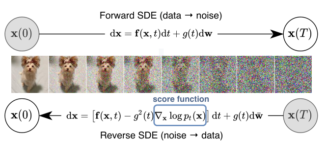

**图 1：** 求解逆时间 SDE 可以得到基于得分的生成模型。
使用连续时间 SDE，可以将数据转变为简单的噪声分布。
如果我们知道每个中间时刻分布的得分 $\nabla_x\log p_t(x)$，就可以逆转这个 SDE。
图中文字：正向 SDE（数据→噪声）；得分函数；逆向 SDE（噪声→数据）。

具体而言，我们不再使用有限个噪声分布扰动数据，而是考虑一个连续的分布族，它随时间按照扩散过程演化。
这一过程逐步将数据点扩散成随机噪声，由一个预先指定的 SDE 描述；该 SDE 不依赖于数据，且没有可训练参数。
逆转这一过程，就能将随机噪声平滑地塑造成数据，用于生成样本。
关键在于，这一逆过程满足一个逆时间 SDE（Anderson, 1982）；给定边缘概率密度的得分随时间变化的函数后，就能从正向 SDE 推导出它。
因此，我们可以训练一个随时间变化的神经网络来估计得分，从而近似逆时间 SDE，再使用 SDE 数值求解器生成样本。
图 1 概括了我们的核心思想。

我们提出的框架具有以下理论和实践贡献。

**灵活的采样和似然计算：** 我们可以使用任意通用 SDE 求解器，对逆时间 SDE 进行积分并采样。
此外，我们提出了两种不适用于一般 SDE 的专用方法：（i）将 SDE 数值求解器与基于得分的 MCMC 方法结合的预测器—校正器（PC）采样器，例如朗之万 MCMC（Parisi, 1981）和 HMC（Neal et al., 2011）；（ii）基于概率流常微分方程的确定性采样器。
前者统一并改进了基于得分的模型现有的采样方法。
后者支持通过黑箱 ODE 求解器进行快速自适应采样、通过潜在编码灵活操作数据、获得具有唯一可辨识性的编码，尤其还能进行精确似然计算。

**可控生成：** 我们可以通过对训练时不可获得的信息进行条件化，调节生成过程，因为条件逆时间 SDE 可以从无条件得分高效估计出来。
这支持类别条件生成、图像修补、着色以及其他逆问题等应用；所有这些应用均可使用同一个无条件得分模型实现，无需重新训练。

**统一框架：** 我们的框架提供了一种统一方式，探索和调节各种 SDE，以改进基于得分的生成模型。
SMLD 和 DDPM 可以作为两个不同 SDE 的离散化，纳入我们的框架。
虽然近期报告指出 DDPM（Ho et al., 2020）的样本质量高于 SMLD（Song & Ermon, 2019；2020），但我们表明，凭借更好的架构和本框架支持的新采样算法，后者能够赶上：它在 CIFAR-10 上取得了新的最先进 Inception 得分 9.89 和 FID 2.20，并首次利用基于得分的模型实现高保真的 $1024\times1024$ 图像生成。
此外，我们在框架下提出一个新 SDE，在均匀去量化的 CIFAR-10 图像上取得 2.99 比特/维的似然，在该任务上创造了新纪录。

## 2 背景

### 2.1 结合朗之万动力学的去噪得分匹配（SMLD）

令 $p_\sigma(\tilde x\mid x):=\mathcal N(\tilde x;x,\sigma^2I)$ 为扰动核，令 $p_\sigma(\tilde x):=\int p_{\mathrm{data}}(x)p_\sigma(\tilde x\mid x)\,dx$，其中 $p_{\mathrm{data}}(x)$ 表示数据分布。
考虑一个正噪声尺度序列 $\sigma_{\min}=\sigma_1<\sigma_2<\cdots<\sigma_N=\sigma_{\max}$。
通常，$\sigma_{\min}$ 足够小，使得 $p_{\sigma_{\min}}(x)\approx p_{\mathrm{data}}(x)$；而 $\sigma_{\max}$ 足够大，使得 $p_{\sigma_{\max}}(x)\approx\mathcal N(x;0,\sigma_{\max}^2I)$。

> **阅读注释 03｜扰动核和带噪分布不是同一个对象**
>
> $p_\sigma(\tilde x\mid x)$ 描述“固定一张干净图片后，它加噪的结果如何分布”；$p_\sigma(\tilde x)$ 描述“从整个数据集随机选图片，再加噪，结果如何分布”。后一项的积分就是把所有可能的干净图片混合起来。实际加噪可直接写成 $\tilde x=x+\sigma z$，其中 $z\sim\mathcal N(0,I)$。
>
> 高噪声下近似零均值高斯，是因为原图信号相对噪声很小，并非有限大小的噪声能严格抹去所有数据信息。采用多个噪声尺度，则可以先学容易处理的平滑分布，再逐渐处理低噪声下复杂的图像细节。

Song & Ermon（2019）提出，使用去噪得分匹配（Vincent, 2011）目标的加权和，训练一个记为 $s_\theta(x,\sigma)$ 的噪声条件得分网络（NCSN）：

$$
\theta^*=\arg\min_\theta\sum_{i=1}^N\sigma_i^2\,
\mathbb E_{p_{\mathrm{data}}(x)}\mathbb E_{p_{\sigma_i}(\tilde x\mid x)}
\left[\left\|s_\theta(\tilde x,\sigma_i)-\nabla_{\tilde x}\log p_{\sigma_i}(\tilde x\mid x)\right\|_2^2\right].\tag{1}
$$

> **阅读注释 04｜去噪得分匹配的监督信号从哪里来**
>
> 我们不知道真实数据密度，但知道自己怎样加了噪声。高斯扰动核的梯度可以直接算出：$\nabla_{\tilde x}\log p_\sigma(\tilde x\mid x)=-(\tilde x-x)/\sigma^2=-z/\sigma$。这就是式（1）的监督目标。
>
> 一次训练只需选干净样本 $x$、选噪声尺度、采样 $z$，把 $\tilde x$ 和尺度送给网络，再计算网络输出与 $-z/\sigma$ 的平方误差。$\|\cdot\|_2^2$ 是各维误差平方之和；$\arg\min_\theta$ 表示寻找使平均损失最小的网络参数。


给定足够的数据和模型容量，对于 $\sigma\in\{\sigma_i\}_{i=1}^N$，最优得分模型 $s_{\theta^*}(x,\sigma)$ 几乎处处等于 $\nabla_x\log p_\sigma(x)$。

> **阅读注释 05｜为什么学习条件得分，最后得到整体得分**
>
> 训练目标依赖干净图片 $x$，但网络输入只有带噪图片 $\tilde x$ 和噪声尺度。同一个带噪输入可能来自多张不同的干净图片，网络无法逐一记住其对应目标。平方误差回归的最优输出是这些目标在该输入下的条件平均：
>
> $s^*(\tilde x,\sigma)=\mathbb E[\nabla_{\tilde x}\log p_\sigma(\tilde x\mid x)\mid\tilde x]=\nabla_{\tilde x}\log p_\sigma(\tilde x)$。
>
> 最后一个等号可由对混合密度求导并使用贝叶斯公式得到。这就是去噪得分匹配能用已知高斯噪声学习未知整体分布的关键。“几乎处处”允许在概率为零的例外集合上不成立；有限数据和有限网络只能近似这一理想结论。

在采样时，Song & Ermon（2019）运行 $M$ 步朗之万 MCMC，依次为每个 $p_{\sigma_i}(x)$ 获得一个样本：

$$
x_i^m=x_i^{m-1}+\epsilon_i s_{\theta^*}(x_i^{m-1},\sigma_i)+\sqrt{2\epsilon_i}\,z_i^m,
\quad m=1,2,\ldots,M.\tag{2}
$$

> **阅读注释 06｜朗之万采样为什么同时有梯度和随机噪声**
>
> $\epsilon_i s_\theta$ 引导样本向当前噪声分布的高密度区域移动；$\sqrt{2\epsilon_i}z$ 让它保持随机探索。若只沿梯度走，通常会趋向局部高密度点，不能覆盖整个目标分布。二者配合，在得分准确、步长足够小且运行足够久等条件下，才能逼近目标分布。
>
> 从大噪声到小噪声依次运行，称为“退火”：先形成粗略结构，再细化内容。这里的步长 $\epsilon_i$ 是采样更新幅度，不是网络训练的学习率。


其中 $\epsilon_i>0$ 是步长，$z_i^m$ 服从标准正态分布。
按 $i=N,N-1,\ldots,1$ 的顺序重复上述过程；初始化为 $x_N^0\sim\mathcal N(0,\sigma_{\max}^2I)$，当 $i<N$ 时令 $x_i^0=x_{i+1}^M$。
在一定正则条件下，当 $M\to\infty$ 且所有 $\epsilon_i\to0$ 时，$x_1^M$ 成为来自 $p_{\sigma_{\min}}(x)\approx p_{\mathrm{data}}(x)$ 的精确样本。

### 2.2 去噪扩散概率模型（DDPM）

Sohl-Dickstein et al.（2015）和 Ho et al.（2020）考虑一系列正噪声尺度 $0<\beta_1,\beta_2,\ldots,\beta_N<1$。
对于每个训练数据点 $x_0\sim p_{\mathrm{data}}(x)$，构造离散马尔可夫链 $\{x_0,x_1,\ldots,x_N\}$，使得 $p(x_i\mid x_{i-1})=\mathcal N(x_i;\sqrt{1-\beta_i}x_{i-1},\beta_iI)$；于是 $p_{\alpha_i}(x_i\mid x_0)=\mathcal N(x_i;\sqrt{\alpha_i}x_0,(1-\alpha_i)I)$，其中 $\alpha_i:=\prod_{j=1}^i(1-\beta_j)$。

> **阅读注释 07｜DDPM 的累计加噪公式怎样理解**
>
> 单步规则是 $x_i=\sqrt{1-\beta_i}x_{i-1}+\sqrt{\beta_i}z$：旧信号缩小一点，同时加入新噪声。累计后可直接采样 $x_i=\sqrt{\alpha_i}x_0+\sqrt{1-\alpha_i}z$，训练时无需真的执行前面所有步骤。
>
> 这里 $\alpha_i$ 是累计信号保留系数，许多 DDPM 文献把它记作 $\bar\alpha_i$。它越接近零，原图影响越小，结果越接近标准高斯。$1-\alpha_i$ 是给定 $x_0$ 时的噪声方差，不是噪声标准差。

与 SMLD 类似，可将受扰动数据分布记为 $p_{\alpha_i}(\tilde x):=\int p_{\mathrm{data}}(x)p_{\alpha_i}(\tilde x\mid x)\,dx$。
噪声尺度经过预先设定，使得 $x_N$ 近似服从 $\mathcal N(0,I)$。
逆向变分马尔可夫链参数化为 $p_\theta(x_{i-1}\mid x_i)=\mathcal N(x_{i-1};(x_i+\beta_i s_\theta(x_i,i))/\sqrt{1-\beta_i},\beta_iI)$，并使用证据下界（ELBO）的重新加权变体训练：

$$
\theta^*=\arg\min_\theta\sum_{i=1}^N(1-\alpha_i)
\mathbb E_{p_{\mathrm{data}}(x)}\mathbb E_{p_{\alpha_i}(\tilde x\mid x)}
\left[\left\|s_\theta(\tilde x,i)-\nabla_{\tilde x}\log p_{\alpha_i}(\tilde x\mid x)\right\|_2^2\right].\tag{3}
$$

> **阅读注释 08｜得分预测与 DDPM 的噪声预测如何对应**
>
> 按上一条的直接加噪公式，条件得分为 $-z/\sqrt{1-\alpha_i}$。若网络 $\varepsilon_\theta$ 预测加入的噪声 $z$，则可以定义 $s_\theta=-\varepsilon_\theta/\sqrt{1-\alpha_i}$。代入式（3），外面的权重 $1-\alpha_i$ 恰好抵消分母平方，损失变为 $\mathbb E\|\varepsilon_\theta-z\|_2^2$。
>
> 因此，得分预测和常见的噪声预测可以相互换算。ELBO 是对数似然的一个下界；本文使用重新加权的训练目标，所以不能把该目标直接当成精确的最大似然目标。


求解式（3）得到最优模型 $s_{\theta^*}(x,i)$ 后，从 $x_N\sim\mathcal N(0,I)$ 开始，按照如下估计出的逆向马尔可夫链生成样本：

$$
x_{i-1}=\frac{x_i+\beta_i s_{\theta^*}(x_i,i)}{\sqrt{1-\beta_i}}+\sqrt{\beta_i}\,z_i,
\quad i=N,N-1,\ldots,1.\tag{4}
$$

我们将这种方法称为祖先采样，因为它等价于从图模型 $\prod_{i=1}^N p_\theta(x_{i-1}\mid x_i)$ 进行祖先采样。
这里描述的式（3）目标，是 Ho et al.（2020）中的 $L_{\mathrm{simple}}$；我们将它写成这种形式，以更清楚地呈现它与式（1）的相似性。
与式（1）一样，式（3）也是去噪得分匹配目标的加权和，这意味着最优模型 $s_{\theta^*}(\tilde x,i)$ 等于受扰动数据分布的得分 $\nabla_x\log p_{\alpha_i}(x)$。
值得注意的是，式（1）和式（3）第 $i$ 项的权重，即 $\sigma_i^2$ 和 $1-\alpha_i$，与相应扰动核具有相同形式的关系：$\sigma_i^2\propto1/\mathbb E[\|\nabla_{\tilde x}\log p_{\sigma_i}(\tilde x\mid x)\|_2^2]$，以及 $1-\alpha_i\propto1/\mathbb E[\|\nabla_{\tilde x}\log p_{\alpha_i}(\tilde x\mid x)\|_2^2]$。

> **阅读注释 09｜为什么要给不同噪声尺度加权**
>
> 对于条件高斯 $\mathcal N(\mu,vI)$，其得分平方范数的期望为 $d/v$，其中 $d$ 为数据维数。低噪声时 $v$ 小，监督目标天然更大；若直接混合所有尺度，低噪声项可能主导损失。乘上与 $v$ 成正比的权重，可以平衡这种尺度差异。正文推荐的 $\lambda(t)$ 延续了这一思路。


## 3 使用 SDE 的基于得分的生成建模

以多个噪声尺度扰动数据，是以往方法成功的关键。
我们提出，将这一思想进一步推广到无穷多个噪声尺度，使受扰动数据分布在噪声增强时按照一个 SDE 演化。
图 2 给出了我们的框架概览。

### 3.1 使用 SDE 扰动数据

我们的目标是构造一个以连续时间变量 $t\in[0,T]$ 为索引的扩散过程 $\{x(t)\}_{t=0}^T$，使得 $x(0)\sim p_0$，且我们拥有来自该分布的独立同分布样本数据集；同时 $x(T)\sim p_T$，该分布具有易于处理的形式，能够高效生成样本。
换句话说，$p_0$ 是数据分布，$p_T$ 是先验分布。
这个扩散过程可以建模为如下伊藤 SDE 的解：

$$dx=f(x,t)\,dt+g(t)\,dw.\tag{5}$$

> **阅读注释 10｜把 SDE 写成一个可计算的小步更新**
>
> 对很小的正时间步 $h$，式（5）可以近似写为 $x(t+h)=x(t)+f(x(t),t)h+g(t)\sqrt h\,z$，其中 $z\sim\mathcal N(0,I)$。这是 Euler–Maruyama 更新：$f$ 决定平均移动方向，$g$ 决定随机扰动的强度。
>
> 布朗运动增量的方差是 $h$，因此噪声幅度是 $\sqrt h$，不是 $h$。$dw$ 也不能当成普通可微函数的导数。“连续时间”指用一个方程描述任意加噪进度，实际计算仍需离散步长或数值求解器。


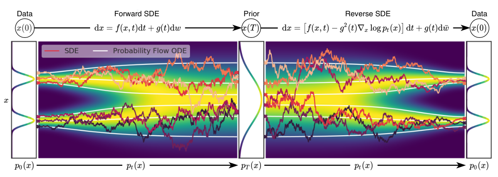

**图 2：通过 SDE 进行基于得分的生成建模的概览。**
我们可以利用 SDE 将数据映射到噪声分布，也就是先验分布（第 3.1 节），并逆转这个 SDE 来进行生成建模（第 3.2 节）。
我们也可以逆转与之关联的概率流 ODE（第 4.3 节），得到一个确定性过程，它与 SDE 从同一个分布采样。
逆时间 SDE 和概率流 ODE，都可以通过估计得分 $\nabla_x\log p_t(x)$ 得到（第 3.3 节）。
图中文字依次为：数据；正向 SDE；先验；逆向 SDE；数据。
图例：SDE——随机微分方程轨迹；概率流 ODE——概率流常微分方程轨迹。

其中 $w$ 是标准维纳过程，也称布朗运动；$f(\cdot,t):\mathbb R^d\to\mathbb R^d$ 是向量值函数，称为 $x(t)$ 的漂移系数；$g(\cdot):\mathbb R\to\mathbb R$ 是标量函数，称为 $x(t)$ 的扩散系数。
为便于表述，我们假定扩散系数是标量，而不是 $d\times d$ 矩阵，并且不依赖于 $x$；但我们的理论可以推广到这些情况，见附录 A。
只要系数对状态和时间都满足全局 Lipschitz 条件，SDE 就具有唯一强解（Øksendal, 2003）。
下文用 $p_t(x)$ 表示 $x(t)$ 的概率密度，并用 $p_{st}(x(t)\mid x(s))$ 表示从 $x(s)$ 到 $x(t)$ 的转移核，其中 $0\le s<t\le T$。

> **阅读注释 11｜轨迹、边缘分布和转移核**
>
> 一次 SDE 模拟得到一条随机轨迹 $x(t)$；重复很多次，在同一时刻观察所有样本，就得到边缘分布 $p_t$。转移核则先固定某个起点，描述之后的随机结果。它们分别对应“一个样本怎么走”“整体样本怎样分布”和“给定起点后怎么走”。
>
> 全局 Lipschitz 条件大致要求系数不会随输入变化而无限剧烈地变化。“唯一强解”是在给定初值和同一条布朗运动路径后，解的轨迹唯一；它不表示不同随机噪声会得到相同轨迹。


通常，$p_T$ 是不含 $p_0$ 信息的无结构先验分布，例如均值和方差固定的高斯分布。
设计式（5）的 SDE，使其将数据分布扩散成固定先验分布，有多种方式。
我们将在第 3.4 节给出几个例子，它们来自 SMLD 和 DDPM 的连续推广。

### 3.2 通过逆转 SDE 生成样本

从 $x(T)\sim p_T$ 的样本出发并逆转该过程，我们便能获得 $x(0)\sim p_0$ 的样本。
Anderson（1982）的一个重要结果指出，扩散过程的逆过程仍然是扩散过程，它沿时间反向运行，并由如下逆时间 SDE 给出：

$$dx=[f(x,t)-g(t)^2\nabla_x\log p_t(x)]\,dt+g(t)\,d\bar w.\tag{6}$$

> **阅读注释 12｜逆时间公式的负号与时间方向**
>
> 这里沿 $T\to0$ 积分，所以 $dt<0$。若用正数 $h$ 表示回退的时间长度，则一步更新为：$x(t-h)\approx x(t)-f(x(t),t)h+g(t)^2s_\theta(x(t),t)h+g(t)\sqrt h\,z$。因此式中虽然写着“减去得分”，回退时实际是沿得分方向更新，不能忽略负时间步。
>
> “逆转”是逆转分布的演化，不是找回某张训练图片加噪时使用的那串随机数。逆向过程仍注入新的随机噪声，从先验产生新的数据样本；在准确得分和正确初始分布等理想条件下，它才恢复原数据分布。


其中，当时间从 $T$ 反向流向 $0$ 时，$\bar w$ 是标准维纳过程，而 $dt$ 是无穷小的负时间步长。
一旦知道所有时刻的边缘分布得分 $\nabla_x\log p_t(x)$，就可以从式（6）推导出逆向扩散过程，并通过模拟它从 $p_0$ 采样。

### 3.3 估计 SDE 的得分

利用得分匹配，在某个分布的样本上训练得分模型，可以估计该分布的得分（Hyvärinen, 2005；Song et al., 2019a）。
为了估计 $\nabla_x\log p_t(x)$，我们可以用式（1）和式（3）的连续推广，训练随时间变化的得分模型 $s_\theta(x,t)$：

$$
\theta^*=\arg\min_\theta\mathbb E_t\left\{\lambda(t)\mathbb E_{x(0)}\mathbb E_{x(t)\mid x(0)}
\left[\left\|s_\theta(x(t),t)-\nabla_{x(t)}\log p_{0t}(x(t)\mid x(0))\right\|_2^2\right]\right\}.\tag{7}
$$

> **阅读注释 13｜连续时间训练的实际步骤**
>
> 若扰动核可写成 $x_t=a(t)x_0+b(t)z$，则一次训练为：从数据集取 $x_0$；随机取时间 $t$ 和高斯噪声 $z$；构造 $x_t$；让网络输出 $s_\theta(x_t,t)$；用 $\lambda(t)\|s_\theta(x_t,t)+z/b(t)\|_2^2$ 更新参数。这里 $b(t)$ 是条件噪声的标准差，监督得分为 $-z/b(t)$。
>
> 网络需要输入时间，因为同一张带噪图像在不同噪声水平下，对应的去噪方向和幅度不同。“连续时间训练”通常只是每批随机抽取实数时间，仍使用普通梯度下降，不需要对整个时间区间逐点训练。


这里，$\lambda:[0,T]\to\mathbb R_{>0}$ 是正权重函数；$t$ 从 $[0,T]$ 均匀采样；$x(0)\sim p_0(x)$，且 $x(t)\sim p_{0t}(x(t)\mid x(0))$。
给定足够的数据和模型容量，得分匹配保证式（7）的最优解 $s_{\theta^*}(x,t)$，对几乎所有 $x$ 和 $t$ 都等于 $\nabla_x\log p_t(x)$。
与 SMLD 和 DDPM 一样，我们通常可以选择 $\lambda(t)\propto1/\mathbb E[\|\nabla_{x(t)}\log p_{0t}(x(t)\mid x(0))\|_2^2]$。
注意，式（7）使用去噪得分匹配；但其他得分匹配目标，例如切片得分匹配（Song et al., 2019a）和有限差分得分匹配（Pang et al., 2020），也适用于这里。

为了高效求解式（7），我们通常需要知道转移核 $p_{0t}(x(t)\mid x(0))$。
当 $f(\cdot,t)$ 是仿射函数时，转移核总是高斯分布，其均值和方差通常具有已知的闭式表达式，可以通过标准方法求得，见 Särkkä & Solin（2019）第 5.5 节。

> **阅读注释 14｜为什么高斯转移核让训练容易**
>
> 在本节扩散系数不依赖 $x$ 的设定下，仿射漂移指 $f(x,t)=A(t)x+c(t)$。给定固定起点 $x_0$，线性演化加上高斯随机扰动仍然是高斯，所以只需求它的均值和协方差，就能直接生成带噪训练样本并计算监督目标。
>
> 这里说的是“给定 $x_0$ 的条件分布为高斯”。把不同原图混合后的 $p_t(x)$ 一般仍很复杂，并不因为转移核是高斯就自动成为高斯；这正是需要训练得分网络的原因。

对于更一般的 SDE，可以求解 Kolmogorov 正向方程（Øksendal, 2003），得到 $p_{0t}(x(t)\mid x(0))$。
另一种方法是模拟 SDE，从 $p_{0t}(x(t)\mid x(0))$ 采样，并在模型训练时将式（7）中的去噪得分匹配替换为切片得分匹配；这可以绕过 $\nabla_{x(t)}\log p_{0t}(x(t)\mid x(0))$ 的计算，见附录 A。

### 3.4 示例：VE、VP SDE 及其扩展

SMLD 和 DDPM 使用的噪声扰动，可以看成两个不同 SDE 的离散化。
下面进行简要讨论，更多细节放在附录 B。

使用总计 $N$ 个噪声尺度时，SMLD 的每个扰动核 $p_{\sigma_i}(x\mid x_0)$，都对应于如下马尔可夫链中 $x_i$ 的分布：

$$x_i=x_{i-1}+\sqrt{\sigma_i^2-\sigma_{i-1}^2}\,z_{i-1},\quad i=1,\ldots,N.\tag{8}$$

> **阅读注释 15｜为什么新增噪声用方差之差**
>
> 独立高斯噪声相加时，方差相加。前一步已经累计了 $\sigma_{i-1}^2$ 的噪声方差，要让下一步累计方差变成 $\sigma_i^2$，只需再加入方差 $\sigma_i^2-\sigma_{i-1}^2$ 的噪声。该差值开平方后才是新噪声的标准差。


其中 $z_{i-1}\sim\mathcal N(0,I)$；为简化记号，我们引入 $\sigma_0=0$。
在 $N\to\infty$ 的极限下，$\{\sigma_i\}_{i=1}^N$ 变成函数 $\sigma(t)$，$z_i$ 变成 $z(t)$，马尔可夫链 $\{x_i\}_{i=1}^N$ 变成连续随机过程 $\{x(t)\}_{t=0}^1$；这里用连续时间变量 $t\in[0,1]$ 代替整数 $i$ 作为索引。
过程 $\{x(t)\}_{t=0}^1$ 由如下 SDE 给出：

$$dx=\sqrt{\frac{d[\sigma^2(t)]}{dt}}\,dw.\tag{9}$$

类似地，对于 DDPM 的扰动核 $\{p_{\alpha_i}(x\mid x_0)\}_{i=1}^N$，离散马尔可夫链为：

$$x_i=\sqrt{1-\beta_i}\,x_{i-1}+\sqrt{\beta_i}\,z_{i-1},\quad i=1,\ldots,N.\tag{10}$$

当 $N\to\infty$ 时，式（10）收敛到如下 SDE：

$$dx=-\tfrac12\beta(t)x\,dt+\sqrt{\beta(t)}\,dw.\tag{11}$$

> **阅读注释 16｜DDPM 为什么产生这个连续方程**
>
> 令离散步的噪声方差满足 $\beta_i\approx\beta(t)h$。用 $\sqrt{1-u}\approx1-u/2$ 展开，单步信号变化成为 $-\frac12\beta(t)x h$，噪声成为 $\sqrt{\beta(t)}\sqrt h\,z$，于是得到式（11）。这里连续的 $\beta(t)$ 是单位时间的噪声率，不能与离散单步的 $\beta_i$ 直接等同。


因此，SMLD 和 DDPM 中的噪声扰动，分别对应式（9）和式（11）所描述 SDE 的离散化。
有趣的是，当 $t\to\infty$ 时，式（9）的 SDE 总是产生方差爆炸的过程；而当初始分布具有单位方差时，式（11）的 SDE 产生的过程具有固定为 1 的方差，证明见附录 B。
由于这一差异，下文将式（9）称为方差爆炸（VE）SDE，将式（11）称为方差保持（VP）SDE。

> **阅读注释 17｜VE 和 VP 的名字容易产生什么误解**
>
> VE 不衰减原始信号，只不断叠加噪声；在噪声调度持续增长的情况下，方差越来越大。VP 一边衰减原始信号，一边补入噪声：若初始协方差为 $I$，总体协方差始终为 $I$；若初始协方差不是 $I$，则逐渐趋向 $I$。
>
> “方差保持”不表示图片内容保持，也不表示给定原图时的噪声方差不增长。即使总体方差恒定，信号仍会逐渐被噪声替代。


受 VP SDE 启发，我们提出一种新的 SDE，它在似然方面表现尤其好，见第 4.3 节，其形式为：

$$dx=-\tfrac12\beta(t)x\,dt+\sqrt{\beta(t)\left(1-e^{-2\int_0^t\beta(s)\,ds}\right)}\,dw.\tag{12}$$

使用相同的 $\beta(t)$ 并从相同初始分布出发时，式（12）产生的随机过程在每个中间时刻的方差，都不超过 VP SDE 的方差，证明见附录 B。
因此，我们将式（12）命名为 sub-VP SDE。

> **阅读注释 18｜sub-VP 改了什么**
>
> sub-VP 保留 VP 的漂移项，因此两者对原图的平均衰减相同；它把噪声系数乘上一个不超过 1 的因子，减小中间时刻的噪声量。令 $B(t)=\int_0^t\beta(s)ds$，两者的条件噪声方差分别是 $1-e^{-B(t)}$ 和 $[1-e^{-B(t)}]^2$。后者更小，但当 $B(t)$ 足够大时，两者都接近 1。
>
> 论文中 sub-VP 的似然表现较好，是实验结果；不能仅由“方差更小”推出它对所有数据集和架构都更优。


由于 VE、VP 和 sub-VP SDE 都具有仿射漂移系数，它们的扰动核 $p_{0t}(x(t)\mid x(0))$ 都是高斯分布，且可以按第 3.3 节所述计算闭式表达式。
这使得使用式（7）训练尤其高效。

## 4 求解逆向 SDE

训练随时间变化的得分模型 $s_\theta$ 后，我们可以用它构造逆时间 SDE，再通过数值方法模拟，从 $p_0$ 生成样本。

**表 1：在 CIFAR-10 上比较不同逆时间 SDE 求解器。**
原表阴影区域表示使用相同计算量，即相同的得分函数求值次数。
表中报告五次采样运行的均值和标准差。
“P1000”或“P2000”：使用 1000 或 2000 步的纯预测器采样器。
“C2000”：使用 2000 步的纯校正器采样器。
“PC1000”：使用 1000 步预测和 1000 步校正的预测器—校正器采样器。

|预测器（FID 越低越好）|VE P1000|VE P2000|VE C2000|VE PC1000|VP P1000|VP P2000|VP C2000|VP PC1000|
|---|---:|---:|---:|---:|---:|---:|---:|---:|
|祖先采样|4.98±.06|4.88±.06|20.43±.07|3.62±.03|3.24±.02|3.24±.02|19.06±.06|3.21±.02|
|逆向扩散|4.79±.07|4.74±.08|同上|3.60±.02|3.21±.02|3.19±.02|同上|3.18±.01|
|概率流|15.41±.15|10.54±.08|同上|3.51±.04|3.59±.04|3.23±.03|同上|3.06±.03|

### 4.1 通用 SDE 数值求解器

数值求解器给出 SDE 的近似轨迹。
求解 SDE 的通用数值方法有很多，例如 Euler-Maruyama 和随机 Runge-Kutta 方法（Kloeden & Platen, 2013），它们对应随机动力学的不同离散化。

> **阅读注释 19｜数值求解器解决的是什么问题**
>
> 网络提供某个位置、某个时刻的得分，但并没有直接输出最终图片。求解器负责把这些局部方向串成完整生成过程。较大的步长更省计算，却可能跳过关键变化；较小的步长通常能减少离散误差，但得分网络本身的估计误差不会因此自动消失。

我们可以将其中任何一种应用于逆时间 SDE，生成样本。

祖先采样，即 DDPM 的采样方法（式（4）），实际上对应逆时间 VP SDE（式（11））的一种特殊离散化，见附录 E。
然而，为新的 SDE 推导祖先采样规则，可能并不容易。
为解决这一问题，我们提出逆向扩散采样器，细节见附录 E；它以与正向 SDE 相同的方式离散化逆时间 SDE，因此只要给定正向离散化，就可以方便地推导出来。
如表 1 所示，在 CIFAR-10 上，对于 SMLD 和 DDPM 模型，逆向扩散采样器的表现都略优于祖先采样；DDPM 类型的祖先采样也可用于 SMLD 模型，见附录 F。

### 4.2 预测器—校正器采样器

与一般 SDE 不同，我们有额外信息可用于改进解。
因为拥有得分模型 $s_{\theta^*}(x,t)\approx\nabla_x\log p_t(x)$，我们可以使用基于得分的 MCMC 方法，例如朗之万 MCMC（Parisi, 1981；Grenander & Miller, 1994）或 HMC（Neal et al., 2011），直接从 $p_t$ 采样，并校正 SDE 数值求解器的解。

具体来说，在每个时间步，SDE 数值求解器首先估计下一时间步的样本，起到“预测器”的作用。
随后，基于得分的 MCMC 方法校正所估计样本的边缘分布，起到“校正器”的作用。
这一思想类似于预测器—校正器方法；后者是用于求解方程组的一类数值延拓技术（Allgower & Georg, 2012）；我们也因此将混合采样算法称为预测器—校正器（PC）采样器。
伪代码和完整说明见附录 G。
PC 采样器推广了 SMLD 和 DDPM 的原始采样方法：前者使用恒等函数作为预测器，使用退火朗之万动力学作为校正器；后者使用祖先采样作为预测器，使用恒等函数作为校正器。

> **阅读注释 20｜预测器和校正器怎样分工**
>
> 预测器把样本从时刻 $t$ 推进到下一个更低噪声时刻；校正器在该时刻固定目标分布，用若干次朗之万更新改善样本分布。校正器不是把图片与某张标准答案比较，也不一定执行一次就能消除全部误差。
>
> “恒等函数”就是不做更新。因此原始 SMLD 可看成主要依靠校正器，原始 DDPM 可看成主要依靠预测器；PC 则允许两者组合。采样时通常固定已训练好的网络参数。


我们在使用式（1）和式（3）原始离散目标训练的 SMLD 和 DDPM 模型上，测试 PC 采样器，见附录 G 的算法 2 和算法 3。
这展示了 PC 采样器与使用固定数量噪声尺度训练的得分模型的兼容性。
表 1 汇总了不同采样器的表现，其中概率流是一种将在第 4.3 节讨论的预测器。
详细实验设置和补充结果见附录 G。
我们观察到，逆向扩散采样器总是优于祖先采样；在相同计算量下，纯校正器方法 C2000 的表现差于其他方法 P2000 和 PC1000；实际上，要达到其他采样器的表现，每个噪声尺度需要多得多的校正步骤，因而需要更多计算。
对于所有预测器，每个预测步骤加入一个校正步骤，即 PC1000，都会使计算量加倍，但相较 P1000，总能提高样本质量。
而且，这通常优于不加校正器、仅将预测步骤数量加倍的 P2000；对于 SMLD/DDPM 模型，后者需要以临时设计的方式在噪声尺度之间插值，细节见附录 G。
在附录 G 的图 9 中，我们还对使用连续目标式（7）和 VE SDE、在 $256\times256$ LSUN 图像上训练的模型，进行了定性比较；在采用合适数量的校正步骤时，PC 采样器在相近计算量下明显优于纯预测器采样器。

### 4.3 概率流及其与神经 ODE 的联系

基于得分的模型支持另一种求解逆时间 SDE 的数值方法。
对于所有扩散过程，都存在一个对应的确定性过程，其轨迹与 SDE 具有相同的边缘概率密度 $\{p_t(x)\}_{t=0}^T$。
这一确定性过程满足如下 ODE，更多细节见附录 D.1：

$$dx=\left[f(x,t)-\tfrac12g(t)^2\nabla_x\log p_t(x)\right]dt.\tag{13}$$

> **阅读注释 21｜ODE 与 SDE 相同的是什么**
>
> 使用准确得分并从匹配的初始分布出发时，概率流 ODE 和 SDE 在每个时刻产生相同的边缘分布 $p_t$，但单个样本的轨迹和跨时刻的联合分布不同。ODE 在给定起点后完全确定；SDE 沿途还会加入随机扰动。ODE 生成仍有随机性，因为起点 $x(T)$ 是随机采样的。
>
> ODE 中的系数是 $1/2$，逆时间 SDE 中则是 1。差别来自 SDE 的随机扩散本身承担了一部分分布演化，ODE 必须用确定性流动实现同样的演化；推导见附录 D.1。实际使用近似网络时，两种生成分布不保证严格相同。


一旦知道得分，就可以根据 SDE 确定这个 ODE。
我们将式（13）称为概率流 ODE。
当用随时间变化的得分模型来近似得分函数时——该模型通常是神经网络——它就是一个神经 ODE 的例子（Chen et al., 2018）。

**精确似然计算。** 借助与神经 ODE 的联系，我们可以利用瞬时变量变换公式（Chen et al., 2018）计算式（13）定义的密度。
这使得我们能够计算任意输入数据的精确似然，细节见附录 D.2。

> **阅读注释 22｜精确似然的“精确”指什么**
>
> 这里指概率流 ODE 所定义模型的似然可由变量变换公式计算，而不是只能给出 ELBO 下界。它不表示学到的模型等于真实数据分布，也不表示计算机上完全没有误差：数值积分、有限时间截断和随机迹估计仍会带来误差。附录 D.2 解释了实际的计算方法。

作为示例，表 2 报告了 CIFAR-10 数据集上以比特/维计量的负对数似然（NLL）。
我们在均匀去量化的数据上计算对数似然，并只与采用相同评估方式的模型比较，省略使用变分去量化（Ho et al., 2019）或离散数据评估的模型；例外是 DDPM（$L/L_{\mathrm{simple}}$），其带星号的 ELBO 值是在离散数据上报告的。
主要结果为：（i）对于 Ho et al.（2020）的同一个 DDPM 模型，由于似然是精确的，我们得到的比特/维优于 ELBO；（ii）使用相同架构，我们用式（7）的连续目标训练了另一个 DDPM 模型，即 DDPM cont.，进一步提高了似然；（iii）与 VP SDE 相比，使用 sub-VP SDE 总能获得更高的似然；（iv）使用改进架构，即 DDPM++ cont.，细节见第 4.4 节，并采用 sub-VP SDE，即使没有进行最大似然训练，也可以在均匀去量化的 CIFAR-10 上创造 2.99 比特/维的新纪录。

**表 2：CIFAR-10 上的 NLL 和 FID（ODE）。** 两项指标均越低越好；星号表示在离散数据上得到的 ELBO 值。

> **阅读注释 23｜NLL、FID 和去量化分别评价什么**
>
> NLL 衡量模型给真实测试数据分配的概率，bit/dim 是把负对数概率换算成每个数据维度的比特数；越低说明在该评估约定下，真实数据获得的概率越高。FID 比较真实和生成图像的特征统计，越低通常表示样本整体更接近真实数据；它并不直接等于似然。
>
> 像素原本是离散整数，而 ODE 模型描述连续密度。“均匀去量化”是给离散像素加入小的均匀噪声，再按约定缩放，使其适合连续密度评估。只有相同去量化与数据处理约定下的数值才适合直接比较。论文的纪录指发表时的实验结果。


|模型|测试 NLL|FID|
|---|---:|---:|
|RealNVP（Dinh et al., 2016）|3.49|-|
|iResNet（Behrmann et al., 2019）|3.45|-|
|Glow（Kingma & Dhariwal, 2018）|3.35|-|
|MintNet（Song et al., 2019b）|3.32|-|
|Residual Flow（Chen et al., 2019）|3.28|46.37|
|FFJORD（Grathwohl et al., 2018）|3.40|-|
|Flow++（Ho et al., 2019）|3.29|-|
|DDPM（$L$）（Ho et al., 2020）|≤3.70*|13.51|
|DDPM（$L_{\mathrm{simple}}$）（Ho et al., 2020）|≤3.75*|3.17|
|DDPM|3.28|3.37|
|DDPM cont.（VP）|3.21|3.69|
|DDPM cont.（sub-VP）|3.05|3.56|
|DDPM++ cont.（VP）|3.16|3.93|
|DDPM++ cont.（sub-VP）|3.02|3.16|
|DDPM++ cont.（深层，VP）|3.13|3.08|
|DDPM++ cont.（深层，sub-VP）|2.99|2.92|

**表 3：CIFAR-10 样本质量。** FID 越低越好，IS 越高越好。

|模型|FID|IS|
|---|---:|---:|
|**条件生成**|||
|BigGAN（Brock et al., 2018）|14.73|9.22|
|StyleGAN2-ADA（Karras et al., 2020a）|2.42|10.14|
|**无条件生成**|||
|StyleGAN2-ADA（Karras et al., 2020a）|2.92|9.83|
|NCSN（Song & Ermon, 2019）|25.32|8.87±.12|
|NCSNv2（Song & Ermon, 2020）|10.87|8.40±.07|
|DDPM（Ho et al., 2020）|3.17|9.46±.11|
|DDPM++|2.78|9.64|
|DDPM++ cont.（VP）|2.55|9.58|
|DDPM++ cont.（sub-VP）|2.61|9.56|
|DDPM++ cont.（深层，VP）|2.41|9.68|
|DDPM++ cont.（深层，sub-VP）|2.41|9.57|
|NCSN++|2.45|9.73|
|NCSN++ cont.（VE）|2.38|9.83|
|NCSN++ cont.（深层，VE）|2.20|9.89|

**操作潜在表示。** 对式（13）积分，可以将任意数据点 $x(0)$ 编码到潜在空间 $x(T)$。
通过对逆时间 SDE 所对应的 ODE 积分，可以进行解码。
与神经 ODE 和归一化流等其他可逆模型（Dinh et al., 2016；Kingma & Dhariwal, 2018）一样，我们可以操作这种潜在表示来编辑图像，例如插值和温度缩放，见图 3 及附录 D.4。

> **阅读注释 24｜潜在编码为何能用于图像编辑**
>
> 沿概率流 ODE 正向积分，可把输入图片映射为高斯先验空间中的向量；反向积分则把向量映射回图片。在解唯一且数值求解准确等条件下，这是可逆映射。可以先在潜空间对两个向量插值，再解码，得到中间图像；也可缩放潜向量的范数，改变采样温度。
>
> 这里“潜在”不意味着维数更低：通常潜向量与输入图片具有相同维数。缩放潜变量也不保证只改变某个特定语义属性。


**具有唯一可辨识性的编码。** 与目前大多数可逆模型不同，我们的编码具有唯一可辨识性；这意味着，在训练数据、模型容量和优化精度都足够时，输入的编码由数据分布唯一确定（Roeder et al., 2020）。
这是因为正向 SDE（式（5））没有可训练参数；在得分被完美估计的条件下，与其关联的概率流 ODE（式（13））给出相同的轨迹。
附录 D.5 提供了这一性质的补充实验验证。

> **阅读注释 25｜唯一可辨识性的适用范围**
>
> 此处须固定同一个正向 SDE。若数据分布相同且得分学习完全准确，则概率流 ODE 的向量场相同，因此同一输入的编码不因网络架构或训练参数的不同而改变。换一种正向 SDE，编码仍可能不同；有限训练下也只能近似一致，而非保证完全一致。


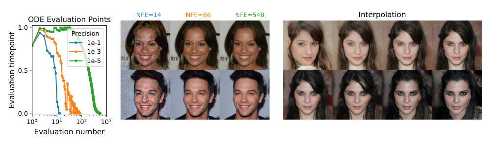

**图 3：** 随着数值精度变化，概率流 ODE 能够通过自适应步长快速采样（左），并在不损害质量的情况下减少得分函数求值次数 NFE（中）。
从潜在变量到图像的可逆映射支持插值（右）。
图中文字：精度；求值时刻；求值次数；NFE=14、86、548；插值；ODE 求值点。

**高效采样。** 与神经 ODE 一样，我们可以从不同终值条件 $x(T)\sim p_T$ 出发，求解式（13），采样得到 $x(0)\sim p_0$。
使用固定离散化策略，可以生成具有竞争力的样本，特别是与校正器配合使用时，见表 1 的“概率流采样器”，细节见附录 D.3。
使用黑箱 ODE 求解器（Dormand & Prince, 1980），不仅可以生成高质量样本，见表 2，细节见附录 D.4，还允许明确地在精度和效率之间进行权衡。
采用更大的误差容限，可以将函数求值次数减少超过 90%，而不影响样本的视觉质量，见图 3。

> **阅读注释 26｜自适应步长和 NFE**
>
> NFE 是得分网络被调用的次数，通常是采样计算量的主要来源。自适应 ODE 求解器在变化平缓处走大步，在变化剧烈处走小步；误差容限越宽松，通常所需调用越少。论文说视觉质量未受明显影响，是特定实验中的观察，不等于任意放宽容限都能保持 FID 或似然精度。


### 4.4 架构改进

我们探索了多种使用 VE 和 VP SDE 的得分模型新架构，细节见附录 H；模型使用与 SMLD/DDPM 相同的离散目标训练。

> **阅读注释 27｜得分网络的输入与输出**
>
> 网络接收带噪图片和时间，输出与图片形状相同的得分场，每个像素、每个通道都有一个方向分量。网络结构主要沿用 DDPM 的多分辨率图像网络，再改进残差块、上下采样和跳跃连接。结构负责表示得分；SDE 负责定义加噪过程；采样器负责使用得分生成图片，这三者可以分别调整。

由于相似性，我们将 VP SDE 的架构直接用于 sub-VP SDE。
VE SDE 的最优架构命名为 NCSN++，使用 PC 采样器，在 CIFAR-10 上取得 2.45 的 FID；VP SDE 的最优架构称为 DDPM++，取得 2.78。

切换到式（7）的连续训练目标，并增加网络深度，可以进一步提高所有模型的样本质量。
对于 VE SDE 和 VP/sub-VP SDE，所得架构在表 3 中分别记为 NCSN++ cont. 和 DDPM++ cont.。
表 3 的结果对应训练过程中 FID 最小的检查点，样本使用 PC 采样器生成。
相反，表 2 的 FID 和 NLL 对应最后一个训练检查点，样本使用黑箱 ODE 求解器生成。
如表 3 所示，VE SDE 通常比 VP/sub-VP SDE 产生更好的样本质量，但实验中我们也观察到，其似然比对应的 VP/sub-VP SDE 更差。
这表明，实践者可能需要针对不同领域和架构，实验比较不同的 SDE。

我们在样本质量方面最好的模型 NCSN++ cont.（深层，VE），将网络深度加倍，在 CIFAR-10 无条件生成的 Inception 得分和 FID 上均创造了新纪录。
令人惊讶的是，无需带标签的数据，我们就能获得优于此前最佳条件生成模型的 FID。
结合所有改进，我们还得到基于得分的模型在 CelebA-HQ $1024\times1024$ 上的首批高保真样本，见附录 H.3。
我们在似然方面最好的模型 DDPM++ cont.（深层，sub-VP），同样将网络深度加倍，并用式（7）的连续目标取得 2.99 比特/维的对数似然指标。
据我们所知，这是均匀去量化 CIFAR-10 上最高的似然。

## 5 可控生成

框架的连续结构不仅允许从 $p_0$ 生成数据样本；如果已知 $p_t(y\mid x(t))$，还可以从 $p_0(x(0)\mid y)$ 生成样本。
给定式（5）的正向 SDE，可以从 $p_T(x(T)\mid y)$ 出发，求解条件逆时间 SDE，从 $p_t(x(t)\mid y)$ 采样：

$$dx=\{f(x,t)-g(t)^2[\nabla_x\log p_t(x)+\nabla_x\log p_t(y\mid x)]\}\,dt+g(t)\,d\bar w.\tag{14}$$

> **阅读注释 28｜条件生成公式如何由贝叶斯公式得到**
>
> 由 $p_t(x\mid y)=p_t(x)p_t(y\mid x)/p(y)$，取对数再对 $x$ 求梯度，得到“无条件得分 + 条件信息梯度”，因为 $p(y)$ 不依赖 $x$，梯度为零。若 $y$ 是类别，$\nabla_x\log p_t(y\mid x)$ 就引导当前带噪图像朝更符合该类别的方向变化。
>
> 分类器须适应不同噪声水平，不能直接把只见过干净图像的分类器当成所有时刻的条件模型。这里可复用无条件得分网络，但类别条件实验仍需另训噪声条件分类器；“无需重新训练”主要指不必重训得分模型。


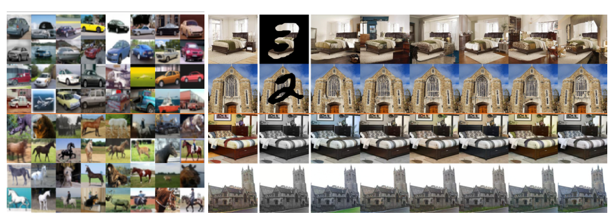

**图 4：** 左：$32\times32$ CIFAR-10 上的类别条件样本。
上面四行是汽车，下面四行是马。
右：$256\times256$ LSUN 上的图像修补（上面两行）和着色（下面两行）结果。
第一列为原图，第二列为遮挡图/灰度图，其余列为采样得到的补全图像或着色图像。

一般而言，只要给定正向过程梯度 $\nabla_x\log p_t(y\mid x(t))$ 的估计，就可以利用式（14）和基于得分的生成模型，求解一大类逆问题。
某些情况下，可以训练一个单独模型，学习正向过程 $\log p_t(y\mid x(t))$，再计算其梯度。
否则，可以利用启发式方法和领域知识估计梯度。
附录 I.4 提供了一种广泛适用的方法，不必训练辅助模型就能得到这样的估计。

> **阅读注释 29｜逆问题中的正向过程与正向 SDE**
>
> “正向 SDE”是为了训练生成模型而人为设计的加噪过程；“逆问题的正向过程”是观测怎样从原始对象产生，例如遮挡图片得到可见部分、彩色图片变成灰度图。它们不是同一个过程。
>
> 给定观测 $y$，逆问题的目标通常是从后验 $p(x\mid y)$ 采样。由于多个原图可能符合相同观测，模型可以生成多个合理补全，而不是保证找回唯一的原图。


我们考虑这种可控生成方法的三种应用：类别条件生成、图像缺失值填补和着色。
当 $y$ 表示类别标签时，可以训练随时间变化的分类器 $p_t(y\mid x(t))$，用于类别条件采样。
由于正向 SDE 易于处理，可以先从数据集采样 $(x(0),y)$，再采样 $x(t)\sim p_{0t}(x(t)\mid x(0))$，从而方便地创建该分类器的训练数据 $(x(t),y)$。
随后，可以类似式（7），使用不同时间步上的交叉熵损失混合，训练随时间变化的分类器 $p_t(y\mid x(t))$。
图 4 左侧给出 CIFAR-10 类别条件样本，更多细节和结果见附录 I。

缺失值填补是条件采样的特例。
假设有一个不完整数据点 $y$，只有某个子集 $\Omega(y)$ 已知。
填补相当于从 $p(x(0)\mid\Omega(y))$ 采样，这可以使用无条件模型实现，见附录 I.2。
着色是填补的特例，只是已知数据维度彼此耦合。
我们可以用正交线性变换将这些维度解耦，并在变换后的空间执行填补，细节见附录 I.3。
图 4 右侧展示了使用无条件、随时间变化的得分模型得到的修补和着色结果。

## 6 结论

我们提出了一个基于 SDE 的得分生成建模框架。
我们的工作支持更好地理解现有方法、新的采样算法、精确似然计算、具有唯一可辨识性的编码以及潜在编码操作，并为基于得分的生成模型带来了新的条件生成能力。

尽管所提出的采样方法改善了结果，并支持更高效的采样，但在相同数据集上，其采样仍慢于 GAN（Goodfellow et al., 2014）。
寻找将基于得分的生成模型的稳定学习，与 GAN 等隐式模型的快速采样相结合的方法，仍是重要研究方向。
此外，获得得分函数后可以使用多种采样器，这也引入了若干超参数。
未来工作可以改进自动选择和调节这些超参数的方法，并更广泛地研究不同采样器的优点和局限。

## 致谢

感谢 Nanxin Chen、Ruiqi Gao、Jonathan Ho、Kevin Murphy、Tim Salimans 和 Han Zhang 在项目过程中参与富有启发的讨论。
本研究部分得到 NSF（#1651565、#1522054、#1733686）、ONR（N000141912145）、AFOSR（FA95501910024）和 TensorFlow Research Cloud 的支持。
Yang Song 部分得到 Apple 人工智能/机器学习博士奖学金的支持。

## 参考文献

1. Eugene L Allgower and Kurt Georg. 数值延拓方法：导论, 卷 13. Springer Science & Business Media, 2012.

2. Brian D O Anderson. 逆时间扩散方程模型. Stochastic Process. Appl., 12(3): 313–326, May 1982.

3. Jens Behrmann, Will Grathwohl, Ricky TQ Chen, David Duvenaud, and Jörn-Henrik Jacobsen. 可逆残差网络。载于 International Conference on Machine Learning, 页 573–582, 2019.

4. Florian Bordes, Sina Honari, and Pascal Vincent. 通过注入式训练学习从噪声生成样本. arXiv 预印本 arXiv:1703.06975, 2017.

5. Andrew Brock, Jeff Donahue, and Karen Simonyan. 用于高保真自然图像合成的大规模 GAN 训练。载于 International Conference on Learning Representations, 2018.

6. Ruojin Cai, Guandao Yang, Hadar Averbuch-Elor, Zekun Hao, Serge Belongie, Noah Snavely, and Bharath Hariharan. 学习用于形状生成的梯度场。载于 Proceedings of the European Conference on Computer Vision (ECCV), 2020.

7. Nanxin Chen, Yu Zhang, Heiga Zen, Ron J Weiss, Mohammad Norouzi, and William Chan. WaveGrad：估计用于波形生成的梯度. arXiv 预印本 arXiv:2009.00713, 2020.

8. Ricky TQ Chen, Yulia Rubanova, Jesse Bettencourt, and David K Duvenaud. 神经常微分方程。载于 Advances in neural information processing systems, 页 6571–6583, 2018.

9. Ricky TQ Chen, Jens Behrmann, David K Duvenaud, and Jörn-Henrik Jacobsen. 用于可逆生成建模的残差流。载于 Advances in Neural Information Processing Systems, 页 9916–9926, 2019.

10. Laurent Dinh, Jascha Sohl-Dickstein, and Samy Bengio. 使用 Real NVP 进行密度估计. arXiv 预印本 arXiv:1605.08803, 2016.

11. John R Dormand and Peter J Prince. 一族嵌入式 Runge-Kutta 公式. Journal of computational and applied mathematics, 6(1):19–26, 1980.

12. Yilun Du and Igor Mordatch. 使用能量模型进行隐式生成与建模。载于 H. Wallach, H. Larochelle, A. Beygelzimer, F. d'Alché-Buc, E. Fox, and R. Garnett（编）, Advances in Neural Information Processing Systems, 卷 32, 页 3608–3618. Curran Associates, Inc., 2019.

13. Bradley Efron. Tweedie 公式与选择偏差. Journal of the American Statistical Association, 106(496):1602–1614, 2011.

14. Ian Goodfellow, Jean Pouget-Abadie, Mehdi Mirza, Bing Xu, David Warde-Farley, Sherjil Ozair, Aaron Courville, and Yoshua Bengio. 生成对抗网络。载于 Advances in neural information processing systems, 页 2672–2680, 2014.

15. Anirudh Goyal Alias Parth Goyal, Nan Rosemary Ke, Surya Ganguli, and Yoshua Bengio. 变分回溯：将转移算子学习为随机循环网络。载于 Advances in Neural Information Processing Systems, 页 4392–4402, 2017.

16. Will Grathwohl, Ricky TQ Chen, Jesse Bettencourt, Ilya Sutskever, and David Duvenaud. FFJORD：用于可扩展可逆生成模型的自由形式连续动力学。载于 International Conference on Learning Representations, 2018.

17. Ulf Grenander and Michael I Miller. 复杂系统中的知识表示. Journal of the Royal Statistical Society: Series B (Methodological), 56(4):549–581, 1994.

18. Jonathan Ho, Xi Chen, Aravind Srinivas, Yan Duan, and Pieter Abbeel. Flow++：通过变分去量化和架构设计改进基于流的生成模型。载于 International Conference on Machine Learning, 页 2722–2730, 2019.

19. Jonathan Ho, Ajay Jain, and Pieter Abbeel. 去噪扩散概率模型. Advances in Neural Information Processing Systems, 33, 2020.

20. Michael F Hutchinson. 拉普拉斯平滑样条影响矩阵迹的随机估计器. Communications in Statistics-Simulation and Computation, 19(2):433–450, 1990.

21. Aapo Hyvärinen. 通过得分匹配估计未归一化统计模型. Journal of Machine Learning Research, 6(Apr):695–709, 2005.

22. Alexia Jolicoeur-Martineau, Rémi Piché-Taillefer, Rémi Tachet des Combes, and Ioannis Mitliagkas. 用于图像生成的对抗得分匹配与改进采样. arXiv 预印本 arXiv:2009.05475, 2020.

23. Tero Karras, Timo Aila, Samuli Laine, and Jaakko Lehtinen. 通过 GAN 的渐进生长改进质量、稳定性和多样性。载于 International Conference on Learning Representations, 2018.

24. Tero Karras, Samuli Laine, and Timo Aila. 用于生成对抗网络的基于风格的生成器架构。载于 Proceedings of the IEEE Conference on Computer Vision and Pattern Recognition, 页 4401–4410, 2019.

25. Tero Karras, Miika Aittala, Janne Hellsten, Samuli Laine, Jaakko Lehtinen, and Timo Aila. 使用有限数据训练生成对抗网络. Advances in Neural Information Processing Systems, 33, 2020a.

26. Tero Karras, Samuli Laine, Miika Aittala, Janne Hellsten, Jaakko Lehtinen, and Timo Aila. 分析并改进 StyleGAN 的图像质量。载于 Proc. CVPR, 2020b.

27. Durk P Kingma and Prafulla Dhariwal. Glow：使用可逆 1×1 卷积的生成流。载于 Advances in Neural Information Processing Systems, 页 10215–10224, 2018.

28. Peter E Kloeden and Eckhard Platen. 随机微分方程的数值解, 卷 23. Springer Science & Business Media, 2013.

29. Zhifeng Kong, Wei Ping, Jiaji Huang, Kexin Zhao, and Bryan Catanzaro. DiffWave：用于音频合成的通用扩散模型. arXiv 预印本 arXiv:2009.09761, 2020.

30. Alex Krizhevsky, Geoffrey Hinton, et al. 从微小图像学习多层特征. 2009.

31. Ziwei Liu, Ping Luo, Xiaogang Wang, and Xiaoou Tang. 在自然环境图像中深度学习人脸属性。载于 Proceedings of International Conference on Computer Vision (ICCV), December 2015.

32. Dimitra Maoutsa, Sebastian Reich, and Manfred Opper. 通过对数密度梯度估计得到 Fokker-Planck 方程的相互作用粒子解. arXiv 预印本 arXiv:2006.00702, 2020.

33. Radford M Neal et al. 使用哈密顿动力学的 MCMC. Handbook of markov chain monte carlo, 2(11):2, 2011.

34. Chenhao Niu, Yang Song, Jiaming Song, Shengjia Zhao, Aditya Grover, and Stefano Ermon. 通过基于得分的生成建模实现置换不变图生成. 卷 108 of Proceedings of Machine Learning Research, 页 4474–4484, Online, 26–28 Aug 2020. PMLR.

35. Bernt Øksendal. 随机微分方程。载于 随机微分方程, 页 65–84. Springer, 2003.

36. Tianyu Pang, Kun Xu, Chongxuan Li, Yang Song, Stefano Ermon, and Jun Zhu. 通过有限差分得分匹配高效学习生成模型. arXiv 预印本 arXiv:2007.03317, 2020.

37. Giorgio Parisi. 相关函数与计算机模拟. Nuclear Physics B, 180(3):378–384, 1981.

38. Ali Razavi, Aaron van den Oord, and Oriol Vinyals. 使用 VQ-VAE-2 生成多样的高保真图像。载于 Advances in Neural Information Processing Systems, 页 14837–14847, 2019.

39. Geoffrey Roeder, Luke Metz, and Diederik P Kingma. 关于学习所得表示的线性可辨识性. arXiv 预印本 arXiv:2007.00810, 2020.

40. Simo Särkkä and Arno Solin. Applied 随机微分方程, 卷 10. Cambridge University Press, 2019.

41. John Skilling. 超高维矩阵的特征值。载于 Maximum Entropy and Bayesian Methods, 页 455–466. Springer, 1989.

42. Jascha Sohl-Dickstein, Eric Weiss, Niru Maheswaranathan, and Surya Ganguli. 利用非平衡热力学进行深度无监督学习。载于 International Conference on Machine Learning, 页 2256–2265, 2015.

43. Yang Song and Stefano Ermon. 通过估计数据分布的梯度进行生成建模。载于 Advances in Neural Information Processing Systems, 页 11895–11907, 2019.

44. Yang Song and Stefano Ermon. 训练基于得分的生成模型的改进技术. Advances in Neural Information Processing Systems, 33, 2020.

45. Yang Song, Sahaj Garg, Jiaxin Shi, and Stefano Ermon. 切片得分匹配：可扩展的密度与得分估计方法。载于 Proceedings of the Thirty-Fifth Conference on Uncertainty in Artificial Intelligence, UAI 2019, Tel Aviv, Israel, July 22-25, 2019, 页 204, 2019a.

46. Yang Song, Chenlin Meng, and Stefano Ermon. MintNet：使用掩码卷积构建可逆神经网络。载于 Advances in Neural Information Processing Systems, 页 11002–11012, 2019b.

47. Matthew Tancik, Pratul P. Srinivasan, Ben Mildenhall, Sara Fridovich-Keil, Nithin Raghavan, Utkarsh Singhal, Ravi Ramamoorthi, Jonathan T. Barron, and Ren Ng. 傅里叶特征使网络能够学习低维域中的高频函数. NeurIPS, 2020.

48. Pascal Vincent. 得分匹配与去噪自编码器之间的联系. Neural computation, 23(7):1661–1674, 2011.

49. Fisher Yu, Ari Seff, Yinda Zhang, Shuran Song, Thomas Funkhouser, and Jianxiong Xiao. LSUN：使用人在环路的深度学习构建大规模图像数据集. arXiv 预印本 arXiv:1506.03365, 2015.

50. Sergey Zagoruyko and Nikos Komodakis. 宽残差网络. arXiv 预印本 arXiv:1605.07146, 2016.

51. Richard Zhang. 使卷积网络重新具有平移不变性。载于 ICML, 2019.

## 附录

我们提供若干附录，补充细节、推导和结果。
我们的框架支持扩散系数为依赖状态的矩阵值函数的一般 SDE；附录 A 对此进行详细讨论。
附录 B 完整推导 VE、VP 和 sub-VP SDE，附录 C 从实践者角度讨论如何使用它们。
附录 D 详细介绍框架的概率流形式，包括概率流 ODE 的推导（D.1）、精确似然计算（D.2）、固定离散化策略下的概率流采样（D.3）、黑箱 ODE 求解器采样（D.4），以及具有唯一可辨识性的编码的实验验证（D.5）。
附录 E 完整说明逆向扩散采样器；附录 F 介绍用于 SMLD 模型的 DDPM 类型祖先采样器；附录 G 介绍预测器—校正器采样器。
附录 H 解释模型架构和详细实验设置，并展示 $1024\times1024$ CelebA-HQ 样本。
最后，附录 I 详述可控生成算法，并提供类别条件生成（I.1）、图像修补（I.2）、着色（I.3）的补充结果，以及求解一般逆问题的策略（I.4）。

## A 更一般 SDE 的框架

正文基于简化的 SDE（式（5））介绍框架，其中扩散系数不依赖 $x(t)$。
事实上，框架也可以推广到更一般的扩散系数。

> **阅读注释 30｜为何矩阵扩散系数需要额外一项**
>
> 标量 $g(t)$ 表示各维加入同强度的独立噪声；矩阵 $G(x,t)$ 还可改变各维噪声强度和相关性。一个小步的噪声协方差为 $G(x,t)G(x,t)^\top h$。若它随位置变化，逆向漂移还需额外的散度修正；若 $G(x,t)=g(t)I$ 且不依赖 $x$，该项为零，就退化成正文公式。

可以考虑如下形式的 SDE：

$$dx=f(x,t)\,dt+G(x,t)\,dw,\tag{15}$$

其中 $f(\cdot,t):\mathbb R^d\to\mathbb R^d$，$G(\cdot,t):\mathbb R^d\to\mathbb R^{d\times d}$。
本文始终采用 SDE 的伊藤解释。

根据 Anderson（1982），逆时间 SDE 为，参见式（6）：

$$dx=\{f(x,t)-\nabla\cdot[G(x,t)G(x,t)^\top]-G(x,t)G(x,t)^\top\nabla_x\log p_t(x)\}\,dt+G(x,t)\,d\bar w.\tag{16}$$

本文对于矩阵值函数 $F(x):=(f^1(x),f^2(x),\ldots,f^d(x))^\top$，定义 $\nabla\cdot F(x):=(\nabla\cdot f^1(x),\nabla\cdot f^2(x),\ldots,\nabla\cdot f^d(x))^\top$。

式（15）对应的概率流 ODE 具有如下形式，参见式（13），详细推导见附录 D.1：

$$dx=\left\{f(x,t)-\tfrac12\nabla\cdot[G(x,t)G(x,t)^\top]-\tfrac12G(x,t)G(x,t)^\top\nabla_x\log p_t(x)\right\}\,dt.\tag{17}$$

最后，对于使用一般 SDE（式（15））的条件生成，可以求解如下条件逆时间 SDE，参见式（14），细节见附录 I：

$$\begin{aligned}
dx=\{&f(x,t)-\nabla\cdot[G(x,t)G(x,t)^\top]-G(x,t)G(x,t)^\top\nabla_x\log p_t(x)\\
&-G(x,t)G(x,t)^\top\nabla_x\log p_t(y\mid x)\}\,dt+G(x,t)\,d\bar w.
\end{aligned}\tag{18}$$

当 SDE 的漂移和扩散系数不是仿射函数时，转移核 $p_{0t}(x(t)\mid x(0))$ 的闭式表达式可能很难计算。
这会妨碍得分模型的训练，因为式（7）需要知道 $\nabla_{x(t)}\log p_{0t}(x(t)\mid x(0))$。
为克服这个困难，可以将式（7）的去噪得分匹配替换为其他高效得分匹配变体，它们不需要计算该条件得分。
例如，使用切片得分匹配（Song et al., 2019a）时，训练目标式（7）变为：

$$\theta^*=\arg\min_\theta\mathbb E_t\left\{\lambda(t)\mathbb E_{x(0)}\mathbb E_{x(t)}\mathbb E_{v\sim p_v}\left[\tfrac12\|s_\theta(x(t),t)\|_2^2+v^\top\nabla_xs_\theta(x(t),t)v\right]\right\}.\tag{19}$$

> **阅读注释 31｜切片得分匹配怎样避开未知监督目标**
>
> 去噪得分匹配需要显式知道扰动核的得分；切片得分匹配改用网络输出及其导数构造目标。随机方向 $v$ 把高维导数压成 $v^\top(\nabla_xs_\theta)v$，不需要知道每个训练样本对应的条件得分。
>
> 由于 $\mathbb E[vv^\top]=I$，对随机方向平均后，这一项等于网络雅可比矩阵的迹，也就是散度。它由得分匹配中的分部积分推导而来，需要相应光滑性与边界条件。这里是换一种训练损失，不是换一种生成采样器。


其中 $\lambda:[0,T]\to\mathbb R_+$ 是正权重函数，$t\sim U(0,T)$，$\mathbb E[v]=0$，$\operatorname{Cov}[v]=I$。
我们始终可以模拟 SDE，从 $p_{0t}(x(t)\mid x(0))$ 采样，并求解式（19），训练随时间变化的得分模型 $s_\theta(x,t)$。

> **译注（原文公式排印问题）：** 原 PDF 的式（19）第二项印作 $v^\top s_\theta(x(t),t)v$，缺少雅可比的梯度记号，且维度不匹配。译稿按切片得分匹配目标补为 $v^\top\nabla_xs_\theta(x(t),t)v$。式（37）中的向量分量也用下标 $i$ 明确标出。

## B VE、VP 和 sub-VP SDE

下面给出详细推导，说明 SMLD 和 DDPM 的噪声扰动，分别是方差爆炸（VE）和方差保持（VP）SDE 的离散化。
我们还引入 sub-VP SDE，它是 VP SDE 的一个改动，通常能在样本质量和似然两方面取得更好的表现。

首先，使用总计 $N$ 个噪声尺度时，SMLD 的每个扰动核 $p_{\sigma_i}(x\mid x_0)$，都可从如下马尔可夫链推导出来：

$$x_i=x_{i-1}+\sqrt{\sigma_i^2-\sigma_{i-1}^2}\,z_{i-1},\quad i=1,\ldots,N.\tag{20}$$

其中 $z_{i-1}\sim\mathcal N(0,I)$，$x_0\sim p_{\mathrm{data}}$，并引入 $\sigma_0=0$ 以简化记号。
在 $N\to\infty$ 的极限下，马尔可夫链 $\{x_i\}_{i=1}^N$ 变成连续随机过程 $\{x(t)\}_{t=0}^1$，$\{\sigma_i\}_{i=1}^N$ 变成函数 $\sigma(t)$，$z_i$ 变成 $z(t)$；这里使用连续时间变量 $t\in[0,1]$ 代替整数 $i\in\{1,2,\ldots,N\}$ 作为索引。
令 $x(i/N)=x_i$、$\sigma(i/N)=\sigma_i$、$z(i/N)=z_i$，其中 $i=1,2,\ldots,N$。
取 $\Delta t=1/N$ 和 $t\in\{0,1/N,\ldots,(N-1)/N\}$，可将式（20）改写为：

$$x(t+\Delta t)=x(t)+\sqrt{\sigma^2(t+\Delta t)-\sigma^2(t)}\,z(t)
\approx x(t)+\sqrt{\frac{d[\sigma^2(t)]}{dt}\Delta t}\,z(t).$$

当 $\Delta t\ll1$ 时，近似等式成立。
在 $\Delta t\to0$ 的极限下，它收敛到：

$$dx=\sqrt{\frac{d[\sigma^2(t)]}{dt}}\,dw,\tag{21}$$

这就是 VE SDE。

对于 DDPM 使用的扰动核 $\{p_{\alpha_i}(x\mid x_0)\}_{i=1}^N$，离散马尔可夫链为：

$$x_i=\sqrt{1-\beta_i}\,x_{i-1}+\sqrt{\beta_i}\,z_{i-1},\quad i=1,\ldots,N,\tag{22}$$

其中 $z_{i-1}\sim\mathcal N(0,I)$。
为了得到该马尔可夫链在 $N\to\infty$ 时的极限，定义辅助噪声尺度集合 $\{\bar\beta_i=N\beta_i\}_{i=1}^N$，并将式（22）改写为：

$$x_i=\sqrt{1-\frac{\bar\beta_i}{N}}\,x_{i-1}+\sqrt{\frac{\bar\beta_i}{N}}\,z_{i-1},\quad i=1,\ldots,N.\tag{23}$$

> **阅读注释 32｜为什么步数增加时必须缩小每步噪声**
>
> 若每一步都固定加入同样多的噪声，仅让步数趋于无穷，就无法得到有限强度的连续过程。正确做法是保持单位时间的噪声率 $\beta(t)$ 固定，让每步噪声方差随 $\Delta t$ 缩小：$\beta_i=\beta(t_i)\Delta t$。式（23）中的 $\bar\beta_i=N\beta_i$ 正是把单步噪声换算成单位时间噪声率。


在 $N\to\infty$ 的极限下，$\{\bar\beta_i\}_{i=1}^N$ 变为以 $t\in[0,1]$ 为索引的函数 $\beta(t)$。
令 $\beta(i/N)=\bar\beta_i$、$x(i/N)=x_i$、$z(i/N)=z_i$。
取 $\Delta t=1/N$ 和 $t\in\{0,1/N,\ldots,(N-1)/N\}$，式（23）可改写为：

$$\begin{aligned}
x(t+\Delta t)&=\sqrt{1-\beta(t+\Delta t)\Delta t}\,x(t)+\sqrt{\beta(t+\Delta t)\Delta t}\,z(t)\\
&\approx x(t)-\tfrac12\beta(t+\Delta t)\Delta t\,x(t)+\sqrt{\beta(t+\Delta t)\Delta t}\,z(t)\\
&\approx x(t)-\tfrac12\beta(t)\Delta t\,x(t)+\sqrt{\beta(t)\Delta t}\,z(t).
\end{aligned}\tag{24}$$

当 $\Delta t\ll1$ 时，近似等式成立。
因此，在 $\Delta t\to0$ 的极限下，式（24）收敛到如下 VP SDE：

$$dx=-\tfrac12\beta(t)x\,dt+\sqrt{\beta(t)}\,dw.\tag{25}$$

到此，我们已经说明，SMLD 和 DDPM 使用的噪声扰动，分别对应 VE 和 VP SDE 的离散化。
当 $t\to\infty$ 时，VE SDE 总会产生方差爆炸的过程。
相比之下，VP SDE 产生的过程具有有界方差。
此外，当 $p(x(0))$ 具有单位方差时，该过程对所有 $t\in[0,\infty)$ 都具有恒定的单位方差。
由于 VP SDE 具有仿射漂移和扩散系数，可以用 Särkkä & Solin（2019）的式（5.51），得到控制方差演化的 ODE：

$$\frac{d\Sigma_{\mathrm{VP}}(t)}{dt}=\beta(t)(I-\Sigma_{\mathrm{VP}}(t)),$$

其中，对于服从 VP SDE 的过程 $\{x(t)\}_{t=0}^1$，定义 $\Sigma_{\mathrm{VP}}(t):=\operatorname{Cov}[x(t)]$。
求解这个 ODE，得到：

$$\Sigma_{\mathrm{VP}}(t)=I+e^{-\int_0^t\beta(s)\,ds}(\Sigma_{\mathrm{VP}}(0)-I).\tag{26}$$

> **阅读注释 33｜用协方差公式检查“方差保持”**
>
> 令 $B(t)=\int_0^t\beta(s)ds$，则 $\Sigma_{\mathrm{VP}}(t)=e^{-B(t)}\Sigma(0)+(1-e^{-B(t)})I$。它是初始协方差与单位矩阵的加权组合，所以不会随着加噪无限增大。初始为 $I$ 时，两项相加仍为 $I$；否则，随累计噪声增大逐渐靠近 $I$。


由此可见，给定 $\Sigma_{\mathrm{VP}}(0)$ 后，方差始终有界。
而且，如果 $\Sigma_{\mathrm{VP}}(0)=I$，则 $\Sigma_{\mathrm{VP}}(t)\equiv I$。
由于这一差别，我们将式（9）称为方差爆炸 SDE，将式（11）称为方差保持 SDE。

受 VP SDE 启发，我们提出称为 sub-VP SDE 的新 SDE：

$$dx=-\tfrac12\beta(t)x\,dt+\sqrt{\beta(t)(1-e^{-2\int_0^t\beta(s)\,ds})}\,dw.\tag{27}$$

按标准方法推导，很容易证明 VP 和 sub-VP SDE 的 $\mathbb E[x(t)]$ 相同；sub-VP SDE 的方差函数则不同，为：

$$\Sigma_{\mathrm{sub\text{-}VP}}(t)=I+e^{-2\int_0^t\beta(s)\,ds}I+e^{-\int_0^t\beta(s)\,ds}(\Sigma_{\mathrm{sub\text{-}VP}}(0)-2I).\tag{28}$$

> **阅读注释 34｜sub-VP 的方差为什么不超过 VP**
>
> 令 $a=e^{-B(t)}$，式（28）可整理为 $\Sigma_{\mathrm{sub\text{-}VP}}=a\Sigma(0)+(1-a)^2I$；对应 VP 为 $a\Sigma(0)+(1-a)I$。两者相减得到 $\Sigma_{\mathrm{VP}}-\Sigma_{\mathrm{sub\text{-}VP}}=a(1-a)I$，这是半正定矩阵，因此任意方向上的 sub-VP 方差都不大于 VP。
>
> 这里矩阵的“$\le$”指半正定意义的大小关系，不是逐元素比较。当 $B(t)\to\infty$ 时，$a\to0$，两者的条件均值都衰减到零、条件噪声协方差都趋于 $I$，因此可趋向相同标准高斯先验。


其中，对于求解式（27）得到的过程 $\{x(t)\}_{t=0}^1$，定义 $\Sigma_{\mathrm{sub\text{-}VP}}(t):=\operatorname{Cov}[x(t)]$。
此外，我们观察到：（i）当 $\Sigma_{\mathrm{sub\text{-}VP}}(0)=\Sigma_{\mathrm{VP}}(0)$ 且使用相同 $\beta(s)$ 时，对所有 $t\ge0$，都有 $\Sigma_{\mathrm{sub\text{-}VP}}(t)\le\Sigma_{\mathrm{VP}}(t)$；（ii）如果 $\lim_{t\to\infty}\int_0^t\beta(s)\,ds=\infty$，则 $\lim_{t\to\infty}\Sigma_{\mathrm{sub\text{-}VP}}(t)=\lim_{t\to\infty}\Sigma_{\mathrm{VP}}(t)=I$。
前者解释了 sub-VP SDE 这一名称：它的方差始终以对应 VP SDE 的方差为上界。
后者说明了 sub-VP SDE 适用于得分生成建模，因为与 VP SDE 一样，它能在适当条件下，将任意数据分布扰动成标准高斯分布。

VE、VP 和 sub-VP SDE 都有仿射漂移系数。
因此，它们的扰动核 $p_{0t}(x(t)\mid x(0))$ 都是高斯分布，可用 Särkkä & Solin（2019）的式（5.50）和式（5.51）计算：

$$p_{0t}(x(t)\mid x(0))=
\begin{cases}
\mathcal N(x(t);x(0),[\sigma^2(t)-\sigma^2(0)]I),&\text{VE SDE},\\
\mathcal N(x(t);x(0)e^{-\frac12\int_0^t\beta(s)ds},[1-e^{-\int_0^t\beta(s)ds}]I),&\text{VP SDE},\\
\mathcal N(x(t);x(0)e^{-\frac12\int_0^t\beta(s)ds},[1-e^{-\int_0^t\beta(s)ds}]^2I),&\text{sub-VP SDE}.
\end{cases}\tag{29}$$

> **阅读注释 35｜把三种高斯核统一成训练代码的形式**
>
> 三者都可写成 $x_t=m(t)x_0+b(t)z$。VE：$m=1$，$b=\sqrt{\sigma^2(t)-\sigma^2(0)}$；VP：$m=e^{-B(t)/2}$，$b=\sqrt{1-e^{-B(t)}}$；sub-VP：$m=e^{-B(t)/2}$，$b=1-e^{-B(t)}$。其中 $z\sim\mathcal N(0,I)$，条件得分统一为 $-z/b$。
>
> 特别注意高斯记号的第三个参数是协方差，而 $b$ 是标准差；sub-VP 那一行已有平方，取标准差后便不再开平方。这一区别直接影响加噪代码和训练监督目标。


因此，这里介绍的所有 SDE 都可以使用式（7）的目标高效训练。

## C 实践中的 SDE

下面讨论 VE 和 VP SDE 的具体实例，它们的离散化分别产生 SMLD 和 DDPM 模型；同时介绍实验中使用的具体 sub-VP SDE。
在 SMLD 中，噪声尺度 $\{\sigma_i\}_{i=1}^N$ 通常为等比数列，其中 $\sigma_{\min}$ 固定为 0.01，$\sigma_{\max}$ 按 Song & Ermon（2020）的技巧 1 选择。
通常，SMLD 模型将输入图像归一化到 $[0,1]$。
由于噪声尺度为等比数列，对于 $i=1,2,\ldots,N$，有 $\sigma(i/N)=\sigma_i=\sigma_{\min}(\sigma_{\max}/\sigma_{\min})^{(i-1)/(N-1)}$。
在 $N\to\infty$ 的极限下，对 $t\in(0,1]$，有 $\sigma(t)=\sigma_{\min}(\sigma_{\max}/\sigma_{\min})^t$。
对应的 VE SDE 为：

$$dx=\sigma_{\min}\left(\frac{\sigma_{\max}}{\sigma_{\min}}\right)^t\sqrt{2\log\frac{\sigma_{\max}}{\sigma_{\min}}}\,dw,\quad t\in(0,1].\tag{30}$$

扰动核可由式（29）推得：

$$p_{0t}(x(t)\mid x(0))=\mathcal N\left(x(t);x(0),\sigma_{\min}^2\left(\frac{\sigma_{\max}}{\sigma_{\min}}\right)^{2t}I\right),\quad t\in(0,1].\tag{31}$$

在 $t=0$ 时有一个细微问题：按定义，遵循式（20）的约定，$\sigma(0)=\sigma_0=0$；但 $\sigma(0^+):=\lim_{t\to0^+}\sigma(t)=\sigma_{\min}\ne0$。
换句话说，因为 $\sigma(0)\ne\sigma(0^+)$，SMLD 的 $\sigma(t)$ 不可微，使式（21）的 VE SDE 在 $t=0$ 处没有定义。
实践中，我们始终只在 $t\in[\epsilon,1]$ 范围内求解 SDE 及对应概率流 ODE，以绕过这一问题，其中 $\epsilon>0$ 是小常数；VE SDE 实验中取 $\epsilon=10^{-5}$。

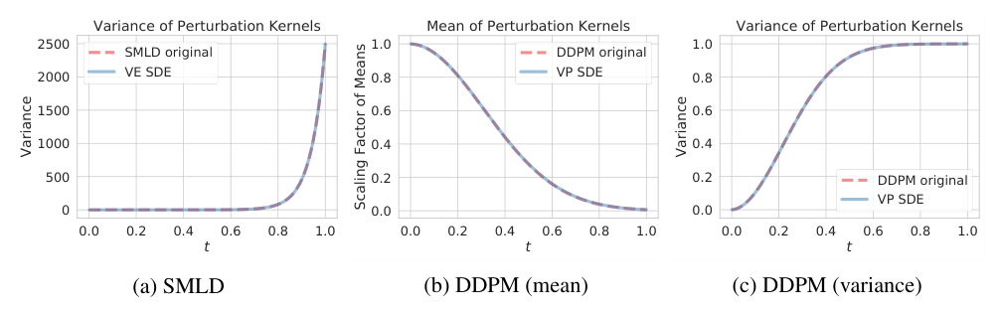

**图 5：** 离散时间扰动核与我们的连续推广几乎完全一致。
（a）比较 SMLD 和 VE SDE 扰动核的方差；（b）比较 DDPM 和 VP SDE 扰动核均值的缩放因子；（c）比较 DDPM 和 VP SDE 扰动核的方差。
图中文字：扰动核的方差；扰动核的均值；均值缩放因子；原始 SMLD；原始 DDPM；VE SDE；VP SDE；时间 $t$。

对于 DDPM，$\{\beta_i\}_{i=1}^N$ 通常为等差数列，$\beta_i=\bar\beta_{\min}/N+\frac{i-1}{N(N-1)}(\bar\beta_{\max}-\bar\beta_{\min})$，其中 $i=1,2,\ldots,N$。
因此，在 $N\to\infty$ 的极限下，对于 $t\in[0,1]$，有 $\beta(t)=\bar\beta_{\min}+t(\bar\beta_{\max}-\bar\beta_{\min})$。
这对应于如下 VP SDE 实例：

$$dx=-\tfrac12[\bar\beta_{\min}+t(\bar\beta_{\max}-\bar\beta_{\min})]x\,dt+\sqrt{\bar\beta_{\min}+t(\bar\beta_{\max}-\bar\beta_{\min})}\,dw,\quad t\in[0,1],\tag{32}$$

其中 $x(0)\sim p_{\mathrm{data}}(x)$。
实验中令 $\bar\beta_{\min}=0.1$、$\bar\beta_{\max}=20$，以匹配 Ho et al.（2020）的设置。
扰动核为：

$$p_{0t}(x(t)\mid x(0))=\mathcal N\left(x(t);e^{-\frac14t^2(\bar\beta_{\max}-\bar\beta_{\min})-\frac12t\bar\beta_{\min}}x(0),\left[1-e^{-\frac12t^2(\bar\beta_{\max}-\bar\beta_{\min})-t\bar\beta_{\min}}\right]I\right),\quad t\in[0,1].\tag{33}$$

DDPM 对应的 VP SDE 没有不连续问题；但由于 $t\to0$ 时 $x(t)$ 的方差趋于零，$t=0$ 处的训练和采样存在数值不稳定问题。
因此，与 VE SDE 相同，我们将计算限制在 $t\in[\epsilon,1]$，其中 $\epsilon>0$ 很小。
采样时选择 $\epsilon=10^{-3}$，使 VP SDE 中 $x(\epsilon)$ 的方差与 DDPM 中 $x_1$ 的方差相匹配；训练和似然计算采用 $\epsilon=10^{-5}$，实验表明这能得到更好的结果。

> **阅读注释 36｜为什么计算只到一个很小的正时间**
>
> 当条件噪声标准差 $b(t)\to0$，监督得分 $-z/b(t)$ 可能非常大，导致数值困难。因此用小正数 $\epsilon$ 代替零作为计算端点。这里趋于零的是“给定原图的条件噪声方差”，不是整个数据集的总体方差。
>
> 附录 C 的 $\epsilon$ 是时间截断值；式（2）的 $\epsilon_i$ 则是朗之万步长，它们含义不同。有限截断意味着最后得到的通常是近似干净的 $x(\epsilon)$，可再用去噪步骤改善结果。VE 在零点附近还有本节所述的噪声调度不连续问题。


为了检查 SMLD 和 DDPM 的 SDE 推广是否合理，我们在图 5 比较了 SDE 与原始离散马尔可夫链的扰动核。
SMLD 和 DDPM 模型均使用 $N=1000$ 个噪声尺度。
对于 SMLD，只需比较扰动核方差，因为均值按定义相同。
对于 DDPM，我们比较均值缩放因子和方差。
如图 5 所示，原始 SMLD 和 DDPM 的离散扰动核，与从 VE 和 VP SDE 推导出的扰动核非常吻合。

对于 sub-VP SDE，使用与 VP SDE 完全相同的 $\beta(t)$。
这给出如下扰动核：

$$p_{0t}(x(t)\mid x(0))=\mathcal N\left(x(t);e^{-\frac14t^2(\bar\beta_{\max}-\bar\beta_{\min})-\frac12t\bar\beta_{\min}}x(0),\left[1-e^{-\frac12t^2(\bar\beta_{\max}-\bar\beta_{\min})-t\bar\beta_{\min}}\right]^2I\right),\quad t\in[0,1].\tag{34}$$

我们同样将数值计算限制在与 VP SDE 相同的 $[\epsilon,1]$ 区间。
实验中观察到，对于所有 SDE，较小的 $\epsilon$ 通常产生更好的似然值。
采样时，为了获得更好的 Inception 得分和 FID，选择合适的 $\epsilon$ 很重要，虽然不同 $\epsilon$ 的样本在人眼看来视觉上相同。

## D 概率流 ODE

### D.1 推导

概率流 ODE 的思想受 Maoutsa et al.（2020）启发，其中可找到简化情形的推导。
下面推导式（17）中完全一般的 ODE。
考虑式（15）的 SDE，其形式为：

$$dx=f(x,t)\,dt+G(x,t)\,dw,$$

其中 $f(\cdot,t):\mathbb R^d\to\mathbb R^d$，$G(\cdot,t):\mathbb R^d\to\mathbb R^{d\times d}$。
边缘概率密度 $p_t(x(t))$ 按 Kolmogorov 正向方程，即 Fokker-Planck 方程（Øksendal, 2003）演化：

$$\frac{\partial p_t(x)}{\partial t}=-\sum_{i=1}^d\frac{\partial}{\partial x_i}[f_i(x,t)p_t(x)]+\frac12\sum_{i=1}^d\sum_{j=1}^d\frac{\partial^2}{\partial x_i\partial x_j}\left[\sum_{k=1}^dG_{ik}(x,t)G_{jk}(x,t)p_t(x)\right].\tag{35}$$

> **阅读注释 37｜Fokker–Planck 方程描述的是整体密度**
>
> SDE 描述一个随机样本怎样运动；Fokker–Planck 方程描述大量样本的概率密度怎样变化。第一项来自漂移对概率的搬运，第二项来自随机噪声对概率的扩散。“Kolmogorov 正向方程”和“Fokker–Planck 方程”在这里是同一个密度演化方程的两种称呼。


可以很容易地将式（35）改写为：

$$\begin{aligned}
\frac{\partial p_t(x)}{\partial t}
&=-\sum_{i=1}^d\frac{\partial}{\partial x_i}[f_i(x,t)p_t(x)]+\frac12\sum_{i=1}^d\sum_{j=1}^d\frac{\partial^2}{\partial x_i\partial x_j}\left[\sum_{k=1}^dG_{ik}(x,t)G_{jk}(x,t)p_t(x)\right]\\
&=-\sum_{i=1}^d\frac{\partial}{\partial x_i}[f_i(x,t)p_t(x)]+\frac12\sum_{i=1}^d\frac{\partial}{\partial x_i}\left[\sum_{j=1}^d\frac{\partial}{\partial x_j}\left[\sum_{k=1}^dG_{ik}(x,t)G_{jk}(x,t)p_t(x)\right]\right].
\end{aligned}\tag{36}$$

注意：

$$\begin{aligned}
&\sum_{j=1}^d\frac{\partial}{\partial x_j}\left[\sum_{k=1}^dG_{ik}(x,t)G_{jk}(x,t)p_t(x)\right]\\
&=\sum_{j=1}^d\frac{\partial}{\partial x_j}\left[\sum_{k=1}^dG_{ik}(x,t)G_{jk}(x,t)\right]p_t(x)
+\sum_{j=1}^d\sum_{k=1}^dG_{ik}(x,t)G_{jk}(x,t)p_t(x)\frac{\partial}{\partial x_j}\log p_t(x).
\end{aligned}$$

其向量形式为 $p_t(x)\nabla\cdot[GG^\top]+p_t(x)GG^\top\nabla_x\log p_t(x)$，这里 $G=G(x,t)$。
据此，可以继续改写式（36），得到：

$$\begin{aligned}
\frac{\partial p_t(x)}{\partial t}
&=-\sum_{i=1}^d\frac{\partial}{\partial x_i}[f_i(x,t)p_t(x)]+\frac12\sum_{i=1}^d\frac{\partial}{\partial x_i}\left[\sum_{j=1}^d\frac{\partial}{\partial x_j}\left[\sum_{k=1}^dG_{ik}(x,t)G_{jk}(x,t)p_t(x)\right]\right]\\
&=-\sum_{i=1}^d\frac{\partial}{\partial x_i}[f_i(x,t)p_t(x)]+\frac12\sum_{i=1}^d\frac{\partial}{\partial x_i}\left[p_t(x)\nabla\cdot[GG^\top]+p_t(x)GG^\top\nabla_x\log p_t(x)\right]_i\\
&=-\sum_{i=1}^d\frac{\partial}{\partial x_i}\left\{f_i(x,t)p_t(x)-\frac12\left[\nabla\cdot[GG^\top]+GG^\top\nabla_x\log p_t(x)\right]_i p_t(x)\right\}\\
&=-\sum_{i=1}^d\frac{\partial}{\partial x_i}[\tilde f_i(x,t)p_t(x)].
\end{aligned}\tag{37}$$

> **阅读注释 38｜概率流推导省略的关键代数步骤**
>
> 关键是对扩散项使用乘积求导，并代入 $\nabla p_t=p_t\nabla\log p_t$，把它改写成 $\tfrac12\nabla\cdot[p_t\nabla\cdot(GG^\top)+p_tGG^\top\nabla\log p_t]$。于是整个方程变成 $\partial_t p_t=-\nabla\cdot(p_t\tilde f)$。
>
> 最后这个形式就是由速度场 $\tilde f$ 驱动的确定性概率搬运方程。只要从相同初始密度出发，并满足相应的解唯一性条件，ODE 和 SDE 就可具有同样的密度演化。证明匹配的是密度方程，而不是逐条匹配随机轨迹。


其中定义：

$$\tilde f(x,t):=f(x,t)-\tfrac12\nabla\cdot[G(x,t)G(x,t)^\top]-\tfrac12G(x,t)G(x,t)^\top\nabla_x\log p_t(x).$$

考察式（37）可见，它等于如下 SDE 在 $\tilde G(x,t):=0$ 时的 Kolmogorov 正向方程；此时该方程也称为 Liouville 方程：

$$dx=\tilde f(x,t)\,dt+\tilde G(x,t)\,dw.$$

它本质上是一个 ODE：

$$dx=\tilde f(x,t)\,dt,$$

与式（17）的概率流 ODE 相同。
因此，我们证明了式（17）的概率流 ODE，与式（15）的 SDE 产生相同的边缘概率密度 $p_t(x)$。

### D.2 似然计算

用随时间变化的得分模型 $s_\theta(x,t)$ 替换得分 $\nabla_x\log p_t(x)$ 后，式（17）的概率流 ODE 变为：

$$dx=\underbrace{\left\{f(x,t)-\tfrac12\nabla\cdot[G(x,t)G(x,t)^\top]-\tfrac12G(x,t)G(x,t)^\top s_\theta(x,t)\right\}}_{:=\tilde f_\theta(x,t)}\,dt.\tag{38}$$

利用瞬时变量变换公式（Chen et al., 2018），可以按下式计算 $p_0(x)$ 的对数似然：

$$\log p_0(x(0))=\log p_T(x(T))+\int_0^T\nabla\cdot\tilde f_\theta(x(t),t)\,dt.\tag{39}$$

> **阅读注释 39｜似然积分的正负号从哪里来**
>
> 对 ODE $dx/dt=\tilde f_\theta$，沿轨迹有 $d\log p_t(x(t))/dt=-\nabla\cdot\tilde f_\theta$。从 0 积分到 $T$ 再移项，就得到式（39）的加号。散度为正表示局部体积扩张、密度下降；散度为负则表示压缩、密度上升。
>
> 计算一个输入的似然时，先把它沿 ODE 推到 $x(T)$，计算容易处理的高斯先验密度，再加上沿途的体积变化。用近似得分网络时，式中的密度应理解为该 ODE 与选定先验共同定义的模型密度，不能直接认作真实数据密度。


作为时间 $t$ 的函数的随机变量 $x(t)$，可通过求解式（38）的概率流 ODE 得到。
很多情况下，计算 $\nabla\cdot\tilde f_\theta(x,t)$ 代价很高，因此我们遵循 Grathwohl et al.（2018），用 Skilling-Hutchinson 迹估计器（Skilling, 1989；Hutchinson, 1990）估计它。
具体而言，有：

$$\nabla\cdot\tilde f_\theta(x,t)=\mathbb E_{p(\varepsilon)}[\varepsilon^\top\nabla\tilde f_\theta(x,t)\varepsilon].\tag{40}$$

> **阅读注释 40｜Hutchinson 估计为何可以省去完整雅可比**
>
> 散度等于雅可比矩阵 $J$ 的迹：$\nabla\cdot\tilde f=\operatorname{tr}(J)$。若随机向量满足 $\mathbb E[\varepsilon\varepsilon^\top]=I$，则 $\mathbb E[\varepsilon^\top J\varepsilon]=\operatorname{tr}(J)$。因此可用随机向量与雅可比的乘积估计迹，避免构造图像维数乘以图像维数的巨大矩阵。
>
> 常见选择是标准高斯或每维独立取 $\pm1$ 的随机向量；乘积可通过自动微分计算。单次估计仍有随机误差，“无偏”指重复采样的平均值等于真实迹，不是每次都等于真实迹。一般在一次 ODE 积分中固定所采样的向量，并通过独立运行评估估计误差。


其中 $\nabla\tilde f_\theta$ 表示 $\tilde f_\theta(\cdot,t)$ 的雅可比矩阵，随机变量 $\varepsilon$ 满足 $\mathbb E_{p(\varepsilon)}[\varepsilon]=0$、$\operatorname{Cov}_{p(\varepsilon)}[\varepsilon]=I$。
向量—雅可比乘积 $\varepsilon^\top\nabla\tilde f_\theta(x,t)$ 可以用反向模式自动微分高效计算，代价约等于一次 $\tilde f_\theta(x,t)$ 求值。
因此，可以采样 $\varepsilon\sim p(\varepsilon)$，再使用 $\varepsilon^\top\nabla\tilde f_\theta(x,t)\varepsilon$，高效计算散度的无偏估计。
由于估计器无偏，对足够多次运行求平均，就能使误差任意小。
因此，将式（40）的 Skilling-Hutchinson 估计器用于式（39），可以以任意精度计算对数似然。

所有实验均使用 `scipy.integrate.solve_ivp` 提供的 RK45 ODE 求解器（Dormand & Prince, 1980）。
表 2 的比特/维使用 `atol=1e-5` 和 `rtol=1e-5` 计算，与 Grathwohl et al.（2018）相同。
为给出表 2 的模型似然结果，我们取 $\epsilon=10^{-5}$，并对测试集上的比特/维结果进行五次不同运行后求平均；$\epsilon$ 的定义见附录 C。

### D.3 概率流采样

假设有一个正向 SDE：

$$dx=f(x,t)\,dt+G(t)\,dw,$$

以及它的一种离散化：

$$x_{i+1}=x_i+f_i(x_i)+G_i z_i,\quad i=0,1,\ldots,N-1,\tag{41}$$

其中 $z_i\sim\mathcal N(0,I)$。
假定时间离散化方案预先固定，因此将对 $\Delta t$ 的依赖吸收到 $f_i$ 和 $G_i$ 的记号中。
利用式（17），可得到如下概率流 ODE：

$$dx=\left\{f(x,t)-\tfrac12G(t)G(t)^\top\nabla_x\log p_t(x)\right\}\,dt.\tag{42}$$

可以使用任意数值方法，沿时间反向积分概率流 ODE，生成样本。
具体来说，我们提出一种与式（41）函数形式相似的离散化：

$$x_i=x_{i+1}-f_{i+1}(x_{i+1})+\tfrac12G_{i+1}G_{i+1}^\top s_{\theta^*}(x_{i+1},i+1),\quad i=0,1,\ldots,N-1.$$

其中得分模型 $s_{\theta^*}(x_i,i)$ 以迭代编号 $i$ 为条件。
这是确定性迭代规则。
与逆向扩散采样器或祖先采样不同，从先验分布得到初始样本 $x_N$ 后，不再有额外随机性。
应用到 SMLD 模型时，可得到如下概率流采样迭代规则：

$$x_i=x_{i+1}+\tfrac12(\sigma_{i+1}^2-\sigma_i^2)s_{\theta^*}(x_{i+1},\sigma_{i+1}),\quad i=0,1,\ldots,N-1.\tag{43}$$

类似地，对于 DDPM，有：

$$x_i=(2-\sqrt{1-\beta_{i+1}})x_{i+1}+\tfrac12\beta_{i+1}s_{\theta^*}(x_{i+1},i+1),\quad i=0,1,\ldots,N-1.\tag{44}$$

### D.4 使用黑箱 ODE 求解器采样

为生成图 3 的图像，我们使用一个在 $256\times256$ CelebA-HQ 上训练的 DDPM 模型，设置与 Ho et al.（2020）相同。
表 2 中我们所有模型的 FID，都根据 `scipy.integrate.solve_ivp` 实现的 RK45 ODE 求解器生成的样本计算，设置 `atol=1e-5`、`rtol=1e-5`。
VE SDE 使用 $\epsilon=10^{-5}$，VP SDE 使用 $\epsilon=10^{-3}$，也见附录 C。

除图 3 的插值结果外，图 6 展示更多潜在空间操作示例，包括插值和温度缩放。
这里测试的是与 Ho et al.（2020）采用相同设置训练的 DDPM 模型。

虽然概率流 ODE 求解器支持快速采样，但在不使用校正器时，其样本的 FID 通常高于，也就是差于 SDE 求解器生成的样本。
对于附录 D.3 的离散化策略和上述黑箱 ODE 求解器，我们均有这一实验观察。
此外，概率流 ODE 采样器的表现依赖于 SDE 的选择：对于 VE SDE，样本质量明显差于 VP SDE，特别是在高维数据上。

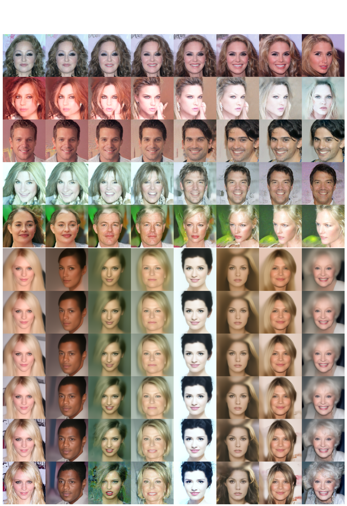

**图 6：** 在 $256\times256$ CelebA-HQ 上，VP SDE 对应概率流 ODE 的样本。
上：随机样本之间的球面插值。
下：温度重新缩放，即减小嵌入的范数。

### D.5 具有唯一可辨识性的编码

为检验这一性质，我们在 CIFAR-10 上使用 VE SDE，训练两个具有不同架构的模型，记为“模型 A”和“模型 B”。
模型 A 是一个每个分辨率使用 4 层、按式（7）的连续目标训练的 NCSN++ 模型；模型 B 的其他设置相同，只是每个分辨率使用 8 层。
模型定义见附录 H。

图 7 报告模型 A 和模型 B 对同一张随机 CIFAR-10 图像获得的潜在编码。
图 8 展示总计 16 张 CIFAR-10 图像的潜在编码之间的逐维差异和相关系数。
结果说明，对于相同输入，尽管架构和训练运行不同，模型 A 和模型 B 在每个维度上得到的编码都很接近。

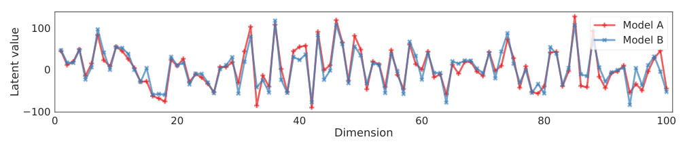

**图 7：** 比较一张随机 CIFAR-10 图像的潜在编码的前 100 个维度。
“模型 A”和“模型 B”使用不同架构分别训练。
图中文字：潜在变量值；维度；模型 A；模型 B。

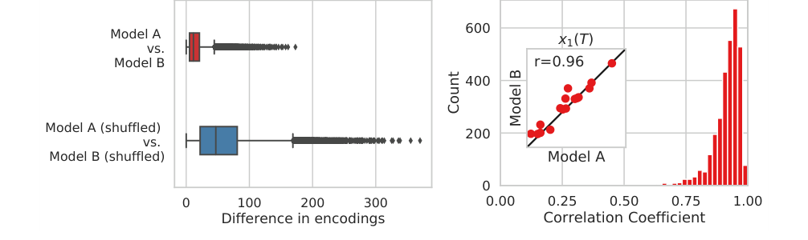

**图 8：** 左：模型 A 和模型 B 得到的编码的逐维差异。
作为基线，我们还报告将两个模型的表示打乱后的差异。
右：模型 A 和模型 B 得到的编码的逐维相关系数。
图中文字：编码差异；相关系数；计数；打乱后的模型 A/模型 B；模型 A 与模型 B；$r=0.96$。

## E 逆向扩散采样

给定一个正向 SDE：

$$dx=f(x,t)\,dt+G(t)\,dw,$$

并假设以下迭代规则是它的一种离散化：

$$x_{i+1}=x_i+f_i(x_i)+G_i z_i,\quad i=0,1,\ldots,N-1,\tag{45}$$

其中 $z_i\sim\mathcal N(0,I)$。
这里假定时间离散化方案预先固定，因此可以将它吸收到 $f_i$ 和 $G_i$ 的记号中。

> **阅读注释 41｜离散公式中的漂移和噪声已包含步长**
>
> 对 Euler–Maruyama 而言，离散量大致对应 $f_i(x)=f(x,t_i)\Delta t$、$G_i=G(t_i)\sqrt{\Delta t}$，所以 $G_iG_i^\top$ 已包含 $\Delta t$。阅读下面的逆向更新时，不应再给这些量重复乘上步长。其他正向离散化可以有不同的具体表达式。


基于式（45），我们提出以相似的函数形式，离散化逆时间 SDE：

$$dx=[f(x,t)-G(t)G(t)^\top\nabla_x\log p_t(x)]\,dt+G(t)\,d\bar w,$$

从而得到如下迭代规则，其中 $i\in\{0,1,\ldots,N-1\}$：

$$x_i=x_{i+1}-f_{i+1}(x_{i+1})+G_{i+1}G_{i+1}^\top s_{\theta^*}(x_{i+1},i+1)+G_{i+1}z_{i+1}.\tag{46}$$

> **阅读注释 42｜逆向扩散更新的三部分**
>
> 这一步包含：减去离散正向漂移、沿得分增加 $G_iG_i^\top s_\theta$、再加一份高斯随机扰动。它是用已知正向离散规则构造的逆向数值近似，并不是有限步长下精确的反向条件分布。原始 DDPM 祖先采样与它的公式略有不同，但小步长时对应同一逆时间 SDE。


其中训练好的得分模型 $s_{\theta^*}(x_i,i)$ 以迭代编号 $i$ 为条件。

将式（46）用于式（10）和式（20），就得到用于逆时间 VE 和 VP SDE 的一组新数值求解器，所得采样算法见算法 2 和算法 3 的“预测器”部分。
我们将这些基于式（46）离散化策略的采样方法称为逆向扩散采样器。

正如预期，当所有 $\beta_i\to0$ 时，DDPM（Ho et al., 2020）的祖先采样（式（4））与其逆向扩散版本一致；当 $\Delta t\to0$ 时会出现这一情况，因为 $\beta_i=\bar\beta_i\Delta t$，见附录 B。
原因是：

$$\begin{aligned}
x_i&=\frac{x_{i+1}+\beta_{i+1}s_{\theta^*}(x_{i+1},i+1)}{\sqrt{1-\beta_{i+1}}}+\sqrt{\beta_{i+1}}z_{i+1}\\
&=\left(1+\tfrac12\beta_{i+1}+o(\beta_{i+1})\right)(x_{i+1}+\beta_{i+1}s_{\theta^*}(x_{i+1},i+1))+\sqrt{\beta_{i+1}}z_{i+1}\\
&\approx\left(1+\tfrac12\beta_{i+1}\right)(x_{i+1}+\beta_{i+1}s_{\theta^*}(x_{i+1},i+1))+\sqrt{\beta_{i+1}}z_{i+1}\\
&=\left(1+\tfrac12\beta_{i+1}\right)x_{i+1}+\beta_{i+1}s_{\theta^*}(x_{i+1},i+1)+\tfrac12\beta_{i+1}^2s_{\theta^*}(x_{i+1},i+1)+\sqrt{\beta_{i+1}}z_{i+1}\\
&\approx\left(1+\tfrac12\beta_{i+1}\right)x_{i+1}+\beta_{i+1}s_{\theta^*}(x_{i+1},i+1)+\sqrt{\beta_{i+1}}z_{i+1}\\
&=\left[2-\left(1-\tfrac12\beta_{i+1}\right)\right]x_{i+1}+\beta_{i+1}s_{\theta^*}(x_{i+1},i+1)+\sqrt{\beta_{i+1}}z_{i+1}\\
&\approx\left[2-\left(1-\tfrac12\beta_{i+1}+o(\beta_{i+1})\right)\right]x_{i+1}+\beta_{i+1}s_{\theta^*}(x_{i+1},i+1)+\sqrt{\beta_{i+1}}z_{i+1}\\
&=(2-\sqrt{1-\beta_{i+1}})x_{i+1}+\beta_{i+1}s_{\theta^*}(x_{i+1},i+1)+\sqrt{\beta_{i+1}}z_{i+1}.
\end{aligned}$$

因此，式（4）的原始祖先采样器，本质上是同一个逆时间 SDE 的另一种离散化。
这将 Ho et al.（2020）的采样方法，统一为连续框架中逆时间 VP SDE 的数值求解器。

## F 用于 SMLD 模型的祖先采样

DDPM 的祖先采样方法也可以改用于 SMLD。
考虑与 SMLD 相同的噪声尺度序列 $\sigma_1<\sigma_2<\cdots<\sigma_N$。
依次使用这些尺度扰动数据点 $x_0$，得到马尔可夫链 $x_0\to x_1\to\cdots\to x_N$，其中：

$$p(x_i\mid x_{i-1})=\mathcal N(x_i;x_{i-1},(\sigma_i^2-\sigma_{i-1}^2)I),\quad i=1,2,\ldots,N.$$

这里假定 $\sigma_0=0$，以简化记号。
遵循 Ho et al.（2020），可以计算：

$$q(x_{i-1}\mid x_i,x_0)=\mathcal N\left(x_{i-1};\frac{\sigma_{i-1}^2}{\sigma_i^2}x_i+\left(1-\frac{\sigma_{i-1}^2}{\sigma_i^2}\right)x_0,\frac{\sigma_{i-1}^2(\sigma_i^2-\sigma_{i-1}^2)}{\sigma_i^2}I\right).$$

如果将逆向转移核参数化为 $p_\theta(x_{i-1}\mid x_i)=\mathcal N(x_{i-1};\mu_\theta(x_i,i),\tau_i^2I)$，则：

$$\begin{aligned}
L_{t-1}&=\mathbb E_q[D_{\mathrm{KL}}(q(x_{i-1}\mid x_i,x_0)\|p_\theta(x_{i-1}\mid x_i))]\\
&=\mathbb E_q\left[\frac1{2\tau_i^2}\left\|\frac{\sigma_{i-1}^2}{\sigma_i^2}x_i+\left(1-\frac{\sigma_{i-1}^2}{\sigma_i^2}\right)x_0-\mu_\theta(x_i,i)\right\|_2^2\right]+C\\
&=\mathbb E_{x_0,z}\left[\frac1{2\tau_i^2}\left\|x_i(x_0,z)-\frac{\sigma_i^2-\sigma_{i-1}^2}{\sigma_i}z-\mu_\theta(x_i(x_0,z),i)\right\|_2^2\right]+C.
\end{aligned}$$

其中 $L_{t-1}$ 是 ELBO 目标的一项代表性项，见 Ho et al.（2020）的式（8）；$C$ 是不依赖 $\theta$ 的常数；$z\sim\mathcal N(0,I)$，$x_i(x_0,z)=x_0+\sigma_i z$。
因此，可以按下式参数化 $\mu_\theta(x_i,i)$：

$$\mu_\theta(x_i,i)=x_i+(\sigma_i^2-\sigma_{i-1}^2)s_\theta(x_i,i),$$

其中 $s_\theta(x_i,i)$ 用于估计 $z/\sigma_i$。
与 Ho et al.（2020）一样，令 $\tau_i=\sqrt{\sigma_{i-1}^2(\sigma_i^2-\sigma_{i-1}^2)/\sigma_i^2}$。
通过对 $\prod_{i=1}^Np_\theta(x_{i-1}\mid x_i)$ 进行祖先采样，得到如下迭代规则：

$$x_{i-1}=x_i+(\sigma_i^2-\sigma_{i-1}^2)s_{\theta^*}(x_i,i)+\sqrt{\frac{\sigma_{i-1}^2(\sigma_i^2-\sigma_{i-1}^2)}{\sigma_i^2}}\,z_i,\quad i=1,2,\ldots,N.\tag{47}$$

其中 $x_N\sim\mathcal N(0,\sigma_N^2I)$，$\theta^*$ 表示 $s_\theta$ 的最优参数，$z_i\sim\mathcal N(0,I)$。
我们将式（47）称为 SMLD 模型的祖先采样方法。

> **译注（原文符号问题）：** 上文“估计 $z/\sigma_i$”忠实保留原文表述。按 $x_i=x_0+\sigma_i z$ 和正文的得分定义，条件得分实际为 $-z/\sigma_i$；此处原文漏写负号。式（47）的加号与得分定义一致。

> **阅读注释 43｜用噪声参数化时务必核对负号**
>
> 此处已有译注指出原文的一处符号问题。若定义 $x_i=x_0+\sigma_i z$，那么条件得分是 $-z/\sigma_i$；若网络直接预测噪声 $z$，转换为得分时必须带负号。不能一边把网络输出当作正的噪声预测，一边直接代入以得分定义的采样公式。


## G 预测器—校正器采样器

**预测器—校正器（PC）采样。** 预测器可以是采用固定离散化策略的任意逆时间 SDE 数值求解器。
校正器可以是任意基于得分的 MCMC 方法。
PC 采样在预测器和校正器之间交替进行，见算法 1。
例如，使用逆向扩散 SDE 求解器（附录 E）作为预测器、退火朗之万动力学（Song & Ermon, 2019）作为校正器时，VE 和 VP SDE 分别得到算法 2 和算法 3；其中 $\{\epsilon_i\}_{i=0}^{N-1}$ 是下文指定的朗之万动力学步长。

**算法 1：预测器—校正器（PC）采样。**

```text
输入：N，逆时间 SDE 的离散化步数；M，校正步数。
1. 初始化 x_N ~ p_T(x)。
2. 对 i = N−1, N−2, …, 0：
3.     x_i ← 预测器(x_{i+1})。
4.     对 j = 1, …, M：
5.         x_i ← 校正器(x_i)。
6. 返回 x_0。
```

**校正器算法。** 我们采用 Song & Ermon（2019）的退火朗之万动力学调度，但略作修改并重新表述，以得到更好的可解释性和实验表现。
算法 4 和算法 5 分别给出校正器算法，其中 $r$ 称为“信噪比”。
利用高斯噪声范数 $\|z\|_2$、得分模型输出范数 $\|s_{\theta^*}\|_2$ 和信噪比 $r$，确定步长 $\epsilon$。
同时生成大批样本时，将范数 $\|\cdot\|_2$ 替换为小批量中的平均范数。
当批量较小时，建议将 $\|z\|_2$ 替换为 $\sqrt d$，其中 $d$ 是 $z$ 的维数。

> **阅读注释 44｜信噪比怎样决定校正器步长**
>
> 一次朗之万更新中的信号项范数约为 $\epsilon\|g\|_2$，噪声项范数约为 $\sqrt{2\epsilon}\|z\|_2$。把二者的比值设为 $r$，解得 $\epsilon=2(r\|z\|_2/\|g\|_2)^2$，这就是算法 4 的步长公式。
>
> 这里的 $g$ 是算法临时变量，代表网络得分输出，不是正文的扩散系数 $g(t)$。$r$ 越大通常意味着校正移动越强，但并非越大越好；批量平均范数用于减少步长的随机波动。


**算法 2：PC 采样（VE SDE）。**

1. $x_N\sim\mathcal N(0,\sigma_{\max}^2I)$。
2. 对 $i=N-1,\ldots,0$：
   - $x_i'\leftarrow x_{i+1}+(\sigma_{i+1}^2-\sigma_i^2)s_{\theta^*}(x_{i+1},\sigma_{i+1})$。
   - $z\sim\mathcal N(0,I)$。
   - $x_i\leftarrow x_i'+\sqrt{\sigma_{i+1}^2-\sigma_i^2}\,z$。
   - 对 $j=1,\ldots,M$：采样 $z\sim\mathcal N(0,I)$；令 $x_i\leftarrow x_i+\epsilon_i s_{\theta^*}(x_i,\sigma_i)+\sqrt{2\epsilon_i}\,z$。
3. 返回 $x_0$。

**算法 3：PC 采样（VP SDE）。**

1. $x_N\sim\mathcal N(0,I)$。
2. 对 $i=N-1,\ldots,0$：
   - $x_i'\leftarrow(2-\sqrt{1-\beta_{i+1}})x_{i+1}+\beta_{i+1}s_{\theta^*}(x_{i+1},i+1)$。
   - $z\sim\mathcal N(0,I)$。
   - $x_i\leftarrow x_i'+\sqrt{\beta_{i+1}}\,z$。
   - 对 $j=1,\ldots,M$：采样 $z\sim\mathcal N(0,I)$；令 $x_i\leftarrow x_i+\epsilon_i s_{\theta^*}(x_i,i)+\sqrt{2\epsilon_i}\,z$。
3. 返回 $x_0$。

**算法 4：校正器算法（VE SDE）。**

输入：$\{\sigma_i\}_{i=1}^N,r,N,M$。

1. $x_N^0\sim\mathcal N(0,\sigma_{\max}^2I)$。
2. 对 $i=N,\ldots,1$，执行 $j=1,\ldots,M$：
   - $z\sim\mathcal N(0,I)$。
   - $g\leftarrow s_{\theta^*}(x_i^{j-1},\sigma_i)$。
   - $\epsilon\leftarrow2(r\|z\|_2/\|g\|_2)^2$。
   - $x_i^j\leftarrow x_i^{j-1}+\epsilon g+\sqrt{2\epsilon}\,z$。
3. 每个尺度结束后，令 $x_{i-1}^0\leftarrow x_i^M$。
4. 返回 $x_0^0$。

**算法 5：校正器算法（VP SDE）。**

输入：$\{\beta_i\}_{i=1}^N,\{\alpha_i\}_{i=1}^N,r,N,M$。

1. $x_N^0\sim\mathcal N(0,I)$。
2. 对 $i=N,\ldots,1$，执行 $j=1,\ldots,M$：
   - $z\sim\mathcal N(0,I)$。
   - $g\leftarrow s_{\theta^*}(x_i^{j-1},i)$。
   - $\epsilon\leftarrow2\alpha_i(r\|z\|_2/\|g\|_2)^2$。
   - $x_i^j\leftarrow x_i^{j-1}+\epsilon g+\sqrt{2\epsilon}\,z$。
3. 每个尺度结束后，令 $x_{i-1}^0\leftarrow x_i^M$。
4. 返回 $x_0^0$。

**去噪。** 对于 SMLD 和 DDPM，生成样本通常含有少量人类难以察觉的噪声。
正如 Jolicoeur-Martineau et al.（2020）所指出，不去除这些噪声，FID 可能显著变差。
这种不理想的噪声敏感性，也是使用 SMLD 训练的 NCSN 模型在 FID 上一直差于 DDPM 的部分原因：前者不在采样末尾去噪，而后者会去噪。
本文所有实验都确保在采样末尾使用 Tweedie 公式（Efron, 2011），执行一次去噪步骤。

> **阅读注释 45｜Tweedie 公式如何用得分做最后去噪**
>
> 若 $x_t=m(t)x_0+b(t)z$ 且 $m(t)\ne0$，则高斯扰动下的条件均值满足 $\mathbb E[x_0\mid x_t]=(x_t+b(t)^2\nabla_{x_t}\log p_t(x_t))/m(t)$。实际使用网络得分代替真实得分；对于 VE，$m=1$，因此形式尤其简单。
>
> 这是给定带噪输入时的平均去噪估计，并不是保证恢复加噪前的那一张原图。将它用于采样末尾可减少残余噪声；本文还提醒，FID 可能对人眼不易察觉的残余噪声很敏感。


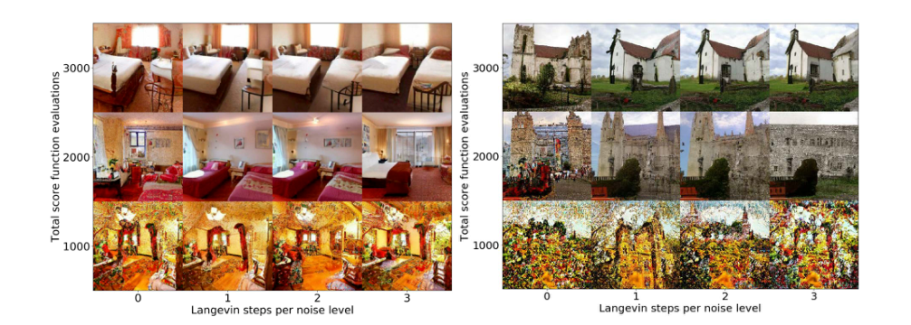

**图 9：LSUN 卧室和教堂的 PC 采样。**
纵轴对应总计算量，横轴表示分配给校正器的计算量。
计算量在预测器和校正器之间分配时，样本最好。
图中纵轴：得分函数总求值次数；横轴：每个噪声级别的朗之万步数。

**训练。** 得分模型使用与 Ho et al.（2020）相同的架构。
对于 VE SDE，使用式（1）的原始 SMLD 目标训练；对于 VP SDE，使用式（3）的原始 DDPM 目标。
两个模型的训练均使用 1000 个噪声尺度。
图 9 的结果来自一个在 $256\times256$ LSUN 卧室和教堂外景数据集（Yu et al., 2015）上、使用 VE SDE 和连续目标式（7）训练的 NCSN++ 模型，定义见附录 H。
CIFAR-10 的训练批量固定为 128，LSUN 为 64。

**表 4：比较 CIFAR-10 上的不同采样器，其中 P2000 使用噪声尺度间的取整插值。**
原表阴影区域表示相同计算量，即相同的得分函数求值次数。
报告五次采样运行的均值和标准差。

|预测器（FID 越低越好）|VE P1000|VE P2000|VE C2000|VE PC1000|VP P1000|VP P2000|VP C2000|VP PC1000|
|---|---:|---:|---:|---:|---:|---:|---:|---:|
|祖先采样|4.98±.06|4.92±.02|20.43±.07|3.62±.03|3.24±.02|3.11±.03|19.06±.06|3.21±.02|
|逆向扩散|4.79±.07|4.72±.07|同上|3.60±.02|3.21±.02|3.10±.03|同上|3.18±.01|
|概率流|15.41±.15|12.87±.09|同上|3.51±.04|3.59±.04|3.25±.04|同上|3.06±.03|

**表 5：不同采样器的最优信噪比。**
P1000/P2000 是使用 1000/2000 步的纯预测器；C2000 是使用 2000 步的纯校正器；PC1000 使用 1000 步预测和 1000 步校正。

|预测器|VE P1000|VE P2000|VE C2000|VE PC1000|VP P1000|VP P2000|VP C2000|VP PC1000|
|---|---:|---:|---:|---:|---:|---:|---:|---:|
|祖先采样|-|-|0.22|0.17|-|-|0.27|0.01|
|逆向扩散|-|-|同上|0.16|-|-|同上|0.01|
|概率流|-|-|同上|0.17|-|-|同上|0.04|

**噪声尺度的临时插值方法。** 本实验的模型均使用 1000 个噪声尺度训练。
为了得到 P2000，也就是使用 2000 步的纯预测器采样器的结果，需要 2000 个噪声尺度，因此必须在测试时对原有的 1000 个噪声尺度插值。
Ho et al.（2020）的噪声条件得分模型架构使用正弦位置嵌入，以整数时间步为条件。
这允许在测试时对噪声尺度进行临时插值；而 Song & Ermon（2019）等其他架构很难做到这一点。
具体而言，对 SMLD，保持 $\sigma_{\min}$ 和 $\sigma_{\max}$ 不变，将时间步数量加倍。
对 DDPM，先将 $\beta_{\min}$ 和 $\beta_{\max}$ 减半，再将时间步数量加倍。
假设 $\{s_\theta(x,i)\}_{i=0}^{N-1}$ 是使用 $N$ 个时间步训练的得分模型，令 $\{s'_\theta(x,i)\}_{i=0}^{2N-1}$ 表示相应的 $2N$ 时间步插值模型。
我们测试两种不同的时间步插值策略：线性插值 $s'_\theta(x,i)=s_\theta(x,i/2)$，和取整插值 $s'_\theta(x,i)=s_\theta(x,\lfloor i/2\rfloor)$。
表 1 给出线性插值结果，表 4 给出取整插值结果。
我们观察到，不同插值方法会带来表现差异，但总体趋势不变：预测器—校正器方法的表现与纯预测器或纯校正器相当，或者更好。

**采样器超参数。** 对 CIFAR-10 的 PC 和纯校正器采样器，我们在间隔为 0.01 的网格上搜索最优信噪比 $r$。
表 5 报告最优 $r$。
对于 LSUN 卧室/教堂外景，固定 $r=0.075$。
除非另有说明，所有 PC 采样器在每个噪声尺度使用一个校正步骤。
CIFAR-10 的纯校正器采样器，在每个噪声尺度使用两个校正步骤。
样本生成时，CIFAR-10 的批量为 1024，LSUN 卧室/教堂外景为 8。

## H 架构改进

我们探索了若干架构设计，以改进 VE 和 VP SDE 的得分模型。
这些工作带来了 CIFAR-10 上新的最先进样本质量、均匀去量化 CIFAR-10 上新的最先进似然，并首次使基于得分的生成模型能够生成分辨率为 $1024\times1024$ 的高保真图像样本。
代码和检查点开源于 <https://github.com/yang-song/score_sde>。

### H.1 架构探索的设置

除非另有说明，所有模型均训练 130 万次迭代，每 5 万次迭代保存一个检查点。
对于 VE SDE，考虑两个数据集：$32\times32$ CIFAR-10（Krizhevsky et al., 2009）和 $64\times64$ CelebA（Liu et al., 2015），按 Song & Ermon（2020）的方法预处理。
根据 50 万次迭代之后各检查点的平均 FID，比较不同配置。
对于 VP SDE，为节省计算，只考虑 CIFAR-10，并根据 25 万至 50 万次迭代之间各检查点的平均 FID 比较模型，因为 VP SDE 的 FID 在 50 万次迭代后开始上升。

所有 FID 均使用 `tensorflow_gan`，根据 5 万个样本计算。
采样使用离散为 1000 个时间步的 PC 采样器。
选择逆向扩散作为预测器，见附录 E。
对于 VE SDE，每次预测器更新使用一次校正，信噪比为 0.16；对于 VP SDE，则省略校正步骤，因为校正只带来小幅提升，却需要加倍计算。
优化遵循 Ho et al.（2020），包括学习率、梯度裁剪和学习率预热方案。
除非另有说明，模型使用式（1）和式（3）的原始离散 SMLD 和 DDPM 目标训练，批量为 128。
在这些设置下找到的最优架构，随后转用于连续目标和更深模型。
考虑到 VP 和 sub-VP SDE 的相似性，我们也将 VP SDE 的最佳架构直接用于 sub-VP SDE。

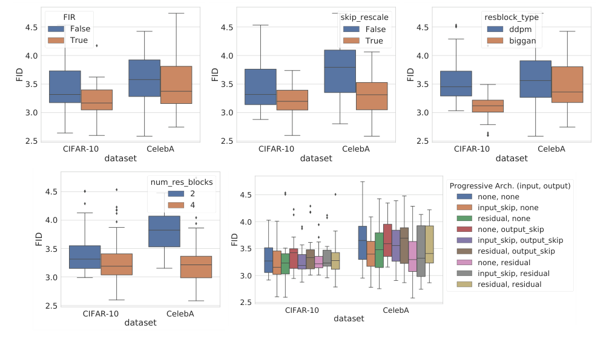

**图 10：使用 VE 扰动训练的得分模型中，不同架构组件的影响。**
图中文字：数据集；FID；FIR（关闭/开启）；跳跃连接重新缩放（关闭/开启）；残差块类型（DDPM/BigGAN）；残差块数量（2/4）；渐进架构（输入、输出）。
渐进架构选项：无、输入跳跃连接、输出跳跃连接、残差。

我们的架构主要基于 Ho et al.（2020）。
为尽可能提高得分模型的改进空间，还引入以下组件。

1. 使用基于有限冲激响应（FIR）的抗混叠，对图像上采样和下采样（Zhang, 2019）。采用与 StyleGAN-2（Karras et al., 2020b）相同的实现和超参数。
2. 将所有跳跃连接按 $1/\sqrt2$ 重新缩放。这已被证明在多个顶尖 GAN 中有效，包括 ProgressiveGAN（Karras et al., 2018）、StyleGAN（Karras et al., 2019）和 StyleGAN-2（Karras et al., 2020b）。
3. 将 DDPM 的原始残差块替换为 BigGAN（Brock et al., 2018）的残差块。
4. 将每个分辨率的残差块数量从 2 增加到 4。
5. 引入渐进生长架构。输入考虑“输入跳跃连接”和“残差”两种渐进架构；输出考虑“输出跳跃连接”和“残差”两种。这些渐进架构按 StyleGAN-2 定义和实现。

我们也测试了均衡学习率，这一技巧用于 ProgressiveGAN（Karras et al., 2018）和 StyleGAN（Karras et al., 2019）等非常成功的模型。
但在早期实验中发现它有害，因此决定不再进一步探索。

指数移动平均（EMA）的衰减率对表现有显著影响。
对于使用 VE 扰动训练的模型，我们发现 0.999 优于 0.9999；对于使用 VP 扰动训练的模型，情况相反。
因此，VE 和 VP 模型的 EMA 衰减率分别取 0.999 和 0.9999。

> **阅读注释 46｜EMA 平滑的是网络参数**
>
> EMA 更新为 $\bar\theta\leftarrow\rho\bar\theta+(1-\rho)\theta$，把近期多个训练步骤的参数平均起来，生成时通常使用这份平滑参数。它平滑的是训练参数，不是生成轨迹或图片像素。$\rho$ 越接近 1，历史记忆越长；论文中不同 SDE 适合不同衰减率，是经验发现。


### H.2 CIFAR-10 上的结果

如图 10 所示，上述所有架构组件都能改善使用 VE SDE 训练的得分模型。
箱线图展示了其他组件可自由变化时，各组件的重要性。
对于 CIFAR-10 和 CelebA，我们探索的额外组件，对 VE SDE 的平均表现总有提升。
对于渐进生长，尚不明确哪种配置组合始终最好，但结果通常优于不使用渐进生长架构。
最好的 VE SDE 得分模型：（1）使用 FIR 上采样/下采样；（2）重新缩放跳跃连接；（3）采用 BigGAN 类型的残差块；（4）每个分辨率使用 4 个残差块而不是 2 个；（5）输入使用“残差”渐进架构，输出不使用渐进生长架构。
遵循此前 SMLD 模型的命名方式（Song & Ermon, 2019；2020），我们将该模型命名为 NCSN++。

对于 VP SDE，也遵循类似过程检查这些架构组件，只是由于计算资源有限，省略 CelebA 实验。
NCSN++ 架构用于 VP SDE 时表现不错，在所有 144 种可能配置中排名第四。
但是最佳配置具有略微不同的结构：与 NCSN++ 相比，它不使用 FIR 上采样/下采样，也不使用渐进生长架构。
遵循 Ho et al.（2020）的命名方式，称该模型为 DDPM++。

每个分辨率使用 4 个残差块的基础 NCSN++，在 CIFAR-10 上达到 2.45 的 FID；基础 DDPM++ 达到 2.78。
这里，为符合 Karras et al.（2018）、Song & Ermon（2019）和 Ho et al.（2020）的惯例，报告训练过程中最低的 FID，而不是架构探索中用于比较 VE 模型的 50 万次迭代后检查点平均 FID，或用于比较 VP 模型的 25 万至 50 万次迭代之间检查点平均 FID。

从离散训练目标切换到式（7）的连续目标，会进一步改善所有 SDE 的 FID。
为使 NCSN++ 以连续时间变量为条件，我们将位置嵌入，即 Ho et al.（2020）中用于离散时间步条件化的层，改成随机傅里叶特征嵌入（Tancik et al., 2020）。
这些随机傅里叶特征嵌入的尺度参数固定为 16。

> **阅读注释 47｜时间嵌入为什么不用只输入一个数字**
>
> 先把时间或噪声尺度映射成一组正弦、余弦特征，再送入网络，有助于网络表达随噪声水平变化的规律。“随机傅里叶特征”中的频率通常在初始化时随机取样，之后固定；不是每次采样都重新给时间增加随机噪声。

我们还将训练迭代次数减至 95 万，以抑制过拟合。
这些改动使使用 VE SDE 训练的 NCSN++ 在 CIFAR-10 上的 FID 从 2.45 改善为 2.38，所得模型称为 NCSN++ cont.。
此外，将 NCSN++ cont. 每个分辨率的残差块数量加倍，还能将 FID 从 2.38 改善为 2.20，所得模型记为 NCSN++ cont.（深层）。
表 3 汇总所有定量结果，图 11 给出最佳模型的随机样本。

类似地，也可让 DDPM++ 以连续时间步为条件，得到 DDPM++ cont.。
使用 VP SDE 训练时，它将 DDPM++ 的 FID 从 2.78 改善为 2.55。
使用 sub-VP SDE 训练时，FID 为 2.61。
为获得更好表现，对于连续训练的模型，我们使用 Euler-Maruyama 求解器作为预测器，代替祖先采样预测器或逆向扩散预测器。
这是因为，当 $t\to0$ 时，原始 DDPM 的离散化策略不能很好地匹配连续过程的方差，会显著损害 FID。
如表 2 所示，VP 和 sub-VP SDE 的似然指标分别为 3.21 和 3.05 比特/维。
将深度加倍并训练 95 万次迭代，可以同时改善 VP 和 sub-VP SDE 的 FID 与比特/维，得到 DDPM++ cont.（深层）。
对于 VP 和 sub-VP SDE，该模型的 FID 均为 2.41。
使用 sub-VP SDE 训练时，似然指标达到 2.99 比特/维。
这里所有似然值都对应训练中的最后一个检查点。

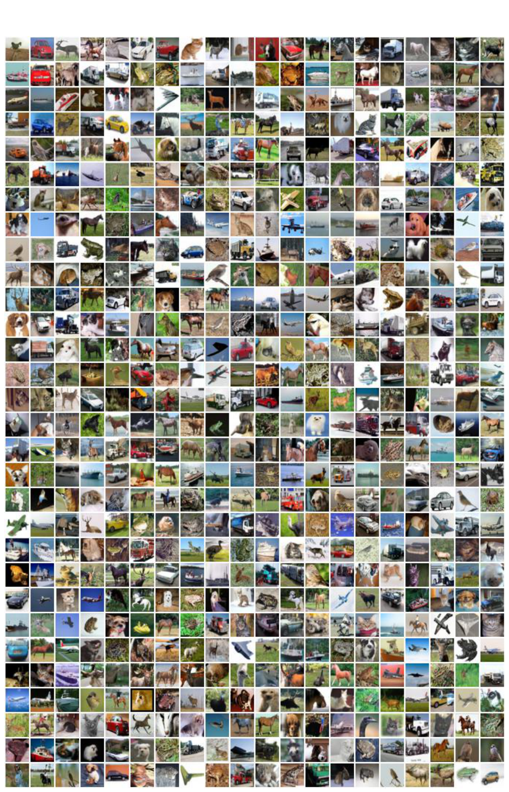

**图 11：** NCSN++ cont.（深层，VE）生成的无条件 CIFAR-10 样本。

### H.3 高分辨率图像

受到 NCSN++ 在 CIFAR-10 上成功的鼓舞，我们继续在 $1024\times1024$ CelebA-HQ（Karras et al., 2018）上测试它；此前，只有部分 GAN 和 VQ-VAE-2（Razavi et al., 2019）能完成这一任务。
我们使用批量 8，将 EMA 衰减率提高至 0.9999，以连续目标式（7）训练一个与 NCSN++ 相似的模型，约 240 万次迭代；详细架构见公开代码。
使用离散为 2000 步的 PC 采样器，预测器为逆向扩散，每次预测器更新执行一步朗之万更新，信噪比为 0.15。
随机傅里叶特征嵌入的尺度参数固定为 16。
输入使用“输入跳跃连接”渐进架构，输出使用“输出跳跃连接”渐进架构。
图 12 给出样本。
虽然这些样本并不完美，例如面部对称性存在可见缺陷，但我们认为结果令人鼓舞，能够展示方法的可扩展性。
未来对更有效架构的研究，很可能显著提升基于得分的生成模型在此任务上的表现。

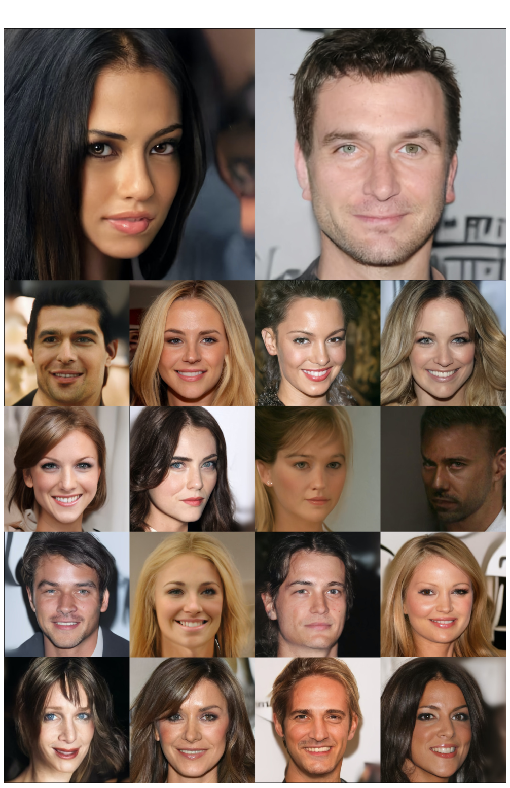

**图 12：** 使用 VE SDE 训练的修改版 NCSN++，在 $1024\times1024$ CelebA-HQ 上生成的样本。

## I 可控生成

考虑如下形式的一般正向 SDE：

$$dx=f(x,t)\,dt+G(x,t)\,dw,$$

并假设初始状态分布为 $p_0(x(0)\mid y)$。
以 $y$ 为条件时，时刻 $t$ 的密度为 $p_t(x(t)\mid y)$。
因此，利用 Anderson（1982）的结果，逆时间 SDE 为：

$$dx=\{f(x,t)-\nabla\cdot[G(x,t)G(x,t)^\top]-G(x,t)G(x,t)^\top\nabla_x\log p_t(x\mid y)\}\,dt+G(x,t)\,d\bar w.\tag{48}$$

由于 $p_t(x(t)\mid y)\propto p_t(x(t))p(y\mid x(t))$，得分 $\nabla_x\log p_t(x(t)\mid y)$ 可以方便地计算为：

$$\nabla_x\log p_t(x(t)\mid y)=\nabla_x\log p_t(x(t))+\nabla_x\log p(y\mid x(t)).\tag{49}$$

式（14）的条件逆时间 SDE 是它的特例。
此前讨论的所有采样方法，都可以用于条件逆时间 SDE，生成样本。

### I.1 类别条件采样

当 $y$ 表示类别标签时，可以训练随时间变化的分类器 $p_t(y\mid x(t))$，用于类别条件采样。
由于正向 SDE 易于处理，可以先从数据集采样 $(x(0),y)$，再获得 $x(t)\sim p_{0t}(x(t)\mid x(0))$，方便地创建一对训练数据 $(x(t),y)$。
随后，可以类似式（7），使用不同时间步的交叉熵损失混合，训练随时间变化的分类器 $p_t(y\mid x(t))$。

> **阅读注释 48｜训练噪声条件分类器时标签不变**
>
> 例如原图是汽车，加噪后仍把“汽车”作为标签，只是输入图片越来越难辨认。训练时随机选择噪声水平，要求分类器既看到 $x_t$，又知道时间 $t$。生成时取目标类别的对数概率对输入图片的梯度，而不是对分类器参数求梯度；高噪声下分类信息弱，也是准确条件化的难点。


为测试这一思想，我们在 CIFAR-10 上，使用 VE 扰动训练 Wide ResNet（Zagoruyko & Komodakis, 2016），具体为 Wide-ResNet-28-10。
分类器使用随机傅里叶特征（Tancik et al., 2020），以 $\log\sigma_i$ 为条件；训练目标是不同采样尺度上交叉熵损失的简单求和。
图 13 展示分类器准确率随噪声尺度变化的曲线。
得分模型为表 3 的无条件 NCSN++，每个分辨率使用 4 个残差块；生成样本使用 2000 个离散化步骤的 PC 算法。
图 4 给出类别条件样本，图 13 给出更多条件样本。

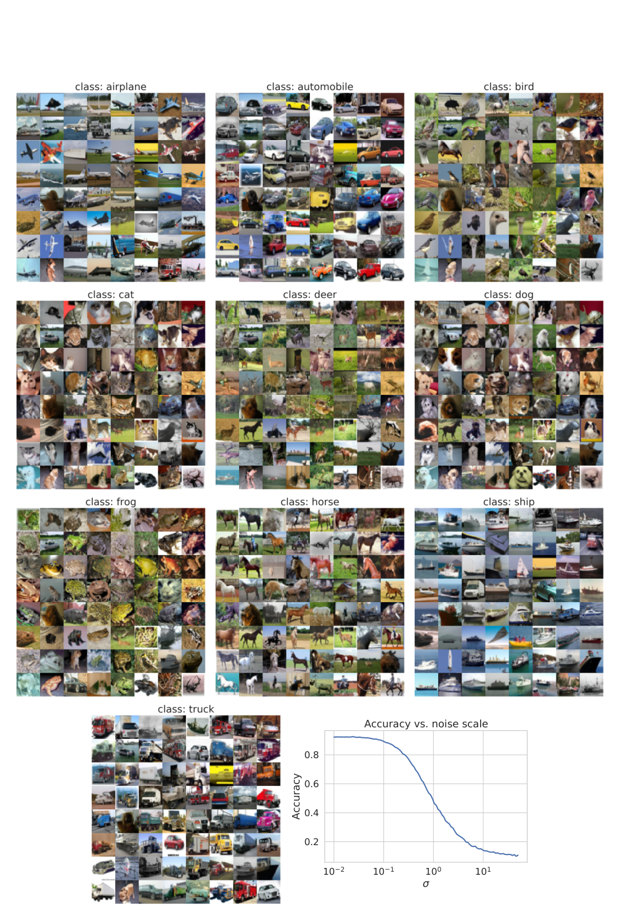

**图 13：** 使用 PC 求解条件逆时间 SDE，生成类别条件图像。
曲线展示噪声条件分类器在不同噪声尺度上的准确率。
图中文字：准确率与噪声尺度；准确率。

### I.2 缺失值填补

填补是条件采样的特例。
分别用 $\Omega(x)$ 和 $\bar\Omega(x)$ 表示 $x$ 的已知和未知维度，用 $f_{\bar\Omega}(\cdot,t)$ 和 $G_{\bar\Omega}(\cdot,t)$ 表示限制在未知维度上的 $f(\cdot,t)$ 和 $G(\cdot,t)$。

> **阅读注释 49｜填补中的已知维度和未知维度**
>
> 以一张中间被遮住的图片为例，$\Omega(x)$ 取出可见像素，$\bar\Omega(x)$ 取出被遮挡像素，$z(t)$ 表示正在生成的未知部分。目标是已知可见像素后，对其余像素进行条件采样；相同可见区域可能对应多个合理完整图像。
>
> 在噪声时刻 $t$，已知部分也要按对应正向核加噪，再与未知部分拼接送入得分网络，才能与网络训练时的噪声水平匹配。算法并非在高噪声阶段一直把干净可见像素直接拼进去。

对于 VE/VP SDE，漂移系数 $f(\cdot,t)$ 是逐元素的，扩散系数 $G(\cdot,t)$ 是对角矩阵。
当 $f(\cdot,t)$ 是逐元素函数时，$f_{\bar\Omega}(\cdot,t)$ 表示仅作用于未知维度的相同逐元素函数。
当 $G(\cdot,t)$ 是对角矩阵时，$G_{\bar\Omega}(\cdot,t)$ 表示限制在未知维度上的子矩阵。

填补的目标是从 $p(\bar\Omega(x(0))\mid\Omega(x(0))=y)$ 采样。
定义新扩散过程 $z(t)=\bar\Omega(x(t))$，注意其 SDE 可写为：

$$dz=f_{\bar\Omega}(z,t)\,dt+G_{\bar\Omega}(z,t)\,dw.$$

以 $\Omega(x(0))=y$ 为条件的逆时间 SDE 为：

$$\begin{aligned}
dz=\{&f_{\bar\Omega}(z,t)-\nabla\cdot[G_{\bar\Omega}(z,t)G_{\bar\Omega}(z,t)^\top]\\
&-G_{\bar\Omega}(z,t)G_{\bar\Omega}(z,t)^\top\nabla_z\log p_t(z\mid\Omega(x(0))=y)\}\,dt+G_{\bar\Omega}(z,t)\,d\bar w.
\end{aligned}$$

> **译注（原文记号问题）：** 原 PDF 在上述逆时间 SDE 中写作 $\Omega(z(0))=y$，但 $z$ 已定义为仅包含未知维度；这里按前后文的条件统一为 $\Omega(x(0))=y$。

虽然 $p_t(z(t)\mid\Omega(x(0))=y)$ 一般难以处理，但可以近似。
令 $A$ 表示事件 $\Omega(x(0))=y$。
有：

$$\begin{aligned}
p_t(z(t)\mid\Omega(x(0))=y)&=p_t(z(t)\mid A)\\
&=\int p_t(z(t)\mid\Omega(x(t)),A)p_t(\Omega(x(t))\mid A)\,d\Omega(x(t))\\
&=\mathbb E_{p_t(\Omega(x(t))\mid A)}[p_t(z(t)\mid\Omega(x(t)),A)]\\
&\approx\mathbb E_{p_t(\Omega(x(t))\mid A)}[p_t(z(t)\mid\Omega(x(t)))]\\
&\approx p_t(z(t)\mid\hat\Omega(x(t))).
\end{aligned}$$

其中 $\hat\Omega(x(t))$ 是来自 $p_t(\Omega(x(t))\mid A)$ 的随机样本，该分布通常易于处理。

> **阅读注释 50｜填补推导中的两个近似分别做了什么**
>
> 第一个近似是：已知时刻 $t$ 的带噪可见部分后，暂时忽略最初干净观测 $A$ 对未知部分的额外影响；第二个近似是用一份随机的带噪已知部分，替代对所有可能已知部分的混合积分。这样才能利用已训练的无条件得分模型。
>
> 这些近似使计算容易，但一般不是精确的后验采样。尤其“混合密度的对数梯度”不能通常直接等同于“各分量得分的普通平均”；文中的单样本替代应按近似算法理解。

因此：

$$\begin{aligned}
\nabla_z\log p_t(z(t)\mid\Omega(x(0))=y)&\approx\nabla_z\log p_t(z(t)\mid\hat\Omega(x(t)))\\
&=\nabla_z\log p_t([z(t);\hat\Omega(x(t))]).
\end{aligned}$$

其中 $[z(t);\hat\Omega(x(t))]$ 表示一个向量 $u(t)$，满足 $\Omega(u(t))=\hat\Omega(x(t))$、$\bar\Omega(u(t))=z(t)$；等式成立是因为：

$$\begin{aligned}
\nabla_z\log p_t([z(t);\hat\Omega(x(t))])
&=\nabla_z\log p_t(z(t)\mid\hat\Omega(x(t)))+\nabla_z\log p(\hat\Omega(x(t)))\\
&=\nabla_z\log p_t(z(t)\mid\hat\Omega(x(t))).
\end{aligned}$$

图 14 和图 15 提供更多修补结果。

### I.3 着色

着色是填补的特例，只是已知数据维度彼此耦合。
可以用正交线性变换，将灰度图映射到另一空间中的单独通道，使这些数据维度解耦；随后进行填补，补全其他通道，再将所有通道变换回原始图像空间。
用于解耦颜色通道的正交矩阵为：

$$\begin{pmatrix}0.577&-0.816&0\\0.577&0.408&0.707\\0.577&0.408&-0.707\end{pmatrix}.$$

由于变换都是正交矩阵，标准维纳过程 $w(t)$ 在变换空间中仍是标准维纳过程，因此可以构造 SDE，并使用附录 I.2 的相同填补方法。

> **阅读注释 51｜着色为什么可以转化为填补**
>
> 该正交变换把 RGB 的平均亮度方向与两个颜色差异方向分开。论文采用的灰度约束对应其中的亮度方向；知道灰度后，可以固定这个方向，再生成两个未知颜色方向，最后变换回 RGB。实际若采用不同灰度权重，需要相应调整变换和约束。
>
> 若 $Q$ 是正交矩阵，标准高斯噪声经变换后的协方差为 $QIQ^\top=I$，所以仍是标准高斯；布朗运动也有同样的旋转不变性。转换后的得分亦应按链式法则变换：若 $u=Qx$，则 $s_u(u,t)=Q s_x(Q^\top u,t)$。

图 16 和图 17 提供更多着色结果。

### I.4 求解一般逆问题

假设有两个随机变量 $x$ 和 $y$，并且知道从 $x$ 生成 $y$ 的正向过程，由 $p(y\mid x)$ 给出。
逆问题是从 $y$ 获得 $x$，即从 $p(x\mid y)$ 生成样本。
原则上，可以估计先验分布 $p(x)$，并使用贝叶斯法则获得 $p(x\mid y)$：$p(x\mid y)=p(x)p(y\mid x)/p(y)$。
但在实践中，无论估计先验还是执行贝叶斯推断，都并不容易。

借助式（48），基于得分的生成模型提供了一种求解逆问题的方法。
假设有一个用 SDE 扰动 $x$ 所产生的扩散过程 $\{x(t)\}_{t=0}^T$，以及一个训练来近似 $\nabla_x\log p_t(x(t))$ 的随时间变化得分模型 $s_{\theta^*}(x(t),t)$。
一旦得到 $\nabla_x\log p_t(x(t)\mid y)$ 的估计，就可以模拟式（48）的逆时间 SDE，从 $p_0(x(0)\mid y)=p(x\mid y)$ 采样。
为获得这一估计，首先观察到：

$$\nabla_x\log p_t(x(t)\mid y)=\nabla_x\log\int p_t(x(t)\mid y(t),y)p(y(t)\mid y)\,dy(t),$$

其中 $y(t)$ 由 $x(t)$ 和正向过程 $p(y(t)\mid x(t))$ 定义。
现在假定两个条件。

- $p(y(t)\mid y)$ 易于处理。通常可以通过正向过程与 SDE 的相互作用推导这一分布，例如图像填补和着色的情况。
- $p_t(x(t)\mid y(t),y)\approx p_t(x(t)\mid y(t))$。当 $t$ 较小时，$y(t)$ 与 $y$ 几乎相同，因此近似成立。当 $t$ 较大时，$y$ 在马尔可夫链中距离 $x(t)$ 更远，因此对 $x(t)$ 的影响更小。而且，大 $t$ 处的近似误差对最终样本的影响较小，因为它用于采样过程的早期。

给定这两个假设，有：

$$\begin{aligned}
\nabla_x\log p_t(x(t)\mid y)&\approx\nabla_x\log\int p_t(x(t)\mid y(t))p(y(t)\mid y)\,dy(t)\\
&\approx\nabla_x\log p_t(x(t)\mid\hat y(t))\\
&=\nabla_x\log p_t(x(t))+\nabla_x\log p_t(\hat y(t)\mid x(t))\\
&\approx s_{\theta^*}(x(t),t)+\nabla_x\log p_t(\hat y(t)\mid x(t)).
\end{aligned}\tag{50}$$

> **阅读注释 52｜一般逆问题的条件梯度为何需要近似**
>
> 原始观测模型 $p(y\mid x_0)$ 已知，并不意味着带噪时刻的 $p_t(y\mid x_t)$ 也容易计算。噪声增加后，$x_t$ 与干净对象之间还隔着不确定性，不能直接把干净观测模型的梯度当成所有时刻的条件梯度。
>
> 本节先从易采样的 $p(y(t)\mid y)$ 生成一份带噪观测 $\hat y(t)$，再把后验得分近似为“无条件得分 + 带噪观测似然的梯度”。能否使用这一做法，取决于文中两个假设是否适合具体观测过程；它是一个近似逆问题框架，不是对任意观测都无需推导即可精确求解。


其中 $\hat y(t)$ 是来自 $p(y(t)\mid y)$ 的样本。
现在可以将式（50）代入式（48），求解所得逆时间 SDE，从 $p(x\mid y)$ 生成样本。

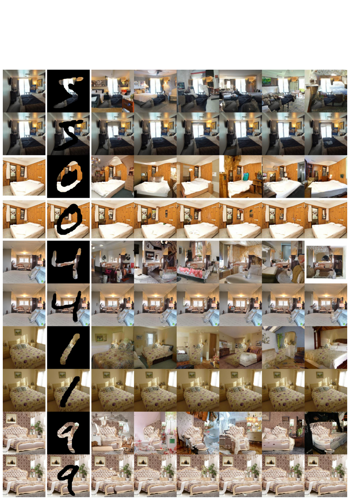

**图 14：** $256\times256$ 卧室图像的更多修补结果。

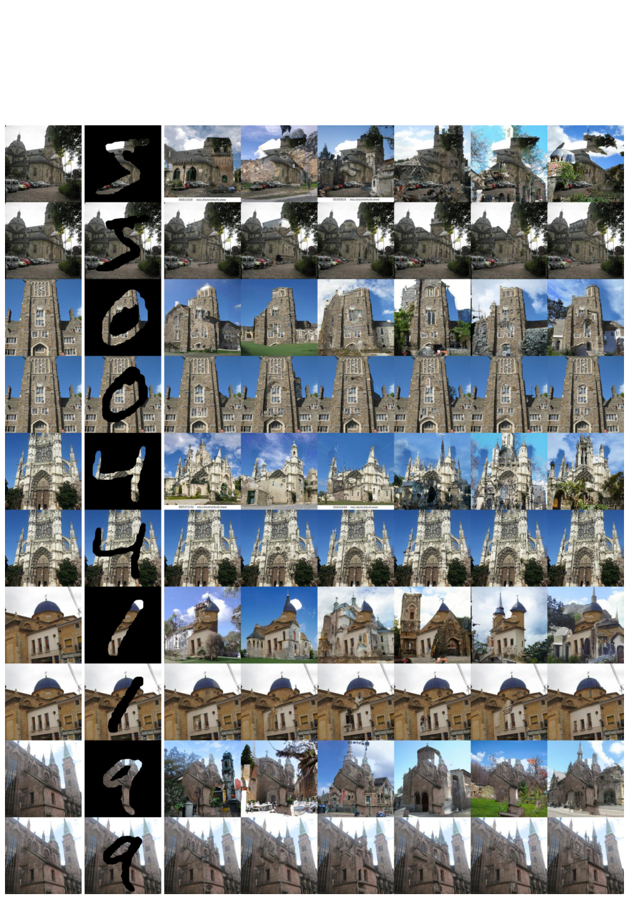

**图 15：** $256\times256$ 教堂图像的更多修补结果。

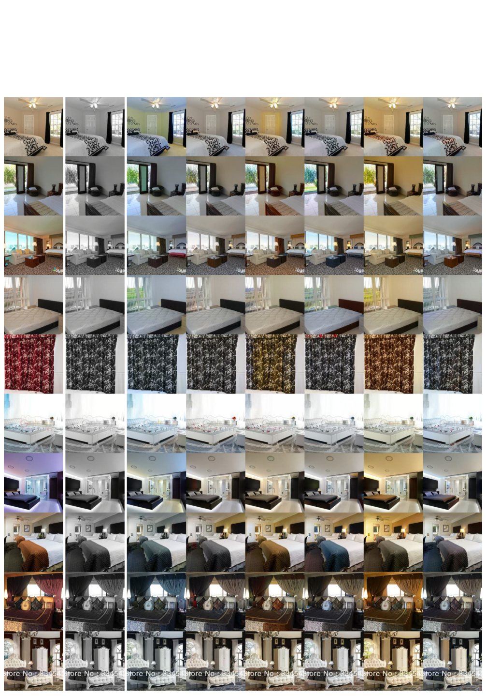

**图 16：** $256\times256$ 卧室图像的更多着色结果。

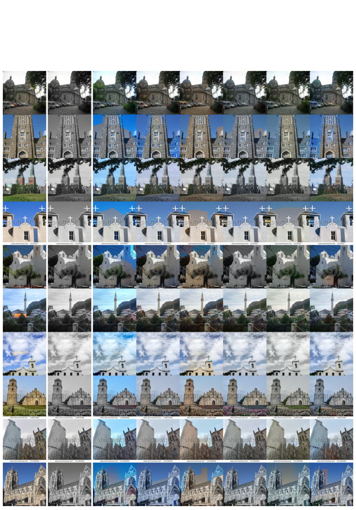

**图 17：** $256\times256$ 教堂图像的更多着色结果。
