# 通过估计数据分布的梯度进行生成建模

**原题：** Generative Modeling by Estimating Gradients of the Data Distribution  
**作者：** Yang Song、Stefano Ermon  
**机构：** 斯坦福大学（Stanford University）  
**作者邮箱：** yangsong@cs.stanford.edu；ermon@cs.stanford.edu  
**版本：** arXiv:1907.05600v3 [cs.LG]，2020 年 10 月 10 日；NeurIPS 2019，第 33 届神经信息处理系统大会，加拿大温哥华。  
**原文件：** `ScoreBasedModel.pdf`，共 23 页；正文第 1–9 页，致谢与参考文献第 10–13 页，附录第 14–23 页。

> 译稿按原文结构完整翻译正文、致谢、附录及图表说明，保留公式（1）–（6）、算法 1–2、图 1–17、表 1 与文献引用编号。参考文献保留英文著录，并附中文题名，便于检索。插图使用同目录 `ScoreBasedModel_译文图像/` 中已有的论文图像；图内英文标签保留，图注译为中文。
> 术语：score 译为“得分”，特指对数概率密度对输入的梯度；score matching 为“得分匹配”；denoising score matching 为“去噪得分匹配”；sliced score matching 为“切片得分匹配”；Langevin dynamics 为“朗之万动力学”；annealed Langevin dynamics 为“退火朗之万动力学”；ambient space 为“环境空间”；mixing 为“混合”；Noise Conditional Score Network（NCSN）为“噪声条件得分网络”。作者姓名、模型名、数据集名和代码标识保留原形式。
> 文中“最先进”等评价均指论文发表时的结果。原文的交叉引用、信噪比记号及实验参数存在几处疑点，译稿在相应位置用“译注”说明，并保留原文信息。

> **阅读说明：** 下文新增的“阅读注释”用于解释概念、公式和算法，属于辅助讲解。第一次阅读可先看摘要后的整体流程，再重点看第 2 节的得分定义、式（4）、第 4.2 节的式（5）和第 4.3 节的算法 1；式（1）、式（3）的计算细节及附录架构可放到第二遍。

## 摘要

我们提出一种新的生成模型：用得分匹配估计数据分布的梯度，再利用这些梯度通过朗之万动力学生成样本。
当数据位于低维流形上时，梯度可能无法良好定义，也难以估计；因此，我们用不同水平的高斯噪声扰动数据，并联合估计相应的得分，也就是所有噪声水平下扰动后数据分布的梯度向量场。
在采样方面，我们提出退火朗之万动力学：随着采样过程逐渐接近数据流形，使用与逐步降低的噪声水平相对应的梯度。
我们的框架允许灵活的模型架构，训练期间无需采样，也不需要采用对抗方法，而且提供了可用于有理论依据的模型比较的学习目标。
我们的模型在 MNIST、CelebA 和 CIFAR-10 数据集上生成了可与 GAN 媲美的样本，并在 CIFAR-10 上取得了 8.87 的新最先进 Inception 分数。
此外，我们通过图像修复实验表明，模型学到了有效的表示。

> **阅读注释：先把整篇论文的流程串起来。** 作者要解决的是“怎样从随机噪声生成一张像真实数据的图”。训练时，拿真实图像，加上已知强度的噪声，让网络学习当前图像应该往什么方向调整；生成时，从随机噪声出发，反复使用网络提供的方向，再配合随机扰动更新图像。先在大噪声水平下进行，再换到更小的噪声水平，直到得到清晰样本。
>
> **训练：** 真实图像 → 随机选择噪声强度并加噪 → 网络预测得分 → 计算误差、更新网络参数。
>
> **生成：** 随机噪声 → 大噪声水平下更新多次 → 降低噪声水平并继续更新 → 小噪声水平下完成采样。
>
> 训练得到的是一个“给出调整方向”的网络；一张新图像由采样算法反复调用这个网络产生。

## 1 引言

生成模型在机器学习中有许多应用。
举例来说，它们已被用于生成高保真图像[26, 6]、合成逼真的语音和音乐片段[58]、改善半监督学习的性能[28, 10]、检测对抗样本和其他异常数据[54]、进行模仿学习[22]，以及在强化学习中探索有前景的状态[41]。
近期进展主要由两类方法推动：基于似然的方法[17, 29, 11, 60]与生成对抗网络（GAN[15]）。
前者使用对数似然或适当的替代量作为训练目标，后者则通过对抗训练，最小化模型分布与数据分布之间的 $f$ 散度[40]或积分概率度量[2, 55]。

尽管基于似然的模型和 GAN 已取得巨大成功，它们仍存在一些内在局限。
例如，基于似然的模型要么必须采用专门架构来构建归一化的概率模型（如自回归模型、流模型），要么必须使用替代损失进行训练（如变分自编码器中的证据下界[29]、能量模型中的对比散度[21]）。
GAN 避开了基于似然模型的部分局限，但其对抗训练过程可能导致训练不稳定。
此外，GAN 的目标不适合用于评估和比较不同的 GAN 模型。
虽然生成建模还存在其他目标，例如噪声对比估计[19]和最小概率流[50]，但这些方法通常只在低维数据上表现良好。

本文探索一种新的生成建模原则：估计数据对数密度的（Stein）得分[33]，并利用该得分进行采样；得分就是对数密度函数在输入数据点处的梯度。
它是一个向量场，指向数据对数密度增长最快的方向。
我们用得分匹配[24]训练神经网络，从数据中学习这个向量场。
随后，我们用朗之万动力学生成样本，其近似工作方式是：沿着估计得到的得分向量场，把一个随机初始化的样本逐渐移动到高密度区域。
不过，这种方法面临两个主要挑战。
第一，如果数据分布的支撑集位于低维流形上——许多真实数据集通常被认为满足这一假设——那么得分在环境空间中将没有定义，得分匹配也无法提供一致的得分估计量。
第二，低数据密度区域（例如远离流形的区域）缺少训练数据，这会妨碍得分估计的准确性，并减慢朗之万动力学采样的混合速度。
由于朗之万动力学经常从数据分布的低密度区域初始化，这些区域中的不准确得分估计会对采样过程产生负面影响。
此外，在分布的不同模态之间转移需要穿过低密度区域，这也会使混合变得困难。

为应对这两个挑战，我们提出用不同强度的随机高斯噪声扰动数据。
加入随机噪声可以确保得到的分布不会塌缩到低维流形上。
较大的噪声水平会在原始、未经扰动的数据分布的低密度区域中产生样本，从而改善得分估计。
关键在于，我们训练一个以噪声水平为条件的单一得分网络，估计所有噪声强度下的得分。
随后，我们提出朗之万动力学的退火版本：先使用最高噪声水平对应的得分，再逐渐降低噪声水平，直到它足够小，使扰动后的分布与原始数据分布无法区分。
我们的采样策略受到模拟退火[30, 37]的启发；模拟退火能以启发式方式改善多模态目标上的优化。

我们的方法具有若干理想性质。
首先，对几乎所有得分网络参数化方式，我们的目标都可直接计算，无需特殊约束或架构；优化它时，训练期间不需要对抗训练、MCMC 采样或其他近似。
该目标还可用于在同一数据集上定量比较不同模型。
实验中，我们在 MNIST、CelebA[34]和 CIFAR-10[31]上展示了方法的有效性。
我们表明，生成样本的视觉效果可与现代基于似然的模型和 GAN 所生成的样本相媲美。
在 CIFAR-10 上，我们的模型为无条件生成模型取得了新的最先进 Inception 分数 8.87，并获得了具有竞争力的 FID 分数 25.32。
我们通过图像修复实验表明，模型学到了有意义的数据表示。

## 2 基于得分的生成建模

假设数据集由来自未知数据分布 $p_{\mathrm{data}}(\mathbf{x})$ 的独立同分布样本 $\{\mathbf{x}_i\in\mathbb{R}^D\}_{i=1}^N$ 构成。
我们将概率密度 $p(\mathbf{x})$ 的得分定义为 $\nabla_{\mathbf{x}}\log p(\mathbf{x})$。
得分网络 $s_\theta:\mathbb{R}^D\to\mathbb{R}^D$ 是一个由 $\theta$ 参数化的神经网络，我们将训练它来近似 $p_{\mathrm{data}}(\mathbf{x})$ 的得分。
生成建模的目标是利用数据集学习一个模型，从 $p_{\mathrm{data}}(\mathbf{x})$ 中生成新样本。
基于得分的生成建模框架包含两个组成部分：得分匹配和朗之万动力学。

> **阅读注释：先认清主要符号。** 一张图像可以看成由所有像素值组成的长向量；例如 $32\times32$ 的 RGB 图像有 $D=32\times32\times3=3072$ 个分量。
>
> | 符号 | 可以怎样理解 |
> | --- | --- |
> | $\mathbf{x}$ | 训练中的真实图像；具体含义随上下文变化 |
> | $\tilde{\mathbf{x}}$ | 加噪图像，或采样过程中当前正在更新的图像 |
> | $p_{\mathrm{data}}$ | 真实图像的分布；我们只有它的样本，不知道它的公式 |
> | $q_\sigma$ | 真实图像加入标准差为 $\sigma$ 的高斯噪声后形成的分布 |
> | $s_\theta(\mathbf{x},\sigma)$ | 神经网络输出的得分估计，每个像素分量都有一个对应的调整量 |
> | $\theta$ | 网络参数；训练时更新它，生成时固定它 |
> | $\nabla_{\mathbf{x}}$ | 对输入图像各分量求导；与训练时对参数求导的 $\nabla_\theta$ 不同 |
> | $\sigma_i$、$L$ | 第 $i$ 个噪声水平、噪声水平总数；本文按从大到小排列 |
> | $\alpha_i$、$T$ | 当前噪声水平下的采样步长、更新次数 |
>
> 文中的 $\mathbb{E}$ 表示“按指定分布取平均”，$\|\mathbf{a}\|_2^2$ 表示向量各分量平方后求和，$\mathcal{N}(\mathbf{0},\mathbf{I})$ 表示各分量独立的标准高斯噪声。

> **阅读注释：得分是一组方向和大小。** 对图像而言，$\nabla_{\mathbf{x}}\log p(\mathbf{x})$ 的每个分量告诉你：稍微增大相应像素值，会使对数密度上升还是下降，以及变化有多快。因此网络输出与图像同形状的向量，而非一个评价图像好坏的标量。
>
> 看一个一维例子：若 $p(x)=\mathcal{N}(\mu,\tau^2)$，则 $\frac{d}{dx}\log p(x)=-(x-\mu)/\tau^2$。取 $\mu=0,\tau=1$，当 $x=2$ 时，得分为 $-2$，提示向左移动；当 $x=-2$ 时，得分为 $2$，提示向右移动。图像情况下，同样的思想同时作用于很多像素，并考虑它们之间的关联。这里的 $p(x)$ 是概率密度，某个精确点的概率与密度是不同概念。

### 2.1 用于得分估计的得分匹配

得分匹配[24]最初用于根据未知数据分布的独立同分布样本，学习未归一化的统计模型。
遵循文献[53]，我们将它用于得分估计。
利用得分匹配，我们可以直接训练得分网络 $s_\theta(\mathbf{x})$ 来估计 $\nabla_{\mathbf{x}}\log p_{\mathrm{data}}(\mathbf{x})$，而无需先训练一个模型来估计 $p_{\mathrm{data}}(\mathbf{x})$。
与得分匹配的典型用法不同，我们选择不以能量模型的梯度作为得分网络，以避免高阶梯度带来的额外计算。

> **阅读注释：为什么学习梯度能省去归一化？** 如果概率密度写成 $p(\mathbf{x})=\tilde p(\mathbf{x})/Z$，归一化常数 $Z$ 可能很难计算。但是 $\nabla_{\mathbf{x}}\log p=\nabla_{\mathbf{x}}\log\tilde p-\nabla_{\mathbf{x}}\log Z=\nabla_{\mathbf{x}}\log\tilde p$，因为 $Z$ 不依赖输入 $\mathbf{x}$。学习得分可以绕过计算 $Z$。本文进一步让神经网络直接输出这个向量；“无需先估计密度”指的是这个学习过程，网络并不直接给出可计算的图像似然。
该目标最小化

$$
\frac12\mathbb{E}_{p_{\mathrm{data}}}\left[\left\|s_\theta(\mathbf{x})-\nabla_{\mathbf{x}}\log p_{\mathrm{data}}(\mathbf{x})\right\|_2^2\right],
$$

可以证明，在相差一个常数的意义下，它等价于：

$$
\mathbb{E}_{p_{\mathrm{data}}(\mathbf{x})}\left[\operatorname{tr}\bigl(\nabla_{\mathbf{x}}s_\theta(\mathbf{x})\bigr)+\frac12\|s_\theta(\mathbf{x})\|_2^2\right].
\tag{1}
$$

其中，$\nabla_{\mathbf{x}}s_\theta(\mathbf{x})$ 表示 $s_\theta(\mathbf{x})$ 的雅可比矩阵。
如文献[53]所示，在某些正则条件下，式（3）的最小化解（记为 $s_{\theta^*}(\mathbf{x})$）几乎必然满足 $s_{\theta^*}(\mathbf{x})=\nabla_{\mathbf{x}}\log p_{\mathrm{data}}(\mathbf{x})$。

> **译注：** 上一句原文确实引用了式（3）。式（3）是后文的切片得分匹配目标；本段当前展示的普通得分匹配目标编号为式（1）。这里保留原文的引用编号，以便核对。

> **阅读注释：式（1）解决了“没有真实得分标签”的问题。** 前面的平方误差很好理解：让网络输出接近真实得分。但真实分布未知，我们算不出这个标签。通过展开平方误差，并在适当边界条件下进行分部积分，可以把含真实得分的项改写成网络自身的导数；剩余差异是与 $\theta$ 无关的常数，所以两种目标有相同的最小化解。
>
> $\operatorname{tr}(\nabla_{\mathbf{x}}s_\theta)=\sum_{j=1}^D\partial s_{\theta,j}/\partial x_j$ 是雅可比矩阵对角元素之和，也称向量场的散度。它需要输入方向的导数，因此高维时计算较贵。式（1）的损失可能为负，这是改写后的目标允许的，不能按普通平方误差“必须非负”来判断。

实际中，式（1）中对 $p_{\mathrm{data}}(\mathbf{x})$ 的期望可以利用数据样本快速估计。
但是，由于需要计算 $\operatorname{tr}(\nabla_{\mathbf{x}}s_\theta(\mathbf{x}))$，得分匹配难以扩展到深度网络和高维数据[53]。
下面讨论两种常用的大规模得分匹配方法。

**去噪得分匹配。**
去噪得分匹配[61]是得分匹配的一种变体，可以完全避开 $\operatorname{tr}(\nabla_{\mathbf{x}}s_\theta(\mathbf{x}))$ 的计算。
它首先使用预先指定的噪声分布 $q_\sigma(\tilde{\mathbf{x}}\mid\mathbf{x})$ 扰动数据点 $\mathbf{x}$，随后用得分匹配估计扰动后数据分布的得分，其中

$$
q_\sigma(\tilde{\mathbf{x}})\triangleq\int q_\sigma(\tilde{\mathbf{x}}\mid\mathbf{x})p_{\mathrm{data}}(\mathbf{x})\,d\mathbf{x}.
$$

已经证明，该目标等价于：

$$
\frac12\mathbb{E}_{q_\sigma(\tilde{\mathbf{x}}\mid\mathbf{x})p_{\mathrm{data}}(\mathbf{x})}\left[\left\|s_\theta(\tilde{\mathbf{x}})-\nabla_{\tilde{\mathbf{x}}}\log q_\sigma(\tilde{\mathbf{x}}\mid\mathbf{x})\right\|_2^2\right].
\tag{2}
$$

如文献[61]所示，最小化式（2）的最优得分网络（记为 $s_{\theta^*}(\mathbf{x})$）几乎必然满足 $s_{\theta^*}(\mathbf{x})=\nabla_{\mathbf{x}}\log q_\sigma(\mathbf{x})$。
不过，只有噪声足够小、使得 $q_\sigma(\mathbf{x})\approx p_{\mathrm{data}}(\mathbf{x})$ 时，才有 $s_{\theta^*}(\mathbf{x})=\nabla_{\mathbf{x}}\log q_\sigma(\mathbf{x})\approx\nabla_{\mathbf{x}}\log p_{\mathrm{data}}(\mathbf{x})$。

> **阅读注释：式（2）里的两个 $q_\sigma$ 很容易混淆。** $q_\sigma(\tilde{\mathbf{x}}\mid\mathbf{x})$ 是“给定这张干净图像，怎样加噪”的分布，由我们自己设定，因而其得分可直接计算。$q_\sigma(\tilde{\mathbf{x}})$ 是“对所有真实图像加噪后，总体得到什么分布”，它仍然未知。训练拿前者的得分作标签，最终学到后者的得分；第 4.2 节会解释为什么平方误差训练能完成这一步。去噪得分匹配这个名字也由此而来。

**切片得分匹配。**
切片得分匹配[53]使用随机投影近似得分匹配中的 $\operatorname{tr}(\nabla_{\mathbf{x}}s_\theta(\mathbf{x}))$。
其目标为：

$$
\mathbb{E}_{p_{\mathbf{v}}}\mathbb{E}_{p_{\mathrm{data}}}\left[\mathbf{v}^{\mathsf T}\nabla_{\mathbf{x}}s_\theta(\mathbf{x})\mathbf{v}+\frac12\|s_\theta(\mathbf{x})\|_2^2\right].
\tag{3}
$$

其中，$p_{\mathbf{v}}$ 是一个简单的随机向量分布，例如多元标准正态分布。
如文献[53]所示，$\mathbf{v}^{\mathsf T}\nabla_{\mathbf{x}}s_\theta(\mathbf{x})\mathbf{v}$ 可通过前向模式自动微分高效计算。
去噪得分匹配估计的是扰动后数据的得分，而切片得分匹配提供的是原始、未经扰动的数据分布的得分估计；不过，由于前向模式自动微分，它需要约四倍的计算量。

> **阅读注释：式（3）的随机向量在做什么？** 设雅可比矩阵为 $J$。如果随机向量 $\mathbf{v}$ 满足 $\mathbb{E}[\mathbf{v}\mathbf{v}^{\mathsf T}]=\mathbf{I}$，那么 $\mathbb{E}[\mathbf{v}^{\mathsf T}J\mathbf{v}]=\operatorname{tr}(J)$。也就是说，可以通过随机方向上的计算来估计矩阵的迹，避免显式计算整个雅可比矩阵。先记住它是式（1）的另一种计算办法即可；本文主要实验采用的是式（2）对应的去噪得分匹配。

### 2.2 用朗之万动力学采样

朗之万动力学仅使用得分函数 $\nabla_{\mathbf{x}}\log p(\mathbf{x})$，就可以从概率密度 $p(\mathbf{x})$ 中产生样本。
给定固定步长 $\epsilon>0$，以及初值 $\tilde{\mathbf{x}}_0\sim\pi(\mathbf{x})$（其中 $\pi$ 为先验分布），朗之万方法递归计算：

$$
\tilde{\mathbf{x}}_t=\tilde{\mathbf{x}}_{t-1}+\frac\epsilon2\nabla_{\mathbf{x}}\log p(\tilde{\mathbf{x}}_{t-1})+\sqrt\epsilon\,\mathbf{z}_t,
\tag{4}
$$

其中 $\mathbf{z}_t\sim\mathcal{N}(\mathbf{0},\mathbf{I})$。

> **阅读注释：把式（4）拆成三部分。** 新图像 = 当前图像 + 得分引导的移动 + 随机扰动。$\frac\epsilon2\nabla\log p$ 把当前位置推向密度增大的方向；$\sqrt\epsilon\mathbf{z}_t$ 让过程保留随机性，使它探索分布。
>
> 如果只顺着得分移动，就更像是在寻找密度峰值；生成模型希望抽取符合整个分布的多样样本，因此还需要随机项。沿用标准正态的例子，更新为 $\tilde x_t=(1-\epsilon/2)\tilde x_{t-1}+\sqrt\epsilon z_t$：第一项拉向零，第二项带来随机波动，两者共同作用。图像生成时，这种“拉回＋扰动”由网络在高维空间中实现。有限步长和有限步数产生的是近似采样。
当 $\epsilon\to0$ 且 $T\to\infty$ 时，$\tilde{\mathbf{x}}_T$ 的分布等于 $p(\mathbf{x})$；在某些正则条件下，此时 $\tilde{\mathbf{x}}_T$ 成为来自 $p(\mathbf{x})$ 的精确样本[62]。
当 $\epsilon>0$ 且 $T<\infty$ 时，需要 Metropolis–Hastings 更新来修正式（4）的误差，但实际中通常可以忽略它[9, 12, 39]。
本文假定，当 $\epsilon$ 较小且 $T$ 较大时，这个误差可以忽略。

注意，用式（4）采样只需要得分函数 $\nabla_{\mathbf{x}}\log p(\mathbf{x})$。
因此，为了获得来自 $p_{\mathrm{data}}(\mathbf{x})$ 的样本，我们可以先训练得分网络，使 $s_\theta(\mathbf{x})\approx\nabla_{\mathbf{x}}\log p_{\mathrm{data}}(\mathbf{x})$，再用 $s_\theta(\mathbf{x})$ 通过朗之万动力学近似获得样本。
这就是我们基于得分的生成建模框架的核心思想。

## 3 基于得分的生成建模面临的挑战

本节更仔细地分析基于得分的生成建模思想。
我们认为，有两个主要障碍阻止我们直接、朴素地应用这一思想。

### 3.1 流形假设

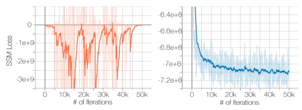

**图 1：** 左：切片得分匹配（SSM）损失随迭代次数的变化，未向数据加入噪声。右：相同实验，但数据受到 $\mathcal{N}(0,0.0001)$ 噪声扰动。

流形假设指出，真实世界的数据往往集中在嵌入高维空间（也称环境空间）的低维流形上。
这一假设在许多数据集上得到了经验支持，并已成为流形学习的基础[3, 47]。
在流形假设下，基于得分的生成模型面临两个关键困难。
首先，得分 $\nabla_{\mathbf{x}}\log p_{\mathrm{data}}(\mathbf{x})$ 是在环境空间中求取的梯度，因此当 $\mathbf{x}$ 被限制在低维流形上时，它没有定义。
其次，只有数据分布的支撑集是整个空间时，得分匹配目标式（1）才提供一致的得分估计量（参见文献[24]的定理 2）；当数据位于低维流形上时，该估计将不再一致。

> **阅读注释：低维流形可以想成高维空间里的一条薄曲面。** 用二维平面中的一条曲线作类比：数据只出现在曲线上，曲线外没有数据。它可以有“沿曲线的分布”，却未必有普通的“整个平面上的概率密度”，所以也无法直接在整个平面上计算本文需要的对数密度梯度。自然图像的像素空间很大，但像真实照片的组合只占其中很小的一部分，这就是这里的直觉。
>
> 给曲线上的每个点加高斯噪声，相当于在它周围铺开一小团概率，得到一个在整个平面上平滑分布的密度。即使很小的非零高斯噪声也能解决这种定义上的困难；但远处仍可能几乎没有样本，所以仅有小噪声还不足以解决下一节的问题。图 1 中 $0.0001$ 是方差，对应标准差 $0.01$。

流形假设对得分估计的负面影响可以从图 1 中清楚看到；在该实验中，我们训练一个 ResNet（详见附录 B.1），估计 CIFAR-10 的数据得分。
为实现快速训练及忠实的数据得分估计，我们使用切片得分匹配目标式（3）。
如图 1 左侧所示，在原始 CIFAR-10 图像上训练时，切片得分匹配损失先下降，随后不规则地波动。
相比之下，如果用很小的高斯噪声扰动数据，使扰动后的数据分布在 $\mathbb{R}^D$ 上具有完整支撑集，损失曲线就会收敛（右图）。
注意，对于像素值位于 $[0,1]$ 的图像，我们施加的高斯噪声 $\mathcal{N}(0,0.0001)$ 非常小，人眼几乎无法察觉。

### 3.2 低数据密度区域

低密度区域中数据稀缺，会同时给得分匹配的得分估计和朗之万动力学的 MCMC 采样带来困难。

#### 3.2.1 得分匹配中的不准确得分估计

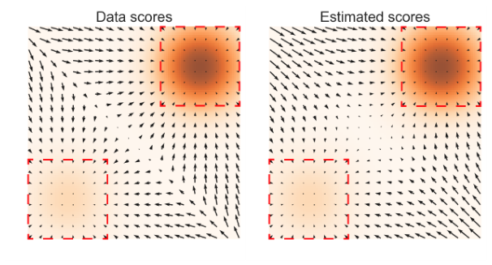

**图 2：** 左：$\nabla_{\mathbf{x}}\log p_{\mathrm{data}}(\mathbf{x})$；右：$s_\theta(\mathbf{x})$。数据密度 $p_{\mathrm{data}}(\mathbf{x})$ 以橙色映射表示，颜色越深，密度越高。红色矩形标出了 $\nabla_{\mathbf{x}}\log p_{\mathrm{data}}(\mathbf{x})\approx s_\theta(\mathbf{x})$ 的区域。

在数据密度较低的区域，由于缺少数据样本，得分匹配可能没有足够的依据来准确估计得分函数。
为理解这一点，回顾第 2.1 节：得分匹配最小化得分估计的期望平方误差，即 $\frac12\mathbb{E}_{p_{\mathrm{data}}}[\|s_\theta(\mathbf{x})-\nabla_{\mathbf{x}}\log p_{\mathrm{data}}(\mathbf{x})\|_2^2]$。
实际中，对数据分布的期望总是用独立同分布样本 $\{\mathbf{x}_i\}_{i=1}^N\overset{\mathrm{i.i.d.}}{\sim}p_{\mathrm{data}}(\mathbf{x})$ 来估计。
考虑任意满足 $p_{\mathrm{data}}(R)\approx0$ 的区域 $R\subset\mathbb{R}^D$。
大多数情况下，$\{\mathbf{x}_i\}_{i=1}^N\cap R=\varnothing$，得分匹配将没有足够的数据样本来准确估计 $\mathbf{x}\in R$ 时的 $\nabla_{\mathbf{x}}\log p_{\mathrm{data}}(\mathbf{x})$。

为展示其负面影响，我们在图 2 中给出了一个示例实验的结果（详见附录 B.1）：使用切片得分匹配估计以下高斯混合分布的得分：

$$
p_{\mathrm{data}}=\frac15\mathcal{N}((-5,-5),\mathbf{I})+\frac45\mathcal{N}((5,5),\mathbf{I}).
$$

图中表明，只有紧邻 $p_{\mathrm{data}}$ 各个模态、数据密度较高的区域，得分估计才可靠。

> **阅读注释：会修正“几乎真实的图”，不等于会修正纯噪声。** 如果训练只见过真实图像附近的输入，网络在这些地方可能很准确，但对远离数据的随机噪声未必知道该往哪里走。而生成恰好从这种输入开始。图 2 的含义是：损失在常见区域表现好，不能保证整个空间的方向都可靠。大噪声训练提供了更远处的输入，从而帮助网络学会生成过程的早期调整。

#### 3.2.2 朗之万动力学的缓慢混合

当数据分布的两个模态被低密度区域分隔开时，朗之万动力学无法在合理时间内正确恢复这两个模态的相对权重，因此可能无法收敛到真实分布。
我们的分析主要受到文献[63]的启发；该文献在用得分匹配进行密度估计的背景下分析了同一现象。

考虑混合分布 $p_{\mathrm{data}}(\mathbf{x})=\pi p_1(\mathbf{x})+(1-\pi)p_2(\mathbf{x})$，其中 $p_1$ 和 $p_2$ 为支撑集互不相交的归一化分布，且 $\pi\in(0,1)$。
在 $p_1$ 的支撑集内，$\nabla_{\mathbf{x}}\log p_{\mathrm{data}}(\mathbf{x})=\nabla_{\mathbf{x}}(\log\pi+\log p_1(\mathbf{x}))=\nabla_{\mathbf{x}}\log p_1(\mathbf{x})$；在 $p_2$ 的支撑集内，$\nabla_{\mathbf{x}}\log p_{\mathrm{data}}(\mathbf{x})=\nabla_{\mathbf{x}}(\log(1-\pi)+\log p_2(\mathbf{x}))=\nabla_{\mathbf{x}}\log p_2(\mathbf{x})$。
两种情况下，得分 $\nabla_{\mathbf{x}}\log p_{\mathrm{data}}(\mathbf{x})$ 都不依赖于 $\pi$。
由于朗之万动力学使用 $\nabla_{\mathbf{x}}\log p_{\mathrm{data}}(\mathbf{x})$ 从 $p_{\mathrm{data}}(\mathbf{x})$ 中采样，获得的样本也不会依赖于 $\pi$。
实际中，当不同模态的支撑集近似互不相交时，这一分析也成立：它们可能共享同一个支撑集，但彼此由低数据密度区域连接。
在这种情况下，朗之万动力学理论上可以产生正确样本，但可能需要非常小的步长和非常多的步数才能混合。

> **阅读注释：“模态”和“混合”分别是什么？** 模态指分布中的密度峰或高密度簇，这里就是图 3 中的两团点。“混合好”指采样过程能充分探索不同区域，减少对起点的依赖，并恢复分布应有的样本比例。若两团点的真实权重是 $1/5$ 和 $4/5$，只在两团各生成一半样本，位置看着正确，分布仍然不对。
>
> 文中的 $\pi$ 是模态权重。支撑集完全分开时，每团内部的得分会消去 $\log\pi$ 这种常数，因此局部方向无法告诉你两团应各占多少。支撑集有少量重叠时，比例信息仍存在于连接区域，但过程可能很难走到那里。大噪声会扩大两团的重叠，让跨区域探索更容易。

为验证这一分析，我们对第 3.2.1 节中的同一高斯混合分布测试朗之万动力学采样，并在图 3 中给出结果。
使用朗之万动力学采样时，我们采用真实得分。
比较图 3(b) 和图 3(a)，可以明显看出，朗之万动力学样本在两个模态之间的相对密度不正确，这与我们的分析一致。

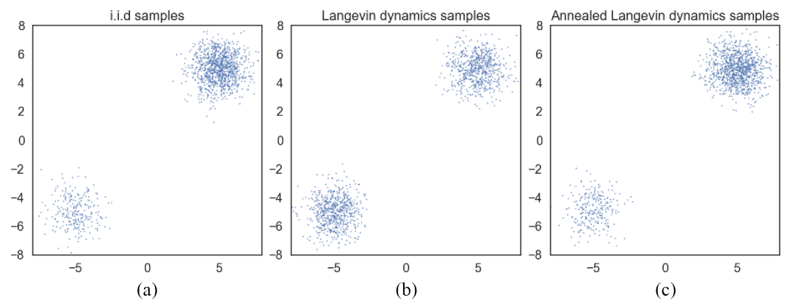

**图 3：** 用不同方法从高斯混合分布中生成的样本。(a) 精确采样。(b) 使用精确得分的朗之万动力学采样。(c) 使用精确得分的退火朗之万动力学采样。普通朗之万动力学明显错误地估计了两个模态的相对权重，而退火朗之万动力学忠实地恢复了这些相对权重。

## 4 噪声条件得分网络：学习与推断

我们观察到，用随机高斯噪声扰动数据，使数据分布更适合基于得分的生成建模。
首先，由于高斯噪声分布的支撑集是整个空间，扰动后的数据不会被限制在低维流形上，从而消除了流形假设引起的困难，使得分估计具有良好定义。
其次，较大的高斯噪声可以填充原始、未经扰动的数据分布中的低密度区域，因此得分匹配可以获得更多训练信号来改善得分估计。
此外，使用多个噪声水平，我们可以获得一系列收敛到真实数据分布的噪声扰动分布。
借鉴模拟退火[30]和退火重要性采样[37]的思想，利用这些中间分布，我们可以提高朗之万动力学在多模态分布上的混合速度。

基于这一直觉，我们提出通过以下方式改善基于得分的生成建模：1）使用不同水平的噪声扰动数据；2）训练一个条件得分网络，同时估计所有噪声水平对应的得分。
训练结束后，使用朗之万动力学生成样本时，我们先使用大噪声对应的得分，再逐渐降低噪声水平。
这有助于将大噪声水平带来的优势平滑地传递到低噪声水平；在低噪声水平下，扰动后的数据与原始数据几乎无法区分。
下面我们详细介绍方法，包括得分网络的架构、训练目标，以及朗之万动力学的退火调度。

### 4.1 噪声条件得分网络

令 $\{\sigma_i\}_{i=1}^L$ 为一个满足 $\sigma_1/\sigma_2=\cdots=\sigma_{L-1}/\sigma_L>1$ 的正等比数列。
令

$$
q_\sigma(\mathbf{x})\triangleq\int p_{\mathrm{data}}(\mathbf{t})\mathcal{N}(\mathbf{x}\mid\mathbf{t},\sigma^2\mathbf{I})\,d\mathbf{t}
$$

表示扰动后的数据分布。
我们选择噪声水平 $\{\sigma_i\}_{i=1}^L$，使 $\sigma_1$ 足够大，以缓解第 3 节讨论的困难，并使 $\sigma_L$ 足够小，以尽量减轻对数据的影响。
我们希望训练一个条件得分网络，联合估计所有扰动后数据分布的得分，即对任意 $\sigma\in\{\sigma_i\}_{i=1}^L$，都有 $s_\theta(\mathbf{x},\sigma)\approx\nabla_{\mathbf{x}}\log q_\sigma(\mathbf{x})$。
注意，当 $\mathbf{x}\in\mathbb{R}^D$ 时，$s_\theta(\mathbf{x},\sigma)\in\mathbb{R}^D$。
我们将 $s_\theta(\mathbf{x},\sigma)$ 称为噪声条件得分网络（NCSN）。

> **阅读注释：为什么网络还要输入 $\sigma$？** 同一个像素向量，在大噪声分布和小噪声分布中可能需要不同的调整方向。告知网络噪声水平，才能让它分别估计各个 $q_\sigma$ 的得分。这里的“条件”指噪声强度，未提供图像类别标签，所以 NCSN 仍可用于无条件图像生成。
>
> 等比数列表示每次按相同比例降低噪声。例如论文的 10 个水平从 $1$ 降到 $0.01$，相邻水平的比值约为 $1.67$。这些 $q_\sigma$ 均由真实图像直接加入相应噪声定义；理解训练公式时，无需先构造一条逐步加噪的长链。

与基于似然的生成模型和 GAN 类似，模型架构设计对生成高质量样本起着重要作用。
本文主要关注适用于图像生成的架构，将其他领域的架构设计留作未来工作。
由于噪声条件得分网络 $s_\theta(\mathbf{x},\sigma)$ 的输出形状与输入图像 $\mathbf{x}$ 相同，我们从成功的图像密集预测架构（例如语义分割模型）中汲取灵感。
实验中，我们的模型 $s_\theta(\mathbf{x},\sigma)$ 将 U-Net[46]的架构设计与膨胀／空洞卷积[64, 65, 8]结合起来；两者均已被证明在语义分割中非常成功。
此外，受到实例归一化在某些图像生成任务中优异表现的启发[57, 13, 23]，我们在得分网络中采用实例归一化，并使用条件实例归一化[13]的修改版本，将 $\sigma_i$ 作为条件引入网络。
更多架构细节见附录 A。

### 4.2 通过得分匹配学习 NCSN

切片得分匹配和去噪得分匹配都能训练 NCSN。
我们采用去噪得分匹配，因为它稍快一些，并且天然适合估计噪声扰动后数据分布的得分。
不过，我们强调，实验中切片得分匹配训练 NCSN 的效果也与去噪得分匹配一样好。
我们选择噪声分布 $q_\sigma(\tilde{\mathbf{x}}\mid\mathbf{x})=\mathcal{N}(\tilde{\mathbf{x}}\mid\mathbf{x},\sigma^2\mathbf{I})$，因此 $\nabla_{\tilde{\mathbf{x}}}\log q_\sigma(\tilde{\mathbf{x}}\mid\mathbf{x})=-(\tilde{\mathbf{x}}-\mathbf{x})/\sigma^2$。
对于给定的 $\sigma$，去噪得分匹配目标式（2）为：

$$
\ell(\theta;\sigma)\triangleq\frac12\mathbb{E}_{p_{\mathrm{data}}(\mathbf{x})}\mathbb{E}_{\tilde{\mathbf{x}}\sim\mathcal{N}(\mathbf{x},\sigma^2\mathbf{I})}\left[\left\|s_\theta(\tilde{\mathbf{x}},\sigma)+\frac{\tilde{\mathbf{x}}-\mathbf{x}}{\sigma^2}\right\|_2^2\right].
\tag{5}
$$

> **阅读注释：式（5）就是一个有已知标签的回归任务。** 把加噪过程写成 $\tilde{\mathbf{x}}=\mathbf{x}+\sigma\boldsymbol{\varepsilon}$，其中 $\boldsymbol{\varepsilon}\sim\mathcal{N}(\mathbf{0},\mathbf{I})$。训练标签为
>
> $$
> \mathbf{y}=-\frac{\tilde{\mathbf{x}}-\mathbf{x}}{\sigma^2}=-\frac{\boldsymbol{\varepsilon}}\sigma.
> $$
>
> 式（5）便是 $\frac12\mathbb{E}\|s_\theta(\tilde{\mathbf{x}},\sigma)-\mathbf{y}\|_2^2$。原式中出现加号，是因为标签本身带负号。例如某个分量的 $\sigma=0.1$、所加标准噪声为 $\varepsilon=0.5$，则该分量增加了 $0.05$，标签为 $-5$；负号提示往回调整。标签的尺度含 $1/\sigma$，因此网络输出不能直接当成干净像素值。
>
> 网络只接收 $\tilde{\mathbf{x}}$ 和 $\sigma$，不接收干净图像 $\mathbf{x}$；$\mathbf{x}$ 仅用来构造训练标签。平方误差的最优预测是给定输入后的标签条件平均，因此
>
> $$
> s^*(\tilde{\mathbf{x}},\sigma)=\mathbb{E}\left[-\frac{\tilde{\mathbf{x}}-\mathbf{x}}{\sigma^2}\,\middle|\,\tilde{\mathbf{x}}\right]=\nabla_{\tilde{\mathbf{x}}}\log q_\sigma(\tilde{\mathbf{x}}).
> $$
>
> 这解释了式（2）的关键点：单个训练标签指向那张对应的干净图像，而最优网络学到的是所有可能干净图像共同决定的分布得分。它不必、通常也无法从每个加噪输入精确找回原来的那张图。

随后，我们将所有 $\sigma\in\{\sigma_i\}_{i=1}^L$ 对应的式（5）组合起来，得到统一目标：

$$
\mathcal{L}(\theta;\{\sigma_i\}_{i=1}^L)\triangleq\frac1L\sum_{i=1}^L\lambda(\sigma_i)\ell(\theta;\sigma_i),
\tag{6}
$$

其中，$\lambda(\sigma_i)>0$ 是依赖于 $\sigma_i$ 的系数函数。
假设 $s_\theta(\mathbf{x},\sigma)$ 具有足够的表达能力，则 $s_{\theta^*}(\mathbf{x},\sigma)$ 最小化式（6），当且仅当对所有 $i\in\{1,2,\ldots,L\}$，都有 $s_{\theta^*}(\mathbf{x},\sigma_i)=\nabla_{\mathbf{x}}\log q_{\sigma_i}(\mathbf{x})$ 几乎必然成立；这是因为式（6）是 $L$ 个去噪得分匹配目标的正系数组合。

> **阅读注释：式（6）怎样落实为一次训练？** 它将不同噪声水平的损失加权后取平均，所有水平共享同一组网络参数。实际可以这样理解一次更新：①抽取一批真实图像；②为每个样本均匀选一个噪声水平；③生成高斯噪声并得到加噪图像；④预测得分，计算该水平的加权平方误差；⑤对批内损失取平均，反向传播更新 $\theta$。随机均匀选择水平，就能估计式（6）的平均，无需每次都跑遍全部 $L$ 个水平。

$\lambda(\cdot)$ 可以有许多选择。
理想情况下，我们希望所有 $\sigma_i$ 对应的 $\lambda(\sigma_i)\ell(\theta;\sigma_i)$ 数值大致处于同一数量级。
经验上，我们观察到，当得分网络训练至最优时，近似有 $\|s_\theta(\mathbf{x},\sigma)\|_2\propto1/\sigma$。
这启发我们选择 $\lambda(\sigma)=\sigma^2$。
因为在此选择下：

$$
\lambda(\sigma)\ell(\theta;\sigma)=\sigma^2\ell(\theta;\sigma)=\frac12\mathbb{E}\left[\left\|\sigma s_\theta(\tilde{\mathbf{x}},\sigma)+\frac{\tilde{\mathbf{x}}-\mathbf{x}}\sigma\right\|_2^2\right].
$$

由于 $(\tilde{\mathbf{x}}-\mathbf{x})/\sigma\sim\mathcal{N}(\mathbf{0},\mathbf{I})$，且 $\|\sigma s_\theta(\mathbf{x},\sigma)\|_2\propto1$，我们很容易得出结论：$\lambda(\sigma)\ell(\theta;\sigma)$ 的数量级不依赖于 $\sigma$。

> **阅读注释：为什么用 $\lambda(\sigma)=\sigma^2$？** 训练标签是 $-\boldsymbol{\varepsilon}/\sigma$，小噪声时数值很大。例如 $\sigma$ 缩小 10 倍，标签放大 10 倍，其平方尺度会放大 100 倍。乘上 $\sigma^2$ 后，损失变成 $\frac12\mathbb{E}\|\sigma s_\theta+\boldsymbol{\varepsilon}\|_2^2$，不同水平就更容易处于可比较的尺度，避免训练被小噪声项的数值主导。文中的 $\|s_\theta\|\propto1/\sigma$ 是经验观察，应按这里的尺度平衡动机理解，并非任意分布上都严格成立的定理。

我们强调，目标式（6）不需要对抗训练、不需要替代损失，也不需要在训练期间从得分网络中采样（这与对比散度等方法不同）。
此外，为使目标可计算，它并不要求 $s_\theta(\mathbf{x},\sigma)$ 具有特殊架构。
当 $\lambda(\cdot)$ 和 $\{\sigma_i\}_{i=1}^L$ 固定时，该目标还可用于定量比较不同的 NCSN。

> **阅读注释：“训练期间无需采样”具体指什么？** 训练仍然要抽取真实图像、噪声水平和高斯噪声；这些都容易得到。省去的是“先用当前生成模型运行一段朗之万链，生成图像，再计算训练损失”这种耗时过程。训练用已知加噪规则构造标签，生成阶段才运行算法 1；两者因此可以分开设计。

### 4.3 通过退火朗之万动力学进行 NCSN 推断

**算法 1：退火朗之万动力学。**

**输入：** $\{\sigma_i\}_{i=1}^L$、$\epsilon$、$T$。

```text
1: 初始化 x̃₀
2: 对 i = 1, …, L：
3:     αᵢ ← ε · σᵢ² / σL²                    // αᵢ 为步长
4:     对 t = 1, …, T：
5:         抽取 zₜ ∼ N(0, I)
6:         x̃ₜ ← x̃ₜ₋₁ + (αᵢ/2)sθ(x̃ₜ₋₁, σᵢ) + √αᵢ zₜ
7:     结束内层循环
8:     x̃₀ ← x̃T
9: 结束外层循环
返回 x̃T
```

训练好 NCSN $s_\theta(\mathbf{x},\sigma)$ 后，我们提出一种采样方法——退火朗之万动力学（算法 1）——来生成样本，其灵感来自模拟退火[30]和退火重要性采样[37]。

> **阅读注释：算法 1 的两层循环怎么读？** 外层 $i$ 选择噪声水平，从 $\sigma_1$ 到 $\sigma_L$，由大到小。内层 $t$ 在同一个水平下更新当前图像 $T$ 次，每次都重新调用网络、抽取新的随机噪声。完成内层后，第 8 行把当前结果交给下一噪声水平，沿着同一张正在生成的图继续改进。
>
> “退火”在这里就是逐渐降低噪声水平。大噪声时面对的是较平滑、更容易探索的分布；小噪声时分布更接近真实图像，细节逐渐显现。采样全程固定网络参数 $\theta$，改变的是图像、噪声条件和步长。采样中的 $\tilde{\mathbf{x}}_t$ 不带“对应干净原图”：它是当前生成状态，因此这一步也不需要知道一张目标图像。
如算法 1 所示，我们首先从某个固定的先验分布（例如均匀噪声）初始化样本，启动退火朗之万动力学。
随后，以步长 $\alpha_1$ 运行朗之万动力学，从 $q_{\sigma_1}(\mathbf{x})$ 中采样。
接着，以前一次模拟的最终样本为起点，用减小后的步长 $\alpha_2$ 运行朗之万动力学，从 $q_{\sigma_2}(\mathbf{x})$ 中采样。
我们继续这一过程：将 $q_{\sigma_{i-1}}(\mathbf{x})$ 的朗之万动力学最终样本作为 $q_{\sigma_i}(\mathbf{x})$ 的初始样本，并按照 $\alpha_i=\epsilon\cdot\sigma_i^2/\sigma_L^2$ 逐渐减小步长。
最后，运行朗之万动力学从 $q_{\sigma_L}(\mathbf{x})$ 中采样；当 $\sigma_L\approx0$ 时，该分布接近 $p_{\mathrm{data}}(\mathbf{x})$。

由于分布 $\{q_{\sigma_i}\}_{i=1}^L$ 均受到高斯噪声扰动，它们的支撑集覆盖整个空间，得分具有良好定义，因此避免了流形假设带来的困难。
当 $\sigma_1$ 足够大时，$q_{\sigma_1}(\mathbf{x})$ 的低密度区域变小，各个模态的孤立程度降低。
如前所述，这能使得分估计更准确，并使朗之万动力学混合得更快。
因此，我们可以假设朗之万动力学能够为 $q_{\sigma_1}(\mathbf{x})$ 产生良好样本。
这些样本很可能来自 $q_{\sigma_1}(\mathbf{x})$ 的高密度区域；由于 $q_{\sigma_1}(\mathbf{x})$ 和 $q_{\sigma_2}(\mathbf{x})$ 仅有轻微差别，它们也很可能位于 $q_{\sigma_2}(\mathbf{x})$ 的高密度区域。
由于得分估计和朗之万动力学在高密度区域表现更好，$q_{\sigma_1}(\mathbf{x})$ 的样本会成为 $q_{\sigma_2}(\mathbf{x})$ 朗之万动力学的良好初始样本。
类似地，$q_{\sigma_{i-1}}(\mathbf{x})$ 为 $q_{\sigma_i}(\mathbf{x})$ 提供良好的初始样本，最终我们从 $q_{\sigma_L}(\mathbf{x})$ 中获得高质量样本。

算法 1 中，根据 $\sigma_i$ 调整 $\alpha_i$ 的方式可以有很多。

> **阅读注释：两种噪声、两种尺度要分清。** $\sigma_i$ 决定当前要采样的分布 $q_{\sigma_i}$，也是网络的输入条件；$\sqrt{\alpha_i}$ 则决定一次朗之万更新中随机项的标准差。它们通过作者选定的步长规则联系起来，含义不同。随着 $\sigma_i$ 变小，$\alpha_i$ 也减小，使更新更精细；到最后一级有 $\alpha_L=\epsilon$。
>
> 可把步长选择理解为平衡“按得分走多远”和“随机扰动多大”。小噪声水平下得分往往更大，若继续沿用大步长，就可能移动过猛。这一段的复杂信噪比推导可以第二遍再读，先掌握 $\alpha_i\propto\sigma_i^2$ 的使用方式即可。
我们的选择是 $\alpha_i\propto\sigma_i^2$。
其动机是让朗之万动力学中的“信噪比” $\alpha_i s_\theta(\mathbf{x},\sigma_i)/(2\sqrt{\alpha_i}\,\mathbf{z})$ 的大小保持固定。
注意，原文给出的关系为：

$$
\mathbb{E}\left[\left\|\frac{\alpha_i s_\theta(\mathbf{x},\sigma_i)}{2\sqrt{\alpha_i}\,\mathbf{z}}\right\|_2^2\right]
\approx\mathbb{E}\left[\frac{\alpha_i\|s_\theta(\mathbf{x},\sigma_i)\|_2^2}{4}\right]
\propto\frac14\mathbb{E}\left[\|\sigma_i s_\theta(\mathbf{x},\sigma_i)\|_2^2\right].
$$

回顾前文，经验上发现，当得分网络训练至接近最优时，$\|s_\theta(\mathbf{x},\sigma)\|_2\propto1/\sigma$，此时 $\mathbb{E}[\|\sigma_i s_\theta(\mathbf{x};\sigma_i)\|_2^2]\propto1$。
因此，原文进一步写道：

$$
\left\|\frac{\alpha_i s_\theta(\mathbf{x},\sigma_i)}{2\sqrt{\alpha_i}\,\mathbf{z}}\right\|_2
\propto\frac14\mathbb{E}\left[\|\sigma_i s_\theta(\mathbf{x},\sigma_i)\|_2^2\right]
\propto\frac14,
$$

即其大小不依赖于 $\sigma_i$。

> **译注：** 上述两个关系式按原文保留。原文将两个向量直接相除，未定义该运算，并在最后一行混用了范数与平方范数的量级；应将其视为步长选择的启发式解释。若用漂移项与随机噪声项的均方范数之比严格表述，则在 $D$ 维下为 $\mathbb{E}\|\frac{\alpha_i}{2}s_\theta\|_2^2/\mathbb{E}\|\sqrt{\alpha_i}\mathbf{z}\|_2^2=\alpha_i\mathbb{E}\|s_\theta\|_2^2/(4D)$。在作者观察到的 $1/\sigma_i$ 缩放关系下，$\alpha_i\propto\sigma_i^2$ 会抵消噪声水平造成的尺度变化。这是译者的说明，不属于原文。

为展示退火朗之万动力学的有效性，我们提供了一个示例：只使用得分，从具有两个相距很远的模态的高斯混合分布中采样。
我们用算法 1 从第 3.2 节中的高斯混合分布采样。
在该实验中，$\{\sigma_i\}_{i=1}^L$ 被选为等比数列，$L=10$、$\sigma_1=10$、$\sigma_{10}=0.1$。
结果见图 3。
比较图 3(b) 与图 3(c)，退火朗之万动力学正确恢复了两个模态的相对权重，而普通朗之万动力学失败了。

> **译注：** 本段噪声参数为正文原值；附录 B.1 对图 3 写的是 $\sigma_1=20$、$\sigma_{10}=1$。两处不一致，译稿均按各自原文保留。

## 5 实验

本节展示 NCSN 能够在若干常用图像数据集上产生高质量图像样本。
此外，我们通过图像修复实验表明，模型学到了合理的图像表示。

**实验设置。**
实验使用 MNIST、CelebA[34]和 CIFAR-10[31]数据集。
对于 CelebA，首先将图像中心裁剪为 $140\times140$，再缩放为 $32\times32$。
所有图像均重新缩放，使像素值位于 $[0,1]$。
我们选择 $L=10$ 个不同的标准差，使 $\{\sigma_i\}_{i=1}^L$ 为等比数列，且 $\sigma_1=1$、$\sigma_{10}=0.01$。
注意，对图像数据而言，$\sigma=0.01$ 的高斯噪声在人眼看来几乎无法察觉。
用退火朗之万动力学生成图像时，我们选择 $T=100$ 和 $\epsilon=2\times10^{-5}$，并以均匀噪声作为初始样本。
我们发现结果对 $T$ 的选择具有稳健性，$\epsilon$ 在 $5\times10^{-6}$ 到 $5\times10^{-5}$ 之间通常都能良好工作。
附录 A 和 B 提供了模型架构与设置的更多细节。

> **阅读注释：这里的 $T=100$ 是每一级的更新次数。** $L=10$ 个噪声水平，每个水平更新 100 次，所以生成一次总共执行 $L\times T=1000$ 次朗之万更新。这与训练 200,000 次参数更新的含义不同。模型的“大噪声条件”在采样早期启用，随后逐渐切换到“小噪声条件”；并不是把网络重新训练 10 遍。

**图像生成。**
图 5 展示了在 MNIST、CelebA 和 CIFAR-10 上通过退火朗之万动力学获得的未经筛选的样本。
这些样本表明，我们生成的图像质量高于或相当于现代基于似然的模型和 GAN。
为了直观展示退火朗之万动力学的过程，我们在图 4 中给出了中间样本，每一行都展示了样本如何从纯随机噪声演变成高质量图像。
更多样本见附录 C。
附录 C.2 还展示了生成图像在训练数据集中的最近邻，以说明模型并非简单地记住训练图像。
为了表明联合学习多个噪声水平的条件得分网络并采用退火朗之万动力学的重要性，我们与一个基线方法进行了比较：该方法只考虑单个噪声水平 $\{\sigma_1=0.01\}$，并使用普通朗之万动力学采样。
虽然加入这一小噪声有助于绕开流形假设引起的困难（如图 1 所示，完全不加噪声时方法会彻底失败），但它不足以提供低数据密度区域中的得分信息。
因此，该基线无法生成合理图像，附录 C.1 中的样本展示了这一点。

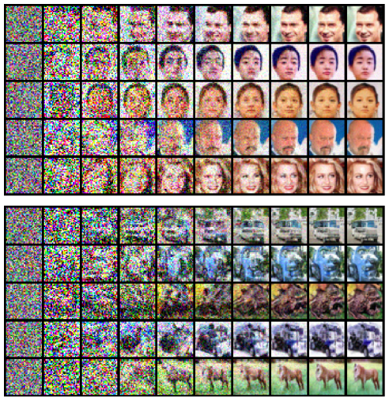

**图 4：** 退火朗之万动力学的中间样本。

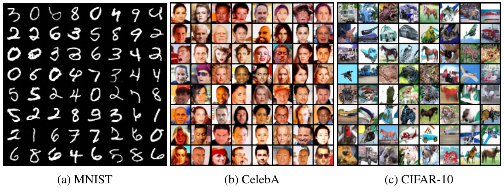

**图 5：** MNIST、CelebA 和 CIFAR-10 数据集上未经筛选的样本；(a) MNIST，(b) CelebA，(c) CIFAR-10。

为进行定量评估，我们在表 1 中报告 CIFAR-10 上的 Inception[48]和 FID[20]分数。
作为无条件模型，我们取得了最先进的 Inception 分数 8.87，甚至超过了类别条件生成模型中大多数已报告的数值。
我们在 CIFAR-10 上的 FID 分数 25.32 也可与现有顶尖模型（例如 SNGAN[36]）相媲美。
我们省略了 MNIST 和 CelebA 的分数，因为这两个数据集的分数未被广泛报告，而且不同的预处理方式（例如 CelebA 的中心裁剪尺寸）会使数值无法直接比较。

**表 1：CIFAR-10 的 Inception 和 FID 分数。**

| 设置 | 模型 | Inception | FID |
| --- | --- | ---: | ---: |
| 无条件 | PixelCNN[59] | 4.60 | 65.93 |
| 无条件 | PixelIQN[42] | 5.29 | 49.46 |
| 无条件 | EBM[12] | 6.02 | 40.58 |
| 无条件 | WGAN-GP[18] | 7.86 ± 0.07 | 36.4 |
| 无条件 | MoLM[45] | 7.90 ± 0.10 | 18.9 |
| 无条件 | SNGAN[36] | 8.22 ± 0.05 | 21.7 |
| 无条件 | ProgressiveGAN[25] | 8.80 ± 0.05 | - |
| 无条件 | **NCSN（本文）** | **8.87 ± 0.12** | **25.32** |
| 条件 | EBM[12] | 8.30 | 37.9 |
| 条件 | SNGAN[36] | 8.60 ± 0.08 | 25.5 |
| 条件 | BigGAN[6] | 9.22 | 14.73 |

> **阅读注释：表 1 应怎样比较？** Inception 分数通常越高越好，FID 通常越低越好，两者衡量的侧重点不同。NCSN 在无条件一组的 Inception 分数最高，但其 FID 为 25.32，仍高于 SNGAN 的 21.7 和 MoLM 的 18.9，所以这张表并不表示 NCSN 在所有指标上都最好。“条件”一组使用类别条件，任务设置与无条件一组不同，应先在相同设置内比较。这些均是论文当时的结果。

**图像修复。**
图 6 展示了得分网络学习到了可泛化、具有语义意义的图像表示，因此能够产生多样化的图像修复结果。
注意，一些先前模型（如 PixelCNN）只能按光栅扫描顺序补全图像。
相比之下，我们的方法只需简单修改退火朗之万动力学过程，就能自然地处理遮挡形状任意的图像（详见附录 B.3）。
更多图像修复结果见附录 C.5。

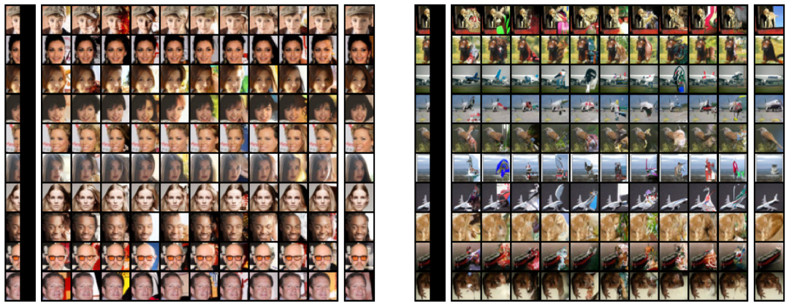

**图 6：** CelebA（左）和 CIFAR-10（右）上的图像修复。每幅图最左列为被遮挡的图像，最右列为原始图像。

## 6 相关工作

我们的方法与学习马尔可夫链转移算子来生成样本的方法有一些相似之处[4, 51, 5, 16, 52]。
例如，生成随机网络（GSN[4, 1]）用去噪自编码器训练一条平衡分布与数据分布匹配的马尔可夫链。
类似地，我们的方法训练朗之万动力学中使用的得分函数，以便从数据分布中采样。
但是，GSN 经常在非常接近训练数据点的位置启动链，因此需要链能在不同模态之间快速转移。
相比之下，我们的退火朗之万动力学从无结构噪声初始化。
非平衡热力学方法（NET[51]）使用预先指定的扩散过程，将数据缓慢变成随机噪声，然后通过训练逆向扩散学习反转这一过程。
但 NET 的可扩展性不佳，因为它要求扩散过程的步长非常小，并且需要在训练时模拟包含数千步的链。

先前的注入训练（IT[5]）和变分回溯（VW[16]）等方法也使用不同噪声水平／温度，训练马尔可夫链的转移算子。
IT 和 VW（以及 NET）都通过最大化适当边际似然的证据下界来训练模型。
实际中，它们往往产生模糊的图像样本，与变分自编码器类似。
相比之下，我们的目标基于得分匹配而非似然，且能够生成可与 GAN 媲美的图像。

还有若干结构差异，使我们的方法进一步区别于上述先前方法。
首先，我们在训练期间不需要从马尔可夫链采样。
相比之下，GSN 的回溯过程需要多次运行链，以生成“负样本”。
NET、IT 和 VW 等其他方法也需要为每个输入模拟马尔可夫链，才能计算训练损失。
这一区别使我们的方法在训练深度模型时更高效、更易扩展。
其次，我们的训练方法与采样方法彼此解耦。
对于得分估计，既可以采用切片得分匹配，也可以采用去噪得分匹配。
对于采样，任何基于得分的方法都适用，包括朗之万动力学，以及可能的哈密顿蒙特卡洛[38]。
我们的框架允许任意组合得分估计器与基于梯度的采样方法，而大多数先前方法把模型与某条特定的马尔可夫链绑定在一起。
最后，我们可以使用能量模型的梯度作为得分模型，从而用本方法训练能量模型（EBM）。
相比之下，先前那些学习马尔可夫链转移算子的方法，如何直接用于训练 EBM 尚不清楚。

得分匹配最初就是为学习 EBM 而提出的。
不过，许多现有的得分匹配方法要么难以扩展[24]，要么无法生成质量可与 VAE 或 GAN 相媲美的样本[27, 49]。
为改善深度能量模型的训练表现，一些近期工作转向对比散度[21]，并提出在训练和测试阶段都用朗之万动力学采样[12, 39]。
但是，与我们的方法不同，对比散度在训练期间将计算开销很大的朗之万动力学过程用作内循环。
将退火与去噪得分匹配结合的思想，也曾在其他背景下被研究。
文献[14, 7, 66]提出了训练去噪自编码器时采用的不同噪声退火调度。
不过，这些工作研究的是学习表示以改善分类性能，而不是生成建模。
去噪得分匹配也可以从贝叶斯最小二乘的角度推导[43, 44]，其中使用了 Stein 无偏风险估计量的技术[35, 56]。

## 7 结论

我们提出了基于得分的生成建模框架：首先通过得分匹配估计数据密度的梯度，再通过朗之万动力学生成样本。
我们分析了直接应用这一方法所面临的若干挑战，并提出通过训练噪声条件得分网络（NCSN）和用退火朗之万动力学采样来解决它们。
我们的方法不需要对抗训练、不需要在训练期间进行 MCMC 采样，也不需要特殊模型架构。
实验表明，我们的方法能够生成高质量图像，而此前只有最好的基于似然的模型和 GAN 才能生成这样的图像。
我们在 CIFAR-10 上取得了新的最先进 Inception 分数，以及可与 SNGAN 相媲美的 FID 分数。

> **阅读注释：学得分与预测噪声有什么联系？** 在本文的加噪方式 $\tilde{\mathbf{x}}=\mathbf{x}+\sigma\boldsymbol{\varepsilon}$ 下，得分标签是 $-\boldsymbol{\varepsilon}/\sigma$。因此可以把网络输出改写为噪声预测 $\hat{\boldsymbol{\varepsilon}}=-\sigma s_\theta(\tilde{\mathbf{x}},\sigma)$，加权损失就是预测该标准高斯噪声的平方误差。这是同一个训练目标的另一种表达，有助于将得分理解为“经尺度换算后的去噪方向”。这里的 $\boldsymbol{\varepsilon}$ 是训练时加入的噪声向量，与算法中的标量步长 $\epsilon$ 不同。
>
> 更具体地，当得分估计正确时，$\tilde{\mathbf{x}}+\sigma^2s_\theta(\tilde{\mathbf{x}},\sigma)=\mathbb{E}[\mathbf{x}\mid\tilde{\mathbf{x}}]$，对应的是给定加噪输入后的干净图像条件均值。只做这一次均值估计，通常不会得到本文所需的多样化生成过程；本文实际通过多个噪声水平和多次随机更新产生样本。

## 致谢

丰田研究院（Toyota Research Institute，TRI）提供了资金以支持作者的研究，但本文仅反映作者的意见和结论，并不代表 TRI 或任何其他丰田实体。
本研究还受到 NSF（#1651565、#1522054、#1733686）、ONR（N00014-19-1-2145）和 AFOSR（FA9550-19-1-0024）的支持。

## 参考文献

以下保留原文的作者、英文题名、出版信息与编号，并为每条文献附中文题名。

**[1]** G. Alain, Y. Bengio, L. Yao, J. Yosinski, E. Thibodeau-Laufer, S. Zhang, and P. Vincent. GSNs: generative stochastic networks. Information and Inference, 2016.  
**题名译文：** GSN：生成随机网络。

**[2]** M. Arjovsky, S. Chintala, and L. Bottou. Wasserstein generative adversarial networks. In D. Precup and Y. W. Teh, editors, Proceedings of the 34th International Conference on Machine Learning, volume 70 of Proceedings of Machine Learning Research, pages 214–223, International Convention Centre, Sydney, Australia, 06–11 Aug 2017. PMLR.  
**题名译文：** Wasserstein 生成对抗网络。

**[3]** M. Belkin and P. Niyogi. Laplacian eigenmaps for dimensionality reduction and data representation. Neural computation, 15(6):1373–1396, 2003.  
**题名译文：** 用于降维和数据表示的拉普拉斯特征映射。

**[4]** Y. Bengio, L. Yao, G. Alain, and P. Vincent. Generalized denoising auto-encoders as generative models. In Advances in neural information processing systems, pages 899–907, 2013.  
**题名译文：** 作为生成模型的广义去噪自编码器。

**[5]** F. Bordes, S. Honari, and P. Vincent. Learning to generate samples from noise through infusion training. arXiv preprint arXiv:1703.06975, 2017.  
**题名译文：** 通过注入训练学习从噪声生成样本。

**[6]** A. Brock, J. Donahue, and K. Simonyan. Large scale GAN training for high fidelity natural image synthesis. In International Conference on Learning Representations, 2019.  
**题名译文：** 用于高保真自然图像合成的大规模 GAN 训练。

**[7]** B. Chandra and R. K. Sharma. Adaptive noise schedule for denoising autoencoder. In International conference on neural information processing, pages 535–542. Springer, 2014.  
**题名译文：** 去噪自编码器的自适应噪声调度。

**[8]** L.-C. Chen, G. Papandreou, I. Kokkinos, K. Murphy, and A. L. Yuille. Deeplab: Semantic image segmentation with deep convolutional nets, atrous convolution, and fully connected crfs. IEEE transactions on pattern analysis and machine intelligence, 40(4):834–848, 2017.  
**题名译文：** DeepLab：使用深度卷积网络、空洞卷积和全连接条件随机场进行语义图像分割。

**[9]** T. Chen, E. Fox, and C. Guestrin. Stochastic gradient hamiltonian monte carlo. In International conference on machine learning, pages 1683–1691, 2014.  
**题名译文：** 随机梯度哈密顿蒙特卡洛。

**[10]** Z. Dai, Z. Yang, F. Yang, W. W. Cohen, and R. R. Salakhutdinov. Good semi-supervised learning that requires a bad gan. In Advances in neural information processing systems, pages 6510–6520, 2017.  
**题名译文：** 需要一个差 GAN 的良好半监督学习。

**[11]** L. Dinh, D. Krueger, and Y. Bengio. Nice: Non-linear independent components estimation. arXiv preprint arXiv:1410.8516, 2014.  
**题名译文：** NICE：非线性独立成分估计。

**[12]** Y. Du and I. Mordatch. Implicit generation and generalization in energy-based models. arXiv preprint arXiv:1903.08689, 2019.  
**题名译文：** 能量模型中的隐式生成与泛化。

**[13]** V. Dumoulin, J. Shlens, and M. Kudlur. A learned representation for artistic style. In International Conference on Learning Representations 2017, 2017.  
**题名译文：** 艺术风格的学习表示。

**[14]** K. J. Geras and C. Sutton. Scheduled denoising autoencoders. arXiv preprint arXiv:1406.3269, 2014.  
**题名译文：** 采用调度的去噪自编码器。

**[15]** I. Goodfellow, J. Pouget-Abadie, M. Mirza, B. Xu, D. Warde-Farley, S. Ozair, A. Courville, and Y. Bengio. Generative adversarial nets. In Advances in neural information processing systems, pages 2672–2680, 2014.  
**题名译文：** 生成对抗网络。

**[16]** A. G. A. P. Goyal, N. R. Ke, S. Ganguli, and Y. Bengio. Variational walkback: Learning a transition operator as a stochastic recurrent net. In Advances in Neural Information Processing Systems, pages 4392–4402, 2017.  
**题名译文：** 变分回溯：将转移算子学习为随机循环网络。

**[17]** A. Graves. Generating sequences with recurrent neural networks. arXiv preprint arXiv:1308.0850, 2013.  
**题名译文：** 使用循环神经网络生成序列。

**[18]** I. Gulrajani, F. Ahmed, M. Arjovsky, V. Dumoulin, and A. C. Courville. Improved training of wasserstein gans. In Advances in Neural Information Processing Systems, pages 5767–5777, 2017.  
**题名译文：** Wasserstein GAN 的改进训练。

**[19]** M. Gutmann and A. Hyvärinen. Noise-contrastive estimation: A new estimation principle for unnormalized statistical models. In Proceedings of the Thirteenth International Conference on Artificial Intelligence and Statistics, pages 297–304, 2010.  
**题名译文：** 噪声对比估计：未归一化统计模型的新估计原则。

**[20]** M. Heusel, H. Ramsauer, T. Unterthiner, B. Nessler, and S. Hochreiter. Gans trained by a two time-scale update rule converge to a local nash equilibrium. In Advances in Neural Information Processing Systems, pages 6626–6637, 2017.  
**题名译文：** 采用双时间尺度更新规则训练的 GAN 收敛到局部纳什均衡。

**[21]** G. E. Hinton. Training products of experts by minimizing contrastive divergence. Neural computation, 14(8):1771–1800, 2002.  
**题名译文：** 通过最小化对比散度训练专家乘积模型。

**[22]** J. Ho and S. Ermon. Generative adversarial imitation learning. In Advances in Neural Information Processing Systems, pages 4565–4573, 2016.  
**题名译文：** 生成对抗模仿学习。

**[23]** X. Huang and S. Belongie. Arbitrary style transfer in real-time with adaptive instance normalization. In Proceedings of the IEEE International Conference on Computer Vision, pages 1501–1510, 2017.  
**题名译文：** 通过自适应实例归一化实现实时任意风格迁移。

**[24]** A. Hyvärinen. Estimation of non-normalized statistical models by score matching. Journal of Machine Learning Research, 6(Apr):695–709, 2005.  
**题名译文：** 通过得分匹配估计未归一化统计模型。

**[25]** T. Karras, T. Aila, S. Laine, and J. Lehtinen. Progressive growing of GANs for improved quality, stability, and variation. In International Conference on Learning Representations, 2018.  
**题名译文：** 通过渐进式增长 GAN 改善质量、稳定性和多样性。

**[26]** T. Karras, S. Laine, and T. Aila. A style-based generator architecture for generative adversarial networks. arXiv preprint arXiv:1812.04948, 2018.  
**题名译文：** 生成对抗网络的基于风格的生成器架构。

**[27]** D. Kingma and Y. LeCun. Regularized estimation of image statistics by score matching. In Advances in Neural Information Processing Systems 23: 24th Annual Conference on Neural Information Processing Systems 2010, NIPS 2010, 2010.  
**题名译文：** 通过得分匹配对图像统计量进行正则化估计。

**[28]** D. P. Kingma, S. Mohamed, D. J. Rezende, and M. Welling. Semi-supervised learning with deep generative models. In Advances in neural information processing systems, pages 3581–3589, 2014.  
**题名译文：** 使用深度生成模型进行半监督学习。

**[29]** D. P. Kingma and M. Welling. Auto-encoding variational bayes. In ICLR, 2014.  
**题名译文：** 自编码变分贝叶斯。

**[30]** S. Kirkpatrick, C. D. Gelatt, and M. P. Vecchi. Optimization by simulated annealing. SCIENCE, 220(4598):671–680, 1983.  
**题名译文：** 通过模拟退火进行优化。

**[31]** A. Krizhevsky. Learning multiple layers of features from tiny images. Technical report, 2009.  
**题名译文：** 从微小图像中学习多层特征。

**[32]** G. Lin, A. Milan, C. Shen, and I. Reid. Refinenet: Multi-path refinement networks for highresolution semantic segmentation. In Proceedings of the IEEE conference on computer vision and pattern recognition, pages 1925–1934, 2017.  
**题名译文：** RefineNet：用于高分辨率语义分割的多路径细化网络。

**[33]** Q. Liu, J. Lee, and M. Jordan. A kernelized stein discrepancy for goodness-of-fit tests. In International Conference on Machine Learning, pages 276–284, 2016.  
**题名译文：** 用于拟合优度检验的核化 Stein 差异。

**[34]** Z. Liu, P. Luo, X. Wang, and X. Tang. Deep learning face attributes in the wild. In Proceedings of International Conference on Computer Vision (ICCV), 2015.  
**题名译文：** 野外人脸属性的深度学习。

**[35]** K. Miyasawa. An empirical bayes estimator of the mean of a normal population. Bull. Inst. Internat. Statist, 38(181-188):1–2, 1961.  
**题名译文：** 正态总体均值的经验贝叶斯估计量。

**[36]** T. Miyato, T. Kataoka, M. Koyama, and Y. Yoshida. Spectral normalization for generative adversarial networks. In International Conference on Learning Representations, 2018.  
**题名译文：** 生成对抗网络的谱归一化。

**[37]** R. M. Neal. Annealed importance sampling. Statistics and computing, 11(2):125–139, 2001.  
**题名译文：** 退火重要性采样。

**[38]** R. M. Neal. Mcmc using hamiltonian dynamics. arXiv preprint arXiv:1206.1901, 2012.  
**题名译文：** 使用哈密顿动力学的 MCMC。

**[39]** E. Nijkamp, M. Hill, T. Han, S.-C. Zhu, and Y. N. Wu. On the anatomy of mcmc-based maximum likelihood learning of energy-based models. arXiv preprint arXiv:1903.12370, 2019.  
**题名译文：** 剖析能量模型中基于 MCMC 的最大似然学习。

**[40]** S. Nowozin, B. Cseke, and R. Tomioka. f-gan: Training generative neural samplers using variational divergence minimization. In Advances in neural information processing systems, pages 271–279, 2016.  
**题名译文：** f-GAN：使用变分散度最小化训练生成式神经采样器。

**[41]** G. Ostrovski, M. G. Bellemare, A. van den Oord, and R. Munos. Count-based exploration with neural density models. In Proceedings of the 34th International Conference on Machine Learning-Volume 70, pages 2721–2730. JMLR. org, 2017.  
**题名译文：** 使用神经密度模型进行基于计数的探索。

**[42]** G. Ostrovski, W. Dabney, and R. Munos. Autoregressive quantile networks for generative modeling. In ICML, volume 80 of Proceedings of Machine Learning Research, pages 3933– 3942. PMLR, 2018.  
**题名译文：** 用于生成建模的自回归分位数网络。

**[43]** M. Raphan and E. P. Simoncelli. Learning to be bayesian without supervision. In Advances in neural information processing systems, pages 1145–1152, 2007.  
**题名译文：** 无监督地学习贝叶斯方法。

**[44]** M. Raphan and E. P. Simoncelli. Least squares estimation without priors or supervision. Neural computation, 23(2):374–420, 2011.  
**题名译文：** 不依赖先验或监督的最小二乘估计。

**[45]** S. Ravuri, S. Mohamed, M. Rosca, and O. Vinyals. Learning implicit generative models with the method of learned moments. In J. Dy and A. Krause, editors, Proceedings of the 35th International Conference on Machine Learning, volume 80 of Proceedings of Machine Learning Research, pages 4314–4323, Stockholmsmässan, Stockholm Sweden, 10–15 Jul 2018. PMLR.  
**题名译文：** 利用学习矩的方法学习隐式生成模型。

**[46]** O. Ronneberger, P.Fischer, and T. Brox. U-net: Convolutional networks for biomedical image segmentation. In Medical Image Computing and Computer-Assisted Intervention (MICCAI), volume 9351 of LNCS, pages 234–241. Springer, 2015. (available on arXiv:1505.04597 [cs.CV]).  
**题名译文：** U-Net：用于生物医学图像分割的卷积网络。

**[47]** S. T. Roweis and L. K. Saul. Nonlinear dimensionality reduction by locally linear embedding. science, 290(5500):2323–2326, 2000.  
**题名译文：** 通过局部线性嵌入进行非线性降维。

**[48]** T. Salimans, I. Goodfellow, W. Zaremba, V. Cheung, A. Radford, and X. Chen. Improved techniques for training gans. In Advances in neural information processing systems, pages 2234–2242, 2016.  
**题名译文：** 训练 GAN 的改进技术。

**[49]** S. Saremi, A. Mehrjou, B. Schölkopf, and A. Hyvärinen. Deep energy estimator networks. arXiv preprint arXiv:1805.08306, 2018.  
**题名译文：** 深度能量估计器网络。

**[50]** J. Sohl-Dickstein, P. Battaglino, and M. R. DeWeese. Minimum probability flow learning. arXiv preprint arXiv:0906.4779, 2009.  
**题名译文：** 最小概率流学习。

**[51]** J. Sohl-Dickstein, E. Weiss, N. Maheswaranathan, and S. Ganguli. Deep unsupervised learning using nonequilibrium thermodynamics. In International Conference on Machine Learning, pages 2256–2265, 2015.  
**题名译文：** 利用非平衡热力学进行深度无监督学习。

**[52]** J. Song, S. Zhao, and S. Ermon. A-nice-mc: Adversarial training for mcmc. In Advances in Neural Information Processing Systems, pages 5140–5150, 2017.  
**题名译文：** A-NICE-MC：用于 MCMC 的对抗训练。

**[53]** Y. Song, S. Garg, J. Shi, and S. Ermon. Sliced score matching: A scalable approach to density and score estimation. In Proceedings of the Thirty-Fifth Conference on Uncertainty in Artificial Intelligence, UAI 2019, Tel Aviv, Israel, July 22-25, 2019, page 204, 2019.  
**题名译文：** 切片得分匹配：可扩展的密度与得分估计方法。

**[54]** Y. Song, T. Kim, S. Nowozin, S. Ermon, and N. Kushman. Pixeldefend: Leveraging generative models to understand and defend against adversarial examples. In International Conference on Learning Representations, 2018.  
**题名译文：** PixelDefend：利用生成模型理解和防御对抗样本。

**[55]** B. K. Sriperumbudur, K. Fukumizu, A. Gretton, B. Schölkopf, and G. R. Lanckriet. On integral probability metrics,\phi-divergences and binary classification. arXiv preprint arXiv:0901.2698, 2009.  
**题名译文：** 论积分概率度量、φ 散度与二分类。

**[56]** C. M. Stein. Estimation of the mean of a multivariate normal distribution. The annals of Statistics, pages 1135–1151, 1981.  
**题名译文：** 多元正态分布均值的估计。

**[57]** D. Ulyanov, A. Vedaldi, and V. Lempitsky. Instance normalization: The missing ingredient for fast stylization. arXiv preprint arXiv:1607.08022, 2016.  
**题名译文：** 实例归一化：快速风格化中缺失的要素。

**[58]** A. van den Oord, S. Dieleman, H. Zen, K. Simonyan, O. Vinyals, A. Graves, N. Kalchbrenner, A. Senior, and K. Kavukcuoglu. Wavenet: A generative model for raw audio. In Arxiv, 2016.  
**题名译文：** WaveNet：原始音频的生成模型。

**[59]** A. Van den Oord, N. Kalchbrenner, L. Espeholt, O. Vinyals, A. Graves, et al. Conditional image generation with pixelcnn decoders. In Advances in neural information processing systems, pages 4790–4798, 2016.  
**题名译文：** 使用 PixelCNN 解码器进行条件图像生成。

**[60]** A. Van Den Oord, N. Kalchbrenner, and K. Kavukcuoglu. Pixel recurrent neural networks. In Proceedings of the 33rd International Conference on International Conference on Machine Learning - Volume 48, ICML’16, pages 1747–1756. JMLR.org, 2016.  
**题名译文：** 像素循环神经网络。

**[61]** P. Vincent. A connection between score matching and denoising autoencoders. Neural computation, 23(7):1661–1674, 2011.  
**题名译文：** 得分匹配与去噪自编码器之间的联系。

**[62]** M. Welling and Y. W. Teh. Bayesian learning via stochastic gradient langevin dynamics. In Proceedings of the 28th international conference on machine learning (ICML-11), pages 681–688, 2011.  
**题名译文：** 通过随机梯度朗之万动力学进行贝叶斯学习。

**[63]** L. Wenliang, D. Sutherland, H. Strathmann, and A. Gretton. Learning deep kernels for exponential family densities. In International Conference on Machine Learning, pages 6737–6746, 2019.  
**题名译文：** 为指数族密度学习深度核。

**[64]** F. Yu and V. Koltun. Multi-scale context aggregation by dilated convolutions. In International Conference on Learning Representations (ICLR), 2016.  
**题名译文：** 利用膨胀卷积进行多尺度上下文聚合。

**[65]** F. Yu, V. Koltun, and T. Funkhouser. Dilated residual networks. In Computer Vision and Pattern Recognition (CVPR), 2017.  
**题名译文：** 膨胀残差网络。

**[66]** Q. Zhang and L. Zhang. Convolutional adaptive denoising autoencoders for hierarchical feature extraction. Frontiers of Computer Science, 12(6):1140–1148, 2018.  
**题名译文：** 用于层次特征提取的卷积自适应去噪自编码器。

## 附录 A 架构

实验中的 NCSN 架构有三个重要组成部分：实例归一化、膨胀卷积和 U-Net 类型架构。
下面介绍它们的背景，并讨论我们如何修改它们以适应本文的目标。
如需更完整的细节和参考实现，建议读者查看我们公开的代码库。
我们的得分网络使用 PyTorch 实现。
代码和模型检查点见 <https://github.com/ermongroup/ncsn>。

### A.1 实例归一化

我们使用条件实例归一化[13]，使 $s_\theta(\mathbf{x},\sigma)$ 在预测得分时考虑 $\sigma$。
条件实例归一化对不同的 $\sigma\in\{\sigma_i\}_{i=1}^L$ 使用不同的缩放系数和偏置。
更具体地，假设输入 $\mathbf{x}$ 有 $C$ 个特征图。
令 $\mu_k$ 和 $s_k$ 分别表示第 $k$ 个特征图沿空间轴计算的均值和标准差。
条件实例归一化通过下式实现：

$$
\mathbf{z}_k=\gamma[i,k]\frac{\mathbf{x}_k-\mu_k}{s_k}+\beta[i,k],
$$

其中，$\gamma\in\mathbb{R}^{L\times C}$ 和 $\beta\in\mathbb{R}^{L\times C}$ 是可学习参数，$k$ 为特征图索引，$i$ 为 $\sigma$ 在 $\{\sigma_i\}_{i=1}^L$ 中的索引。

不过，实例归一化的一个缺点是，它会完全移除不同特征图的 $\mu_k$ 信息。
这会使生成图像出现颜色偏移。
为解决这一问题，我们提出对条件实例归一化进行简单修改。
首先，计算各个 $\mu_k$ 的均值和标准差，分别记为 $m$ 和 $v$。
随后，增加另一个可学习参数 $\alpha\in\mathbb{R}^{L\times C}$。
修改后的条件实例归一化定义为：

$$
\mathbf{z}_k=\gamma[i,k]\frac{\mathbf{x}_k-\mu_k}{s_k}+\beta[i,k]+\alpha[i,k]\frac{\mu_k-m}{v}.
$$

我们将这种修改后的条件实例归一化简称为 CondInstanceNorm++。
在架构中，我们在每个卷积层和池化层前加入 CondInstanceNorm++。

> **阅读注释：条件实例归一化怎样告诉网络噪声大小？** 对一个输入样本，每个特征图分别沿空间位置求均值、标准差，再归一化。噪声水平的索引 $i$ 决定使用哪一组 $\gamma[i,k]$ 和 $\beta[i,k]$，所以即使卷积权重共享，不同噪声条件也会得到不同的特征处理。
>
> “++”版本额外保留了不同通道均值的相对信息，帮助缓解颜色偏移。这里的 $v$ 是标准差，$\alpha[i,k]$ 是可学习参数；它们分别与第 2 节的随机向量 $\mathbf{v}$、采样步长 $\alpha_i$ 含义不同。读公式时按当前小节的定义区分即可。

### A.2 膨胀卷积

膨胀卷积能够在保持特征图分辨率的同时扩大感受野。
它已被证明在语义分割中非常有效，因为采用更高分辨率的特征图能更好地保留位置信息。
在 NCSN 架构设计中，我们用膨胀卷积替换除第一个以外的所有下采样层。

> **阅读注释：为什么输出方向的网络需要这些架构？** 每个像素的调整往往依赖周围乃至远处的内容，例如脸部像素需要考虑眼睛和轮廓的位置。膨胀卷积让卷积在更稀疏的位置取样，从而扩大能看到的范围，同时保留特征图分辨率。下一节的 U-Net／RefineNet 则结合不同层次的特征，使全局结构和局部细节都能参与得分预测。

### A.3 U-Net 架构

U-Net 是一种具有特殊跳跃连接的架构。
这些跳跃连接有助于将浅层中的低层次信息传递到网络深层。
由于浅层往往包含位置、形状等低层次信息，这些跳跃连接有助于改善语义分割结果。
为了构建 $s_\theta(\mathbf{x},\sigma)$，我们采用 RefineNet[32]架构，它是 U-Net 的一个现代变体，同时融入了 ResNet 的设计。
有关 RefineNet 架构的详细说明，请参见文献[32]。

实验中，我们使用四级级联的 RefineNet。
我们使用预激活残差块。
我们移除 RefineNet 中的所有批归一化，并用 CondInstanceNorm++ 替代。
我们将 Refine Block 中的最大池化层替换为平均池化，因为已有报告指出，在风格迁移等图像生成任务中，平均池化可以产生更平滑的图像。
此外，我们在 Refine Block 的每个卷积和平均池化操作前也加入 CondInstanceNorm++，尽管原始 Refine Block 并不使用归一化。
所有激活函数均选择 ELU。
如前所述，我们使用膨胀卷积替代残差块中的下采样层，但第一个下采样层除外。
遵循常见做法，每进入下一级级联，膨胀率就增大为原来的两倍。
在 CelebA 和 CIFAR-10 实验中，第一级级联对应层的滤波器数量为 128，其他级联的滤波器数量则加倍。
在 MNIST 实验中，滤波器数量减半。

## 附录 B 更多实验细节

### B.1 示例实验

对于图 1 的结果，我们在 CIFAR-10 上用切片得分匹配训练一个 ResNet。
我们使用预激活残差块，将 ResNet 组织为自编码器：编码器包含 5 个残差块，解码器采用与编码器镜像对称的架构。
编码器各残差块的滤波器数量依次为 32、64、64、128 和 128。
编码器的第 2 和第 4 个残差块将特征图下采样为原来的一半。
整个网络均使用 ELU 激活。
使用 Adam 优化器训练网络 50,000 次迭代，批大小为 128，学习率为 0.001。
该实验在一块 Titan XP GPU 上运行。

对于图 2 的结果，我们选择 $p_{\mathrm{data}}=\frac15\mathcal{N}((-5,-5),\mathbf{I})+\frac45\mathcal{N}((5,5),\mathbf{I})$。
得分网络为三层 MLP，具有 128 个隐藏单元，采用 softplus 激活函数。
我们用切片得分匹配和 Adam 优化器训练得分网络 10,000 次迭代。
学习率为 0.001，批大小为 128。
该实验在一款主频为 2.7 GHz 的 Intel Core i7 GPU 上运行。

> **译注：** 原文写作“Intel Core i7 GPU with 2.7GHz”；Intel Core i7 是 CPU 产品系列，这里很可能是将 CPU 误写成了 GPU。译文保留原文称呼。

对于图 3 的结果，我们使用同一示例分布 $p_{\mathrm{data}}=\frac15\mathcal{N}((-5,-5),\mathbf{I})+\frac45\mathcal{N}((5,5),\mathbf{I})$。
为图 3 的每个子图生成 1,280 个样本。
所有初始样本都从正方形 $[-8,8]\times[-8,8]$ 中均匀选取。
普通朗之万动力学采用 $T=1000$ 和 $\epsilon=0.1$。
退火朗之万动力学采用 $T=100$、$L=10$ 和 $\epsilon=0.1$。
我们将 $\{\sigma_i\}_{i=1}^L$ 选为等比数列，$L=10$、$\sigma_1=20$、$\sigma_{10}=1$。
两种朗之万方法都使用真实的数据得分进行采样。
该实验在一款主频为 2.7 GHz 的 Intel Core i7 GPU 上运行。

> **译注：** 上述硬件名称同样为原文写法；噪声范围与第 4.3 节正文不同，详见正文相应译注。

### B.2 图像生成

训练时，我们随机翻转 CelebA 和 CIFAR-10 中的图像。
所有模型均用 Adam 优化，学习率为 0.001，共训练 200,000 次迭代。
批大小固定为 128。
每 5,000 次迭代保存一个检查点。
对于 MNIST，我们选择第 200,000 次训练迭代的最后一个检查点。
对于 CIFAR-10 和 CelebA 的模型选择，我们为每个检查点生成 1,000 张图像，并选择在这 1,000 张图像上计算得到的 FID 分数最小的检查点。
本文图像样本及表 1 的结果来自这些检查点。
类似的模型选择过程也用于先前工作，例如 ProgressiveGAN[25]。

Inception 和 FID 分数分别用 OpenAI[48]与 TTUR[20]作者提供的官方代码计算：

- 原文脚注 1（Inception）：<https://github.com/openai/improved-gan/tree/master/inception_score>。
- 原文脚注 2（FID）：<https://github.com/bioinf-jku/TTUR>。

架构见附录 A。
报告表 1 数值时，我们基于总计 50,000 个样本计算 Inception 和 FID 分数。

基线模型使用相同的得分网络。
唯一的区别是，得分网络仅以一个噪声水平 $\{\sigma_1=0.01\}$ 为条件。
用朗之万动力学采样时，我们采用 $\epsilon=2\times10^{-5}$ 和 $T=1000$。

MNIST 模型使用一块 Titan XP GPU 运行，CelebA 和 CIFAR-10 模型使用两块 Titan XP GPU。

### B.3 图像修复

我们使用下面的算法 2 进行图像修复。
超参数与图像生成所用的退火朗之万动力学相同。

**算法 2：通过退火朗之万动力学进行图像修复。**

**输入：** $\{\sigma_i\}_{i=1}^L$、$\epsilon$、$T$；$\epsilon$ 为最小步长，$T$ 为每个噪声水平下的迭代次数。  
**输入：** $\mathbf{m}$、$\mathbf{x}$；$\mathbf{m}$ 为指示未被遮挡区域的掩码，$\mathbf{x}$ 为给定图像。

```text
1:  初始化 x̃₀
2:  对 i = 1, …, L：
3:      αᵢ ← ε · σᵢ² / σL²                  // αᵢ 为步长
4:      抽取 z̃ ∼ N(0, σᵢ²)
5:      y ← x + z̃
6:      对 t = 1, …, T：
7:          抽取 zₜ ∼ N(0, I)
8:          x̃ₜ ← x̃ₜ₋₁ + (αᵢ/2)sθ(x̃ₜ₋₁, σᵢ) + √αᵢ zₜ
9:          x̃ₜ ← x̃ₜ ⊙ (1 − m) + y ⊙ m
10:     结束内层循环
11:     x̃₀ ← x̃T
12: 结束外层循环
返回 x̃T
```

> **译注：** $\odot$ 表示逐元素乘法。原文第 4 行将高斯噪声写成 $\mathcal{N}(0,\sigma_i^2)$；对于图像向量，可理解为各分量独立、方差为 $\sigma_i^2$ 的高斯噪声，即 $\mathcal{N}(\mathbf{0},\sigma_i^2\mathbf{I})$。

> **阅读注释：算法 2 的关键是第 9 行“把已知区域放回去”。** 掩码 $m_j=1$ 表示第 $j$ 个位置可见，$m_j=0$ 表示它需要补全。第 8 行先更新整张图；第 9 行在缺失位置保留生成结果，在可见位置改用 $\mathbf{y}$ 中的已知内容。这样网络不断利用已有内容，为缺失部分生成相容的图像。
>
> 为什么放回的是 $\mathbf{y}=\mathbf{x}+\tilde{\mathbf{z}}$，而非一直放回无噪声的 $\mathbf{x}$？因为当前网络正在处理噪声水平为 $\sigma_i$ 的分布，已知区域也应带有相应噪声。随着噪声水平降低，已知区域逐渐接近给定图像。不同随机扰动会得到不同补全结果，因此图 6 的中间列展示了多个可能的修复。这是本文给出的修复采样过程，不代表有限步数下已保证精确的条件采样。

## 附录 C 样本

### C.1 基线模型的样本

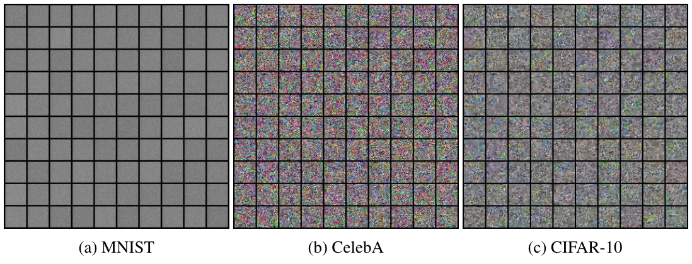

**图 7：** 基线模型在 MNIST、CelebA 和 CIFAR-10 数据集上生成的未经筛选的样本；(a) MNIST，(b) CelebA，(c) CIFAR-10。

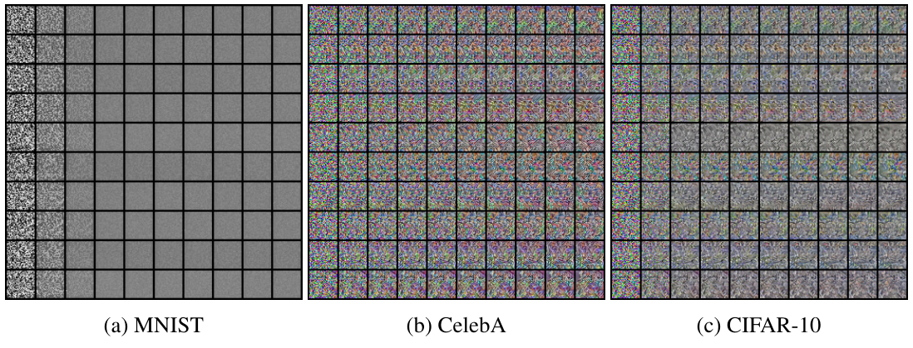

**图 8：** 基线模型使用朗之万动力学生成的中间样本；(a) MNIST，(b) CelebA，(c) CIFAR-10。

### C.2 最近邻

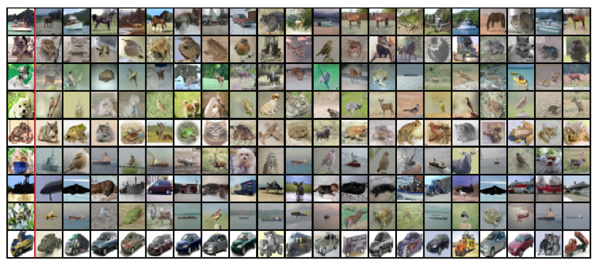

**图 9：** 使用图像之间的 $\ell_2$ 距离衡量的最近邻。红色竖线左侧的图像是 NCSN 的生成样本，右侧是训练数据集中的最近邻。

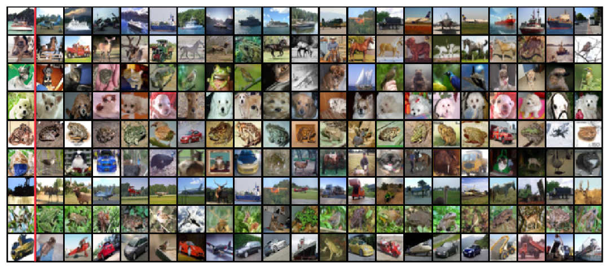

**图 10：** 使用在 ImageNet 上预训练的 Inception V3 网络特征空间中的 $\ell_2$ 距离衡量的最近邻。红色竖线左侧的图像是 NCSN 的生成样本，右侧是训练数据集中的最近邻。

### C.3 更多样本

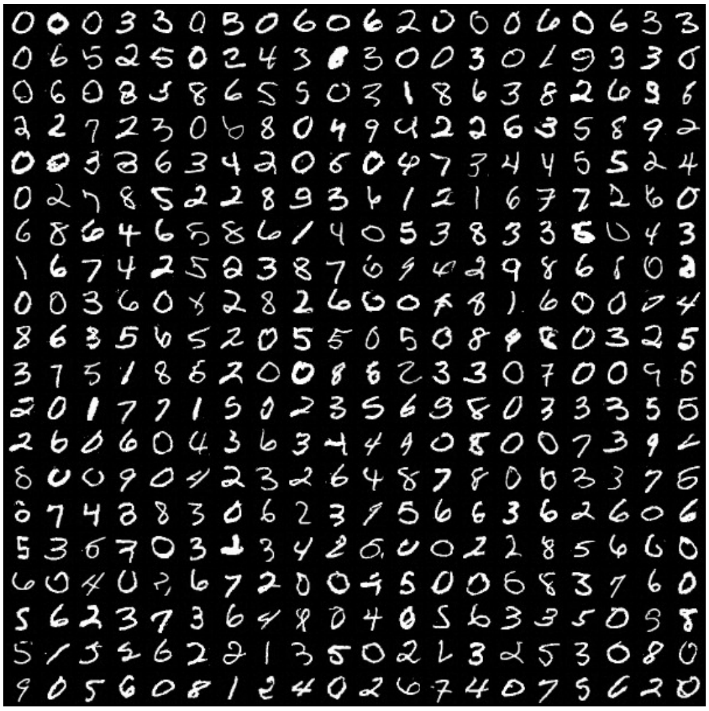

**图 11：** 更多 MNIST 样本。

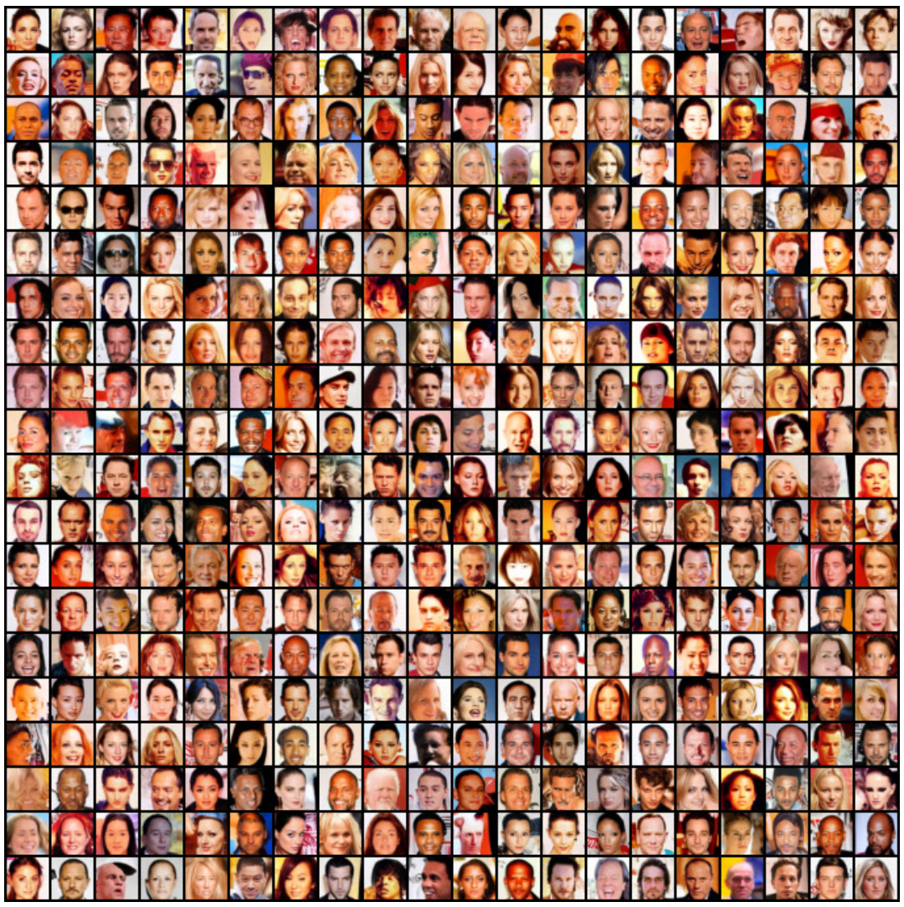

**图 12：** 更多 CelebA 样本。

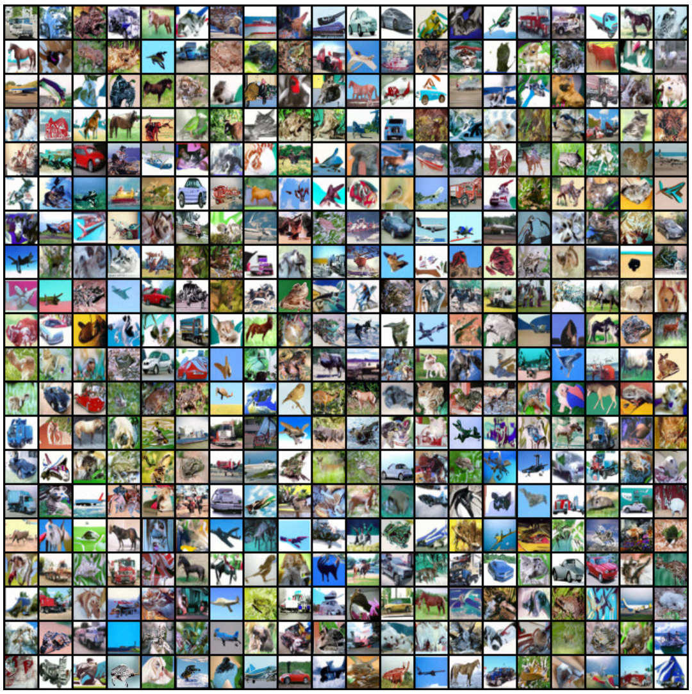

**图 13：** 更多 CIFAR-10 样本。

### C.4 更多退火朗之万动力学的中间样本

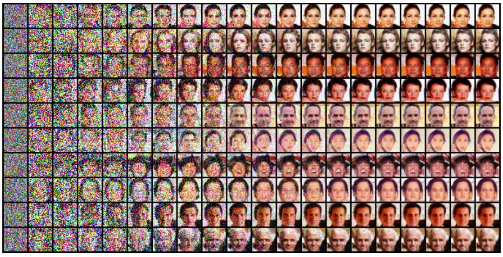

**图 14：** CelebA 上更多退火朗之万动力学的中间样本。

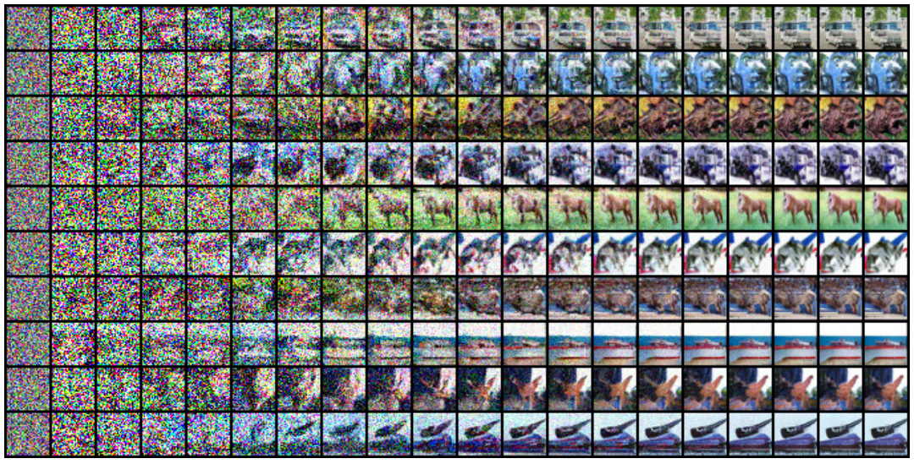

**图 15：** CIFAR-10 上更多退火朗之万动力学的中间样本。

### C.5 更多图像修复结果

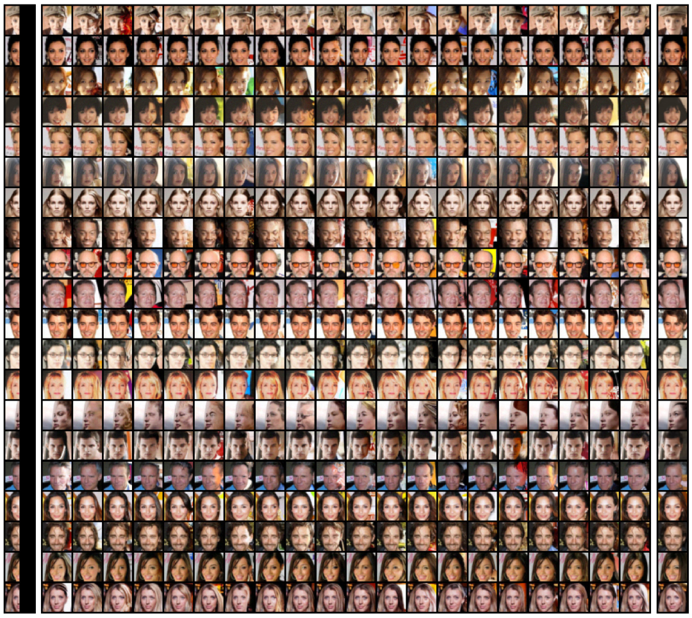

**图 16：** CelebA 上更多图像修复结果。每幅图最左列为被遮挡的图像，最右列为原始图像。

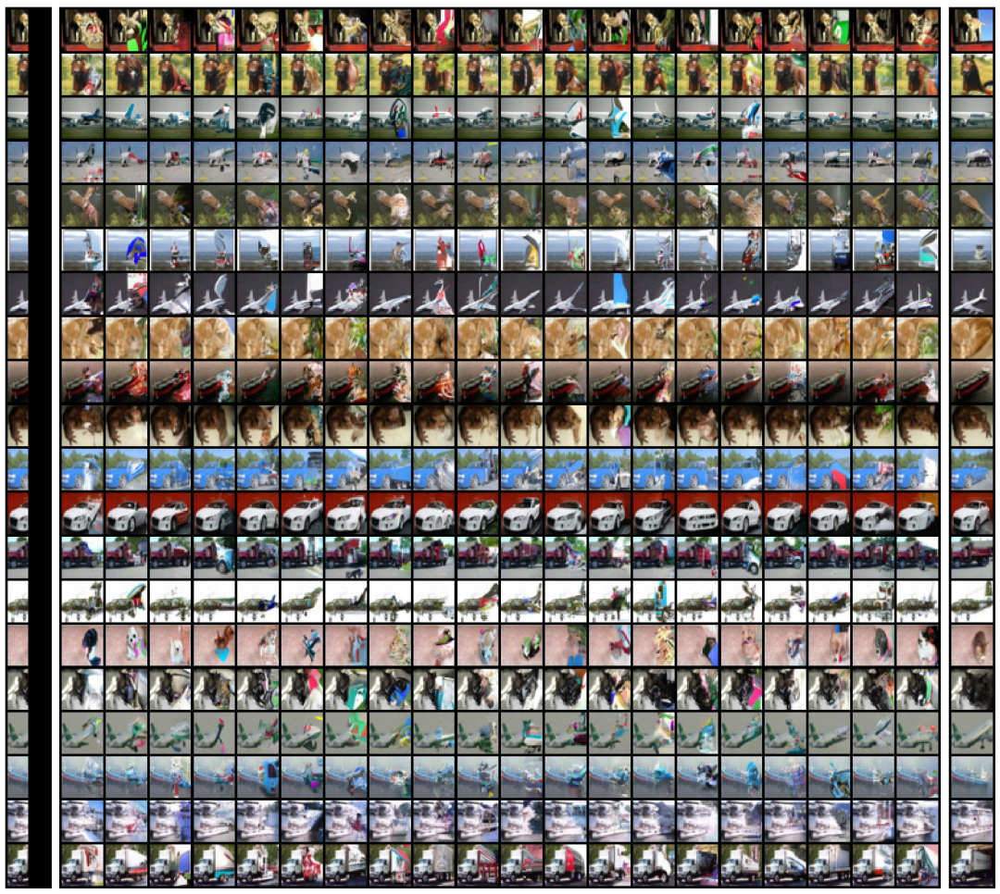

**图 17：** CIFAR-10 上更多图像修复结果。每幅图最左列为被遮挡的图像，最右列为原始图像。
