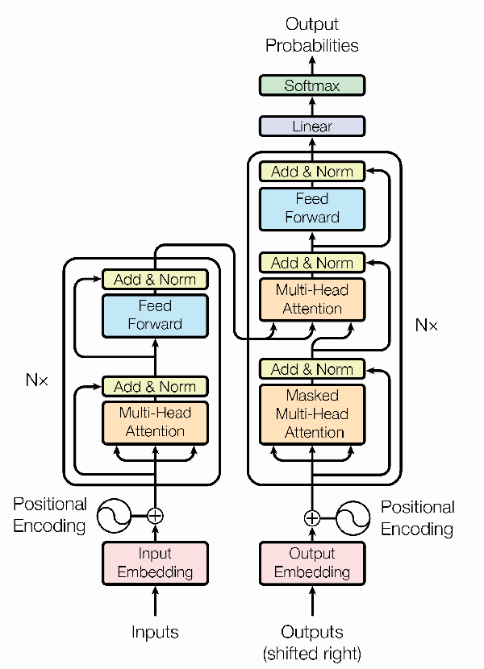
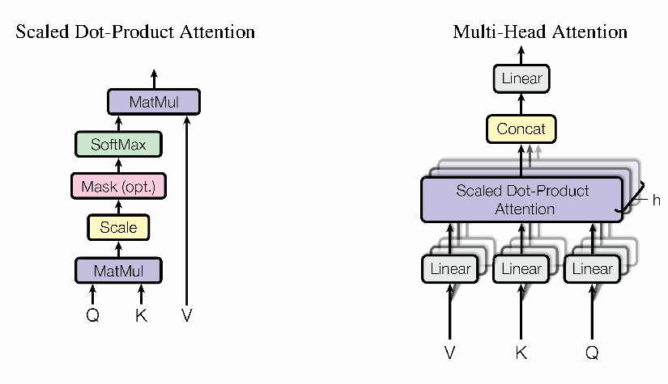
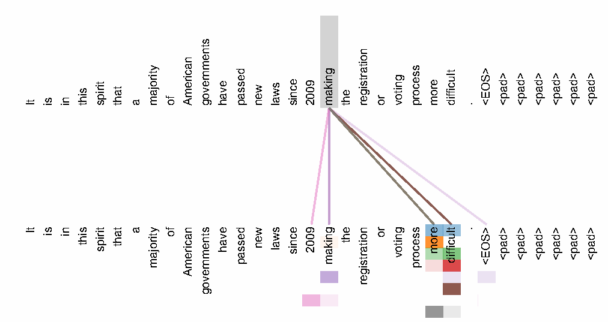
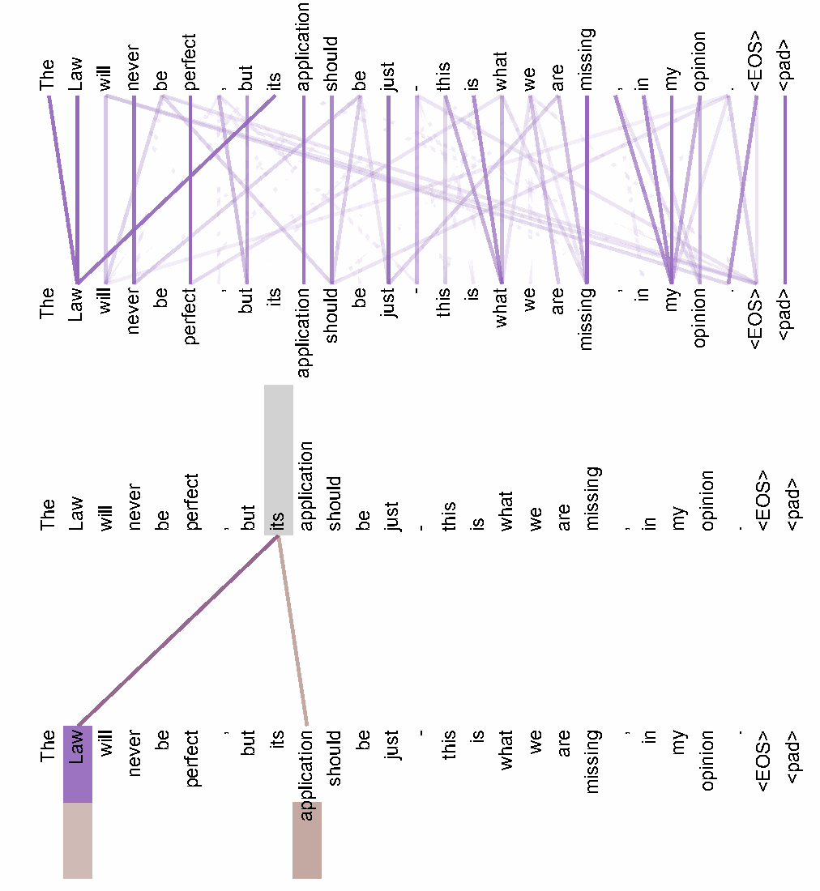
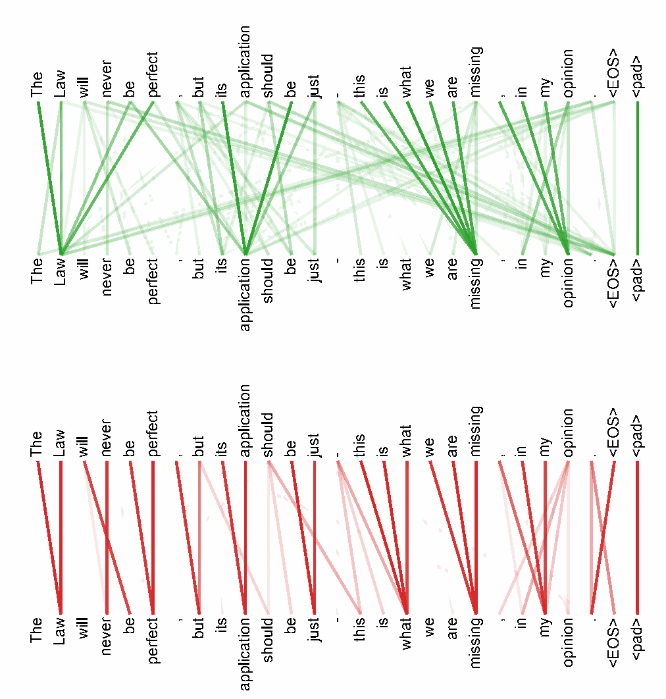

# 注意力就是你所需要的一切

**Attention Is All You Need**

> 来源：`Transformer.pdf`，arXiv:1706.03762v7（2023 年 8 月 2 日）。本文发表于第 31 届神经信息处理系统大会（NIPS 2017），美国加利福尼亚州长滩。
>
> 译文保留原文的章节、公式、表格、引用编号和图注。图片取自原 PDF，图内英文标签的中文对应在图下给出。文献题名译为中文，作者姓名和出版信息保留以便检索。原文中的数值差异以译注说明。

> **学习注｜阅读说明**：下文标为“学习注”的内容是为帮助理解补充的解释与例子，不属于论文原文。“译注”用于说明原文表述或数值上的问题。初读时，建议重点关注第 3 节的模型结构与公式，再阅读第 4 节的效率分析和第 5 节的训练方法。

## 作者

| 作者 | 单位 | 邮箱 |
| --- | --- | --- |
| Ashish Vaswani* | Google Brain | avaswani@google.com |
| Noam Shazeer* | Google Brain | noam@google.com |
| Niki Parmar* | Google Research | nikip@google.com |
| Jakob Uszkoreit* | Google Research | usz@google.com |
| Llion Jones* | Google Research | llion@google.com |
| Aidan N. Gomez* † | 多伦多大学 | aidan@cs.toronto.edu |
| Łukasz Kaiser* | Google Brain | lukaszkaiser@google.com |
| Illia Polosukhin* ‡ | 原文未列单位 | illia.polosukhin@gmail.com |

**版权许可说明**：在提供适当署名的前提下，Google 允许复制本论文中的表格和图片，但仅限用于新闻报道或学术作品。

**作者注：**

- * 所有作者贡献相同，署名顺序随机。Jakob 提出用自注意力替代 RNN，并启动了评估这一想法的工作。Ashish 与 Illia 一起设计并实现了最初的 Transformer 模型，并在本研究的各个方面发挥了关键作用。Noam 提出了缩放点积注意力、多头注意力和无参数的位置表示，并成为另一位参与几乎所有细节的作者。Niki 在最初的代码库及 tensor2tensor 中设计、实现、调优并评估了大量模型变体。Llion 也试验了新的模型变体，负责最初的代码库，以及高效推理和可视化。Łukasz 和 Aidan 花费了无数个漫长的工作日，设计并实现 tensor2tensor 的各个部分，替换了早期代码库，显著改善了结果，并大幅加快了研究进展。
- † 相关工作在 Google Brain 任职期间完成。
- ‡ 相关工作在 Google Research 任职期间完成。

## 摘要

目前占主导地位的序列转换模型基于复杂的循环神经网络或卷积神经网络，并包含编码器和解码器。表现最好的模型还通过注意力机制连接编码器与解码器。我们提出一种新的、简单的网络架构 Transformer，它完全基于注意力机制，彻底摒弃循环和卷积。在两个机器翻译任务上的实验表明，这些模型不仅质量更高，而且更易于并行化，所需训练时间也显著减少。

我们的模型在 WMT 2014 英语到德语翻译任务上取得了 28.4 BLEU，比此前的最佳结果（包括集成模型）高出 2 BLEU 以上。在 WMT 2014 英语到法语翻译任务上，我们的模型在 8 块 GPU 上训练 3.5 天后，以 41.8 BLEU 创下了单模型的新最佳成绩；其训练成本仅为已有文献中最佳模型的一小部分。通过在训练数据充足和有限的情况下成功应用于英语成分句法分析，我们表明 Transformer 能很好地泛化到其他任务。

> **学习注｜论文的核心贡献**：注意力机制在这篇论文之前已经存在。本文的关键是用注意力替代序列建模中的循环和卷积，并将多头注意力、位置编码、前馈网络等组合成完整的编码器-解码器架构。“完全基于注意力”指序列位置之间的信息交互方式；模型依然包含全连接层、非线性激活和归一化等组件。

## 1 引言

循环神经网络，尤其是长短期记忆网络（LSTM）[13] 和门控循环神经网络 [7]，已经成为语言建模、机器翻译等序列建模与序列转换问题中的先进方法 [35, 2, 5]。此后，大量研究持续推进循环语言模型及编码器-解码器架构的能力边界 [38, 24, 15]。

循环模型通常沿着输入与输出序列中符号的位置分解计算。它们将序列位置对应到计算时间步，并根据前一个隐藏状态 $h_{t-1}$ 和位置 $t$ 的输入生成隐藏状态 $h_t$，从而得到一系列隐藏状态。这种本质上的顺序性使得单个训练样本内部无法并行计算。当序列变长时，这个问题尤为突出，因为内存限制了不同样本之间的批处理规模。近期研究通过因子分解技巧 [21] 和条件计算 [32] 显著提高了计算效率，后者还改善了模型性能。然而，顺序计算这一根本限制依然存在。

> **学习注｜顺序计算的瓶颈**：在 RNN 中，必须先算出 $h_{t-1}$，才能算 $h_t$，因此同一序列的时间步形成依赖链。自注意力的一层可以同时计算各个位置之间的匹配分数；不同层之间仍需依次计算。这就是论文强调的“序列内部并行化”。

注意力机制已经成为各种任务中高效的序列建模与序列转换模型不可或缺的组成部分；它能够对依赖关系进行建模，而不受这些依赖在输入或输出序列中距离的限制 [2, 19]。不过，除了少数情况 [27]，这类注意力机制仍然与循环网络结合使用。

在本文中，我们提出 Transformer：它摒弃循环，完全依赖注意力机制来建立输入与输出之间的全局依赖。Transformer 支持显著更高程度的并行化，只需在 8 块 P100 GPU 上训练约 12 小时，就能在翻译质量上达到新的最佳水平。

## 2 背景

减少顺序计算也是 Extended Neural GPU [16]、ByteNet [18] 和 ConvS2S [9] 的基础目标。这些模型均以卷积神经网络作为基本构建模块，并行计算所有输入和输出位置的隐藏表示。在这些模型中，要关联任意两个输入或输出位置上的信号，所需操作次数随位置间距离增大而增加：对于 ConvS2S，这种增长是线性的；对于 ByteNet，则是对数级的。这使得相距较远的位置之间的依赖更难学习 [12]。在 Transformer 中，这个操作次数被降低为常数。不过，对注意力加权的位置进行平均会降低有效分辨率；我们通过第 3.2 节介绍的多头注意力来抵消这一影响。

自注意力有时也称为内部注意力（intra-attention），它通过关联同一序列的不同位置来计算该序列的表示。自注意力已成功应用于阅读理解、生成式摘要、文本蕴含和与任务无关的句子表示学习等多种任务 [4, 27, 28, 22]。

端到端记忆网络采用循环注意力机制，而不是与序列位置对齐的循环计算；已有研究表明，它们在简单语言问答和语言建模任务上表现良好 [34]。

然而，据我们所知，Transformer 是第一个完全依赖自注意力来计算输入和输出表示、而不使用与序列位置对齐的 RNN 或卷积的序列转换模型。在接下来的章节中，我们将介绍 Transformer，说明使用自注意力的动机，并讨论它相对于 [17, 18] 和 [9] 等模型的优势。

## 3 模型架构

大多数有竞争力的神经序列转换模型采用编码器-解码器结构 [5, 2, 35]。编码器将输入符号表示序列 $(x_1,\ldots,x_n)$ 映射为连续表示序列 $z=(z_1,\ldots,z_n)$。给定 $z$，解码器逐个元素生成输出符号序列 $(y_1,\ldots,y_m)$。模型在每一步都是自回归的 [10]：生成下一个符号时，将此前生成的符号作为额外输入。

> **学习注｜自回归、训练与推理**：自回归表示 $p(y\mid x)=\prod_{t=1}^{m}p(y_t\mid y_{<t},x)$：每一步根据源序列和此前的目标词元预测下一词元。训练时，真实目标序列已知，可以把它右移后一次送入解码器，并用因果掩码并行计算各位置的预测，这通常称为教师强制（teacher forcing）。推理时，后续目标词元尚未生成，仍需逐步生成。因此，“可并行训练”不意味着本文的生成过程也能一次并行完成。

**图 1：Transformer 模型架构**。左侧为编码器，右侧为解码器。图内标签：Inputs＝输入；Input Embedding＝输入嵌入；Outputs (shifted right)＝输出（右移一位）；Output Embedding＝输出嵌入；Positional Encoding＝位置编码；Multi-Head Attention＝多头注意力；Masked Multi-Head Attention＝带掩码的多头注意力；Feed Forward＝前馈网络；Add & Norm＝相加与归一化；Linear＝线性变换；Output Probabilities＝输出概率；$N\times$＝堆叠 $N$ 层。

Transformer 遵循这一总体架构，在编码器和解码器中均使用堆叠的自注意力层以及逐位置的全连接层，分别如图 1 的左半部分和右半部分所示。

> **学习注｜如何阅读图 1**：编码器从下到上是“输入嵌入＋位置编码 → 自注意力 → 前馈网络”，其中后两个子层重复堆叠。解码器则是“右移的目标嵌入＋位置编码 → 掩码自注意力 → 编码器-解码器注意力 → 前馈网络”，随后通过线性层与 Softmax 预测词元。图中从编码器连到解码器中间注意力子层的箭头，表示解码器读取源序列表示。

### 3.1 编码器与解码器堆叠

**编码器**：编码器由 $N=6$ 个结构相同的层堆叠而成。每层包含两个子层：第一个是多头自注意力机制，第二个是简单的逐位置全连接前馈网络。我们在每个子层外围使用残差连接 [11]，随后进行层归一化 [1]。也就是说，每个子层的输出为

$$
\operatorname{LayerNorm}\bigl(x+\operatorname{Sublayer}(x)\bigr),
$$

其中 $\operatorname{Sublayer}(x)$ 是该子层本身实现的函数。为了便于使用这些残差连接，模型中的所有子层以及嵌入层都产生维度为 $d_{\text{model}}=512$ 的输出。

> **学习注｜残差连接、层归一化与层数：**$x+\operatorname{Sublayer}(x)$ 为信息和梯度提供直接通路，因此两项的形状必须一致。LayerNorm 对每个词元向量的特征维度进行归一化，并具有可学习的缩放和偏移参数。本文先做残差相加，再做 LayerNorm，这种顺序通常称为 Post-LN。“6 个结构相同的层”指结构相同，各层的参数分别学习；不是 6 次复用同一组权重。

**解码器**：解码器同样由 $N=6$ 个结构相同的层堆叠而成。除编码器每层包含的两个子层外，解码器还加入第三个子层，对编码器堆叠的输出执行多头注意力。与编码器类似，我们在每个子层外围使用残差连接，随后进行层归一化。我们还修改了解码器堆叠中的自注意力子层，防止某个位置关注其后续位置。这种掩码操作与输出嵌入偏移一位的处理相结合，确保位置 $i$ 的预测只能依赖位置小于 $i$ 的已知输出。

> **学习注｜为什么“右移”和“掩码”缺一不可**：假设目标序列是 `我 喜欢 你 <EOS>`，解码器输入为 `<BOS> 我 喜欢 你`，各位置分别预测 `我 喜欢 你 <EOS>`。因果掩码允许关注当前及此前的输入位置，禁止关注之后的位置。右移使当前位置输入也不包含当前待预测的答案；只加掩码而不右移，模型仍可能直接看到该答案。`<BOS>` 和 `<EOS>` 分别表示序列开始和结束。

### 3.2 注意力

注意力函数可以描述为将一个查询（query）和一组键值对（key-value pairs）映射为输出，其中查询、键、值和输出均为向量。输出是各个值的加权和，而每个值所分配的权重由查询与对应键之间的相容性函数计算得出。

> **学习注｜Q、K、V 的直观含义**：Query（Q）可理解为“当前想寻找什么”，Key（K）是“各位置用什么特征参与匹配”，Value（V）是“从各位置实际读取什么信息”。自注意力通常从同一个输入表示 $X$ 经不同的可学习投影得到 $Q=XW^Q$、$K=XW^K$、$V=XW^V$。因此，三者来源相同，但数值和作用不同；“自注意力”也不是只关注自己这个位置。

**图 2**：左侧为缩放点积注意力；右侧为多头注意力，由多个并行运行的注意力层组成。图内标签：Scaled Dot-Product Attention＝缩放点积注意力；Multi-Head Attention＝多头注意力；MatMul＝矩阵乘法；Scale＝缩放；Mask (opt.)＝掩码（可选）；SoftMax＝Softmax 函数；Concat＝拼接；Linear＝线性变换；$Q$、$K$、$V$ 分别表示查询、键和值。

#### 3.2.1 缩放点积注意力

我们将所使用的注意力称为“缩放点积注意力”（图 2）。输入由维度为 $d_k$ 的查询和键，以及维度为 $d_v$ 的值组成。我们计算查询与所有键的点积，将每个点积除以 $\sqrt{d_k}$，再应用 Softmax 函数，得到各个值的权重。

实际计算中，我们将一组查询组合为矩阵 $Q$，同时计算其注意力函数。键和值也分别组合为矩阵 $K$ 和 $V$。输出矩阵的计算方式为：

$$
\operatorname{Attention}(Q,K,V)
=\operatorname{softmax}\left(\frac{QK^{\mathsf T}}{\sqrt{d_k}}\right)V.
\tag{1}
$$

> **学习注｜公式（1）的计算过程与形状**：暂时忽略批次和多头维度。若 $Q\in\mathbb{R}^{n_q\times d_k}$、$K\in\mathbb{R}^{n_k\times d_k}$、$V\in\mathbb{R}^{n_k\times d_v}$，则 $QK^{\mathsf T}$ 的形状为 $n_q\times n_k$，表示每个查询对各个键的分数。分数除以 $\sqrt{d_k}$ 后，对每一行沿键的位置维度做 Softmax，得到注意力矩阵 $A$；每行权重之和为 1。最后 $AV$ 的形状为 $n_q\times d_v$，第 $i$ 行是 $\sum_j A_{ij}V_j$，即该查询对值向量的加权汇总。自注意力中通常 $n_q=n_k$；跨序列注意力中两者可以不同。

最常用的两种注意力函数是加性注意力 [2] 和点积（乘性）注意力。点积注意力与我们的算法相同，只是没有 $1/\sqrt{d_k}$ 这一缩放因子。加性注意力使用带有一个隐藏层的前馈网络来计算相容性函数。虽然两者的理论复杂度相近，但实际应用中点积注意力速度更快、空间效率更高，因为它可以通过高度优化的矩阵乘法代码来实现。

当 $d_k$ 较小时，两种机制表现相近；当 $d_k$ 较大时，加性注意力优于未经缩放的点积注意力 [3]。我们推测，当 $d_k$ 较大时，点积的数值幅度会增大，将 Softmax 函数推入梯度极小的区域。[^4] 为了抵消这一影响，我们用 $1/\sqrt{d_k}$ 对点积进行缩放。

[^4]: 为说明点积为何会变大，假设 $q$ 和 $k$ 的各个分量都是均值为 0、方差为 1 的独立随机变量。那么，它们的点积 $q\cdot k=\sum_{i=1}^{d_k}q_i k_i$ 的均值为 0，方差为 $d_k$。

> **学习注｜为什么除以平方根**：在脚注的独立性假设下，点积的标准差为 $\sqrt{d_k}$，除以这个量能把分数的方差控制到约 1。分数幅度过大时，Softmax 容易接近“一项为 1、其余为 0”，导致梯度很小。基础模型中 $d_k=64$，所以分数除以 8。这里缩放的是注意力分数，不能理解为要求 Q、K 向量的长度必须为 1。

#### 3.2.2 多头注意力

我们发现，相比对 $d_{\text{model}}$ 维的键、值和查询只执行一次注意力函数，使用 $h$ 组不同的、可学习的线性投影，将查询、键和值分别映射到 $d_k$、$d_k$ 和 $d_v$ 维更有益。然后，在这些投影得到的查询、键和值上并行执行注意力函数，产生 $d_v$ 维的输出。将这些输出拼接后再次进行投影，就得到最终的值，如图 2 所示。

多头注意力允许模型同时关注不同位置上、来自不同表示子空间的信息。只有单个注意力头时，平均操作会妨碍这一能力。

$$
\operatorname{MultiHead}(Q,K,V)
=\operatorname{Concat}(\operatorname{head}_1,\ldots,\operatorname{head}_h)W^O,
$$

其中

$$
\operatorname{head}_i
=\operatorname{Attention}(QW_i^Q,KW_i^K,VW_i^V).
$$

投影所使用的参数矩阵为：

$$
W_i^Q\in\mathbb{R}^{d_{\text{model}}\times d_k},\qquad
W_i^K\in\mathbb{R}^{d_{\text{model}}\times d_k},\qquad
W_i^V\in\mathbb{R}^{d_{\text{model}}\times d_v},\qquad
W^O\in\mathbb{R}^{h d_v\times d_{\text{model}}}.
$$

本文使用 $h=8$ 个并行注意力层，即 8 个注意力头。每个头使用 $d_k=d_v=d_{\text{model}}/h=64$。由于每个头的维度减小，总计算成本与使用完整维度的单头注意力相近。

> **学习注｜“多头”如何工作**：以基础模型为例，每个位置的 512 维表示分别经各头自己的投影得到 64 维 Q、K、V；8 个头各自计算一套注意力权重，得到 8 个 64 维输出。沿特征维度拼接后恢复为 512 维，再乘 $W^O$ 混合各头的信息。不同头的分工由训练学习得到，模型没有预先规定哪个头必须负责语法或指代。计算量相近来自每个头的维度缩小，并不意味着任意增加头数都没有成本。

#### 3.2.3 注意力在模型中的应用

Transformer 以三种不同方式使用多头注意力：

- 在“编码器-解码器注意力”层中，查询来自前一个解码器层，而作为记忆的键和值来自编码器输出。这使得解码器中的每个位置都可以关注输入序列的所有位置。这与 [38, 2, 9] 等序列到序列模型中典型的编码器-解码器注意力机制相似。
- 编码器包含自注意力层。在自注意力层中，所有的键、值和查询都来自同一个地方，此处即编码器前一层的输出。编码器中的每个位置都可以关注编码器前一层中的所有位置。
- 类似地，解码器中的自注意力层允许每个位置关注解码器中截至该位置的所有位置，包括该位置本身。为了保持自回归性质，我们需要防止信息在解码器中向左流动。我们在缩放点积注意力内部实现这一点：将 Softmax 输入中对应非法连接的所有值掩蔽掉，即设为 $-\infty$。参见图 2。

> **学习注｜三种注意力与掩码位置**：编码器自注意力的 Q/K/V 均来自编码器同一子层的输入；解码器自注意力的 Q/K/V 均来自解码器同一子层的输入，并限制未来位置；编码器-解码器注意力（也常称交叉注意力）的 Q 来自解码器表示，K/V 来自编码器最终输出。掩码要施加在 Softmax 之前的分数上：$A=\operatorname{softmax}(QK^{\mathsf T}/\sqrt{d_k}+M)$，允许位置的 $M_{ij}=0$，禁止位置的 $M_{ij}=-\infty$，于是禁止位置的权重为 0。训练时，这防止真实目标序列中的未来信息泄露。

### 3.3 逐位置前馈网络

除了注意力子层，编码器和解码器的每层还包含一个全连接前馈网络，分别对每个位置应用同一个网络。它由两次线性变换组成，中间使用 ReLU 激活函数。

$$
\operatorname{FFN}(x)=\max(0,xW_1+b_1)W_2+b_2.
\tag{2}
$$

同一层中，不同位置使用相同的线性变换；不同层之间则使用不同的参数。也可以将这一结构描述为两次卷积核大小为 1 的卷积。输入和输出维度为 $d_{\text{model}}=512$，内部层维度为 $d_{\text{ff}}=2048$。

> **学习注｜注意力与 FFN 的分工**：注意力负责在不同位置之间汇总信息，FFN 则对每个位置的特征进行非线性变换。基础模型的 FFN 是“512 维 → 2048 维 → 512 维”，其中 $W_1$ 的形状为 $512\times2048$，$W_2$ 为 $2048\times512$。它对各位置使用同一组参数，但不会在这一子层中直接混合相邻词元。输出回到 512 维，便于残差相加。

### 3.4 嵌入与 Softmax

与其他序列转换模型类似，我们使用可学习的嵌入，将输入词元和输出词元转换为 $d_{\text{model}}$ 维向量。我们还使用常规的可学习线性变换及 Softmax 函数，将解码器输出转换为对下一个词元的预测概率。在我们的模型中，两个嵌入层与 Softmax 前的线性变换共享同一个权重矩阵，类似于 [30]。在嵌入层中，我们将这些权重乘以 $\sqrt{d_{\text{model}}}$。

> **学习注｜嵌入、输出概率与权重共享**：若共享词表大小为 $V_{\text{ocab}}$，嵌入矩阵 $E$ 的形状为 $V_{\text{ocab}}\times d_{\text{model}}$，输入嵌入就是根据词元编号查找对应行。输出端用解码器向量乘 $E^{\mathsf T}$，得到词表中各词元的分数，再用 Softmax 转为概率。这就是输入嵌入与输出投影的权重绑定；两端乘法方向不同。注意，输出 Softmax 沿“词表”维度归一化，注意力 Softmax 沿“键的位置”维度归一化。

### 3.5 位置编码

由于模型既不包含循环，也不包含卷积，为了让模型利用序列的顺序，我们必须注入词元在序列中相对位置或绝对位置的信息。为此，我们在编码器和解码器堆叠的底部，将“位置编码”加到输入嵌入上。位置编码与嵌入具有相同的维度 $d_{\text{model}}$，因此两者可以相加。位置编码有多种选择，包括可学习的和固定的形式 [9]。

在本文中，我们使用不同频率的正弦和余弦函数：

$$
\operatorname{PE}_{(pos,2i)}
=\sin\left(\frac{pos}{10000^{2i/d_{\text{model}}}}\right),
$$

$$
\operatorname{PE}_{(pos,2i+1)}
=\cos\left(\frac{pos}{10000^{2i/d_{\text{model}}}}\right),
$$

> **学习注｜位置编码的作用**：不带位置信息的自注意力无法自行区分词元的排列顺序；例如，“我喜欢你”和“你喜欢我”需要不同的位置关系。相邻的第 $2i$、$2i+1$ 维是一组同频率的正弦/余弦，低维变化较快，高维变化较慢，组合后提供多个尺度的位置特征。位置向量与词元嵌入逐元素相加，长度仍为 $d_{\text{model}}$；它不是拼接，也不需要为这组正弦函数学习参数。

其中 $pos$ 表示位置，$i$ 表示维度索引。也就是说，位置编码的每一维对应一个正弦函数，其波长构成从 $2\pi$ 到 $10000\cdot 2\pi$ 的几何级数。我们选择这种函数，是因为我们推测它有利于模型学习根据相对位置分配注意力：对于任意固定偏移量 $k$，$\operatorname{PE}_{pos+k}$ 都可以表示为 $\operatorname{PE}_{pos}$ 的线性函数。

我们也试验了用可学习的位置嵌入 [9] 来替代这种编码，发现两个版本产生的结果几乎相同（参见表 3 的 E 行）。我们选择正弦版本，是因为它可能使模型能够外推到比训练时遇到的序列更长的序列。

> **学习注｜相对位置与外推**：正弦、余弦的加法公式使同一频率下的 $(\sin(\omega pos),\cos(\omega pos))$ 在平移 $k$ 后可以通过一个由 $\omega k$ 决定的二维线性变换得到，因此相对偏移有可利用的结构。“可以为更长的位置计算编码”不等于“必然能准确处理更长序列”；论文这里将长度外推作为选择这一编码的动机，而非性能保证。

## 4 为什么使用自注意力

本节从多个方面比较自注意力层与循环层、卷积层。后两者通常用于将一个变长符号表示序列 $(x_1,\ldots,x_n)$ 映射为另一个等长序列 $(z_1,\ldots,z_n)$，其中 $x_i,z_i\in\mathbb{R}^d$，例如典型序列转换编码器或解码器中的隐藏层。为了说明使用自注意力的动机，我们考察三个期望满足的条件。

第一个是每层的总计算复杂度。第二个是能够并行执行的计算量，以所需顺序操作的最少次数衡量。

第三个是网络中长距离依赖之间的路径长度。学习长距离依赖是许多序列转换任务的关键挑战。影响学习这种依赖能力的一个关键因素，是前向和反向信号在网络中必须经过的路径长度。输入与输出序列中任意位置组合之间的路径越短，长距离依赖就越容易学习 [12]。因此，我们也比较由不同类型的层构成的网络中，任意两个输入与输出位置之间的最大路径长度。

**表 1：不同层类型的最大路径长度、每层复杂度和所需顺序操作的最少次数。**$n$ 是序列长度，$d$ 是表示维度，$k$ 是卷积核大小，$r$ 是受限自注意力中邻域的大小。

| 层类型 | 每层复杂度 | 顺序操作次数 | 最大路径长度 |
| --- | --- | --- | --- |
| 自注意力 | $O(n^2\cdot d)$ | $O(1)$ | $O(1)$ |
| 循环 | $O(n\cdot d^2)$ | $O(n)$ | $O(n)$ |
| 卷积 | $O(k\cdot n\cdot d^2)$ | $O(1)$ | $O(\log_k n)$ |
| 自注意力（受限） | $O(r\cdot n\cdot d)$ | $O(1)$ | $O(n/r)$ |

> **学习注｜如何理解表 1 的效率**：自注意力中的 $O(1)$ 顺序操作表示同一层不需要沿序列位置逐步递推，不能解释为计算时间不随长度变化。全局注意力需计算位置两两之间的分数，所以时间复杂度含 $n^2$；常规多头实现的注意力矩阵存储量也随 $h n^2$ 增长。表中未将逐位置 FFN 的 $O(n d d_{\text{ff}})$ 计算计入“自注意力”一行。最大路径长度 $O(1)$ 表示两个位置在全局注意力中可直接交互，有利于长距离依赖的学习，但不保证模型一定学会这些依赖。

如表 1 所示，自注意力层只需要常数次顺序执行的操作就能连接所有位置，而循环层需要 $O(n)$ 次顺序操作。从计算复杂度来看，当序列长度 $n$ 小于表示维度 $d$ 时，自注意力层比循环层更快；在先进机器翻译模型所使用的句子表示中，这通常成立，例如 WordPiece [38] 和字节对 [31] 表示。为了提高涉及极长序列任务的计算性能，可以将自注意力限制为只考虑输入序列中以相应输出位置为中心、大小为 $r$ 的邻域。这会使最大路径长度增加到 $O(n/r)$。我们计划在未来的工作中进一步研究这种方法。

当卷积核宽度 $k<n$ 时，单个卷积层无法连接所有输入与输出位置对。要做到这一点，使用连续卷积核时需要堆叠 $O(n/k)$ 个卷积层，使用空洞卷积 [18] 时需要堆叠 $O(\log_k n)$ 个卷积层。这会增加网络中任意两个位置之间的最长路径。卷积层通常比循环层昂贵，成本大约是后者的 $k$ 倍。然而，可分离卷积 [6] 能显著降低复杂度，将其降至 $O(k\cdot n\cdot d+n\cdot d^2)$。即使 $k=n$，可分离卷积的复杂度也与一个自注意力层加一个逐位置前馈层的组合相当，而这正是我们的模型采用的方式。

作为额外收益，自注意力可能产生更易解释的模型。我们检查了模型的注意力分布，并在附录中展示和讨论了一些示例。各个注意力头不仅明显学会了执行不同的任务，其中许多还表现出与句子的句法和语义结构相关的行为。

## 5 训练

本节介绍模型的训练方案。

### 5.1 训练数据与批处理

我们使用标准的 WMT 2014 英德数据集进行训练，该数据集包含约 450 万个句子对。句子采用字节对编码（byte-pair encoding，BPE）[3]，源语言和目标语言共享一个包含约 37,000 个词元的词表。对于英法翻译，我们使用规模大得多的 WMT 2014 英法数据集，包含 3,600 万个句子，并将词元拆分为一个包含 32,000 个 WordPiece 的词表 [38]。句子对按照近似的序列长度组成批次。每个训练批次包含一组句子对，总计约 25,000 个源语言词元和 25,000 个目标语言词元。

> **学习注｜子词与按长度组批**：BPE 和 WordPiece 都把文本表示为子词词元序列，使罕见词可以由较常见的片段组成；因此，论文中的一个 token 不一定是一个完整单词。将长度相近的句子放进同一批次，可以减少补齐长度时引入的填充词元。填充掩码用于屏蔽无效的 `<pad>` 位置，因果掩码用于屏蔽未来位置，两者的目的不同，实际批处理时可能需要同时使用。

### 5.2 硬件与训练安排

我们在一台配有 8 块 NVIDIA P100 GPU 的机器上训练模型。基础模型使用本文各处介绍的超参数，每个训练步约耗时 0.4 秒。基础模型共训练 100,000 步，即约 12 小时。对于大型模型（配置见表 3 最后一行），每步耗时 1.0 秒。大型模型训练 300,000 步，约 3.5 天。

### 5.3 优化器

我们使用 Adam 优化器 [20]，参数为 $\beta_1=0.9$、$\beta_2=0.98$ 和 $\epsilon=10^{-9}$。训练过程中，按照以下公式调整学习率：

$$
\operatorname{lrate}
=d_{\text{model}}^{-0.5}\cdot
\min\left(
\operatorname{step\_num}^{-0.5},
\operatorname{step\_num}\cdot\operatorname{warmup\_steps}^{-1.5}
\right).
\tag{3}
$$

这意味着，在最初的 $\operatorname{warmup\_steps}$ 个训练步中，学习率线性增加；此后，学习率按步数的平方根倒数成比例减小。我们使用 $\operatorname{warmup\_steps}=4000$。

> **学习注｜公式（3）的两段行为**：设预热步数为 $w$、当前步数为 $s\geq1$。当 $s<w$ 时，较小的一项为 $s w^{-1.5}$，学习率随步数线性上升；当 $s>w$ 时，较小的一项为 $s^{-0.5}$，学习率逐渐下降；在 $s=w$ 时两项相等，达到峰值。这样既避免训练初期更新过大，又能在后期减小更新幅度。$d_{\text{model}}^{-0.5}$ 还根据表示维度调整了整体学习率尺度。

### 5.4 正则化

训练时，我们采用三种正则化方式：

**残差 Dropout**。我们对子层的输出施加 Dropout [33]，然后再将其与子层输入相加并进行归一化。此外，在编码器和解码器堆叠中，我们也对嵌入与位置编码之和施加 Dropout。对于基础模型，使用的丢弃率为 $P_{\text{drop}}=0.1$。

**标签平滑**。训练时，我们采用平滑系数 $\epsilon_{\text{ls}}=0.1$ 的标签平滑 [36]。由于模型学会了对预测保持更大的不确定性，这会使困惑度变差，但能提高准确率和 BLEU 分数。

> **学习注｜Dropout 与标签平滑**：Dropout 在训练时随机丢弃部分激活，减少对某些特征的过度依赖，评估时关闭这种随机丢弃。标签平滑则把“正确词元概率为 1、其余为 0”的硬目标，改成给其他词元也分配少量概率质量的软目标，抑制模型过度自信。它可能提高完整译文的质量，同时使正确词元的预测概率不那么极端，因此困惑度变差与 BLEU 提高可以同时发生。

> 译注：原文在本节开头写“三种”，随后只列出上述两个小标题。译文保留这一表述，未补写原文没有的第三项。

## 6 结果

### 6.1 机器翻译

在 WMT 2014 英语到德语翻译任务中，大型 Transformer 模型（表 2 中的 Transformer (big)）比此前报道的最佳模型（包括集成模型）高出 2.0 BLEU 以上，以 28.4 BLEU 创下了新的最佳成绩。该模型的配置列于表 3 最后一行。训练在 8 块 P100 GPU 上耗时 3.5 天。即使是我们的基础模型，也超过了此前发表的所有模型和集成模型，而其训练成本仅为这些有竞争力模型的一小部分。

在 WMT 2014 英语到法语翻译任务中，大型模型取得了 41.0 BLEU，超过此前发表的所有单模型，训练成本却不到此前最佳模型的四分之一。用于英法翻译的 Transformer (big) 使用 $P_{\text{drop}}=0.1$ 的 Dropout 丢弃率，而不是 0.3。

> 译注：本段原文写的是 **41.0 BLEU**，而摘要与表 2 写的是 **41.8 BLEU**。两处均按原文保留。

对于基础模型，我们将最后 5 个检查点的参数取平均，得到一个单模型；这些检查点每隔 10 分钟保存一次。对于大型模型，我们对最后 20 个检查点取平均。我们使用束宽为 4、长度惩罚 $\alpha=0.6$ 的束搜索 [38]。这些超参数是在开发集上试验后选定的。推理时，我们将最大输出长度设为输入长度加 50，但会在可能时提前终止 [38]。

> **学习注｜束搜索与检查点平均**：束宽为 4 表示每一步保留 4 条分数较高的候选前缀，再继续扩展，而不是只选当前概率最大的词元。序列概率是多个条件概率的乘积，直接比较通常会偏向较短序列，因此用长度惩罚调整候选分数。检查点平均是在同一次训练后期的多个参数快照之间求平均，推理时运行一个模型；它不同于同时运行多个模型并融合预测的集成方法。

表 2 汇总了我们的结果，并将翻译质量及训练成本与文献中的其他模型架构进行比较。我们通过将训练时间、GPU 数量以及每块 GPU 持续单精度浮点运算能力的估计值相乘，估算训练模型所使用的浮点运算次数。[^5]

[^5]: 对于 K80、K40、M40 和 P100，我们分别使用 2.8、3.7、6.0 和 9.5 TFLOPS 的估计值。

**表 2：在英德和英法 newstest2014 测试集上，Transformer 以远低于此前先进模型的训练成本，取得了更高的 BLEU 分数**。EN-DE 表示英语到德语，EN-FR 表示英语到法语；训练成本单位为浮点运算次数（FLOPs）。

| 模型 | BLEU（EN-DE） | BLEU（EN-FR） | 训练成本（EN-DE） | 训练成本（EN-FR） |
| --- | ---: | ---: | ---: | ---: |
| ByteNet [18] | 23.75 | — | — | — |
| Deep-Att + PosUnk [39] | — | 39.2 | — | $1.0\times10^{20}$ |
| GNMT + RL [38] | 24.6 | 39.92 | $2.3\times10^{19}$ | $1.4\times10^{20}$ |
| ConvS2S [9] | 25.16 | 40.46 | $9.6\times10^{18}$ | $1.5\times10^{20}$ |
| MoE [32] | 26.03 | 40.56 | $2.0\times10^{19}$ | $1.2\times10^{20}$ |
| Deep-Att + PosUnk 集成 [39] | — | 40.4 | — | $8.0\times10^{20}$ |
| GNMT + RL 集成 [38] | 26.30 | 41.16 | $1.8\times10^{20}$ | $1.1\times10^{21}$ |
| ConvS2S 集成 [9] | 26.36 | 41.29 | $7.7\times10^{19}$ | $1.2\times10^{21}$ |
| Transformer（基础模型） | 27.3 | 38.1 | $3.3\times10^{18}$ | $3.3\times10^{18}$ |
| Transformer（大型模型） | **28.4** | **41.8** | $2.3\times10^{19}$ | $2.3\times10^{19}$ |

原表在 Transformer 的两行中，将训练成本列横跨两个语言方向显示为单个数值；此处为适应 Markdown 的列结构，在两列中重复列出该数值。“—”表示原文未报告。

> **学习注｜BLEU 与训练成本**：BLEU 通过比较生成译文与参考译文的 n-gram 重合情况，并结合过短译文的惩罚衡量质量，通常越高越好；它不直接等同于人类对语义正确性的判断。表中的 FLOPs 是估算的训练总浮点运算量，TFLOPS 则是每秒浮点运算能力，两者不要混淆。比较结果时还需留意单模型与集成模型、模型规模以及训练设置的差异。

### 6.2 模型变体

为了评估 Transformer 不同组件的重要性，我们以不同方式修改基础模型，并在英德翻译开发集 newstest2013 上测量性能变化。我们使用前一节介绍的束搜索，但不进行检查点平均。结果见表 3。

**表 3：Transformer 架构的变体**。未列出的值与基础模型相同。所有指标均在英德翻译开发集 newstest2013 上测量。困惑度按我们的字节对编码中的每个词片（WordPiece）计算，不应与按词计算的困惑度比较。为便于阅读，下面将原表拆为“基础与大型模型配置”和“相对于基础模型的变动”两部分。K 表示千；参数量单位为百万。

| 模型 | $N$ | $d_{\text{model}}$ | $d_{\text{ff}}$ | $h$ | $d_k$ | $d_v$ | $P_{\text{drop}}$ | $\epsilon_{\text{ls}}$ | 训练步数 | PPL（开发集） | BLEU（开发集） | 参数量 |
| --- | ---: | ---: | ---: | ---: | ---: | ---: | ---: | ---: | ---: | ---: | ---: | ---: |
| 基础模型 | 6 | 512 | 2048 | 8 | 64 | 64 | 0.1 | 0.1 | 100K | 4.92 | 25.8 | 65 |
| 大型模型 | 6 | 1024 | 4096 | 16 | 64 | 64 | 0.3 | 0.1 | 300K | **4.33** | **26.4** | 213 |

| 分组 | 相对于基础模型的变动 | PPL（开发集） | BLEU（开发集） | 参数量 |
| --- | --- | ---: | ---: | ---: |
| A | $h=1,\ d_k=d_v=512$ | 5.29 | 24.9 | — |
| A | $h=4,\ d_k=d_v=128$ | 5.00 | 25.5 | — |
| A | $h=16,\ d_k=d_v=32$ | 4.91 | 25.8 | — |
| A | $h=32,\ d_k=d_v=16$ | 5.01 | 25.4 | — |
| B | $d_k=16$ | 5.16 | 25.1 | 58 |
| B | $d_k=32$ | 5.01 | 25.4 | 60 |
| C | $N=2$ | 6.11 | 23.7 | 36 |
| C | $N=4$ | 5.19 | 25.3 | 50 |
| C | $N=8$ | 4.88 | 25.5 | 80 |
| C | $d_{\text{model}}=256,\ d_k=d_v=32$ | 5.75 | 24.5 | 28 |
| C | $d_{\text{model}}=1024,\ d_k=d_v=128$ | 4.66 | 26.0 | 168 |
| C | $d_{\text{ff}}=1024$ | 5.12 | 25.4 | 53 |
| C | $d_{\text{ff}}=4096$ | 4.75 | 26.2 | 90 |
| D | $P_{\text{drop}}=0.0$ | 5.77 | 24.6 | — |
| D | $P_{\text{drop}}=0.2$ | 4.95 | 25.5 | — |
| D | $\epsilon_{\text{ls}}=0.0$ | 4.67 | 25.3 | — |
| D | $\epsilon_{\text{ls}}=0.2$ | 5.47 | 25.7 | — |
| E | 用可学习的位置嵌入替代正弦位置编码 | 4.92 | 25.7 | — |

大型模型配置中的 $d_k$、$d_v$ 和 $\epsilon_{\text{ls}}$ 在原表中留空，此处按原表“未列出的值与基础模型相同”的说明补全。“—”表示原表未单独列出参数量。

在表 3 的 A 组中，我们改变注意力头的数量以及注意力键和值的维度，同时按照第 3.2.2 节的方法保持计算量不变。单头注意力比最佳配置低 0.9 BLEU，但注意力头过多时质量也会下降。

在表 3 的 B 组中，我们观察到减小注意力键的维度 $d_k$ 会损害模型质量。这说明确定相容性并不容易，比点积更复杂的相容性函数可能会有所帮助。我们还在 C 组和 D 组中观察到，正如预期，较大的模型表现更好，而 Dropout 对避免过拟合非常有帮助。在 E 组中，我们将正弦位置编码替换为可学习的位置嵌入 [9]，得到的结果与基础模型几乎相同。

> **学习注｜如何读消融实验与困惑度**：消融实验通过有控制地改变配置，观察结果变化，判断组件的作用。A 组在改变头数时同时调整每头维度，因此比较的是计算量大致相当的配置，不是简单地“增加头数”。困惑度（PPL）是平均负对数预测概率的指数，通常越低越好；它衡量词元预测，与衡量完整译文重合度的 BLEU 不完全一致。这里 PPL 按子词计算，不能直接与采用不同分词单位的 PPL 比较。表 3 使用开发集且不做检查点平均，数值也不能与表 2 的测试结果直接混为一谈。

### 6.3 英语成分句法分析

为了评估 Transformer 是否能够泛化到其他任务，我们在英语成分句法分析任务上进行了实验。这个任务有一些特殊挑战：输出受到严格的结构约束，而且明显长于输入。此外，RNN 序列到序列模型在小数据条件下尚未取得最佳水平的结果 [37]。

> **学习注｜成分句法分析与 F1**：成分句法分析要把句子组织成短语层级的树，例如识别名词短语和动词短语。序列到序列方法可把树表示为带括号的输出序列，因此输出会比原句更长，并需满足树结构约束。表 4 的 F1 综合衡量预测成分的精确率和召回率，越高越好。这项实验主要检验同一架构能否适用于翻译以外的结构化输出任务。

我们在 Penn Treebank [25] 的《华尔街日报》（WSJ）部分上训练了一个 4 层、$d_{\text{model}}=1024$ 的 Transformer，训练数据约为 40,000 个句子。我们还在半监督设置下进行了训练，使用 [37] 中更大的高置信度语料和 Berkeley Parser 语料，约含 1,700 万个句子。仅使用 WSJ 的设置采用 16,000 个词元的词表，半监督设置采用 32,000 个词元的词表。

我们只进行了少量实验，在第 22 节开发集上选择注意力和残差的 Dropout（第 5.4 节）、学习率及束宽；其他所有参数均与英德翻译基础模型保持一致。推理时，我们将最大输出长度增加为输入长度加 300。对于仅使用 WSJ 和半监督两种设置，我们均使用束宽 21 和 $\alpha=0.3$。

**表 4：Transformer 能很好地泛化到英语成分句法分析**。结果在 WSJ 第 23 节上测量。

| 句法分析器 | 训练方式 | WSJ 23 F1 |
| --- | --- | ---: |
| Vinyals、Kaiser 等（2014）[37] | 仅 WSJ，判别式 | 88.3 |
| Petrov 等（2006）[29] | 仅 WSJ，判别式 | 90.4 |
| Zhu 等（2013）[40] | 仅 WSJ，判别式 | 90.4 |
| Dyer 等（2016）[8] | 仅 WSJ，判别式 | 91.7 |
| Transformer（4 层） | 仅 WSJ，判别式 | **91.3** |
| Zhu 等（2013）[40] | 半监督 | 91.3 |
| Huang 与 Harper（2009）[14] | 半监督 | 91.3 |
| McClosky 等（2006）[26] | 半监督 | 92.1 |
| Vinyals、Kaiser 等（2014）[37] | 半监督 | 92.1 |
| Transformer（4 层） | 半监督 | **92.7** |
| Luong 等（2015）[23] | 多任务 | 93.0 |
| Dyer 等（2016）[8] | 生成式 | 93.3 |

表 4 的结果表明，尽管没有针对任务进行专门调优，我们的模型仍表现得令人惊讶地好；除循环神经网络语法模型（Recurrent Neural Network Grammar）[8] 外，它优于此前报道的所有模型。

> 译注：上一句按原文翻译。表 4 同时列出 Luong 等的多任务模型为 93.0，高于 Transformer 半监督模型的 92.7；原文未在此句中解释这一比较口径。

与 RNN 序列到序列模型 [37] 相比，即使只在包含 40,000 个句子的 WSJ 训练集上训练，Transformer 也能超过 Berkeley Parser [29]。

## 7 结论

在本文中，我们提出了 Transformer，这是第一个完全基于注意力的序列转换模型。它以多头自注意力替代了编码器-解码器架构中最常用的循环层。

在翻译任务上，Transformer 的训练速度明显快于基于循环层或卷积层的架构。在 WMT 2014 英语到德语和英语到法语两个翻译任务中，我们都达到了新的最佳水平。在前一个任务中，我们最好的模型甚至超过此前报道的所有集成模型。

我们对基于注意力模型的未来充满期待，并计划将其应用于其他任务。我们计划将 Transformer 扩展到输入和输出模态并非文本的问题，并研究局部、受限的注意力机制，以高效处理图像、音频和视频等大规模输入与输出。减少生成过程中的顺序计算也是我们的另一个研究目标。

用于训练和评估模型的代码可在以下地址获取：<https://github.com/tensorflow/tensor2tensor>。

## 致谢

感谢 Nal Kalchbrenner 和 Stephan Gouws 提供富有成效的意见、修正和启发。

## 参考文献

[1] Jimmy Lei Ba, Jamie Ryan Kiros, Geoffrey E. Hinton. **层归一化**（Layer normalization）. arXiv 预印本 arXiv:1607.06450, 2016.

[2] Dzmitry Bahdanau, Kyunghyun Cho, Yoshua Bengio. **通过联合学习对齐与翻译实现神经机器翻译**（Neural machine translation by jointly learning to align and translate）. CoRR, abs/1409.0473, 2014.

[3] Denny Britz, Anna Goldie, Minh-Thang Luong, Quoc V. Le. **神经机器翻译架构的大规模探索**（Massive exploration of neural machine translation architectures）. CoRR, abs/1703.03906, 2017.

[4] Jianpeng Cheng, Li Dong, Mirella Lapata. **用于机器阅读的长短期记忆网络**（Long short-term memory-networks for machine reading）. arXiv 预印本 arXiv:1601.06733, 2016.

[5] Kyunghyun Cho, Bart van Merrienboer, Caglar Gulcehre, Fethi Bougares, Holger Schwenk, Yoshua Bengio. **使用 RNN 编码器-解码器为统计机器翻译学习短语表示**（Learning phrase representations using RNN encoder-decoder for statistical machine translation）. CoRR, abs/1406.1078, 2014.

[6] François Chollet. **Xception：使用深度可分离卷积的深度学习**（Xception: Deep learning with depthwise separable convolutions）. arXiv 预印本 arXiv:1610.02357, 2016.

[7] Junyoung Chung, Çaglar Gülçehre, Kyunghyun Cho, Yoshua Bengio. **门控循环神经网络在序列建模中的实证评估**（Empirical evaluation of gated recurrent neural networks on sequence modeling）. CoRR, abs/1412.3555, 2014.

[8] Chris Dyer, Adhiguna Kuncoro, Miguel Ballesteros, Noah A. Smith. **循环神经网络语法**（Recurrent neural network grammars）. NAACL 会议论文集, 2016.

[9] Jonas Gehring, Michael Auli, David Grangier, Denis Yarats, Yann N. Dauphin. **卷积式序列到序列学习**（Convolutional sequence to sequence learning）. arXiv 预印本 arXiv:1705.03122v2, 2017.

[10] Alex Graves. **使用循环神经网络生成序列**（Generating sequences with recurrent neural networks）. arXiv 预印本 arXiv:1308.0850, 2013.

[11] Kaiming He, Xiangyu Zhang, Shaoqing Ren, Jian Sun. **用于图像识别的深度残差学习**（Deep residual learning for image recognition）. IEEE 计算机视觉与模式识别会议论文集, 第 770-778 页, 2016.

[12] Sepp Hochreiter, Yoshua Bengio, Paolo Frasconi, Jürgen Schmidhuber. **循环网络中的梯度流：学习长期依赖的困难**（Gradient flow in recurrent nets: the difficulty of learning long-term dependencies）. 2001.

[13] Sepp Hochreiter, Jürgen Schmidhuber. **长短期记忆**（Long short-term memory）. Neural Computation, 9(8):1735-1780, 1997.

[14] Zhongqiang Huang, Mary Harper. **跨语言的带潜在标注 PCFG 语法自训练**（Self-training PCFG grammars with latent annotations across languages）. 2009 年自然语言处理经验方法会议论文集, 第 832-841 页. ACL, 2009 年 8 月.

[15] Rafal Jozefowicz, Oriol Vinyals, Mike Schuster, Noam Shazeer, Yonghui Wu. **探索语言建模的极限**（Exploring the limits of language modeling）. arXiv 预印本 arXiv:1602.02410, 2016.

[16] Łukasz Kaiser, Samy Bengio. **主动记忆能否替代注意力？**（Can active memory replace attention?）. 神经信息处理系统进展（NIPS）, 2016.

[17] Łukasz Kaiser, Ilya Sutskever. **神经 GPU 学习算法**（Neural GPUs learn algorithms）. 国际学习表征会议（ICLR）, 2016.

[18] Nal Kalchbrenner, Lasse Espeholt, Karen Simonyan, Aaron van den Oord, Alex Graves, Koray Kavukcuoglu. **线性时间的神经机器翻译**（Neural machine translation in linear time）. arXiv 预印本 arXiv:1610.10099v2, 2017.

[19] Yoon Kim, Carl Denton, Luong Hoang, Alexander M. Rush. **结构化注意力网络**（Structured attention networks）. 国际学习表征会议, 2017.

[20] Diederik Kingma, Jimmy Ba. **Adam：一种随机优化方法**（Adam: A method for stochastic optimization）. ICLR, 2015.

[21] Oleksii Kuchaiev, Boris Ginsburg. **LSTM 网络的因子分解技巧**（Factorization tricks for LSTM networks）. arXiv 预印本 arXiv:1703.10722, 2017.

[22] Zhouhan Lin, Minwei Feng, Cicero Nogueira dos Santos, Mo Yu, Bing Xiang, Bowen Zhou, Yoshua Bengio. **结构化自注意力句子嵌入**（A structured self-attentive sentence embedding）. arXiv 预印本 arXiv:1703.03130, 2017.

[23] Minh-Thang Luong, Quoc V. Le, Ilya Sutskever, Oriol Vinyals, Lukasz Kaiser. **多任务序列到序列学习**（Multi-task sequence to sequence learning）. arXiv 预印本 arXiv:1511.06114, 2015.

[24] Minh-Thang Luong, Hieu Pham, Christopher D. Manning. **基于注意力的神经机器翻译的有效方法**（Effective approaches to attention-based neural machine translation）. arXiv 预印本 arXiv:1508.04025, 2015.

[25] Mitchell P. Marcus, Mary Ann Marcinkiewicz, Beatrice Santorini. **构建大规模英语标注语料库：Penn Treebank**（Building a large annotated corpus of English: The Penn Treebank）. Computational Linguistics, 19(2):313-330, 1993.

[26] David McClosky, Eugene Charniak, Mark Johnson. **用于句法分析的有效自训练**（Effective self-training for parsing）. NAACL 人类语言技术会议主会议论文集, 第 152-159 页. ACL, 2006 年 6 月.

[27] Ankur Parikh, Oscar Täckström, Dipanjan Das, Jakob Uszkoreit. **可分解的注意力模型**（A decomposable attention model）. 自然语言处理经验方法会议, 2016.

[28] Romain Paulus, Caiming Xiong, Richard Socher. **用于生成式摘要的深度强化模型**（A deep reinforced model for abstractive summarization）. arXiv 预印本 arXiv:1705.04304, 2017.

[29] Slav Petrov, Leon Barrett, Romain Thibaux, Dan Klein. **学习准确、紧凑且可解释的树标注**（Learning accurate, compact, and interpretable tree annotation）. 第 21 届国际计算语言学会议与第 44 届 ACL 年会论文集, 第 433-440 页. ACL, 2006 年 7 月.

[30] Ofir Press, Lior Wolf. **使用输出嵌入改进语言模型**（Using the output embedding to improve language models）. arXiv 预印本 arXiv:1608.05859, 2016.

[31] Rico Sennrich, Barry Haddow, Alexandra Birch. **利用子词单元进行罕见词的神经机器翻译**（Neural machine translation of rare words with subword units）. arXiv 预印本 arXiv:1508.07909, 2015.

[32] Noam Shazeer, Azalia Mirhoseini, Krzysztof Maziarz, Andy Davis, Quoc Le, Geoffrey Hinton, Jeff Dean. **超大规模神经网络：稀疏门控的混合专家层**（Outrageously large neural networks: The sparsely-gated mixture-of-experts layer）. arXiv 预印本 arXiv:1701.06538, 2017.

[33] Nitish Srivastava, Geoffrey E. Hinton, Alex Krizhevsky, Ilya Sutskever, Ruslan Salakhutdinov. **Dropout：一种防止神经网络过拟合的简单方法**（Dropout: a simple way to prevent neural networks from overfitting）. Journal of Machine Learning Research, 15(1):1929-1958, 2014.

[34] Sainbayar Sukhbaatar, Arthur Szlam, Jason Weston, Rob Fergus. **端到端记忆网络**（End-to-end memory networks）. 载于 C. Cortes, N. D. Lawrence, D. D. Lee, M. Sugiyama, R. Garnett（编）, 神经信息处理系统进展 28, 第 2440-2448 页. Curran Associates, Inc., 2015.

[35] Ilya Sutskever, Oriol Vinyals, Quoc V. V. Le. **使用神经网络进行序列到序列学习**（Sequence to sequence learning with neural networks）. 神经信息处理系统进展, 第 3104-3112 页, 2014.

[36] Christian Szegedy, Vincent Vanhoucke, Sergey Ioffe, Jonathon Shlens, Zbigniew Wojna. **重新思考用于计算机视觉的 Inception 架构**（Rethinking the Inception architecture for computer vision）. CoRR, abs/1512.00567, 2015.

[37] Vinyals & Kaiser, Koo, Petrov, Sutskever, Hinton. **将语法视为一门外语**（Grammar as a foreign language）. 神经信息处理系统进展, 2015.

[38] Yonghui Wu, Mike Schuster, Zhifeng Chen, Quoc V. Le, Mohammad Norouzi, Wolfgang Macherey, Maxim Krikun, Yuan Cao, Qin Gao, Klaus Macherey 等. **Google 的神经机器翻译系统：弥合人类与机器翻译之间的差距**（Google’s neural machine translation system: Bridging the gap between human and machine translation）. arXiv 预印本 arXiv:1609.08144, 2016.

[39] Jie Zhou, Ying Cao, Xuguang Wang, Peng Li, Wei Xu. **用于神经机器翻译的带快速前向连接的深度循环模型**（Deep recurrent models with fast-forward connections for neural machine translation）. CoRR, abs/1606.04199, 2016.

[40] Muhua Zhu, Yue Zhang, Wenliang Chen, Min Zhang, Jingbo Zhu. **快速且准确的移进-归约成分句法分析**（Fast and accurate shift-reduce constituent parsing）. 第 51 届 ACL 年会论文集（第 1 卷：长论文）, 第 434-443 页. ACL, 2013 年 8 月.

## 附录：注意力可视化

以下各图展示编码器自注意力在 6 层中的第 5 层的行为。原图中的 “Input-Input Layer5” 表示“输入对输入的注意力，第 5 层”。为便于将注意力连线与具体词元对应，图内英文句子及特殊词元保留，中文翻译列在图下。`<EOS>` 表示序列结束，`<pad>` 表示填充。

### 图 3：长距离依赖

**图 3**：编码器自注意力在 6 层中的第 5 层追踪长距离依赖的示例。许多注意力头关注动词 “making” 的远距离依赖，从而补全短语 “making ... more difficult”（“使……更加困难”）。此处仅显示词 “making” 的注意力。不同颜色代表不同的注意力头。建议以彩色查看。

图中句子：

> It is in this spirit that a majority of American governments have passed new laws since 2009 making the registration or voting process more difficult.

中文：

> 正是在这种精神的指引下，自 2009 年以来，大多数美国政府通过了新的法律，使选民登记或投票过程更加困难。

### 图 4：照应消解

**图 4**：两个注意力头同样位于 6 层中的第 5 层，看起来参与了照应消解。上图：第 5 个注意力头的完整注意力。下图：只显示第 5 和第 6 个注意力头从词 “its” 出发的注意力。注意，这个词的注意力分布非常尖锐。

> **学习注｜如何理解照应消解**：照应消解是在上下文中确定代词指向谁或什么，例如这里 “its”（它的）与 “Law”（法律）的关系。“注意力分布尖锐”表示权重集中在少数位置，图中较明显的连线体现了这种集中。可视化为模型学习了某些语言关系提供线索，但注意力权重本身不足以证明某个位置对最终预测的因果贡献。

图中句子：

> The Law will never be perfect, but its application should be just - this is what we are missing, in my opinion.

中文：

> 法律永远不会完美，但法律的适用应当公正；在我看来，这正是我们所欠缺的。

### 图 5：与句子结构相关的注意力

**图 5**：许多注意力头表现出似乎与句子结构相关的行为。上面给出了两个这样的例子，分别来自编码器自注意力在 6 层中的第 5 层的两个不同注意力头。这些注意力头显然学会了执行不同的任务。

图中句子与图 4 相同，中文翻译为：法律永远不会完美，但法律的适用应当公正；在我看来，这正是我们所欠缺的。
