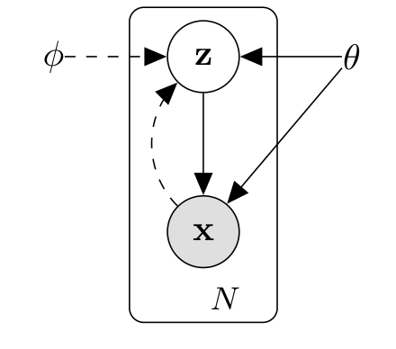
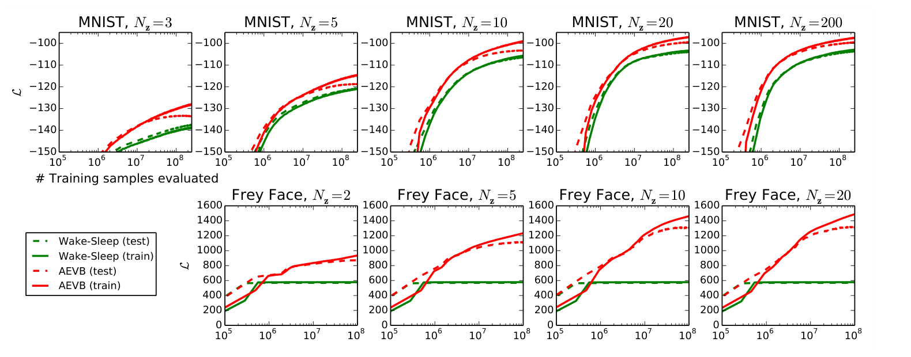
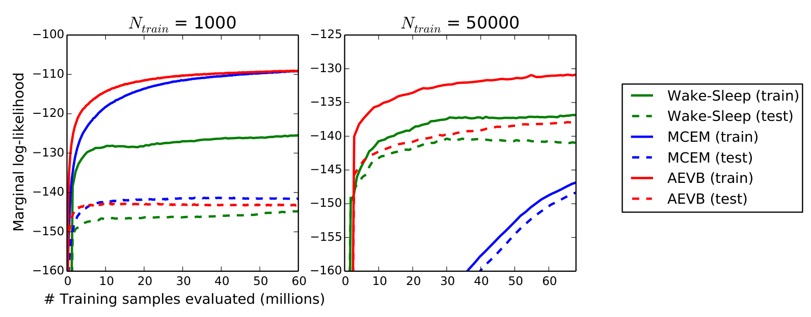
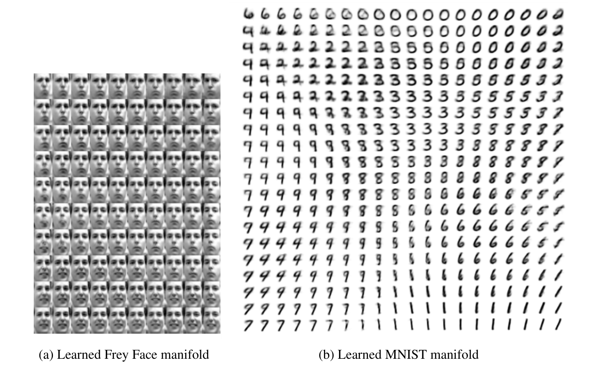
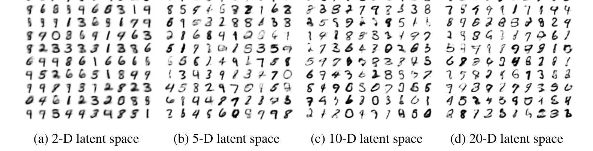

# 自编码变分贝叶斯

**Auto-Encoding Variational Bayes**

| 作者 | 单位 | 邮箱 |
| --- | --- | --- |
| Diederik P. Kingma | 阿姆斯特丹大学机器学习组 | dpkingma@gmail.com |
| Max Welling | 阿姆斯特丹大学机器学习组 | welling.max@gmail.com |

> 来源：[VAE.pdf](VAE.pdf)，arXiv:1312.6114v11，2022 年 12 月 10 日。
>
> 本文为全文中文翻译，保留原文的章节、公式编号、算法、参考文献和全部 5 张图。图内英文保留，中文对应说明见图注。参考文献题名译为中文，作者和出版信息保留以便检索。原文中影响理解的符号或表述问题用“译注”标明；译注不属于论文原文。向量统一用粗体表示，$\operatorname{diag}(\boldsymbol\sigma^2)$ 表示以各维方差为对角元的协方差矩阵。

## 摘要

当有向概率模型包含连续潜变量、其后验分布难以处理，而且数据集规模很大时，如何高效地进行推断和学习？我们提出一种随机变分推断与学习算法，它能够扩展到大型数据集，而且只要满足一些温和的可微条件，即使在难以解析处理的情况下也能工作。我们的贡献包括两方面。首先，我们证明，对变分下界进行重参数化，可以得到一个下界估计量，并能直接使用标准随机梯度方法来优化它。其次，我们证明，对于每个数据点都对应连续潜变量的独立同分布数据集，可以利用所提出的下界估计量，训练一个近似推断模型（也称为识别模型），使其拟合难以处理的后验，从而让后验推断格外高效。实验结果体现了这些理论优势。

## 1 引言

对于连续潜变量和／或参数的后验分布难以处理的有向概率模型，我们如何高效地进行近似推断和学习？变分贝叶斯（VB）方法需要优化一个对难处理后验的近似。遗憾的是，常用的平均场方法需要解析求出关于近似后验的期望，而这些期望在一般情况下也难以处理。我们将说明，对变分下界进行重参数化，可以得到一个简单、可微且无偏的下界估计量。这个随机梯度变分贝叶斯（Stochastic Gradient Variational Bayes，SGVB）估计量，能够在几乎任何具有连续潜变量和／或参数的模型中高效地进行近似后验推断，并且可以直接用标准随机梯度上升技术来优化。

对于独立同分布数据集，并且每个数据点都对应连续潜变量的情形，我们提出自编码变分贝叶斯（Auto-Encoding VB，AEVB）算法。在 AEVB 算法中，我们使用 SGVB 估计量来优化一个识别模型。该模型能够通过简单的祖先采样，非常高效地完成近似后验推断，进而使我们能够高效地学习模型参数，而无须针对每个数据点执行代价高昂的迭代推断过程，例如 MCMC。学习得到的近似后验推断模型，还能用于识别、去噪、表示学习和可视化等多种任务。当识别模型采用神经网络时，我们就得到了**变分自编码器**。

## 2 方法

本节的策略可以为多种包含连续潜变量的有向图模型推导下界估计量，即随机目标函数。这里，我们仅讨论一种常见情形：数据集独立同分布，每个数据点都对应潜变量；对全局参数进行最大似然（ML）或最大后验（MAP）估计，对潜变量进行变分推断。例如，将这一情形扩展到也对全局参数进行变分推断，并不困难。相应算法放在附录中，但这一情形的实验留待未来工作。请注意，我们的方法也可以用于在线、非平稳场景，例如流式数据；不过为简单起见，本文假定数据集固定。

**图 1：** 本文考虑的有向图模型类型。实线表示生成模型 $p_{\boldsymbol\theta}(\mathbf z)p_{\boldsymbol\theta}(\mathbf x\mid\mathbf z)$，虚线表示对难处理后验 $p_{\boldsymbol\theta}(\mathbf z\mid\mathbf x)$ 的变分近似 $q_{\boldsymbol\phi}(\mathbf z\mid\mathbf x)$。变分参数 $\boldsymbol\phi$ 与生成模型参数 $\boldsymbol\theta$ 联合学习。图中 $N$ 表示重复 $N$ 次的数据点及其潜变量。

### 2.1 问题设定

考虑数据集 $\mathbf X=\{\mathbf x^{(i)}\}_{i=1}^N$，它包含某个连续或离散变量 $\mathbf x$ 的 $N$ 个独立同分布样本。我们假定数据由某个随机过程生成，这个过程涉及一个未观测到的连续随机变量 $\mathbf z$。该过程包含两步：（1）从先验分布 $p_{\boldsymbol\theta^*}(\mathbf z)$ 生成一个值 $\mathbf z^{(i)}$；（2）从条件分布 $p_{\boldsymbol\theta^*}(\mathbf x\mid\mathbf z)$ 生成一个值 $\mathbf x^{(i)}$。我们假定，先验 $p_{\boldsymbol\theta^*}(\mathbf z)$ 和似然 $p_{\boldsymbol\theta^*}(\mathbf x\mid\mathbf z)$ 分别来自参数化分布族 $p_{\boldsymbol\theta}(\mathbf z)$ 和 $p_{\boldsymbol\theta}(\mathbf x\mid\mathbf z)$，它们的概率密度函数关于 $\boldsymbol\theta$ 和 $\mathbf z$ 都几乎处处可微。遗憾的是，这个过程有很多部分对我们不可见：真实参数 $\boldsymbol\theta^*$ 和潜变量取值 $\mathbf z^{(i)}$ 都是未知的。

非常关键的一点是，我们不对边缘概率或后验概率作通常的简化假设。相反，我们希望找到一种通用算法，即使在以下情况下也能高效工作：

1. **难以解析处理。** 边缘似然中的积分
   $$
   p_{\boldsymbol\theta}(\mathbf x)
   =\int p_{\boldsymbol\theta}(\mathbf z)p_{\boldsymbol\theta}(\mathbf x\mid\mathbf z)\,d\mathbf z
   $$
   难以计算，因此无法对边缘似然求值或求导；真实后验密度
   $$
   p_{\boldsymbol\theta}(\mathbf z\mid\mathbf x)
   =\frac{p_{\boldsymbol\theta}(\mathbf x\mid\mathbf z)p_{\boldsymbol\theta}(\mathbf z)}{p_{\boldsymbol\theta}(\mathbf x)}
   $$
   难以处理，因此不能使用 EM 算法；任何合理的平均场 VB 算法所需的积分也难以计算。这些困难非常常见，只要似然函数 $p_{\boldsymbol\theta}(\mathbf x\mid\mathbf z)$ 稍微复杂一些就会出现，例如包含一个非线性隐藏层的神经网络。
2. **数据集规模大。** 数据量大到全批量优化代价过高；我们希望使用很小的小批量，甚至单个数据点来更新参数。基于采样的方案，例如蒙特卡洛 EM，通常会太慢，因为它一般需要为每个数据点执行代价较高的采样循环。

对于上述设定，我们关注并为三个相关问题提出解决方案：

1. 对参数 $\boldsymbol\theta$ 进行高效的近似 ML 或 MAP 估计。参数本身可能就是研究对象，例如在分析某种自然过程时。它们还使我们能够模拟隐藏的随机过程，生成类似真实数据的人工数据。
2. 给定观测值 $\mathbf x$ 和选定的参数 $\boldsymbol\theta$，高效地进行潜变量 $\mathbf z$ 的近似后验推断。这对编码或数据表示任务很有用。
3. 高效地进行变量 $\mathbf x$ 的近似边缘推断。这使我们能够执行各种需要 $\mathbf x$ 的先验分布的推断任务。计算机视觉中的常见应用包括图像去噪、图像修复和超分辨率。

为解决这些问题，我们引入识别模型 $q_{\boldsymbol\phi}(\mathbf z\mid\mathbf x)$，用它近似难以处理的真实后验 $p_{\boldsymbol\theta}(\mathbf z\mid\mathbf x)$。请注意，与平均场变分推断中的近似后验不同，它不一定是因子化分布，其参数 $\boldsymbol\phi$ 也不是通过某个闭式期望计算得到的。我们将提出一种方法，联合学习识别模型参数 $\boldsymbol\phi$ 与生成模型参数 $\boldsymbol\theta$。

从编码理论角度看，未观测变量 $\mathbf z$ 可以解释为潜在表示或编码。因此，本文也将识别模型 $q_{\boldsymbol\phi}(\mathbf z\mid\mathbf x)$ 称为**概率编码器**：给定数据点 $\mathbf x$，它会为可能生成该数据点的编码 $\mathbf z$ 的取值产生一个分布，例如高斯分布。类似地，我们将 $p_{\boldsymbol\theta}(\mathbf x\mid\mathbf z)$ 称为**概率解码器**：给定编码 $\mathbf z$，它会产生对应的 $\mathbf x$ 可能取值的分布。

### 2.2 变分下界

数据集的对数边缘似然可分解为各数据点对数边缘似然的和：

$$
\log p_{\boldsymbol\theta}(\mathbf x^{(1)},\ldots,\mathbf x^{(N)})
=\sum_{i=1}^N\log p_{\boldsymbol\theta}(\mathbf x^{(i)}).
$$

其中每一项都可以改写为：

$$
\log p_{\boldsymbol\theta}(\mathbf x^{(i)})
=D_{\mathrm{KL}}\!\left(q_{\boldsymbol\phi}(\mathbf z\mid\mathbf x^{(i)})\,\|\,p_{\boldsymbol\theta}(\mathbf z\mid\mathbf x^{(i)})\right)
+\mathcal L(\boldsymbol\theta,\boldsymbol\phi;\mathbf x^{(i)}).
\tag{1}
$$

右侧第一项是近似后验相对于真实后验的 KL 散度。由于 KL 散度非负，右侧第二项 $\mathcal L(\boldsymbol\theta,\boldsymbol\phi;\mathbf x^{(i)})$ 被称为数据点 $i$ 的边缘似然的（变分）下界，可以写为：

$$
\log p_{\boldsymbol\theta}(\mathbf x^{(i)})
\geq\mathcal L(\boldsymbol\theta,\boldsymbol\phi;\mathbf x^{(i)})
=\mathbb E_{q_{\boldsymbol\phi}(\mathbf z\mid\mathbf x^{(i)})}
\!\left[-\log q_{\boldsymbol\phi}(\mathbf z\mid\mathbf x^{(i)})+\log p_{\boldsymbol\theta}(\mathbf x^{(i)},\mathbf z)\right].
\tag{2}
$$

它也可以写为：

$$
\begin{aligned}
\mathcal L(\boldsymbol\theta,\boldsymbol\phi;\mathbf x^{(i)})
={}&-D_{\mathrm{KL}}\!\left(q_{\boldsymbol\phi}(\mathbf z\mid\mathbf x^{(i)})\,\|\,p_{\boldsymbol\theta}(\mathbf z)\right)\\
&+\mathbb E_{q_{\boldsymbol\phi}(\mathbf z\mid\mathbf x^{(i)})}
\!\left[\log p_{\boldsymbol\theta}(\mathbf x^{(i)}\mid\mathbf z)\right].
\end{aligned}
\tag{3}
$$

我们希望同时对变分参数 $\boldsymbol\phi$ 和生成参数 $\boldsymbol\theta$ 求导，并优化下界 $\mathcal L(\boldsymbol\theta,\boldsymbol\phi;\mathbf x^{(i)})$。然而，下界关于 $\boldsymbol\phi$ 的梯度有些棘手。此类问题通常采用的朴素蒙特卡洛梯度估计量是：

$$
\begin{aligned}
\nabla_{\boldsymbol\phi}\mathbb E_{q_{\boldsymbol\phi}(\mathbf z)}[f(\mathbf z)]
&=\mathbb E_{q_{\boldsymbol\phi}(\mathbf z)}
\!\left[f(\mathbf z)\nabla_{\boldsymbol\phi}\log q_{\boldsymbol\phi}(\mathbf z)\right]\\
&\simeq\frac1L\sum_{l=1}^L f(\mathbf z^{(l)})
\nabla_{\boldsymbol\phi}\log q_{\boldsymbol\phi}(\mathbf z^{(l)}),
\qquad\mathbf z^{(l)}\sim q_{\boldsymbol\phi}(\mathbf z\mid\mathbf x^{(i)}).
\end{aligned}
$$

这个梯度估计量的方差非常高，例如可参见 [BJP12]，因而不适合我们的目的。

> **译注：** 原文该式把对参数的梯度下标误写成了分布 $q_{\boldsymbol\phi}$；这里按其所表达的得分函数梯度恒等式统一写为 $\nabla_{\boldsymbol\phi}$。

### 2.3 SGVB 估计量与 AEVB 算法

本节介绍一种实用的下界估计量，以及它关于参数的导数。我们假定近似后验具有 $q_{\boldsymbol\phi}(\mathbf z\mid\mathbf x)$ 的形式，但请注意，该技术也适用于 $q_{\boldsymbol\phi}(\mathbf z)$，即不以 $\mathbf x$ 为条件的情形。用于推断参数后验的完整变分贝叶斯方法见附录。

对于选定的近似后验 $q_{\boldsymbol\phi}(\mathbf z\mid\mathbf x)$，在第 2.4 节所述的某些温和条件下，可以将随机变量 $\widetilde{\mathbf z}\sim q_{\boldsymbol\phi}(\mathbf z\mid\mathbf x)$ 重参数化为辅助噪声变量 $\boldsymbol\epsilon$ 的可微变换 $g_{\boldsymbol\phi}(\boldsymbol\epsilon,\mathbf x)$：

$$
\widetilde{\mathbf z}=g_{\boldsymbol\phi}(\boldsymbol\epsilon,\mathbf x),
\qquad\boldsymbol\epsilon\sim p(\boldsymbol\epsilon).
\tag{4}
$$

选择适当分布 $p(\boldsymbol\epsilon)$ 与函数 $g_{\boldsymbol\phi}(\boldsymbol\epsilon,\mathbf x)$ 的一般策略见第 2.4 节。现在，我们可以对函数 $f(\mathbf z)$ 关于 $q_{\boldsymbol\phi}(\mathbf z\mid\mathbf x)$ 的期望构造如下蒙特卡洛估计：

$$
\begin{aligned}
\mathbb E_{q_{\boldsymbol\phi}(\mathbf z\mid\mathbf x^{(i)})}[f(\mathbf z)]
&=\mathbb E_{p(\boldsymbol\epsilon)}
\!\left[f\!\left(g_{\boldsymbol\phi}(\boldsymbol\epsilon,\mathbf x^{(i)})\right)\right]\\
&\simeq\frac1L\sum_{l=1}^L
f\!\left(g_{\boldsymbol\phi}(\boldsymbol\epsilon^{(l)},\mathbf x^{(i)})\right),
\quad\boldsymbol\epsilon^{(l)}\sim p(\boldsymbol\epsilon).
\end{aligned}
\tag{5}
$$

将这一技术应用于式（2）的变分下界，得到通用的随机梯度变分贝叶斯（SGVB）估计量 $\widetilde{\mathcal L}^{A}(\boldsymbol\theta,\boldsymbol\phi;\mathbf x^{(i)})\simeq\mathcal L(\boldsymbol\theta,\boldsymbol\phi;\mathbf x^{(i)})$：

$$
\begin{aligned}
\widetilde{\mathcal L}^{A}(\boldsymbol\theta,\boldsymbol\phi;\mathbf x^{(i)})
&=\frac1L\sum_{l=1}^L
\left[\log p_{\boldsymbol\theta}(\mathbf x^{(i)},\mathbf z^{(i,l)})
-\log q_{\boldsymbol\phi}(\mathbf z^{(i,l)}\mid\mathbf x^{(i)})\right],\\
\mathbf z^{(i,l)}&=g_{\boldsymbol\phi}(\boldsymbol\epsilon^{(i,l)},\mathbf x^{(i)}),
\qquad\boldsymbol\epsilon^{(i,l)}\sim p(\boldsymbol\epsilon).
\end{aligned}
\tag{6}
$$

式（3）中的 KL 散度 $D_{\mathrm{KL}}(q_{\boldsymbol\phi}(\mathbf z\mid\mathbf x^{(i)})\|p_{\boldsymbol\theta}(\mathbf z))$ 往往可以解析积分，见附录 B。这样，只有期望重构误差项 $\mathbb E_{q_{\boldsymbol\phi}(\mathbf z\mid\mathbf x^{(i)})}[\log p_{\boldsymbol\theta}(\mathbf x^{(i)}\mid\mathbf z)]$ 需要通过采样估计。此时，KL 散度项可以解释为对 $\boldsymbol\phi$ 的正则化，促使近似后验接近先验 $p_{\boldsymbol\theta}(\mathbf z)$。由此得到对应于式（3）的第二种 SGVB 估计量 $\widetilde{\mathcal L}^{B}(\boldsymbol\theta,\boldsymbol\phi;\mathbf x^{(i)})\simeq\mathcal L(\boldsymbol\theta,\boldsymbol\phi;\mathbf x^{(i)})$，其方差通常比通用估计量更低：

$$
\begin{aligned}
\widetilde{\mathcal L}^{B}(\boldsymbol\theta,\boldsymbol\phi;\mathbf x^{(i)})
={}&-D_{\mathrm{KL}}\!\left(q_{\boldsymbol\phi}(\mathbf z\mid\mathbf x^{(i)})\,\|\,p_{\boldsymbol\theta}(\mathbf z)\right)\\
&+\frac1L\sum_{l=1}^L\log p_{\boldsymbol\theta}(\mathbf x^{(i)}\mid\mathbf z^{(i,l)}),\\
\mathbf z^{(i,l)}={}&g_{\boldsymbol\phi}(\boldsymbol\epsilon^{(i,l)},\mathbf x^{(i)}),
\qquad\boldsymbol\epsilon^{(i,l)}\sim p(\boldsymbol\epsilon).
\end{aligned}
\tag{7}
$$

> **译注：** 上段沿用原文“期望重构误差项”的称呼；严格地说，该期望是重构对数似然，即后文所说的“负重构误差”。另外，式（6）、（7）中的噪声样本下标已统一为 $(i,l)$。

给定含有 $N$ 个数据点的数据集 $\mathbf X$，我们可以利用小批量，构造整个数据集边缘似然下界的估计量：

$$
\mathcal L(\boldsymbol\theta,\boldsymbol\phi;\mathbf X)
\simeq\widetilde{\mathcal L}^{M}(\boldsymbol\theta,\boldsymbol\phi;\mathbf X^M)
=\frac NM\sum_{i=1}^{M}\widetilde{\mathcal L}(\boldsymbol\theta,\boldsymbol\phi;\mathbf x^{(i)}).
\tag{8}
$$

其中，小批量 $\mathbf X^M=\{\mathbf x^{(i)}\}_{i=1}^M$ 是从包含 $N$ 个数据点的完整数据集 $\mathbf X$ 中随机抽取的 $M$ 个数据点。在实验中，我们发现，只要小批量大小 $M$ 足够大，例如 $M=100$，每个数据点的采样数 $L$ 就可以设为 1。对估计量求导得到 $\nabla_{\boldsymbol\theta,\boldsymbol\phi}\widetilde{\mathcal L}^{M}(\boldsymbol\theta,\boldsymbol\phi;\mathbf X^M)$ 后，便可结合 SGD 或 Adagrad [DHS10] 等随机优化方法使用这些梯度。算法 1 给出了计算随机梯度的基本方法。

**算法 1：自编码 VB（AEVB）算法的小批量版本。** 可以使用第 2.3 节中的任一种 SGVB 估计量。实验中采用 $M=100$、$L=1$。

1. 初始化参数 $\boldsymbol\theta,\boldsymbol\phi$。
2. 重复以下步骤，直到参数 $(\boldsymbol\theta,\boldsymbol\phi)$ 收敛：
   - 从完整数据集中随机抽取包含 $M$ 个数据点的小批量 $\mathbf X^M$。
   - 从噪声分布 $p(\boldsymbol\epsilon)$ 随机抽取样本 $\boldsymbol\epsilon$。
   - 计算 $\mathbf g\leftarrow\nabla_{\boldsymbol\theta,\boldsymbol\phi}\widetilde{\mathcal L}^{M}(\boldsymbol\theta,\boldsymbol\phi;\mathbf X^M,\boldsymbol\epsilon)$，即小批量估计量（8）的梯度。
   - 使用梯度 $\mathbf g$ 更新参数 $\boldsymbol\theta,\boldsymbol\phi$，例如采用 SGD 或 Adagrad [DHS10]。
3. 返回 $\boldsymbol\theta,\boldsymbol\phi$。

观察式（7）的目标函数，就能看出它与自编码器的联系。第一项，即近似后验相对于先验的负 KL 散度，起正则化作用；第二项是期望负重构误差。函数 $g_{\boldsymbol\phi}(\cdot)$ 将数据点 $\mathbf x^{(i)}$ 与随机噪声向量 $\boldsymbol\epsilon^{(l)}$ 映射为该数据点近似后验的一个样本：$\mathbf z^{(i,l)}=g_{\boldsymbol\phi}(\boldsymbol\epsilon^{(l)},\mathbf x^{(i)})$，其中 $\mathbf z^{(i,l)}\sim q_{\boldsymbol\phi}(\mathbf z\mid\mathbf x^{(i)})$。随后，样本 $\mathbf z^{(i,l)}$ 被输入函数 $\log p_{\boldsymbol\theta}(\mathbf x^{(i)}\mid\mathbf z^{(i,l)})$。它给出在生成模型下、以 $\mathbf z^{(i,l)}$ 为条件的数据点 $\mathbf x^{(i)}$ 的对数概率密度或对数概率质量。按照自编码器的说法，这一项就是负重构误差。

> **译注：** 原文把上述 $\log p$ 称为“概率密度（或质量）”，此处补出“对数”以与公式一致。

### 2.4 重参数化技巧

为解决我们的问题，我们采用了另一种从 $q_{\boldsymbol\phi}(\mathbf z\mid\mathbf x)$ 生成样本的方法。重参数化技巧的核心非常简单。设 $\mathbf z$ 是连续随机变量，$\mathbf z\sim q_{\boldsymbol\phi}(\mathbf z\mid\mathbf x)$ 是某个条件分布。通常可以把随机变量 $\mathbf z$ 写成确定性函数 $\mathbf z=g_{\boldsymbol\phi}(\boldsymbol\epsilon,\mathbf x)$，其中 $\boldsymbol\epsilon$ 是具有独立边缘分布 $p(\boldsymbol\epsilon)$ 的辅助变量，$g_{\boldsymbol\phi}(\cdot)$ 是由 $\boldsymbol\phi$ 参数化的某个向量值函数。

这种重参数化对我们很有用，因为它可以改写关于 $q_{\boldsymbol\phi}(\mathbf z\mid\mathbf x)$ 的期望，使该期望的蒙特卡洛估计关于 $\boldsymbol\phi$ 可微。证明如下。给定确定性映射 $\mathbf z=g_{\boldsymbol\phi}(\boldsymbol\epsilon,\mathbf x)$，有：

$$
q_{\boldsymbol\phi}(\mathbf z\mid\mathbf x)\prod_i dz_i
=p(\boldsymbol\epsilon)\prod_i d\epsilon_i.
$$

因此：

$$
\begin{aligned}
\int q_{\boldsymbol\phi}(\mathbf z\mid\mathbf x)f(\mathbf z)\,d\mathbf z
&=\int p(\boldsymbol\epsilon)f(\mathbf z)\,d\boldsymbol\epsilon\\
&=\int p(\boldsymbol\epsilon)f(g_{\boldsymbol\phi}(\boldsymbol\epsilon,\mathbf x))\,d\boldsymbol\epsilon.
\end{aligned}
$$

这里对微元采用记号约定 $d\mathbf z=\prod_i dz_i$，即原文脚注 1。因此，可以构造可微估计量：

$$
\int q_{\boldsymbol\phi}(\mathbf z\mid\mathbf x)f(\mathbf z)\,d\mathbf z
\simeq\frac1L\sum_{l=1}^L f(g_{\boldsymbol\phi}(\boldsymbol\epsilon^{(l)},\mathbf x)),
\qquad\boldsymbol\epsilon^{(l)}\sim p(\boldsymbol\epsilon).
$$

在第 2.3 节中，我们正是利用这一技巧，得到了变分下界的可微估计量。

以一元高斯分布为例：令 $z\sim p(z\mid x)=\mathcal N(\mu,\sigma^2)$。一种有效的重参数化是 $z=\mu+\sigma\epsilon$，其中辅助噪声变量 $\epsilon\sim\mathcal N(0,1)$。因此：

$$
\mathbb E_{\mathcal N(z;\mu,\sigma^2)}[f(z)]
=\mathbb E_{\mathcal N(\epsilon;0,1)}[f(\mu+\sigma\epsilon)]
\simeq\frac1L\sum_{l=1}^{L}f(\mu+\sigma\epsilon^{(l)}),
\qquad\epsilon^{(l)}\sim\mathcal N(0,1).
$$

对于哪些 $q_{\boldsymbol\phi}(\mathbf z\mid\mathbf x)$，能够选择这样的可微变换 $g_{\boldsymbol\phi}(\cdot)$ 和辅助变量 $\boldsymbol\epsilon\sim p(\boldsymbol\epsilon)$？有三种基本方法：

1. **逆累积分布函数易于计算。** 此时令 $\boldsymbol\epsilon\sim\mathcal U(\mathbf0,\mathbf I)$，并令 $g_{\boldsymbol\phi}(\boldsymbol\epsilon,\mathbf x)$ 为 $q_{\boldsymbol\phi}(\mathbf z\mid\mathbf x)$ 的逆累积分布函数（逆 CDF）。例子包括指数、柯西、逻辑斯谛、瑞利、帕累托、威布尔、倒数（Reciprocal）、冈珀茨、耿贝尔和埃尔朗分布。
2. **位置-尺度分布族。** 与高斯分布的例子类似，对于任意位置-尺度分布族，都可以把位置为 0、尺度为 1 的标准分布作为辅助变量 $\boldsymbol\epsilon$ 的分布，并令 $g(\cdot)=\text{位置}+\text{尺度}\cdot\boldsymbol\epsilon$。例子包括拉普拉斯、椭圆、Student $t$、逻辑斯谛、均匀、三角和高斯分布。
3. **组合。** 随机变量往往可以表示为辅助变量的不同变换。例子包括对数正态分布（对正态随机变量取指数）、伽马分布（指数随机变量之和）、狄利克雷分布（伽马随机变量的加权和），以及贝塔、卡方和 F 分布。

如果三种方法都不适用，还可以使用逆 CDF 的良好近似，其计算时间复杂度与计算概率密度函数相当。部分方法可参见 [Dev86]。

> **译注：** 原文对伽马分布与狄利克雷分布的构造表述较简略。“指数随机变量之和”直接对应整数形状参数的伽马分布；一般狄利克雷采样可通过相同尺度的独立伽马变量除以它们的总和得到。这里保留原文列举，并补充适用条件。

## 3 示例：变分自编码器

本节给出一个例子：使用神经网络作为概率编码器 $q_{\boldsymbol\phi}(\mathbf z\mid\mathbf x)$，即对生成模型 $p_{\boldsymbol\theta}(\mathbf x,\mathbf z)$ 后验的近似，并用 AEVB 算法联合优化参数 $\boldsymbol\phi$ 和 $\boldsymbol\theta$。

令潜变量的先验为零均值、各向同性的多元高斯分布 $p_{\boldsymbol\theta}(\mathbf z)=\mathcal N(\mathbf z;\mathbf0,\mathbf I)$。注意，此时先验没有待学习参数。对于实值数据，令 $p_{\boldsymbol\theta}(\mathbf x\mid\mathbf z)$ 为多元高斯分布；对于二值数据，令它为伯努利分布。分布参数由一个 MLP 根据 $\mathbf z$ 计算得到。这里的 MLP 是具有单个隐藏层的全连接神经网络，见附录 C。请注意，此时真实后验 $p_{\boldsymbol\theta}(\mathbf z\mid\mathbf x)$ 难以处理。

尽管 $q_{\boldsymbol\phi}(\mathbf z\mid\mathbf x)$ 的形式有很大的选择自由，我们仍假定真实但难以处理的后验近似为高斯分布，而且协方差近似为对角矩阵。这样，就可以令变分近似后验为具有对角协方差结构的多元高斯分布：

$$
\log q_{\boldsymbol\phi}(\mathbf z\mid\mathbf x^{(i)})
=\log\mathcal N\!\left(\mathbf z;\boldsymbol\mu^{(i)},\operatorname{diag}((\boldsymbol\sigma^{(i)})^2)\right).
\tag{9}
$$

其中，近似后验的均值和标准差 $\boldsymbol\mu^{(i)}$、$\boldsymbol\sigma^{(i)}$ 是编码 MLP 的输出，即数据点 $\mathbf x^{(i)}$ 与变分参数 $\boldsymbol\phi$ 的非线性函数，见附录 C。

**原文脚注 2：** 这只是一种简化选择，并非我们方法的限制。

如第 2.4 节所述，我们通过下式从后验中抽取 $\mathbf z^{(i,l)}\sim q_{\boldsymbol\phi}(\mathbf z\mid\mathbf x^{(i)})$：

$$
\mathbf z^{(i,l)}=g_{\boldsymbol\phi}(\boldsymbol\epsilon^{(l)},\mathbf x^{(i)})
=\boldsymbol\mu^{(i)}+\boldsymbol\sigma^{(i)}\odot\boldsymbol\epsilon^{(l)},
\qquad\boldsymbol\epsilon^{(l)}\sim\mathcal N(\mathbf0,\mathbf I).
$$

符号 $\odot$ 表示逐元素乘积。在这个模型中，先验 $p_{\boldsymbol\theta}(\mathbf z)$ 和 $q_{\boldsymbol\phi}(\mathbf z\mid\mathbf x)$ 都是高斯分布；因此可以使用式（7）的估计量，其中 KL 散度能够精确计算并求导，无须采样估计，见附录 B。由此，该模型对数据点 $\mathbf x^{(i)}$ 的估计量为：

$$
\begin{aligned}
\mathcal L(\boldsymbol\theta,\boldsymbol\phi;\mathbf x^{(i)})\simeq{}&
\frac12\sum_{j=1}^{J}
\left[1+\log\left((\sigma_j^{(i)})^2\right)-(\mu_j^{(i)})^2-(\sigma_j^{(i)})^2\right]\\
&+\frac1L\sum_{l=1}^{L}\log p_{\boldsymbol\theta}(\mathbf x^{(i)}\mid\mathbf z^{(i,l)}),\\
\mathbf z^{(i,l)}={}&\boldsymbol\mu^{(i)}+\boldsymbol\sigma^{(i)}\odot\boldsymbol\epsilon^{(l)},
\qquad\boldsymbol\epsilon^{(l)}\sim\mathcal N(\mathbf0,\mathbf I).
\end{aligned}
\tag{10}
$$

如上文和附录 C 所述，解码项 $\log p_{\boldsymbol\theta}(\mathbf x^{(i)}\mid\mathbf z^{(i,l)})$ 使用伯努利 MLP 或高斯 MLP，具体取决于所建模数据的类型。

> **译注：** 原文用 $\boldsymbol\sigma^2\mathbf I$ 简写逐维方差的对角协方差；译文统一写为 $\operatorname{diag}(\boldsymbol\sigma^2)$，以免与所有维度共享同一方差的各向同性高斯混淆。$J$ 为潜变量维数。

## 4 相关工作

据我们所知，唤醒-睡眠（wake-sleep）算法 [HDFN95] 是文献中唯一另一种适用于同样广泛的连续潜变量模型的在线学习方法。与我们的方法类似，唤醒-睡眠算法使用识别模型来近似真实后验。它的一个缺点是需要同时优化两个目标函数，而这两个目标合在一起并不对应于对边缘似然或其下界的优化。唤醒-睡眠算法的一个优点是，它也适用于具有离散潜变量的模型。对于每个数据点，唤醒-睡眠与 AEVB 的计算复杂度相同。

随机变分推断 [HBWP13] 近来受到越来越多的关注。[BJP12] 最近引入了控制变量方案，以降低前文讨论的朴素梯度估计量的高方差，并将其应用于后验的指数族近似。[RGB13] 提出了一些降低原始梯度估计量方差的通用方法，即控制变量方案。[SK13] 使用了与本文类似的重参数化，将其用于一种高效的随机变分推断算法，以学习指数族近似分布的自然参数。

AEVB 算法揭示了采用变分目标训练的有向概率模型与自编码器之间的联系。线性自编码器与某类生成式线性高斯模型之间的联系早已为人所知。[Row98] 表明，PCA 对应于一种特殊线性高斯模型的最大似然解：其先验为 $p(\mathbf z)=\mathcal N(\mathbf0,\mathbf I)$，条件分布为 $p(\mathbf x\mid\mathbf z)=\mathcal N(\mathbf x;\mathbf W\mathbf z,\epsilon\mathbf I)$，并取 $\epsilon$ 无穷小的情形。

近期有关自编码器的相关研究 [VLL+10] 表明，无正则化自编码器的训练准则，相当于最大化输入 $\mathbf X$ 与潜在表示 $\mathbf Z$ 之间互信息的一个下界，参见信息最大化原则 [Lin89]。原文进一步表示，对参数最大化互信息等价于最大化条件熵，而条件熵以下述量为下界：在自编码模型下，数据的期望对数似然 [VLL+10]，也就是负重构误差。然而，众所周知，仅靠这种重构准则不足以学习有用的表示 [BCV13]。因此，人们提出了各种正则化技术，促使自编码器学习有用的表示，例如去噪、收缩和稀疏自编码器变体 [BCV13]。SGVB 目标中包含由变分下界所决定的正则化项，例如式（10），不需要通常为学习有用表示而引入的额外正则化超参数。

> **译注：** 上段关于“最大化条件熵”的表述来自原文，存在符号方向问题。对于固定的数据分布，由 $I(\mathbf X;\mathbf Z)=H(\mathbf X)-H(\mathbf X\mid\mathbf Z)$，最大化互信息对应于最小化条件熵，或者最大化负条件熵。重构期望对数似然给出的是负条件熵的下界。

相关工作还包括预测稀疏分解（Predictive Sparse Decomposition，PSD）[KRL08] 等编码器-解码器架构，我们从中得到了一些启发。另一个相关方向是最近提出的生成随机网络（Generative Stochastic Networks）[BTL13]：带噪自编码器学习一个马尔可夫链的转移算子，使该链能够从数据分布采样。[SL10] 使用识别模型来高效学习深度玻尔兹曼机。这些方法针对未归一化模型，即玻尔兹曼机之类的无向模型，或者仅限于稀疏编码模型；而我们提出的算法旨在学习一大类有向概率模型。

最近提出的 DARN 方法 [GMW13] 也利用自编码结构学习有向概率模型，但它适用于二值潜变量。更近的工作 [RMW14] 也使用本文描述的重参数化技巧，建立了自编码器、有向概率模型与随机变分推断之间的联系。他们的工作独立于我们开展，为 AEVB 提供了另一种视角。

## 5 实验

我们在 MNIST 和 Frey Face 数据集上训练图像生成模型，并通过变分下界和估计得到的边缘似然来比较学习算法。

**原文脚注 3：** 数据可从 <http://www.cs.nyu.edu/~roweis/data.html> 获取。

我们采用第 3 节中的生成模型（解码器）和变分近似（编码器），并让编码器和解码器具有相同数量的隐藏单元。由于 Frey Face 数据是连续值，我们使用具有高斯输出的解码器。它与编码器相同，只是在解码器输出端使用 sigmoid 激活函数，将均值限制在 $(0,1)$ 区间。注意，这里的隐藏单元是指编码器和解码器神经网络隐藏层中的单元。

> **译注：** 原文此处把生成模型称为“encoder”、变分近似称为“decoder”，与第 2、3 节及其后实验描述相反；这里按模型定义更正为“生成模型（解码器）”和“变分近似（编码器）”。

参数通过随机梯度上升更新。梯度由下界估计量的导数 $\nabla_{\boldsymbol\theta,\boldsymbol\phi}\mathcal L(\boldsymbol\theta,\boldsymbol\phi;\mathbf X)$，见算法 1，再加上一项较小的权重衰减项得到；该衰减项对应于先验 $p(\boldsymbol\theta)=\mathcal N(\mathbf0,\mathbf I)$。优化这个目标等价于近似 MAP 估计，其中似然梯度由下界的梯度近似。

我们将 AEVB 的性能与唤醒-睡眠算法 [HDFN95] 比较。唤醒-睡眠算法与变分自编码器采用相同的编码器，也称为识别模型。所有参数，包括变分参数与生成参数，都通过从 $\mathcal N(0,0.01)$ 随机采样初始化，并在 MAP 准则下联合进行随机优化。步长通过 Adagrad [DHS10] 调整；根据训练开始后前几次迭代在训练集上的表现，从 $\{0.01,0.02,0.1\}$ 中选择 Adagrad 的全局步长参数。小批量大小为 $M=100$，每个数据点抽取 $L=1$ 个样本。

### 似然下界

在 MNIST 上，我们训练的生成模型（解码器）及其对应的编码器，即识别模型，各包含 500 个隐藏单元；在 Frey Face 上各包含 200 个隐藏单元，以防过拟合，因为后者的数据集小得多。隐藏单元数量参考了已有自编码器文献，不同算法的相对性能对这些选择并不十分敏感。图 2 给出了下界比较结果。有趣的是，多余的潜变量并未引起过拟合，这可以由变分下界的正则化性质解释。

**图 2：** 在不同潜空间维数 $N_z$ 下，比较我们的 AEVB 方法与唤醒-睡眠算法优化下界的表现。在所有实验中，我们的方法都明显更快地收敛，并取得更好的解。有趣的是，增加潜变量并未带来更多过拟合，这可由下界的正则化作用解释。纵轴为估计得到的每个数据点的平均变分下界；估计量方差很小（小于 1），故未显示。横轴为已处理的训练样本数量。在有效算力为 40 GFLOPS 的 Intel Xeon CPU 上，每处理一百万个训练样本约耗时 20 至 40 分钟。

图内文字：`# Training samples evaluated` 为“已处理的训练样本数量”；`Wake-Sleep` 为“唤醒-睡眠”；`test`、`train` 分别为“测试集”“训练集”；$N_z$ 为潜变量维数。绿色曲线表示唤醒-睡眠，红色曲线表示 AEVB；实线为训练集，虚线为测试集。

### 边缘似然

当潜空间维数非常低时，可以使用 MCMC 估计量，估计学习得到的生成模型的边缘似然。边缘似然估计量的更多信息见附录。编码器和解码器仍使用神经网络，这次各有 100 个隐藏单元，并使用 3 个潜变量；对于更高维的潜空间，估计结果变得不可靠。这里同样使用 MNIST 数据集。我们将 AEVB 和唤醒-睡眠方法，与采用混合蒙特卡洛（Hybrid Monte Carlo，HMC）[DKPR87] 采样器的蒙特卡洛 EM（MCEM）进行比较；详情见附录。我们分别针对较小和较大的训练集，比较了三种算法的收敛速度。结果见图 3。

**图 3：** 在不同训练数据量下，通过估计的边缘似然，比较 AEVB、唤醒-睡眠算法与蒙特卡洛 EM。蒙特卡洛 EM 不是在线算法，因而无法像 AEVB 和唤醒-睡眠方法那样高效地应用于完整 MNIST 数据集。

图内文字：`Marginal log-likelihood` 为“对数边缘似然”；`# Training samples evaluated (millions)` 为“已处理的训练样本数量（百万）”；$N_{\mathrm{train}}$ 为训练集样本数，左图为 1,000，右图为 50,000；`MCEM` 为“蒙特卡洛 EM”。绿色、蓝色和红色分别表示唤醒-睡眠、MCEM 和 AEVB；实线为训练集，虚线为测试集。

### 高维数据的可视化

如果选择低维潜空间，例如二维，就可以利用学到的编码器，即识别模型，把高维数据投影到低维流形上。MNIST 和 Frey Face 数据集的二维潜在流形可视化见附录 A。

## 6 结论

我们提出了一种新的变分下界估计量，即随机梯度 VB（SGVB），用于对连续潜变量进行高效的近似推断。所提出的估计量可以直接求导，并用标准随机梯度方法优化。对于独立同分布数据集，并且每个数据点都对应连续潜变量的情况，我们提出了用于高效推断与学习的自编码 VB（AEVB）算法，它使用 SGVB 估计量来学习近似推断模型。实验结果体现了这些理论优势。

## 7 未来工作

由于 SGVB 估计量和 AEVB 算法几乎可以应用于任何包含连续潜变量的推断与学习问题，未来研究方向很多：

1. 学习分层生成架构，使用深度神经网络，例如卷积网络，作为编码器和解码器，并通过 AEVB 联合训练。
2. 时间序列模型，即动态贝叶斯网络。
3. 将 SGVB 应用于全局参数。
4. 包含潜变量的监督模型，用于学习复杂的噪声分布。

## 参考文献

- **[BCV13]** Yoshua Bengio, Aaron Courville, and Pascal Vincent. 表示学习：综述与新视角（Representation learning: A review and new perspectives）. 2013.
- **[BJP12]** David M Blei, Michael I Jordan, and John W Paisley. 基于随机搜索的变分贝叶斯推断（Variational Bayesian inference with Stochastic Search）. In *Proceedings of the 29th International Conference on Machine Learning (ICML-12)*, pages 1367-1374, 2012.
- **[BTL13]** Yoshua Bengio and Éric Thibodeau-Laufer. 可通过反向传播训练的深度生成随机网络（Deep generative stochastic networks trainable by backprop）. arXiv preprint arXiv:1306.1091, 2013.
- **[Dev86]** Luc Devroye. 基于样本的非均匀随机变量生成（Sample-based non-uniform random variate generation）. In *Proceedings of the 18th conference on Winter simulation*, pages 260-265. ACM, 1986.
- **[DHS10]** John Duchi, Elad Hazan, and Yoram Singer. 用于在线学习与随机优化的自适应次梯度方法（Adaptive subgradient methods for online learning and stochastic optimization）. *Journal of Machine Learning Research*, 12:2121-2159, 2010.
- **[DKPR87]** Simon Duane, Anthony D Kennedy, Brian J Pendleton, and Duncan Roweth. 混合蒙特卡洛（Hybrid monte carlo）. *Physics letters B*, 195(2):216-222, 1987.
- **[GMW13]** Karol Gregor, Andriy Mnih, and Daan Wierstra. 深度自回归网络（Deep autoregressive networks）. arXiv preprint arXiv:1310.8499, 2013.
- **[HBWP13]** Matthew D Hoffman, David M Blei, Chong Wang, and John Paisley. 随机变分推断（Stochastic variational inference）. *The Journal of Machine Learning Research*, 14(1):1303-1347, 2013.
- **[HDFN95]** Geoffrey E Hinton, Peter Dayan, Brendan J Frey, and Radford M Neal. 用于无监督神经网络的“唤醒-睡眠”算法（The “wake-sleep” algorithm for unsupervised neural networks）. *SCIENCE*, pages 1158-1158, 1995.
- **[KRL08]** Koray Kavukcuoglu, Marc’Aurelio Ranzato, and Yann LeCun. 稀疏编码算法中的快速推断及其在目标识别中的应用（Fast inference in sparse coding algorithms with applications to object recognition）. Technical Report CBLL-TR-2008-12-01, Computational and Biological Learning Lab, Courant Institute, NYU, 2008.
- **[Lin89]** Ralph Linsker. 最大信息保持原则在线性系统中的应用（An application of the principle of maximum information preservation to linear systems）. Morgan Kaufmann Publishers Inc., 1989.
- **[RGB13]** Rajesh Ranganath, Sean Gerrish, and David M Blei. 黑盒变分推断（Black Box Variational Inference）. arXiv preprint arXiv:1401.0118, 2013.
- **[RMW14]** Danilo Jimenez Rezende, Shakir Mohamed, and Daan Wierstra. 深度潜在高斯模型中的随机反向传播与变分推断（Stochastic backpropagation and variational inference in deep latent gaussian models）. arXiv preprint arXiv:1401.4082, 2014.
- **[Row98]** Sam Roweis. 用于 PCA 和 SPCA 的 EM 算法（EM algorithms for PCA and SPCA）. *Advances in neural information processing systems*, pages 626-632, 1998.
- **[SK13]** Tim Salimans and David A Knowles. 通过随机线性回归进行固定形式的变分后验近似（Fixed-form variational posterior approximation through stochastic linear regression）. *Bayesian Analysis*, 8(4), 2013.
- **[SL10]** Ruslan Salakhutdinov and Hugo Larochelle. 深度玻尔兹曼机的高效学习（Efficient learning of deep boltzmann machines）. In *International Conference on Artificial Intelligence and Statistics*, pages 693-700, 2010.
- **[VLL+10]** Pascal Vincent, Hugo Larochelle, Isabelle Lajoie, Yoshua Bengio, and Pierre-Antoine Manzagol. 堆叠去噪自编码器：利用局部去噪准则在深度网络中学习有用表示（Stacked denoising autoencoders: Learning useful representations in a deep network with a local denoising criterion）. *The Journal of Machine Learning Research*, 9999:3371-3408, 2010.

> **译注：** 以上年份、卷号、页码等出版信息按原文保留，包括个别不一致之处。

## 附录 A 可视化

图 4 和图 5 展示了使用 SGVB 学习的模型的潜空间及其对应观测空间。

**图 4：** 使用 AEVB 学习的、具有二维潜空间的生成模型，其所学数据流形的可视化。由于潜空间的先验为高斯分布，我们把单位正方形上等间距的坐标，通过高斯分布的逆 CDF 变换为潜变量 $\mathbf z$ 的取值。对于每一个 $\mathbf z$，我们使用学到的参数 $\boldsymbol\theta$，绘制对应的生成分布 $p_{\boldsymbol\theta}(\mathbf x\mid\mathbf z)$。

图中：（a）学到的 Frey Face 流形；（b）学到的 MNIST 流形。

**图 5：** 从学习得到的不同潜空间维数的 MNIST 生成模型中抽取的随机样本。图中：（a）二维潜空间；（b）五维潜空间；（c）十维潜空间；（d）二十维潜空间。

## 附录 B 高斯情形下 $-D_{\mathrm{KL}}(q_{\boldsymbol\phi}(\mathbf z)\|p_{\boldsymbol\theta}(\mathbf z))$ 的解析解

变分下界，也就是待最大化的目标，包含一个通常能够解析积分的 KL 项。这里给出先验 $p_{\boldsymbol\theta}(\mathbf z)=\mathcal N(\mathbf0,\mathbf I)$ 和近似后验 $q_{\boldsymbol\phi}(\mathbf z\mid\mathbf x^{(i)})$ 都为高斯分布时的解。令 $J$ 为 $\mathbf z$ 的维数，$\boldsymbol\mu$ 和 $\boldsymbol\sigma$ 分别为在数据点 $i$ 处计算的变分均值与标准差，$\mu_j$ 和 $\sigma_j$ 分别表示这两个向量的第 $j$ 个元素。那么：

$$
\begin{aligned}
\int q_{\boldsymbol\phi}(\mathbf z)\log p_{\boldsymbol\theta}(\mathbf z)\,d\mathbf z
&=\int\mathcal N(\mathbf z;\boldsymbol\mu,\operatorname{diag}(\boldsymbol\sigma^2))
\log\mathcal N(\mathbf z;\mathbf0,\mathbf I)\,d\mathbf z\\
&=-\frac J2\log(2\pi)-\frac12\sum_{j=1}^J(\mu_j^2+\sigma_j^2).
\end{aligned}
$$

同时：

$$
\begin{aligned}
\int q_{\boldsymbol\phi}(\mathbf z)\log q_{\boldsymbol\phi}(\mathbf z)\,d\mathbf z
&=\int\mathcal N(\mathbf z;\boldsymbol\mu,\operatorname{diag}(\boldsymbol\sigma^2))
\log\mathcal N(\mathbf z;\boldsymbol\mu,\operatorname{diag}(\boldsymbol\sigma^2))\,d\mathbf z\\
&=-\frac J2\log(2\pi)-\frac12\sum_{j=1}^J(1+\log\sigma_j^2).
\end{aligned}
$$

因此：

$$
\begin{aligned}
-D_{\mathrm{KL}}\!\left(q_{\boldsymbol\phi}(\mathbf z)\,\|\,p_{\boldsymbol\theta}(\mathbf z)\right)
&=\int q_{\boldsymbol\phi}(\mathbf z)
\left[\log p_{\boldsymbol\theta}(\mathbf z)-\log q_{\boldsymbol\phi}(\mathbf z)\right]d\mathbf z\\
&=\frac12\sum_{j=1}^J\left[1+\log(\sigma_j^2)-\mu_j^2-\sigma_j^2\right].
\end{aligned}
$$

当使用识别模型 $q_{\boldsymbol\phi}(\mathbf z\mid\mathbf x)$ 时，均值 $\boldsymbol\mu$ 和标准差 $\boldsymbol\sigma$ 就是 $\mathbf x$ 和变分参数 $\boldsymbol\phi$ 的函数，正文中已有示例。

> **译注：** 原文附录 B 的部分积分误用 $q_{\boldsymbol\theta}$；这里统一为变分分布 $q_{\boldsymbol\phi}$，并省略其对固定数据点 $\mathbf x^{(i)}$ 的条件依赖。

## 附录 C 用作概率编码器和解码器的 MLP

变分自编码器使用神经网络作为概率编码器和解码器。根据数据与模型类型，编码器和解码器有许多可能的选择。在我们的例子中，使用相对简单的神经网络，即多层感知机（MLP）。编码器使用具有高斯输出的 MLP；解码器则根据数据类型，使用具有高斯或伯努利输出的 MLP。

### C.1 用作解码器的伯努利 MLP

此时，令 $p_{\boldsymbol\theta}(\mathbf x\mid\mathbf z)$ 为多元伯努利分布，其概率由单个隐藏层的全连接神经网络根据 $\mathbf z$ 计算得到：

$$
\begin{aligned}
\log p(\mathbf x\mid\mathbf z)
&=\sum_{i=1}^{D}\left[x_i\log y_i+(1-x_i)\log(1-y_i)\right],\\
\mathbf y&=f_\sigma\!\left(\mathbf W_2\tanh(\mathbf W_1\mathbf z+\mathbf b_1)+\mathbf b_2\right).
\end{aligned}
\tag{11}
$$

其中，$f_\sigma(\cdot)$ 是逐元素 sigmoid 激活函数，$\boldsymbol\theta=\{\mathbf W_1,\mathbf W_2,\mathbf b_1,\mathbf b_2\}$ 是 MLP 的权重与偏置。

### C.2 用作编码器或解码器的高斯 MLP

此时，令编码器或解码器为具有对角协方差结构的多元高斯分布：

$$
\begin{aligned}
\log p(\mathbf x\mid\mathbf z)
&=\log\mathcal N(\mathbf x;\boldsymbol\mu,\operatorname{diag}(\boldsymbol\sigma^2)),\\
\boldsymbol\mu&=\mathbf W_4\mathbf h+\mathbf b_4,\\
\log\boldsymbol\sigma^2&=\mathbf W_5\mathbf h+\mathbf b_5,\\
\mathbf h&=\tanh(\mathbf W_3\mathbf z+\mathbf b_3).
\end{aligned}
\tag{12}
$$

其中，$\{\mathbf W_3,\mathbf W_4,\mathbf W_5,\mathbf b_3,\mathbf b_4,\mathbf b_5\}$ 为 MLP 的权重与偏置；当用作解码器时，它们属于 $\boldsymbol\theta$。请注意，当这个网络用作编码器 $q_{\boldsymbol\phi}(\mathbf z\mid\mathbf x)$ 时，$\mathbf z$ 与 $\mathbf x$ 的角色互换，权重与偏置则是变分参数 $\boldsymbol\phi$。

## 附录 D 边缘似然估计量

我们推导了如下边缘似然估计量。只要采样空间维数较低，小于 5 维，并抽取足够多的样本，就能得到较好的边缘似然估计。令 $p_{\boldsymbol\theta}(\mathbf x,\mathbf z)=p_{\boldsymbol\theta}(\mathbf z)p_{\boldsymbol\theta}(\mathbf x\mid\mathbf z)$ 为我们从中采样的生成模型；对于给定数据点 $\mathbf x^{(i)}$，我们希望估计边缘似然 $p_{\boldsymbol\theta}(\mathbf x^{(i)})$。

估计过程分为三个阶段：

1. 使用基于梯度的 MCMC，例如混合蒙特卡洛，从后验中抽取 $L$ 个值 $\{\mathbf z^{(l)}\}$，所用梯度为
   $$
   \nabla_{\mathbf z}\log p_{\boldsymbol\theta}(\mathbf z\mid\mathbf x)
   =\nabla_{\mathbf z}\log p_{\boldsymbol\theta}(\mathbf z)
   +\nabla_{\mathbf z}\log p_{\boldsymbol\theta}(\mathbf x\mid\mathbf z).
   $$
2. 对这些样本 $\{\mathbf z^{(l)}\}$ 拟合密度估计器 $q(\mathbf z)$。
3. 再从后验中抽取 $L$ 个新样本。将这些样本与拟合得到的 $q(\mathbf z)$ 一起代入下式：
   $$
   p_{\boldsymbol\theta}(\mathbf x^{(i)})
   \simeq\left(\frac1L\sum_{l=1}^L
   \frac{q(\mathbf z^{(l)})}
   {p_{\boldsymbol\theta}(\mathbf z^{(l)})p_{\boldsymbol\theta}(\mathbf x^{(i)}\mid\mathbf z^{(l)})}\right)^{-1},
   \qquad\mathbf z^{(l)}\sim p_{\boldsymbol\theta}(\mathbf z\mid\mathbf x^{(i)}).
   $$

估计量的推导如下：

$$
\begin{aligned}
\frac1{p_{\boldsymbol\theta}(\mathbf x^{(i)})}
&=\frac{\int q(\mathbf z)\,d\mathbf z}{p_{\boldsymbol\theta}(\mathbf x^{(i)})}\\
&=\frac{\int q(\mathbf z)\frac{p_{\boldsymbol\theta}(\mathbf x^{(i)},\mathbf z)}{p_{\boldsymbol\theta}(\mathbf x^{(i)},\mathbf z)}\,d\mathbf z}
{p_{\boldsymbol\theta}(\mathbf x^{(i)})}\\
&=\int\frac{p_{\boldsymbol\theta}(\mathbf x^{(i)},\mathbf z)}{p_{\boldsymbol\theta}(\mathbf x^{(i)})}
\frac{q(\mathbf z)}{p_{\boldsymbol\theta}(\mathbf x^{(i)},\mathbf z)}\,d\mathbf z\\
&=\int p_{\boldsymbol\theta}(\mathbf z\mid\mathbf x^{(i)})
\frac{q(\mathbf z)}{p_{\boldsymbol\theta}(\mathbf x^{(i)},\mathbf z)}\,d\mathbf z\\
&\simeq\frac1L\sum_{l=1}^L
\frac{q(\mathbf z^{(l)})}{p_{\boldsymbol\theta}(\mathbf z^{(l)})p_{\boldsymbol\theta}(\mathbf x^{(i)}\mid\mathbf z^{(l)})},
\qquad\mathbf z^{(l)}\sim p_{\boldsymbol\theta}(\mathbf z\mid\mathbf x^{(i)}).
\end{aligned}
$$

> **译注：** 原文估计量的分母中将先验的自变量写为未标样本下标的 $\mathbf z$；这里统一为 $\mathbf z^{(l)}$。

## 附录 E 蒙特卡洛 EM

蒙特卡洛 EM 算法不使用编码器，而是利用后验的梯度，从潜变量后验中采样：

$$
\nabla_{\mathbf z}\log p_{\boldsymbol\theta}(\mathbf z\mid\mathbf x)
=\nabla_{\mathbf z}\log p_{\boldsymbol\theta}(\mathbf z)
+\nabla_{\mathbf z}\log p_{\boldsymbol\theta}(\mathbf x\mid\mathbf z).
$$

蒙特卡洛 EM 的过程包括 10 个 HMC 蛙跳步，步长自动调整到接受率为 90%；随后使用获得的样本执行 5 次权重更新。对于所有算法，参数都使用 Adagrad 步长更新，并配合相应的退火调度。

边缘似然使用训练集与测试集各自的前 1,000 个数据点来估计。对于每个数据点，使用包含 4 个蛙跳步的混合蒙特卡洛，从潜变量后验中抽取 50 个样本。

## 附录 F 完整变分贝叶斯

如正文所述，可以同时对参数 $\boldsymbol\theta$ 和潜变量 $\mathbf z$ 进行变分推断，而不像正文那样仅对潜变量进行变分推断。这里推导这一情形下的估计量。

令 $p_{\boldsymbol\alpha}(\boldsymbol\theta)$ 为前述参数的某个超先验，由 $\boldsymbol\alpha$ 参数化。对数边缘似然可以写为：

$$
\log p_{\boldsymbol\alpha}(\mathbf X)
=D_{\mathrm{KL}}\!\left(q_{\boldsymbol\phi}(\boldsymbol\theta)\,\|\,p_{\boldsymbol\alpha}(\boldsymbol\theta\mid\mathbf X)\right)
+\mathcal L(\boldsymbol\phi;\mathbf X).
\tag{13}
$$

其中，右侧第一项表示近似后验相对于真实后验的 KL 散度，$\mathcal L(\boldsymbol\phi;\mathbf X)$ 表示对数边缘似然的变分下界：

$$
\mathcal L(\boldsymbol\phi;\mathbf X)
=\int q_{\boldsymbol\phi}(\boldsymbol\theta)
\left[\log p_{\boldsymbol\theta}(\mathbf X)+\log p_{\boldsymbol\alpha}(\boldsymbol\theta)-\log q_{\boldsymbol\phi}(\boldsymbol\theta)\right]d\boldsymbol\theta.
\tag{14}
$$

由于 KL 散度非负，它确实是一个下界；当近似后验与真实后验完全一致时，下界等于真实的对数边缘似然。$\log p_{\boldsymbol\theta}(\mathbf X)$ 由各数据点对数边缘似然的和构成，即 $\log p_{\boldsymbol\theta}(\mathbf X)=\sum_{i=1}^N\log p_{\boldsymbol\theta}(\mathbf x^{(i)})$。每一项又可改写为：

$$
\log p_{\boldsymbol\theta}(\mathbf x^{(i)})
=D_{\mathrm{KL}}\!\left(q_{\boldsymbol\phi}(\mathbf z\mid\mathbf x^{(i)})\,\|\,p_{\boldsymbol\theta}(\mathbf z\mid\mathbf x^{(i)})\right)
+\mathcal L(\boldsymbol\theta,\boldsymbol\phi;\mathbf x^{(i)}).
\tag{15}
$$

这里，右侧第一项同样是近似后验相对于真实后验的 KL 散度，$\mathcal L(\boldsymbol\theta,\boldsymbol\phi;\mathbf x^{(i)})$ 是数据点 $i$ 的对数边缘似然的变分下界：

$$
\begin{aligned}
\mathcal L(\boldsymbol\theta,\boldsymbol\phi;\mathbf x^{(i)})
=\int q_{\boldsymbol\phi}(\mathbf z\mid\mathbf x^{(i)})
\big[&\log p_{\boldsymbol\theta}(\mathbf x^{(i)}\mid\mathbf z)+\log p_{\boldsymbol\theta}(\mathbf z)\\
&-\log q_{\boldsymbol\phi}(\mathbf z\mid\mathbf x^{(i)})\big]d\mathbf z.
\end{aligned}
\tag{16}
$$

显然，式（14）和式（16）右侧的期望都可以写成三个独立期望之和，其中第二项和第三项有时可以解析求解，例如先验与近似后验均为高斯分布时。为保持一般性，这里假定这些期望都难以处理。

> **译注：** 原文该处举例写为“$p_{\boldsymbol\theta}(\mathbf x)$ 与 $q_{\boldsymbol\phi}(\mathbf z\mid\mathbf x)$ 均为高斯”，按上下文应指相应先验与变分分布。另需区分两层下界：式（14）包含真实的 $\log p_{\boldsymbol\theta}(\mathbf X)$；用式（16）替代各数据点的对数边缘似然后，会得到一个进一步的下界。因此后续式（22）、（24）在一般情况下估计的是这个进一步的下界。为方便与原文对照，仍保留原文的 $\mathcal L$ 记号。

对于选定的近似后验 $q_{\boldsymbol\phi}(\boldsymbol\theta)$ 与 $q_{\boldsymbol\phi}(\mathbf z\mid\mathbf x)$，在正文第 2.4 节所述的某些温和条件下，可以将条件样本 $\widetilde{\mathbf z}\sim q_{\boldsymbol\phi}(\mathbf z\mid\mathbf x)$ 重参数化为：

$$
\widetilde{\mathbf z}=g_{\boldsymbol\phi}(\boldsymbol\epsilon,\mathbf x),
\qquad\boldsymbol\epsilon\sim p(\boldsymbol\epsilon).
\tag{17}
$$

选择噪声分布 $p(\boldsymbol\epsilon)$ 与函数 $g_{\boldsymbol\phi}(\boldsymbol\epsilon,\mathbf x)$，使得下式成立：

$$
\begin{aligned}
\mathcal L(\boldsymbol\theta,\boldsymbol\phi;\mathbf x^{(i)})
={}&\int q_{\boldsymbol\phi}(\mathbf z\mid\mathbf x^{(i)})
\big[\log p_{\boldsymbol\theta}(\mathbf x^{(i)}\mid\mathbf z)+\log p_{\boldsymbol\theta}(\mathbf z)
-\log q_{\boldsymbol\phi}(\mathbf z\mid\mathbf x^{(i)})\big]d\mathbf z\\
={}&\int p(\boldsymbol\epsilon)
\left.\big[\log p_{\boldsymbol\theta}(\mathbf x^{(i)}\mid\mathbf z)+\log p_{\boldsymbol\theta}(\mathbf z)
-\log q_{\boldsymbol\phi}(\mathbf z\mid\mathbf x^{(i)})\big]\right|_{\mathbf z=g_{\boldsymbol\phi}(\boldsymbol\epsilon,\mathbf x^{(i)})}
d\boldsymbol\epsilon.
\end{aligned}
\tag{18}
$$

对于近似后验 $q_{\boldsymbol\phi}(\boldsymbol\theta)$，也可以进行同样的处理：

$$
\widetilde{\boldsymbol\theta}=h_{\boldsymbol\phi}(\boldsymbol\zeta),
\qquad\boldsymbol\zeta\sim p(\boldsymbol\zeta).
\tag{19}
$$

与上面类似，选择噪声分布 $p(\boldsymbol\zeta)$ 与函数 $h_{\boldsymbol\phi}(\boldsymbol\zeta)$，使下式成立：

$$
\begin{aligned}
\mathcal L(\boldsymbol\phi;\mathbf X)
={}&\int q_{\boldsymbol\phi}(\boldsymbol\theta)
\left[\log p_{\boldsymbol\theta}(\mathbf X)+\log p_{\boldsymbol\alpha}(\boldsymbol\theta)-\log q_{\boldsymbol\phi}(\boldsymbol\theta)\right]d\boldsymbol\theta\\
={}&\int p(\boldsymbol\zeta)
\left.\left[\log p_{\boldsymbol\theta}(\mathbf X)+\log p_{\boldsymbol\alpha}(\boldsymbol\theta)-\log q_{\boldsymbol\phi}(\boldsymbol\theta)\right]\right|_{\boldsymbol\theta=h_{\boldsymbol\phi}(\boldsymbol\zeta)}d\boldsymbol\zeta.
\end{aligned}
\tag{20}
$$

为简化记号，引入缩写函数 $f_{\boldsymbol\phi}(\mathbf x,\mathbf z,\boldsymbol\theta)$：

$$
\begin{aligned}
f_{\boldsymbol\phi}(\mathbf x,\mathbf z,\boldsymbol\theta)
={}&N\left[\log p_{\boldsymbol\theta}(\mathbf x\mid\mathbf z)+\log p_{\boldsymbol\theta}(\mathbf z)-\log q_{\boldsymbol\phi}(\mathbf z\mid\mathbf x)\right]\\
&+\log p_{\boldsymbol\alpha}(\boldsymbol\theta)-\log q_{\boldsymbol\phi}(\boldsymbol\theta).
\end{aligned}
\tag{21}
$$

利用式（20）与式（18），可以得到变分下界的蒙特卡洛估计：

$$
\mathcal L(\boldsymbol\phi;\mathbf X)
\simeq\frac1L\sum_{l=1}^L
f_{\boldsymbol\phi}\!\left(\mathbf x^{(l)},g_{\boldsymbol\phi}(\boldsymbol\epsilon^{(l)},\mathbf x^{(l)}),h_{\boldsymbol\phi}(\boldsymbol\zeta^{(l)})\right).
\tag{22}
$$

其中，$\boldsymbol\epsilon^{(l)}\sim p(\boldsymbol\epsilon)$，$\boldsymbol\zeta^{(l)}\sim p(\boldsymbol\zeta)$。估计量中的噪声只来自 $p(\boldsymbol\epsilon)$ 与 $p(\boldsymbol\zeta)$，这两个分布显然不受 $\boldsymbol\phi$ 的影响，因此可以对估计量关于 $\boldsymbol\phi$ 求导。所得随机梯度可与 SGD 或 Adagrad [DHS10] 等随机优化方法结合使用。计算随机梯度的基本方法见算法 1。

> **译注：** 式（22）还对数据点进行随机抽样，即每个 $\mathbf x^{(l)}$ 均从数据集 $\mathbf X$ 中均匀抽取，见算法 2；式（21）中的 $N$ 用于把单个数据点的贡献缩放到全数据集。原文式（22）前的文字写为“给定数据点 $\mathbf x^{(i)}$”，与式中随机抽取不同 $\mathbf x^{(l)}$ 的写法不一致，这里按算法说明。

### F.1 示例

令参数与潜变量的先验为零均值、各向同性高斯分布 $p_{\boldsymbol\alpha}(\boldsymbol\theta)=\mathcal N(\boldsymbol\theta;\mathbf0,\mathbf I)$ 和 $p_{\boldsymbol\theta}(\mathbf z)=\mathcal N(\mathbf z;\mathbf0,\mathbf I)$。注意，此时先验没有待学习参数。再假定真实后验近似为高斯分布，协方差近似为对角矩阵。此时，可以令变分近似后验为具有对角协方差结构的多元高斯分布：

$$
\begin{aligned}
\log q_{\boldsymbol\phi}(\boldsymbol\theta)
&=\log\mathcal N(\boldsymbol\theta;\boldsymbol\mu_\theta,\operatorname{diag}(\boldsymbol\sigma_\theta^2)),\\
\log q_{\boldsymbol\phi}(\mathbf z\mid\mathbf x)
&=\log\mathcal N(\mathbf z;\boldsymbol\mu_z,\operatorname{diag}(\boldsymbol\sigma_z^2)).
\end{aligned}
\tag{23}
$$

其中，$\boldsymbol\mu_z$ 和 $\boldsymbol\sigma_z$ 是尚未具体指定的、关于 $\mathbf x$ 的函数。由于它们是高斯分布，可以将变分近似后验参数化为：

$$
\begin{aligned}
q_{\boldsymbol\phi}(\boldsymbol\theta):\quad
\widetilde{\boldsymbol\theta}&=\boldsymbol\mu_\theta+\boldsymbol\sigma_\theta\odot\boldsymbol\zeta,
&\boldsymbol\zeta&\sim\mathcal N(\mathbf0,\mathbf I),\\
q_{\boldsymbol\phi}(\mathbf z\mid\mathbf x):\quad
\widetilde{\mathbf z}&=\boldsymbol\mu_z+\boldsymbol\sigma_z\odot\boldsymbol\epsilon,
&\boldsymbol\epsilon&\sim\mathcal N(\mathbf0,\mathbf I).
\end{aligned}
$$

符号 $\odot$ 表示逐元素乘积。将这些表达式代入上面定义的下界，即式（21）与式（22），即可使用。

**算法 2：使用本文估计量计算随机梯度的伪代码。** 函数 $f_{\boldsymbol\phi}$、$g_{\boldsymbol\phi}$ 与 $h_{\boldsymbol\phi}$ 的含义见前文。

输入：当前变分参数 $\boldsymbol\phi$。

1. 令 $\mathbf g\leftarrow\mathbf0$。
2. 对 $l=1,\ldots,L$，依次执行：
   - 从数据集 $\mathbf X$ 随机抽取 $\mathbf x$。
   - 从分布 $p(\boldsymbol\epsilon)$ 随机抽取 $\boldsymbol\epsilon$。
   - 从分布 $p(\boldsymbol\zeta)$ 随机抽取 $\boldsymbol\zeta$。
   - 更新 $\mathbf g\leftarrow\mathbf g+\frac1L\nabla_{\boldsymbol\phi}f_{\boldsymbol\phi}(\mathbf x,g_{\boldsymbol\phi}(\boldsymbol\epsilon,\mathbf x),h_{\boldsymbol\phi}(\boldsymbol\zeta))$。
3. 返回 $\mathbf g$。

在这一情形下，可以构造另一种方差更低的估计量，因为模型中的 $p_{\boldsymbol\alpha}(\boldsymbol\theta)$、$p_{\boldsymbol\theta}(\mathbf z)$、$q_{\boldsymbol\phi}(\boldsymbol\theta)$ 和 $q_{\boldsymbol\phi}(\mathbf z\mid\mathbf x)$ 都为高斯分布，因此 $f_{\boldsymbol\phi}$ 中的四项可以解析求解。得到的估计量为：

$$
\begin{aligned}
\mathcal L(\boldsymbol\phi;\mathbf X)\simeq{}&
\frac1L\sum_{l=1}^{L}N\Bigg\{
\frac12\sum_{j=1}^{J_z}\left[
1+\log\left((\sigma_{z,j}^{(l)})^2\right)
-(\mu_{z,j}^{(l)})^2-(\sigma_{z,j}^{(l)})^2\right]\\
&\hspace{45mm}+\log p_{\boldsymbol\theta^{(l)}}(\mathbf x^{(l)}\mid\mathbf z^{(l)})\Bigg\}\\
&+\frac12\sum_{j=1}^{J_\theta}\left[
1+\log(\sigma_{\theta,j}^2)-\mu_{\theta,j}^2-\sigma_{\theta,j}^2\right].
\end{aligned}
\tag{24}
$$

其中，$\mu_j^{(i)}$ 和 $\sigma_j^{(i)}$ 分别表示向量 $\boldsymbol\mu^{(i)}$ 和 $\boldsymbol\sigma^{(i)}$ 的第 $j$ 个元素。

> **译注：** 原文 F.1 的参数先验误写为 $\mathcal N(\mathbf z;\mathbf0,\mathbf I)$，此处改为以 $\boldsymbol\theta$ 为自变量。原文式（24）还存在若干记号问题：重构项缺少条件分隔符，样本指标 $i,l$ 混用，参数后验的均值与标准差带有无必要的采样上标，并将参数维数与潜变量维数都写成 $J$。这里按式（21）至（23）整理为一致的记法：$J_z$ 与 $J_\theta$ 分别表示潜变量和参数的维数；$\boldsymbol\theta^{(l)}=h_{\boldsymbol\phi}(\boldsymbol\zeta^{(l)})$，$\mathbf z^{(l)}=g_{\boldsymbol\phi}(\boldsymbol\epsilon^{(l)},\mathbf x^{(l)})$；$\boldsymbol\mu_z^{(l)}$ 和 $\boldsymbol\sigma_z^{(l)}$ 是编码器在 $\mathbf x^{(l)}$ 处的输出。公式结构仍是全数据集的期望重构项，加上潜变量与全局参数各自的负 KL 散度项。
