# 使用 PagedAttention 高效管理大语言模型服务的内存

**英文标题：** Efficient Memory Management for Large Language Model Serving with PagedAttention  
**作者：** Woosuk Kwon¹∗、Zhuohan Li¹∗、Siyuan Zhuang¹、Ying Sheng¹˒²、Lianmin Zheng¹、Cody Hao Yu³、Joseph E. Gonzalez¹、Hao Zhang⁴、Ion Stoica¹  
**机构：** ¹加州大学伯克利分校（UC Berkeley）；²斯坦福大学（Stanford University）；³独立研究者（Independent Researcher）；⁴加州大学圣迭戈分校（UC San Diego）。  
**作者说明：** ∗ Woosuk Kwon 与 Zhuohan Li 贡献相同。  
**版本：** arXiv:2309.06180v1 [cs.LG]，2023 年 9 月 12 日；SOSP ’23，2023 年 10 月 23–26 日，德国科布伦茨；DOI：<https://doi.org/10.1145/3600006.3613165>。  
**原文件：** [VLLM.pdf](VLLM.pdf)（共 16 页；摘要、正文与致谢在第 1–14 页，参考文献在第 14–16 页；无附录）。  
**项目源码：** <https://github.com/vllm-project/vllm>

> 译稿按本地 PDF 的句子顺序逐句翻译，一句译文占一个源文件行，并保留原段落与章节顺序。
> 翻译范围包括摘要、正文、图注、表注、脚注与致谢；保留公式（1）–（4）、图 1–19、表 1 及全部正文引用编号；原文没有独立编号的算法、定理、证明或附录。
> 参考文献共 64 条，依仓库已有译稿的方式，在文末指引查阅原 PDF 第 14–16 页，不逐条翻译。
> 术语：serving 译为“模型服务／提供服务”（依语境），key-value cache（KV cache）译为“键值缓存”，token 译为“词元”，prompt 译为“提示”，KV block 译为“键值块”，paging 译为“分页”，copy-on-write 译为“写时复制”，beam search 译为“束搜索”，preemption 译为“抢占”；PagedAttention、vLLM、模型名、数据集名及代码标识保留原形式。
> 19 幅插图均从本地 PDF 按原图编号裁切，图内英文保留，并在图注下补充中文对应说明；表 1 重排为 Markdown 表格。
> 文中“最先进”、模型规模、硬件趋势与实验性能等表述均保留论文发表时的语境；原文疑似笔误或不一致在相邻“译注”中说明，不静默修改。

## 摘要

大语言模型（LLM）的高吞吐量服务需要一次将足够多的请求组成批次。
然而，现有系统难以做到这一点，因为每个请求的键值缓存（KV cache）占用大量内存，而且会动态增长和缩减。
如果管理不当，碎片化和冗余复制就会造成大量内存浪费，从而限制批大小。
为解决这一问题，我们提出了 PagedAttention，这是一种受到操作系统中经典虚拟内存与分页技术启发的注意力算法。
在此基础上，我们构建了大语言模型服务系统 vLLM，它实现了：（1）键值缓存内存浪费近乎为零；（2）在请求内部和不同请求之间灵活共享键值缓存，以进一步降低内存占用。
我们的评估表明，相较于 FasterTransformer 和 Orca 等最先进的系统，vLLM 在保持相同延迟水平的同时，将常用大语言模型的吞吐量提高到原来的 2–4 倍。
当序列更长、模型更大、解码算法更复杂时，提升更加显著。
vLLM 的源码已公开，见 <https://github.com/vllm-project/vllm>。

## 1 引言

GPT [5, 37] 和 PaLM [9] 等大语言模型的出现，催生了编程助手 [6, 18] 和通用聊天机器人 [19, 35] 等新应用，它们正开始深刻影响我们的工作和日常生活。
许多云服务公司 [34, 44] 正竞相以托管服务的形式提供这些应用。
然而，运行这些应用非常昂贵，需要大量 GPU 等硬件加速器。
根据近期的估算，处理一次大语言模型请求的成本可能达到传统关键词查询的 10 倍 [43]。
鉴于成本如此之高，提高大语言模型服务系统的吞吐量，从而降低每个请求的成本，变得越来越重要。

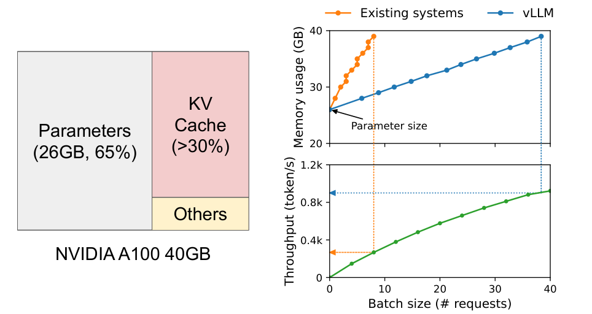

**图 1：** 左：在 NVIDIA A100 上为一个具有 130 亿参数的大语言模型提供服务时的内存布局。
参数（灰色）在整个服务期间常驻 GPU 内存。
键值缓存所需的内存（红色）按服务请求分配和释放。
少量内存（黄色）短暂用于存储激活值。
右：vLLM 使现有系统 [31, 60] 中键值缓存内存占用快速增长的曲线变得平缓，从而显著提高服务吞吐量。

*图中文字：* Parameters＝参数；KV Cache＝键值缓存；Others＝其他；Memory usage (GB)＝内存占用（GB）；Parameter size＝参数大小；Existing systems＝现有系统；Throughput (token/s)＝吞吐量（词元/秒）；Batch size (# requests)＝批大小（请求数）；26GB, 65%＝26 GB、65%；>30%＝超过 30%。

大语言模型的核心是一个自回归 Transformer 模型 [53]。
该模型根据输入（提示）以及此前已经生成的输出词元序列，每次生成一个词（词元）。
对于每个请求，这一昂贵的过程会不断重复，直到模型输出终止词元。
这种顺序生成过程使工作负载受限于内存，无法充分利用 GPU 的计算能力，并限制了服务吞吐量。

将多个请求组成批次，可以提高吞吐量。
不过，要在一个批次内处理许多请求，就应高效管理每个请求的内存空间。
例如，图 1（左）展示了在配备 40 GB 内存的 NVIDIA A100 GPU 上运行一个 130 亿参数大语言模型时的内存分布。
约 65% 的内存分配给模型权重，这部分在服务期间保持不变。
接近 30% 的内存用于存储请求的动态状态。
对于 Transformer，这些状态由与注意力机制相关的键张量和值张量组成，通常称为键值缓存 [41]，它们表示先前词元提供的上下文，用于依次生成新的输出词元。
剩余的少量内存用于其他数据，包括激活值，即在执行大语言模型计算时创建的临时张量。
由于模型权重保持不变，而激活值仅占 GPU 内存的一小部分，因此键值缓存的管理方式对于确定最大批大小至关重要。
如果管理低效，键值缓存内存就会严重限制批大小，进而限制大语言模型的吞吐量，如图 1（右）所示。

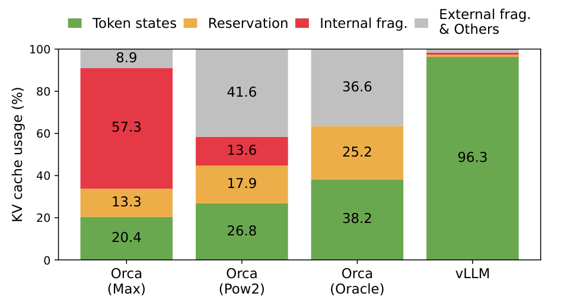

**图 2：** 在第 6.2 节实验中，不同大语言模型服务系统的各类内存浪费所占的平均百分比。

*图中文字：* KV cache usage (%)＝键值缓存内存使用占比（%）；Token states＝词元状态；Reservation＝预留；Internal frag.＝内部碎片；External frag. & Others＝外部碎片及其他；Orca (Max)、Orca (Pow2)、Orca (Oracle) 为第 6.1 节定义的三种 Orca 基线。

在本文中，我们观察到，现有大语言模型服务系统 [31, 60] 未能高效管理键值缓存内存。
这主要是因为它们将一个请求的键值缓存存储在连续的内存空间中，而大多数深度学习框架 [33, 39] 要求张量存储在连续内存中。
然而，与传统深度学习工作负载中的张量不同，键值缓存具有独特的性质：随着模型生成新词元，它会随时间动态增长和缩减，而且其生命周期和长度事先未知。
这些性质使现有系统的做法在两个方面表现得极为低效：

首先，现有系统 [31, 60] 存在内部和外部内存碎片。
为了将一个请求的键值缓存存储在连续空间中，它们按照请求的最大长度（例如 2048 个词元）预分配一整段连续内存。
由于请求的实际长度可能远短于最大长度（例如图 11），这可能造成严重的内部碎片。
此外，即使事先知道实际长度，这种预分配仍然低效：因为整段内存在请求的整个生命周期内都会被保留，其他较短请求无法利用其中当前未使用的任何部分。
除此之外，由于各请求的预分配大小可能不同，外部内存碎片也可能相当严重。
事实上，图 2 中的性能剖析结果表明，在现有系统中，只有 20.4%–38.2% 的键值缓存内存用于存储实际的词元状态。

其次，现有系统无法利用内存共享的机会。
大语言模型服务经常使用并行采样、束搜索等高级解码算法，为每个请求生成多个输出。
在这些场景下，一个请求包含多个序列，它们可以部分共享键值缓存。
然而，在现有系统中，序列的键值缓存存储在彼此独立的连续空间中，因此无法共享内存。

为解决上述局限，我们提出了 PagedAttention，这是一种受到操作系统（OS）解决内存碎片与共享问题的方法，即分页式虚拟内存，启发的注意力算法。
PagedAttention 将请求的键值缓存划分成块，每个块可以容纳固定数量词元的注意力键和值。
在 PagedAttention 中，键值缓存块不必存储在连续空间中。
因此，我们可以像操作系统的虚拟内存那样，更灵活地管理键值缓存：可以把块视为页、词元视为字节、请求视为进程。
这一设计通过使用相对较小的块并按需分配，缓解了内部碎片。
此外，由于所有块大小相同，它消除了外部碎片。
最后，它支持以块为粒度，在同一请求的不同序列之间，甚至在不同请求之间共享内存。

在这项工作中，我们在 PagedAttention 之上构建了 vLLM，这是一个高吞吐量的分布式大语言模型服务引擎，实现了近乎为零的键值缓存内存浪费。
vLLM 使用与 PagedAttention 协同设计的块级内存管理和抢占式请求调度。
vLLM 支持 GPT [5]、OPT [62] 和 LLaMA [52] 等不同规模的常用大语言模型，包括超出单个 GPU 内存容量的模型。
我们在多种模型和工作负载上的评估表明，相较于最先进的系统 [31, 60]，vLLM 将大语言模型服务吞吐量提高到原来的 2–4 倍，而且完全不影响模型准确率。
在序列更长、模型更大、解码算法更复杂的情况下，这些提升更加明显（第 4.3 节）。

概括而言，我们做出了以下贡献：

- 我们指出了为大语言模型提供服务时内存分配面临的挑战，并量化了它们对服务性能的影响。
- 我们提出了 PagedAttention，这是一种对存储在非连续分页内存中的键值缓存进行操作的注意力算法，其灵感来自操作系统中的虚拟内存与分页。
- 我们设计并实现了 vLLM，一个构建于 PagedAttention 之上的分布式大语言模型服务引擎。
- 我们在多种场景下评估了 vLLM，并证明它显著优于 FasterTransformer [31] 和 Orca [60] 等先前最先进的方案。

## 2 背景

本节介绍典型大语言模型的生成与服务流程，以及大语言模型服务中采用的迭代级调度。

### 2.1 基于 Transformer 的大语言模型

语言建模的任务是对词元列表 $(x_1,\ldots,x_n)$ 的概率进行建模。
由于语言具有天然的顺序，通常将整个序列的联合概率分解为条件概率的乘积（也称自回归分解 [3]）：

$$
P(x)=P(x_1)\cdot P(x_2\mid x_1)\cdots P(x_n\mid x_1,\ldots,x_{n-1}).
\tag{1}
$$

Transformer [53] 已成为大规模建模上述概率的事实标准架构。
基于 Transformer 的语言模型中，最重要的组件是自注意力层。
对于输入隐藏状态序列 $(x_1,\ldots,x_n)\in\mathbb{R}^{n\times d}$，自注意力层首先对每个位置 $i$ 应用线性变换，得到查询、键和值向量：

$$
q_i=W_qx_i,\quad k_i=W_kx_i,\quad v_i=W_vx_i.
\tag{2}
$$

然后，自注意力层将某个位置的查询向量与它之前所有位置的键向量相乘，计算注意力分数 $a_{ij}$，并通过对值向量求加权平均来计算输出 $o_i$：

$$
a_{ij}=\frac{\exp(q_i^\top k_j/\sqrt{d})}{\sum_{t=1}^{i}\exp(q_i^\top k_t/\sqrt{d})},\quad
o_i=\sum_{j=1}^{i}a_{ij}v_j.
\tag{3}
$$

除式（4）中的计算外，Transformer 模型中的所有其他组件，包括嵌入层、前馈层、层归一化 [2]、残差连接 [22]、输出 logit 计算，以及式（2）中的查询、键和值变换，都以 $y_i=f(x_i)$ 的形式，独立地作用于各个位置。

> **译注：** 原文此处写作“Eq. 4”，但根据紧邻的自注意力计算及“除……以外”的上下文，应当指式（3）；译文保留原交叉引用。

### 2.2 大语言模型服务与自回归生成

训练完成后，大语言模型通常被部署为条件生成服务（例如补全 API [34] 或聊天机器人 [19, 35]）。
发给大语言模型服务的请求提供一个输入提示词元列表 $(x_1,\ldots,x_n)$，大语言模型服务根据式（1）生成一个输出词元列表 $(x_{n+1},\ldots,x_{n+T})$。
我们将提示列表与输出列表的拼接结果称为序列。

由于式（1）的分解，大语言模型只能逐个采样和生成新词元，而且每个新词元的生成过程依赖该序列中此前的所有词元，具体来说，是它们的键向量和值向量。
在这一顺序生成过程中，现有词元的键向量和值向量通常会被缓存起来，用于生成之后的词元，这就是所谓的键值缓存。
注意，一个词元的键值缓存依赖于它之前的所有词元。
这意味着，同一个词元出现在序列中的不同位置时，其键值缓存会有所不同。

给定请求提示，大语言模型服务中的生成计算可以分为两个阶段：

**提示阶段**以整个用户提示 $(x_1,\ldots,x_n)$ 为输入，并计算第一个新词元的概率 $P(x_{n+1}\mid x_1,\ldots,x_n)$。
在此过程中，也会生成键向量 $k_1,\ldots,k_n$ 和值向量 $v_1,\ldots,v_n$。
由于提示词元 $x_1,\ldots,x_n$ 全部已知，提示阶段的计算可以通过矩阵与矩阵乘法进行并行化。
因此，这一阶段能够高效利用 GPU 固有的并行能力。

**自回归生成阶段**按顺序生成其余新词元。
在第 $t$ 次迭代中，模型以一个词元 $x_{n+t}$ 为输入，并利用键向量 $k_1,\ldots,k_{n+t}$ 和值向量 $v_1,\ldots,v_{n+t}$，计算概率 $P(x_{n+t+1}\mid x_1,\ldots,x_{n+t})$。
注意，位置 1 至 $n+t-1$ 的键向量和值向量已在此前的迭代中缓存，本次迭代只计算新的键向量 $k_{n+t}$ 和值向量 $v_{n+t}$。
当序列达到最大长度（由用户指定或受大语言模型限制），或输出序列结束词元（`<eos>`）时，这一阶段结束。
由于数据依赖，不同迭代的计算不能并行，而且通常采用效率较低的矩阵与向量乘法。
因此，这一阶段严重未能充分利用 GPU 计算能力，并受限于内存，占据单个请求延迟的大部分。

### 2.3 大语言模型的批处理技术

通过对多个请求进行批处理，可以提高大语言模型服务中的计算利用率。
由于请求共享相同的模型权重，搬运权重的开销可以由一个批次内的请求分摊，而且当批大小足够大时，计算开销可以超过权重搬运开销。
然而，对大语言模型服务的请求进行批处理并不容易，原因有二。
首先，请求可能在不同时间到达。
朴素的批处理策略要么让较早到达的请求等待后续请求，要么将新到达的请求延后到先前请求完成之后，导致显著的排队延迟。
其次，各请求的输入和输出长度可能有很大差异（图 11）。
一种直接的批处理技术会对请求的输入和输出进行填充，使它们的长度相同，从而浪费 GPU 计算和内存。

为解决这一问题，研究者提出了细粒度批处理机制，例如蜂窝式批处理（cellular batching）[16] 和迭代级调度 [60]。
与以请求为单位操作的传统方法不同，这些技术以迭代为单位操作。
每次迭代后，已完成的请求会从批次中移除，并加入新的请求。
因此，新请求只需等待一次迭代就能得到处理，而不必等待整个批次完成。
此外，借助专门的 GPU 内核，这些技术消除了对输入和输出进行填充的需要。
通过减少排队延迟和填充造成的低效，细粒度批处理机制显著提高了大语言模型服务的吞吐量。

## 3 大语言模型服务中的内存挑战

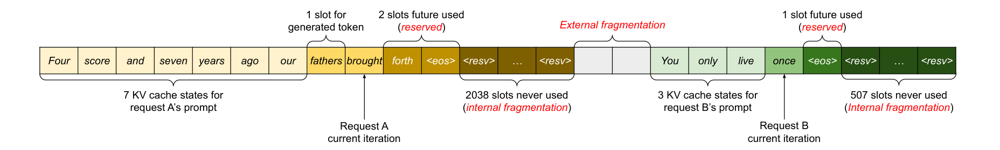

**图 3：** 现有系统中的键值缓存内存管理。
存在三类内存浪费，即预留、内部碎片和外部碎片，它们使其他请求无法装入内存。
每个内存槽中的词元表示其键值缓存。
注意，相同词元处于不同位置时，可能具有不同的键值缓存。

*图中文字：* Request A/B＝请求 A/B；current iteration＝当前迭代；1 slot for generated token＝供已生成词元使用的 1 个槽位；2 slots future used (reserved)＝未来将使用的 2 个槽位（预留）；1 slot future used (reserved)＝未来将使用的 1 个槽位（预留）；External fragmentation＝外部碎片；7/3 KV cache states for request A’s/B’s prompt＝请求 A/B 提示的 7/3 个键值缓存状态；2038/507 slots never used (internal fragmentation)＝永远不会使用的 2038/507 个槽位（内部碎片）；`<eos>`＝序列结束词元；`<resv>`＝预留槽位；“Four score and seven years ago our fathers brought forth”＝“八十七年前，我们的先辈开创了……”；“You only live once”＝“人生只有一次”。

虽然细粒度批处理减少了计算浪费，并允许以更灵活的方式将请求组成批次，但能一起组成批次的请求数量仍受 GPU 内存容量约束，尤其受分配给键值缓存的空间约束。
换言之，服务系统的吞吐量受限于内存。
要突破这一内存限制，就需要解决以下内存管理挑战：

**庞大的键值缓存。** 键值缓存大小会随着请求数量迅速增长。
以具有 130 亿参数的 OPT 模型 [62] 为例，单个词元的键值缓存需要 800 KB 空间，其计算方式为：2（键向量和值向量）×5120（隐藏状态大小）×40（层数）×2（每个 FP16 数值的字节数）。
由于 OPT 可以生成最长 2048 个词元的序列，存储一个请求的键值缓存所需的内存最高可达 1.6 GB。
当时 GPU 的内存容量为数十 GB。
即使将全部可用内存都分配给键值缓存，也只能容纳几十个请求。
此外，低效的内存管理还会进一步减小批大小，如图 2 所示。
另外，按照当前趋势，GPU 计算速度的增长快于内存容量的增长 [17]。
例如，从 NVIDIA A100 到 H100，FLOPS 增加到 2 倍以上，但 GPU 内存仍然最多为 80 GB。
因此，我们认为内存将成为越来越显著的瓶颈。

> **译注：** 原文在描述当时 GPU 的内存容量时写作 “Concurrent GPUs”；按前后文讨论硬件代际的语境，这里应为 current/contemporary GPUs（当时的 GPU），译文按该含义处理。

**复杂的解码算法。** 大语言模型服务向用户提供多种可选解码算法，它们对内存管理复杂度的影响各不相同。
例如，用户可能要求从单个输入提示中生成多个随机样本，这是程序建议 [18] 中的典型用例；此时可以共享提示部分的键值缓存，以尽量减少内存使用，而在我们的实验中，这部分占键值缓存内存总量的 12%（第 6.3 节）。
另一方面，由于采样结果不同，并且依赖上下文与位置，自回归生成阶段的键值缓存应保持不共享。
键值缓存的共享程度取决于所采用的具体解码算法。
在束搜索 [49] 等更复杂的算法中，不同请求束可以共享更大比例的键值缓存（最多节省 55% 的内存，见第 6.3 节），而且共享模式会随着解码过程的推进而变化。

**输入和输出长度未知时的调度。** 大语言模型服务请求的输入和输出长度各不相同。
这要求内存管理系统适应范围很广的提示长度。
此外，随着请求的输出长度在解码时增长，其键值缓存所需的内存也会扩大，并可能耗尽新到达请求或现有提示的后续生成所需的可用内存。
系统需要作出调度决策，例如从 GPU 内存中删除或换出某些请求的键值缓存。

### 3.1 现有系统中的内存管理

由于当前深度学习框架 [33, 39] 中的大多数算子都要求张量存储在连续内存中，先前的大语言模型服务系统 [31, 60] 也将一个请求不同位置的键值缓存存储为连续张量。
由于大语言模型的输出长度不可预测，它们会根据请求可能达到的最大序列长度，静态分配一整段内存，而不考虑请求的实际输入长度或最终输出长度。

图 3 展示了两个请求：请求 A 的最大可能序列长度为 2048，请求 B 的最大可能序列长度为 512。
现有系统的整段预分配方案存在三个主要内存浪费来源：为未来词元预留的槽位、为可能的最大序列长度过量分配而产生的内部碎片，以及伙伴分配器等内存分配器造成的外部碎片。
外部碎片永远不会被用于生成的词元，而且在为请求提供服务之前就能知道这一点。
内部碎片同样不会被使用，但只有在请求完成采样后才能确定。
这两者都是纯粹的内存浪费。
虽然预留内存最终会被使用，但在整个请求持续期间都预留这些空间，尤其在预留空间较大时，会占据本可用于处理其他请求的空间。
我们在图 2 中可视化了实验中各类内存浪费的平均比例，结果表明，先前系统中真正有效使用的内存比例可能低至 20.4%。

虽然内存紧缩（compaction）[54] 曾被提出作为碎片问题的潜在解决方案，但由于键值缓存非常庞大，在性能敏感的大语言模型服务系统中执行内存紧缩并不现实。
即使采用内存紧缩，现有内存管理系统为每个请求预分配的整段空间仍然阻碍了与具体解码算法相关的内存共享。

## 4 方法

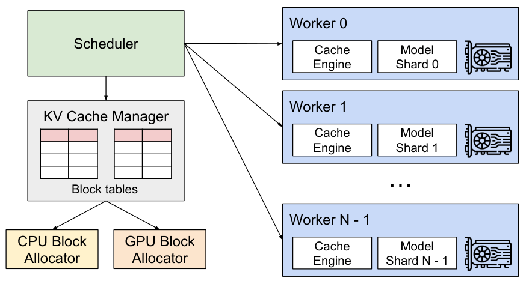

**图 4：** vLLM 系统概览。

*图中文字：* Scheduler＝调度器；KV Cache Manager＝键值缓存管理器；Block tables＝块表；CPU/GPU Block Allocator＝CPU/GPU 块分配器；Worker＝工作进程；Cache Engine＝缓存引擎；Model Shard＝模型分片。

在这项工作中，我们开发了一种新的注意力算法 PagedAttention，并构建了大语言模型服务引擎 vLLM，以应对第 3 节概述的挑战。
vLLM 的架构如图 4 所示。
vLLM 采用集中式调度器来协调分布式 GPU 工作进程的执行。
借助 PagedAttention，键值缓存管理器能够以分页方式有效管理键值缓存。
具体而言，键值缓存管理器通过集中式调度器发送的指令，管理 GPU 工作进程上的物理键值缓存内存。

接下来，我们在第 4.1 节介绍 PagedAttention 算法。
在此基础上，我们分别在第 4.2 节和第 4.3 节展示键值缓存管理器的设计，以及它如何支持 PagedAttention。
然后，我们说明这一设计如何为多种解码方法提供有效的内存管理（第 4.4 节），以及如何处理长度可变的输入和输出序列（第 4.5 节）。
最后，我们说明 vLLM 的系统设计如何在分布式环境中运行（第 4.6 节）。

### 4.1 PagedAttention

为应对第 3 节中的内存挑战，我们引入了 PagedAttention，这是一种受到操作系统中经典分页思想 [25] 启发的注意力算法。
与传统注意力算法不同，PagedAttention 允许将连续的键和值存储在非连续内存空间中。
具体而言，PagedAttention 将每个序列的键值缓存划分为键值块。
每个块包含固定数量词元的键向量和值向量，¹我们将这一数量记为键值块大小（$B$）。
记键块为 $K_j=(k_{(j-1)B+1},\ldots,k_{jB})$，值块为 $V_j=(v_{(j-1)B+1},\ldots,v_{jB})$。
式（4）中的注意力计算可以变换为以下按块进行的计算：

$$
A_{ij}=\frac{\exp(q_i^\top K_j/\sqrt{d})}{\sum_{t=1}^{\lceil i/B\rceil}\exp(q_i^\top K_t1/\sqrt{d})},\quad
o_i=\sum_{j=1}^{\lceil i/B\rceil}V_jA_{ij}^\top,
\tag{4}
$$

其中，$A_{ij}=(a_{i,(j-1)B+1},\ldots,a_{i,jB})$ 是第 $j$ 个键值块上的注意力分数行向量。

> **译注：** 原文“Eq. 4”的交叉引用指向本段之后的式（4），按上下文应指第 2.1 节的式（3）；这里保留原写法。
> 此外，原 PDF 的式（4）分母确实印作 $\sum_{t=1}^{\lceil i/B\rceil}\exp(q_i^\top K_t1/\sqrt{d})$，即 $1$ 位于指数函数内部，且正文未解释该符号。
> 若将 $1$ 理解为全 1 列向量，则此写法先对块内的 logit 求和再取指数，与式（3）的 softmax 归一化不一致；与式（3）对应的块式分母应为 $\sum_{t=1}^{\lceil i/B\rceil}\exp(q_i^\top K_t/\sqrt{d})\mathbf{1}$，并对当前位置之后的无效位置加以掩蔽。
> 上述解释属于译注，显示公式仍逐字保留原 PDF 的写法。

**脚注 1：** 在 Transformer 中，每个词元在各层以及每层的各注意力头上，都有一组键向量和值向量。
可以在一个键值块内统一管理所有键向量和值向量，也可以为不同注意力头和不同层的键向量和值向量分别设置块，并用各自独立的块表管理。
这两种设计没有性能差异，我们选择第二种，以便于实现。

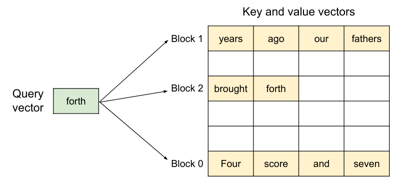

**图 5：** PagedAttention 算法示意图，其中注意力键向量和值向量以非连续块的形式存储在内存中。

*图中文字：* Query vector＝查询向量；Key and value vectors＝键向量和值向量；Block＝块；示例词元沿用图 3 的句子，其中 “forth” 为本次查询对应的词元。

在注意力计算期间，PagedAttention 内核分别识别并获取不同的键值块。
我们在图 5 中展示了 PagedAttention 的一个示例：键向量和值向量分布在三个块中，而且这三个块在物理内存中并不连续。
每次，内核将查询词元（“forth”）的查询向量 $q_i$ 与某个块中的键向量 $K_j$ 相乘（例如块 0 中 “Four score and seven” 的键向量），计算注意力分数 $A_{ij}$，随后将 $A_{ij}$ 与块中的值向量 $V_j$ 相乘，得到最终的注意力输出 $o_i$。

概括而言，PagedAttention 算法允许将键值块存储在非连续物理内存中，从而在 vLLM 中实现更灵活的分页内存管理。

### 4.2 键值缓存管理器

vLLM 内存管理器背后的核心思想类似于操作系统中的虚拟内存 [25]。
操作系统将内存划分为固定大小的页，并将用户程序的逻辑页映射到物理页。
连续的逻辑页可以对应非连续的物理内存页，使用户程序可以像访问连续内存一样访问内存。
此外，无须事先完整预留物理内存空间，因而操作系统能够根据需要动态分配物理页。
vLLM 使用虚拟内存背后的思想，管理大语言模型服务中的键值缓存。
借助 PagedAttention，我们将键值缓存组织为固定大小的键值块，就像虚拟内存中的页一样。

一个请求的键值缓存表示为一系列逻辑键值块，随着新词元及其键值缓存的生成，这些块会从左到右填满。
最后一个键值块中尚未填充的位置，为未来的生成预留。
在 GPU 工作进程上，块引擎分配一整段连续的 GPU DRAM，并将它划分为物理键值块（CPU RAM 上也会进行同样操作，以供换入换出；见第 4.5 节）。
键值块管理器还维护块表，即每个请求的逻辑键值块与物理键值块之间的映射。
每个块表条目记录某个逻辑块对应的物理块，以及已填充的位置数。
通过分离逻辑键值块与物理键值块，vLLM 可以动态扩展键值缓存内存，而无须事先为所有位置预留内存，从而消除现有系统中的大部分内存浪费，如图 2 所示。

### 4.3 使用 PagedAttention 与 vLLM 解码

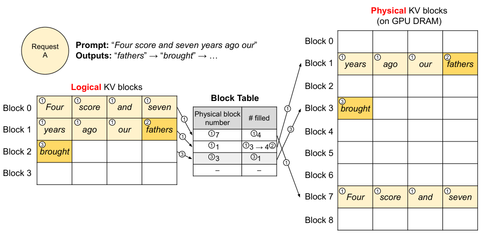

**图 6：** vLLM 中的块表转换。

*图中文字：* Prompt＝提示；Outputs＝输出；Logical KV blocks＝逻辑键值块；Physical KV blocks (on GPU DRAM)＝物理键值块（位于 GPU DRAM）；Block Table＝块表；Physical block number＝物理块编号；# filled＝已填充位置数；Request A＝请求 A；①②③ 对应下文三个阶段；英文句子沿用图 3。

接下来，我们通过图 6 中的一个示例，说明在单个输入序列的解码过程中，vLLM 如何执行 PagedAttention 并管理内存：
① 与操作系统的虚拟内存一样，vLLM 无须在一开始就为可能生成的最大序列长度预留内存。
相反，它只预留必要的键值块，以容纳提示计算期间生成的键值缓存。
在这个例子中，提示有 7 个词元，因此 vLLM 将前 2 个逻辑键值块（0 和 1）映射到 2 个物理键值块（分别为 7 和 1）。
在预填充步骤中，vLLM 使用常规自注意力算法（例如 [13]），生成提示的键值缓存以及第一个输出词元。
随后，vLLM 将前 4 个词元的键值缓存存储在逻辑块 0 中，将接下来的 3 个词元的键值缓存存储在逻辑块 1 中。
剩下的槽位为后续的自回归生成阶段预留。
② 在第一个自回归解码步骤中，vLLM 在物理块 7 和 1 上运行 PagedAttention 算法，生成新词元。
由于最后一个逻辑块中还剩一个可用槽位，新生成的键值缓存就存储在那里，并更新块表中的 `#filled` 记录。
③ 在第二个解码步骤中，由于最后一个逻辑块已满，vLLM 将新生成的键值缓存存储到一个新的逻辑块中；vLLM 为其分配一个新的物理块（物理块 3），并在块表中保存这一映射。

从全局来看，在每次解码迭代中，vLLM 首先选择一组候选序列组成批次（详见第 4.5 节），并为新需要的逻辑块分配物理块。
然后，vLLM 将当前迭代的所有输入词元（即提示阶段请求的全部词元，以及生成阶段请求的最新词元）拼接为一个序列，并送入大语言模型。
在大语言模型计算过程中，vLLM 使用 PagedAttention 内核访问以逻辑键值块形式组织的先前键值缓存，并将新生成的键值缓存保存到物理键值块中。
在一个键值块中存储多个词元（块大小大于 1），使 PagedAttention 内核能够并行处理更多位置的键值缓存，从而提高硬件利用率并降低延迟。
然而，更大的块也会增加内存碎片。
我们在第 7.2 节研究块大小的影响。

同样，随着更多词元及其键值缓存的生成，vLLM 会动态地为逻辑块分配新的物理块。
由于所有块都从左到右填充，而且只有在之前所有块均填满时才分配新的物理块，vLLM 将每个请求的全部内存浪费限制在一个块之内，因此能够有效利用全部内存，如图 2 所示。
这使内存能够容纳更多请求进行批处理，从而提高吞吐量。
一旦某个请求完成生成，它的键值块就可以释放，用于存储其他请求的键值缓存。
在图 7 中，我们展示了 vLLM 为两个序列管理内存的一个示例。
两个序列的逻辑块被映射到 GPU 工作进程的块引擎所预留空间中的不同物理块。
两个序列中相邻的逻辑块都不必在 GPU 物理内存中连续，而物理块空间能够被两个序列有效利用。

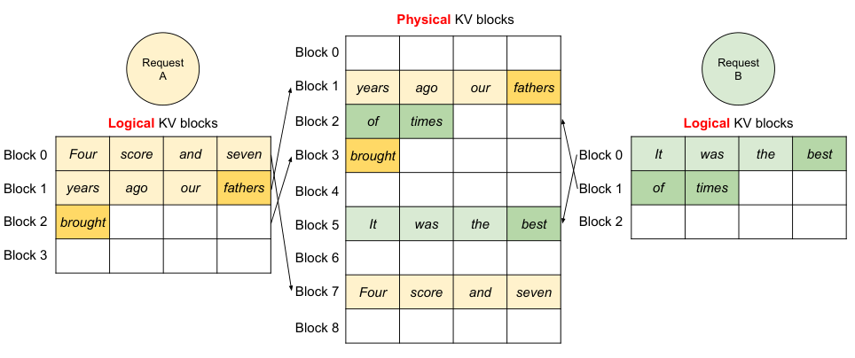

**图 7：** 在 vLLM 中同时存储两个请求的键值缓存。

*图中文字：* Request A/B＝请求 A/B；Logical KV blocks＝逻辑键值块；Physical KV blocks＝物理键值块；Block＝块；“It was the best of times”＝“那是最美好的时代”；请求 A 的示例句子沿用图 3。

### 4.4 应用于其他解码场景

第 4.3 节展示了 PagedAttention 与 vLLM 如何处理贪心解码和采样等基本解码算法，这些算法以一个用户提示为输入，并生成单个输出序列。
在许多成功的大语言模型应用 [18, 34] 中，大语言模型服务必须提供更复杂的解码场景，它们具有复杂的访问模式，也提供更多内存共享机会。
本节展示 vLLM 对这些场景的普遍适用性。

**并行采样。** 在基于大语言模型的编程助手 [6, 18] 中，大语言模型为单个输入提示生成多个采样输出；用户可以从不同候选结果中选择自己喜欢的输出。
到目前为止，我们一直隐含地假设一个请求生成一个序列。
在本文剩余部分，我们假设更一般的情形，即一个请求生成多个序列。
在并行采样中，一个请求包含多个共享同一输入提示的样本，因此也可以共享提示的键值缓存。
借助 PagedAttention 和分页内存管理，vLLM 可以轻松实现这种共享，并节省内存。

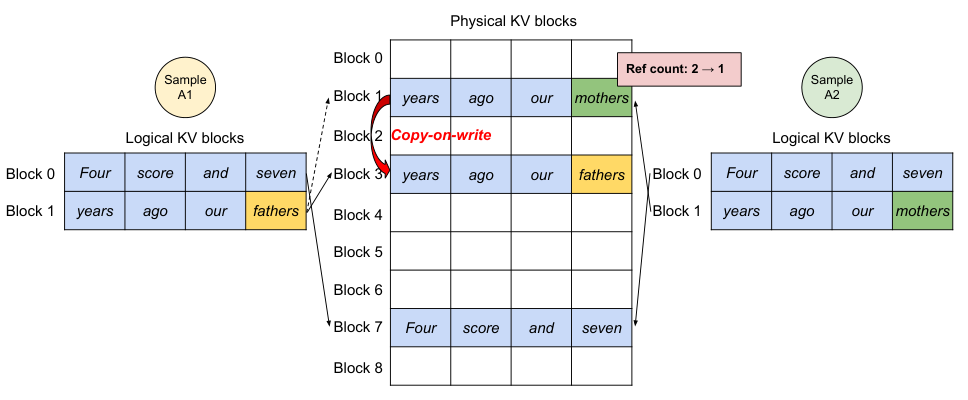

**图 8：** 并行采样示例。

*图中文字：* Sample A1/A2＝样本 A1/A2；Logical KV blocks＝逻辑键值块；Physical KV blocks＝物理键值块；Copy-on-write＝写时复制；Ref count: 2 → 1＝引用计数：2 → 1；fathers/mothers＝父辈／母辈；其余示例词元沿用图 3。

图 8 展示了并行解码两个输出的示例。
由于两个输出共享同一提示，我们在提示阶段只为提示状态的一份副本预留空间；两个序列中提示的逻辑块映射到相同的物理块：两个序列的逻辑块 0 和 1 分别映射到物理块 7 和 1。
由于一个物理块可以被映射到多个逻辑块，我们为每个物理块引入引用计数。
在这个例子中，物理块 7 和 1 的引用计数都是 2。
在生成阶段，两个输出采样出不同的输出词元，需要独立存储各自的键值缓存。
对于需要被多个序列修改的物理块，vLLM 实现了块粒度的写时复制机制，类似于操作系统虚拟内存中的写时复制技术（例如创建子进程时）。
具体而言，在图 8 中，当样本 A1 需要写入其最后一个逻辑块（逻辑块 1）时，vLLM 发现相应物理块（物理块 1）的引用计数大于 1；它便分配一个新的物理块（物理块 3），指示块引擎从物理块 1 复制信息，并将原块的引用计数减至 1。
接下来，当样本 A2 写入物理块 1 时，引用计数已经降为 1；因此，A2 直接将新生成的键值缓存写入物理块 1。

概括而言，vLLM 允许多个输出样本共享用于存储提示键值缓存的大部分空间，只有最后一个逻辑块例外，它通过写时复制机制管理。
通过让多个样本共享物理块，可以大幅降低内存占用，尤其是在输入提示较长时。

**束搜索。** 在机器翻译 [59] 等大语言模型任务中，用户期望大语言模型输出最合适的前 $k$ 个翻译结果。
束搜索 [49] 广泛用于从大语言模型中解码出概率最大的输出序列，因为它减轻了完整遍历采样空间的计算复杂度。
该算法依赖束宽参数 $k$，它决定每一步保留的最优候选数量。
在解码过程中，束搜索通过考虑所有可能的词元来扩展束中的每个候选序列，使用大语言模型计算它们各自的概率，并从 $k\cdot\lvert V\rvert$ 个候选中保留概率最大的前 $k$ 个序列，其中 $\lvert V\rvert$ 是词表大小。

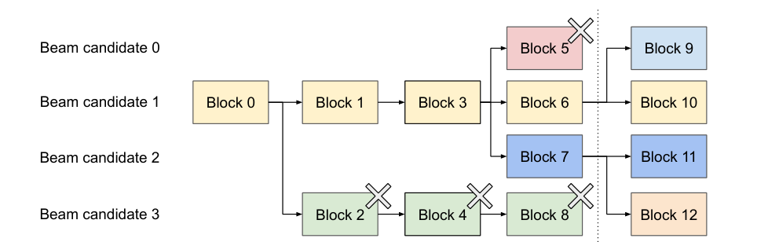

**图 9：** 束搜索示例。

*图中文字：* Beam candidate 0–3＝束候选 0–3；Block 0–12＝块 0–12；虚线表示下文讨论的迭代分界。

与并行解码不同，束搜索不仅支持不同候选共享最初的提示块，还支持共享其他块，并且共享模式会随着解码过程推进而动态变化，类似于操作系统中通过多次派生进程形成的进程树。
图 9 展示了 vLLM 如何为一个 $k=4$ 的束搜索示例管理键值块。
在虚线所示的迭代之前，每个候选序列都已经使用了 4 个完整的逻辑块。
所有束候选共享第一个块 0（即提示）。
候选 3 从第二个块起与其他候选分离。
候选 0–2 共享前 3 个块，并在第四个块处分离。
在后续迭代中，概率最大的前 4 个候选全部源自候选 1 和 2。
由于原来的候选 0 和 3 不再属于最优候选，它们的逻辑块被释放，相应物理块的引用计数也会减少。
vLLM 释放所有引用计数降至 0 的物理块（块 2、4、5、8）。
随后，vLLM 分配新的物理块（块 9–12），存储新候选产生的新键值缓存。
此时，所有候选共享块 0、1、3；候选 0 和 1 共享块 6，候选 2 和 3 还共享块 7。

先前的大语言模型服务系统需要在束候选之间频繁复制键值缓存内存。
例如，在图 9 所示的情形中，虚线之后，候选 3 需要复制候选 2 的大部分键值缓存，以继续生成。
vLLM 的物理块共享显著减少了这种频繁内存复制的开销。
在 vLLM 中，不同束候选的大多数块都可以共享。
与并行解码一样，只有当新生成词元位于旧的共享块内时，才会使用写时复制机制。
这只涉及复制一个块的数据。

**共享前缀。** 大语言模型用户通常会提供一段（较长的）任务描述，其中包含指令以及输入输出示例，这也称为系统提示 [36]。
将这段描述与实际任务输入拼接起来，就形成请求的提示。
大语言模型根据完整提示生成输出。
图 10 展示了一个示例。
此外，还可以通过提示工程进一步调整共享前缀，提高下游任务的准确率 [26, 27]。

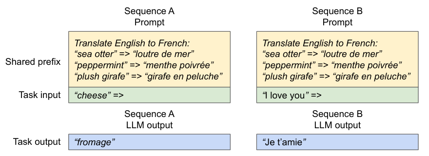

**图 10：** 机器翻译中的共享提示示例。
示例取自 [5]。

*图中文字：* Sequence A/B＝序列 A/B；Prompt＝提示；Shared prefix＝共享前缀；Task input/output＝任务输入／输出；LLM output＝大语言模型输出；Translate English to French＝将英语翻译为法语；三个共享示例分别将 “sea otter”（海獭）、“peppermint”（薄荷）、“plush girafe”（长颈鹿毛绒玩具）对应为图示法语；两个任务输入为 “cheese”（奶酪）和 “I love you”（我爱你），图示输出为 “fromage” 和 “Je t’amie”。

> **译注：** 原图将英文示例写为 “plush girafe”，并将第二个法语输出写为 “Je t’amie”；图像与上述转写均保留原拼写，通常的对应写法分别为 “plush giraffe” 和 “Je t’aime”。

对于这类应用，许多用户提示共享一个前缀，因此大语言模型服务提供者可以预先存储该前缀的键值缓存，以减少在前缀上进行的冗余计算。
在 vLLM 中，实现这一点很方便：可以为大语言模型服务提供者预定义的一组共享前缀预留一组物理块，就像操作系统处理跨进程共享库那样。
带有该共享前缀的用户输入提示，只需将其逻辑块映射到已缓存的物理块（最后一个块标记为写时复制）。
提示阶段只需对用户的任务输入执行计算。

**混合解码方法。** 前面讨论的解码方法具有多种不同的内存共享和访问模式。
尽管如此，vLLM 仍能支持同时处理具有不同解码偏好的请求，而现有系统无法高效做到这一点。
这是因为，vLLM 通过一个将逻辑块转换为物理块的通用映射层，隐藏了不同序列之间复杂的内存共享关系。
大语言模型及其执行内核只看到每个序列的一组物理块 ID，无须处理跨序列的共享模式。
与现有系统相比，这一方法扩大了对不同采样需求的请求进行批处理的机会，最终提高了系统的总体吞吐量。

### 4.5 调度与抢占

当请求流量超过系统容量时，vLLM 必须优先处理其中一部分请求。
在 vLLM 中，我们对所有请求采用先来先服务（FCFS）调度策略，以保证公平性并避免饥饿。
当 vLLM 需要抢占请求时，它会确保最早到达的请求优先得到服务，而最晚到达的请求最先被抢占。

大语言模型服务面临一个独特挑战：输入提示的长度可能差异很大，而最终输出长度事先未知，取决于输入提示和模型两者。
随着请求数量及其输出的增长，vLLM 可能用尽 GPU 上用于存储新生成键值缓存的物理块。
在这种情况下，vLLM 需要回答两个经典问题：（1）应驱逐哪些块？（2）如果再次需要，如何恢复已驱逐的块？
通常，驱逐策略使用启发式方法，预测未来最晚才会被访问的块，并驱逐该块。
由于在我们的场景中，已知一个序列的所有块会被一起访问，我们实现了一种“全有或全无”的驱逐策略，即要么驱逐一个序列的所有块，要么一个也不驱逐。
此外，一个请求内的多个序列（例如同一束搜索请求中的束候选）会作为一个序列组进行协同调度（gang scheduling）。
由于这些序列之间可能共享内存，同一序列组内的序列总是一起被抢占或重新调度。
对于如何恢复已驱逐块这一第二个问题，我们考虑两种技术：

**换入换出。** 这是大多数虚拟内存实现采用的经典技术，即将被驱逐的页复制到磁盘上的交换空间中。
在我们的场景中，我们将被驱逐的块复制到 CPU 内存中。
如图 4 所示，除 GPU 块分配器之外，vLLM 还包含一个 CPU 块分配器，用于管理换出到 CPU RAM 的物理块。
当 vLLM 耗尽供新词元使用的空闲物理块时，它会选择一组待驱逐序列，并将它们的键值缓存传输到 CPU。
一旦抢占某个序列并驱逐其块，vLLM 就停止接收新请求，直到所有被抢占的序列完成。
一旦某个请求完成，其块就会从内存中释放，而某个被抢占序列的块会被重新换入，以继续处理该序列。
注意，在这一设计下，换出到 CPU RAM 的块数永远不会超过 GPU RAM 中的物理块总数，因此 CPU RAM 上的交换空间大小以 GPU 中分配给键值缓存的内存为上限。

**重计算。** 在这种情况下，我们只需在被抢占的序列重新得到调度时，重新计算键值缓存。
注意，重计算延迟可能显著低于原始延迟，因为解码时生成的词元可以与原始用户提示拼接成一个新提示——它们所有位置的键值缓存都可以在一次提示阶段迭代中生成。

换入换出与重计算的性能，取决于 CPU RAM 与 GPU 内存之间的带宽，以及 GPU 的计算能力。
我们在第 7.3 节考察换入换出和重计算的速度。

### 4.6 分布式执行

许多大语言模型的参数大小超过单个 GPU 的容量 [5, 9]。
因此，必须将它们划分到分布式 GPU 上，并以模型并行方式执行 [28, 63]。
这要求内存管理器具备管理分布式内存的能力。
vLLM 通过支持 Transformer 上广泛使用的 Megatron-LM 式张量模型并行策略 [47]，在分布式环境中有效运行。
这一策略遵循 SPMD（单程序多数据）执行调度：将线性层分区以执行分块矩阵乘法，并由 GPU 通过 all-reduce 操作持续同步中间结果。
具体而言，注意力算子沿注意力头维度进行切分，每个 SPMD 进程负责多头注意力中的一部分注意力头。

我们观察到，即使采用模型并行执行，每个模型分片仍然处理相同的一组输入词元，因此需要相同位置的键值缓存。
因此，vLLM 在集中式调度器内设置一个统一的键值缓存管理器，如图 4 所示。
不同 GPU 工作进程共享该管理器，以及从逻辑块到物理块的映射。
这一共同映射允许 GPU 工作进程，使用调度器为每个输入请求提供的物理块来执行模型。
虽然每个 GPU 工作进程具有相同的物理块 ID，但一个工作进程只存储与其所负责注意力头对应的那部分键值缓存。

每一步中，调度器首先准备一条消息，其中包含批次内各请求的输入词元 ID，以及各请求的块表。
接下来，调度器将这一控制消息广播给 GPU 工作进程。
然后，GPU 工作进程开始使用输入词元 ID 执行模型。
在注意力层中，GPU 工作进程根据控制消息中的块表读取键值缓存。
执行过程中，GPU 工作进程通过 all-reduce 通信原语同步中间结果，无须调度器协调，与 [47] 相同。
最后，GPU 工作进程将本次迭代采样得到的词元发回调度器。
概括而言，GPU 工作进程无须就内存管理进行同步，因为它们只需在每次解码迭代开始时，随该步输入一起接收全部内存管理信息。

## 5 实现

vLLM 是一个端到端服务系统，具有 FastAPI [15] 前端和基于 GPU 的推理引擎。
前端扩展了 OpenAI API [34] 接口，允许用户为每个请求定制采样参数，例如最大序列长度和束宽 $k$。
vLLM 引擎由 8.5 千行 Python 代码和 2 千行 C++/CUDA 代码编写。
我们用 Python 开发调度器和块管理器等控制相关组件，同时为 PagedAttention 等关键操作开发定制 CUDA 内核。
对于模型执行器，我们使用 PyTorch [39] 和 Transformers [58] 实现 GPT [5]、OPT [62] 和 LLaMA [52] 等常用大语言模型。
我们使用 NCCL [32] 在分布式 GPU 工作进程之间进行张量通信。

### 5.1 内核级优化

由于 PagedAttention 引入的内存访问模式无法被现有系统高效支持，我们开发了若干 GPU 内核进行优化。
（1）**融合形状变换与块写入。** 在每个 Transformer 层中，新键值缓存被划分成块，重排为针对块读取优化的内存布局，再保存到块表指定的位置。
为尽量降低内核启动开销，我们将这些操作融合到一个内核中。
（2）**融合块读取与注意力计算。** 我们改造 FasterTransformer [31] 中的注意力内核，使其根据块表读取键值缓存，并在读取过程中执行注意力运算。
为确保合并内存访问，我们为每个块分配一个 GPU 线程束（warp）来读取。
此外，我们还增加了对同一请求批次中不同序列长度的支持。
（3）**融合块复制。** 写时复制机制发出的块复制操作可能作用于不连续的块。
如果使用 `cudaMemcpyAsync` API，这可能导致对小规模数据搬运进行大量调用。
为减轻这一开销，我们实现了一个内核，将不同块的复制操作合并到一次内核启动中执行。

### 5.2 支持多种解码算法

vLLM 通过三个关键方法实现多种解码算法：`fork`、`append` 和 `free`。
`fork` 方法根据一个已有序列创建新序列。
`append` 方法向序列追加一个新词元。
最后，`free` 方法删除序列。
例如，在并行采样中，vLLM 使用 `fork` 方法从单个输入序列创建多个输出序列。
随后，它在每次迭代中用 `append` 向这些序列添加新词元，并用 `free` 删除满足停止条件的序列。
vLLM 也将同一策略用于束搜索与前缀共享。
我们相信，通过组合这些方法，也可以支持未来的解码算法。

## 6 评估

本节评估 vLLM 在多种工作负载下的性能。

### 6.1 实验设置

**模型与服务器配置。** 我们使用具有 130 亿、660 亿和 1750 亿参数的 OPT [62] 模型，以及具有 130 亿参数的 LLaMA [52] 进行评估。
一个大语言模型排行榜 [38] 表明，130 亿和 660 亿是常见的大语言模型规模，而 1750 亿则是知名 GPT-3 [5] 模型的规模。
在全部实验中，我们都使用 Google Cloud Platform 上配备 NVIDIA A100 GPU 的 A2 实例。
详细的模型大小与服务器配置见表 1。

**表 1：** 模型大小与服务器配置。

| 模型规模 | 13B | 66B | 175B |
| --- | --- | --- | --- |
| GPU | A100 | 4×A100 | 8×A100-80GB |
| GPU 内存总量 | 40 GB | 160 GB | 640 GB |
| 参数大小 | 26 GB | 132 GB | 346 GB |
| 键值缓存内存 | 12 GB | 21 GB | 264 GB |
| 键值缓存最大槽位数 | 15.7K | 9.7K | 60.1K |

**工作负载。** 我们基于 ShareGPT [51] 和 Alpaca [50] 数据集合成工作负载，它们包含真实大语言模型服务的输入和输出文本。
ShareGPT 数据集收集了用户分享的 ChatGPT [35] 对话。
Alpaca 数据集是由 GPT-3.5 使用 self-instruct [57] 生成的指令数据集。
我们对数据集进行词元化，并根据其输入和输出长度合成客户端请求。
如图 11 所示，ShareGPT 数据集的平均输入提示长度为 Alpaca 数据集的 8.4 倍，平均输出长度为 5.8 倍，而且方差更大。
由于这些数据集不包含时间戳，我们使用不同请求速率下的泊松分布，生成请求到达时间。

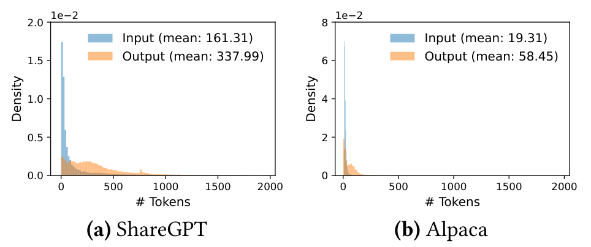

**图 11：** （a）ShareGPT 和（b）Alpaca 数据集的输入与输出长度分布。

*图中文字：* Density＝密度；# Tokens＝词元数；Input/Output (mean)＝输入／输出（均值）；ShareGPT 的输入、输出均值分别为 161.31、337.99 个词元；Alpaca 分别为 19.31、58.45 个词元；1e−2 表示坐标刻度的 $10^{-2}$ 倍率。

**基线 1：FasterTransformer。** FasterTransformer [31] 是一个针对延迟进行了高度优化的分布式推理引擎。
由于 FasterTransformer 没有自己的调度器，我们实现了一个定制调度器，使用类似 Triton [30] 等现有服务系统的动态批处理机制。
具体而言，在每个实验中，我们根据 GPU 内存容量，将最大批大小 $B$ 设置得尽可能大。
调度器选取最多 $B$ 个最早到达的请求，并将该批次发送给 FasterTransformer 处理。

**基线 2：Orca。** Orca [60] 是一个针对吞吐量优化的最先进大语言模型服务系统。
由于 Orca 尚未公开供使用，我们自行实现了一个 Orca 版本。
我们假设 Orca 使用伙伴分配算法，确定存储键值缓存的内存地址。
根据为请求输出过量预留空间的程度，我们实现了三个 Orca 版本：

- **Orca (Oracle)。** 我们假设系统知道各请求实际将生成的输出长度。
  这展示了 Orca 的性能上界，而在实践中无法达到。
- **Orca (Pow2)。** 我们假设系统为输出预留的空间最多为实际需要的 2 倍。
  例如，如果实际输出长度为 25，它会为输出预留 32 个位置。
- **Orca (Max)。** 我们假设系统始终预留到模型的最大序列长度，即 2048 个词元。

**关键指标。** 我们关注服务吞吐量。
具体而言，与 Orca [60] 一样，我们使用不同请求速率的工作负载，测量系统的归一化延迟，即对每个请求先用其端到端延迟除以输出长度，再对所得值求平均。
高吞吐量服务系统应当在请求速率很高时仍然保持较低的归一化延迟。
在大多数实验中，我们使用时长 1 小时的请求轨迹评估系统。
例外是，由于成本限制，我们对 OPT-175B 模型使用时长 15 分钟的请求轨迹。

### 6.2 基本采样

我们在三个模型和两个数据集上，使用基本采样（每个请求一个样本）评估 vLLM 的性能。
图 12 的第一行展示了 ShareGPT 数据集上的结果。
曲线表明，随着请求速率增加，延迟最初缓慢上升，但随后突然急剧增加。
这是因为，当请求速率超过服务系统的容量时，队列长度会持续无限增长，请求延迟也随之增长。

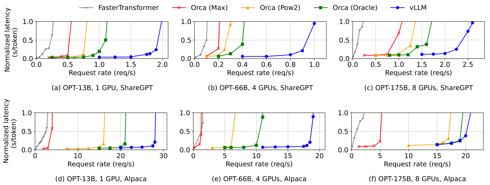

**图 12：** 使用 OPT 模型在 ShareGPT 和 Alpaca 数据集上进行单序列生成。

*图中文字：* Normalized latency (s/token)＝归一化延迟（秒/词元）；Request rate (req/s)＝请求速率（请求/秒）；第一行（a）–（c）为 ShareGPT，第二行（d）–（f）为 Alpaca；各行从左到右依次为 OPT-13B（1 个 GPU）、OPT-66B（4 个 GPU）和 OPT-175B（8 个 GPU）；图例为 FasterTransformer、三种 Orca 基线与 vLLM。

在 ShareGPT 数据集上，vLLM 在保持相近延迟的同时，能承受的请求速率是 Orca (Oracle) 的 1.7–2.7 倍、Orca (Max) 的 2.7–8 倍。
这是因为 vLLM 的 PagedAttention 能够高效管理内存使用，因此可以比 Orca 将更多请求组成批次。
例如，如图 13a 所示，对于 OPT-13B，vLLM 同时处理的请求数是 Orca (Oracle) 的 2.2 倍、Orca (Max) 的 4.3 倍。
与 FasterTransformer 相比，vLLM 能承受的请求速率最高达到其 22 倍，因为 FasterTransformer 不使用细粒度调度机制，而且像 Orca (Max) 一样低效地管理内存。

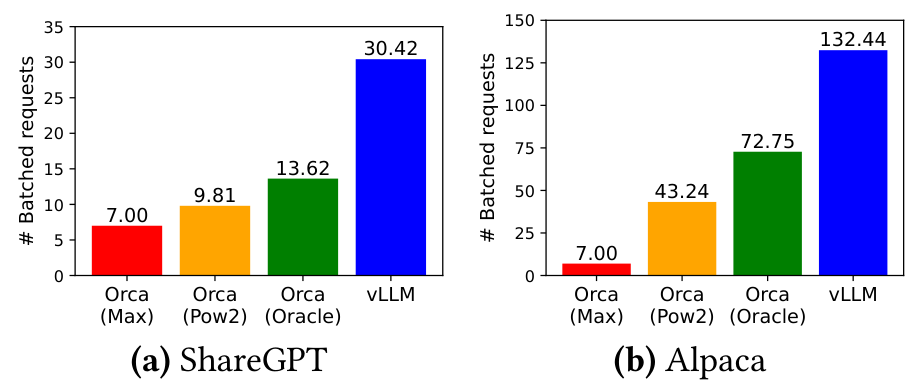

**图 13：** 使用 ShareGPT（2 请求/秒）和 Alpaca（30 请求/秒）请求轨迹，为 OPT-13B 提供服务时，组成批次的平均请求数。

*图中文字：* # Batched requests＝批内请求数；（a）ShareGPT、（b）Alpaca；按 Orca (Max)、Orca (Pow2)、Orca (Oracle)、vLLM 的顺序，图中均值分别为 7.00、9.81、13.62、30.42，以及 7.00、43.24、72.75、132.44。

图 12 的第二行和图 13b 展示了 Alpaca 数据集上的结果，其趋势与 ShareGPT 数据集相似。
一个例外是图 12（f），其中 vLLM 相对 Orca (Oracle) 和 Orca (Pow2) 的优势没有那么明显。
这是因为，OPT-175B 的模型与服务器配置（表 1）使 GPU 中有大量内存可用于存储键值缓存，而 Alpaca 数据集的序列较短。
在这种配置下，尽管 Orca (Oracle) 和 Orca (Pow2) 的内存管理存在低效之处，它们也能将大量请求组成批次。
因此，系统性能变为受限于计算，而非内存。

### 6.3 并行采样与束搜索

我们使用两种常见采样方法，即并行采样和束搜索，评估 PagedAttention 中内存共享的有效性。
在并行采样中，一个请求中的所有并行序列都可以共享提示的键值缓存。
如图 14 第一行所示，需要采样的序列数量越多，vLLM 相对 Orca 基线带来的提升就越大。
类似地，图 14 第二行展示了不同束宽下的束搜索结果。
由于束搜索支持更多共享，vLLM 展现出更大的性能收益。
在 OPT-13B 和 Alpaca 数据集上，vLLM 相对 Orca (Oracle) 的性能倍数，从基本采样时的 1.3 倍，增加到束宽为 6 的束搜索时的 2.3 倍。

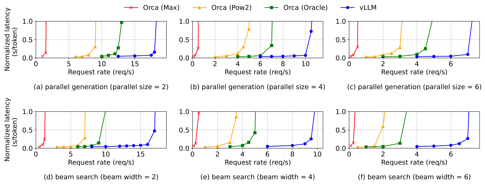

**图 14：** 在 Alpaca 数据集上，使用 OPT-13B 进行并行生成和束搜索。

*图中文字：* Normalized latency (s/token)＝归一化延迟（秒/词元）；Request rate (req/s)＝请求速率（请求/秒）；（a）–（c）为并行生成，并行数量分别为 2、4、6；（d）–（f）为束搜索，束宽分别为 2、4、6；图例为 Orca (Max)、Orca (Pow2)、Orca (Oracle) 和 vLLM。

图 15 绘出了内存节省比例，其计算方式为：通过共享节省的块数，除以不共享时的总块数。
我们展示了并行采样中 6.1%–9.8% 的内存节省，以及束搜索中 37.6%–55.2% 的内存节省。
在使用 ShareGPT 数据集的相同实验中，我们观察到并行采样节省了 16.2%–30.5% 的内存，束搜索节省了 44.3%–66.3%。

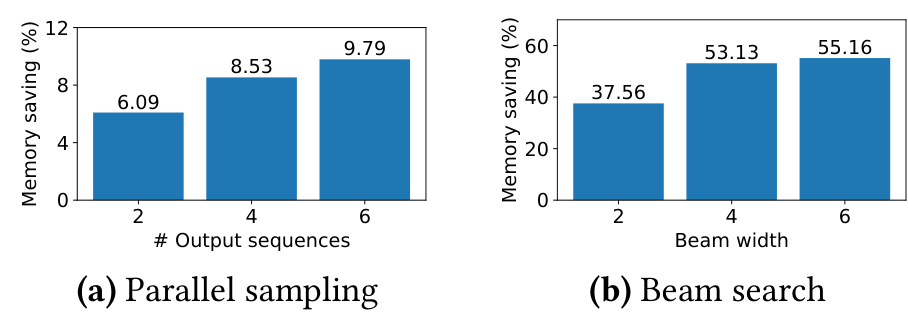

**图 15：** 使用 Alpaca 请求轨迹为 OPT-13B 提供服务时，通过共享键值块获得的平均内存节省比例。

*图中文字：* Memory saving (%)＝内存节省（%）；（a）Parallel sampling＝并行采样，横轴 # Output sequences＝输出序列数，2、4、6 个序列对应 6.09%、8.53%、9.79%；（b）Beam search＝束搜索，横轴 Beam width＝束宽，2、4、6 对应 37.56%、53.13%、55.16%。

### 6.4 共享前缀

我们研究了不同输入提示共享一个前缀时，vLLM 的有效性，如图 10 所示。
模型方面，我们使用支持多种语言的 LLaMA-13B [52]。
工作负载方面，我们使用 WMT16 [4] 英译德翻译数据集，并合成两个包含指令和少量翻译示例的前缀。
第一个前缀包含单个示例（即单样本），另一个前缀包含 5 个示例（即少样本）。
如图 16（a）所示，在共享单样本前缀时，vLLM 的吞吐量达到 Orca (Oracle) 的 1.67 倍。
此外，当共享更多示例时（图 16（b）），vLLM 的吞吐量达到 Orca (Oracle) 的 3.58 倍。

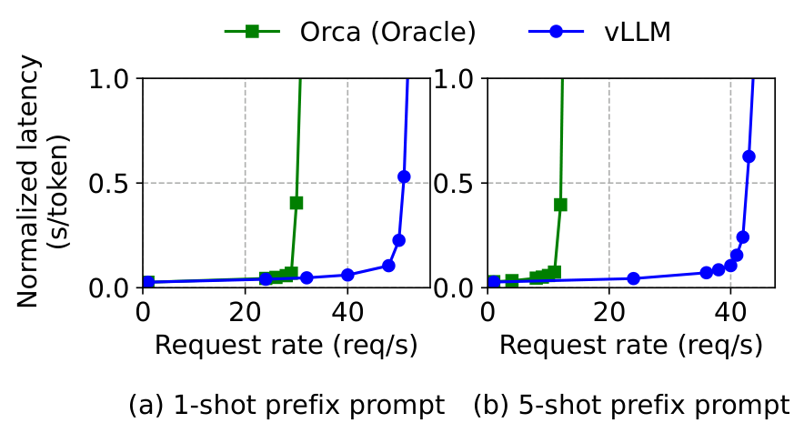

**图 16：** 输入提示共享一个公共前缀的翻译工作负载。
前缀包含（a）1 个示例，共 80 个词元；或（b）5 个示例，共 341 个词元。

*图中文字：* Normalized latency (s/token)＝归一化延迟（秒/词元）；Request rate (req/s)＝请求速率（请求/秒）；1-shot/5-shot prefix prompt＝包含 1 个／5 个示例的前缀提示；图例为 Orca (Oracle) 和 vLLM。

### 6.5 聊天机器人

聊天机器人 [8, 19, 35] 是大语言模型最重要的应用之一。
为实现聊天机器人，我们将聊天历史与用户最近一次查询拼接成提示，让模型生成回复。
我们使用 ShareGPT 数据集合成聊天历史和用户查询。
由于 OPT-13B 模型的上下文长度有限，我们将提示截取为最后 1024 个词元，并让模型最多生成 1024 个词元。
我们不在不同对话轮次之间存储键值缓存，因为这样做会在对话轮次之间占用本可供其他请求使用的空间。

图 17 表明，与三种 Orca 基线相比，vLLM 能承受 2 倍的请求速率。
由于 ShareGPT 数据集包含许多长对话，大多数请求的输入提示都有 1024 个词元。
由于伙伴分配算法，无论如何预测输出长度，Orca 基线都会为请求输出预留 1024 个词元的空间。
因此，三种 Orca 基线的表现相近。
相比之下，vLLM 能够有效处理长提示，因为 PagedAttention 解决了内存碎片与预留问题。

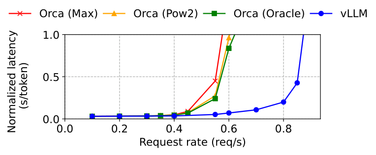

**图 17：** 聊天机器人工作负载上的性能。

*图中文字：* Normalized latency (s/token)＝归一化延迟（秒/词元）；Request rate (req/s)＝请求速率（请求/秒）；图例为 Orca (Max)、Orca (Pow2)、Orca (Oracle) 和 vLLM。

## 7 消融研究

本节研究 vLLM 的各个方面，并通过消融实验评估我们的设计选择。

### 7.1 内核微基准测试

PagedAttention 中的动态块映射，会影响涉及已存储键值缓存的 GPU 操作的性能，即块读写与注意力计算。
与现有系统相比，我们的 GPU 内核（第 5 节）会产生访问块表、执行额外分支以及处理可变序列长度的额外开销。
如图 18a 所示，与经过高度优化的 FasterTransformer 实现相比，这导致注意力内核延迟增加 20%–26%。
我们认为这一开销较小，因为它只影响注意力算子，不影响模型中的其他算子，例如 Linear。
尽管存在这一开销，PagedAttention 仍使 vLLM 的端到端性能显著优于 FasterTransformer（第 6 节）。

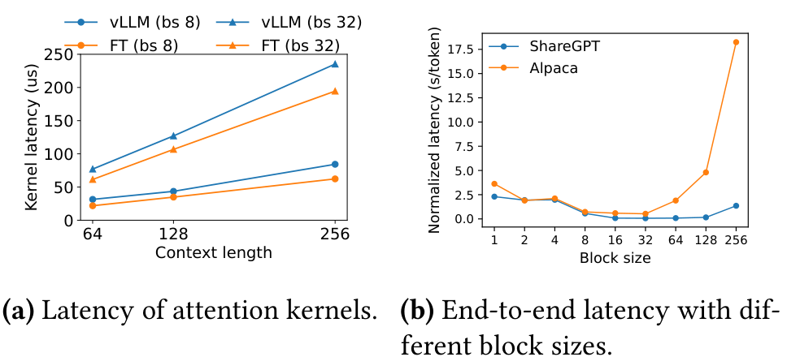

**图 18：** 消融实验。
（a）注意力内核的延迟。
（b）不同块大小下的端到端延迟。

*图中文字：* Kernel latency (us)＝内核延迟（微秒）；Context length＝上下文长度；FT＝FasterTransformer；bs 8/32＝批大小 8/32；Normalized latency (s/token)＝归一化延迟（秒/词元）；Block size＝块大小；右图图例为 ShareGPT 与 Alpaca。

### 7.2 块大小的影响

块大小的选择可能对 vLLM 的性能产生重大影响。
如果块太小，vLLM 可能无法充分利用 GPU 的并行能力来读取和处理键值缓存。
如果块太大，内部碎片就会增加，共享的可能性也会降低。

在图 18b 中，我们使用固定请求速率下、采用基本采样的 ShareGPT 和 Alpaca 请求轨迹，评估不同块大小下 vLLM 的性能。
在 ShareGPT 请求轨迹中，16 到 128 的块大小能够获得最佳性能。
在 Alpaca 请求轨迹中，虽然块大小 16 和 32 表现良好，但更大的块会显著降低性能，因为序列长度变得小于块大小。
实践中，我们发现对于大多数工作负载，块大小 16 已足够大，能够高效利用 GPU，同时又足够小，能够避免显著的内部碎片。
因此，vLLM 将默认块大小设置为 16。

### 7.3 比较重计算与换入换出

vLLM 同时支持重计算和换入换出作为恢复机制。
为理解两种方法之间的权衡，我们评估了它们的端到端性能，并对其开销进行了微基准测试，如图 19 所示。
我们的结果表明，块较小时，换入换出会产生过大的开销。
这是因为较小的块往往会导致 CPU 与 GPU 之间出现大量小规模数据传输，从而限制有效 PCIe 带宽。
相比之下，在不同块大小下，重计算开销保持不变，因为重计算不使用键值块。
因此，块较小时重计算更高效，块较大时换入换出更高效，不过重计算开销从不会高于换入换出延迟的 20%。
对于 16 到 64 的中等块大小，两种方法的端到端性能相当。

> **译注：** 原文此处写作 “though recomputation overhead is never higher than 20% of swapping’s latency”，直译即上句所保留的“重计算开销从不会高于换入换出延迟的 20%”。
> 但图 19a 中，大块时重计算耗时略高于换入换出的总耗时，这与前述文字的字面含义不一致；作者可能意指“重计算开销比换入换出延迟高出的幅度不超过 20%”。
> 此处不替作者改写结论，请结合原图阅读。

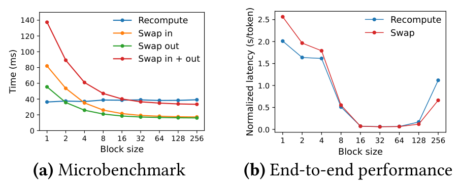

**图 19：** （a）不同块大小下重计算与换入换出的开销。
（b）在相同请求速率下，使用 ShareGPT 请求轨迹为 OPT-13B 提供服务时的性能。

*图中文字：* （a）Microbenchmark＝微基准测试，Time (ms)＝时间（毫秒），Recompute＝重计算，Swap in＝换入，Swap out＝换出，Swap in + out＝换入与换出总计；（b）End-to-end performance＝端到端性能，Normalized latency (s/token)＝归一化延迟（秒/词元），Swap＝换入换出；两图横轴 Block size＝块大小。

## 8 讨论

**将虚拟内存与分页技术应用于其他 GPU 工作负载。** 虚拟内存与分页思想能够有效管理大语言模型服务中的键值缓存，因为这一工作负载需要动态内存分配（由于输出长度事先未知），而且其性能受限于 GPU 内存容量。
然而，并非每种 GPU 工作负载都普遍具有这一性质。
例如，在深度神经网络训练中，张量形状通常是静态的，因此可以提前优化内存分配。
又例如，在为大语言模型之外的深度神经网络提供服务时，提高内存效率可能不会带来任何性能提升，因为性能主要受限于计算。
在这些场景下，引入 vLLM 的技术反而可能降低性能，因为内存间接寻址和非连续块内存会带来额外开销。
不过，我们很期待看到 vLLM 的技术被应用到具有与大语言模型服务相似性质的其他工作负载中。

**应用虚拟内存与分页时针对大语言模型的优化。** vLLM 利用应用特定的语义，重新诠释并扩展了虚拟内存与分页思想。
一个例子是 vLLM 的“全有或全无”换出策略，它利用了这样一个事实：处理一个请求时，其对应的所有词元状态都必须存储在 GPU 内存中。
另一个例子是，通过重计算恢复被驱逐的块，而这在操作系统中不可行。
此外，vLLM 将内存访问操作的 GPU 内核，与注意力等其他操作的内核融合，从而减轻分页中内存间接寻址的开销。

## 9 相关工作

**通用模型服务系统。** 近年来，模型服务一直是一个活跃的研究领域，研究者提出了许多系统，以解决深度学习模型部署中的不同问题。
Clipper [11]、TensorFlow Serving [33]、Nexus [45]、InferLine [10] 和 Clockwork [20] 是一些较早的通用模型服务系统。
它们研究了为单个或多个模型提供服务时的批处理、缓存、放置和调度。
近期，DVABatch [12] 引入了多入口多出口批处理。
REEF [21] 和 Shepherd [61] 提出了用于模型服务的抢占机制。
AlpaServe [28] 利用模型并行实现统计复用。
然而，这些通用系统未考虑大语言模型推理的自回归性质和词元状态，因此错失了优化机会。

**面向 Transformer 的专用服务系统。** 由于 Transformer 架构的重要性，人们开发了许多专用服务系统。
这些系统利用 GPU 内核优化 [1, 29, 31, 56]、高级批处理机制 [14, 60]、模型并行 [1, 41, 60] 和参数共享 [64]，实现高效服务。
其中，Orca [60] 与我们的方法最为相关。

**与 Orca 的比较。** Orca [60] 中的迭代级调度与 vLLM 中的 PagedAttention 是互补技术：两个系统都旨在提高 GPU 利用率，进而提高大语言模型服务的吞吐量；Orca 通过调度并交错执行请求，使更多请求能够并行处理，而 vLLM 通过提高内存利用率，使更多请求的工作集能够装入内存。
通过减少内存碎片并支持共享，vLLM 能在一个批次中并行运行更多请求，相较 Orca 达到 2–4 倍加速。
事实上，像 Orca 那样对请求进行细粒度调度和交错执行，会使内存管理更具挑战性，从而使 vLLM 提出的技术更加重要。

**内存优化。** 加速器计算能力与内存容量之间不断扩大的差距，使内存成为训练和推理的共同瓶颈。
换入换出 [23, 42, 55]、重计算 [7, 24] 及其组合 [40] 已被用于降低训练时的峰值内存占用。
值得一提的是，FlexGen [46] 研究了如何在 GPU 内存有限时，为大语言模型推理换入换出权重和词元状态，但它并不面向在线服务场景。
OLLA [48] 通过优化张量的生命周期和存储位置来减少碎片，但它不进行细粒度的块级管理，也不面向在线服务。
FlashAttention [13] 采用分块计算和内核优化，降低注意力计算的峰值内存占用与 I/O 成本。
本文在在线服务场景中引入了一种块级内存管理的新思想。

## 10 结论

本文提出了 PagedAttention，这是一种新的注意力算法，允许将注意力键和值存储在非连续的分页内存中；同时介绍了 vLLM，这是一个借助 PagedAttention 实现高效内存管理的高吞吐量大语言模型服务系统。
受操作系统启发，我们展示了如何调整虚拟内存和写时复制等成熟技术，以高效管理键值缓存，并处理大语言模型服务中的各种解码算法。
我们的实验表明，vLLM 的吞吐量达到最先进系统的 2–4 倍。

## 致谢

我们感谢 Xiaoxuan Liu、Zhifeng Chen、Yanping Huang、SOSP 匿名审稿人，以及我们的论文指导人（shepherd）Lidong Zhou 提供的深刻反馈。
本研究部分获得了 Andreessen Horowitz、Anyscale、Astronomer、Google、IBM、Intel、Lacework、Microsoft、Mohamed Bin Zayed University of Artificial Intelligence、Samsung SDS、Uber 和 VMware 的捐赠支持。

## 参考文献

原文共列出 **64 条参考文献 [1]–[64]**，位于本地 [VLLM.pdf](VLLM.pdf) **第 14–16 页**。
本译稿保留正文和图注中的全部引用编号，参考文献的作者、英文标题、发表信息与 URL 请按编号查阅原 PDF。
