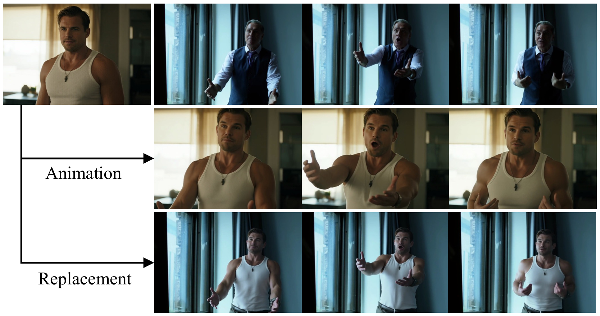
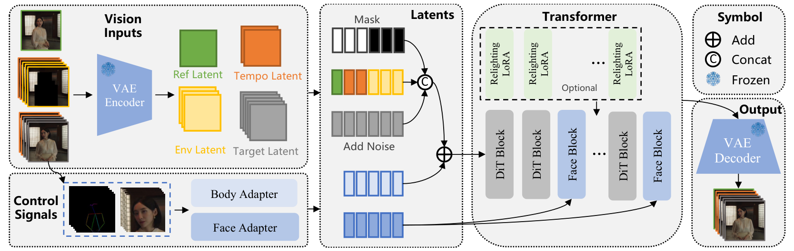
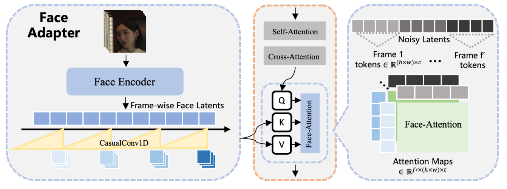
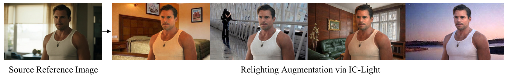
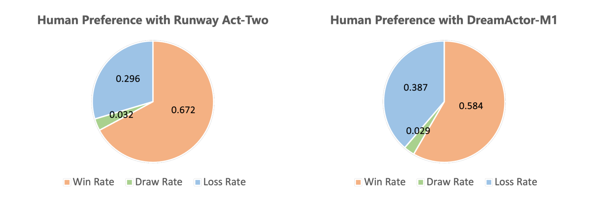
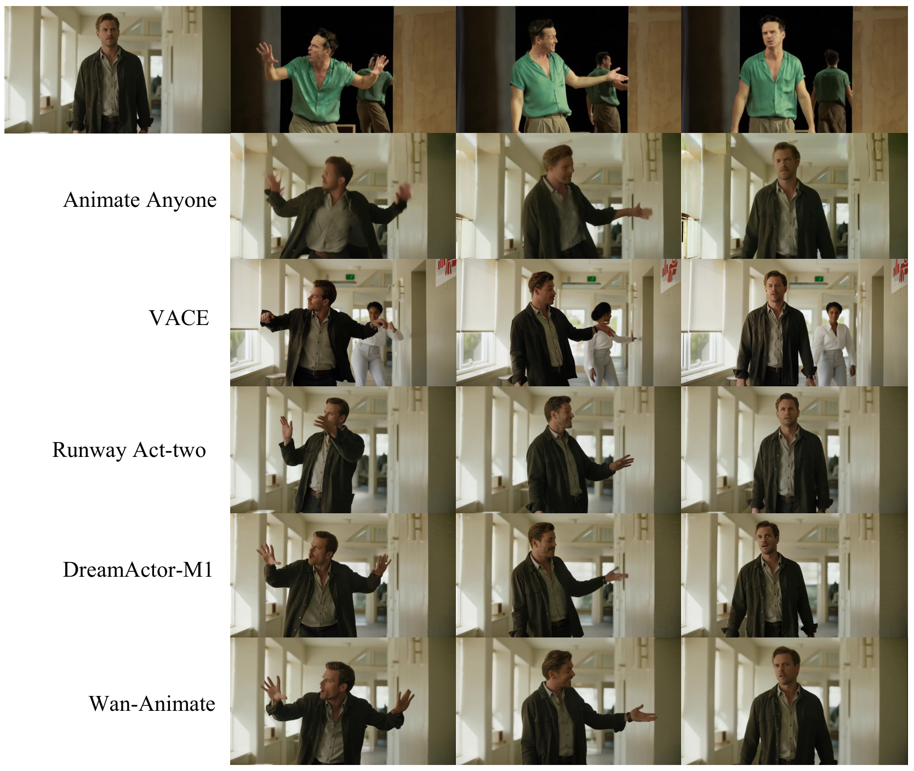
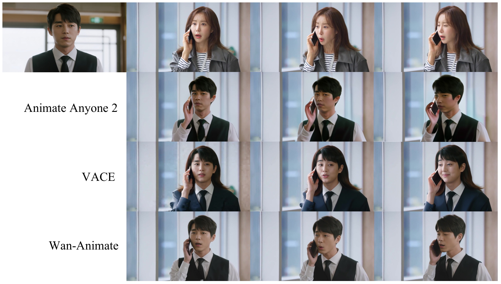
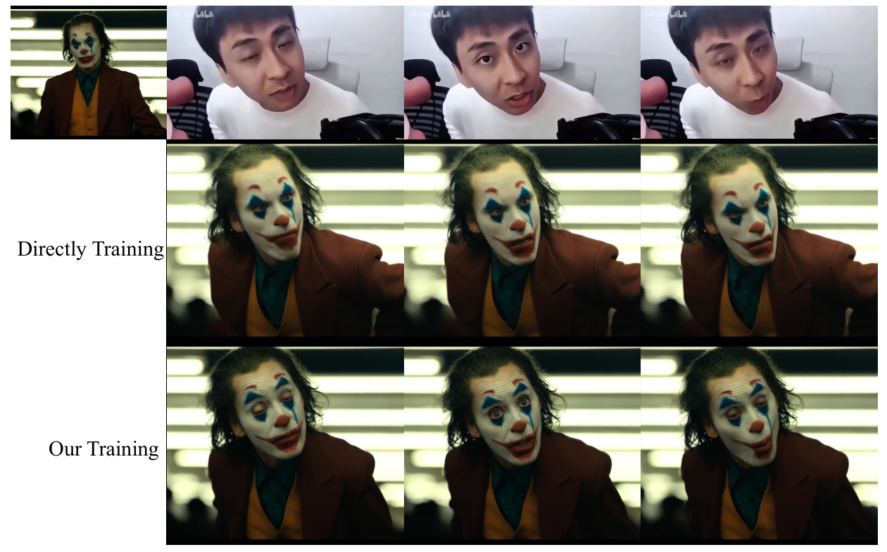
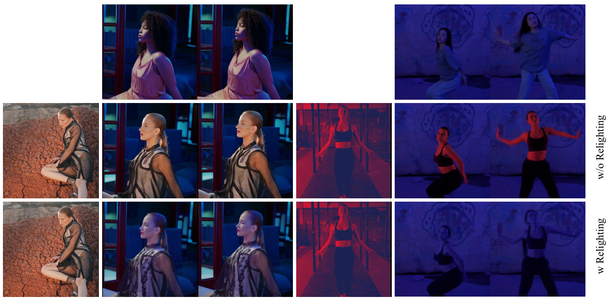
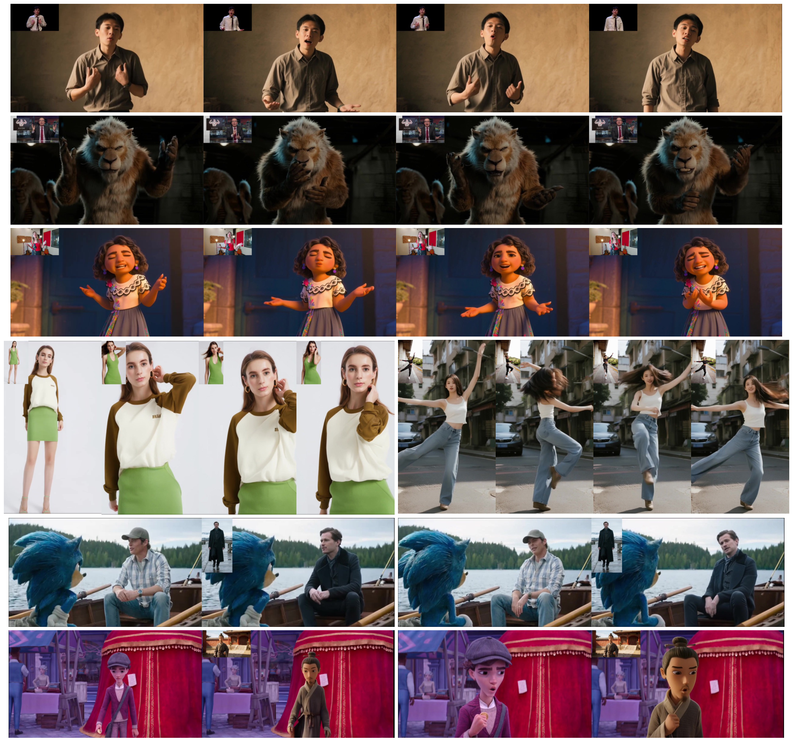

# Wan-Animate：通过整体复现统一角色动画与角色替换

**原论文：** Wan-Animate: Unified Character Animation and Replacement with Holistic Replication

**作者：** HumanAIGC 团队  
**单位：** 阿里巴巴通义实验室  
**版本：** arXiv:2509.14055v1，2025 年 9 月 17 日  
**翻译来源：** 本目录中的 [WanAnimate.pdf](WanAnimate.pdf)  
**项目主页：** <https://humanaigc.github.io/wan-animate/>

> 本译文覆盖原 PDF 全部 17 页，包括摘要、正文第 1–7 节、全部 10 幅图的图注、1 张定量结果表和参考文献。插图从原 PDF 以 300 dpi 渲染，图内英文保留，中文说明随图给出；参考文献保留英文书目信息，正文引用保留作者与年份。有关性能、开源计划及产品比较的表述均对应原论文版本。标有“译注”的文字用于说明原文中的编号或拼写问题，不属于原论文正文。

> **阅读说明：** 新增的“阅读注释”用于解释关键概念、架构设计和实验结果，不属于原论文正文；原有“译注”仍用于说明原文编号或拼写问题。初读可重点关注第 3.2–3.4 节的输入与控制方式，再结合第 3.6 节和第 4.3 节理解长视频推理。

## 摘要

我们提出 Wan-Animate，一个统一的角色动画与角色替换框架。给定一张角色图像和一段参考视频，Wan-Animate 能够精确复现视频中角色的表情与动作，使图像中的角色动起来，生成高保真的角色视频。它也可以将动画化后的角色融入参考视频，替换原有角色，并复现场景的光照与色调，实现与环境的无缝融合。

Wan-Animate 基于 Wan 模型构建。为了使其适应角色动画任务，我们采用经过修改的输入范式，区分参考条件与待生成区域。这一设计将多项任务统一为共同的符号表示。我们使用空间对齐的骨架信号复现身体运动，并使用从源图像提取的隐式面部特征重现表情，从而生成具有高度可控性与表现力的角色视频。

此外，为了增强角色替换时的环境融合效果，我们开发了一个辅助的重光照 LoRA（Relighting LoRA）。该模块在保持角色外观一致性的同时，施加与环境相适应的光照与色调。实验结果表明，Wan-Animate 达到了最先进的性能。我们承诺开源模型权重与源代码。项目主页：<https://humanaigc.github.io/wan-animate/>。

> **阅读注释｜先分清三个信息来源。** 角色图像提供“长什么样”，参考视频提供“怎样动、怎样做表情”，背景来源则由模式决定：动画模式沿用角色图像的场景，替换模式沿用参考视频的场景。后文的“参考图像”通常指角色图像，“驱动图像／人脸”指从参考视频取出的帧或裁剪区域。摘要中的“源图像”需结合这一分工理解，表情驱动的具体输入见第 3.3 节。

## 1 引言

角色图像动画是一个重要的研究方向。在视觉生成技术进步，尤其是扩散模型应用的推动下，这一领域取得了显著进展。该技术具有重要的潜在价值，在电影制作、广告和数字化身创建等方面有着广泛应用。此前的工作，如 Hu（2024）、Zhu 等（2025）和 Tu 等（2025），对基于扩散模型的角色图像动画架构进行了深入探索，显著提升了一致性和可控性。此外，一些研究（Hu 等，2025；Men 等，2024；Xu 等，2024c；Wang 等，2025a）引入了环境信息，将生成能力拓展至角色替换、人与物体交互合成等更丰富的任务。

最近，在 OpenAI 推出 Sora（Brooks 等，2024）之后，采用扩散 Transformer（Diffusion Transformer，DiT；Peebles 与 Xie，2023）架构的视频生成迎来了爆发式发展。大量开源工作（Kong 等，2025；Wan 等，2025）的出现，也推动了相关子任务的同步进步。因此，基于 DiT 的角色图像动画（Gan 等，2025；Zhou 等，2025；Luo 等，2025）也受到了广泛关注。借助预训练视频基础模型的能力，生成角色视频的真实感与时间连贯性得到了显著提升。

然而，一个关键缺口仍然存在：现有框架尚未提供一种高保真角色动画的整体解决方案，能够统一控制运动、表情及其与环境的交互。在开源领域，现有角色图像动画工作在性能和功能完整性上都存在明显不足。多数开源成果，如 Zhu 等（2025）、Zhang 等（2024）、Tu 等（2025）和 Wang 等（2024），基于 UNet 架构的基础模型设计，例如 SD（Rombach 等，2022）和 SVD（Blattmann 等，2023），其结果明显落后于当前最先进的水平。虽然一些基于 DiT 的开源项目（Zhou 等，2025；Wang 等，2025b）专注于运动控制，但在结合身体运动、整体复现富有表现力的面部动态方面仍有不足。

此外，专门将角色动画与环境上下文相结合，即实现角色替换的开源方法也较为稀缺。尽管一些视频生成方法（Jiang 等，2025）可以近似实现这一功能，但通常存在一致性与易用性问题。这些尚未解决的挑战共同阻碍了开源社区中角色图像动画的持续发展与创新。

**图 1：** 给定一张角色图像与一段参考视频，Wan-Animate 支持两项核心功能。第一项称为“动画”（Animation）：重现参考视频中角色的动作和表情，使静态源图像动起来。第二项称为“替换”（Replacement）：将参考视频中的角色替换为源图像中的角色身份，并确保与环境无缝融合。

为了解决上述问题，本报告提出统一的角色动画与角色替换框架 Wan-Animate，以高保真结果实现整体复现。如图 1 所示，给定一张角色图像和一段参考视频，Wan-Animate 能够准确复现参考视频中的面部表情与身体动作，驱动角色并生成逼真的角色视频。同时，Wan-Animate 支持角色替换，能够将动画化后的角色融入参考视频，以替换原有角色。该过程还会复现视频中的光照与色调，实现角色与环境的无缝融合。

在方法上，Wan-Animate 以 Wan-I2V 模型为基础，通过加入额外控制条件的后训练增强其能力。与 Wan-I2V 相比，Wan-Animate 根据角色动画的需求修改了输入定义。我们采用修改后的输入范式，区分参考条件与指定的生成区域，进而指导相应潜变量的注入。这一设计将参考图像注入、时序帧引导，以及全画面生成和角色替换之间的模式选择，统一为共同的符号表示。关键在于，这种方式保留了 Wan-I2V 原有的输入结构，从而尽可能减小后训练中的分布偏移。

为了实现对角色的整体控制，我们将控制信号解耦为身体运动和面部表情。对于身体运动，我们采用基于骨架的表示，在准确性与通用性之间取得平衡。由于该信号具有空间对齐特性，我们将其加到初始噪声潜变量上进行注入。对于表情复现，我们直接使用参考视频中的原始人脸图像作为驱动信号，以尽可能保留细节。这些人脸图像被编码成潜向量，以将表情信息与身份属性解耦。随后，对这些潜变量进行时间压缩，使其与视频潜变量对齐，并通过交叉注意力注入模型。这种联合控制策略展现出了很高的鲁棒性与精度。

在进行角色替换时，我们开发了一个辅助的重光照 LoRA，以增强角色与环境之间的一致性。在基础模型确保角色外观得到一致迁移之后，该模块施加恰当的环境光照与色调，使替换后的角色能够更加自然地融入视频。

我们承诺向公众发布完整的 Wan-Animate 框架，包括模型权重和完整流程。实验结果表明，Wan-Animate 拥有出色且多样的能力。它不仅能够驱动角色生成富有表现力的视频，还能良好地泛化到多种类人角色，并在肖像、半身及全身等不同场景中展现出很强的鲁棒性。此外，即使与若干闭源商业产品相比，它在质量方面仍具有竞争优势。

我们希望 Wan-Animate 的发布能够为加速角色图像动画的发展作出重要贡献。我们也希望让各个水平的开发者都能够使用高水准模型，借此构建多样化应用、激发新的产品形态，并最终推动该技术在现实世界中落地。

## 2 相关工作

**角色图像动画。** 早期图像动画工作主要侧重于基于形变的特征表示和基于 GAN 的架构（Siarohin 等，2019；Zhao 与 Zhang，2022；Siarohin 等，2021）。相比之下，近期方法（Hu，2024；Xu 等，2024b；Chang 等，2023；Zhu 等，2025；Tu 等，2025）转向设计基于扩散模型（Ho 等，2020）的架构，带来了显著的性能提升。

例如，Animate Anyone（Hu，2024）利用 ReferenceNet 结构注入角色外观特征，在保持一致性方面取得了出色结果。在时间建模上，它采用受 AnimateDiff（Guo 等，2023）启发的时序层，并将这些层嵌入 Stable Diffusion（Rombach 等，2022）架构。许多后续方法（Zhu 等，2025；Tu 等，2025）都采用了这一设计范式。然而，Stable Diffusion 作为主要用于图像生成的基础模型，本身缺乏时间维度的知识。

为了解决这一局限，一些工作（Wang 等，2024；Zhang 等，2024）开始基于视频基础模型构建。由于这些模型在预训练阶段已经学习了帧间一致性与连续性的知识，由此得到的图像动画架构可以更加精简。最近，基于 DiT 的模型（Kong 等，2025；Wan 等，2025；Yang 等，2024）大幅增强了视频生成能力，将其用于图像动画（Zhou 等，2025；Luo 等，2025）也显著提升了生成角色的真实感与时间连续性。相应地，我们的 Wan-Animate 同样建立在开源模型 Wan2.1 之上，充分利用其强大的预训练知识，从一开始便保障高质量的视觉生成。

除了生成角色本身，一些工作还研究如何将动画角色与周围环境，或与其交互的物体相融合。例如，Men 等（2024）额外输入一张背景图像，使生成的角色视频能够呈现指定场景。Hu 等（2025）提出的另一种方法利用掩码机制区分背景环境与交互物体，使生成角色与环境高度适配。从概念上看，这些方法可以适用于视频角色替换任务。另一个相关研究方向是生成人与物体交互的视频（Xu 等，2024c；Wang 等，2025a）。这些方法不仅要生成运动中的角色，还要生成与其共同运动的物体，使该物体以符合物理规律且同步的方式动起来。

**面部动画。** 面部动画领域（Wang 等，2022；Guo 等，2024）同样从扩散模型的应用中显著受益，取得了长足进展。受到姿态引导人体动画的启发，一些早期工作（Wei 等，2024；Ma 等，2024；Zhang 等，2024；Tu 等，2025）采用面部关键点作为控制信号生成表情，其架构设计紧密遵循人体动画的范式。

然而，与身体姿态相比，面部关键点在提取过程中可能丢失细粒度细节，削弱生成动画的表现力，使细微表情难以合成。此外，在跨身份应用场景下，密集面部关键点要求极高的信号重定向精度，这给驱动多样化角色身份带来了重大挑战。最近，一些方法（Xu 等，2024a；Drobyshev 等，2024；Ki 等，2024；Xie 等，2024；Zhao 等，2025；Xu 等，2025；Luo 等，2025）开始摆脱人工定义的运动信号，转而从原始源图像提取隐式表示作为控制输入。这种方式显著提升了表现力与通用性。

**视频生成。** 自 OpenAI 发布 Sora（Brooks 等，2024）以来，基于 DiT（Peebles 与 Xie，2023）的方法逐渐取代基于 UNet 的方法，成为视频生成研究的主流技术路线。采用纯 Transformer 架构使模型参数规模能够显著扩展，再结合训练数据规模的增长，视频生成质量实现了质的飞跃。

为了在 Transformer 中融合多模态特征，视频会被转换成离散的 token 序列。具体来说，首先使用 3D VAE（Kingma 与 Welling，2014）在空间和时间维度上压缩视频，大幅缩短特征长度；随后，通过分块（patchify）过程将压缩后的表示离散化。最近多数基于 DiT 的视频生成模型（Kong 等，2025；Wan 等，2025；Yang 等，2024）都遵循这一流程。

> **阅读注释｜潜变量、token 与帧的关系。** VAE 将像素视频压缩为带有时间、空间和通道维度的连续特征，即潜变量；patchify 再将局部特征分块并投影为 Transformer 处理的 token。这里“离散化”可以理解为划分出有限个序列单元，不表示使用离散码本量化。一个 token 通常只对应潜在视频中的局部区域，不能把 token 数、潜在时间长度和原始视频帧数当成同一个量。

随着技术趋于成熟，越来越多视频生成基础模型得以开源，其中 HunyuanVideo 和 Wan 是尤其具有代表性的工作。它们推动了大量后续视频生成研究与应用。因此，角色图像动画领域也受益于视频基础模型的进步，其性能逐渐与通用视频生成的能力相匹配。

## 3 模型设计与架构

**图 2：** 基于 Wan-I2V 构建的 Wan-Animate 总体框架。我们修改其输入形式，将参考图像输入、时序帧引导，以及用于兼容双模式的环境信息，统一为共同的符号表示。在身体运动控制方面，我们采用通过空间对齐进行融合的骨架信号。在面部表情控制方面，我们使用从人脸图像提取的隐式特征作为驱动信号。此外，对于角色替换，我们训练一个辅助的重光照 LoRA，以增强角色与新环境的融合。

*图中术语：* Vision Inputs：视觉输入；Ref Latent：参考潜变量；Tempo Latent：时序潜变量；Env Latent：环境潜变量；Target Latent：目标潜变量；Mask：掩码；Body Adapter：身体适配器；Face Adapter：面部适配器；Face Block：面部模块；Relighting LoRA：重光照 LoRA；Concat：拼接；Add：相加；Frozen：冻结；Optional：可选。

> **阅读注释｜图 2 的阅读顺序。** 先看视觉输入：Ref Latent 提供角色外观，Tempo Latent 提供上一片段的衔接信息，Env Latent 提供要保留的环境，Mask 标出已知区域与待生成区域。再看两条控制支路：骨架经 Body Adapter 与视频特征相加，人脸经 Face Adapter 和 Face Blocks 通过交叉注意力注入。DiT 结合这些条件逐步更新带噪视频潜变量，生成结果再经 VAE 解码；重光照 LoRA 用于替换模式的光照适配。“Frozen”表示相应模块在图示训练设置中不更新参数，仍会参与前向计算。

### 3.1 任务定义

Wan-Animate 具有两项核心功能：动画模式和替换模式。在动画模式中，源图像中的角色根据参考视频中角色的运动而动起来，同时保留源图像的背景。该过程类似于图像到视频（Image-to-Video，I2V）合成任务。在替换模式中，源图像中的角色由相同的参考运动驱动，但随后被融入参考视频的环境中。这实际上替换了原视频主体，对应视频到视频（Video-to-Video，V2V）转换任务。

两种模式的共同目标都是准确复现参考角色的动作和面部表情。关键区别在于最终视频背景的来源：动画模式的背景来自源图像，而替换模式的背景继承自参考视频。Wan-Animate 将这两种模式统一到一个联合训练的模型中，只有重光照 LoRA 例外，它专门用于替换模式。只需对输入格式进行小幅调整，模型便能按照所需模式生成结果。整体架构如图 2 所示。

> **阅读注释｜两种模式如何共用一个模型。** 可以把任务理解为“用同一套角色与动作条件，在不同的已知环境约束下补全视频”。动画模式的目标画面整体待生成，背景由参考角色图像引导；替换模式提供参考视频的背景，只将主体区域留给模型生成。模式差异主要通过条件内容和掩码表达，重光照 LoRA 则补充替换模式的环境适配能力。

### 3.2 输入形式

Wan-Animate 采用 Wan-I2V 作为基础架构。Wan-I2V 的输入由三个部分组成：噪声潜变量、条件潜变量和二值掩码。由于 I2V 任务被定义为以给定图像为首帧生成视频，因此条件潜变量通过沿时间维度拼接给定图像与全零帧构造。二值掩码与条件潜变量具有相同的空间与时间维度，其中 1 表示需要保留的帧，0 表示需要生成的帧。对于 I2V，只有首帧的掩码被设为 1。

> **阅读注释｜噪声、条件与掩码各负责什么。** 噪声潜变量是去噪过程中不断更新的生成状态；条件潜变量提供已知视觉信息；掩码说明哪些位置已有条件。本节约定 **1 表示已知／保留，0 表示待生成**，阅读其他修复模型时需留意其约定可能相反。条件中的零值只是占位，是否需要生成由掩码明确表达，不能仅根据特征值是否为零判断。

然而，角色图像动画对输入范式有不同的要求。首先，在 I2V 中，图像是视频的起始帧；而在我们的任务中，角色图像需要作为稳定的外观参考。生成视频的内容由驱动信号决定，而不是从角色图像本身开始演化。其次，为了支持任意长度的动画，后续片段的生成必须以先前片段的最后一帧或最后若干帧为条件。这提供了时序引导，确保连续性，从而支持长视频合成。第三，我们希望通过兼容的表示，将动画模式与替换模式统一到一个模型中，减少重复训练。因此，为了适应这些独特需求，Wan-Animate 在原始 Wan-I2V 输入形式的基础上引入了修改后的输入范式。

**参考信息的表示。** 给定一张参考角色图像，我们首先使用 Wan-VAE 将其编码为专用的参考潜变量。为了充分利用 Wan 模型预训练得到的帧间一致性能力，我们沿时间维度将参考潜变量与条件潜变量拼接，并将其二值掩码设为 1。这种拼接是注入角色外观的主要机制。

为了满足长视频合成对时序引导的需求，我们随机选择目标序列开头的若干潜变量，作为时序潜变量。对于这些选中的潜变量，将其对应的真实值用作条件潜变量，并将关联的整帧二值掩码设为 1。这样，模型便能在这些时序帧的引导下生成时间连贯的视频。我们采用概率式训练策略，只以一定概率使用时序潜变量。这使模型能够学会在不同条件输入下平衡其生成能力。需要注意，去噪过程会生成完整的输出序列，包括参考信息对应的部分；之后再丢弃与这些参考信息对应的输出帧。

> **阅读注释｜参考帧不是成片的第一帧。** 角色参考潜变量占据专门的时间位置，供模型提取外观，输出时会丢弃对应部分，因此参考图像不必就是动作起始姿态。时序潜变量则用于衔接片段：训练时来自真实目标序列的开头，推理时来自上一片段末尾。随机启用时序条件，使模型兼顾无历史帧的首段和有历史帧的后续段。

**环境信息的表示。** 在动画模式下，对应目标帧的条件帧填充为零，其二值掩码全部设为 0。因此，Wan-Animate 在生成角色视频的同时，保留给定参考图像的背景，这与标准 I2V 模式类似。

在替换模式下，我们首先从参考视频中分割出角色。随后，遵循 Hu 等（2025）的掩码构造策略，将分割出的主体区域置零，得到环境图像。该环境图像作为条件帧的内容。相应地，二值掩码在环境区域设为 1，在主体区域设为 0。这样，Wan-Animate 只在掩码为零的区域中生成内容，从而保留参考视频的原始背景。

> **阅读注释｜按区域理解统一输入。** 下表概括条件与掩码的作用；参考和时序信息按整帧提供，替换模式的环境信息则按帧内区域提供。
>
> | 位置／区域 | 提供的条件 | 掩码 | 用途 |
> | --- | --- | --- | --- |
> | 专用角色参考位置 | 角色图像的潜变量 | 1 | 提供外观，成片时丢弃对应输出 |
> | 时序引导位置（若启用） | 已知的片段衔接帧 | 1 | 提供连续性，避免在成片中重复计入 |
> | 动画模式的目标画面 | 零占位 | 0 | 整体生成，由角色图像引导场景 |
> | 替换模式的背景区域 | 参考视频的环境内容 | 1 | 提供原场景约束 |
> | 替换模式的主体区域 | 零占位 | 0 | 生成新角色 |
>
> 动画模式“保留背景”是以参考图像为条件生成场景，不等于逐像素复制静态背景；替换模式则有显式背景条件。这里的掩码描述模型的条件机制，正文没有据此保证输出背景与输入逐像素完全相同。

总的来说，Wan-Animate 的输入范式虽然针对新任务进行了调整，但在本质上继承了 Wan-I2V 的核心思想。这一设计能够自然适应角色动画的多样化条件需求，并支持两种生成模式。这种适应性使模型能够在后训练阶段快速、有效地进行微调，并取得良好的实验结果。

### 3.3 控制信号

**身体控制。** 先前研究已经证明，空间对齐信号能够有效引导人体视频生成。就当前技术路线而言，身体控制信号主要有两类：基于 2D 骨架的表示，以及 3D SMPL（Loper 等，2023）的渲染图像。

基于骨架的方法具有更好的通用性，尤其对于外形特殊的非类人角色，表现出更强的鲁棒性。但由于空间歧义，它在表达复杂运动时存在困难，也容易受到关键点缺失或错误的影响。相反，SMPL 作为一种 3D 信号，能够更准确地表示复杂姿态下的肢体关系，但在肢体末端位置上可能不够精确，对非人类角色的捕捉能力也较差。此外，SMPL 渲染图像包含角色的体形信息。这可能导致模型依赖运动信号中的体形线索，使身份一致性的学习更加困难，尤其是在 SMPL 体形不准确的情况下。

> **阅读注释｜为什么没有直接选择更丰富的 3D 信号。** 控制信号既要准确描述动作，也要尽量少夹带驱动者的体形。SMPL 的体形线索可能让模型把“怎样动”和“长什么样”混在一起；骨架信号减少这类干扰，但也丢失深度信息，例如仅凭 2D 关节点难以判断手臂是在身前还是身后。这里体现的是任务中的取舍，不能据此认为 2D 骨架能无歧义地描述所有动作。

经过仔细权衡，我们选择基于骨架的表示进行身体控制，因为它更符合多数主流应用场景。在实现中，我们使用 VitPose（Xu 等，2022）提取目标帧中角色的骨架，生成姿态帧。在身体适配器（Body Adapter）的设计中，这些姿态帧经过 Wan-VAE 压缩，在空间和时间上与目标潜变量对齐。我们使用一个投影层对姿态潜变量进行分块，并将其加到分块后的噪声潜变量上。关键的是，参考潜变量不注入姿态信息。这一设计用于在时间维度上区分参考潜变量与目标潜变量。

> **阅读注释｜“相加”发生在特征空间。** 骨架先渲染为姿态帧，再经过 VAE 和投影，使其与目标视频 token 的时空位置及特征维度匹配，然后逐位置相加。可以用示意式 $h_{\mathrm{in}}=h_{\mathrm{video}}+h_{\mathrm{pose}}$ 理解，式中的量都是特征，不是直接把骨架线条叠到最终画面。角色参考位置不加入姿态，以保持它作为外观条件的角色。

**图 3：** 人脸图像首先被编码为逐帧的隐式潜变量，随后在时间上与 DiT 潜变量对齐。这些特征通过交叉注意力机制注入，注意力计算在各自对应的时间片段内部进行。

**面部控制。** 一种直接的方法是仿照身体控制，使用面部关键点作为空间对齐信号来驱动面部动画。然而，这种方式在关键点提取时会丢失细粒度细节，难以完整复现参考视频中角色的表现力。此外，面部关键点作为一种密集信号，对精度要求很高；否则就可能严重破坏身份一致性，特别是在面部形状差异较大的跨身份场景下。

相比之下，我们不采用人工定义的面部信号，而是直接使用原始人脸图像作为驱动输入。在训练中，我们利用角色的骨架信息定位并裁剪驱动图像中的面部区域。由于训练采用自监督方式，在提取面部特征时，将身份信息与表情信息解耦至关重要。这能够防止模型利用身份线索指导生成，避免身份泄漏。

我们主要采用两种策略应对这一挑战：第一，在空间上将人脸图像压缩成一维潜变量，以减少低层次、身份特有信息的存储。第二，在训练时对人脸图像施加一系列数据增强，包括缩放、颜色抖动和随机噪声。这些操作有意制造增强后人脸与目标人脸之间的差异，抑制模型对身份特征的过拟合。

> **阅读注释｜身份泄漏为什么会发生。** 自监督训练中，参考角色与驱动人脸通常来自同一视频，模型可能通过复制驱动人脸的外观完成重建，而没有真正学会只迁移表情。跨身份推理时，这种捷径会让生成角色越来越像驱动者。空间压缩和数据增强旨在抑制这条捷径，同时保留表情信息；它们是解耦的训练手段，不代表身份信息必然被完全消除。

在架构上，面部适配器（Face Adapter）采用与 Wang 等（2022）相同的编码器结构，从每张人脸图像中提取特征。我们还使用线性运动分解（Linear Motion Decomposition）对这些特征进行正交化，以促进表情信息的进一步解耦。输入人脸图像被调整为 512 × 512，每帧被压缩成一个潜向量。

> **阅读注释｜“一维潜变量”不是一个数。** 这里指每帧人脸被编码为一个特征向量，不再保留二维脸部特征网格；向量仍可有多个分量。线性运动分解的正交化旨在减少运动表示之间的相关性，促进解耦，不能把正交直接理解为统计独立，或理解为每一维都对应一种可命名的表情。

如图 3 所示，我们采用多层一维因果卷积，对面部潜变量进行时间下采样，使其序列长度与噪声潜变量一致。对齐后的面部潜变量被注入 Transformer 内专门的面部模块（Face Blocks）。特征通过时间对齐的交叉注意力进行融合，其中注意力计算被限制在每个时间步对应的 token 集合内。为了减少计算量，我们只在 DiT 网络的特定层注入面部信息。根据经验，我们在 40 层的 Wan-14B 模型中每隔 5 层注入一次，共有 8 个注入层。

> **阅读注释｜图 3 为什么要先做时间对齐。** 人脸特征逐原始帧提取，而视频潜变量已经被 VAE 沿时间压缩，两者不能按原序号直接配对。因果卷积在不引入未来时间输入的前提下压缩人脸序列，使其对应潜在时间位置；面部交叉注意力再让该位置的视频特征读取相应的人脸条件，避免把不同时间的表情混在一起。这个限制针对面部条件的交叉注意力，不表示整个 DiT 只能处理单帧。40 层中使用 8 个注入层描述网络深度上的布置，与去噪采样步数无关。

### 3.4 重光照 LoRA

**图 4：** 使用 IC-Light 进行数据增强的示例。左侧为源参考图像（Source Reference Image），右侧为通过 IC-Light 获得的重光照增强结果（Relighting Augmentation via IC-Light）。

保留角色外观是角色图像动画的一项关键特性。然而，在角色替换时，由于角色与环境来自不同来源，会产生一个问题：严格维持外观一致性，可能导致动画角色的光照与色调和新环境不匹配，损害最终结果的真实感。

因此，我们为替换模式引入一个辅助的重光照 LoRA（Hu 等，2022）。该模块允许在替换过程中进一步调整角色的光照与色调，使其适应新环境。重光照 LoRA 仅应用于 DiT 模块中的自注意力层和交叉注意力层。

为了训练这一 LoRA，我们构造专门的数据对。对于从视频片段中采样的一张参考图像，首先从原始图像中分割并裁剪出角色。随后，使用 IC-Light（Zhang 等，2025）将角色合成到一个新的随机背景上。如图 4 所示，借助 IC-Light 的能力，角色的光照与色调受到新背景影响，从而与原始视频序列产生差异。接着，将新合成的图像作为参考，让重光照 LoRA 学习进行光照和色彩调整。

> **阅读注释｜重光照训练的数据方向。** 将原视频记为 $V$，从中取出的角色经 IC-Light 合成为新背景、新光照下的参考图像 $I'$；训练时用 $I'$ 作为角色参考，目标仍是原视频 $V$。这样，参考角色的光照与目标环境有意不一致，迫使模型学习在保留身份的同时恢复目标环境中的光照与色调。LoRA 通过低秩参数更新适配注意力层；IC-Light 在这里负责构造训练样本，不是本文描述的推理阶段必经模块。

加入重光照 LoRA 后，Wan-Animate 能在保持角色身份的同时，使替换后的角色更好地与环境融合。

### 3.5 训练

Wan-Animate 的训练过程分为以下阶段。

**身体控制训练。** 首先，我们专门训练模型的动画模式。在这一阶段，条件仅限于身体控制信号，不注入面部信号。目标是让模型快速学会修改后的输入范式，即参考图像与时序图像的特定配置，并掌握与身体控制信号的对齐。

**面部控制训练。** 接下来，我们引入面部信号注入。在第一阶段得到的模型上，集成面部适配器与面部模块。为加快训练，我们使用 Wang 等（2022）的预训练编码器权重初始化其中一部分参数。该阶段主要使用肖像数据，因为此类视频中的主要动态来自面部运动，有助于集中学习表情驱动的动画。我们还利用面部关键点识别头部、眼睛和嘴部区域，并为这些区域赋予更高的损失权重，以增强其保真度。

**联合控制训练。** 在这一阶段，将第二阶段得到的面部适配器和面部模块，与第一阶段训练的主模型结合，在完整数据集上进行联合控制训练。实验表明，独立的面部模块已经具有很强的表情驱动能力，使完整模型能够迅速收敛。

**双模式联合训练。** 在这一阶段，我们调整训练数据，使其同时包含动画模式与替换模式的格式。由于模型已经具备动画能力，而且我们的输入形式与 Wan-I2V 的预训练兼容，因此这一转换十分顺畅。

**重光照 LoRA 训练。** 最后，应用重光照 LoRA，专门训练替换模式下的重光照能力。该阶段的详细方法见第 3.4 节。

> **阅读注释｜分阶段训练分别解决什么。** 五个阶段依次处理“学会新输入与身体对齐 → 集中学表情 → 结合身体和表情 → 同时支持两种模式 → 适配环境光照”。肖像训练和面部区域加权提高了表情细节在学习中的影响，避免人脸面积小、信号弱而被身体与背景淹没。正文只明确说明最后的重光照阶段使用 LoRA，不能将整个 Wan-Animate 的后训练都理解成 LoRA 微调。

### 3.6 推理

**姿态重定向。** 在推理时，给定图像中的角色与参考视频中的角色通常具有不同身份。由于骨骼比例与相对大小存在差异，在动画模式下，我们会对从参考视频提取的骨架进行姿态重定向。具体来说，计算两个角色各对应肢体的长度比，并调整目标姿态的骨长，使其匹配源图像中的角色。此外，还对姿态进行平移，使其与图像中角色的位置对齐。平移的参考点根据镜头取景确定，例如全身镜头使用脚部，半身或肖像镜头使用颈部。我们将开源重定向流程的简化版本。

由于采用的是 2D 骨架，角色姿势可能影响骨长计算的准确性。为缓解这一问题，我们提供了一个辅助方案。具体而言，我们使用图像编辑模型（Wu 等，2025；Labs 等，2025），将参考图像和驱动图像中的角色都编辑为标准 T 形姿态，然后根据编辑后 T 形姿态图像中的骨长计算缩放系数。在大多数场景中，这种方式能获得更准确的重定向结果。

在替换模式下，考虑到角色可能与环境存在特定交互，我们希望避免破坏这些关系。因此，我们不建议在角色替换中使用姿态重定向。不过，这也给某些应用带来了局限，例如在替换体形差异较大的角色时，可能出现一定形变。

> **阅读注释｜姿态重定向与场景交互的取舍。** 动画模式需要把驱动者的骨长和位置映射到新角色，例如让较短的手臂保持新角色的比例。替换模式还要维持脚踩地面、手接触物体等空间关系，缩放骨架可能破坏接触位置，所以论文不建议重定向。标准 T 形姿态辅助估计可减少透视缩短带来的骨长误差，但效果依赖图像编辑模型生成的姿态与体形是否可靠。

**长视频。** 对于长视频生成，我们采用迭代生成方式。具体而言，对于第一个片段，仅拼接参考潜变量与噪声潜变量。生成该片段的视频结果后，选取其最后若干帧，作为下一片段的时序引导。此后，所有片段的生成都需要拼接参考潜变量、时序潜变量和新的噪声潜变量。根据实际使用经验，我们通常使用 1 个或 2 个潜变量作为时序引导，分别对应 1 帧或 5 帧。每个片段去噪完成后，丢弃与参考潜变量及时间引导潜变量对应的部分，再将剩余生成内容拼接为最终长视频。

> **阅读注释｜长视频如何逐段接起来。** 可以把过程写成“角色参考 + 当前段控制信号 → 首段；角色参考 + 上一段尾帧 + 当前段控制信号 → 下一段”。尾帧在相邻段中起重叠条件的作用，输出拼接时只保留一次。文中的“1 个或 2 个潜变量”指潜在时间位置，不是 1 个或 2 个标量。“任意长度”依靠重复生成有限长度片段实现，时序条件有助于边界连贯，但不等于无限长生成都不会产生累积漂移。

## 4 实现

### 4.1 数据构建

我们收集了大规模的以人为中心的视频数据集，覆盖说话、面部表情和身体运动等活动。我们采用了与通用视频生成相似的质量评估措施（Wu 等，2023；Xu 等，2023；Schuhmann，2022）。为了确保训练中的身份一致性，我们验证每个视频片段仅包含一个身份始终一致的角色。

我们提取每个角色的骨架信息，这些信息具有双重作用：一是作为运动信号标注，二是作为依据角色行为筛选视频的标准。对于角色替换任务，我们使用标注的骨架跟踪角色，然后利用 SAM2（Ravi 等，2024）提取相应的角色掩码。

此外，我们使用 QwenVL2.5-72B（Bai 等，2025）模型为每段视频生成文本描述，以满足 Wan 后训练的需求。虽然 Wan-Animate 支持一定程度的文本控制，但运动信号是主要控制因素，因此文本控制并非核心功能。在实际使用中，我们建议采用默认文本提示词。

> **阅读注释｜文本与运动条件的分工。** 文本描述满足基础模型的条件输入需求，骨架和人脸则提供更直接的动作与表情约束。因此，本文建议使用默认提示词；若姿态提取或人脸裁剪有误，仅修改文字并不能保证修复驱动信号中的问题。

### 4.2 并行策略

训练过程中需要加载多个模型：DiT、T5（Raffel 等，2020）、VAE 和 CLIP（Radford 等，2021）。对于 DiT 和 T5 这类显存开销较大的模型，我们采用完全分片数据并行（Fully Sharded Data Parallelism，FSDP；Zhao 等，2023），以减少每块 GPU 的显存占用。其余模型采用标准数据并行（Data Parallelism，DP）进行训练。

对于 DiT 模型，我们还采用上下文并行方案，将 RingAttention 与 Ulysses 相结合（Fang 与 Zhao，2024）来实现并行训练。这种方式进一步降低了显存消耗，加快了训练速度。对于面部适配器中的逐帧面部特征提取，我们将单个视频片段的人脸帧视为一个批次，在各 Ulysses 组内并发处理，以实现计算并行化。

> **阅读注释｜两种并行处理不同的显存开销。** FSDP 将参数、梯度和优化器状态分片，减少每张卡长期保存的模型状态；上下文并行将长视频 token 序列分摊到多张卡，降低单卡处理的序列负担。它们可以配合使用，但会引入设备间通信。这一节描述训练系统，不能由此直接推断模型的单卡推理显存要求。

### 4.3 具体设置

Wan-Animate 支持任意输出分辨率。在动画模式下，输出宽高比与输入角色图像一致；在替换模式下，则与参考视频的宽高比一致。最终推理分辨率根据分块后视频 token 的总数确定。例如，我们首先基于 1280 × 720 这样的标准分辨率计算目标 token 数量，再针对给定宽高比，选择 token 数量最接近该目标的分辨率。

> **阅读注释｜“任意分辨率”如何受到计算预算约束。** 论文按输入宽高比调整尺寸，使分块后的 token 总数接近标准分辨率的预算；长宽变化时并不固定为 1280 × 720。这里的“任意”强调宽高比和尺寸的适配能力，实际仍需符合 VAE 与分块操作的尺寸要求，也受到显存和计算量限制。

每个推理片段包含 78 帧。其中固定保留 1 帧用于角色图像。在剩余 77 帧中，除第一个片段以外，其余片段会使用 1 帧或 5 帧作为时序参考帧，这些帧取自前一个片段的结尾。

> **阅读注释｜78 帧中有多少是新增内容。** 按本节口径，78 个帧位置包含 1 个角色参考位置，留下 77 帧用于时序引导和目标视频。首段无时序引导，贡献 77 帧；后续段若使用 1 帧引导，每段新增 $77-1=76$ 帧，若使用 5 帧引导，每段新增 $77-5=72$ 帧。结合第 3.6 节，角色参考和重复的引导部分在输出时被丢弃，不能把每段都当成新增 78 帧。

为了保持较高的推理效率，默认关闭无分类器引导（classifier-free guidance，CFG）。不过，在希望更精细控制面部表情的场景下，可以选择针对面部条件输入启用 CFG，以调整表情重现效果。

> **阅读注释｜面部 CFG 调整的是条件影响。** 可以用“有面部条件与无面部条件的预测差异，按引导强度放大”理解针对面部条件的 CFG；无面部条件不等于撤掉角色图像和身体控制。它通常需要额外模型计算，因此关闭 CFG 有利于效率。更强的引导也不必然带来更自然的表情，需在控制强度与生成质量之间权衡。

## 5 实验

### 5.1 定量评估

我们与若干主流开源角色动画框架进行了定量比较。为了开展更全面的评估，我们建立了自己的定量评估基准。测试数据集包含各种场景下的人体视频，覆盖不同的角色尺度和动作。

评估采用自重建任务：将视频第一帧作为参考图像，然后让模型利用后续帧的运动信号重建视频。我们使用了若干广泛采用的定量指标，包括 SSIM（Wang 等，2004）、LPIPS（Zhang 等，2018）和 FVD（Unterthiner 等，2018）。此外，我们从测试数据中划分出仅包含肖像的子集，单独与专门的面部动画方法进行定量比较。比较结果见表 1。

> **译注：** 原文此处写作“Table 6”，但该 PDF 仅有一张表，实际对应标为“Table 1”的定量比较表，译文按实际表号标注。表中的方法名沿用原表拼写，包括 `Moore-AA`、`MicmicMotion` 和 `Unianimate`。

**表 1：定量比较。** 左半部分对应角色动画方法，右半部分对应面部动画方法。↑ 表示越高越好，↓ 表示越低越好。

| 角色动画方法 | SSIM ↑ | LPIPS ↓ | FVD ↓ | 面部动画方法 | SSIM ↑ | LPIPS ↓ | FVD ↓ |
| --- | ---: | ---: | ---: | --- | ---: | ---: | ---: |
| Moore-AA | 0.761 | 0.288 | 170.07 | LivePortrait | 0.811 | 0.231 | 118.67 |
| Champ | 0.749 | 0.297 | 177.64 | AniPortrait | 0.791 | 0.252 | 135.08 |
| MicmicMotion | 0.742 | 0.307 | 184.71 | Emoji | 0.803 | 0.244 | 127.95 |
| Unianimate | 0.787 | 0.271 | 155.03 | X-portrait2 | 0.825 | 0.212 | 98.03 |
| StableAnimator | 0.794 | 0.265 | 147.92 | SkyReel-A1 | 0.821 | 0.231 | 101.45 |
| **Wan-Animate** | **0.813** | **0.227** | **118.65** | **Wan-Animate** | **0.834** | **0.205** | **94.65** |

> **阅读注释｜表 1 的指标和比较范围。** SSIM 衡量与真实帧的结构相似性，越高越好；LPIPS 衡量深层特征中的感知差异，越低越好；FVD 比较生成视频集合与真实视频集合的特征分布，越低越好，不能当成某一帧的误差。左右两半对应不同测试范围，应分别比较各列。自重建测试主要检验同身份、已有真实目标的视频重建能力，不能单凭这张表判断跨身份动画、角色替换或重光照效果。

现有开源框架多数建立在较早的 UNet 基础模型之上，因此在生成质量上存在一定不足，尤其体现在人体真实感、局部细节和时间平滑性方面。虽然近期基于 DiT 的开源工作提升了性能基线，但在功能完整性上往往受到限制，例如身体驱动模型缺乏有效的表情重现能力，表情驱动模型不包含身体，或者缺少对多种角色类型与尺度的支持。相比之下，Wan-Animate 的表现优于这些现有开源工作，是迄今功能最全面、性能最出色的开源模型。

### 5.2 人工评估

目前，在功能与性能上最接近 Wan-Animate 的方案主要是闭源产品：Runway 的 Act-two（Runway，2025）和字节跳动的 DreamActor-M1（Luo 等，2025）。相较于现有开源替代方案，这两种专有方案代表了行业角色动画的最先进水平。我们将 Wan-Animate 与这两种方法比较，以展示其优势。

当结果质量较高时，常规定量重建指标可能无法准确反映感知差异。因此，我们采用跨身份动画设置，并进行用户研究。评估集中的每个数据对都由一段驱动视频与一张不同角色的图像组成。生成结果后，我们邀请 20 名参与者进行主观评估。

具体而言，我们以匿名方式并排展示两段生成视频，一段来自 Wan-Animate，另一段来自对比方法，请参与者选择更偏好的结果。他们需要综合考虑视频生成质量、整体身份一致性、运动准确性和表情准确性。用户研究结果如图 5 所示，清楚表明 Wan-Animate 获得了更优结果。我们认为，Wan-Animate 的开源将提升该领域开源模型的性能基线，推动这项技术的应用与长期发展。

**图 5：** 与当前最先进方法的人工评估。左图为与 Runway Act-Two 的人工偏好比较，右图为与 DreamActor-M1 的人工偏好比较；图例依次表示胜率（Win Rate）、平局率（Draw Rate）和负率（Lose Rate）。

> **阅读注释｜人工偏好补充了什么证据。** 这里改用“不同身份的角色图像 + 驱动视频”，补充自重建指标难以覆盖的跨身份效果。匿名并排比较有助于减少模型名称带来的偏好，但结论仍取决于测试样例、对比方法设置及评价者群体。正文给出了 20 名参与者，未在本节给出置信区间等统计细节；“胜率更高”应理解为该用户研究中的偏好结果。

### 5.3 定性评估

本节对我们的方法结果进行视觉比较。

**动画模式。** 我们将 Wan-Animate 与 Animate Anyone、VACE、Runway Act-two 和 DreamActor-M1 进行比较。如图 6 所示，受基础模型限制，Animate Anyone 的生成质量明显较低。VACE 作为通用可控视频生成模型，在角色动画任务中表现不稳定。Runway Act-two 在捕捉较复杂运动时存在明显困难。DreamActor-M1 在局部细节质量和整体图像保真度上略逊一筹。相比之下，Wan-Animate 的整体表现更全面、更稳定。

**图 6：** 动画模式的定性比较。对比方法包括 Animate Anyone、VACE、Runway Act-two、DreamActor-M1 与 Wan-Animate。

**替换模式。** 我们将 Wan-Animate 与 Animate Anyone 2 和 VACE 进行比较。如图 7 所示，Animate Anyone 2 同样存在生成质量不足的问题，这也可能源于其基础模型。VACE 存在身份一致性问题。此外，它的通用性使其高度依赖参数调节，因而使用门槛较高。相比之下，Wan-Animate 更易使用，角色替换效果也更好。

**图 7：** 替换模式的定性比较。对比方法包括 Animate Anyone 2、VACE 与 Wan-Animate。

### 5.4 消融研究

**面部适配器训练的消融研究。** 我们的训练方案采用渐进式流程：先训练身体控制，再训练面部表情，最后进行联合训练。每个阶段都有特定的数据使用方式与训练技巧。这种方案十分有利于面部适配器收敛。

为了验证其有效性，我们进行了消融研究。用于比较的基线是从一开始就在全部数据上联合训练整个控制模块。结果见图 8。我们观察到，在基线实验中，表情驱动不准确，模型难以正常收敛。我们认为，这是因为身体运动更复杂，先学习身体对齐有助于后续学习表情。此外，在一般数据中，人脸通常只占画面的一小部分；因此，使用人脸占比显著的肖像数据训练表情模块，能够显著加快其收敛。

**图 8：** 面部适配器训练的消融研究。Directly Training：直接训练；Our Training：我们采用的训练方法。

**重光照 LoRA 的作用。** 在替换模式下，我们使用专门构造的数据训练重光照 LoRA，使角色在光照与色调方面更好地与环境融合。我们进行了消融研究以验证其效果。图 9 比较了使用和不使用重光照 LoRA 的结果。

可以看到，不使用 LoRA 时，生成视频中角色的光照与色调和参考图像保持高度一致，但融入新环境时可能显得不协调。因此，重光照 LoRA 在角色动画任务对强一致性的要求之上，增加了一定的灵活适应能力。使用重光照 LoRA 后，角色与环境的融合更加真实、和谐。关键在于，这一过程不会破坏角色在感知层面的身份。

**图 9：** 重光照 LoRA 的消融研究。w/o Relighting：不使用重光照；w Relighting：使用重光照。

> **阅读注释｜消融研究支持到什么程度。** 图 8 比较的是整套渐进训练方案与直接联合训练，支持阶段安排和数据使用策略的整体价值，不能单独量化每种增强或损失加权的贡献。图 9 针对重光照模块，说明它能缓解身份保持与环境光照适配之间的冲突。这些图提供视觉证据，本节没有给出各模块带来的定量提升幅度。

### 5.5 更多定性结果

在图 10 中，我们展示了 Wan-Animate 生成的多种结果，体现其广泛的潜在应用。

**表演重现：** Wan-Animate 能让指定人物精确复现源视频中角色的表演，从而重新演绎经典表演场景。

**跨风格迁移：** 模型能够将真人表演稳健地迁移到多种类型的角色上，这对电影制作和动画具有重要价值。

**复杂运动合成：** Wan-Animate 能复现舞蹈动作及其他特殊动作，为短篇娱乐视频的内容创作提供便利。

**动态镜头运动：** 模型能够生成包含镜头运动的角色动作，体现出其在广告制作中的价值。

**角色替换：** 此外，Wan-Animate 强大的角色替换能力支持对影视场景进行重新演绎，以及编辑商业摄影与广告中的角色等应用。

**图 10：** 多种应用的定性结果。

## 6 结论

本文提出 Wan-Animate，一种最先进的角色动画与角色替换方法。Wan-Animate 支持两项核心功能：**角色动画**，即给定参考视频和角色图像，使用视频中的运动驱动角色图像，生成新的动画；**角色替换**，即给定参考视频和角色图像，用新角色替换视频中的角色。

我们设计了修改后的输入范式，统一这些不同的输入形式，提高训练过程的效率。Wan-Animate 能够精确重现面部表情与身体动作。在信号注入方面，我们将运动与表情解耦：运动信号通过空间对齐的融合方式整合到输入噪声潜变量中；表情信号则采用从人脸图像提取的隐式特征，通过注意力机制注入。

此外，针对角色替换，我们设计了一个辅助 LoRA 模块，使模型更好地实现角色与新环境之间的光照和色调一致性。Wan-Animate 的性能优于当前的开源和闭源算法。我们将开源 Wan-Animate，为这项技术的进一步迭代与应用作出贡献。

## 7 贡献者

所有贡献者按姓氏的字母顺序列出。

Gang Cheng、Xin Gao、Li Hu、Siqi Hu、Mingyang Huang、Chaonan Ji、Ju Li、Dechao Meng、Jinwei Qi、Penchong Qiao、Zhen Shen、Yafei Song、Ke Sun、Linrui Tian、Feng Wang、Guangyuan Wang、Qi Wang、Zhongjian Wang、Jiayu Xiao、Sheng Xu、Bang Zhang、Peng Zhang、Xindi Zhang、Zhe Zhang、Jingren Zhou、Lian Zhuo。

## 参考文献

以下保留原论文的英文书目信息与排列顺序，方便按正文中的作者和年份检索。仅修复 PDF 提取产生的断行、断词与网址换行。

1. Shuai Bai, Keqin Chen, Xuejing Liu, Jialin Wang, Wenbin Ge, Sibo Song, Kai Dang, Peng Wang, Shijie Wang, Jun Tang, Humen Zhong, Yuanzhi Zhu, Mingkun Yang, Zhaohai Li, Jianqiang Wan, Pengfei Wang, Wei Ding, Zheren Fu, Yiheng Xu, Jiabo Ye, Xi Zhang, Tianbao Xie, Zesen Cheng, Hang Zhang, Zhibo Yang, Haiyang Xu, and Junyang Lin. Qwen2.5-vl technical report. arXiv preprint arXiv:2502.13923, 2025.

2. Andreas Blattmann, Tim Dockhorn, Sumith Kulal, Daniel Mendelevitch, Maciej Kilian, Dominik Lorenz, Yam Levi, Zion English, Vikram Voleti, Adam Letts, et al. Stable video diffusion: Scaling latent video diffusion models to large datasets. arXiv preprint arXiv:2311.15127, 2023.

3. Tim Brooks, Bill Peebles, Connor Holmes, Will DePue, Yufei Guo, Li Jing, David Schnurr, Joe Taylor, Troy Luhman, Eric Luhman, et al. Video generation models as world simulators. OpenAI Blog, 1(8):1, 2024.

4. Di Chang, Yichun Shi, Quankai Gao, Hongyi Xu, Jessica Fu, Guoxian Song, Qing Yan, Yizhe Zhu, Xiao Yang, and Mohammad Soleymani. Magicpose: Realistic human poses and facial expressions retargeting with identity-aware diffusion. In Forty-first International Conference on Machine Learning, 2023.

5. Nikita Drobyshev, Antoni Bigata Casademunt, Konstantinos Vougioukas, Zoe Landgraf, Stavros Petridis, and Maja Pantic. Emoportraits: Emotion-enhanced multimodal one-shot head avatars. In Proceedings of the IEEE/CVF Conference on Computer Vision and Pattern Recognition, pp. 8498–8507, 2024.

6. Jiarui Fang and Shangchun Zhao. Usp: A unified sequence parallelism approach for long context generative ai, 2024. URL https://arxiv.org/abs/2405.07719.

7. Qijun Gan, Yi Ren, Chen Zhang, Zhenhui Ye, Pan Xie, Xiang Yin, Zehuan Yuan, Bingyue Peng, and Jianke Zhu. Humandit: Pose-guided diffusion transformer for long-form human motion video generation. arXiv preprint arXiv:2502.04847, 2025.

8. Jianzhu Guo, Dingyun Zhang, Xiaoqiang Liu, Zhizhou Zhong, Yuan Zhang, Pengfei Wan, and Di Zhang. Liveportrait: Efficient portrait animation with stitching and retargeting control. arXiv preprint arXiv:2407.03168, 2024.

9. Yuwei Guo, Ceyuan Yang, Anyi Rao, Yaohui Wang, Yu Qiao, Dahua Lin, and Bo Dai. Animatediff: Animate your personalized text-to-image diffusion models without specific tuning. arXiv preprint arXiv:2307.04725, 2023.

10. Jonathan Ho, Ajay Jain, and Pieter Abbeel. Denoising diffusion probabilistic models. Advances in neural information processing systems, 33:6840–6851, 2020.

11. Edward J Hu, Yelong Shen, Phillip Wallis, Zeyuan Allen-Zhu, Yuanzhi Li, Shean Wang, Lu Wang, Weizhu Chen, et al. Lora: Low-rank adaptation of large language models. ICLR, 1(2):3, 2022.

12. Li Hu. Animate anyone: Consistent and controllable image-to-video synthesis for character animation. In Proceedings of the IEEE/CVF Conference on Computer Vision and Pattern Recognition, pp. 8153–8163, 2024.

13. Li Hu, Guangyuan Wang, Zhen Shen, Xin Gao, Dechao Meng, Lian Zhuo, Peng Zhang, Bang Zhang, and Liefeng Bo. Animate anyone 2: High-fidelity character image animation with environment affordance. arXiv preprint arXiv:2502.06145, 2025.

14. Zeyinzi Jiang, Zhen Han, Chaojie Mao, Jingfeng Zhang, Yulin Pan, and Yu Liu. Vace: All-in-one video creation and editing. arXiv preprint arXiv:2503.07598, 2025.

15. Taekyung Ki, Dongchan Min, and Gyeongsu Chae. Float: Generative motion latent flow matching for audio-driven talking portrait. arXiv preprint arXiv:2412.01064, 2024.

16. Diederik P. Kingma and Max Welling. Auto-encoding variational bayes. In Yoshua Bengio and Yann LeCun (eds.), 2nd International Conference on Learning Representations, ICLR 2014, Banff, AB, Canada, April 14-16, 2014, Conference Track Proceedings, 2014. URL http://arxiv.org/abs/1312.6114.

17. Weijie Kong, Qi Tian, Zijian Zhang, Rox Min, Zuozhuo Dai, Jin Zhou, Jiangfeng Xiong, Xin Li, Bo Wu, Jianwei Zhang, Kathrina Wu, Qin Lin, Junkun Yuan, Yanxin Long, Aladdin Wang, Andong Wang, Changlin Li, Duojun Huang, Fang Yang, Hao Tan, Hongmei Wang, Jacob Song, Jiawang Bai, Jianbing Wu, Jinbao Xue, Joey Wang, Kai Wang, Mengyang Liu, Pengyu Li, Shuai Li, Weiyan Wang, Wenqing Yu, Xinchi Deng, Yang Li, Yi Chen, Yutao Cui, Yuanbo Peng, Zhentao Yu, Zhiyu He, Zhiyong Xu, Zixiang Zhou, Zunnan Xu, Yangyu Tao, Qinglin Lu, Songtao Liu, Daquan Zhou, Hongfa Wang, Yong Yang, Di Wang, Yuhong Liu, Jie Jiang, and Caesar Zhong. Hunyuanvideo: A systematic framework for large video generative models, 2025. URL https://arxiv.org/abs/2412.03603.

18. Black Forest Labs, Stephen Batifol, Andreas Blattmann, Frederic Boesel, Saksham Consul, Cyril Diagne, Tim Dockhorn, Jack English, Zion English, Patrick Esser, et al. Flux. 1 kontext: Flow matching for in-context image generation and editing in latent space. arXiv preprint arXiv:2506.15742, 2025.

19. Matthew Loper, Naureen Mahmood, Javier Romero, Gerard Pons-Moll, and Michael J Black. Smpl: A skinned multi-person linear model. In Seminal Graphics Papers: Pushing the Boundaries, Volume 2, pp. 851–866. 2023.

20. Yuxuan Luo, Zhengkun Rong, Lizhen Wang, Longhao Zhang, Tianshu Hu, and Yongming Zhu. Dreamactor-m1: Holistic, expressive and robust human image animation with hybrid guidance. arXiv preprint arXiv:2504.01724, 2025.

21. Yue Ma, Hongyu Liu, Hongfa Wang, Heng Pan, Yingqing He, Junkun Yuan, Ailing Zeng, Chengfei Cai, Heung-Yeung Shum, Wei Liu, et al. Follow-your-emoji: Fine-controllable and expressive freestyle portrait animation. In SIGGRAPH Asia 2024 Conference Papers, pp. 1–12, 2024.

22. Yifang Men, Yuan Yao, Miaomiao Cui, and Liefeng Bo. Mimo: Controllable character video synthesis with spatial decomposed modeling. arXiv preprint arXiv:2409.16160, 2024.

23. William Peebles and Saining Xie. Scalable diffusion models with transformers. In Proceedings of the IEEE/CVF international conference on computer vision, pp. 4195–4205, 2023.

24. Alec Radford, Jong Wook Kim, Chris Hallacy, Aditya Ramesh, Gabriel Goh, Sandhini Agarwal, Girish Sastry, Amanda Askell, Pamela Mishkin, Jack Clark, et al. Learning transferable visual models from natural language supervision. In International conference on machine learning, pp. 8748–8763. PMLR, 2021.

25. Colin Raffel, Noam Shazeer, Adam Roberts, Katherine Lee, Sharan Narang, Michael Matena, Yanqi Zhou, Wei Li, and Peter J Liu. Exploring the limits of transfer learning with a unified text-to-text transformer. Journal of machine learning research, 21(140):1–67, 2020.

26. Nikhila Ravi, Valentin Gabeur, Yuan-Ting Hu, Ronghang Hu, Chaitanya Ryali, Tengyu Ma, Haitham Khedr, Roman Rädle, Chloe Rolland, Laura Gustafson, et al. Sam 2: Segment anything in images and videos. arXiv preprint arXiv:2408.00714, 2024.

27. Robin Rombach, Andreas Blattmann, Dominik Lorenz, Patrick Esser, and Björn Ommer. High-resolution image synthesis with latent diffusion models. In Proceedings of the IEEE/CVF conference on computer vision and pattern recognition, pp. 10684–10695, 2022.

28. Runway. Creating with act-two, 2025. URL https://help.runwayml.com/hc/en-us/articles/42311337895827-Creating-with-Act-Two.

29. Christoph Schuhmann. improved-aesthetic-predictor. https://github.com/christophschuhmann/improved-aesthetic-predictor, 2022.

30. Aliaksandr Siarohin, Stéphane Lathuilière, Sergey Tulyakov, Elisa Ricci, and Nicu Sebe. First order motion model for image animation. Advances in neural information processing systems, 32, 2019.

31. Aliaksandr Siarohin, Oliver J Woodford, Jian Ren, Menglei Chai, and Sergey Tulyakov. Motion representations for articulated animation. In Proceedings of the IEEE/CVF Conference on Computer Vision and Pattern Recognition, pp. 13653–13662, 2021.

32. Shuyuan Tu, Zhen Xing, Xintong Han, Zhi-Qi Cheng, Qi Dai, Chong Luo, and Zuxuan Wu. Stableanimator: High-quality identity-preserving human image animation. In Proceedings of the Computer Vision and Pattern Recognition Conference, pp. 21096–21106, 2025.

33. Thomas Unterthiner, Sjoerd Van Steenkiste, Karol Kurach, Raphael Marinier, Marcin Michalski, and Sylvain Gelly. Towards accurate generative models of video: A new metric & challenges. arXiv preprint arXiv:1812.01717, 2018.

34. Team Wan, Ang Wang, Baole Ai, Bin Wen, Chaojie Mao, Chen-Wei Xie, Di Chen, Feiwu Yu, Haiming Zhao, Jianxiao Yang, Jianyuan Zeng, Jiayu Wang, Jingfeng Zhang, Jingren Zhou, Jinkai Wang, Jixuan Chen, Kai Zhu, Kang Zhao, Keyu Yan, Lianghua Huang, Mengyang Feng, Ningyi Zhang, Pandeng Li, Pingyu Wu, Ruihang Chu, Ruili Feng, Shiwei Zhang, Siyang Sun, Tao Fang, Tianxing Wang, Tianyi Gui, Tingyu Weng, Tong Shen, Wei Lin, Wei Wang, Wei Wang, Wenmeng Zhou, Wente Wang, Wenting Shen, Wenyuan Yu, Xianzhong Shi, Xiaoming Huang, Xin Xu, Yan Kou, Yangyu Lv, Yifei Li, Yijing Liu, Yiming Wang, Yingya Zhang, Yitong Huang, Yong Li, You Wu, Yu Liu, Yulin Pan, Yun Zheng, Yuntao Hong, Yupeng Shi, Yutong Feng, Zeyinzi Jiang, Zhen Han, Zhi-Fan Wu, and Ziyu Liu. Wan: Open and advanced large-scale video generative models. arXiv preprint arXiv:2503.20314, 2025.

35. Lizhen Wang, Zhurong Xia, Tianshu Hu, Pengrui Wang, Pengfei Wang, Zerong Zheng, and Ming Zhou. Dreamactor-h1: High-fidelity human-product demonstration video generation via motion-designed diffusion transformers. arXiv preprint arXiv:2506.10568, 2025a.

36. Xiang Wang, Shiwei Zhang, Changxin Gao, Jiayu Wang, Xiaoqiang Zhou, Yingya Zhang, Luxin Yan, and Nong Sang. Unianimate: Taming unified video diffusion models for consistent human image animation. arXiv preprint arXiv:2406.01188, 2024.

37. Xiang Wang, Shiwei Zhang, Longxiang Tang, Yingya Zhang, Changxin Gao, Yuehuan Wang, and Nong Sang. Unianimate-dit: Human image animation with large-scale video diffusion transformer. arXiv preprint arXiv:2504.11289, 2025b.

38. Yaohui Wang, Di Yang, Francois Bremond, and Antitza Dantcheva. Latent image animator: Learning to animate images via latent space navigation. arXiv preprint arXiv:2203.09043, 2022.

39. Zhou Wang, Alan C Bovik, Hamid R Sheikh, and Eero P Simoncelli. Image quality assessment: from error visibility to structural similarity. IEEE transactions on image processing, 13(4):600–612, 2004.

40. Huawei Wei, Zejun Yang, and Zhisheng Wang. Aniportrait: Audio-driven synthesis of photorealistic portrait animation. arXiv preprint arXiv:2403.17694, 2024.

41. Chenfei Wu, Jiahao Li, Jingren Zhou, Junyang Lin, Kaiyuan Gao, Kun Yan, Sheng-ming Yin, Shuai Bai, Xiao Xu, Yilei Chen, et al. Qwen-image technical report. arXiv preprint arXiv:2508.02324, 2025.

42. Haoning Wu, Erli Zhang, Liang Liao, Chaofeng Chen, Jingwen Hou Hou, Annan Wang, Wenxiu Sun Sun, Qiong Yan, and Weisi Lin. Exploring video quality assessment on user generated contents from aesthetic and technical perspectives. In International Conference on Computer Vision (ICCV), 2023.

43. You Xie, Hongyi Xu, Guoxian Song, Chao Wang, Yichun Shi, and Linjie Luo. X-portrait: Expressive portrait animation with hierarchical motion attention. In ACM SIGGRAPH 2024 Conference Papers, pp. 1–11, 2024.

44. Haofei Xu, Jing Zhang, Jianfei Cai, Hamid Rezatofighi, Fisher Yu, Dacheng Tao, and Andreas Geiger. Unifying flow, stereo and depth estimation. IEEE Transactions on Pattern Analysis and Machine Intelligence, 2023.

45. Sicheng Xu, Guojun Chen, Yu-Xiao Guo, Jiaolong Yang, Chong Li, Zhenyu Zang, Yizhong Zhang, Xin Tong, and Baining Guo. Vasa-1: Lifelike audio-driven talking faces generated in real time. Advances in Neural Information Processing Systems, 37:660–684, 2024a.

46. Yufei Xu, Jing Zhang, Qiming Zhang, and Dacheng Tao. Vitpose: Simple vision transformer baselines for human pose estimation, 2022. URL https://arxiv.org/abs/2204.12484.

47. Zhongcong Xu, Jianfeng Zhang, Jun Hao Liew, Hanshu Yan, Jia-Wei Liu, Chenxu Zhang, Jiashi Feng, and Mike Zheng Shou. Magicanimate: Temporally consistent human image animation using diffusion model. In Proceedings of the IEEE/CVF Conference on Computer Vision and Pattern Recognition, pp. 1481–1490, 2024b.

48. Ziyi Xu, Ziyao Huang, Juan Cao, Yong Zhang, Xiaodong Cun, Qing Shuai, Yuchen Wang, Linchao Bao, Jintao Li, and Fan Tang. Anchorcrafter: Animate cyberanchors saling your products via human-object interacting video generation. arXiv preprint arXiv:2411.17383, 2024c.

49. Zunnan Xu, Zhentao Yu, Zixiang Zhou, Jun Zhou, Xiaoyu Jin, Fa-Ting Hong, Xiaozhong Ji, Junwei Zhu, Chengfei Cai, Shiyu Tang, et al. Hunyuanportrait: Implicit condition control for enhanced portrait animation. In Proceedings of the Computer Vision and Pattern Recognition Conference, pp. 15909–15919, 2025.

50. Zhuoyi Yang, Jiayan Teng, Wendi Zheng, Ming Ding, Shiyu Huang, Jiazheng Xu, Yuanming Yang, Wenyi Hong, Xiaohan Zhang, Guanyu Feng, et al. Cogvideox: Text-to-video diffusion models with an expert transformer. arXiv preprint arXiv:2408.06072, 2024.

51. Lvmin Zhang, Anyi Rao, and Maneesh Agrawala. Scaling in-the-wild training for diffusion-based illumination harmonization and editing by imposing consistent light transport. In The Thirteenth International Conference on Learning Representations, 2025.

52. Richard Zhang, Phillip Isola, Alexei A Efros, Eli Shechtman, and Oliver Wang. The unreasonable effectiveness of deep features as a perceptual metric. In Proceedings of the IEEE conference on computer vision and pattern recognition, pp. 586–595, 2018.

53. Yuang Zhang, Jiaxi Gu, Li-Wen Wang, Han Wang, Junqi Cheng, Yuefeng Zhu, and Fangyuan Zou. Mimicmotion: High-quality human motion video generation with confidence-aware pose guidance. arXiv preprint arXiv:2406.19680, 2024.

54. Jian Zhao and Hui Zhang. Thin-plate spline motion model for image animation. In Proceedings of the IEEE/CVF Conference on Computer Vision and Pattern Recognition, pp. 3657–3666, 2022.

55. Xiaochen Zhao, Hongyi Xu, Guoxian Song, You Xie, Chenxu Zhang, Xiu Li, Linjie Luo, Jinli Suo, and Yebin Liu. X-nemo: Expressive neural motion reenactment via disentangled latent attention. arXiv preprint arXiv:2507.23143, 2025.

56. Yanli Zhao, Andrew Gu, Rohan Varma, Liang Luo, Chien-Chin Huang, Min Xu, Less Wright, Hamid Shojanazeri, Myle Ott, Sam Shleifer, Alban Desmaison, Can Balioglu, Pritam Damania, Bernard Nguyen, Geeta Chauhan, Yuchen Hao, Ajit Mathews, and Shen Li. Pytorch fsdp: Experiences on scaling fully sharded data parallel, 2023. URL https://arxiv.org/abs/2304.11277.

57. Jingkai Zhou, Yifan Wu, Shikai Li, Min Wei, Chao Fan, Weihua Chen, Wei Jiang, and Fan Wang. Realisdance-dit: Simple yet strong baseline towards controllable character animation in the wild. arXiv preprint arXiv:2504.14977, 2025.

58. Shenhao Zhu, Junming Leo Chen, Zuozhuo Dai, Zilong Dong, Yinghui Xu, Xun Cao, Yao Yao, Hao Zhu, and Siyu Zhu. Champ: Controllable and consistent human image animation with 3d parametric guidance. In European Conference on Computer Vision, pp. 145–162. Springer, 2025.
