# Wan：开放且先进的大规模视频生成模型

**作者：** Wan 团队，阿里巴巴集团

**原论文：** Wan: Open and Advanced Large-Scale Video Generative Models

**版本：** arXiv:2503.20314v2，2025 年 4 月 19 日；与本目录的 `Wan.pdf` 一致。

**翻译来源：** [原始 LaTeX 源码](Wan_LaTeX源码/main.tex)，下载自 [arXiv TeX Source](https://arxiv.org/src/2503.20314v2)。

> 本译文覆盖摘要、正文第 1–7 节、全部 33 幅图的图注和 8 张表。公式、模型名称、数值和图表编号保留；插图采用源码包原始图件，图内英文保留，中文说明见图注。参考文献保留英文书目信息，正文引用沿用作者与年份。视频及音频展示图在 Markdown 中为静态图。译注为核对原文后补充的说明，不属于论文正文。模型性能、排行榜和硬件速度等陈述均对应论文发表时的结果。

> **阅读说明：** 本文新增的 **阅读注释** 用于解释关键概念、公式、设计动机和实验的适用范围，不属于原论文正文；与核对原文措辞和数值的“译注”区分。初读可优先关注第 4.1 节的时空 VAE、第 4.2 节的 DiT 与流匹配，以及第 5 节的条件生成与流式生成。

## 摘要

本报告介绍 Wan，这是一套全面且开放的视频基础模型，旨在拓展视频生成的能力边界。
Wan 基于主流的扩散 Transformer 范式，通过一系列创新显著提升生成能力，包括新型时空变分自编码器（VAE）、可扩展的预训练策略、大规模数据整理和自动化评估指标。
这些贡献共同提升了模型的性能和通用性。
具体而言，Wan 具有以下四个关键特点。

**领先的性能：** Wan 的 14B 模型在包含数十亿图像和视频的大规模数据集上训练，展示了视频生成在数据规模和模型规模方面的缩放规律。
在多项内部和外部基准上，它持续超越现有开源模型以及先进的商业方案，表现出清晰且显著的性能优势。

**全面的能力：** Wan 提供两种强大的模型，参数量分别为 1.3B 和 14B，分别侧重效率和效果。
它还覆盖图像到视频、指令引导的视频编辑以及个性化视频生成等下游应用，总计涉及多达八项任务。
同时，Wan 是首个能够在画面中同时生成中文和英文文字的模型，显著提升了实用价值。

**消费级硬件上的高效性：** 1.3B 模型具有出色的资源效率，仅需 8.19 GB 显存，可兼容多种消费级 GPU。
其性能也优于更大的开源模型，展示了文本到视频生成方面的显著效率。

**开放性：** 我们开源整个 Wan 系列，包括源代码和全部模型，以促进视频生成社区的发展。
这种开放性旨在显著拓展产业中的视频创作空间，并向学术界提供高质量的视频基础模型。
此外，我们围绕 Wan 的多个方面开展了广泛的实验分析，并给出详细结果和观察。
我们相信，这些发现和结论将显著推动视频生成技术的进步。
全部代码和模型见 <https://github.com/Wan-Video/Wan2.1>。

> **阅读注释｜先建立整篇文章的框架。** Wan 的生成流程可以概括为“文本编码 → 在压缩的视频表示中逐步生成 → 解码为视频”。训练前还需要数据筛选与细致描述，训练和推理时则需要解决长序列的计算问题。因此，本文的能力来自数据、VAE、生成网络、训练策略和系统优化的共同作用，不能只归因于模型参数更多。“基础模型”表示它可以作为多种下游任务的起点，不意味着所有扩展任务都由同一个未修改的检查点直接完成。

<a href="Wan_译文图像/figure_01.png">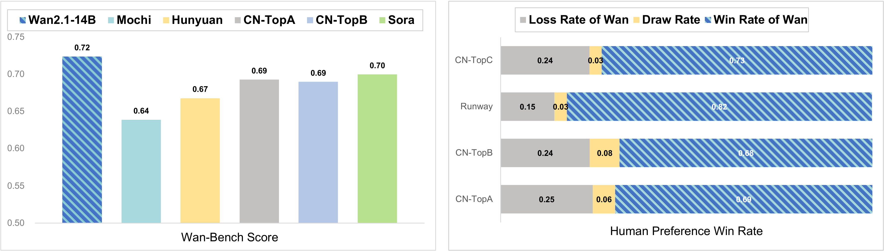</a>

**图 1：** Wan 与先进开源和闭源模型的比较。在基准评估和人工评估中，Wan 都持续表现出更优的结果。注意，HunyuanVideo （[Kong 等，2024](#ref-kong2024hunyuanvideo)） 使用其开源模型进行测试。

*图中文字：* 左图为 Wan-Bench 分数；右图为人工偏好评估中 Wan 的负率、平局率和胜率。

## 1 引言

自 OpenAI 推出 Sora （[OpenAI，2024](#ref-openaisora2024)） 以来，视频生成技术受到产业界和学术界的广泛关注，推动了该领域的快速进步。
能够生成媲美专业制作内容的视频模型的出现，显著提高了内容创作效率，同时降低了视频制作成本。
视频生成技术的快速进步也在很大程度上得益于开源社区的发展。
HunyuanVideo （[Kong 等，2024](#ref-kong2024hunyuanvideo)）、Mochi （[GenmoTeam，2024](#ref-genmo2024mochi)） 和 CogVideoX （[Yang 等，2025b](#ref-cogvideox)） 等代表性项目公开了视频基础模型的代码和权重，逐步缩小开源模型与商业模型之间的差距。
不过，这些优秀开源模型与最新闭源模型之间仍然存在差距。
这种差距主要体现在三个方面。

**性能尚不理想：** 商业模型的发展速度远超当前开源模型，能力显著更强，因此仍存在明显的性能差距。
**能力有限：** 大多数基础模型局限于通用的文本到视频（T2V）任务，而视频创作需求具有多样性，基础 T2V 模型无法满足这些不同的要求。
**效率不足：** 尽管这些模型具有令人印象深刻的性能和规模，但对于计算资源有限的创作团队，它们往往并不实用，限制了其可获取性和易用性。
这些挑战共同制约了开源社区的持续发展与创新。

为应对上述挑战，本报告介绍并公开发布一系列新型高性能视频生成基础模型，称为 Wan，为该领域树立新的基准。
Wan 的核心设计受到扩散 Transformer（DiT）（[Peebles \& Xie，2023](#ref-dit)） 与流匹配（Flow Matching）（[Lipman 等，2022](#ref-flow-matching)） 相结合的成功经验启发；这一框架已在文本到图像（T2I）（[Esser 等，2024](#ref-esser2024sd3)） 和文本到视频（T2V）（[Kong 等，2024](#ref-kong2024hunyuanvideo)） 任务中证明，扩大规模能够带来显著的性能提升。
在这一架构范式下，我们使用交叉注意力嵌入文本条件，并精心优化模型设计，以确保计算效率和精确的文本可控性。
为进一步增强模型捕捉复杂动态的能力，我们加入完整的时空注意力机制。
通过广泛实验，我们在大规模条件下验证了模型，参数量达到 140 亿。
随后，Wan 在包含数十亿图像和视频的大规模数据上训练，总量达到 $\mathcal{O}(1)$ 万亿 token。
这种大规模训练促进了模型能力的涌现，使它在运动幅度与质量、画面文字生成、摄像机控制、指令遵循和风格多样性等方面展现出强大性能。
依托强大的基础模型，我们将能力拓展到多项下游任务，包括图像到视频生成（I2V）、指令引导的视频编辑（V2V）、零样本个性化定制、实时视频生成和音频生成等重要应用。
为降低推理成本，我们还为 T2V 和 I2V 推出与 14B 模型配套的 1.3B 模型，两者均支持 480p 分辨率，并大幅提高推理效率。
值得一提的是，1.3B 模型仅需 8.19 GB 显存，能够在多种消费级 GPU 上运行，同时性能超越许多更大的开源模型。

此外，我们还将公开完整的训练流程，包括大规模数据构建流水线、视频 VAE、训练策略、加速技术以及自动评估算法，帮助社区开发专门的视频基础模型。
我们还提供全面的设计细节和实验结果，分享大型生成模型在高资源消耗训练中观察到的现象，以及关键发现与结论。
我们相信，这些贡献将在加速视频生成技术发展方面发挥关键作用。

<a href="Wan_译文图像/figure_02.png">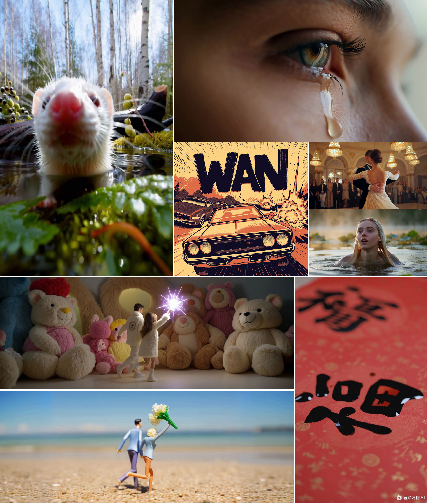</a>

**图 2：** Wan 生成的样本。Wan 可以生成运动幅度大、保真度高且细节逼真的视频。它也是首个能够在视频中同时生成中文和英文文字的模型。此外，Wan 提供文本到视频、图像到视频以及视频编辑等功能。

## 2 相关工作

随着生成建模技术的进步，大规模视频模型的格局发生了显著变化，尤其是基于扩散的框架。
我们的综述聚焦两大类：闭源模型和开源社区的贡献。

**闭源模型。** 闭源模型主要由大型科技公司开发，这些公司投入大量资源，追求高质量、专业的视频生成。
我们按时间顺序梳理过去一年发布的代表性模型。
2024 年 2 月，OpenAI 推出 Sora （[OpenAI，2024](#ref-openaisora2024)），标志着 AI 生成内容的一次重要跃升。
2024 年 6 月，快手的 Kling （[Kuaishou，2024.06](#ref-kuaishou2024kling)） 和 LUMA AI 的 Luma 1.0 （[LumaLabs，2024.06](#ref-luma2024dm)） 开放公众测试，提供强大的视频生成能力。
与此同时，Runway 在 Gen-2 （[Runway，2023](#ref-runway2024gen2)） 的基础上推出 Gen-3 （[Runway，2024.06](#ref-runway2024gen3)），进一步提升视频创作标准。
2024 年 7 月，生数科技发布 Vidu （[Bao 等，2024](#ref-bao2024vidu)），采用自主设计的 U-ViT （[Bao 等，2023](#ref-bao2022all)） 架构。
2024 年 9 月，Kling 和 Luma 都更新到 1.5 版本。
同期，MiniMax 推出 Hailuo Video （[MiniMax，2024.09](#ref-minimax2024hailuo)），向公众展示了出色的视觉效果。
2024 年 10 月，Pika Labs 推出 Pika 1.5 （[PikaLabs，2024.10](#ref-pika2024pika)），允许用户定制视频中的视觉和物理属性。
此外，Meta 推出 Movie Gen （[Polyak 等，](#ref-polyak2024moviegencastmedia)） 视频基础模型系列，详细介绍了训练流程和应用。
2024 年 12 月，Kling 更新到 1.6；同期 Google 发布 Veo 2 （[DeepMind，2024.12](#ref-veo22025)），增强了对现实物理规律和人体运动细节的理解。

这些进展体现了全球视频生成领域的激烈竞争。
在此背景下，我们开源的 Wan 在内部和外部基准上都取得了与这些商业模型相当、甚至更好的表现，并在多个属性上领先。

**开源社区的贡献。** 开源社区不仅为完整的视频生成模型作出重要贡献，也探索了模型的核心组件。
基于扩散的视频生成模型通常建立在 Stable Diffusion （[Rombach 等，2022](#ref-rombach2022sd)） 架构之上。
它主要涉及三个关键模块：将原始视频映射到紧凑潜在空间的自编码器、提取文本嵌入的文本编码器，以及通过扩散模型优化、学习这些视频潜变量分布的神经网络。
在网络结构方面，最初用于图像生成 （[Ho 等，2020](#ref-ho2020denoising)；[Song 等，2020](#ref-song2020denoising)） 的 U-Net （[Ronneberger 等，2015](#ref-ronneberger2015u)） 通过加入时间维度，被适配到视频生成。
VDM （[Ho 等，2022](#ref-ho2022video)） 将二维 U-Net 扩展为三维版本；另一类范式 （[Zhou 等，2022](#ref-zhou2022magicvideo)；[Wang 等，2023a](#ref-wang2023modelscope)；[Guo 等，2024b](#ref-guo2023animatediff)） 将一维时间注意力与二维空间注意力块结合，以降低计算成本。
值得注意的是，仅依赖 Transformer 块的 DiT （[Peebles \& Xie，2023](#ref-dit)） 在视觉生成任务中优于 U-Net （[Chen 等，2023a](#ref-chen2023pixartalpha)）。
这一结构也被迁移到视频模型 （[Ma 等，2024](#ref-ma2024latte)），形成两种常见变体：利用交叉注意力处理文本嵌入的原始 DiT （[Peebles \& Xie，2023](#ref-dit)；[HaCohen 等，2024](#ref-HaCohen2024LTXVideo)），以及将文本嵌入与视觉嵌入拼接、进行完整注意力处理的 MM-DiT （[GenmoTeam，2024](#ref-genmo2024mochi)；[Kong 等，2024](#ref-kong2024hunyuanvideo)）。

在自编码器方面，早期方法 （[Rombach 等，2022](#ref-rombach2022sd)） 使用标准 VAE （[Kingma，2013](#ref-kingma2013auto)）；较新的 VQ-VAE （[Van Den Oord 等，2017](#ref-van2017neural)） 和 VQGAN （[Esser 等，2021](#ref-esser2020taming)） 改进了模型设计，以获得更好的重建和压缩效果。
LTX-Video （[HaCohen 等，2024](#ref-HaCohen2024LTXVideo)） 修改 VAE 解码器，使它执行最后一步去噪并将潜变量转换为像素，在解码过程中生成缺失的高频细节。
文本编码器同样是基于文本的视频生成的关键组件。
当前强大的视频生成模型主要使用 T5 系列 （[Raffel 等，2020](#ref-t5)） 作为文本编码器，且常与 CLIP （[Radford 等，2021](#ref-radford2021learning)） 结合。
HunyuanVideo （[Kong 等，2024](#ref-kong2024hunyuanvideo)） 将 T5 替换为多模态大语言模型 （[Liu 等，2023c](#ref-llava)；[Li 等，2023](#ref-li2024mgm)），实现文本嵌入与视觉特征之间更强的对齐。

通过将这些关键模块与有效的扩散优化技术 （[Ho 等，2020](#ref-ho2020denoising)；[Song \& Ermon，2019](#ref-song2019generative)；[Lipman 等，2022](#ref-flow-matching)） 结合，已出现多个有潜力的开源视频生成模型 （[GenmoTeam，2024](#ref-genmo2024mochi)；[Kong 等，2024](#ref-kong2024hunyuanvideo)；[HaCohen 等，2024](#ref-HaCohen2024LTXVideo)；[Zheng 等，2024](#ref-opensora)；[Lin 等，2024](#ref-lin2024open)；[Jin 等，2024](#ref-jin2024pyramidal)；[Yang 等，2025b](#ref-cogvideox)）。
在 Wan 中，我们仔细设计或选择每一个关键组件，以保证高质量视频合成。
我们提供详细设计信息和消融实验，帮助未来的视频生成模型设计。

此外，大量研究探索了视频生成的下游任务，包括重绘 （[AI，2022](#ref-sdinp)；[Zhou 等，2023](#ref-propainter)）、编辑 （[Meng 等，2021](#ref-sdedit)；[Brooks 等，2023](#ref-ip2p)；[Zhang 等，2023a](#ref-magicbrush)；[Wang 等，2023b](#ref-wang2023videocomposer)；[Wei 等，2024b](#ref-dreamVideo2)）、可控生成 （[Zhang 等，2023b](#ref-controlnet)；[Jiang 等，2024](#ref-scedit)；[Wang 等，2024c](#ref-wang2024unianimate)） 和参考帧生成 （[Yang 等，2025b](#ref-cogvideox)；[Guo 等，2024a](#ref-i2vadapter)）。
这些研究通常利用适配器或类似 ControlNet 的架构 （[Zhang 等，2023b](#ref-controlnet)；[Chu 等，2023](#ref-chu2024diffcomplete)） 来引入用户指定的条件。
我们也基于 Wan 开发了多种下游应用，取得了出色性能。

## 3 数据处理流水线

高质量数据是训练大型生成模型的关键，自动化数据构建流水线能够显著提高训练流程的效率。
构建数据集时，我们优先遵循三个核心原则：**高质量、高多样性和大规模**。
依据这些原则，我们整理了包含数十亿视频和图像的数据集。
本节详细介绍 Wan 使用的数据构建流水线。

### 3.1 预训练数据

我们从内部拥有版权的数据源和公开可获取的数据中整理候选数据集，并进行去重。
预训练阶段的目标，是从庞大但包含噪声的数据集中选择高质量且多样的数据，以支持有效训练。
在整个数据挖掘过程中，我们设计了四步数据清洗流程，关注基础维度、视觉质量和运动质量。
随后，我们还将介绍构建画面文字数据的处理流程。

**基础维度。** 数据过滤框架的基础维度关注原始视频和图像的固有属性，能够高效地初步剔除不适合的数据。
具体而言，我们的多维过滤方法包含以下关键方面。

- **文字检测：** 使用轻量级 OCR 检测器量化文字覆盖率，排除文字元素过多的视频和图像，保持视觉清晰度。
- **美学评估：** 使用广泛采用的 LAION-5B （[Schuhmann 等，2021](#ref-schuhmann2021laion)） 美学分类器对图像进行初步质量评估，快速过滤低质量数据。
- **NSFW 分数：** 利用内部安全评估模型，对全部训练数据计算 NSFW 分数，系统地评估和过滤不适当内容。
- **水印和标志检测：** 检测视频或图像中的水印和标志，并在训练时裁剪这些元素。
- **黑边检测：** 使用基于启发式规则的检测方法，自动裁剪多余黑边，聚焦内容丰富的区域。
- **过曝检测：** 使用训练得到的专门分类器，评估并过滤色调分布异常的数据，确保训练集的视觉质量。
- **合成图像检测：** 实验证据表明，即使生成图像只造成少量污染（$<10\%$），也会显著降低模型性能。因此，我们训练专门分类器过滤这些“污染”图像。
- **模糊检测：** 内部开发的模型为训练素材赋予定量模糊分数，系统地移除视觉上不清晰的内容。
- **时长和分辨率：** 要求视频时长超过 4 秒，并在不同训练阶段设置分辨率阈值，过滤低质量数据。

通过这些高效预处理策略，我们成功剔除了约 50% 的初始数据。
保留的高质量数据随后进入更精细的语义驱动筛选阶段，进一步优化。

> **阅读注释｜数据筛选中的“质量”有多种含义。** 清晰度、美学、主体运动和内容多样性分别影响不同能力，单靠一个总分筛选容易丢掉稀有类别。这里检测并过滤的“合成图像污染”，与后文专门渲染文字、合成个性化训练样本不是同一处理目的；不能把局部实验结论扩展为“所有合成数据都会损害模型”。关键是样本是否适合目标任务，以及它在训练分布中的比例。

**视觉质量。** 这一过程主要从候选数据集中选择质量较高、符合预训练标准的数据。
该子集必须具有良好的视觉质量，并且整体分布应与自然数据的分布一致。
我们将任务分为**聚类**和**评分**两部分。
聚类将全部数据划分成更小的子集，以便分别处理。
其优点是避免长尾分布导致数量较少但重要的数据部分流失，从而保持原始数据分布。
具体而言，我们将数据划分为 100 个簇，再从每个簇选择一定数量的数据进入下一处理阶段。
评分为每个视频或图像赋予质量分数，便于在不同阶段选择和处理数据。
我们从各簇中抽样进行人工评分，分数为 1–5，1 为最差、5 为最好。
随后利用全部标注数据训练专门评估模型，对整个数据集评分。

> **阅读注释｜为什么先聚类，再评分？** 如果直接从全体数据中挑最高分样本，数量多的类别可能占据大部分名额，少见但有价值的类别容易消失。先按内容分簇，再在各簇内抽样和筛选，可以兼顾质量与覆盖范围。“长尾”指数量少的类别，不是视频长度；聚类本身也不保证最终各类均衡，仍需要设置采样比例。

**运动质量。** 运动质量评估旨在选择自然、完整且运动显著的视频，避免静态或抖动的运动。
我们将视频划分为六种运动质量等级。

- **最优运动：** 视频具有理想的运动布局、视角和幅度，运动干净且流畅。
- **中等质量运动：** 有明显运动，但可能存在多个主体或局部遮挡等轻微问题。这类数据确保运动多样性，可在预训练中帮助模型更好地理解时空关系。
- **静态视频：** 主要是聊天和访谈类视频。运动信息虽少，但质量较高，因此需要单独识别并降低采样比例。
- **摄像机驱动的运动：** 以摄像机移动为主、主体运动很少的画面，例如航拍。由于与静态图像相似，其采样优先级显著降低。
- **低质量运动：** 主体过多、严重遮挡或主要主体不清晰的视频，例如拥挤街景。这类内容会损害训练效率和运动生成质量，因此被排除。
- **摄像机抖动画面：** 摄像机明显抖动的业余拍摄，常造成运动模糊，前景与背景难以区分。训练时系统地排除这一类数据。

> **阅读注释｜画面变化大，不一定表示主体运动丰富。** 航拍、镜头平移和抖动都能造成大范围像素变化，但人物或物体可能没有明显动作。这里区分主体运动、摄像机运动与抖动，是为了让模型学到自然的动态规律；静态视频也不一定质量差，只是提供的运动信息较少。训练时需要兼顾外观学习与动作学习，而不是一律保留运动幅度最大的样本。

**画面文字数据。** 此外，我们引入一种新数据处理方法，增强 Wan 的画面文字生成能力。
该方法包含两个独立处理分支，分别改善文字渲染的准确性和协调性。
一方面，我们在纯白背景上渲染汉字，合成数亿张包含文字的图像。
另一方面，我们从大量真实世界数据中收集包含文字的图像。
我们使用多个 OCR 模型准确识别图像和视频中的英文与中文，再将提取的文字输入多模态语言模型 Qwen2-VL。
这一过程生成自然的图像描述，并确保描述尽可能包含准确的文字内容。
借助此流水线，我们收集了大量真实世界图文对。
预训练时将合成数据与真实数据结合，使模型能够泛化到视频中的罕见文字生成，字形准确且真实感高，展示出显著的画面文字生成优势。

> **阅读注释｜理解文字与把文字画出来是两种能力。** 文本编码器可以理解提示词中的汉字，但要在视频画面中生成正确字形，还需要生成网络见过相应的视觉数据。白底文字样本提供字形监督，真实场景图文对帮助学习文字与背景、布局的结合；OCR 则用于让描述中的文字与实际画面对应。前面过滤文字过多的普通数据，与这里建设专门文字数据集，可以同时存在。

<a href="Wan_译文图像/figure_03.png">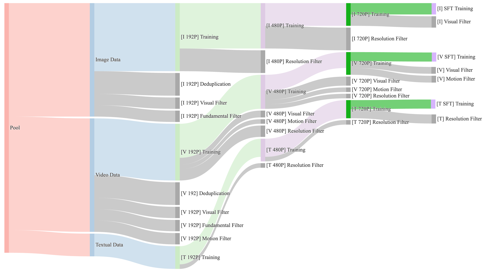</a>

**图 3：** 不同训练阶段的数据供给。在每个阶段，我们依据数据吞吐量，动态调整运动、质量和类别相关数据的比例。

### 3.2 后训练数据

后训练的核心目标，是通过高质量数据提高生成视频的视觉保真度和运动动态表现。
这一阶段对静态和动态数据采用不同策略：优化图像数据以改善视觉质量，专门处理视频数据以提高运动质量。

**图像处理。** 在高分图像池中进一步筛选，识别在质量、构图和细节等方面表现突出的顶级样本。
我们采用两种方式构建精选数据集：**基于专门评估模型的收集**和**人工收集**。
前者选择模型预测分数最高的 20% 图像。
对该子集，还考虑风格和类别等因素，以保证数据分布的多样性。
后者从不同类别和数据源人工收集顶级图像，同时补充数据集中缺失的概念，提升模型泛化能力。
通过这一过程，我们总计收集了数百万张精选图像。

**视频处理。** 我们采用与图像类似的策略收集顶级视频。
首先利用视觉质量分类器从候选数据集中筛选部分高排名视频。
再依据运动质量分类器，分别选择数百万个简单运动视频和数百万个复杂运动视频。
所有视频筛选都强调类别平衡和高多样性。
同时，我们从科技、动物、艺术、人物、交通工具等 12 个主要类别中选择数据，增强模型对常用类别的生成能力。

> **阅读注释｜预训练和后训练各负责什么？** 预训练用规模较大、内容较广的数据学习通用知识，后训练再用精选数据改善画面和运动表现。两者的数据质量与覆盖范围有不同侧重，后训练也需要防止只剩少数题材。本文的后训练主要是高质量数据上的继续训练；“后训练”一词本身不表示采用了强化学习或人类偏好优化。

### 3.3 细致视频描述

数据集中的许多图像和视频虽然带有原网页的文字说明，但这些说明通常过于简单，无法表达详细的视觉内容。
DALL-E 3 （[Betker 等，2023](#ref-BetkerImprovingIG)） 已证明，利用生成的高度详细视觉描述训练，可以显著增强视觉生成模型遵循提示词的能力。
因此，我们开发内部描述模型，为数据集中的每张图像和每个视频生成细致描述。
训练该模型时，既使用开源视觉语言数据集，也使用内部额外收集的数据。

> **阅读注释｜描述为什么会影响生成能力？** 一段视频如果只标为“一个人在运动”，模型很难把具体动作、场景、数量和镜头变化与词语对应起来。细致描述提供更明确的条件监督，但细节必须与画面一致，凭空添加的动作或物体会成为错误标签。这里的描述模型负责“看视频并写说明”，后面的 umT5 负责“把说明编码成特征”，两者不是同一个模块。

#### 3.3.1 开源数据集

我们收集广泛使用的图像和视频视觉语言数据集。
不仅包含描述数据集，也包含关注动作、计数和 OCR 等视觉内容的视觉问答数据集。
某些场景要求描述模型根据用户指令生成特定风格或内容的描述。
因此，我们还收集纯文本指令数据，以增强模型的指令遵循能力。

#### 3.3.2 内部数据集

我们针对多种任务收集内部数据集，增强模型在特定领域的能力。

**名人、地标和电影角色。** 为训练模型识别名人、地标和角色，我们收集覆盖数千个身份的数据集。
首先使用大语言模型（LLM）收集名称，再利用 CLIP 类模型从图文数据库检索对应图像。
我们测试了多种 CLIP 类模型，发现 TEAM （[Xie 等，2022](#ref-TEAM2022MM)） 在人物识别方面表现出色，尤其是中国名人。
为进一步减少数据噪声，我们对图文对中的描述进行关键词匹配。
只有同时被 TEAM 检索到且匹配指定关键词的图像才会保留。

**物体计数。** 为增强视觉计数能力，我们检索文字说明中包含“一”“二”“三”等词语的图像，构建计数数据集。
这些数字提供粗略标注。
再利用 LLM 从对应文本中提取“类别、数量”对。
最后使用 Grounding DINO （[Liu 等，2023d](#ref-groundingdino)） 统计这些类别的物体。
只有文字说明与 Grounding DINO 的结果一致时，图像才会保留。

**OCR。** 为提高模型生成文字描述的能力，我们收集 OCR 增强的图像描述数据集。
首先使用现成的 OCR 检测器提取图像中的文字。
再提示描述模型根据这些 OCR 结果生成描述。
该方法将提取的文字作为先验知识，确保文字描述准确。
目前仅包含英文和中文。

**摄像机角度和运动。** 我们观察到，当前多模态语言模型（MLLM），包括 GPT-4o 和 Google Gemini Pro 等先进商业模型，都难以准确预测摄像机角度和运动。
为改善预测，我们首先对一组视频标注摄像机角度和运动。
该数据集有两种用途：直接训练最终阶段使用的描述模型；或者训练专门模型，标注更多视频数据，辅助早期训练。
这一数据集提高了运动与角度描述的准确性，进而增强视频生成模型的摄像机运动可控性。

**细粒度类别。** 为增强对动物、植物和交通工具等细粒度类别的识别，我们创建了包含这些类别数百万张图像的数据集。

**关系理解。** 通过引入现有物体检测数据集，收集关注左、右、上、下等空间关系的数据，增强模型的关系理解能力。

**重新描述。** 描述模型的一项重要能力，是利用已有标签或简短描述生成细致描述。
为此，我们整理重新描述数据集，根据图像内容，将简短文字标签或说明扩展为详细描述。

**编辑指令描述。** 我们收集描述两张图像之间差异或变换的数据集。
这种描述对于图像编辑任务很有价值。

**图像组描述。** 我们收集对一组图像进行描述的数据集。
每条描述首先说明图像共享的特征，再以相似措辞分别描述每张图像。

**人工标注的图像和视频描述。** 我们收集人工标注的细致图像与视频描述。
这是质量最高的描述数据，用于模型训练的最终阶段。

<a href="Wan_译文图像/figure_04.png">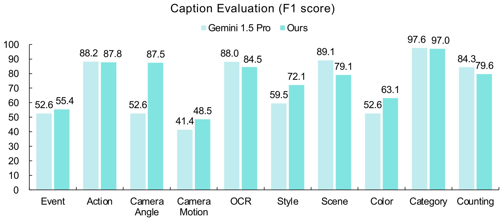</a>

**图 4：** 我们的描述模型整体性能与 Google Gemini 1.5 Pro 相当，尤其在事件、摄像机角度、摄像机运动、风格和颜色方面表现突出。

#### 3.3.3 模型设计

**架构。** 描述模型采用 LLaVA 风格架构 （[Liu 等，2023c](#ref-llava)）。
使用 ViT 编码器提取图像和视频帧的视觉嵌入。
这些嵌入通过两层感知机投影后，输入 Qwen LLM （[QwenTeam，2024](#ref-qwen2.5)）。

图像输入采用与 LLaVA 类似的动态高分辨率方案。
一张图像最多划分为七个图块。
对每个图块，将视觉嵌入自适应池化为 $12\times12$ 网格表示，以减少计算。

对于视频，每秒采样 3 帧，上限为 129 帧。
为进一步减少计算，使用快慢编码策略：每隔四帧保留一帧的原始分辨率，对其余帧的嵌入做全局平均池化。
长视频基准实验表明，快慢机制在视觉 token 数量有限时也能改善理解；例如，在不使用字幕的 VideoMME （[Fu 等，2024](#ref-videomme)） 上，性能从 67.6% 提高到 69.1%。

> **阅读注释｜快慢编码怎样节省计算？** 少数帧保留较丰富的空间特征，用于识别物体、细节和场景；其余帧压缩为更小的表示，补充随时间变化的信息。它是在“看清单帧”与“覆盖更多时刻”之间分配 token 预算，不是把视频播放速度调快或调慢。这里压缩的是描述模型的视觉输入，区别于后文 Wan-VAE 对生成视频的时空压缩。

**训练。** 遵循近期先进方法，训练分为三个阶段。
第一阶段冻结 ViT 和 LLM，仅训练多层感知机，将视觉嵌入与 LLM 输入空间对齐，学习率为 $10^{-3}$。
第二阶段使全部参数可训练。
最终阶段在少量高质量数据上进行端到端训练。
后两个阶段，LLM 和 MLP 的学习率为 $10^{-5}$，ViT 的学习率为 $10^{-6}$。

#### 3.3.4 评估

自动评估对描述模型的开发至关重要，使我们能够识别不同版本的优点和不足。
遵循 CAPability （[Liu 等，2025b](#ref-liu2025good)），我们开发自动描述评估流水线。
重点关注视频生成中的十个视觉维度：动作、摄像机角度、摄像机运动、物体类别、物体颜色、物体计数、OCR、场景、风格和事件。
每个维度随机抽样 1,000 个视频及模型生成的对应描述。
还使用 Google Gemini 1.5 Pro 为同一数据集生成细致视频描述。
按照 CAPability 的方法，计算各维度 F1 指标，评估我们的描述和 Gemini 的描述。
结果见图 4。
我们的描述在视频事件、摄像机角度、摄像机运动、风格和物体颜色方面更好；Gemini 在动作、OCR、场景、物体类别和物体计数方面更强。

## 4 模型设计与加速

### 4.1 时空变分自编码器

<a href="Wan_译文图像/figure_05.png">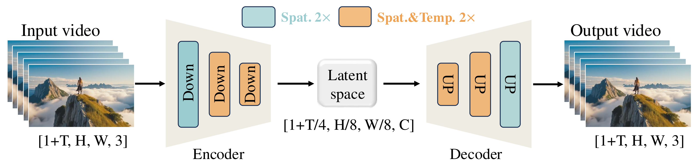</a>

**图 5：** Wan-VAE 框架。Wan-VAE 可将视频的时空维度压缩 $4\times8\times8$ 倍。橙色矩形表示两倍时空压缩，绿色矩形表示两倍空间压缩。

变分自编码器（VAE）（[Wu 等，2024](#ref-wu2024improved)；[Blattmann 等，2023](#ref-blattmann2023svd)；[OpenAI，2024](#ref-openaisora2024)） 在从高维视觉数据，尤其是视频中学习紧凑潜在表示方面发挥关键作用，使扩散模型等生成模型能够进行可扩展、高效的训练。
然而，为视频生成任务设计有效 VAE 面临若干挑战。
第一，视频天然具有空间与时间维度，需要 VAE 捕捉复杂的时空依赖。
第二，视频本身的高维性质，例如多帧高分辨率像素，会增加内存占用和计算成本，使 VAE 难以扩展到长视频序列。
第三，保证时间因果性，即未来帧不影响过去帧，对于生成真实、连贯的视频至关重要，但这一约束也增加了架构复杂度。

为应对这些挑战，我们提出专为视频生成设计的新型三维因果 VAE 架构 Wan-VAE。
我们结合多种策略 （[Wu 等，2024](#ref-wu2024improved)），改善时空压缩、降低内存占用，并保证时间因果性。
这些改进使 Wan-VAE 更高效、更易扩展，也更适合与 DiT 等基于扩散的生成模型集成。
下面介绍网络设计、训练细节、高效推理及实验比较。

> **阅读注释｜潜在空间与时间因果性。** VAE 编码器把像素视频变成较小的特征张量，解码器再将它还原；这个学习得到的表示称为潜变量，不是普通的视频压缩文件。因果结构表示某一时刻的特征不依赖未来帧，便于按时间分块并复用历史计算。它不等于模型理解了物理因果关系，也不是所有连贯视频生成方法都必须采用的约束；Wan 的 VAE 是因果的，后面的基础 DiT 使用完整、非因果的时空注意力。

#### 4.1.1 模型设计

为实现高维像素空间与低维潜在空间之间的双向映射，我们设计了图 5 所示的三维因果 VAE。
给定输入视频 $V\in\mathbb{R}^{(1+T)\times H\times W\times3}$，Wan-VAE 将其时空维度压缩至 $[1+T/4,H/8,W/8]$，同时将通道数 $C$ 扩展到 16。
具体而言，遵循 MagViT-v2 （[Yu 等，2023](#ref-yu2023language)），第一帧仅进行空间压缩，以更好地处理图像数据。
在架构方面，我们将所有 GroupNorm 层 （[Wu \& He，2018](#ref-wu2018group)） 替换为 RMSNorm 层 （[Zhang \& Sennrich，2019](#ref-rms)），以保持时间因果性。
这一修改允许使用特征缓存机制，见第 4.1.3 节，从而显著提升推理效率。
此外，我们将空间上采样层输入特征的通道数减半，使推理内存占用降低 33%。

进一步仔细调整基础通道数后，Wan-VAE 的模型规模仅为 127M 参数。
这一优化减少编码时间和内存占用，也有利于后续扩散 Transformer 模型的训练。

> **阅读注释｜如何读潜变量的尺寸？** 例如，81 帧、$720\times1280$ 的视频对应 $T=80$，编码后为 $21\times90\times160$ 个时空位置，每个位置有 16 个通道。第一帧独立保留时间位置，后面每 4 帧对应一个潜在时间位置，所以帧数是 $1+T/4$，而不是直接用 81 除以 4。$4\times8\times8$ 描述时空尺寸的缩减，不是包含通道数和存储精度后的视频文件压缩率。

> **阅读注释｜为什么归一化也会影响因果性？** 若归一化的统计量跨越整个视频时间轴，当前帧就可能间接用到未来帧信息；各块单独处理时，统计量也会变化。这里使用适当计算维度上的 RMSNorm，避免这种跨时间依赖，使分块与缓存机制可行。RMSNorm 按均方根缩放特征；保持因果性还依赖卷积、填充及其他算子的实现，不能只看归一化层的名称。

#### 4.1.2 训练

我们采用三阶段方法训练 Wan-VAE。
首先构建相同结构的二维图像 VAE，在图像数据上训练。
随后将训练好的二维图像 VAE 扩展为三维因果 Wan-VAE，提供初始空间压缩先验，与从头训练视频 VAE 相比显著提高训练速度。
这一阶段使用低分辨率（$128\times128$）、少帧数（5 帧）视频，加速收敛。
训练损失包括 L1 重建损失、KL 损失和 LPIPS 感知损失，权重分别为 3、$3\times10^{-6}$ 和 3。
最后，在不同分辨率和帧数的高质量视频上微调，并加入来自三维判别器的 GAN 损失 （[Esser 等，2021](#ref-esser2020taming)）。

> **阅读注释｜VAE 的几个损失如何分工？** L1 约束重建像素与输入接近；KL 损失约束编码得到的潜变量分布；LPIPS 比较感知特征，帮助保留人眼关注的结构；GAN 损失用判别器促进更真实的细节。它们优化的目标不同，数字权重也不能脱离各损失的尺度直接比较。先训练二维 VAE 再扩展为三维，相当于先学会压缩单帧，再学习时间关系。

<a href="Wan_译文图像/figure_06.png">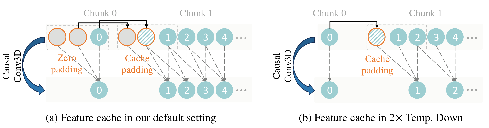</a>

**图 6：** 特征缓存机制。(a) 和 (b) 分别展示该机制在常规因果卷积和时间下采样中的使用方式。

#### 4.1.3 高效推理

为高效支持任意长度视频的编码和解码 （[Yang 等，2025a](#ref-CDT)；[Yao 等，2021](#ref-yao2021wenet)），我们在 Wan-VAE 的因果卷积模块中实现特征缓存机制。
具体而言，视频序列的帧数遵循 $1+T$ 输入格式，因此将视频划分为 $1+T/4$ 个块，与潜在特征数量一致。
处理输入视频时采用分块策略，每次编码或解码仅处理与单个潜在表示对应的视频块。
根据时间压缩比，每个处理块最多包含 4 帧，有效防止内存溢出。

为保证相邻上下文块的时间连续性，模型保留前面视频块的帧级特征缓存。
这些缓存特征被用于后续块的因果卷积计算。
图 6 展示这一机制的两种典型情况。
在图 6(a) 的默认设置中，因果卷积不改变帧数；卷积核大小为 3，因此需要保留两个历史帧的缓存特征。
初始块通过两个虚拟帧的零填充来初始化缓存缓冲区。
后续块复用前一块的最后两帧作为缓存，并丢弃过时的历史数据。
图 6(b) 展示两倍时间下采样，步幅为 2 的情况。
此时需要不同的缓存管理方式：只对非初始块进行单帧缓存填充，以保证维度一致。
这一配置确保输出序列长度遵循准确的下采样比例，同时保持块边界两侧的因果关系。

特征缓存机制不仅优化了内存使用，也保持块边界处的特征连贯性，从而支持无限长度视频的稳定推理。

> **阅读注释｜缓存的是历史特征，不是重新独立处理每个片段。** 时间核大小为 3 的因果卷积，在计算当前位置时需要当前及两个历史位置；缓存保留了下一块仍要使用的历史特征，避免丢失块边界上下文。这里支持任意长度，指 VAE 可以持续编码或解码，并不自动使基础 DiT 能生成任意长度视频。生成长视频还需要第 5.6 节的流式策略。

#### 4.1.4 评估

<a href="Wan_译文图像/figure_07.png">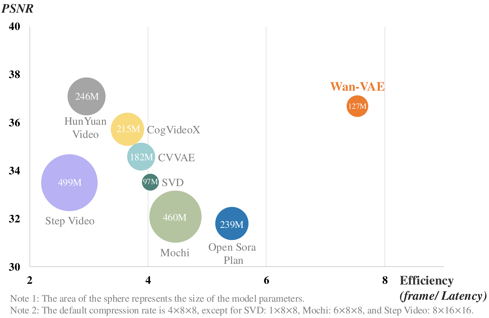</a>

**图 7：** 在 $720\times720$ 分辨率、25 帧条件下的视频重建性能比较。

**定量结果。** 我们通过峰值信噪比（PSNR）和处理效率，即每秒处理帧数，全面评估多种先进视频 VAE （[Kong 等，2024](#ref-kong2024hunyuanvideo)；[Yang 等，2025b](#ref-cogvideox)）。
为公平比较，大多数模型采用与我们相同的压缩率和潜在特征维度，即 $4\times8\times8$ 压缩率和 16 维潜在表示。
Open Sora Plan （[Lab \& etc.，2024](#ref-yuan_opensora)） 的压缩率相同，但潜在维度为 4。
SVD （[Blattmann 等，2023](#ref-blattmann2023svd)） 使用 $1\times8\times8$ 压缩率和 4 维潜在表示；Step Video （[Ma 等，2025](#ref-step_video)） 使用 $8\times16\times16$ 压缩率和 64 维潜在表示；Mochi （[GenmoTeam，2024](#ref-genmo2024mochi)） 使用 $6\times8\times8$ 压缩率和 12 维潜在表示。
评估使用 200 个视频，每个视频包含 25 帧，分辨率为 $720\times720$。
图 7 中圆的大小与模型参数量正相关。

结果表明，Wan-VAE 在两个指标上均非常有竞争力，同时具有高视频质量和高处理效率的双重优势。
在相同硬件环境下，我们 VAE 的重建速度是现有先进方法 HunyuanVideo 的 2.5 倍。
由于 VAE 规模较小且采用特征缓存机制，这一速度优势在更高分辨率下会更加明显。
这一进展为视频重建和视频生成训练提供了高效方案。
这些结果验证了模型设计的有效性，也为未来 VAE 技术的发展提供了有价值的启示。

<a href="Wan_译文图像/figure_08.png">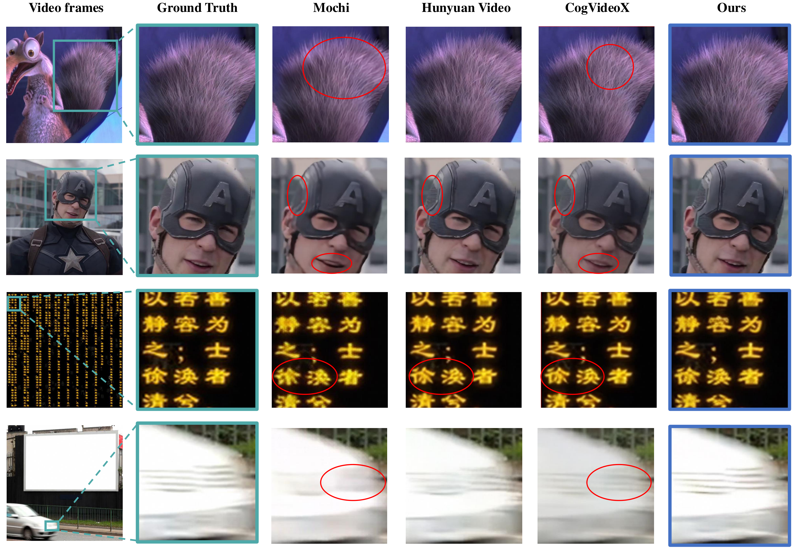</a>

**图 8：** 不同场景下的视频重建可视化，包括纹理（第一行）、人脸（第二行）、文字（第三行）和大幅度运动（第四行）。这些视频包含丰富细节，但未用于训练。

**定性结果。** 为验证在不同场景下的重建性能，图 8 展示了纹理、人脸、文字和大幅度运动场景。
相较现有 VAE，Wan-VAE 在这些场景中表现更好。
第一行纹理场景中，我们的方法能够更准确地捕捉毛发纹理与方向等细节。
第二行人脸场景中，Wan-VAE 保留人脸特征，同时减少嘴唇周围的模糊和失真。
第三行文字场景中，我们的方法清晰地恢复文字内容，缓解字符失真和丢失。
第四行大幅度运动场景中，Wan-VAE 保持视频帧中的运动清晰度。
这些结果说明，该方法在处理多种复杂场景时具有显著优势。

<a href="Wan_译文图像/figure_09.png">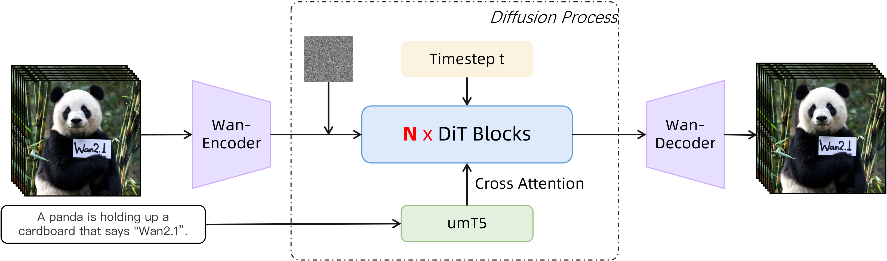</a>

**图 9：** Wan 的架构。

> **阅读注释｜如何读这张架构图？** Wan-Encoder 与 Wan-Decoder 是 VAE 的两部分，负责视频的压缩与还原；umT5 将提示词编码为文本特征，通过交叉注意力提供条件；DiT 处理带噪视频潜变量，在 Wan 的流匹配框架中预测其变化速度。
>
> **训练时：** 真实视频编码为潜变量 $x_1$，与随机噪声 $x_0$ 混合成 $x_t=(1-t)x_0+t x_1$。DiT 根据 $x_t$、时间变量 $t$ 和文本条件预测速度，以 $x_1-x_0$ 为监督目标。灰色方块表示参与混合的噪声。
>
> **生成时：** 文本到视频无需输入真实视频，从随机噪声潜变量开始，反复执行“DiT 预测速度 → 采样器更新潜变量”，最后由 Decoder 解码。图中省略了迭代更新，单次预测的速度不能直接解码为最终视频。$N$ 表示 DiT 块的层数，不是采样步数；$t$ 表示噪声状态，不是视频帧序号，一个采样步通常处理整段视频潜变量。

### 4.2 模型训练

本节详细介绍视频基础模型在文本到视频任务中的架构设计，以及预训练和后训练阶段的细节。
图 9 展示 Wan 架构，其基于当前主流的 DiT （[Peebles \& Xie，2023](#ref-dit)），通常包含三个主要组件：Wan-VAE、扩散 Transformer 和文本编码器。
给定视频 $V\in\mathbb{R}^{(1+T)\times H\times W\times3}$，Wan-VAE 编码器将其从像素空间编码为潜在空间中的 $x\in\mathbb{R}^{(1+T/4)\times H/8\times W/8}$，再送入后续扩散 Transformer。

> **译注：** 原文此处的 $x$ 形状未写出通道维；根据第 4.1.1 节，潜变量具有 16 个通道。

#### 4.2.1 视频扩散 Transformer

<a href="Wan_译文图像/figure_10.png">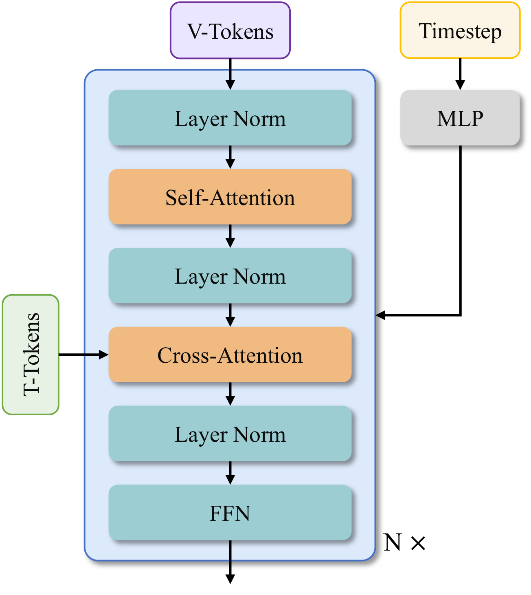</a>

**图 10：** Wan 的 Transformer 块。

> **阅读注释｜如何读这个 DiT 块？** 这张图展开了图 9 中的生成网络。V-Tokens 是带噪视频潜变量图块化后的特征序列，形状为 $[B,L,D]$，分别表示批大小、视频 token 数和特征维度；T-Tokens 是 umT5 编码后的文本特征，其中 T 指 Text；Timestep 表示当前噪声状态，与视频帧序号不同。一个视频 token 对应潜在视频中的局部区域，不是一张完整帧。
>
> **沿主干向下看：** Layer Norm 对每个 token 的特征维度归一化，稳定数值尺度；Self-Attention 让不同帧、不同位置的视频 token 交换信息；Cross-Attention 引入提示词条件；FFN 对每个 token 做非线性特征变换。块内主要更新特征内容，通常保持 $[B,L,D]$ 的形状，不像 VAE 那样逐级压缩时空尺寸。
>
> **两种注意力的区别：** 自注意力的 Query、Key、Value 都来自视频特征；交叉注意力的 Query 来自视频，Key、Value 来自文本。例如，自注意力帮助不同帧中的熊猫与纸板建立联系，交叉注意力帮助画面符合“熊猫举着纸板”的要求。FFN 则加工融合后的特征，本身不直接让不同 token 交换信息。
>
> **右侧时间分支：** 时间变量先转换成嵌入，再经过 MLP，得到六组调制向量：自注意力与 FFN 各有偏移 $\beta$、缩放 $\gamma$ 和残差门控 $g$。可以用 $h=(1+\gamma)\odot\operatorname{LN}(X)+\beta$、$X'=X+g\odot F(h)$ 理解：缩放和偏移调整分支输入，门控控制分支对主干的修正，$\odot$ 表示逐元素乘法。这是便于理解的示意公式。时间调制 MLP 在各块间共享，每块再学习独立偏置，注意力和 FFN 权重并不因此共享。
>
> **图中省略的连接与输出：** 实际块内有残差连接，将自注意力、交叉注意力和 FFN 的结果加回主干；右侧箭头也简化了时间调制的具体作用位置。$N\times$ 表示堆叠 $N$ 个这样的块，区别于采样步数和视频帧数。全部块之后还有输出头与反图块化，得到潜变量的速度预测，再交给采样器更新。六组调制及残差连接的细节可对照 [Wan 官方实现](https://github.com/Wan-Video/Wan2.1/blob/main/wan/modules/model.py#L220)。

**扩散 Transformer。** 主要包含图块化模块、Transformer 块和反图块化模块。
在每个块中，我们关注有效建模时空上下文关系，以及嵌入文本条件和时间步。
图块化模块使用卷积核为 $(1,2,2)$ 的三维卷积，并通过展平操作将 $x$ 转为形状 $(B,L,D)$ 的特征序列。
其中 $B$ 为批大小，$L=(1+T/4)\times H/16\times W/16$ 为序列长度，$D$ 为潜在维度。
如图 10 所示，我们使用交叉注意力嵌入输入文本条件，即使在长上下文建模条件下，也能保证指令遵循能力。
此外，使用包含 Linear 和 SiLU （[Elfwing 等，2018](#ref-SiLU)） 层的 MLP 处理时间嵌入，分别预测六个调制参数。
该 MLP 在全部 Transformer 块之间共享，每个块学习一组独立偏置。
广泛实验表明，这种设计可将参数量减少约 25%，并在相同参数规模下显著提升性能。

> **阅读注释｜从视频张量到 token 序列。** 图块化将每个潜在时间位置上的 $2\times2$ 空间区域投影为一个 token，因此 VAE 的空间缩小 8 倍后，token 网格相对像素又缩小 2 倍，得到公式中的 $H/16$ 与 $W/16$。例如，81 帧、$720\times1280$ 的视频对应 $21\times45\times80=75{,}600$ 个视频 token。这里的 token 是视觉特征单元，不是文字或视频帧。

**文本编码器。** Wan 使用 umT5 （[Chung 等，2023](#ref-chung2023unimax)） 编码输入文本。
大量实验表明，umT5 在我们的框架中具有以下优势。

1. 多语言编码能力强，可以有效理解中文和英文，以及输入中的画面文字。
2. 在相同条件下，umT5 在构图方面优于采用单向注意力的其他 LLM。
3. 收敛性更好，在相同参数规模下收敛更快。

基于这些发现，我们最终选择 umT5 作为文本嵌入器。

> **阅读注释｜为什么语言模型更大，不一定更适合做文本编码器？** 生成网络需要的不是直接回答问题的能力，而是稳定、便于对齐的文本特征。双向编码器可以让每个词参考前后文，纯解码器的因果注意力则限制它只查看此前位置。具体效果还取决于预训练、特征提取层和适配方式；本文消融支持 Wan 的配置选择，不能推出所有扩散模型都应使用 umT5，或双向注意力必然优于任何 LLM 特征。

#### 4.2.2 预训练

我们使用流匹配框架 （[Lipman 等，2022](#ref-flow-matching)；[Esser 等，2024](#ref-esser2024sd3)），对图像和视频领域建立统一的去噪扩散过程。
首先在低分辨率图像上预训练，再进行多阶段图像与视频联合优化。
联合训练中，不同阶段逐步提高数据分辨率，并延长时间跨度。

**训练目标。** 流匹配为扩散模型中的连续时间生成过程提供有理论基础的学习框架。
它绕过迭代速度预测，通过常微分方程（ODE）实现稳定训练，同时保持与最大似然目标的等价性。

> **译注：** 上一句为原文表述。本文实际采用的是式 (3) 的速度回归目标；“与最大似然目标等价”并非对所有流匹配训练都无条件成立。此处保留作者陈述，避免将其误读为普遍结论。

> **阅读注释｜这里的时间变量与 DDPM 不同。** 本节规定 $t=0$ 对应噪声、$t=1$ 对应数据；阅读其他扩散论文时，不能直接套用其时间方向。$t$ 表示噪声到数据的连续路径位置，不是视频第几帧。logit-normal 采样可以理解为先采样一个正态变量，再用 sigmoid 映射到 $(0,1)$，从而改变训练对不同路径位置的关注程度；它与 $x_0$ 的高斯噪声分布是两个不同的采样对象。

> **阅读注释｜式 (1)–(3) 的关键符号。** 三个公式依次说明“怎样构造训练输入、正确速度是什么、如何训练模型预测速度”。下表保留理解公式和生成示例所需的关键变量与算子；各个 $x$、速度目标与速度预测都是特征张量，数值例子只展示其中一个维度。
>
> | 符号 | 含义 |
> | --- | --- |
> | $x_0$ | 从高斯分布采样的随机噪声，与真实潜变量形状相同；本节的噪声端点。 |
> | $x_1$ | 真实图像或视频经 VAE 编码后的潜变量；本节的数据端点。 |
> | $x_t$ | 时间位置 $t$ 上的中间潜变量，训练时由噪声与真实潜变量线性混合得到。 |
> | $t\in[0,1]$ | 连续路径位置：$t=0$ 对应噪声，$t=1$ 对应数据；不是视频帧序号。 |
> | $c_{txt}$ | 文本条件，本文为长度 512 个 token 的 umT5 文本嵌入序列。 |
> | $\theta$ | 生成网络的可学习参数，即 DiT 的模型权重。 |
> | $u(x_t,c_{txt},t;\theta)$、$\hat v$ | DiT 根据当前潜变量、文本条件和时间位置预测的速度；$\hat v$ 是注释中的简写。 |
> | $v_t=dx_t/dt$ | 潜变量沿路径的变化率；已知配对的目标速度为 $x_1-x_0$，不是物体运动速度。 |
> | $\mathcal N(0,I)$ | 零均值、单位协方差的多元高斯分布；各噪声维度为独立标准正态变量。 |
> | $\mathbb E_{x_0,x_1,c_{txt},t}$ | 对采样的噪声、真实数据及其文本条件、时间位置求期望；训练用批次平均近似。 |
> | $\lVert\cdot\rVert^2$ | 平方 L2 范数，将张量各位置的误差平方后求和；实现中也常按元素数归一化为均方误差。 |
> | $\mathcal L$ | 训练损失，用于衡量预测速度与目标速度的差异，并通过反向传播更新 $\theta$。 |
> | $\Delta t$ | 数值积分的时间步长，区别于视频相邻帧之间的时间间隔。 |

训练时，给定图像或视频潜变量 $x_1$、随机噪声 $x_0\sim\mathcal{N}(0,I)$，以及从 logit-normal 分布采样的时间步 $t\in[0,1]$，构造中间潜变量 $x_t$ 作为训练输入。
遵循 Rectified Flows（RF）（[Esser 等，2024](#ref-esser2024sd3)），$x_t$ 定义为 $x_0$ 和 $x_1$ 的线性插值，即：

$$
x_t=t x_1+(1-t)x_0. \tag{1}
$$

> **阅读注释｜式 (1)：构造训练输入。** $x_t$ 将真实潜变量与噪声按 $t$ 和 $1-t$ 混合，$t$ 越大，数据占比越高。这是特征张量的线性混合，不是视频画面叠加。以一个维度的 $x_0=1$、$x_1=5$ 为例，$x_t=1+4t$；当 $t$ 为 $0,0.25,0.5,0.75,1$ 时，结果依次为 $1,2,3,4,5$。训练可以直接构造任意 $x_t$，不必先模拟完整的多步轨迹。

真实速度 $v_t$ 为：

$$
v_t=\frac{dx_t}{dt}=x_1-x_0. \tag{2}
$$

> **阅读注释｜式 (2)：确定正确速度。** 将式 (1) 写成 $x_t=x_0+t(x_1-x_0)$，对 $t$ 求导就得到 $v_t=x_1-x_0$。上例目标速度为 $5-1=4$，表示 $t$ 每增加 $0.1$，该维度的潜变量增加 $0.4$。“速度”是潜变量的变化率，不是光流或人物运动速度。固定配对的目标速度不随 $t$ 变化，但不同配对有不同速度，模型学习的总体速度场仍可随当前状态、文本和时间变化，不能据此认为生成只需一次恒定更新。

模型学习预测速度，因此损失可写为模型输出与 $v_t$ 之间的均方误差（MSE）：

$$
\mathcal{L}=\mathbb{E}_{x_0,x_1,c_{txt},t}\left\|u(x_t,c_{txt},t;\theta)-v_t\right\|^2. \tag{3}
$$

其中，$c_{txt}$ 是长度为 512 个 token 的 umT5 文本嵌入序列，$\theta$ 为模型权重，$u(x_t,c_{txt},t;\theta)$ 表示模型预测的输出速度。

> **阅读注释｜式 (3)：让预测接近正确答案。** DiT 只接收 $x_t$、文本条件和 $t$，输出预测速度 $\hat v$；训练用已知的 $x_1-x_0$ 作为答案。上例正确速度为 4，预测为 3 时，该维度的平方误差为 $(3-4)^2=1$，预测为 4 时误差为 0。损失汇总各位置的误差，并对不同数据、噪声和时间取平均，再通过反向传播更新参数。
>
> **生成时怎样使用速度？** 生成没有真实 $x_1$，从随机噪声开始，求解 $dx/dt=u(x,c_{txt},t;\theta)$。最简单的更新示意是 $x_{t+\Delta t}\approx x_t+\Delta t\,\hat v$：若当前值为 3、预测速度为 4、步长为 $0.1$，下一状态约为 $3.4$。随后在新状态重新预测、继续更新，最终交给 VAE 解码。这是用于理解的 Euler 更新示例，不代表本文固定使用此求解器；生成依靠学到的速度场，不使用未知的真实目标速度。

**图像预训练。** 实验分析发现，直接对高分辨率图像和长视频序列联合训练存在两个关键问题。
第一，长序列，例如 $1280\times720$ 视频通常包含 81 帧，会显著降低训练吞吐量；GPU 小时预算固定时，数据吞吐不足，从而阻碍收敛。
第二，过高显存占用迫使采用不理想的批大小，梯度方差尖峰导致训练不稳定。
为缓解这些问题，14B 模型先进行低分辨率（256 px）文本到图像预训练，先建立跨模态语义与文本对齐、保证几何结构保真，再逐步加入高分辨率视频模态。

**图像与视频联合训练。** 大规模 256 px 文本到图像预训练之后，我们按逐步提高分辨率的课程方案，分阶段联合训练图像和视频。
训练包含三个按空间分辨率区分的阶段。

1. 第一阶段，使用 256 px 图像和时长 5 秒、192 px 分辨率、16 fps 的视频联合训练。
2. 第二阶段，将图像和视频分辨率都提高到 480 px，视频时长保持 5 秒。
3. 最终阶段，将图像和 5 秒视频的空间分辨率提高到 720 px。

> **阅读注释｜为什么从低分辨率图像开始？** 图像数据成本较低，能先让模型学习物体、构图和文本对应；之后加入视频，再学习动态与跨帧关系。逐步提高分辨率可以在训练早期处理更多样本，避免一开始就把预算耗在长序列上。这属于课程学习。前文概述还提到扩展时间跨度，但这里列出的三个联合训练阶段均使用 5 秒视频，不能据此写成三个阶段逐次延长视频。

**预训练配置。** 使用 bf16 混合精度高效训练，并采用 AdamW （[Loshchilov \& Hutter，2017](#ref-adamw)；[Kingma \& Ba，2014](#ref-adam)） 优化器，权重衰减系数为 $10^{-3}$。
初始学习率为 $10^{-4}$，当 FID 和 CLIP Score 指标进入平台期时，动态降低学习率。

#### 4.2.3 后训练

后训练沿用预训练阶段的模型架构和优化器配置，用预训练检查点初始化网络。
使用第 3.2 节介绍的后训练视频数据集，在 480 px 和 720 px 分辨率下联合训练。

> **阅读注释｜哪些组件在视频基础模型训练中更新？** 第 4.3.1 节说明，训练主要优化 DiT，VAE 与文本编码器保持冻结。“冻结”表示参数仍参与计算，但不被优化器更新，不表示模块被移除。VAE 自身的训练是第 4.1.2 节的独立过程，描述模型也有自己的训练流程，阅读时应区分这些不同阶段。

### 4.3 模型扩展与训练效率

#### 4.3.1 工作负载分析

Wan 中文本编码器与 VAE 编码器的计算成本低于 DiT，后者占训练总计算量的 85% 以上。
DiT 的主要计算成本表示为 $L(\alpha bsh^2+\beta bs^2h)$。
其中 $L$ 是 DiT 层数，$b$ 是微批大小，$s$ 是序列长度，$h$ 是隐藏维度大小。
$\alpha$ 对应线性层成本，$\beta$ 对应注意力层成本；对于 Wan 使用的非因果注意力，前向传播的 $\beta=4$，反向传播的 $\beta=8$。
与一般 LLM 不同，Wan 处理的序列长度 $s$ 通常达到数十万甚至更多。
注意力计算成本随 token 数量平方增长，而线性层成本只线性增长，因此注意力逐渐成为训练瓶颈。
当序列长度达到 100 万时，注意力计算时间可占端到端训练时间的 95%。

训练中仅优化 DiT，文本编码器和 VAE 编码器保持冻结。
因此，显存占用集中在 DiT 训练。
DiT 显存占用可表示为 $\gamma Lbsh$，其中 $\gamma$ 取决于 DiT 层的具体实现，$L$ 为层数。
由于视频 token、输入提示词和时间步都作为模型输入，$\gamma$ 通常大于普通 LLM。
例如，标准 LLM 的 $\gamma$ 可能为 34 （[Korthikanti 等，](#ref-korthikanti2022megatronsp)），而 DiT 的 $\gamma$ 可超过 60。
因此，当序列长度为 100 万 token、微批大小为 1 时，14B DiT 的激活总显存占用可超过 8 TB。

总之，Wan 的主要计算成本来自注意力机制。
计算成本随序列长度 $s$ 平方增长，显存占用则仅随 $s$ 线性增长，这为后续优化提供了参考。

> **阅读注释｜平方计算量与线性显存怎样同时成立？** 注意力需要比较 token 对，工作量约为 $s^2$；采用不完整存储全部注意力矩阵的高效实现后，主要激活存储可以近似随 $s$ 线性增长。若朴素地保留整个 $s\times s$ 分数矩阵，显存也会出现平方增长，因此文中的显存结论有实现前提。此外，宽高同时翻倍会使 token 数约增至 4 倍，完整注意力计算量约增至 16 倍，解释了高分辨率视频的成本。

#### 4.3.2 并行策略

Wan 主要包含 VAE、文本编码器和 DiT 三个模块。
采用第 4.1.3 节的缓存优化后，VAE 显存占用很小，可以直接使用数据并行（DP）。
文本编码器则需要超过 20 GB 显存，必须进行模型权重分片，为后续 DiT 节省显存。
为此，我们结合数据并行与完全分片数据并行（FSDP）（[Zhao 等，2023](#ref-zhao2023pytorchfsdp)）。
DiT 的模型参数、梯度和优化器状态超过单 GPU 容量；100 万 token、批大小为 1 时，激活存储约需 8 TB。
同时，DiT 占总计算工作负载的较大比例。
因此，我们重点为 DiT 开发高效分布式策略。

**DiT 并行策略。** 考虑到 DiT 模型规模相对适中、计算与通信重叠的优化，以及最大化数据并行规模的目标，我们选择 FSDP 作为参数分片策略。
DiT 块的激活输入形状为 $[b,s,h]$，$b$ 对应数据并行，$s$ 是序列长度，$h$ 是隐藏维度。
因此需要考察沿 $s$ 和 $h$ 维度的分片策略。
沿 $s$ 维分片通过上下文并行（CP）实现，常见方法包括 Ulysses （[Jacobs 等，2023](#ref-jacobs2023deepspeedulysses)） 和 Ring Attention （[Liu 等，2023a](#ref-liu2023ringattention)）。
沿 $h$ 维分片主要采用 Megatron 张量并行（TP）（[Shoeybi 等，2019](#ref-megatron)） 与序列并行（SP）（[Korthikanti 等，](#ref-korthikanti2022megatronsp)） 的组合，通过分割权重来分割激活隐藏维度。
CP 的通信开销小于 TP+SP，因此我们使用 CP 加速单批计算，同时减少每个 GPU 的激活内存占用。

我们设计了结合 Ulysses 与 Ring Attention 特点的二维 CP，与 USP （[Fang \& Zhao，2024](#ref-fang2024usp)） 类似。
外层采用 Ring Attention，内层采用 Ulysses。
这一组合缓解了 Ulysses 跨机器通信慢的问题，也解决了 Ring Attention 分片后需要较大块尺寸的问题，使外层通信与内层计算尽可能重叠。
在序列长度 256K、两台机器共 16 个 GPU 的情况下，通信开销从 Ulysses 的 10% 以上降至二维 CP 的 1% 以下。

> **阅读注释｜DP、FSDP 与 CP 分别分什么？** DP 让不同设备处理不同训练样本；FSDP 分片模型参数、梯度和优化器状态，缓解模型本身的存储压力；CP 分割同一长序列，并通过通信完成跨分片注意力，缓解单卡激活与计算负担。Ulysses 主要使用 all-to-all 重分配序列和注意力头，Ring Attention 则让键值块沿设备环流转。两者结合后仍可计算完整注意力，不是把不同视频片段彼此隔离。

<a href="Wan_译文图像/figure_11.png">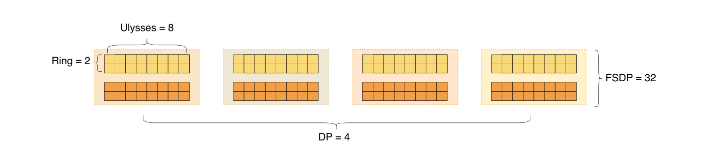</a>

**图 11：** DiT 并行示意。假设共 128 个 GPU，最内层为 Ulysses=8 与 Ring=2 的组合，外层采用 FSDP=32，最外层采用 DP=4。全局批大小为微批大小的 8 倍。

FSDP 组和 CP 组在 FSDP 组内相交，DP 大小等于 FSDP 大小除以 CP 大小。
满足显存和单批延迟要求后，我们使用 DP 扩展规模。
图 11 展示 DiT 的分布式方案。
例如，在 128 GPU 配置中，CP 大小为 16，其中 Ulysses=8、Ring Attention=2；FSDP=32，对应批大小 $2b$；DP=4，最终全局批大小为 $8b$。

> **阅读注释｜并行组大小不能全部直接相乘。** 这里 Ulysses 与 Ring 构成大小为 $8\times2=16$ 的 CP 组，但 CP 组与 FSDP 组共享部分设备，并非彼此独立的资源维度。按正文示例，32 个设备的 FSDP 组内有两个 CP 组，外面再有 4 组，最终共 128 张 GPU、全局批大小 $8b$。看分布式配置时，要先确定哪些组重叠，再计算设备数和批大小。

**不同模块之间的分布式策略切换。** 训练时不同模块使用相同资源。
VAE 和文本编码器使用 DP，DiT 使用 DP 与 CP 的组合。
因此，在 VAE 和文本编码器的输出送入 DiT 时，必须切换分布式策略，避免资源浪费。
CP 要求组内设备读取相同批次的数据。
但是，如果 VAE 和文本编码器也读取相同数据，会产生重复计算。
为消除冗余，CP 组内设备最初读取不同数据。
进入 CP 前，进行次数等于 CP 大小的循环，依次广播组内不同设备读取的数据，保证 CP 内输入一致。
这样，单次模型迭代中 VAE 和文本编码器的时间占比降低到原来的 $1/CP$，提升整体性能。

#### 4.3.3 内存优化

Wan 的计算成本随序列长度 $s$ 平方增长，而显存占用线性增长。
因此，在长序列场景中，计算时间最终可能超过卸载激活所需的 PCIe 传输时间。
具体而言，卸载一个 DiT 层激活所需的 PCIe 传输，可与仅 1–3 个 DiT 层的计算重叠。
相比梯度检查点（GC）（[Chen 等，2016](#ref-chen2016training)），允许计算重叠的激活卸载 （[Rhu 等，2016](#ref-rhu2016vdnn)） 能有效降低显存占用，同时不牺牲端到端性能。
因此，我们优先采用激活卸载来减少显存占用。
由于长序列场景中 CPU 内存也可能耗尽，我们将卸载与 GC 结合，优先对显存占用相对于计算量较高的层使用梯度检查点。

> **阅读注释｜激活卸载与梯度检查点的区别。** 激活是前向计算产生、反向求梯度时可能需要的中间特征。卸载将其暂存到 CPU，需要时再传回 GPU；梯度检查点减少保存的特征，在反向时重新计算。前者增加传输，后者增加计算。长序列注意力很耗时，传输可能被计算掩盖，所以本文优先卸载；这一选择取决于带宽、计算量和 CPU 内存，不能作为所有训练任务的通用最优方案。

#### 4.3.4 集群可靠性

利用阿里云训练集群的智能调度、慢节点检测和自愈能力，保证较高稳定性。
任务启动阶段识别硬件问题，确保只将健康节点分配给训练任务。
训练期间，故障节点被及时隔离和修复，任务自动重启，并无缝恢复训练。
这种高效编排结合可靠性与高性能，确保整体系统稳定。

### 4.4 推理

推理优化的主要目标是最小化视频生成延迟。
与训练不同，推理包含多个采样步骤，通常约为 50 步。
因此，我们使用量化和分布式计算等技术，缩短每一步的时间。
同时利用步骤间注意力的相似性，减少总体计算量。
对于无分类器引导（CFG）（[Ho \& Salimans，2022](#ref-ho2022classifierfreediffusionguidance)），也利用其内在相似性进一步降低计算需求。

> **阅读注释｜先区分三类推理优化。** 生成视频需要反复调用 DiT，因而每一步节省的时间会在整个采样过程中累积。本节分别从以下三个方向降低延迟，它们优化的是不同环节。
>
> | 方向 | 方法 | 核心思路 |
> | --- | --- | --- |
> | 分摊计算 | FSDP、上下文并行 | 多张 GPU 合作处理同一次生成。 |
> | 减少重复计算 | 注意力缓存、CFG 缓存 | 利用采样步骤之间的相似性，近似复用部分结果。 |
> | 加快每次计算 | FP8 GEMM、混合精度 FlashAttention | 降低昂贵运算的精度与数据搬运成本，同时控制数值误差。 |

> **阅读注释｜CFG 为什么增加推理成本？** CFG 通常组合带文本条件的预测 $u_{\mathrm{cond}}$ 与省略文本条件的预测 $u_{\mathrm{uncond}}$，例如 $u_{\mathrm{cfg}}=u_{\mathrm{uncond}}+w(u_{\mathrm{cond}}-u_{\mathrm{uncond}})$，其中 $w$ 控制引导强度。它不需要另训练一个分类器，但通常需要取得两个分支的输出，因此增加计算。引导系数的符号约定在不同资料中可能不同；这里的公式用于解释两分支的关系。

#### 4.4.1 并行策略

<a href="Wan_译文图像/figure_12.png">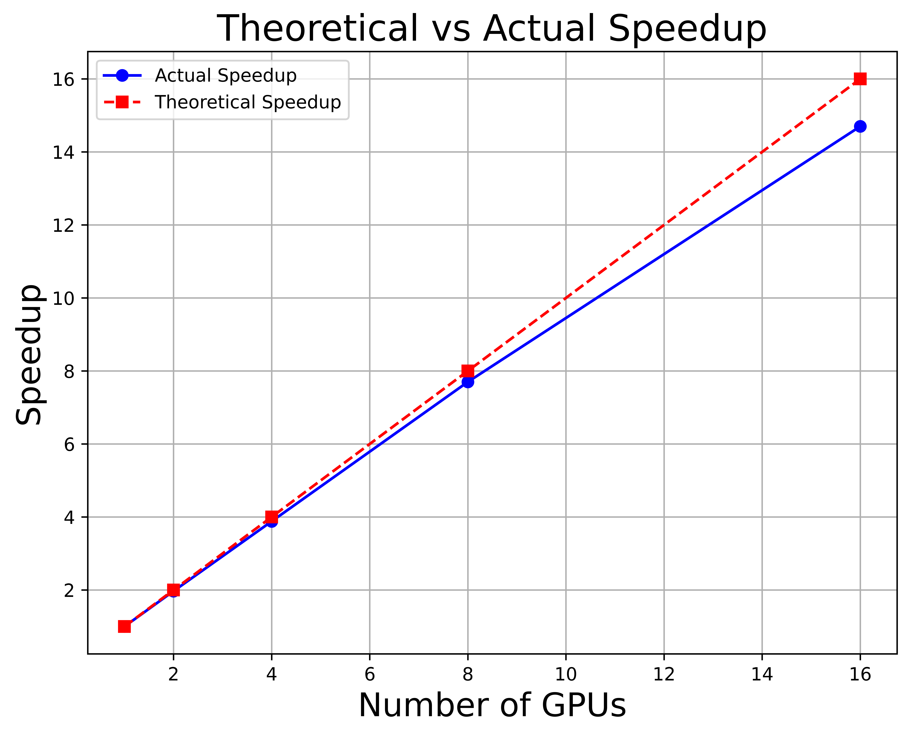</a>

**图 12：** 利用多个 GPU 扩展推理。

如第 4.3.2 节所述，扩展至多 GPU 时，使用上下文并行降低单个视频的生成延迟。
对于 Wan 14B 这样的大模型，还采用模型分片来缓解显存限制。

**模型分片策略：** 推理序列很长，FSDP 相比 TP 通信开销更低，并允许与计算重叠。
因此，与训练一致，采用 FSDP 进行模型分片。
**上下文并行策略：** 使用与训练相同的二维 CP，Ring Attention 为外循环，Ulysses 为内循环。
采用二维 CP 和 FSDP 后，Wan 14B 的 DiT 几乎取得线性加速，见图 12。

> **阅读注释｜模型分片与上下文并行分别解决什么？** FSDP 让各设备长期保存一部分模型参数，并在计算相应层时取得所需权重，主要缓解模型存储压力；推理时没有训练中的梯度和优化器状态。CP 则将同一视频的长 token 序列分给多个设备计算，设备间仍需交换信息，才能完成完整时空注意力，不是把视频分段后各自独立生成。
>
> | CP 方法 | 怎样分担注意力计算 |
> | --- | --- |
> | Ulysses | 通过数据交换重新分配序列与注意力头，让各设备承担不同部分。 |
> | Ring Attention | 让 Key、Value 特征块沿设备环传递，逐块完成注意力计算。 |
> | 二维 CP | 结合两者，尽量让跨设备通信与计算重叠，减少等待。 |
>
> “重叠”可以理解为一边计算当前块，一边准备下一块数据。文中选择 FSDP 与二维 CP，是针对 Wan 长序列及其集群条件的方案，并非对所有模型和硬件都成立的最优组合。

#### 4.4.2 扩散缓存

深入分析 Wan 推理过程后，我们发现两个特点。

- **注意力相似性：** 同一个 DiT 块在不同采样步骤中的注意力输出具有显著相似性。
- **CFG 相似性：** 采样后期，有条件和无条件的 DiT 输出十分相似。

DiTFastAttn （[Yuan 等，2024b](#ref-yuan2024ditfastattn)） 和 FasterCache （[Lv 等，2024](#ref-lv2024fastercache)） 等近期工作也指出这些特点。
我们利用它们实现扩散缓存，以减少计算工作量。
实际使用中，我们针对 Wan 定制扩散缓存，确保性能不受损失，并通过验证集选择需要缓存的步骤。

- **注意力缓存：** 每隔若干步执行一次注意力前向计算并缓存结果，其他步骤复用缓存。
- **CFG 缓存：** 对无条件分支每隔若干步执行一次 DiT 前向计算，其他步骤复用有条件结果。同时使用类似 FasterCache 的残差补偿，防止精细细节退化。

> **阅读注释｜两种缓存具体省略什么？** 注意力缓存可以理解为“计算并保存 → 若干步暂时复用 → 到刷新位置重新计算”；复用的是相应注意力结果，其他网络计算仍可能继续执行，不等于整步 DiT 都跳过。CFG 缓存则利用采样后期两个分支的相似性，减少无条件分支完整前向计算的次数，并配合残差补偿保留重要的分支差异。若直接把两个分支视为完全相同，就可能削弱引导作用。正文没有展开补偿的全部公式，不能据此把它等同于任意一种历史差值复用方案。

将扩散缓存用于 Wan 14B 文本到视频模型后，推理性能提升 1.62 倍。

> **阅读注释｜扩散缓存与 VAE 缓存不要混淆。** VAE 缓存保留时间相邻视频块所需的历史特征；这里则利用生成过程不同采样步骤之间的相似性，近似复用注意力或 CFG 相关结果。跳过计算依赖具体缓存策略、阶段选择与残差补偿，不能保证任意设置下结果完全相同。论文报告的速度和质量表现对应其验证过的配置。

#### 4.4.3 量化

**FP8 GEMM。** 我们发现，在采样步骤中使用 FP8 精度执行 GEMM，结合权重的逐张量量化与激活的逐 token 量化，只造成很小的性能损失。
因此，对 DiT 块中的全部 GEMM 使用 FP8 量化。
FP8 GEMM 性能为 BF16 GEMM 的两倍，带来 DiT 模块 1.13 倍加速。

> **阅读注释｜FP8 GEMM 与量化粒度。** GEMM 可以先理解为矩阵乘法，DiT 的线性投影和 FFN 中都有大量这类运算。FP8 使用 8 位浮点表示，BF16 使用 16 位表示；低精度可降低计算与数据搬运成本，也会增加数值误差。量化尺度类似于表示一组数所用的“刻度”：权重逐张量量化，为一个权重张量设置尺度；激活逐 token 量化，为每个 token 的特征向量分别设置尺度，适应不同 token 的数值幅度。这里的 token 是特征单元，不是采样步。

**8 位 FlashAttention。** FlashAttention3 （[Shah 等，2025](#ref-shah2025flashattention)） 虽然性能很高，但实验中其原生 FP8 实现会使视频生成质量显著下降。
SageAttention （[Zhang 等，2024](#ref-zhang2024sageattention)） 使用 int8 与 fp16 混合精度减少精度损失，但没有提供针对 Hopper GPU 的专门适配。
截至本报告发表时，SageAttention 的后续优化已改善 Hopper 兼容性。
未来工作将探索集成这些性能改进。

下面介绍我们对 FA3-FP8 实现的优化，重点关注数值稳定性和计算效率。

**精度。** 为缓解 Wan 中 FA3-FP8 量化引起的注意力数值误差，我们采用两种主要技术。

- **混合 8 位优化：** 原生 FA3 对所有输入张量 $Q,K,V$ 使用 FP8（E4M3）。依据数据分布分析及 SageAttention 的实验证据，我们采用混合量化：$S=QK^T$ 使用 Int8，$O=PV$ 使用 FP8。
- **跨块归约使用 FP32 累加：** 原生 FP8 WGMMA 使用约 14 位的累加器，长序列处理中容易溢出。为解决这一限制，块内 $PV$ 归约使用 FP8 WGMMA，跨块累加则通过 CUDA 核心和 Float32 寄存器实现。这一策略受 DeepSeek-V3 （[Liu 等，2024a](#ref-liu2024deepseek)） 的 FP8 GEMM 方法启发。

> **阅读注释｜注意力为什么要混合多种精度？** 注意力先计算关联分数 $S=QK^T$，再得到权重 $P=\operatorname{softmax}(S/\sqrt d)$，最后计算加权输出 $O=PV$；$d$ 是每个注意力头的特征维度。FP8 是浮点格式，INT8 是整数格式，表示方式与误差特性不同，因此本文按运算分别选择精度。
>
> | 环节 | 本文采用的处理 | 目的 |
> | --- | --- | --- |
> | $QK^T$ 矩阵乘法 | INT8 | 平衡关联分数计算的效率与误差。 |
> | $PV$ 矩阵乘法 | FP8 | 加速特征加权汇总。 |
> | 跨计算块汇总 | FP32 累加 | 减少长序列反复累加中的数值误差。 |
>
> 低精度乘法与高精度累加可以同时使用：先快速计算局部贡献，再更准确地合并结果。“8 位注意力”不表示 softmax、归一化和所有中间运算都采用 8 位。这里的计算块是矩阵运算分块，区别于 VAE 的视频时间分块。

**性能。** 为保持混合 INT8-FP8 量化下的内核性能，同时提高 $O=PV$ 的累加精度，我们使用两种技术。

- **将 Float32 累加与 warpgroup 内流水线融合：** FlashAttention3 在 warpgroup 内采用流水线，将 WGMMA 与 softmax 和缩放重叠执行。为缓解跨块 Float32 $PV$ 累加的性能代价，我们将 Float32 累加与 `rescale_o` 操作融合。
- **调整块大小：** 跨块 Float32 $PV$ 累加寄存器带来额外寄存器压力，因此调整块大小，减少寄存器溢出。优化后，8 位 FlashAttention 在 NVIDIA H20 GPU 上达到 95% MFU（模型浮点运算利用率）。

> **阅读注释｜流水线融合与调整块大小在优化什么？** 较高精度的累加也有额外成本，因此还要优化执行方式。WGMMA 是 GPU 上的矩阵乘加指令；warpgroup 内流水线让矩阵计算、softmax 和缩放等操作尽量交错执行，融合则把 FP32 累加与已有的输出重缩放操作一起处理。`rescale_o` 用于调整已有输出的尺度，以便正确合并分块注意力结果。计算块过大可能占用过多寄存器，迫使临时数据转存到更慢的存储位置；调整块大小是在计算效率与寄存器占用之间取舍。文中的 95% MFU 对应特定内核及 H20 测试条件，不等于整个视频生成流程始终达到该利用率。

采用 8 位 FlashAttention 后，推理效率提升超过 1.27 倍。

> **阅读注释｜怎样解读本节的加速数字？** 比较倍数时，应先确认测量对象和测试条件。
>
> | 论文报告的加速 | 对应范围 |
> | --- | --- |
> | 1.62 倍 | 扩散缓存用于 Wan 14B 文本到视频模型。 |
> | 2 倍 | FP8 GEMM 相比 BF16 GEMM 的运算性能。 |
> | 1.13 倍 | 使用 FP8 GEMM 后的 DiT 模块加速。 |
> | 超过 1.27 倍 | 使用优化后的 8 位 FlashAttention 后的推理加速。 |
>
> 矩阵乘法快两倍，整个模型只快一部分，是因为其余计算、通信和访存仍有开销。这些数字对应不同范围及配置，不能直接全部相乘，作为任意设备上的预期总加速。初读时优先掌握并行如何分摊计算、缓存如何减少重复计算，以及低精度乘法为何配合高精度累加；内核指令和寄存器调优可以随后深入。

### 4.5 提示词对齐

提示词对齐旨在将用户输入与训练时描述的格式和风格对齐，提高模型推理效果。
我们采用两项主要策略。
首先，为每个视频增加多种描述，提升多样性。
其次，改写用户提示词，使其与训练阶段的视频描述分布一致。
下面详细介绍。

为适应多样用户输入，每个图像或视频配有不同风格和长度的多条描述。
例如，使用长、中、短不同长度，以及正式、非正式、诗意等风格，为训练数据创建多样的样本与描述配对。
这些描述建立不同的文本到视频映射关系，有效覆盖用户可能提供的提示词范围。

即使描述具有多样性，数据集描述与用户输入之间仍经常存在分布不匹配。
用户通常喜欢只包含几个简单词语的简洁提示，远短于训练描述。
这种差异会不利于生成视频的质量。
为此，我们使用 LLM 改写和细化用户提示词。
主要目标是使改写后的提示词分布与训练描述分布一致，取得更好的推理效果。
改写遵循以下原则。

1. 不改变原意的前提下增加细节，提高生成场景的完整性和视觉吸引力。
2. 加入自然的运动属性，根据主体类别添加适当动作，使生成视频的运动更平滑、流畅。
3. 采用类似后训练描述的结构：先说明视频风格，再概述内容，最后给出详细描述，以匹配高质量视频描述的分布。

我们在自建基准上评估 LLM 辅助改写的效果，表 1 展示若干结果。
具有较强指令遵循能力的 LLM 可以生成合适的提示词，改善视频生成。
为平衡速度与效果，我们使用 Qwen2.5-Plus 作为改写模型。

> **阅读注释｜提示词改写解决的是分布差异。** 训练描述往往详细、有固定组织方式，用户提示却可能只有几个词。增加与原意一致的场景、动作和风格信息，可以让输入更接近模型熟悉的条件分布。它不只是追求更长的文字：若新增不合理动作或改变用户要求，就会带来新的偏差。每个样本配多种长度和风格的描述，则是在训练阶段直接增加对不同表达方式的适应能力。

**表 1：** 用户提示词与改写结果示例。这些示例原本为中文，论文为展示而译成英文；以下根据论文英文译回中文。

| 用户提示词 | 改写结果 |
| --- | --- |
| 一名维京战士双手挥舞巨斧，在黄昏的雪地中与猛犸象搏斗，雪花在空中飞舞。 | 一场史诗般的战斗展开：一名高大健壮的维京战士双手握着沉重的巨斧，与一头庞大的猛犸象对峙。战士身穿皮甲、头戴牛角头盔，肌肉突出，表情凶猛而坚定。猛犸象全身覆盖长毛，獠牙锋利，愤怒地咆哮。此时正值黄昏，雪地中雪花纷飞，营造出紧张而富有戏剧性的气氛。背景是一片荒凉冰原，远山轮廓隐约可见。冷色调照明强调力量和勇气。画面采用高角度视角，以动态特写镜头捕捉。 |
| 摄像机跟随一艘在海上追逐海豚的摩托艇。 | 采用纪实摄影风格，摄像机跟随一艘摩托艇，追逐从广阔海面跃起的一群海豚。摩托艇上，驾驶者穿着救生衣、戴着安全头盔，表情专注而兴奋。海豚体形流畅、皮肤光滑，时而跃出水面，时而灵巧地潜回水中。天空湛蓝，阳光明媚，海面波光粼粼。远处天空点缀几朵白云。场景充满动感与活力，以跟拍视角的中景镜头捕捉。 |
| 小小的土豆国王戴着威严的王冠，坐在王座上，土豆臣民向它致敬。 | 采用超现实主义风格，小小的土豆国王戴着华丽的金色王冠，坐在高耸王座上。它的皮肤呈自然的土黄色，并带有细微凹凸纹理。土豆臣民排列两侧，低头向国王致敬。背景为宏伟宫殿的内部，金色与红色装饰显得奢华庄严。一束光从上方照下，营造神圣氛围。画面采用高角度视角的特写镜头捕捉。 |

### 4.6 评估基准

<a href="Wan_译文图像/figure_13.png">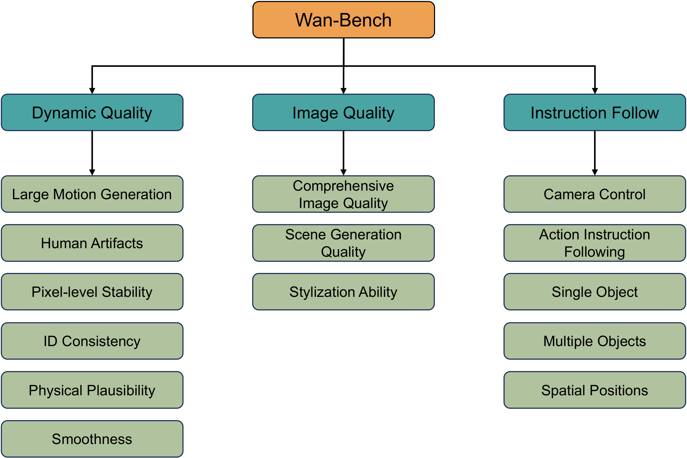</a>

**图 13：** Wan-Bench 覆盖的维度。

<a href="Wan_译文图像/figure_14.png">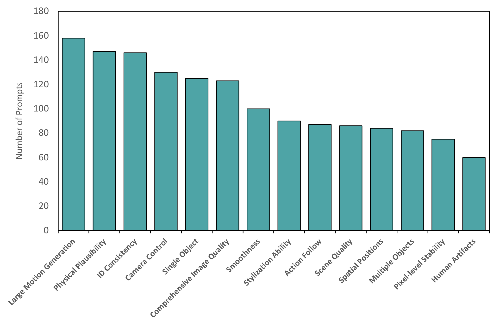</a>

**图 14：** Wan-Bench 各维度的提示词数量分布。

现有视频生成评估方法，如 Fréchet 视频距离（FVD）（[Unterthiner 等，2018](#ref-2018Towards)） 和 Fréchet Inception 距离（FID）（[Heusel 等，2017](#ref-heusel2017gans)），与人类感知的对齐不足。
我们提出自动化、全面且与人类判断对齐的 Wan-Bench，用于评估视频生成模型。
Wan-Bench 包含动态质量、图像质量和指令遵循三个核心维度，以及 14 项细粒度指标。
我们为各维度设计专门的评分算法，简单任务，如物体检测，使用传统检测器；复杂任务使用多模态大语言模型（MLLM）。

> **阅读注释｜视频质量为什么不能只用一个指标？** 视频既要画得清楚，又要运动自然、身份稳定、符合提示词。重复同一帧可以获得较强的稳定性，却没有有效运动；运动幅度很大也可能伴随身体变形。因此，Wan-Bench 将多个目标分开测量。PSNR 主要看重建误差，FID/FVD 比较特征分布，CLIP 相似性侧重语义对应，它们各有侧重，不能彼此替代。

**动态质量。** 该维度评估模型在非静态场景中的质量和稳定性。

**大幅度运动生成：** 为测量运动生成的上限，提示词被设计为鼓励显著运动。
利用 RAFT （[Teed \& Deng，2021](#ref-2021RAFT)） 计算生成视频的光流，根据归一化光流的幅度评估运动分数。

**人体伪影：** 现有评估方法缺乏检测 AI 生成伪影的能力。
因此，我们使用 20,000 张人工标注的 AI 生成图像，训练基于 YOLOv3 （[Redmon \& Farhadi，2018](#ref-2018YOLOv3)） 的模型，识别伪影位置。
伪影评分同时考虑预测概率、边界框和对应持续时间。

**物理合理性与平滑性：** 为评估物理合理性，我们设计提示词生成与物理相关的运动，如球体弹跳、物体交互和水流，并使用具有丰富现实物理知识的 Qwen2-VL （[Bai 等，2023](#ref-qwenvl)）。
借助视频问答模型，检测物体穿模、不真实碰撞和违反重力的运动等物理违规。
为评估平滑性，提示词包含复杂运动，使用 Qwen2-VL 识别伪影并评估运动流畅度。

**像素级稳定性：** 判断视频是否频繁出现噪声。
利用光流识别静态区域，计算这些区域中的逐帧差异。
稳定视频的静态区域差异相对较小。

**身份一致性：** 考虑人物、动物和物体一致性三个子维度，对应不同提示词集合。
提取帧级 DINO （[Caron 等，2021](#ref-2021Emerging)） 特征，以帧间相似性作为一致性分数。

> **阅读注释｜光流和特征相似性分别提供什么证据？** 光流估计相邻帧中像素位置的变化，可用于运动幅度、镜头运动和静态区域分析，但也可能受到抖动、遮挡和伪影干扰。DINO 或 CLIP 特征相似性比较较高层的外观与语义，能提供一致性的线索，却不是严格证明对象身份或物理规律正确。用多模态模型问答评分同样属于自动判断，应结合人工评估理解。

**图像质量。** 评估视觉质量和美学感受。

**综合图像质量：** 视觉质量需要评估保真度与美学。
保真度使用 MANIQA （[Yang 等，2022](#ref-2022MANIQA)），它能有效检测模糊和伪影，准确评估清晰度。
美学使用两个已有模型：基于 LAION 的美学预测器 （[LAION-AI，2022](#ref-LAION-AI_aesthetic-predictor_2022)） 和 MUSIQ （[Ke 等，2021](#ref-2021MUSIQ)）。
对三个评估器的分数取平均，得到最终图像质量分数。

**场景生成质量：** 评估帧间场景一致性和场景与文本对齐。
一致性通过相邻帧之间的 CLIP 相似性 （[Radford 等，2021](#ref-radford2021learning)） 测量，确保时间连贯性。
对齐通过帧与对应文本之间的 CLIP 相似性测量，验证语义准确性。
对这些指标加权平均，得到质量分数。

**风格化：** 利用 Qwen2-VL 的帧级问答评估艺术风格视频生成能力。

**指令遵循。** 评估模型理解和执行文本指令的能力。

**单物体、多物体与空间位置：** 利用 Qwen2-VL 预测视频中物体的类别、数量和空间关系。
评估分数表示与给定提示词准确对应的平均帧数。

**摄像机控制：** 使用 130 条专门设计的提示词，评估平移、升降、推近或拉远、航拍和跟拍五种摄像机运动风格。
对于平移、升降和推拉，利用 RAFT 分析光流，判断运动风格。
对于复杂的航拍和跟拍，利用 Qwen2-VL 通过视频问答推断摄像机运动。

**动作指令遵循：** 将运动分为人体运动，如跑步；动物运动，如爬行；以及物体运动，如飞行。
评估这些运动需要有关动作执行的先验知识，因此向 Qwen2-VL 提供关键帧。
询问动作是否匹配、是否完成，以及是否出现伪影，全面评估文本与视频的对齐程度。

**人工反馈引导的加权策略。** 各维度对用户偏好的影响不同，因此我们利用人工反馈赋予综合视频质量分数，而非简单平均。
收集超过 5,000 对不同模型，包括 Wan，生成的视频对比。
用户依据给定文本评估每对视频，表达偏好并给出大致分数。
通过模型评分与人工评分的 Pearson 相关系数，得到各维度的偏好权重，并将其用于最终分数计算。

> **阅读注释｜人工反馈在这里用于评分，不是直接训练生成模型。** 各自动指标与人的偏好相关程度不同，作者据此调整综合评估权重。Pearson 相关系数衡量线性相关程度，不证明某个指标造成了人的偏好。改变提示词集合、评估器或权重，都可能改变综合排序，所以应同时看各维度结果与人工比较，不能把一个总分理解为所有任务上的绝对优劣。

### 4.7 评估

#### 4.7.1 指标与结果

**表 2：** 使用 Wan-Bench 比较商业模型和开源模型的性能。粗体表示最佳结果，带下划线的值表示次佳结果。

| Wan-Bench 维度 | CNTopB | Hunyuan | Mochi | CNTopA | Sora | Wan 1.3B | Wan 14B |
| --- | --- | --- | --- | --- | --- | --- | --- |
| 大幅度运动生成 | 0.405 | 0.413 | 0.420 | 0.284 | **0.482** | <u>0.468</u> | 0.415 |
| 人体伪影 | 0.712 | 0.734 | 0.622 | **0.833** | <u>0.786</u> | 0.707 | 0.691 |
| 像素级稳定性 | 0.977 | **0.983** | <u>0.981</u> | 0.974 | 0.952 | 0.976 | 0.972 |
| 身份一致性 | <u>0.940</u> | 0.935 | 0.930 | 0.936 | 0.925 | 0.938 | **0.946** |
| 物理合理性 | 0.836 | 0.898 | 0.728 | 0.759 | <u>0.933</u> | 0.912 | **0.939** |
| 平滑性 | 0.765 | 0.890 | 0.530 | 0.880 | **0.930** | 0.790 | <u>0.910</u> |
| 综合图像质量 | 0.621 | 0.605 | 0.530 | **0.668** | <u>0.665</u> | 0.596 | 0.640 |
| 场景生成质量 | 0.369 | 0.373 | 0.368 | <u>0.386</u> | **0.388** | 0.385 | <u>0.386</u> |
| 风格化能力 | **0.623** | 0.386 | 0.403 | 0.346 | <u>0.606</u> | 0.430 | 0.328 |
| 单物体准确性 | **0.987** | 0.912 | 0.949 | 0.942 | 0.932 | 0.930 | <u>0.952</u> |
| 多物体准确性 | 0.840 | 0.850 | 0.693 | <u>0.880</u> | **0.882** | 0.859 | 0.860 |
| 空间位置准确性 | <u>0.518</u> | 0.464 | 0.512 | 0.434 | 0.458 | 0.476 | **0.590** |
| 摄像机控制 | 0.465 | 0.406 | **0.605** | <u>0.529</u> | 0.380 | 0.483 | 0.527 |
| 动作指令遵循 | **0.917** | 0.735 | <u>0.907</u> | 0.783 | 0.721 | 0.844 | 0.860 |
| **加权分数** | 0.690 | 0.673 | 0.639 | 0.693 | <u>0.700</u> | 0.689 | **0.724** |

**基线与指标。** 截至撰写时，市场上存在众多比较对象，包括 Kling （[Kuaishou，2024.06](#ref-kuaishou2024kling)）、Hailuo （[MiniMax，2024.09](#ref-minimax2024hailuo)）、Sora （[OpenAI，2024](#ref-openaisora2024)）、Runway （[Runway，2024.06](#ref-runway2024gen3)） 和 Vidu （[ShengShu-AI，2024.07](#ref-shengshu2024vidu)） 等商业模型，以及 Mochi （[GenmoTeam，2024](#ref-genmo2024mochi)）、CogVideoX （[Yang 等，2025b](#ref-cogvideox)） 和 Hunyuan （[Kong 等，2024](#ref-kong2024hunyuanvideo)） 等开源模型。
本节将 Wan 与经过基准评估、且用户反馈较好的商业及开源模型比较。

**定量结果。** 利用 Wan-Bench 提示词，为每个候选模型收集 1,035 个样本，并通过 Wan-Bench 评分进行公平评估。
评估关注动态质量、图像质量和指令遵循准确性三个关键指标。
按照第 4.6 节介绍的人类偏好加权方式计算总分，对不同生成模型排序。
表 2 表明，Wan 优于现有商业和开源模型。

**定性结果。** 如图 15 所示，Wan 能直接依据文本描述生成多样、高质量的视频。
Wan 擅长合成涉及大幅度复杂运动的动态场景，以及体现物理交互的场景。
它也能熟练处理多种艺术风格，并持续产生电影级视觉效果。
此外，Wan 具备强大的多语言文字生成能力，可将中文和英文文字融入动画，产生电影级文字效果。

<a href="Wan_译文图像/figure_15.png">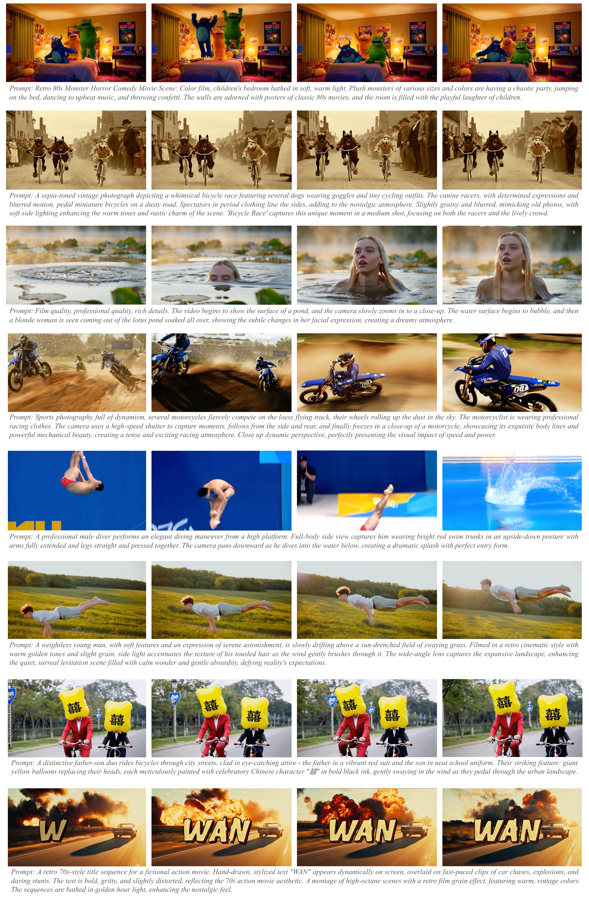</a>

**图 15：** Wan-T2V 的结果。模型擅长生成复杂运动、创意转场和电影级视频，并准确生成中文和英文文字。

**人工评估。** 我们设计了超过 700 项评估任务，由 20 多名人员标注，从对齐、图像质量、动态质量和整体质量四个关键维度评估。
表 3 表明，在 T2V 任务中，Wan 14B 在全部视觉质量维度持续表现出色，体现其性能优势。

**表 3：** T2V 胜率差距。

| 维度 | CN-TopA | CN-TopB | CN-TopC | Runway | 总对比轮数 |
| --- | --- | --- | --- | --- | --- |
| 视觉质量 | 30.6% | 15.9% | 27.8% | 48.1% | 5710 |
| 运动质量 | 16.1% | 9.7% | 14.9% | 40.3% | 5785 |
| 匹配程度 | 46.0% | 57.9% | 56.7% | 69.1% | 5578 |
| 综合排名 | 44.0% | 44.0% | 48.9% | 67.6% | 5560 |

*原表脚注：* 表格显示成对比较中，Wan 14B 优于其他模型的次数占总比较次数的比例。

> **译注：** 原文表题使用“胜率差距”（win rate gap），脚注却描述“胜出次数占比”。表 7 还出现负数，因此两者口径不一致。译文保留原始数值与说明，不擅自把这些值解释为普通胜率。

**Wan 在公开排行榜上的表现。** Wan 在 VBench 排行榜 （[Huang 等，2023](#ref-2023VBench)） 上取得先进水平；VBench 是广泛使用的视频生成评估方法。
它通过多维评估架构，将视频质量分为 16 个与人类判断对齐的维度，覆盖美学质量、运动平滑性和语义连贯性。

我们分析 Wan 14B 与 Wan 1.3B 两个版本，结果见表 4。
Wan 14B 的总分为 86.22%，其中视觉质量为 86.67%，语义一致性为 84.44%，在基准中领先，显著超越 OpenAI Sora 和 MiniMax Hailuo 等竞争者。
高效的 Wan 1.3B 同样具有竞争力，总分为 83.96%，超越 HunyuanVideo （[Kong 等，2024](#ref-kong2024hunyuanvideo)）、Kling 1.0 （[Kuaishou，2024.06](#ref-kuaishou2024kling)），以及开源 CogVideoX1.5-5B （[Yang 等，2025b](#ref-cogvideox)）。

> **译注：** 原文此处将 HunyuanVideo 归入“商业模型”，但表 4 明确使用其开源版本；其余数值保持原样。

**表 4：** 模型在 VBench 上的性能分数。

| 模型名称 | 质量分数 | 语义分数 | 总分 |
| --- | --- | --- | --- |
| MiniMax-Video-01 （[MiniMax，2024.09](#ref-minimax2024hailuo)） | 84.85% | 77.65% | 83.41% |
| Hunyuan（开源版本）（[Kong 等，2024](#ref-kong2024hunyuanvideo)） | 85.09% | 75.82% | 83.24% |
| Gen-3（2024-07）（[Runway，2024.06](#ref-runway2024gen3)） | 84.11% | 75.17% | 82.32% |
| CogVideoX1.5-5B（5 秒，SAT 提示词优化）（[Yang 等，2025b](#ref-cogvideox)） | 82.78% | 79.76% | 82.17% |
| Kling（2024-07，高性能模式）（[Kuaishou，2024.06](#ref-kuaishou2024kling)） | 83.39% | 75.68% | 81.85% |
| Sora （[OpenAI，2024](#ref-openaisora2024)） | <u>85.51%</u> | 79.35% | <u>84.28%</u> |
| Wan 1.3B | 84.92% | <u>80.10%</u> | 83.96% |
| Wan 14B（2025-02-24） | **86.67%** | **84.44%** | **86.22%** |

#### 4.7.2 消融实验

我们对模型设计中的关键模块进行消融，说明它们对整体架构的贡献。
为快速评估，实验在 1.3B 版本上进行。

> **阅读注释｜本节的消融实验在验证什么？** 消融可以是移除组件，也可以是替换设计，再尽量保持其他条件一致以比较影响。本节分别验证“参数用于时间调制还是网络深度更有效”“哪种文本特征更适合生成”“自编码器训练目标改变后，下游生成是否改善”。阅读时依次看改了什么、控制了什么、用什么指标、结论适用于什么范围。实验主要在小规模配置的文本到图像训练阶段进行，以降低成本，不等于直接验证了完整 14B 视频模型的全部能力。

**自适应归一化层的消融。** DiT （[Peebles \& Xie，2023](#ref-dit)） 的自适应归一化层（adaLN）（[Perez 等，2018](#ref-perez2018film)） 包含大量参数，因此我们探索：将参数用于 adaLN，还是增加网络深度，更有效。
为调整参数量，我们遵循 PixArt （[Chen 等，2023a](#ref-chen2023pixartalpha)） 的设置，研究是否共享 adaLN。
不共享时，每个块通过独立 MLP，根据时间嵌入预测缩放和偏移参数。
共享 adaLN，即 PixArt 中的 AdaLN-single，在第一个块中计算一组全局缩放和偏移参数，并在所有块之间共享，从而显著减少参数量。

我们评估四种配置。

1. **Full-shared-adaLN-1.3B：** 原始模型，在全部 30 个注意力块之间完全共享 adaLN。
2. **Half-shared-adaLN-1.5B：** 前 15 个注意力块共享，其余不共享，参数增加 0.2B，总量 1.5B。
3. **Full-shared-adaLN-1.5B（加深版）：** 全部注意力块共享，深度增加到 35 层，参数量保持 1.5B。
4. **Non-shared-AdaLN-1.7B：** 所有块均不共享，深度保持 30 层，参数量为 1.7B。

其余参数不变，从头训练文本到图像任务 200,000 步，即文本到视频训练的第一阶段，全局批大小为 1536。
比较时，使用训练阶段潜在空间中生成图像与真实图像之间的 L2 损失，损失越小表示收敛越好。

<a href="Wan_译文图像/figure_16.png">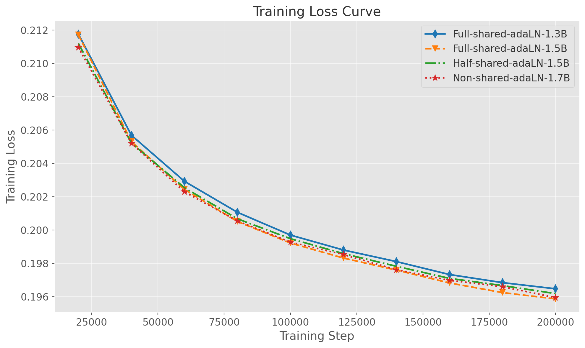</a>

**图 16：** 不同配置的训练损失曲线。

如图 16 所示，参数更少的 Full-shared-AdaLN-1.3B 训练损失略高。
相同参数量的 Half-shared-AdaLN-1.5B 与 Full-shared-AdaLN-1.5B 相比，后者持续达到最低训练损失。
这表明，与增加 AdaLN 参数相比，增加模型深度能取得更好的性能。
Non-shared-AdaLN-1.7B 虽然参数更多，却不优于 Full-shared-AdaLN-1.5B，也支持这一结论。
因此，我们采用完全共享的 AdaLN 设计，在保持性能的同时有效减少参数。

> **阅读注释｜消融实验怎样支持参数分配选择？** 这里的共享主要涉及从时间嵌入生成调制参数的网络，不是共享所有注意力和 FFN 权重，也不是把不同层的归一化统计量混在一起。四个配置可整理为：
>
> | 配置 | DiT 层数 | 调制网络共享方式 | 参数量 |
> | --- | --- | --- | --- |
> | 基础模型 | 30 | 全部共享 | 1.3B |
> | 部分共享 | 30 | 前 15 层共享，其余独立 | 1.5B |
> | 加深模型 | 35 | 全部共享 | 1.5B |
> | 完全独立 | 30 | 各层独立 | 1.7B |
>
> 关键是中间两个 1.5B 模型：同样的参数总量，一种用于增加独立调制，另一种用于增加 5 层 Transformer。图 16 中后者训练损失更低，1.7B 的完全独立方案也没有超过它，因此支持本文“共享调制，把参数用于网络深度”的选择。同参数量不等于同计算量，这不是严格固定计算预算的比较；较低训练损失也不能直接推出所有视频感知指标更好，或任何模型加深都会更有效。

**文本编码器消融。** 选择三种支持双语输入的文本编码器：umT5（5.3B）（[Chung 等，2023](#ref-chung2023unimax)）、Qwen2.5-7B-Instruct （[QwenTeam，2024](#ref-qwen2.5)） 和 GLM-4-9B （[TeamGLM 等，2024](#ref-glm2024chatglm)）。
T5 系列是视频生成模型的常用选择 （[GenmoTeam，2024](#ref-genmo2024mochi)；[Yang 等，2025b](#ref-cogvideox)）；后两者在语言理解上表现突出，尤其是在参数量小于 10B 的 LLM 中。
本消融保持其余设置不变，以全局批大小 1536 训练文本到图像任务。
Qwen2.5-7B-Instruct 和 GLM-4-9B 的文本嵌入取自倒数第二层。
训练损失见图 17。

<a href="Wan_译文图像/figure_17.png">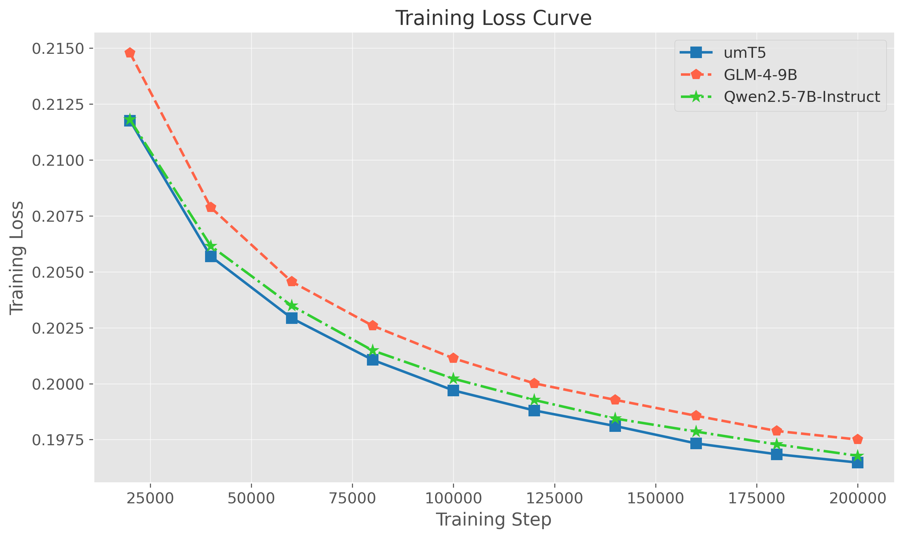</a>

**图 17：** 不同文本编码器的训练损失曲线。

> **阅读注释｜语言模型更强，为什么生成效果不一定更好？** 此处文本编码器负责提供生成网络容易利用的条件特征，聊天或推理能力强不保证这些特征更适合视觉生成。umT5 使用双向注意力，另两个纯解码器模型使用因果注意力，这是可能的解释之一；作者给后二者增加双向 token 精炼器后，训练损失与可视化结果仍支持 umT5。各编码器的规模、预训练和内部表示也不同，所以不能把全部差异只归因于注意力方向，结论首先适用于本文的模型和训练设置。

相较其他强大的 LLM 文本编码器，umT5 的文本嵌入性能更好。
HunyuanVideo （[Kong 等，2024](#ref-kong2024hunyuanvideo)） 指出，纯解码器 LLM 使用因果注意力，而 umT5 使用双向注意力，更适合扩散模型。
遵循 HunyuanVideo 的策略，我们增加双向 token 精炼器作为适配层。
分别用于 Qwen2.5-7B-Instruct 和 GLM-4-9B，但训练损失与可视化结果仍表明 umT5 最优。
进一步将 umT5 与预训练多模态大语言模型 Qwen-VL-7B-Instruct （[Bai 等，2023](#ref-qwenvl)） 比较。
如表 6 所示，采用 Qwen-VL 倒数第二层特征，可获得与 umT5 相当的生成性能，但模型规模更大。

**表 5：** VAE 与 VAE-D 的 FID 分数（$\downarrow$，越低越好）。

| 训练步数 | VAE | VAE-D |
| --- | --- | --- |
| 10k 步 | **42.60** | 44.21 |
| 15k 步 | **40.55** | 41.16 |

> **阅读注释｜表 5 比较的是下游生成效果。** 作者分别使用预训练 VAE 与 VAE-D 开展文本到图像生成训练，再比较 FID。FID 衡量生成图像与真实图像的特征分布差异，越低越好，不是逐像素重建误差。两个检查点上普通 VAE 的数值都更低，支持在本方案中保留普通 VAE，但不能推广为任何扩散式自编码器都更差。表中检查点与正文步数不一致，具体说明见本节末尾译注。

**表 6：** 不同文本编码器的 FID 分数。“最后一层”和“倒数第二层”分别表示从编码器相应层提取的文本特征。

| 指标 | umT5 | Qwen-VL-7B（最后一层） | Qwen-VL-7B（倒数第二层） |
| --- | --- | --- | --- |
| FID（$\downarrow$） | 43.01 | 43.72 | **42.91** |

> **阅读注释｜表 6 还说明了特征提取层的影响。** 此表的 Qwen-VL 是另外加入比较的多模态模型，区别于前面 Qwen2.5-7B-Instruct。同一 Qwen-VL 取最后一层特征时 FID 为 43.72，取倒数第二层时为 42.91，说明提取层也是需要验证的设计选择。后者与 umT5 的 43.01 接近、数值略低，但模型更大；表中没有重复实验的误差范围，不能只凭这点微小差距断言其稳定优于 umT5。作者选择 umT5 也考虑了生成表现与模型规模。

**自编码器消融。** 除了 VAE，我们设计了称为 VAE-D 的变体，将重建损失替换为扩散损失。
使用预训练 VAE 和 VAE-D 分别进行文本到图像生成训练，训练 150,000 步直至收敛。
在 100,000 和 150,000 步测量 FID。
如表 5 所示，VAE 的 FID 持续低于 VAE-D。

> **阅读注释｜“将重建损失替换为扩散损失”是什么意思？** 它改变的是训练自编码器时的监督任务。本文没有给出 VAE-D 的完整结构和损失公式，所以下面用典型的条件扩散解码方式解释概念，不能当作 Wan VAE-D 的确切实现。
>
> **直接重建：** 将原图 $X$ 编码为 $z=E(X)$，再解码为 $\hat X=D(z)$，例如用 $\mathcal L_{\mathrm{rec}}=\lVert\hat X-X\rVert_1$ 比较重建图像与原图。这里 $E$、$D$ 分别是编码器和解码器，$z$ 是压缩表示；为突出重建监督，暂时省略 VAE 的采样与其他损失项。
>
> **扩散式监督示例：** 先构造带噪图像 $Y_s=\alpha_s X+\sigma_s\epsilon$，再让网络根据带噪图像、噪声时间位置 $s$ 和压缩表示 $z$ 预测噪声，即 $\hat\epsilon=F_\theta(Y_s,s,z)$，以 $\mathcal L_{\mathrm{diff}}=\mathbb E\lVert\hat\epsilon-\epsilon\rVert^2$ 训练。$\epsilon$ 是程序加入的随机噪声，$\alpha_s$、$\sigma_s$ 控制信号与噪声比例。这里用噪声预测作示例，扩散训练也可以采用其他预测目标。条件扩散解码的相关思路可参考 [Diffusion Autoencoders](https://arxiv.org/abs/2111.15640)，噪声预测目标可参考 [DDPM](https://arxiv.org/abs/2006.11239)。
>
> | 方式 | 主要监督目标 |
> | --- | --- |
> | 直接重建 | 根据压缩表示还原图像，比较重建结果与原图。 |
> | 扩散式监督示例 | 根据压缩表示和带噪输入完成去噪，比较预测噪声与真实噪声。 |
>
> 重点是输入、预测目标和训练任务发生变化，不只是把某个误差函数换个名字；两种方式都可能使用平方误差。本实验先准备不同的自编码器，再比较下游文本到图像生成的 FID，结果支持本文普通 VAE 方案。这与后面 DiT 在视频潜在空间中学习流匹配是不同的训练环节。仅凭原文，不能确定 VAE-D 的具体预测目标、解码步数，以及是否保留 KL、感知或其他损失。

> **译注：** 原文正文写的是 100,000 和 150,000 步，而表 5 写的是 10k 和 15k 步，二者不一致。这里分别保留正文与表格的原始写法。

## 5 扩展应用

### 5.1 图像到视频生成

图像到视频（I2V）任务根据静态输入图像，在文本提示引导下合成动态视频序列。
通过将输出锚定到指定初始帧，这种方法显著增强视频生成可控性，因此受到研究社区广泛关注。
现有方法，如 I2VGen-XL （[Zhang 等，2023c](#ref-zhang2023i2vgen)）、SVD （[Blattmann 等，2023](#ref-blattmann2023svd)） 和 CogVideo （[Yang 等，2025b](#ref-cogvideox)），通过在通道维将条件潜在表示与噪声潜变量拼接，将 T2V 框架扩展到 I2V。
我们的 Wan-I2V 采用类似策略，利用 T2V 基础模型中的强大先验知识，实现高质量 I2V 生成。

#### 5.1.1 模型设计

我们增加条件图像作为第一帧，以控制视频合成。
将条件图像 $I\in\mathbb{R}^{C\times1\times H\times W}$ 与零填充帧沿时间轴拼接，得到引导帧 $I_c\in\mathbb{R}^{C\times T\times H\times W}$。
Wan-VAE 将其压缩为条件潜变量 $z_c\in\mathbb{R}^{c\times t\times h\times w}$，其中 $c=16$ 表示潜变量通道数，$t=1+(T-1)/4$、$h=H/8$、$w=W/8$。
此外引入二值掩码 $M\in\{0,1\}^{1\times T\times h\times w}$，1 表示保留帧，0 表示待生成帧。
掩码 $M$ 的空间大小与 $z_c$ 一致，但时间长度与目标视频相同；随后重排为 $s\times t\times h\times w$，其中 $s$ 是 Wan-VAE 的时间步幅。
将噪声潜变量 $z_t$、条件潜变量 $z_c$ 和重排后的掩码 $m$ 沿通道轴拼接，送入 Wan 的 DiT。
I2V DiT 输入通道数大于 T2V，即 $2c+s$ 对比 $c$，因此使用额外投影层，并将其初始化为零。
同时，利用 CLIP （[Radford 等，2021](#ref-radford2021learning)） 图像编码器提取条件图像特征，通过三层 MLP 投影，作为全局上下文。
该全局上下文通过解耦交叉注意力注入 DiT。

> **阅读注释｜参考图像怎样变成视频条件？** 先构造 $I_c=[I,\mathbf0,\ldots,\mathbf0]$，把参考图像放在首帧，后续位置补零，再由 VAE 编码为条件潜变量 $z_c$。补零用于占位，不是要求输出黑色画面。$z_c$ 提供固定参考，而原文的 $z_t$ 是不断更新的生成状态：训练时由真实目标视频潜变量与噪声混合得到，生成时从随机噪声开始，不能把它理解为参考图像已经编码出了真实的后续动作。这里 $T$ 表示总帧数，形状中的 $t=1+(T-1)/4$ 表示潜在时间位置数，区别于生成过程的时间变量；下面记作 $t_{\mathrm{lat}}$ 以免混淆。

> **阅读注释｜掩码为什么有 4 个通道，DiT 输入为什么有 36 个通道？** 掩码中 1 表示已有条件、应保留的帧，0 表示待生成帧；普通 I2V 的帧级标记为 $[1,0,\ldots,0]$。VAE 将后续帧按时间步幅 $s=4$ 压缩后，原帧级标记也需要对齐到潜在时间轴：将每组 4 个标记重排到通道维。以 81 帧、$256\times256$ 的目标视频为例，不含批维时：
>
> | 数据 | 形状 | 用途 |
> | --- | --- | --- |
> | 引导视频 $I_c$ | $[3,81,256,256]$ | 首帧图像与后续零填充。 |
> | 条件潜变量 $z_c$ | $[16,21,32,32]$ | 提供参考图像的结构和外观。 |
> | 当前带噪潜变量 $z_t$ | $[16,21,32,32]$ | 表示正在生成的视频状态。 |
> | 重排前掩码 $M$ | $[1,81,32,32]$ | 按原始帧序号记录条件位置。 |
> | 重排后掩码 $m$ | $[4,21,32,32]$ | 与压缩后的时间轴对齐。 |
> | 拼接后的 DiT 输入 | $[36,21,32,32]$ | 合并 16 个生成通道、16 个条件通道和 4 个掩码通道。 |
>
> 首帧需要特殊对齐：官方实现将首帧掩码重复 4 次，再拼接其余 80 帧标记，得到 84 个位置，随后重排成 $4\times21$，不是直接把 81 reshape 成 $4\times21$；参见 [官方掩码实现](https://github.com/Wan-Video/Wan2.1/blob/main/wan/image2video.py#L192)。输入按通道拼接，视频长度不因此增加。新增条件投影零初始化可减小对预训练模型的初始扰动，不是把整个网络清零。模型输出仍对应 16 通道目标潜变量的速度，36 是输入通道数。

> **阅读注释｜为什么参考图像既经过 VAE，又经过 CLIP？** 两条路径提供互补表示，再与文本条件共同控制生成。
>
> | 条件路径 | 侧重点 | 注入方式 |
> | --- | --- | --- |
> | 图像 → VAE | 空间对齐的结构与外观细节。 | 沿通道维与当前生成状态、掩码拼接。 |
> | 图像 → CLIP → MLP | 整体视觉语义与上下文。 | 图像条件交叉注意力分支。 |
> | 文本 → umT5 | 提示词要求的内容和动作。 | 文本条件交叉注意力分支。 |
>
> 解耦交叉注意力分别对图像与文本条件进行注意力计算，再融合到视频特征中。局部细节与整体语义只是侧重点，并非严格互斥的分工。

图 18 所示方法可扩展至首尾帧过渡和视频续写等其他可控生成任务。
掩码机制明确界定输入条件，以及需要生成的帧。
为发挥掩码策略的效果，我们将 I2V、视频续写、首尾帧过渡和随机帧插值整合到统一框架。
I2V 模型采用如下训练方式。
联合训练阶段，对掩码引导模型在这些任务上统一预训练。
这一阶段使模型能够根据输入内容，判断哪些位置应该保留、哪些应该生成。
随后微调时，分别优化各项任务的性能。

> **阅读注释｜掩码怎样统一图生视频、续写与插值？** 改变提供的条件帧及对应掩码，就能表达不同的生成任务：
>
> | 任务 | 已提供的条件帧 | 需要生成的内容 |
> | --- | --- | --- |
> | 图像到视频 | 第一帧。 | 后续帧。 |
> | 视频续写 | 前面一段视频。 | 后续片段。 |
> | 首尾帧过渡 | 第一帧与最后一帧。 | 中间过程。 |
> | 随机帧插值 | 若干指定位置的帧。 | 其余位置。 |
>
> 联合训练让模型学习利用条件帧与掩码补全视频，再针对具体任务微调；不能仅靠在未训练过的模型输入中改变掩码，就保证获得同样能力。掩码提供条件标记，本身不构成输出逐像素完全不变的保证。本节 1 表示保留，第 5.2 节 VACE 的 1 表示待编辑，应分别确认。

<a href="Wan_译文图像/figure_18.png">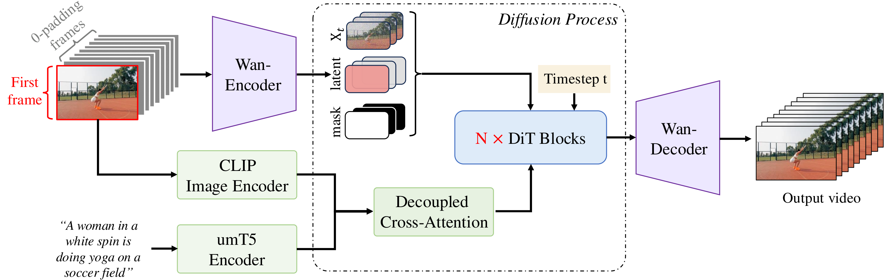</a>

**图 18：** Wan-I2V 模型框架。掩码机制使模型选择性关注输入帧，从而兼容视频续写和首尾帧过渡任务。

#### 5.1.2 数据集

联合训练阶段使用与 T2V 预训练相同的数据集，使模型具备根据参考图像生成运动的基础能力。
微调阶段依据每项任务的特性，整理专门数据集。

**图像到视频数据集。** 早期实验发现，如果训练数据第一帧与其余视频内容差异较大，模型难以学习稳定的图像驱动视频生成。
因此，第一帧与视频内容的差异更小，有利于训练。
利用 SigLIP （[Zhai 等，2023](#ref-zhai2023sigmoid)） 特征计算这种差异：计算第一帧特征与其余帧平均特征之间的余弦相似度，只保留高于预设阈值的视频。

**视频续写数据集。** 类似地，训练使用时间一致的视频，能显著改善续写任务。
为量化视频前后部分，即前 1.5 秒与后 3.5 秒的一致性，计算各自 SigLIP 特征的余弦相似度，再用分数筛选所需数据。

**首尾帧过渡数据集。** 与 I2V 不同，社区更关注图像过渡任务中初始帧与最终帧之间的平滑变换。
为此，我们提高训练集中首尾帧具有显著变化的样本比例。

<a href="Wan_译文图像/figure_19.png">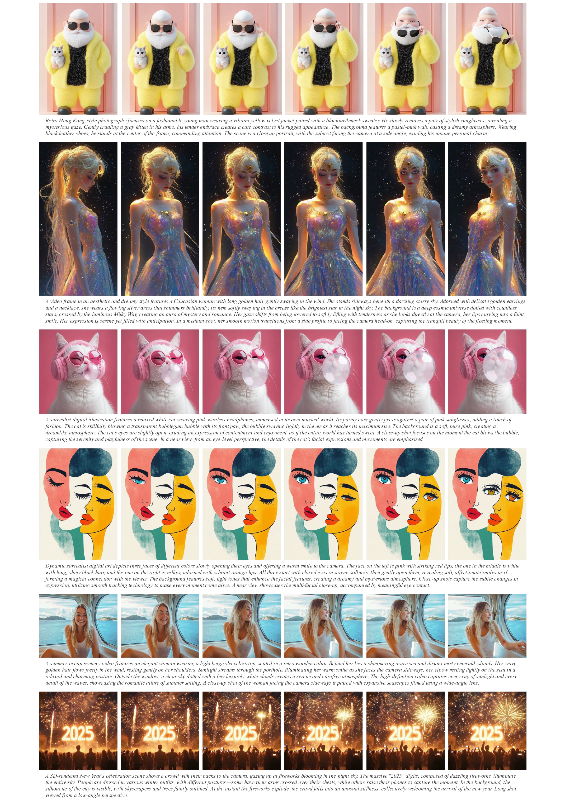</a>

**图 19：** Wan-I2V 生成的视频。结果表明，I2V 模型能够有效捕捉和复现真实世界场景的动态。

<a href="Wan_译文图像/figure_20.png">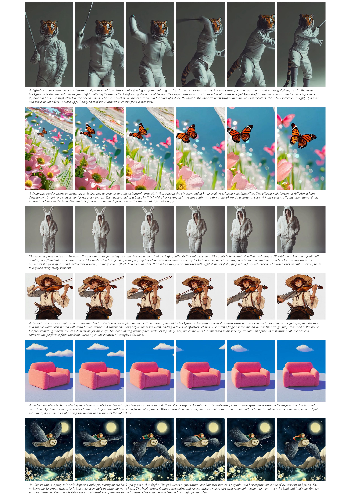</a>

**图 20：** Wan-I2V 生成的视频。模型能够将不同类型的图像有效转化为高度真实、富有动态的视频。

#### 5.1.3 评估

I2V、首尾帧过渡和视频续写的训练分为两个阶段。
初始预训练使用与 T2V 相同的数据集。
由于该阶段涉及的帧数略多，我们不使用图像编码器分支，以维持文本输入与视觉输出的强对齐，保持模型对细微文本语义的敏感性。
预训练稳定后，模型已具备 I2V、视频续写等多种能力，说明该过程为时空理解建立了可靠基础。

> **阅读注释｜不使用图像编码器，为什么仍能做 I2V？** 这里省略的是 CLIP 图像编码器分支，不是 Wan-VAE 编码器。结合第 5.1.1 节，模型仍通过 VAE 条件潜变量获得参考帧结构与外观，通过掩码识别已知位置，并通过 umT5 获取文本要求，因此可以学习图生视频、续写等任务。使用与 T2V 相同的数据集，也不表示输入结构与 T2V 完全相同。作者希望先保持文本与视觉输出的强对齐；文中同时提到帧数略多，但没有量化这一因素的独立影响。

实证观察发现，仅依赖帧级信息，无法在 I2V、视频续写和首尾帧过渡等任务中达到最优性能。
这说明预训练模型虽提供基于帧的视频生成基础框架，但缺乏足够的上下文与语义深度，难以完全捕捉动态视频序列的时间一致性，特别是条件帧极少时。
为此，在监督微调（SFT）阶段，我们加入图像编码器，并通过类似 I2V-Adapter （[Guo 等，2024a](#ref-i2vadapter)） 的解耦交叉注意力 （[Ye 等，2023](#ref-ye2023ip)） 提取图像特征，提供全局上下文，增强模型能力。
基于 480p 和 720p 两个预训练检查点开展实验，覆盖 I2V、视频续写和首尾帧过渡任务。

> **阅读注释｜两阶段训练各自负责什么？** “仅依赖帧级信息”是指已有图像条件还不够充分，不是说模型独立处理每帧、没有时空注意力。VAE 条件提供空间对齐的结构与外观，CLIP 分支进一步补充整体视觉语义与上下文，文本分支继续提供内容和动作要求。
>
> | 阶段 | 使用的图像条件 | 主要目的 |
> | --- | --- | --- |
> | 联合预训练 | VAE 条件潜变量与掩码，不启用 CLIP 分支。 | 学习根据已知帧补全视频，并保持文本控制。 |
> | 监督微调 SFT | 保留原有条件，再加入经解耦交叉注意力注入的 CLIP 图像特征。 | 增强整体视觉上下文，改善少量条件帧下的生成表现。 |
>
> 两条图像路径提供互补信息，结构细节与整体语义只是侧重点，不是严格互斥的分工。先不启用 CLIP、再在 SFT 中接入，是本文采用的训练选择，不是所有 I2V 模型都必须遵循的顺序。

> **阅读注释｜480p 与 720p 检查点说明了什么？** 检查点是训练过程中保存的模型参数。作者从这两个分辨率对应的预训练检查点出发，开展后续训练与实验。本节没有分别列出加入 CLIP 前后的对照指标，也没有给出 480p 与 720p 的完整能力对比，因而不能仅凭表 7 算出 CLIP 带来的具体增益，或断言分辨率提高使某项能力改善了多少。

类似 T2V 的人工评估，我们将 I2V 与先进技术比较，重点考察视觉质量、运动质量和匹配程度。
表 7 表明，模型在所有评估维度上均表现良好。
图 19 和图 20 提供更多可视化，清楚展示模型将图像转化为高质量视频的能力。

**表 7：** I2V 模型的胜率差距。原图注说明：数值表示成对比较中 Wan-I2V 相较其他模型被偏好的次数占总比较次数的比例。

| 维度 | CN-TopA | CN-TopB | CN-TopC | CN-TopD | 总对比轮数 |
| --- | --- | --- | --- | --- | --- |
| 视觉质量 | 29.2% | 60.8% | 24.6% | 55.6% | 896 |
| 运动质量 | 21.7% | 21.7% | 32.5% | 67.0% | 890 |
| 匹配程度 | -4.2% | 35.0% | 51.7% | 72.2% | 896 |
| 综合排名 | 10.8% | 47.5% | 50.8% | 81.6% | 890 |

> **译注：** 表内 -4.2% 不可能是普通的次数占比，说明原文图注与“胜率差距”的定义存在不一致；参见表 3 后的译注。数值未作改动。

> **阅读注释｜表 7 怎样读？** 表中各列是对比模型，各行是人工比较维度。下面是帮助理解的观察角度，并非原文另行给出的严格评分细则。
>
> | 维度 | 主要观察什么 |
> | --- | --- |
> | 视觉质量 | 清晰度、细节、伪影与整体画面表现。 |
> | 运动质量 | 动作是否自然、流畅、连贯。 |
> | 匹配程度 | 生成结果是否符合输入要求。 |
> | 综合排名 | 对生成结果的整体偏好。 |
>
> 结合上方译注，29.2% 不能直接解读为“100 次比较只赢约 29 次”，也不能擅自将这些数值定义为“胜率减负率”。原文“各维度表现良好”是作者对结果的概括，不足以推出所有维度都胜过所有对手；涉及匹配程度的负值尤其需要保留原文口径不清的说明。

### 5.2 统一视频编辑

文本到图像和文本到视频的预训练基础模型，促进了多种下游任务及应用的拓展，包括重绘 （[AI，2022](#ref-sdinp)；[Zhou 等，2023](#ref-propainter)）、编辑 （[Meng 等，2021](#ref-sdedit)；[Brooks 等，2023](#ref-ip2p)；[Zhang 等，2023a](#ref-magicbrush)；[Wang 等，2023b](#ref-wang2023videocomposer)；[Wei 等，2024b](#ref-dreamVideo2)）、可控生成 （[Zhang 等，2023b](#ref-controlnet)；[Jiang 等，2024](#ref-scedit)；[Wang 等，2024c](#ref-wang2024unianimate)）、定制生成 （[Chen 等，2023b](#ref-anydoor)；[Wei 等，2025](#ref-wei2025DreamRelation)）、参考帧生成 （[Yang 等，2025b](#ref-cogvideox)；[Guo 等，2024a](#ref-i2vadapter)）、高效生成 （[Wang 等，2023c](#ref-wang2023videolcm)；[Yuan 等，2024a](#ref-yuan2024instructvideo)；[Liu 等，2024b](#ref-liu2024timestep)） 和身份参考视频合成 （[Pan 等，2024](#ref-largen)；[Yuan 等，2025](#ref-consisid)；[Liu 等，2025a](#ref-phantom)）。
为提高任务灵活性，并减少部署多个模型的开销，研究者越来越关注统一模型架构 （[Tan 等，2024](#ref-ominictr)；[Chen 等，2024](#ref-unireal)），如 ACE （[Han 等，2025](#ref-ace)；[Mao 等，2025](#ref-acepp)） 和 OmniGen （[Xiao 等，2024](#ref-omnigen)）。
这些架构旨在将多样任务集成到单个图像模型中，使用户能够构建不同应用流程，同时保持易用性。
视频涉及时间和空间两个维度的协同变换，因此统一模型可能释放视频创作的无限潜力。

在之前的 VACE （[Jiang 等，2025](#ref-vace)） 工作中，我们提出统一的可控视频生成与编辑框架，支持参考到视频生成、视频到视频编辑和带掩码的视频到视频编辑。
基于 Wan 预训练模型，将待编辑图像与视频、参考和掩码等多种模态集成到视频条件单元（VCU），支持多样输入格式。
VACE 使用概念解耦策略，使模型区分哪些内容应保留、哪些应修改，清晰分离编辑任务与参考任务中的视觉模态信息。
我们提供两种训练模式。
第一种以 VCU 为输入，对整个 Wan 模型完全微调。
第二种以 Res-Tuning （[Jiang 等，2023](#ref-restuning)） 方式使用可插拔上下文适配器，不修改基础模型权重即可支持可控与编辑任务，但整体模型规模增加。
依托 Wan 强大的视频生成能力，这一框架在定量和定性评估中均具有显著竞争力。
它支持基础任务的组合扩展，实现长视频重新渲染等场景。
因此，该框架提供通用、高效的视频合成方案，为用户驱动的视频内容创作和编辑开辟新途径。

> **阅读注释｜完全微调与适配器调优的权衡。** 完全微调直接更新基础模型，新增任务能力进入其权重；适配器方式冻结基础权重，通过新增分支注入上下文。后者便于保留和复用基础模型，但增加额外参数与计算。零初始化、残差连接或独立条件分支通常用于温和地接入新信息，具体结构应以各任务的描述为准。

<a href="Wan_译文图像/figure_21.png">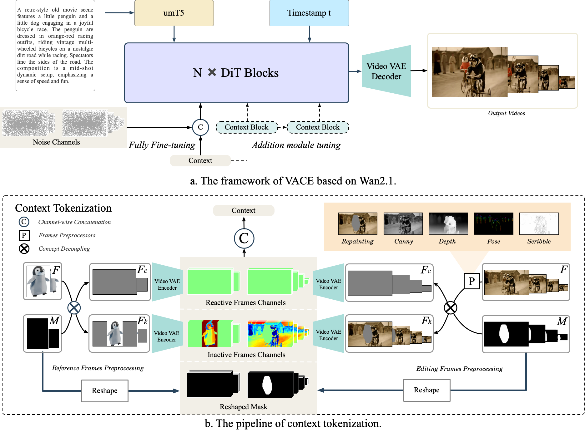</a>

**图 21：** 统一可控生成与编辑框架。帧和掩码通过概念解耦、上下文潜在编码和上下文嵌入器转为 token。Wan 有两种训练策略：完全微调与上下文适配器调优。

#### 5.2.1 模型设计

VACE 提出的视频条件单元（VCU）是一种输入范式，将不同输入条件统一为文本输入、帧序列和掩码序列。
形式化表示为：

$$
V=[T;F;M]. \tag{4}
$$

其中 $T$ 是文本提示词，$F$ 和 $M$ 分别为上下文视频帧序列 $\{u_1,u_2,\ldots,u_n\}$ 与掩码序列 $\{m_1,m_2,\ldots,m_n\}$。
$u$ 位于 RGB 空间，归一化到 $[-1,1]$；$m$ 为二值掩码，1 和 0 分别表示编辑与不编辑的区域。
$F$ 和 $M$ 在空间大小 $h\times w$ 和时间长度 $n$ 上对齐。
在这一范式下，使用前述 Wan-VAE 将输入视频帧和掩码信息转为上下文 token。
如图 21(a) 所示，将这些 token 与带噪视频 token 结合，微调 Wan。
我们还提出上下文适配器调优策略，让上下文 token 通过上下文块，再注入原始 DiT 块。
这样能够无缝集成上下文信息，在不改变基础模型权重的情况下，增强模型处理多种编辑与生成任务的能力。

<a href="Wan_译文图像/figure_22.png">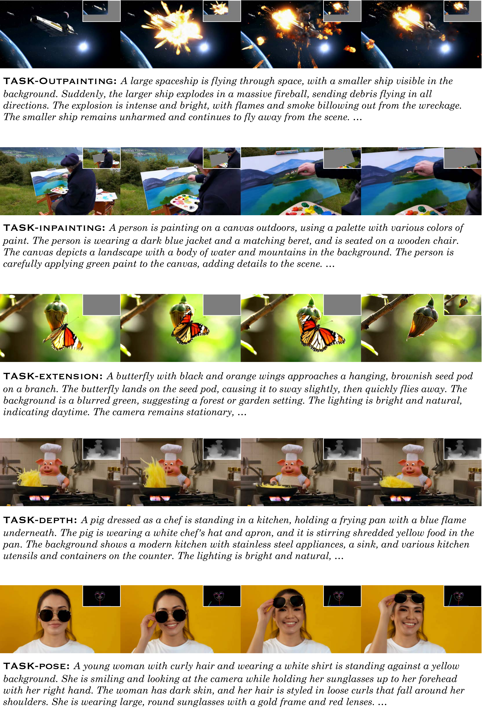</a>

**图 22：** VACE 的可视化结果。

<a href="Wan_译文图像/figure_23.png">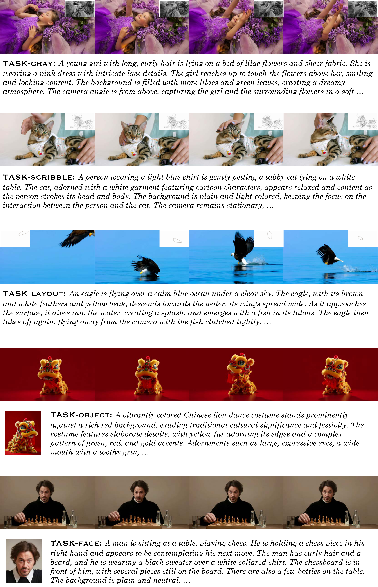</a>

**图 23：** VACE 的可视化结果。

转为 token 前，像素级上下文帧和掩码先通过概念解耦策略预处理，再编码到潜在空间。
如图 21(b) 所示，该策略根据掩码，明确地将不同模态和分布的数据分离为两个同形状帧序列：$F_c=F\times M$ 和 $F_k=F\times(1-M)$。
$F_c$ 是包含全部待修改像素的活动帧，$F_k$ 是保留全部应保留像素的非活动帧。
这一机制确保任务定义清晰，并保证模型在不同任务上收敛。
$F_c$ 与 $F_k$ 由 Wan-VAE 处理，映射到与 $X$ 相同的潜在空间，保持时空一致性。
为避免图像与视频混杂，参考图像由 Wan-VAE 编码器单独编码，再沿时间维拼接；解码时需要移除对应部分。
对 $M$ 直接进行形状重排和插值。
随后，$F_c$、$F_k$ 和 $M$ 映射至潜在空间，以 $n'\times h'\times w'$ 的形状与 $X$ 时空对齐。

> **阅读注释｜式 (4) 与概念解耦怎样理解？** $V=[T;F;M]$ 是统一描述任务输入的范式，不表示把字符串、RGB 帧和掩码直接当同类数字拼接。VACE 中 $M=1$ 表示编辑，因而 $F_c=F\times M$ 提取待修改区域，$F_k=F\times(1-M)$ 提取应保留区域。先将两类内容分开编码，有助于模型区分“参考什么”和“改动什么”。掩码表达任务条件，并不单凭这个公式就保证生成结果在保留区域逐像素完全不变。

<a href="Wan_译文图像/figure_24.png">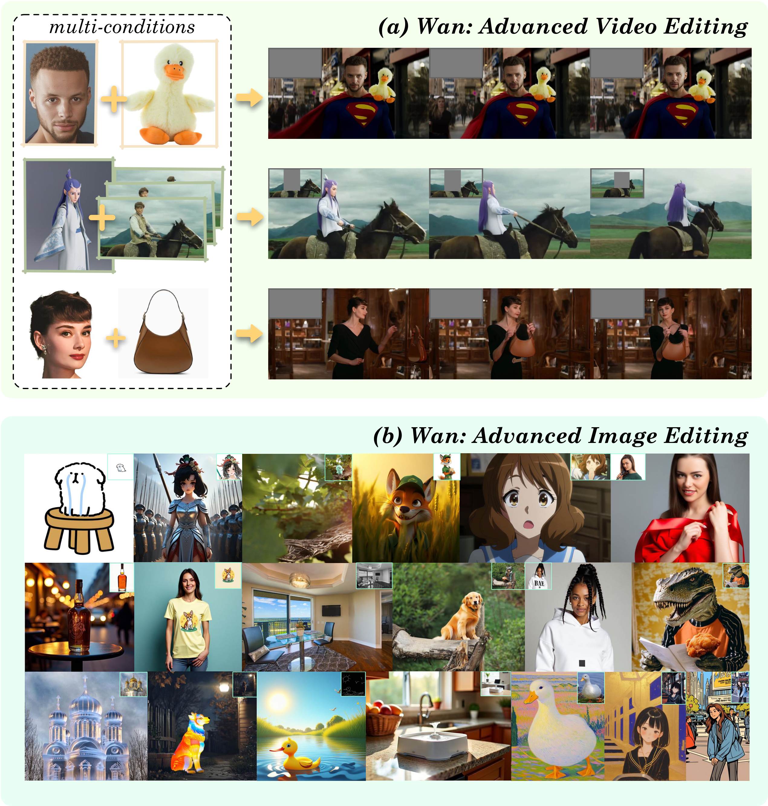</a>

**图 24：** 高级视频与图像编辑的可视化结果。

#### 5.2.2 数据集与实现

**数据构建。** 开发一体化模型，需要提高数据构建的多样性和复杂性。
对于可控视频生成与编辑，输入模态扩展为目标视频、源视频、局部掩码、参考等。
快速高效获取不同任务数据，需要在保持视频质量的同时进行实例级分析与理解。
我们先对视频按镜头切分，再依据分辨率、美学分数和运动幅度初步过滤。
用 RAM （[Zhang 等，2023d](#ref-ram)） 标注第一帧，再用 Grounding DINO （[Liu 等，2023d](#ref-groundingdino)） 检测，二次过滤目标区域过小或过大的视频。
此外，使用 SAM2 （[Ravi 等，2025](#ref-sam2)） 的传播操作进行视频分割，获取整个视频的实例级信息。
根据分割结果，依据掩码面积阈值计算有效帧比例，进一步在时间维筛选实例。
不同任务的数据构建还须依据各自特点调整。
详细信息参见 VACE （[Jiang 等，2025](#ref-vace)）。

**实现细节。** 以 Wan-T2V-14B 为预训练基础，通过多阶段训练，使可控与编辑模型支持最高 720p 分辨率。
最初关注补全和扩展等基础任务，补充预训练文本到视频模型的能力。
这一阶段引入掩码，并建立空间和时间维的上下文生成能力。
随后从单输入参考帧扩展到多输入，从单一任务扩展到复合任务。
最后使用更高质量数据和更长序列微调，提高模型质量。

#### 5.2.3 评估

图 22 和图 23 展示单个 Wan 模型在多种任务上的结果。
模型在视频质量和时间一致性上达到较高水平。
此外，图 24(a) 展示了组合不同生成能力所形成的新应用。
模型有效完成这些任务，体现显著的能力扩展潜力。
VACE 提出的统一可控生成与编辑框架，也适用于图像生成和编辑，见图 24(b)。

### 5.3 文本到图像生成

Wan 同时在图像和视频数据集上训练，因此不仅拥有先进的视频生成能力，也具有出色的图像合成性能。
这种双重训练策略促进跨模态知识迁移，形成高度通用的框架，在两个领域都取得强大效果。
实际训练中，图像数据集规模接近视频数据集的十倍，使图像和视频生成任务相互促进。
大规模训练让模型在图像合成的多个方面表现突出。
如图 25 所示，Wan 能生成多种类别的高保真图像，包括艺术文字视觉作品、逼真人像、富有想象力的创意设计，以及专业级产品摄影。

**图 25：** Wan 生成的图像样本。

### 5.4 视频个性化

视频个性化旨在生成与用户提供的参考保持身份一致的视频 （[Wei 等，2024a](#ref-dreamvideo)；[Li 等，2024](#ref-li2024personalvideo)；[Yuan 等，2025](#ref-consisid)）。
本节将先进个性化技术整合到视频生成流程中，达到先进性能。
下面全面介绍方法，包括模型架构、个性化数据和实验验证。

#### 5.4.1 模型设计

视频个性化的核心技术解决两个主要挑战：获取高保真的个性化身份信息，以及将身份特征无缝集成到视频生成流程。

我们以 Wan-T2V 基础模型为起点，首先获取个性化身份信息。
已有方法通常依赖身份提取器，如 ArcFace （[Deng 等，2019](#ref-deng2019arcface)），或通用视觉提取器，如 CLIP （[Radford 等，2021](#ref-radford2021learning)）。
虽然取得了可观进展，但性能受特征提取器局限性制约。
例如，身份提取器主要关注人脸识别特征，可能无法捕捉疤痕或贴纸等其他关键视觉线索。
它们也容易受到低分辨率人脸、光照变化和眼镜、口罩、头发等局部遮挡的影响。
通用视觉提取器则没有专门针对人脸设计，往往关注粗粒度语义信息。
因此，为避免信息损失，我们不依赖任何特征提取器，而是在 Wan-VAE 潜在空间中直接以输入人脸图像作为生成条件。

> **阅读注释｜为什么直接使用人脸图像的潜变量？** 本节希望给定若干张参考人脸，生成身份一致但动作、场景可以变化的新视频。ArcFace 等特征侧重区分身份，可能忽略疤痕、贴纸等细节；CLIP 等通用特征更侧重整体语义。因此，作者选择直接使用 VAE 编码的人脸条件。“不依赖特征提取器”指不依赖上述专门的身份或通用视觉嵌入，不表示没有视觉特征处理：VAE 仍会压缩特征，流程也仍使用人脸检测、分割与对齐，不能理解为无损保留全部细节。后文还使用 ArcFace 筛选数据和评估身份相似度，区别于把它作为生成条件提取器。

将个性化身份信息注入视频生成有多种方式。
实验发现，交叉注意力适合与身份提取器得到的密集表示交互，而自注意力更适合对同一潜在空间的数据建模。
图 26 展示采用自注意力范式的视频个性化设计。
具体而言，在潜在空间中，使用分割后的人脸图像，在给定视频之前增加 $K$ 帧。
这些人脸由配对视频的人脸检测和分割得到，并依据人脸关键点对齐到与视频帧同大小的黑色画布。
然后沿扩展视频的通道维，前 $K$ 帧拼接人脸图像与全 1 掩码，后续帧拼接空白图像与全 0 掩码。
这些拼接信号作为条件。
最后，以类似图像补全的方式，在通道条件信号引导下，对时间扩展后的视频执行扩散过程。
除此之外，不对 Wan-T2V 作其他修改。

> **阅读注释｜对齐画布与自注意力分别有什么用？** 先分割人脸、按关键点对齐到同尺寸黑色画布，可以减少参考背景干扰并规范输入布局，不是要求输出只能出现人脸或黑色背景。参考人脸与目标视频都进入同一种 VAE 潜在空间，经图块化后由自注意力共同建模，目标视频 token 因而能够参考人脸 token。文本条件仍负责指定内容和动作。这里选择自注意力有其表示与实验背景，不表示所有身份保持方法都必须采用自注意力。

训练时，随机丢弃 $K$ 个扩展帧中的部分人脸图像，以支持使用 0 到 $K$ 张参考人脸生成视频。
推理时，从扩展视频的纯噪声开始，将用户提供的不超过 $K$ 张人脸图像沿通道维拼接到扩展帧，并将对应掩码设为全 1。
目标是在前 $K$ 帧重建人脸图像，在后续帧合成保持所提供身份的新个性化视频。

> **阅读注释｜为什么训练时随机丢弃参考人脸？** 如果训练总是提供满 $K$ 张照片，模型可能依赖固定数量的条件。随机丢弃让它适应多张、一张乃至零张参考图：多张可以提供不同角度和表情，一张时信息更少，零张时则没有指定身份参考，只能依赖其他条件与模型先验。支持零张不表示仍能确定用户想生成谁。“不对 Wan-T2V 作其他修改”强调架构改动有限，本节仍描述了专门训练，不表示原始 T2V 模型无需训练即可获得该能力。

<a href="Wan_译文图像/figure_26.png">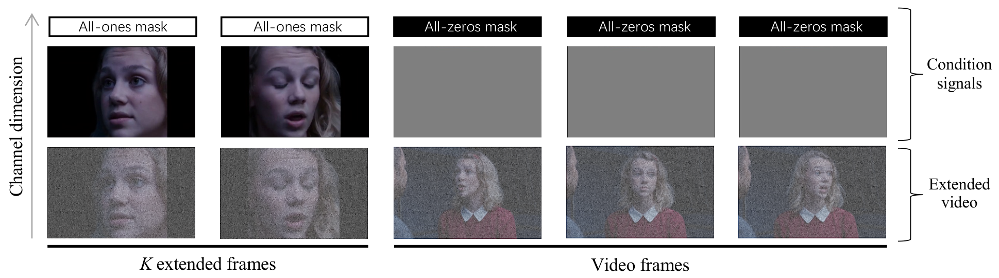</a>

**图 26：** 在 Wan-VAE 潜在空间中实现视频个性化的核心设计。

> **阅读注释｜图 26 的两个方向怎样读？** 横向是时间位置：在目标视频前额外增加 $K$ 个参考位置；纵向是通道组织：将当前带噪扩展视频、条件图像和掩码沿通道维组合。前 $K$ 个位置承担参考重建任务，不是最终视频剧情的前 $K$ 帧。以图中的两个参考位置为例，下表只示意布局，不展开 VAE 时空压缩和具体张量对齐。
>
> | 信息 | 参考位置 1 | 参考位置 2 | 后续目标视频位置 |
> | --- | --- | --- | --- |
> | 条件图像 | 人脸照片 A。 | 人脸照片 B。 | 空白占位。 |
> | 条件掩码 | 全 1。 | 全 1。 | 全 0。 |
> | 训练时的干净目标 | 重建照片 A。 | 重建照片 B。 | 对应的真实目标视频。 |
> | 推理时的待生成初态 | 随机噪声。 | 随机噪声。 | 随机噪声。 |
>
> 上面的干净条件与下面的带噪状态职责不同：条件告诉网络参考人脸是什么样，带噪扩展视频是需要逐步生成的对象。图中的全 1 掩码标记参考条件有效，不是人脸轮廓分割掩码。训练时对扩展序列加噪并学习生成；推理时整个待生成序列从纯噪声开始，参考人脸仍通过另一组条件通道提供。完成采样后，前面的参考位置用于人脸重建，真正需要的视频内容取后续位置。

> **阅读注释｜这与第 5.1 节 I2V 有什么区别？** 两者都利用图像条件，但条件位置和主要约束不同。
>
> | 任务 | 参考内容放在哪里 | 主要约束 |
> | --- | --- | --- |
> | 图像到视频 I2V | 通常作为目标视频的第一帧。 | 初始画面、场景与外观。 |
> | 本节视频个性化 | 放在目标视频前新增的参考位置。 | 人物身份与外观，允许目标视频采用新的场景、动作和构图。 |

#### 5.4.2 数据集

我们通过仔细筛选和自动数据合成，从 T2V 基础模型训练集中整理个性化数据。
首先使用内部人物分类器筛选出约 $\mathcal{O}(100)$M 个视频，并以每秒 1 帧的频率进行人脸检测。
如果任何一帧检测到多于一张人脸，或超过 10% 的帧未检测到人脸，则丢弃该视频。
随后计算相邻帧之间的 ArcFace 相似度，丢弃相似度低的视频。
再进行人脸分割，去除干扰背景，并检测人脸关键点，以便训练时进行画布对齐。
我们不剔除人脸区域较小的视频，因为它们通常包含全身人物。
最终构建约 $\mathcal{O}(10)$M 个个性化视频，每个视频平均带有 5 张分割后人脸。

我们还使用自动数据合成，提高人脸多样性。
从上述数据中随机选择约 $\mathcal{O}(1)$M 个个性化视频，利用 Instant-ID （[Wang 等，2024b](#ref-wang2024instantid)） 为每个视频合成多样人脸。
构建包含 100 多条提示词的文本模板，覆盖动漫、线条艺术、电影风格、Minecraft 等。
每次随机选择一条模板提示词，再从其他视频估计的人体姿态中随机选择一种，共同输入 Instant-ID。
进一步计算生成脸的 ArcFace 相似度，过滤相似度较低的样本。
共收集约 $\mathcal{O}(1)$M 个带合成人脸的视频，显著丰富个性化数据集的风格、姿态、光照和遮挡。

#### 5.4.3 评估

图 27 展示个性化结果，左侧为输入身份，右侧为生成的个性化视频。
全部测试图像随机取自 [Pexels](https://www.pexels.com)。
我们也在未见过的评估集上测试，以每秒 1 帧采样输出视频中的人脸，计算输入人脸与输出视频人脸之间的 ArcFace 相似度。
最终分数是所有采样人脸相似度的平均值。
表 8 表明，相较其他领先的中国商业及闭源竞争者，我们的方法具有竞争力。

**表 8：** 与其他领先视频个性化方法的比较。

| 指标 | Wan | CN-TopA | CN-TopB | CN-TopC |
| --- | --- | --- | --- | --- |
| ArcFace 相似度 | 0.5526 | 0.5655 | 0.5197 | 0.4998 |

<a href="Wan_译文图像/figure_27.png">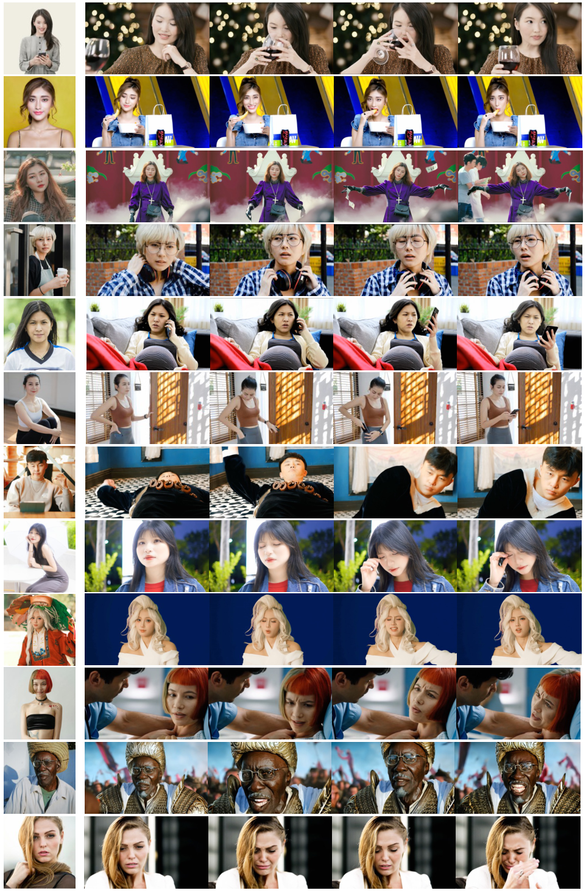</a>

**图 27：** 视频个性化方法的可视化。

### 5.5 摄像机运动可控性

<a href="Wan_译文图像/figure_28.png">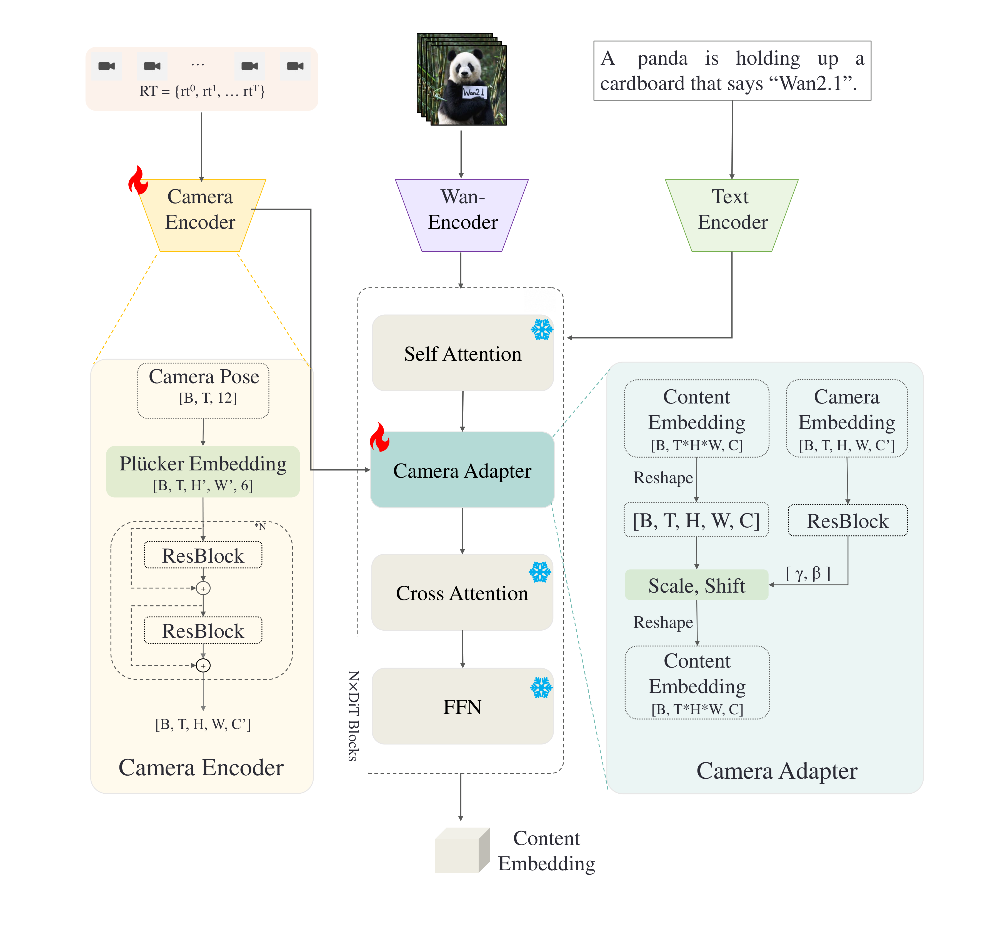</a>

**图 28：** 摄像机运动引导的视频生成框架。

> **阅读注释｜先看图 28 的整体分工。** 文本条件说明“拍什么”，摄像机条件进一步指定“镜头怎样移动”，例如推进、侧移或绕主体旋转；镜头运动与主体动作是不同因素。左侧分支将逐帧摄像机参数编码为条件特征，再由 Camera Adapter 注入视频主干。火焰表示摄像机编码器和适配器参与训练，雪花表示原有注意力、FFN 等主干部分冻结。图中重点展示新增分支，省略了噪声、时间嵌入、采样迭代与最终解码等步骤。

摄像机运动控制模块利用摄像机轨迹，准确匹配视频运动与视角。
具体使用每帧的外参 $[R,t]\in\mathbb{R}^{3\times4}$ 和内参 $K_f\in\mathbb{R}^{3\times3}$。
为有效注入摄像机运动条件，方法包含摄像机姿态编码器和摄像机姿态适配器两部分，见图 28。

> **阅读注释｜摄像机轨迹由哪些参数组成？** 这里的轨迹是一串逐帧摄像机状态，每帧都有相应的内外参。
>
> | 参数 | 含义 |
> | --- | --- |
> | 旋转矩阵 $R$ | 描述摄像机与场景坐标系之间的朝向关系。 |
> | 平移向量 $t$ | 描述两坐标系的位置关系；具体含义取决于外参约定，不一定直接等于相机的世界坐标位置。 |
> | 内参矩阵 $K_f$ | 描述焦距、主点等投影与成像关系。 |
>
> 此处 $t$ 是平移向量，不是生成时间。图中的 Camera Pose 形状 $[B,T,12]$ 可理解为每帧的 $3\times4$ 外参矩阵展开为 12 个数，$B$ 是批大小、$T$ 是帧数；12 是矩阵元素数，不表示 12 个独立自由度。

<a href="Wan_译文图像/figure_29.png">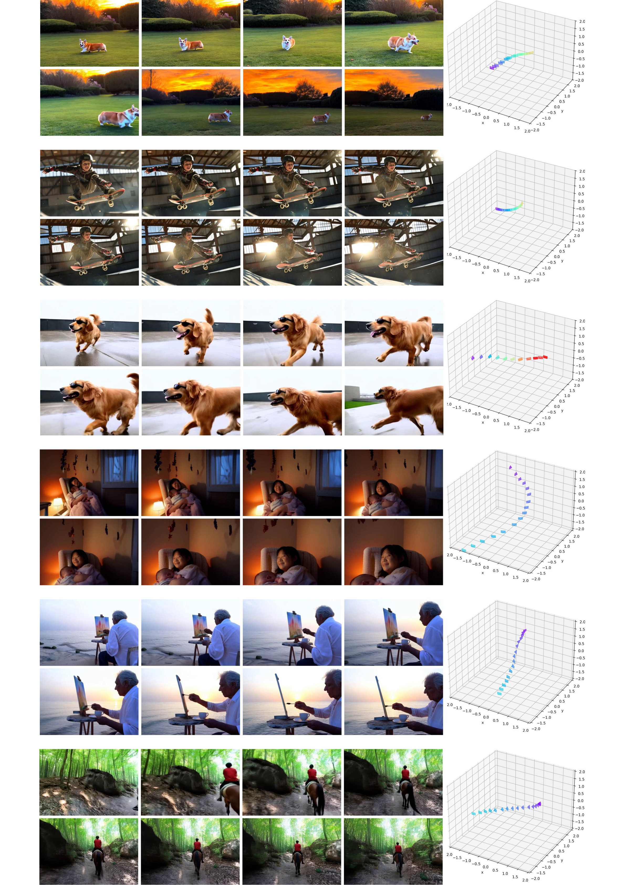</a>

**图 29：** 摄像机运动引导的生成视频结果。

**摄像机姿态编码器。** 首先，对每帧的每个像素，利用 Plücker 坐标将给定内外参转换为细粒度位置序列 $P\in\mathbb{R}^{6\times F\times H\times W}$。
为匹配视频潜在特征的压缩分辨率，使用 PyTorch （[Paszke 等，2019](#ref-paszke2019pytorch)） 的 PixelUnshuffle 降低 $P$ 的空间分辨率，同时增加通道数。
最后，通过与 DiT 块数量相匹配的一系列卷积模块编码输出，提取多层级摄像机运动特征。

> **阅读注释｜为什么将内外参变成 Plücker 射线？** 原始参数是一组矩阵数字，转成逐像素观察射线后，几何条件便能与画面位置对应。一种常见的六维表示是 $p=(o\times d,d)$，其中 $o$ 是摄像机中心、$d$ 是射线方向，$o\times d$ 描述射线的位置关系，两部分各占 3 维。因此 $P$ 的 6 个通道表示每个像素的射线信息，$F,H,W$ 分别是帧数、高度和宽度。这里补充的是常见几何解释，相关定义可参考 [CameraCtrl](https://arxiv.org/html/2404.02101v1#S3.SS2)。射线没有直接给出物体深度或完整三维场景，具体画面仍由生成模型学习和生成。

> **阅读注释｜PixelUnshuffle 为什么缩小空间、增加通道？** 它将邻近位置的数据重新排列到通道中。例如，逐帧采用 2 倍空间重排时，$[6,F,H,W]$ 变成 $[24,F,H/2,W/2]$：每个 $2\times2$ 区域的四组特征合并到一个位置的不同通道。操作本身不丢弃元素，也不改变时间长度，区别于普通缩放或 VAE 的学习式压缩。后续卷积再将这些几何信息加工成适合 DiT 使用的条件特征。这里的 2 倍只是示例，不代表原文指定的实际重排因子；图中的通道末置形状与正文的通道前置形状也只是轴排列不同。

**摄像机姿态适配器。** 使用自适应归一化层，将摄像机运动特征集成到视频潜在特征中。
通过两个零初始化卷积层，将输入摄像机运动特征序列转换为缩放因子 $\gamma_i$ 和偏移参数 $\beta_i$。
再按简单线性投影 $f_i=(\gamma_i+1)*f_{i-1}+\beta_i$ 将它们融入每个 DiT 块，其中 $f_i$ 为第 $i$ 层的视频潜在特征。

> **阅读注释｜适配器怎样通过缩放和偏移控制视频？** 摄像机编码器提取条件，适配器将条件转成特征修正。式子可读作 $f_i=(1+\gamma_i)\odot f_{i-1}+\beta_i$，其中 $\odot$ 表示逐元素乘法。
>
> | 项 | 在调制中的作用 |
> | --- | --- |
> | $f_{i-1}$、$f_i$ | 调制前与调制后的视频特征。 |
> | $\gamma_i$ | 根据摄像机条件调整特征幅度。 |
> | $\beta_i$ | 根据摄像机条件增加特征偏移。 |
>
> 例如一个特征值为 2，$\gamma_i=0.1$、$\beta_i=0.3$，调制后为 $1.1\times2+0.3=2.5$。它作用于网络内部表示，不是直接平移、裁剪输出画面；公式描述适配器的调制，也不能据此将整个 DiT 块理解为只有一次仿射变换。与前面的时间调制类似，这里也使用缩放和偏移，但参数来源是摄像机条件。零初始化使初始 $\gamma_i=\beta_i=0$，从而 $f_i=f_{i-1}$，先保留预训练特征，再逐渐学会利用轨迹进行修正。

训练数据方面，利用先进摄像机姿态估计算法 VGG-SfM （[Wang 等，2024a](#ref-wang2024vggsfm)），从摄像机运动显著的训练视频中提取轨迹。
该过程得到约 $\mathcal{O}(1)$ 千个视频片段。
在文本到视频框架内，使用 Adam 优化器训练此模块。
图 29 展示不同摄像机运动引导下的生成实例。

> **阅读注释｜摄像机控制如何获得训练监督？** VGG-SfM 从真实视频中估计摄像机轨迹，作者据此构建千量级片段，让新增模块学习“给定轨迹与文本，视频视角应怎样变化”。估计的轨迹是训练条件，不等于人工提供的精确真值；推理时则可以提供希望采用的摄像机轨迹，引导已有视频生成模型。冻结主干、训练新增分支，是在已有生成能力上学习控制方式，不表示摄像机参数会直接替代 DiT 或采样器。

### 5.6 实时视频生成

当前视频生成方法往往需要大量计算资源和较长时间，即使只生成短视频。
依赖高端硬件的系统依然较慢，通常需要数分钟才能生成几秒视频。
近年来视觉质量显著提升，但漫长的处理时间仍是实际应用和迭代设计流程的重要瓶颈。
交互娱乐、虚拟现实和视频制作等领域需要快速原型制作与实时调整；过长生成时间限制创作灵活性，拖慢视觉内容优化。

此外，当前方法的低速限制了它们在需要实时反馈的动态环境中的应用。
直播或游戏等场景日益需要根据用户动作或输入变化，即时渲染合成场景和角色。
高质量视频生成中的任何延迟，都可能损害用户体验，降低沉浸感与交互性。
通过关注实时生成，Wan 希望提升视频生成技术的性能与适用性，拓展其在快速交互环境中的潜力。
图 30 和图 31 展示实时长视频流生成实例。
下面介绍如何利用 Wan 实现这一能力。

<a href="Wan_译文图像/figure_30.png">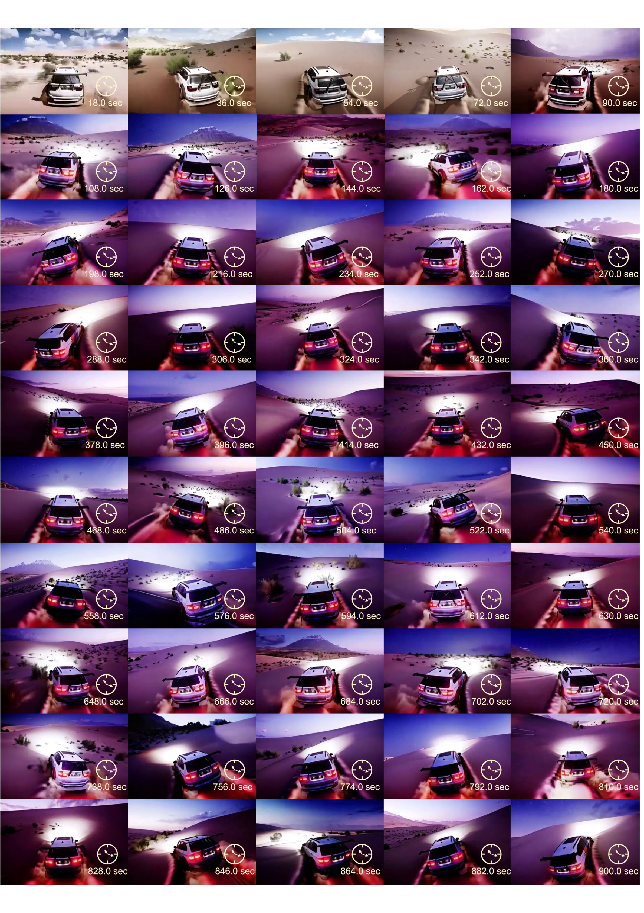</a>

**图 30：** 使用 8 张 A100 GPU，以实时 8 FPS 生成 15 分钟视频。

<a href="Wan_译文图像/figure_31.png">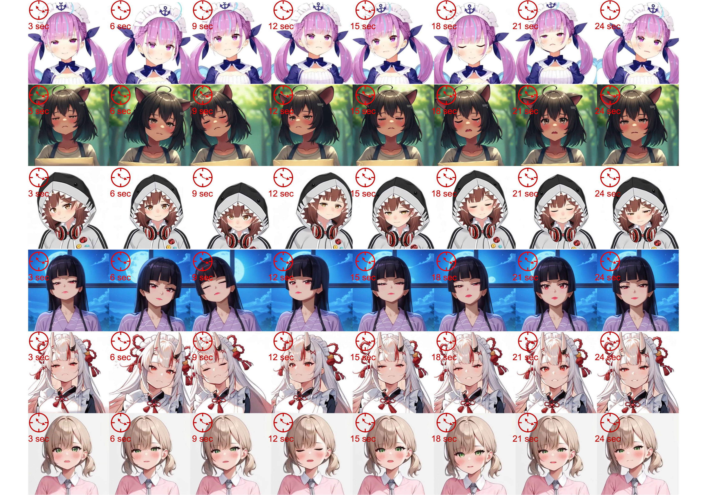</a>

**图 31：** 使用单张 RTX 4090 GPU，结合 int8 和 TensorRT 量化，以实时 20 FPS 生成视频。

> **译注：** 图 31 图注写的是 20 FPS，后文关于单张 4090 的说明写的是 8 FPS。原文没有明确解释测试条件差异，此处保留两处原值。

#### 5.6.1 方法

实时生成流水线建立在先前预训练的 Wan 版本上。
这样做有两个主要好处。
第一，训练良好的模型提供强初始化，显著加快收敛并提高训练稳定性。
第二，预训练模型已学到运动模式和连续时间动态的知识，新流水线可以直接继承，改善生成内容的平滑性和连贯性。
因此，我们采用预训练 Wan 作为实时流水线的基础。

*原文脚注：* 本节部分内容已在先前技术报告 *The Matrix* （[Feng 等，2024](#ref-feng2024matrixinfinitehorizonworldgeneration)） 中介绍。

预训练 Wan 通常生成固定长度的 5–10 秒视频。
要将它转为可以连续生成、不预设长度，甚至无限长度的实时流式模型，需要两项关键修改。

- **适配流式流水线：** 将一次生成固定长度视频 token 序列的静态过程，替换为逐步生成 token 的流式机制。视频 token 在去噪队列中处理，每当最早的 token 生成并出队，就向队尾加入新 token，从而实现无长度限制的连续生成。
- **实时加速：** 除了支持流式生成，还优化速度，使新帧生成足够快，能够跟上实时播放。

下面详细介绍设计动机、技术实现及实测性能。

#### 5.6.2 流式视频生成

传统 DiT （[Peebles \& Xie，2023](#ref-dit)） 即使采用 VAE （[Kingma，2013](#ref-kingma2013auto)） 进行显著时空压缩，也难以生成超过几秒的视频。
主要原因是长时间序列的注意力机制计算和内存开销很大。
为解决这一挑战，我们提出 Streamer，通过滑动时间窗口高效管理时间依赖，以流式方式生成长视频甚至无限长度视频。

**滑动窗口去噪过程模型。** Streamer 的关键创新在于假设时间依赖局限于有限时间窗口。
将注意力计算集中在这一窗口内，显著降低计算开销，同时保持视频连续性。
具体而言，Streamer 以队列处理视频 token，在窗口内针对不同噪声等级进行去噪。
固定数量去噪步骤后，最左侧、噪声最低的 token 出队并缓存，最右侧加入新的高斯噪声 token。
这一滑动机制保持窗口长度不变，同时支持连续视频帧生成。

> **阅读注释｜Streamer 的队列与普通整段采样有什么不同？** 普通生成通常让整段视频一起经过相同的噪声进度；Streamer 在一个固定窗口中同时维护不同噪声等级的 token，较早进入的部分接近完成，较晚进入的部分仍接近噪声。完成的部分从队头输出，新噪声从队尾进入，计算规模不随已输出视频总长度无限增长。这里的时间 token 属于压缩表示，不应机械地理解为一个 token 就是一张像素帧。

**训练与推理。** Streamer 从预训练 DiT 微调得到。
训练时采样长度 $2w$ 的视频 token 序列，$w$ 为滑动窗口大小，通常设为 $w=T$，其中 $T$ 是扩散求解器的步数。
前 $w$ 个 token 仅用于预热，不参与损失计算。
只在后 $w$ 个 token 上计算损失，让模型学习在窗口内生成连贯视频帧。
推理使用同样的预热策略，丢弃前 $w$ 个 token，生成视频从第 $w+1$ 个 token 开始。

> **译注：** 本节的 $T$ 表示扩散求解器步数，与前文表示视频时间长度的符号含义不同。

**训练与推理期间的连续性保障。** 为保证相邻窗口平滑衔接，以噪声等级 0 将缓存 token 重新加入队列。
这样，已生成 token 可以参与后续窗口的去噪，保证时间一致性与连续性。

> **阅读注释｜预热、历史条件与长期一致性。** 前 $w$ 个 token 用来让队列进入工作状态，不作为输出训练目标，推理也丢弃相应预热部分；预热仍需要计算，所以流式模型仍有启动延迟。将已生成 token 以零噪声状态放回窗口，为新内容提供历史条件。“无限长度”描述可以持续运行的机制，不是数学保证所有时间跨度上的人物、场景和故事记忆都不会漂移；有限窗口本身也限定了直接可见的上下文。

Streamer 将 DiT 适配至流式应用，是视频生成的一项重要进展。
滑动时间窗口解决传统 DiT 的限制，使模型能高效生成无限长度视频，同时保持高质量和时间连贯性。
这一方法为实时视频生成和长内容创作提供新可能。
其优点如下。

- **无限长度视频生成：** 滑动窗口机制支持任意长度视频，无需承担过高计算成本。
- **高效注意力计算：** 将注意力限制在有限时间窗口，降低内存和处理需求。
- **无缝连续性：** 缓存并重新加入 token，确保窗口间平滑过渡，长期保持视频质量。

#### 5.6.3 一致性模型蒸馏

将 DiT 扩展为支持无限长度生成的 Streamer 后，下一个关键问题是实现模拟世界的实时渲染。
Streamer 虽然通过滑动窗口高效管理时间依赖，可以生成长视频甚至无限视频，但扩散过程的计算需求仍是实时应用的瓶颈。
为此，我们提出将 Streamer 与一致性模型结合，加速基于扩散的生成过程。
具体使用潜在一致性模型（LCM）（[Luo 等，2023](#ref-luo2023latent)） 及其视频版本 VideoLCM （[Wang 等，2023c](#ref-wang2023videolcm)），将原始扩散过程和无分类器引导蒸馏为高效的四步一致性模型。
蒸馏显著减少高质量生成所需的采样步数，同时保留 Streamer 的时间连贯性与流式能力。

> **阅读注释｜一致性蒸馏与滑动窗口解决不同瓶颈。** 滑动窗口控制每次处理的时间范围，让生成可以持续；一致性蒸馏利用原生成过程提供的指导，学习用更少步骤完成生成。本文将原过程及 CFG 蒸馏到四步模型，减少的是每部分内容所需的采样计算，不是减少最终视频帧数。实时速度还依赖模型版本、硬件、分辨率和量化；不能直接把本节速度套用到普通 Wan 14B 的标准生成配置。

LCM 与 Streamer 的集成保留去噪窗口机制，使滑动时间窗口继续有效管理依赖。
训练时优化组合框架，在效率与质量之间取得平衡。
最终推理速度提升 10–20 倍，渲染速度达到 8–16 FPS。
这种显著改进，使系统适用于交互模拟、实时视频合成和虚拟环境动态内容生成等实时应用。
Streamer 提供时间连贯的无限视频生成，LCM 提供扩散加速；结合两者，缩小高质量视频生成与实时响应之间的差距。
这不仅提高扩散模型在流式应用中的实用性，也为沉浸式、交互式和实时媒体创作提供新可能。

**面向消费级设备的量化。** 即使生成速度达到实时水平，较高计算和内存需求仍使消费级部署困难，NVIDIA 4090 等高端 GPU 也面临这一问题。
为此，引入量化以实现高效部署。
采用两种策略：对注意力层和线性输出层使用 int8 量化 （[torchao maintainers \& contributors，2024](#ref-torchao)），对整体模型使用 TensorRT 量化 （[NVIDIA，2023](#ref-tensorrt)）。
int8 将权重和激活转换为 8 位整数，显著减少内存占用，同时保持整体生成质量。
但该方法主要提高内存效率，计算优化有限，因此生成速度加速很小。
TensorRT 提供更全面的方案，大幅加速生成。
即使单张 4090，也可达到实时 8 FPS，使消费级部署成为可能。
不过，TensorRT 量化会略微增加网络误差，即使开启内置误差检查也能观察到。
误差表现为输出质量的轻微偏差，如少量伪影或不一致。
部分情况下，也可能出现可测量的不稳定，如闪烁或时间不连贯。
尽管存在这些权衡，结合 int8 与 TensorRT 仍能在实时消费级部署中平衡效率、实用性与可接受的生成质量。
通过仔细调整量化参数，利用 TensorRT 误差检查功能，我们尽可能缓解这些问题，在消费级硬件上实现可靠、高效的性能。

### 5.7 音频生成

本工作的音频生成主要目标，是为视频片段生成同步音轨，形式化为视频到音频（V2A）框架。
生成音轨包含环境音和背景音乐，明确排除语音或人声元素。
与文本到音频模型 （[Liu 等，2023b](#ref-audioldm)；[Liu 等，2024c](#ref-audioldm2)） 不同，V2A 生成的环境音必须在时间上与视频视觉内容对齐，配乐也应自然反映视频的情绪和场景。
为增强用户对声音设计的控制，框架同时集成视频和文本提示，允许用户指定画内或画外声音，以及背景音乐的风格和是否出现。

#### 5.7.1 模型设计

与视频生成框架一致，V2A 使用基于流匹配 （[Lipman 等，2022](#ref-flow-matching)） 的 DiT （[Peebles \& Xie，2023](#ref-dit)） 对音频领域的去噪扩散过程建模。
详细流水线见图 32。

<a href="Wan_译文图像/figure_32.png">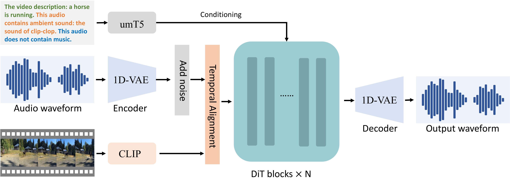</a>

**图 32：** 视频到音频生成框架。模型同时处理视频片段及对应文字描述，合成高质量、语义连贯的音频。

> **阅读注释｜音频是生成目标，视频与文字是条件。** 本节沿用 VAE、DiT 与流匹配的建模思路，但生成对象是音频。例如，输入马奔跑的视频，可以要求生成马蹄声且不加音乐。图左侧出现真实音轨，是因为图同时展示了训练所需的数据流。
>
> | 阶段 | 音频路径 | 视频与文字的作用 |
> | --- | --- | --- |
> | 训练 | 真实音频经 1D-VAE 编码后加噪，DiT 学习相应的生成速度。 | 为声音内容和时间对应关系提供条件。 |
> | 生成 | 从随机音频潜变量开始，反复预测速度并由采样器更新，最后用 1D-VAE 解码。 | 引导生成新音轨，不要求提供正确音频作为输入。 |
>
> 图中省略了采样迭代，单次 DiT 速度预测不能直接当作最终潜变量解码。这里复用的是建模范式，不表示原视频 DiT 无需适配就能直接输出音频。

<a href="Wan_译文图像/figure_33.png">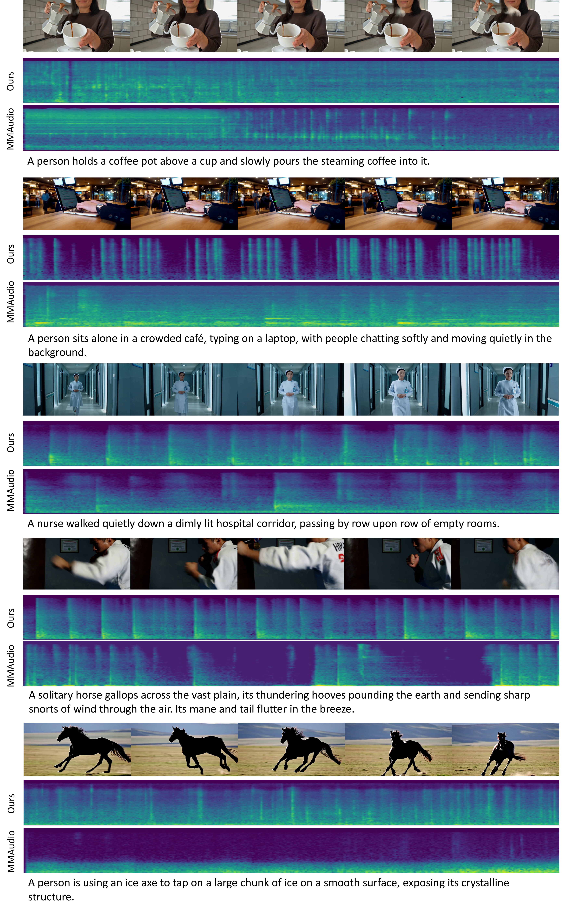</a>

**图 33：** MMAudio 与我们的方法生成的音频样本。

**音频自编码器。** 一种广泛采用的音频压缩方式，是将原始波形转为梅尔频谱图，再通过基于图像的 VAE 编码为 $H^a\times W^a\times C^a$ 潜在特征 （[Liu 等，2023b](#ref-audioldm)；[Liu 等，2024c](#ref-audioldm2)）。
但是，使用扩散 Transformer 主干时，这些特征必须划分为图块，再重排为 $(H^a\cdot W^a)\times C^a$ 张量。
图块化和重排可能破坏与视频内容的时间对齐，给同步造成重大挑战。
因此，我们训练直接操作原始波形的压缩模型。
一维 VAE 产生 $T^a\times C^a$ 潜在特征，其中 $T^a$ 是时间轴上的序列长度，保留精确同步所需的显式时间信息。

> **阅读注释｜1D-VAE 为什么强调显式时间轴？** 波形是按时间排列的采样值，直接压缩后得到 $T^a\times C^a$ 的特征：$T^a$ 是潜在时间位置数，$C^a$ 是每个位置的特征维度，便于将脚步、碰撞等声音与视频时刻对应。1D 表示主要沿时间轴处理，不表示单声道，本节输出是立体声。梅尔频谱图本身也有时间轴，不能把原文理解为所有二维表示都会丢失时间信息；作者强调的是图块化、展平后对齐更复杂，因此选择直接压缩波形。

**视频和文本编码器。** 为使合成音频与视觉序列逐帧精确同步，我们通过多模态特征融合建立时间一致性。
首先使用 CLIP （[Radford 等，2021](#ref-radford2021learning)） 提取逐帧视觉嵌入，再遵循 Movie Gen （[Polyak 等，](#ref-polyak2024moviegencastmedia)），通过复制特征调整时间采样率，使其与音频特征采样率一致。
同步后的视觉与音频特征经线性投影变换维度，对齐到 DiT 潜在空间，再逐元素相加，实现多模态融合。
语言理解方面，使用预训练 umT5 （[Chung 等，2023](#ref-chung2023unimax)） 作为文本编码器，冻结其参数，利用跨语言表示能力。

> **阅读注释｜Temporal Alignment 与特征相加分别做什么？** CLIP 逐帧提取视觉特征，但视觉位置数通常不同于音频潜在时间位置数，因此先按时间对应关系复制视觉特征，使它们与音频时间网格对齐。复制不会增加新的视觉观测，也不自动保证事件与声音精准同步，相关能力仍需从配对数据中学习。
>
> 融合可以用示意式 $h^a=\operatorname{Proj}_a(z^a_\tau)$、$h^v=\operatorname{Proj}_v(v_{\mathrm{aligned}})$、$h=h^a+h^v$ 理解：$z^a_\tau$ 是当前带噪音频潜变量，$v_{\mathrm{aligned}}$ 是时间对齐后的视觉特征；两者先投影到统一维度，再逐元素相加。每个位置因而同时包含音频生成状态和对应时段的视觉条件。相加的是学习得到的特征，不是视频像素与波形振幅；这些式子省略了其他嵌入与网络细节。

**数据。** V2A 训练数据通过严格过滤，从视频生成数据集中获得。
系统地移除没有音轨，或包含语音与人声音乐的视频，得到约 $\mathcal{O}(1)$ 千小时的精选子集。
为增强多模态表示，采用全面描述策略：在细致视频描述之外，补充 Qwen2-audio （[Chu 等，2024](#ref-qwen2-audio)） 生成的音频专用描述。
音频描述分为环境声音与音乐，后者进一步描述风格、节奏、旋律和乐器。
最终结构化描述包含三部分：细致视频描述、环境声音特征和背景音乐分析，为训练提供统一多模态表示。

> **阅读注释｜文字条件与 Qwen2-audio 各负责什么？** 同一段画面可以配不同声音，视频本身不能唯一决定是否加音乐、采用哪种风格，因此需要文字提供额外控制。训练描述按三部分组织，例如：
>
> | 描述部分 | 示例 |
> | --- | --- |
> | 视频内容 | 一匹马在草地上奔跑。 |
> | 环境声音 | 连续、有节奏的马蹄声。 |
> | 背景音乐 | 不含音乐，或使用轻柔的管弦乐。 |
>
> umT5 将文字编码为生成条件，其参数冻结；Qwen2-audio 用于数据准备，为已有音轨生成声音与音乐描述，不是图中负责逐步生成音频的 DiT。冻结表示模块仍参与计算，但训练时不更新其权重。

**实现细节。** V2A 可生成最长 12 秒、采样率 44.1 kHz 的高保真立体声音频。
专门编码器处理多模态输入：umT5-XXL 生成 4096 维文本嵌入，CLIP 为每帧提取 1024 维视觉嵌入。
音频与视频特征在 DiT 主干中投影至统一的 1536 维潜在空间。
时间对齐方面，对输入视频下采样，12 秒片段精确得到 48 帧，保证视觉与音频逐帧同步。
系统在一个批次中处理长度 256 的潜在序列。
为提高仅凭视觉线索生成音频的能力，训练时使用随机掩蔽，以预设概率省略环境音和音乐描述。
这一条件机制迫使模型建立视觉内容与对应声音模式之间的可靠跨模态联系，同时保持在文本可用时使用描述的灵活性。

> **阅读注释｜这些采样率、长度与维度有什么区别？** 下列数字分别属于波形、视觉观测、潜在序列和网络特征，不能混用。
>
> | 数字 | 含义 |
> | --- | --- |
> | 44.1 kHz | 输出波形每个声道每秒有 44,100 个采样点。 |
> | 12 秒、48 帧 | 输入视频下采样后的视觉观测，平均每秒 4 帧。 |
> | 256 | 文中报告的潜在序列长度，不是视频帧数或波形采样率。 |
> | 1024 维 | CLIP 每帧提取的视觉特征维度。 |
> | 4096 维 | umT5-XXL 的文本特征维度。 |
> | 1536 维 | 音频与视觉特征投影后的 DiT 内部特征维度。 |
>
> 1536 不是音频声道数，也不能直接当作 VAE 原始潜变量的通道数 $C^a$。文中同时报告了 48 个视觉位置与长度 256 的潜在序列，但没有展开具体的时间索引映射，不能简单设定每个视觉帧都重复相同次数来得到 256 个位置。

> **阅读注释｜随机省略音频描述的目的。** 如果训练时总有非常详细的声音文字，模型可能过度依赖文字而忽视视频。随机省略部分环境音或音乐描述，让它练习利用视觉线索补足声音信息，也支持不同条件可用性的输入。省略的是文字条件，真实音轨仍提供训练监督。本文数据有意排除了语音和人声，因而能力范围主要是环境音、音效与背景音乐，不能据此推断它已具备角色对白生成能力。

#### 5.7.2 评估

图 33 提供音频生成的定性评估，比较我们的方法与近期发布的开源 MMAudio （[Cheng 等，2024](#ref-mmaudio)）。
这一比较很有意义，因为 MMAudio 是与我们最相近且有竞争力的基线，在音频生成任务中表现出色。
测试视频由我们的文本到视频模型生成，时长 5 秒。

比较结果显示，V2A 在多个关键方面表现更好。
首先，长期一致性更强，在“倒咖啡”场景，即图 33 的第一个例子中尤其明显。
第二个“打字”例子中，相较 MMAudio 较嘈杂的结果，我们产生更干净的音频。
此外，我们更擅长合成有节奏的声音，例如图 33 最后三个“行走”“拳击”和“马蹄声”场景，声音更自然连贯。

**局限性。** 我们的方法在生成人声方面存在限制，包括笑声、哭声和语音等。
主要原因是数据准备阶段有意排除了语音相关人声数据。
MMAudio 能产生随机的类似语音声音，是因为其训练语料保留了语音相关数据。
未来计划加入语音生成能力，解决这一局限。

## 6 局限性与结论

**局限性。** 本研究提出视频生成基础模型 Wan，在多个基准上取得显著进展。
尤其是在运动幅度，如体育和舞蹈，以及指令遵循方面，获得明显改善。
不过，仍有若干局限需要解决，以进一步发挥 Wan 的潜力。

首先，大幅度运动场景中的细粒度细节保持，仍是本方法的挑战，也是整个视频生成领域的普遍问题。
提高大幅度运动视频的保真度，还需要大量努力。

其次，大模型计算成本依然很高。
没有额外优化时，14B 模型在单张高端 GPU 上推理，目前大约需要 30 分钟。
要让视频生成成为人人可用的 AI 工具，还需深入研究效率与可扩展性。

最后，模型仍缺乏特定领域的专门知识。
作为视频基础模型，我们致力于增强通用能力，但在教育、医学等特定场景中，性能可能不足。
我们希望通过开源最新模型，推动社区在不同专业领域开发，解决这一限制。

> **阅读注释｜怎样理解本文结果的适用范围？** 大幅度运动、细节保持、生成速度和专业知识是不同问题，需要分别评估。模型名称、排行榜、显存和 FPS 等数字都对应论文发表时的具体版本与条件；尤其第 5.6 节的实时方案经过额外适配、蒸馏和量化。本文已有译注标明若干表格口径和速度陈述的不一致，引用这些数值时应保留相应条件与说明。

**结论。** 本报告公开发布最新视频模型 Wan，为视频生成建立新的基准。
我们全面介绍 Wan-VAE 与 DiT 架构，包括训练方法、数据整理、评估方式和实验结果。
也详细分析数据预处理流水线，以及为优化训练所采用的策略调整。
这种全面方法旨在推动视频生成领域进步。
此外，我们广泛研究 I2V、视频编辑和个性化视频等下游应用，展示 Wan 在不同场景中的通用性与实用价值。
除了开源 14B 模型，我们还探索较小模型进行高效视频生成的可行性。
1.3B 模型不仅具备与更大模型相比有竞争力的性能，还可在消费级 GPU 上顺畅推理，显著提高内容创作者的可获取性与实用性。
未来将重点扩展数据规模与模型架构，应对视频生成最迫切的挑战。
我们持续努力，为研究社区提供更强大、更通用的视频创作工具，促进这一快速发展领域的创新与普及。

## 7 贡献者

作者按名字（first name）的字母顺序排列。

Ang Wang、Baole Ai、Bin Wen、Chaojie Mao、Chen-Wei Xie、Di Chen、Feiwu Yu、Haiming Zhao、Jianxiao Yang、Jianyuan Zeng、Jiayu Wang、Jingfeng Zhang、Jingren Zhou、Jinkai Wang、Jixuan Chen、Kai Zhu、Kang Zhao、Keyu Yan、Lianghua Huang、Mengyang Feng、Ningyi Zhang、Pandeng Li、Pingyu Wu、Ruihang Chu、Ruili Feng、Shiwei Zhang、Siyang Sun、Tao Fang、Tianxing Wang、Tianyi Gui、Tingyu Weng、Tong Shen、Wei Lin、Wei Wang~1、Wei Wang~2、Wenmeng Zhou、Wente Wang、Wenting Shen、Wenyuan Yu、Xianzhong Shi、Xiaoming Huang、Xin Xu、Yan Kou、Yangyu Lv、Yifei Li、Yijing Liu、Yiming Wang、Yingya Zhang、Yitong Huang、Yong Li、You Wu、Yu Liu、Yulin Pan、Yun Zheng、Yuntao Hong、Yupeng Shi、Yutong Feng、Zeyinzi Jiang、Zhen Han、Zhi-Fan Wu、Ziyu Liu。

## 参考文献

以下保留原论文的 132 条英文书目信息，便于检索和核对。正文作者与年份引用可点击跳转到对应条目。

**AI，2022。** Runway AI. Stable Diffusion Inpainting Model Card, [https://huggingface.co/runwayml/stable-diffusion-inpainting](https://huggingface.co/runwayml/stable-diffusion-inpainting), 2022.

**Bai 等，2023。** Jinze Bai, Shuai Bai, Shusheng Yang, Shijie Wang, Sinan Tan, Peng Wang, Junyang Lin, Chang Zhou, and Jingren Zhou. Qwen-VL: A versatile vision-language model for understanding, localization, text reading, and beyond. *arXiv preprint arXiv.2308.12966*, 2023.

**Bao 等，2023。** Fan Bao, Shen Nie, Kaiwen Xue, Yue Cao, Chongxuan Li, Hang Su, and Jun Zhu. All are worth words: A vit backbone for diffusion models. In *IEEE Conf. Comput. Vis. Pattern Recog.*, 2023.

**Bao 等，2024。** Fan Bao, Chendong Xiang, Gang Yue, Guande He, Hongzhou Zhu, Kaiwen Zheng, Min Zhao, Shilong Liu, Yaole Wang, and Jun Zhu. Vidu: a highly consistent, dynamic and skilled text-to-video generator with diffusion models. *arXiv preprint arXiv:2405.04233*, 2024.

**Betker 等，2023。** James Betker, Gabriel Goh, Li Jing, Tim Brooks, Jianfeng Wang, Linjie Li, Long Ouyang, Juntang Zhuang, Joyce Lee, Yufei Guo, et al. Improving image generation with better captions (2023). *URL https://cdn. openai. com/papers/dall-e-3. pdf*, 2023.

**Blattmann 等，2023。** Andreas Blattmann, Tim Dockhorn, Sumith Kulal, Daniel Mendelevitch, Maciej Kilian, Dominik Lorenz, Yam Levi, Zion English, Vikram Voleti, Adam Letts, et al. Stable video diffusion: Scaling latent video diffusion models to large datasets. *arXiv preprint arXiv:2311.15127*, 2023.

**Brooks 等，2023。** Tim Brooks, Aleksander Holynski, and Alexei A. Efros. InstructPix2Pix: Learning To Follow Image Editing Instructions. In *IEEE Conf. Comput. Vis. Pattern Recog.*, pp. 18392-18402, 2023.

**Caron 等，2021。** Mathilde Caron, Hugo Touvron, Ishan Misra, Hervé Jégou, Julien Mairal, Piotr Bojanowski, and Armand Joulin. Emerging properties in self-supervised vision transformers. *arXiv preprint arXiv:2104.14294*, 2021.

**Chen 等，2023a。** Junsong Chen, Jincheng Yu, Chongjian Ge, Lewei Yao, Enze Xie, Yue Wu, Zhongdao Wang, James Kwok, Ping Luo, Huchuan Lu, et al. Pixart-$\alpha$: Fast training of diffusion transformer for photorealistic text-to-image synthesis. *arXiv preprint arXiv:2310.00426*, 2023a.

**Chen 等，2016。** Tianqi Chen, Bing Xu, Chiyuan Zhang, and Carlos Guestrin. Training deep nets with sublinear memory cost. *arXiv preprint arXiv:1604.06174*, 2016.

**Chen 等，2023b。** Xi Chen, Lianghua Huang, Yu Liu, Yujun Shen, Deli Zhao, and Hengshuang Zhao. AnyDoor: Zero-shot Object-level Image Customization. *arXiv preprint arXiv:2307.09481*, 2023b.

**Chen 等，2024。** Xi Chen, Zhifei Zhang, He Zhang, Yuqian Zhou, Soo Ye Kim, Qing Liu, Yijun Li, Jianming Zhang, Nanxuan Zhao, Yilin Wang, Hui Ding, Zhe Lin, and Hengshuang Zhao. UniReal: Universal Image Generation and Editing via Learning Real-world Dynamics. *arXiv preprint arXiv:2412.07774*, 2024.

**Cheng 等，2024。** Ho Kei Cheng, Masato Ishii, Akio Hayakawa, Takashi Shibuya, Alexander Schwing, and Yuki Mitsufuji. Taming multimodal joint training for high-quality video-to-audio synthesis. *arXiv preprint arXiv:2412.15322*, 2024.

**Chu 等，2023。** Ruihang Chu, Enze Xie, Shentong Mo, Zhenguo Li, Matthias Nießner, Chi-Wing Fu, and Jiaya Jia. Diffcomplete: Diffusion-based generative 3d shape completion. *Adv. Neural Inform. Process. Syst.*, 2023.

**Chu 等，2024。** Yunfei Chu, Jin Xu, Qian Yang, Haojie Wei, Xipin Wei, Zhifang Guo, Yichong Leng, Yuanjun Lv, Jinzheng He, Junyang Lin, et al. Qwen2-audio technical report. *arXiv preprint arXiv:2407.10759*, 2024.

**Chung 等，2023。** Hyung Won Chung, Noah Constant, Xavier Garcia, Adam Roberts, Yi Tay, Sharan Narang, and Orhan Firat. Unimax: Fairer and more effective language sampling for large-scale multilingual pretraining. *arXiv preprint arXiv:2304.09151*, 2023.

**DeepMind，2024.12。** Google DeepMind. Veo 2. *https://deepmind.google/technologies/veo/veo-2/*, 2024.12.

**Deng 等，2019。** Jiankang Deng, Jia Guo, Niannan Xue, and Stefanos Zafeiriou. Arcface: Additive angular margin loss for deep face recognition. In *IEEE Conf. Comput. Vis. Pattern Recog.*, pp. 4690-4699, 2019.

**Elfwing 等，2018。** Stefan Elfwing, Eiji Uchibe, and Kenji Doya. Sigmoid-weighted linear units for neural network function approximation in reinforcement learning. *Neural networks*, 2018.

**Esser 等，2021。** Patrick Esser, Robin Rombach, and Bjorn Ommer. Taming transformers for high-resolution image synthesis. In *IEEE Conf. Comput. Vis. Pattern Recog.*, pp. 12873-12883, 2021.

**Esser 等，2024。** Patrick Esser, Sumith Kulal, Andreas Blattmann, Rahim Entezari, Jonas Muller, Harry Saini, Yam Levi, Dominik Lorenz, Axel Sauer, Frederic Boesel, et al. Scaling rectified flow transformers for high-resolution image synthesis. In *Int. Conf. Mach. Learn.*, 2024.

**Fang \& Zhao，2024。** Jiarui Fang and Shangchun Zhao. Usp: A unified sequence parallelism approach for long context generative ai. *arXiv preprint arXiv:2405.07719*, 2024.

**Feng 等，2024。** Ruili Feng, Han Zhang, Zhantao Yang, Jie Xiao, Zhilei Shu, Zhiheng Liu, Andy Zheng, Yukun Huang, Yu Liu, and Hongyang Zhang. The matrix: Infinite-horizon world generation with real-time moving control. *arXiv preprint arXiv:2412.03568*, 2024.

**Fu 等，2024。** Chaoyou Fu, Yuhan Dai, Yongdong Luo, Lei Li, Shuhuai Ren, Renrui Zhang, Zihan Wang, Chenyu Zhou, Yunhang Shen, Mengdan Zhang, et al. Video-mme: The first-ever comprehensive evaluation benchmark of multi-modal llms in video analysis. *arXiv preprint arXiv:2405.21075*, 2024.

**GenmoTeam，2024。** GenmoTeam. Mochi 1. [https://github.com/genmoai/models](https://github.com/genmoai/models), 2024.

**Guo 等，2024a。** Xun Guo, Mingwu Zheng, Liang Hou, Yuan Gao, Yufan Deng, Pengfei Wan, Di Zhang, Yufan Liu, Weiming Hu, Zhengjun Zha, Haibin Huang, and Chongyang Ma. I2V-Adapter: A General Image-to-Video Adapter for Diffusion Models. In *SIGGRAPH*, pp. 1-12, 2024a.

**Guo 等，2024b。** Yuwei Guo, Ceyuan Yang, Anyi Rao, Zhengyang Liang, Yaohui Wang, Yu Qiao, Maneesh Agrawala, Dahua Lin, and Bo Dai. Animatediff: Animate your personalized text-to-image diffusion models without specific tuning. *International Conference on Learning Representations*, 2024b.

**HaCohen 等，2024。** Yoav HaCohen, Nisan Chiprut, Benny Brazowski, Daniel Shalem, Dudu Moshe, Eitan Richardson, Eran Levin, Guy Shiran, Nir Zabari, Ori Gordon, Poriya Panet, Sapir Weissbuch, Victor Kulikov, Yaki Bitterman, Zeev Melumian, and Ofir Bibi. Ltx-video: Realtime video latent diffusion. *arXiv preprint arXiv:2501.00103*, 2024.

**Han 等，2025。** Zhen Han, Zeyinzi Jiang, Yulin Pan, Jingfeng Zhang, Chaojie Mao, Chenwei Xie, Yu Liu, and Jingren Zhou. ACE: All-round Creator and Editor Following Instructions via Diffusion Transformer. In *Int. Conf. Learn. Represent.*, 2025.

**Heusel 等，2017。** Martin Heusel, Hubert Ramsauer, Thomas Unterthiner, Bernhard Nessler, and Sepp Hochreiter. Gans trained by a two time-scale update rule converge to a local nash equilibrium. *Adv. Neural Inform. Process. Syst.*, 2017.

**Ho \& Salimans，2022。** Jonathan Ho and Tim Salimans. Classifier-free diffusion guidance. *arXiv preprint arXiv:2207.12598*, 2022.

**Ho 等，2020。** Jonathan Ho, Ajay Jain, and Pieter Abbeel. Denoising diffusion probabilistic models. *Adv. Neural Inform. Process. Syst.*, 33: 6840-6851, 2020.

**Ho 等，2022。** Jonathan Ho, Tim Salimans, Alexey Gritsenko, William Chan, Mohammad Norouzi, and David J Fleet. Video diffusion models. *arXiv preprint arXiv:2204.03458*, 2022.

**Huang 等，2023。** Ziqi Huang, Yinan He, Jiashuo Yu, Fan Zhang, Chenyang Si, Yuming Jiang, Yuanhan Zhang, Tianxing Wu, Qingyang Jin, and Nattapol Chanpaisit. Vbench: Comprehensive benchmark suite for video generative models. *IEEE Conf. Comput. Vis. Pattern Recog.*, 2023.

**Jacobs 等，2023。** Sam Ade Jacobs, Masahiro Tanaka, Chengming Zhang, Minjia Zhang, Shuaiwen Leon Song, Samyam Rajbhandari, and Yuxiong He. Deepspeed ulysses: System optimizations for enabling training of extreme long sequence transformer models. *arXiv preprint arXiv:2309.14509*, 2023.

**Jiang 等，2023。** Zeyinzi Jiang, Chaojie Mao, Ziyuan Huang, Ao Ma, Yiliang Lv, Yujun Shen, Deli Zhao, and Jingren Zhou. Res-Tuning: A Flexible and Efficient Tuning Paradigm via Unbinding Tuner from Backbone. In *Adv. Neural Inform. Process. Syst.*, 2023.

**Jiang 等，2024。** Zeyinzi Jiang, Chaojie Mao, Yulin Pan, Zhen Han, and Jingfeng Zhang. SCEdit: Efficient and Controllable Image Diffusion Generation via Skip Connection Editing. In *IEEE Conf. Comput. Vis. Pattern Recog.*, pp. 8995-9004, 2024.

**Jiang 等，2025。** Zeyinzi Jiang, Zhen Han, Chaojie Mao, Jingfeng Zhange, Yulin Pan, and Yu Liu. Vace: All-in-one video creation and editing. *arXiv preprint arXiv:2503.07598*, 2025.

**Jin 等，2024。** Yang Jin, Zhicheng Sun, Ningyuan Li, Kun Xu, Kun Xu, Hao Jiang, Nan Zhuang, Quzhe Huang, Yang Song, Yadong Mu, and Zhouchen Lin. Pyramidal flow matching for efficient video generative modeling. *arXiv preprint arXiv:2410.05954*, 2024.

**Ke 等，2021。** Junjie Ke, Qifei Wang, Yilin Wang, Peyman Milanfar, and Feng Yang. Musiq: Multi-scale image quality transformer. *arXiv preprint arXiv:2108.05997*, 2021.

**Kingma，2013。** Diederik P Kingma. Auto-encoding variational bayes. *arXiv preprint arXiv:1312.6114*, 2013.

**Kingma \& Ba，2014。** Diederik P Kingma and Jimmy Ba. Adam: A method for stochastic optimization. *arXiv preprint arXiv:1412.6980*, 2014.

**Kong 等，2024。** Weijie Kong, Qi Tian, Zijian Zhang, Rox Min, Zuozhuo Dai, Jin Zhou, Jiangfeng Xiong, Xin Li, Bo Wu, Jianwei Zhang, et al. Hunyuanvideo: A systematic framework for large video generative models. *arXiv preprint arXiv:2412.03603*, 2024.

**Korthikanti 等，。** Vijay Korthikanti, Jared Casper, Sangkug Lym, Lawrence McAfee, Michael Andersch, Mohammad Shoeybi, and Bryan Catanzaro. Reducing activation recomputation in large transformer models, 2022. *arXiv preprint arXiv:2205.05198*.

**Kuaishou，2024.06。** Kuaishou. Kling ai. *https://klingai.kuaishou.com/*, 2024.06.

**Lab \& etc.，2024。** PKU-Yuan Lab and Tuzhan AI etc. Open-sora-plan, April 2024.

**LAION-AI，2022。** LAION-AI. aesthetic-predictor, 2022. URL [https://github.com/LAION-AI/aesthetic-predictor](https://github.com/LAION-AI/aesthetic-predictor).

**Li 等，2024。** Hengjia Li, Haonan Qiu, Shiwei Zhang, Xiang Wang, Yujie Wei, Zekun Li, Yingya Zhang, Boxi Wu, and Deng Cai. PersonalVideo: High ID-Fidelity Video Customization without Dynamic and Semantic Degradation. *arXiv preprint arXiv:2411.17048*, 2024.

**Li 等，2023。** Yanwei Li, Yuechen Zhang, Chengyao Wang, Zhisheng Zhong, Yixin Chen, Ruihang Chu, Shaoteng Liu, and Jiaya Jia. Mini-gemini: Mining the potential of multi-modality vision language models. *arXiv preprint arXiv:2403.18814*, 2023.

**Lin 等，2024。** Bin Lin, Yunyang Ge, Xinhua Cheng, Zongjian Li, Bin Zhu, Shaodong Wang, Xianyi He, Yang Ye, Shenghai Yuan, Liuhan Chen, et al. Open-sora plan: Open-source large video generation model. *arXiv preprint arXiv:2412.00131*, 2024.

**Lipman 等，2022。** Yaron Lipman, Ricky TQ Chen, Heli Ben-Hamu, Maximilian Nickel, and Matt Le. Flow matching for generative modeling. *arXiv preprint arXiv:2210.02747*, 2022.

**Liu 等，2024a。** Aixin Liu, Bei Feng, Bing Xue, Bingxuan Wang, Bochao Wu, Chengda Lu, Chenggang Zhao, Chengqi Deng, Chenyu Zhang, Chong Ruan, et al. Deepseek-v3 technical report. *arXiv preprint arXiv:2412.19437*, 2024a.

**Liu 等，2024b。** Feng Liu, Shiwei Zhang, Xiaofeng Wang, Yujie Wei, Haonan Qiu, Yuzhong Zhao, Yingya Zhang, Qixiang Ye, and Fang Wan. Timestep embedding tells: It's time to cache for video diffusion model. *arXiv preprint arXiv:2411.19108*, 2024b.

**Liu 等，2023a。** Hao Liu, Matei Zaharia, and Pieter Abbeel. Ring attention with blockwise transformers for near-infinite context. *arXiv preprint arXiv:2310.01889*, 2023a.

**Liu 等，2023b。** Haohe Liu, Zehua Chen, Yi Yuan, Xinhao Mei, Xubo Liu, Danilo Mandic, Wenwu Wang, and Mark D Plumbley. Audioldm: Text-to-audio generation with latent diffusion models. *arXiv preprint arXiv:2301.12503*, 2023b.

**Liu 等，2024c。** Haohe Liu, Yi Yuan, Xubo Liu, Xinhao Mei, Qiuqiang Kong, Qiao Tian, Yuping Wang, Wenwu Wang, Yuxuan Wang, and Mark D Plumbley. Audioldm 2: Learning holistic audio generation with self-supervised pretraining. *IEEE/ACM Transactions on Audio, Speech, and Language Processing*, 2024c.

**Liu 等，2023c。** Haotian Liu, Chunyuan Li, Qingyang Wu, and Yong Jae Lee. Visual instruction tuning. *arXiv preprint arXiv:2304.08485*, 2023c.

**Liu 等，2025a。** Lijie Liu, Tianxiang Ma, Bingchuan Li, Zhuowei Chen, Jiawei Liu, Qian He, and Xinglong Wu. Phantom: Subject-consistent video generation via cross-modal alignment. *arXiv preprint arXiv:2502.11079*, 2025a.

**Liu 等，2023d。** Shilong Liu, Zhaoyang Zeng, Tianhe Ren, Feng Li, Hao Zhang, Jie Yang, Chunyuan Li, Jianwei Yang, Hang Su, Jun Zhu, and Lei Zhang. Grounding DINO: Marrying DINO with Grounded Pre-Training for Open-Set Object Detection. *arXiv preprint arXiv:2303.05499*, 2023d.

**Liu 等，2025b。** Zhihang Liu, Chen-Wei Xie, Bin Wen, Feiwu Yu, Jixuan Chen, Boqiang Zhang, Nianzu Yang, Pandeng Li, Yun Zheng, and Hongtao Xie. What is a good caption? a comprehensive visual caption benchmark for evaluating both correctness and coverage of mllms. *arXiv preprint arXiv:2502.14914*, 2025b.

**Loshchilov \& Hutter，2017。** Ilya Loshchilov and Frank Hutter. Decoupled weight decay regularization. *arXiv preprint arXiv:1711.05101*, 2017.

**LumaLabs，2024.06。** LumaLabs. Dream machine. *https://lumalabs.ai/dream-machine*, 2024.06.

**Luo 等，2023。** Simian Luo, Yiqin Tan, Longbo Huang, Jian Li, and Hang Zhao. Latent consistency models: Synthesizing high-resolution images with few-step inference. *arXiv preprint arXiv:2310.04378*, 2023.

**Lv 等，2024。** Zhengyao Lv, Chenyang Si, Junhao Song, Zhenyu Yang, Yu Qiao, Ziwei Liu, and Kwan-Yee K. Wong. Fastercache: Training-free video diffusion model acceleration with high quality. *arXiv preprint arXiv:2410.19355*, 2024.

**Ma 等，2025。** Guoqing Ma, Haoyang Huang, Kun Yan, Liangyu Chen, Nan Duan, Shengming Yin, Changyi Wan, Ranchen Ming, Xiaoniu Song, Xing Chen, et al. Step-video-t2v technical report: The practice, challenges, and future of video foundation model. *arXiv preprint arXiv:2502.10248*, 2025.

**Ma 等，2024。** Xin Ma, Yaohui Wang, Gengyun Jia, Xinyuan Chen, Ziwei Liu, Yuan-Fang Li, Cunjian Chen, and Yu Qiao. Latte: Latent diffusion transformer for video generation. *arXiv preprint arXiv:2401.03048*, 2024.

**Mao 等，2025。** Chaojie Mao, Jingfeng Zhang, Yulin Pan, Zeyinzi Jiang, Zhen Han, Yu Liu, and Jingren Zhou. ACE++: Instruction-Based Image Creation and Editing via Context-Aware Content Filling. *arXiv preprint arXiv:2501.02487*, 2025.

**Meng 等，2021。** Chenlin Meng, Yutong He, Yang Song, Jiaming Song, Jiajun Wu, Jun-Yan Zhu, and Stefano Ermon. SDEdit: Guided Image Synthesis and Editing with Stochastic Differential Equations. In *Int. Conf. Learn. Represent.*, 2021.

**MiniMax，2024.09。** MiniMax. Hailuo ai. *https://hailuoai.com/video*, 2024.09.

**NVIDIA，2023。** NVIDIA. Nvidia tensorrt: Programmable inference accelerator, 2023. Version 8.6.

**OpenAI，2024。** OpenAI. Video generation models as world simulators, 2024. URL [https://openai.com/index/video-generation-models-as-world-simulators/](https://openai.com/index/video-generation-models-as-world-simulators/).

**Pan 等，2024。** Yulin Pan, Chaojie Mao, Zeyinzi Jiang, Zhen Han, and Jingfeng Zhang. Locate, Assign, Refine: Taming Customized Image Inpainting with Text-Subject Guidance. *arXiv preprint arXiv:2403.19534*, 2024.

**Paszke 等，2019。** Adam Paszke, Sam Gross, Francisco Massa, Adam Lerer, James Bradbury, Gregory Chanan, Trevor Killeen, Zeming Lin, Natalia Gimelshein, Luca Antiga, et al. Pytorch: An imperative style, high-performance deep learning library. *Adv. Neural Inform. Process. Syst.*, 32, 2019.

**Peebles \& Xie，2023。** William Peebles and Saining Xie. Scalable diffusion models with transformers. In *Int. Conf. Comput. Vis.*, pp. 4195-4205, 2023.

**Perez 等，2018。** Ethan Perez, Florian Strub, Harm De Vries, Vincent Dumoulin, and Aaron Courville. Film: Visual reasoning with a general conditioning layer. In *Assoc. Adv. Artif. Intell.*, volume 32, 2018.

**PikaLabs，2024.10。** PikaLabs. Pika 1.5. *https://pika.art/*, 2024.10.

**Polyak 等，。** Adam Polyak, Amit Zohar, Andrew Brown, Andros Tjandra, Animesh Sinha, Ann Lee, Apoorv Vyas, Bowen Shi, Chih-Yao Ma, Ching-Yao Chuang, David Yan, Dhruv Choudhary, Dingkang Wang, Geet Sethi, Guan Pang, Haoyu Ma, Ishan Misra, Ji Hou, Jialiang Wang, Kiran Jagadeesh, Kunpeng Li, Luxin Zhang, Mannat Singh, Mary Williamson, Matt Le, Matthew Yu, Mitesh Kumar Singh, Peizhao Zhang, Peter Vajda, Quentin Duval, Rohit Girdhar, Roshan Sumbaly, Sai Saketh Rambhatla, Sam Tsai, Samaneh Azadi, Samyak Datta, Sanyuan Chen, Sean Bell, Sharadh Ramaswamy, Shelly Sheynin, Siddharth Bhattacharya, Simran Motwani, Tao Xu, Tianhe Li, Tingbo Hou, Wei-Ning Hsu, Xi Yin, Xiaoliang Dai, Yaniv Taigman, Yaqiao Luo, Yen-Cheng Liu, Yi-Chiao Wu, Yue Zhao, Yuval Kirstain, Zecheng He, Zijian He, Albert Pumarola, Ali Thabet, Artsiom Sanakoyeu, Arun Mallya, Baishan Guo, Boris Araya, Breena Kerr, Carleigh Wood, Ce Liu, Cen Peng, Dimitry Vengertsev, Edgar Schonfeld, Elliot Blanchard, Felix Juefei-Xu, Fraylie Nord, Jeff Liang, John Hoffman, Jonas Kohler, Kaolin Fire, Karthik Sivakumar, Lawrence Chen, Licheng Yu, Luya Gao, Markos Georgopoulos, Rashel Moritz, Sara K. Sampson, Shikai Li, Simone Parmeggiani, Steve Fine, Tara Fowler, Vladan Petrovic, and Yuming Du. Movie gen: A cast of media foundation models. *arXiv preprint arXiv:2410.13720*.

**QwenTeam，2024。** QwenTeam. Qwen2.5: A party of foundation models, September 2024. URL [https://qwenlm.github.io/blog/qwen2.5/](https://qwenlm.github.io/blog/qwen2.5/).

**Radford 等，2021。** Alec Radford, Jong Wook Kim, Chris Hallacy, Aditya Ramesh, Gabriel Goh, Sandhini Agarwal, Girish Sastry, Amanda Askell, Pamela Mishkin, Jack Clark, et al. Learning transferable visual models from natural language supervision. In *Int. Conf. Mach. Learn.*, pp. 8748-8763. PMLR, 2021.

**Raffel 等，2020。** Colin Raffel, Noam Shazeer, Adam Roberts, Katherine Lee, Sharan Narang, Michael Matena, Yanqi Zhou, Wei Li, and Peter J Liu. Exploring the limits of transfer learning with a unified text-to-text transformer. *The Journal of Machine Learning Research*, 21 (1): 5485-5551, 2020.

**Ravi 等，2025。** Nikhila Ravi, Valentin Gabeur, Yuan-Ting Hu, Ronghang Hu, Chaitanya Ryali, Tengyu Ma, Haitham Khedr, Roman Radle, Chloe Rolland, Laura Gustafson, Eric Mintun, Junting Pan, Kalyan Vasudev Alwala, Nicolas Carion, Chao-Yuan Wu, Ross Girshick, Piotr Dollar, and Christoph Feichtenhofer. SAM 2: Segment Anything in Images and Videos. In *Int. Conf. Learn. Represent.*, 2025.

**Redmon \& Farhadi，2018。** Joseph Redmon and Ali Farhadi. Yolov3: An incremental improvement. *arXiv preprint arXiv:1804.02767*, 2018.

**Rhu 等，2016。** Minsoo Rhu, Natalia Gimelshein, Jason Clemons, Arslan Zulfiqar, and Stephen W. Keckler. vdnn: virtualized deep neural networks for scalable, memory-efficient neural network design. In *The 49th Annual IEEE/ACM International Symposium on Microarchitecture*, MICRO-49. IEEE Press, 2016.

**Rombach 等，2022。** Robin Rombach, Andreas Blattmann, Dominik Lorenz, Patrick Esser, and Bjorn Ommer. High-resolution image synthesis with latent diffusion models. In *IEEE Conf. Comput. Vis. Pattern Recog.*, pp. 10684-10695, 2022.

**Ronneberger 等，2015。** Olaf Ronneberger, Philipp Fischer, and Thomas Brox. U-net: Convolutional networks for biomedical image segmentation. In *Medical image computing and computer-assisted intervention-MICCAI 2015: 18th international conference, Munich, Germany, October 5-9, 2015, proceedings, part III 18*, pp. 234-241. Springer, 2015.

**Runway，2023。** Runway. Gen-2: Generate novel videos with text, images or video clips. *https://runwayml.com/research/gen-2*, 2023.

**Runway，2024.06。** Runway. Gen-3. *https://runwayml.com/*, 2024.06.

**Schuhmann 等，2021。** Christoph Schuhmann, Richard Vencu, Romain Beaumont, Robert Kaczmarczyk, Clayton Mullis, Aarush Katta, Theo Coombes, Jenia Jitsev, and Aran Komatsuzaki. Laion-400m: Open dataset of clip-filtered 400 million image-text pairs. *arXiv preprint arXiv:2111.02114*, 2021.

**Shah 等，2025。** Jay Shah, Ganesh Bikshandi, Ying Zhang, Vijay Thakkar, Pradeep Ramani, and Tri Dao. Flashattention-3: Fast and accurate attention with asynchrony and low-precision. *Adv. Neural Inform. Process. Syst.*, 37: 68658-68685, 2025.

**ShengShu-AI，2024.07。** ShengShu-AI. Vidu. *https://www.vidu.studio/*, 2024.07.

**Shoeybi 等，2019。** Mohammad Shoeybi, Mostofa Patwary, Raul Puri, Patrick LeGresley, Jared Casper, and Bryan Catanzaro. Megatron-LM: Training multi-billion parameter language models using model parallelism. *arXiv preprint arXiv:1909.08053*, 2019.

**Song 等，2020。** Jiaming Song, Chenlin Meng, and Stefano Ermon. Denoising diffusion implicit models. *arXiv:2010.02502*, October 2020.

**Song \& Ermon，2019。** Yang Song and Stefano Ermon. Generative modeling by estimating gradients of the data distribution. *Adv. Neural Inform. Process. Syst.*, 32, 2019.

**Tan 等，2024。** Zhenxiong Tan, Songhua Liu, Xingyi Yang, Qiaochu Xue, and Xinchao Wang. OminiControl: Minimal and Universal Control for Diffusion Transformer. *arXiv preprint arXiv:2411.15098*, 2024.

**TeamGLM 等，2024。** TeamGLM, Aohan Zeng, Bin Xu, Bowen Wang, Chenhui Zhang, Da Yin, Diego Rojas, Guanyu Feng, Hanlin Zhao, Hanyu Lai, Hao Yu, Hongning Wang, Jiadai Sun, Jiajie Zhang, Jiale Cheng, Jiayi Gui, Jie Tang, Jing Zhang, Juanzi Li, Lei Zhao, Lindong Wu, Lucen Zhong, Mingdao Liu, Minlie Huang, Peng Zhang, Qinkai Zheng, Rui Lu, Shuaiqi Duan, Shudan Zhang, Shulin Cao, Shuxun Yang, Weng Lam Tam, Wenyi Zhao, Xiao Liu, Xiao Xia, Xiaohan Zhang, Xiaotao Gu, Xin Lv, Xinghan Liu, Xinyi Liu, Xinyue Yang, Xixuan Song, Xunkai Zhang, Yifan An, Yifan Xu, Yilin Niu, Yuantao Yang, Yueyan Li, Yushi Bai, Yuxiao Dong, Zehan Qi, Zhaoyu Wang, Zhen Yang, Zhengxiao Du, Zhenyu Hou, and Zihan Wang. Chatglm: A family of large language models from glm-130b to glm-4 all tools, 2024.

**Teed \& Deng，2021。** Zachary Teed and Jia Deng. Raft: Recurrent all-pairs field transforms for optical flow (extended abstract). In *Assoc. Adv. Artif. Intell.*, 2021.

**torchao maintainers \& contributors，2024。** torchao maintainers and contributors. torchao: Pytorch native quantization and sparsity for training and inference, 2024.

**Unterthiner 等，2018。** Thomas Unterthiner, Sjoerd Van Steenkiste, Karol Kurach, Raphael Marinier, and Sylvain Gelly. Towards accurate generative models of video: A new metric and challenges, 2018.

**Van Den Oord 等，2017。** Aaron Van Den Oord, Oriol Vinyals, et al. Neural discrete representation learning. *Adv. Neural Inform. Process. Syst.*, 30, 2017.

**Wang 等，2024a。** Jianyuan Wang, Nikita Karaev, Christian Rupprecht, and David Novotny. VGGSfM: Visual geometry grounded deep structure from motion. In *IEEE Conf. Comput. Vis. Pattern Recog.*, 2024a. Highlight.

**Wang 等，2023a。** Jiuniu Wang, Hangjie Yuan, Dayou Chen, Yingya Zhang, Xiang Wang, and Shiwei Zhang. Modelscope text-to-video technical report. *arXiv preprint arXiv:2308.06571*, 2023a.

**Wang 等，2024b。** Qixun Wang, Xu Bai, Haofan Wang, Zekui Qin, and Anthony Chen. Instantid: Zero-shot identity-preserving generation in seconds. *arXiv preprint arXiv:2401.07519*, 2024b.

**Wang 等，2023b。** Xiang Wang, Hangjie Yuan, Shiwei Zhang, Dayou Chen, Jiuniu Wang, Yingya Zhang, Yujun Shen, Deli Zhao, and Jingren Zhou. VideoComposer: Compositional video synthesis with motion controllability. *Adv. Neural Inform. Process. Syst.*, 36: 7594-7611, 2023b.

**Wang 等，2023c。** Xiang Wang, Shiwei Zhang, Han Zhang, Yu Liu, Yingya Zhang, Changxin Gao, and Nong Sang. VideoLCM: Video latent consistency model. *arXiv preprint arXiv:2312.09109*, 2023c.

**Wang 等，2024c。** Xiang Wang, Shiwei Zhang, Changxin Gao, Jiayu Wang, Xiaoqiang Zhou, Yingya Zhang, Luxin Yan, and Nong Sang. Unianimate: Taming unified video diffusion models for consistent human image animation. *arXiv preprint arXiv:2406.01188*, 2024c.

**Wei 等，2024a。** Yujie Wei, Shiwei Zhang, Zhiwu Qing, Hangjie Yuan, Zhiheng Liu, Yu Liu, Yingya Zhang, Jingren Zhou, and Hongming Shan. DreamVideo: Composing your dream videos with customized subject and motion. In *IEEE Conf. Comput. Vis. Pattern Recog.*, pp. 6537-6549, 2024a.

**Wei 等，2024b。** Yujie Wei, Shiwei Zhang, Hangjie Yuan, Xiang Wang, Haonan Qiu, Rui Zhao, Yutong Feng, Feng Liu, Zhizhong Huang, Jiaxin Ye, Yingya Zhang, and Hongming Shan. DreamVideo-2: Zero-Shot Subject-Driven Video Customization with Precise Motion Control. *arXiv preprint arXiv:2410.13830*, 2024b.

**Wei 等，2025。** Yujie Wei, Shiwei Zhang, Hangjie Yuan, Biao Gong, Longxiang Tang, Xiang Wang, Haonan Qiu, Hengjia Li, Shuai Tan, Yingya Zhang, and Hongming Shan. DreamRelation: Relation-Centric Video Customization. *arXiv preprint arXiv:2503.07602*, 2025.

**Wu 等，2024。** Pingyu Wu, Kai Zhu, Yu Liu, Liming Zhao, Wei Zhai, Yang Cao, and Zheng-Jun Zha. Improved video vae for latent video diffusion model. *arXiv preprint arXiv:2411.06449*, 2024.

**Wu \& He，2018。** Yuxin Wu and Kaiming He. Group normalization. In *Eur. Conf. Comput. Vis.*, pp. 3-19, 2018.

**Xiao 等，2024。** Shitao Xiao, Yueze Wang, Junjie Zhou, Huaying Yuan, Xingrun Xing, Ruiran Yan, Chaofan Li, Shuting Wang, Tiejun Huang, and Zheng Liu. OmniGen: Unified Image Generation. *arXiv preprint arXiv:2409.11340*, 2024.

**Xie 等，2022。** Chen-Wei Xie, Jianmin Wu, Yun Zheng, Pan Pan, and Xian-Sheng Hua. Token embeddings alignment for cross-modal retrieval. In *ACM Int. Conf. Multimedia*, 2022.

**Yang 等，2025a。** Nianzu Yang, Pandeng Li, Liming Zhao, Yang Li, Chen-Wei Xie, Yehui Tang, Xudong Lu, Zhihang Liu, Yun Zheng, Yu Liu, and Junchi Yan. Rethinking video tokenization: A conditioned diffusion-based approach. *arXiv preprint arXiv:2503.03708*, 2025a.

**Yang 等，2022。** Sidi Yang, Tianhe Wu, Shuwei Shi, Shanshan Lao Yuan Gong, Mingdeng Cao, Jiahao Wang, and Yujiu Yang. Maniqa: Multi-dimension attention network for no-reference image quality assessment. *arXiv e-prints*, 2022.

**Yang 等，2025b。** Zhuoyi Yang, Jiayan Teng, Wendi Zheng, Ming Ding, Shiyu Huang, Jiazheng Xu, Yuanming Yang, Wenyi Hong, Xiaohan Zhang, Guanyu Feng, Da Yin, Xiaotao Gu, Yuxuan Zhang, Weihan Wang, Yean Cheng, Ting Liu, Bin Xu, Yuxiao Dong, and Jie Tang. CogVideoX: Text-to-Video Diffusion Models with An Expert Transformer. In *Int. Conf. Learn. Represent.*, 2025b.

**Yao 等，2021。** Zhuoyuan Yao, Di Wu, Xiong Wang, Binbin Zhang, Fan Yu, Chao Yang, Zhendong Peng, Xiaoyu Chen, Lei Xie, and Xin Lei. Wenet: Production oriented streaming and non-streaming end-to-end speech recognition toolkit. In *InterSpeech*, 2021.

**Ye 等，2023。** Hu Ye, Jun Zhang, Sibo Liu, Xiao Han, and Wei Yang. Ip-adapter: Text compatible image prompt adapter for text-to-image diffusion models. *arXiv preprint arXiv:2308.06721*, 2023.

**Yu 等，2023。** Lijun Yu, Jose Lezama, Nitesh B Gundavarapu, Luca Versari, Kihyuk Sohn, David Minnen, Yong Cheng, Vighnesh Birodkar, Agrim Gupta, Xiuye Gu, et al. Language model beats diffusion-tokenizer is key to visual generation. *arXiv preprint arXiv:2310.05737*, 2023.

**Yuan 等，2024a。** Hangjie Yuan, Shiwei Zhang, Xiang Wang, Yujie Wei, Tao Feng, Yining Pan, Yingya Zhang, Ziwei Liu, Samuel Albanie, and Dong Ni. InstructVideo: Instructing video diffusion models with human feedback. In *IEEE Conf. Comput. Vis. Pattern Recog.*, pp. 6463-6474, 2024a.

**Yuan 等，2025。** Shenghai Yuan, Jinfa Huang, Xianyi He, Yunyuan Ge, Yujun Shi, Liuhan Chen, Jiebo Luo, and Li Yuan. Identity-Preserving Text-to-Video Generation by Frequency Decomposition. In *IEEE Conf. Comput. Vis. Pattern Recog.*, 2025.

**Yuan 等，2024b。** Zhihang Yuan, Hanling Zhang, Lu Pu, Xuefei Ning, Linfeng Zhang, Tianchen Zhao, Shengen Yan, Guohao Dai, and Yu Wang. DiTFastattn: Attention compression for diffusion transformer models. In *Adv. Neural Inform. Process. Syst.*, 2024b.

**Zhai 等，2023。** Xiaohua Zhai, Basil Mustafa, Alexander Kolesnikov, and Lucas Beyer. Sigmoid loss for language image pre-training. In *Int. Conf. Comput. Vis.*, pp. 11975-11986, 2023.

**Zhang \& Sennrich，2019。** Biao Zhang and Rico Sennrich. Root mean square layer normalization. *Adv. Neural Inform. Process. Syst.*, 32, 2019.

**Zhang 等，2024。** Jintao Zhang, Haofeng Huang, Pengle Zhang, Jun Zhu, Jianfei Chen, et al. Sageattention: Accurate 8-bit attention for plug-and-play inference acceleration. *arXiv preprint arXiv:2410.02367*, 2024.

**Zhang 等，2023a。** Kai Zhang, Lingbo Mo, Wenhu Chen, Huan Sun, and Yu Su. MagicBrush: A Manually Annotated Dataset for Instruction-Guided Image Editing. In *Adv. Neural Inform. Process. Syst.*, 2023a.

**Zhang 等，2023b。** Lvmin Zhang, Anyi Rao, and Maneesh Agrawala. Adding conditional control to text-to-image diffusion models. In *Int. Conf. Comput. Vis.*, pp. 3836-3847, 2023b.

**Zhang 等，2023c。** Shiwei Zhang, Jiayu Wang, Yingya Zhang, Kang Zhao, Hangjie Yuan, Zhiwu Qin, Xiang Wang, Deli Zhao, and Jingren Zhou. I2vgen-xl: High-quality image-to-video synthesis via cascaded diffusion models. *arXiv preprint arXiv:2311.04145*, 2023c.

**Zhang 等，2023d。** Youcai Zhang, Xinyu Huang, Jinyu Ma, Zhaoyang Li, Zhaochuan Luo, Yanchun Xie, Yuzhuo Qin, Tong Luo, Yaqian Li, Shilong Liu, Yandong Guo, and Lei Zhang. Recognize Anything: A Strong Image Tagging Model. *arXiv preprint arXiv:2306.03514*, 2023d.

**Zhao 等，2023。** Yanli Zhao, Andrew Gu, Rohan Varma, Liang Luo, Chien-Chin Huang, Min Xu, Less Wright, Hamid Shojanazeri, Myle Ott, Sam Shleifer, Alban Desmaison, Can Balioglu, Pritam Damania, Bernard Nguyen, Geeta Chauhan, Yuchen Hao, Ajit Mathews, and Shen Li. Pytorch fsdp: Experiences on scaling fully sharded data parallel, 2023.

**Zheng 等，2024。** Zangwei Zheng, Xiangyu Peng, Tianji Yang, Chenhui Shen, Shenggui Li, Hongxin Liu, Yukun Zhou, Tianyi Li, and Yang You. Open-sora: Democratizing efficient video production for all, March 2024.

**Zhou 等，2022。** Daquan Zhou, Weimin Wang, Hanshu Yan, Weiwei Lv, Yizhe Zhu, and Jiashi Feng. Magicvideo: Efficient video generation with latent diffusion models. *arXiv preprint arXiv:2211.11018*, 2022.

**Zhou 等，2023。** Shangchen Zhou, Chongyi Li, Kelvin C. K. Chan, and Chen Change Loy. ProPainter: Improving Propagation and Transformer for Video Inpainting. In *Int. Conf. Comput. Vis.*, pp. 10477-10486, 2023.

