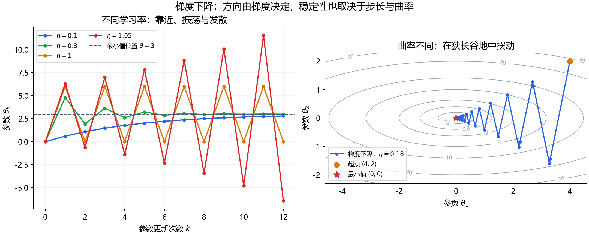

# 深度学习论文知识点整理

## 1. 高斯分布（Gaussian Distribution）

高斯分布又称**正态分布（Normal Distribution）**。一维情况下，它的概率密度曲线呈对称的钟形：样本更容易出现在均值附近，偏离均值越远，出现的可能性通常越小。

在生成模型中，高斯分布常用于构造噪声、初始化采样，以及定义给定数据样本后的条件分布。理解它，可以帮助阅读 DDPM 的加噪公式、SDE 的得分函数和 Flow Matching 的高斯条件概率路径。

### 1.1 一维高斯分布：均值、方差与标准差

记号：

$$
X \sim \mathcal{N}(\mu,\sigma^2),\qquad \sigma>0.
$$

其中 $X$ 是随机变量，$x$ 表示它可能取得的具体数值。

| 符号 | 名称 | 含义 |
| --- | --- | --- |
| $\mu$ | 均值 | 分布的中心，$\mathbb{E}[X]=\mu$ |
| $\sigma^2$ | 方差 | 偏离均值的平方的期望，$\operatorname{Var}(X)=\mathbb{E}[(X-\mu)^2]$ |
| $\sigma$ | 标准差 | 方差的平方根，与 $X$ 具有相同的单位 |

概率密度函数为：

$$
p(x)=\frac{1}{\sqrt{2\pi}\,\sigma}
\exp\left(-\frac{(x-\mu)^2}{2\sigma^2}\right).
$$

读公式时，可以将它拆成两部分：

- 指数项决定钟形曲线：$x$ 离 $\mu$ 越远，密度越小。
- 前面的系数保证曲线下的总面积等于 $1$。

改变 $\mu$ 会平移曲线；增大 $\sigma$ 会使曲线更宽、峰值更低。


**图 1：均值与方差如何改变高斯曲线。** 横轴是变量的取值，纵轴是概率密度。蓝、红、黄三条曲线的均值均为 $0$，方差分别为 $0.2$、$1$、$5$：方差越大，曲线越宽、峰值越低。绿线的均值为 $-2$、方差为 $0.5$，说明均值决定中心位置。每条曲线下的总面积都为 $1$。

例如，$X\sim\mathcal{N}(2,9)$ 表示均值为 $2$、方差为 $9$、标准差为 $3$。

> **概率密度不等于概率。** 连续高斯变量取某一个精确值的概率为 $0$。区间概率才是密度曲线下的面积：$P(a\le X\le b)=\int_a^b p(x)\,dx$。密度值本身可以大于 $1$。

### 1.2 标准高斯分布与标准化

**标准高斯分布**的均值为 $0$、方差为 $1$：

$$
Z\sim\mathcal{N}(0,1).
$$

普通高斯变量可以通过标准化变成标准高斯变量：

$$
Z=\frac{X-\mu}{\sigma}.
$$

反过来，先采样标准高斯噪声，再缩放和平移，就能得到目标高斯变量：

$$
X=\mu+\sigma Z.
$$

对于一维高斯分布，约有 $68.27\%$、$95.45\%$、$99.73\%$ 的概率分别落在 $\mu\pm\sigma$、$\mu\pm2\sigma$、$\mu\pm3\sigma$ 内。这些比例不直接表示高维样本落在相同半径球内的概率。


**图 2：概率对应曲线下的面积。** 图中的中心为 $0$，横轴按标准差标出区间。中心两块区域各约占 $34.1\%$，相加得到 $[-\sigma,\sigma]$ 内约 $68.2\%$ 的概率；再加上两侧各约 $13.6\%$ 的区域，就得到 $[-2\sigma,2\sigma]$ 内约 $95.4\%$ 的概率。图中百分比经过四舍五入，精确值以正文为准；曲线的高度本身不是区间概率。

### 1.3 多维高斯分布与协方差矩阵

图像有许多像素，通常需要使用多维随机变量。设 $\mathbf{x}\in\mathbb{R}^d$，记作：

$$
\mathbf{x}\sim\mathcal{N}(\boldsymbol{\mu},\boldsymbol{\Sigma}).
$$

- $\boldsymbol{\mu}\in\mathbb{R}^d$：均值向量，每个维度都有一个均值。
- $\boldsymbol{\Sigma}\in\mathbb{R}^{d\times d}$：协方差矩阵。
- $\Sigma_{ii}$：第 $i$ 个维度的方差。
- $\Sigma_{ij}=\mathbb{E}[(x_i-\mu_i)(x_j-\mu_j)]$：第 $i$、$j$ 个维度的协方差。

#### 协方差：两个变量如何一起变化？

对于具有有限二阶矩的随机变量 $X$ 和 $Y$，**协方差（covariance）** 定义为：

$$
\operatorname{Cov}(X,Y)
=\mathbb{E}\left[(X-\mathbb{E}[X])(Y-\mathbb{E}[Y])\right]
=\mathbb{E}[XY]-\mathbb{E}[X]\mathbb{E}[Y].
$$

可以按“减去均值 → 将偏差相乘 → 求平均”来理解这个公式。它衡量两个变量的**线性关联**：

| 协方差 | 偏差乘积的整体表现 | 直观含义 |
| --- | --- | --- |
| 大于 $0$ | 同号偏差占优势 | $X$ 高于自身均值时，$Y$ 也倾向于高于自身均值 |
| 小于 $0$ | 异号偏差占优势 | $X$ 高于自身均值时，$Y$ 倾向于低于自身均值 |
| 等于 $0$ | 正负乘积抵消 | 两者不相关，但仍可能存在非线性依赖 |

这种“倾向”是统计关系，并不意味着每个样本都满足同样的变化方向，也不能据此判断因果关系。

**方差是协方差的特殊情况**：

$$
\operatorname{Cov}(X,X)=\operatorname{Var}(X).
$$

两个常用性质是：

$$
\operatorname{Cov}(X,Y)=\operatorname{Cov}(Y,X),
\qquad
\operatorname{Cov}(aX+b,cY+d)=ac\operatorname{Cov}(X,Y).
$$

加上常数不会改变协方差；改变单位或缩放变量会改变其数值。例如，长度由米换成厘米后，与另一个变量的协方差会乘以 $100$。

> **协方差为零不代表独立。** 例如 $X\sim\mathcal{N}(0,1)$、$Y=X^2$，由对称性可得 $\operatorname{Cov}(X,Y)=0$，但 $Y$ 完全由 $X$ 决定。这里 $X$ 和 $Y$ 不构成联合高斯分布，因此不满足“联合高斯中不相关即独立”的条件。

#### 协方差与相关系数有什么区别？

协方差的单位是两个变量单位的乘积，其大小受尺度影响。因此，仅凭协方差的绝对值，不能比较不同单位或尺度下的关联强弱。

当两个变量的标准差都大于 $0$ 时，**皮尔逊相关系数**将协方差标准化：

$$
\rho_{XY}=
\frac{\operatorname{Cov}(X,Y)}{\sigma_X\sigma_Y},
\qquad -1\le\rho_{XY}\le1.
$$

它没有单位。$\rho$ 越接近 $1$ 或 $-1$，线性关联越强；$\rho=0$ 表示不相关。若某个变量的方差为 $0$，这个相关系数未定义。

例如，下方配图的协方差是 $0.6$，两维方差分别是 $1$ 和 $2$，所以相关系数是：

$$
\rho=\frac{0.6}{\sqrt{1}\sqrt{2}}\approx0.424.
$$

因此，图中的 $0.6$ 是**协方差**，并不是相关系数。

#### 协方差矩阵：把所有维度的关系放在一起

对于随机向量 $\mathbf{x}=(x_1,\ldots,x_d)^\top$，令 $\boldsymbol{\mu}=\mathbb{E}[\mathbf{x}]$，则：

$$
\boldsymbol{\Sigma}
=\mathbb{E}\left[(\mathbf{x}-\boldsymbol{\mu})(\mathbf{x}-\boldsymbol{\mu})^\top\right],
\qquad
\Sigma_{ij}=\operatorname{Cov}(x_i,x_j).
$$

列向量与其转置相乘得到一个 $d\times d$ 矩阵，也称为**外积**。二维情况下：

$$
\boldsymbol{\Sigma}=
\begin{pmatrix}
\operatorname{Var}(x_1)&\operatorname{Cov}(x_1,x_2)\\
\operatorname{Cov}(x_2,x_1)&\operatorname{Var}(x_2)
\end{pmatrix}.
$$

**推广到 $n$ 维：** 这里 $n$ 表示随机向量的维度，与前文的 $d$ 含义相同；后面样本估计公式中的 $n$ 则表示样本数量，阅读时需要按上下文区分。

设随机向量及其均值向量为：

$$
\mathbf{x}=\begin{pmatrix}x_1\\x_2\\\vdots\\x_n\end{pmatrix},
\qquad
\boldsymbol{\mu}=\begin{pmatrix}\mu_1\\\mu_2\\\vdots\\\mu_n\end{pmatrix},
\qquad \mu_i=\mathbb{E}[x_i].
$$

它的协方差矩阵是一个 $n\times n$ 矩阵，完整展开为：

$$
\boldsymbol{\Sigma}=
\begin{pmatrix}
\operatorname{Var}(x_1) & \operatorname{Cov}(x_1,x_2) & \cdots & \operatorname{Cov}(x_1,x_n) \\
\operatorname{Cov}(x_2,x_1) & \operatorname{Var}(x_2) & \cdots & \operatorname{Cov}(x_2,x_n) \\
\vdots & \vdots & \ddots & \vdots \\
\operatorname{Cov}(x_n,x_1) & \operatorname{Cov}(x_n,x_2) & \cdots & \operatorname{Var}(x_n)
\end{pmatrix}.
$$

也可以将每个元素写成偏差乘积的期望：

$$
\Sigma_{ij}=\mathbb{E}[(x_i-\mu_i)(x_j-\mu_j)],
\qquad i,j\in\{1,\ldots,n\}.
$$

读这个矩阵时，第 $i$ 行、第 $j$ 列表示 $x_i$ 与 $x_j$ 的协方差。主对角线包含 $n$ 个方差；非对角线包含不同维度之间的协方差。由于矩阵对称，$\Sigma_{ij}=\Sigma_{ji}$，只需要 $n(n+1)/2$ 个数就能确定整个矩阵，其中有 $n(n-1)/2$ 对不同维度的协方差；这些数仍须满足半正定条件。

例如三维情况下：

$$
\boldsymbol{\Sigma}=
\begin{pmatrix}
\sigma_1^2 & c_{12} & c_{13}\\
 c_{12} & \sigma_2^2 & c_{23}\\
 c_{13} & c_{23} & \sigma_3^2
\end{pmatrix},
\qquad c_{ij}=\operatorname{Cov}(x_i,x_j).
$$

如果所有不同维度之间的协方差均为 $0$，矩阵就变为 $\operatorname{diag}(\sigma_1^2,\ldots,\sigma_n^2)$。如果各维度的方差进一步都相同，则为 $\boldsymbol{\Sigma}=\sigma^2\mathbf{I}_n$，其中 $\mathbf{I}_n$ 是 $n$ 阶单位矩阵。对于联合高斯分布，这两种对角形式都意味着各维度相互独立；一般分布只能据此判断各维度不相关。

协方差矩阵具有以下性质：

- **对称**：$\Sigma_{ij}=\Sigma_{ji}$。
- **对角元素非负**：因为它们都是方差。
- **半正定**：任意向量 $\mathbf{v}$ 都满足 $\mathbf{v}^\top\boldsymbol{\Sigma}\mathbf{v}=\operatorname{Var}(\mathbf{v}^\top\mathbf{x})\ge0$。这表示沿任意方向观察，方差都不会为负。

若每个非零方向的方差都大于 $0$，矩阵为**正定**，可以求逆。若某个非零方向的方差为 $0$，矩阵是奇异的。例如 $x_2=2x_1$ 时，$x_2-2x_1$ 恒为 $0$，二维样本被限制在一条直线上；这时不能直接使用下方含有 $\boldsymbol{\Sigma}^{-1}$ 的普通二维密度公式。

二维情况下，还必须满足：

$$
\operatorname{Cov}(x_1,x_2)^2
\le\operatorname{Var}(x_1)\operatorname{Var}(x_2).
$$

因此，不能随意填写一个对称矩阵作为协方差矩阵。例如 $\begin{pmatrix}1&2\\2&1\end{pmatrix}$ 不合法，因为 $2^2>1\times1$。

| 矩阵形式 | 方差与关联 | 二维高斯等密度线 |
| --- | --- | --- |
| $\sigma^2\mathbf{I}$，$\sigma>0$ | 各维度方差相同，协方差为零 | 圆形 |
| 正定对角矩阵，对角元素不全相同 | 方差不同，协方差为零 | 与坐标轴对齐的椭圆 |
| 正定矩阵，非对角元素非零 | 维度之间存在相关性 | 倾斜的椭圆 |

更一般地，将正定矩阵分解为 $\boldsymbol{\Sigma}=\mathbf{Q}\boldsymbol{\Lambda}\mathbf{Q}^\top$，其中 $\mathbf{Q}$ 的列是单位特征向量、$\boldsymbol{\Lambda}$ 的对角元素是特征值。**特征向量决定椭圆主轴的方向，特征值决定这些方向上的方差**；同一等密度线的半轴长度与对应特征值的平方根成正比。

#### 如何从样本计算协方差与协方差矩阵？

假设有 $n\ge2$ 对观测 $(x_k,y_k)$，样本均值分别为 $\bar{x}$、$\bar{y}$。常用的样本协方差为：

$$
\widehat{\operatorname{Cov}}(X,Y)
=\frac{1}{n-1}\sum_{k=1}^{n}(x_k-\bar{x})(y_k-\bar{y}).
$$

对于独立同分布且具有有限二阶矩的样本，使用 $n-1$ 可得到总体协方差的无偏估计。若计算的是这 $n$ 个点构成的等权经验分布的协方差，则分母使用 $n$。阅读公式或代码时，应确认采用了哪种约定。

例如，观测为 $(1,1)$、$(2,3)$、$(3,2)$：

| 样本 | $x_k-\bar{x}$ | $y_k-\bar{y}$ | 偏差乘积 |
| --- | --- | --- | --- |
| $(1,1)$ | $-1$ | $-1$ | $1$ |
| $(2,3)$ | $0$ | $1$ | $0$ |
| $(3,2)$ | $1$ | $0$ | $0$ |

这里 $\bar{x}=\bar{y}=2$，所以样本协方差为 $(1+0+0)/(3-1)=0.5$。两维的样本方差都为 $1$，样本协方差矩阵为：

$$
\widehat{\boldsymbol{\Sigma}}
=\begin{pmatrix}1&0.5\\0.5&1\end{pmatrix}.
$$

对一般的 $d$ 维样本，令数据矩阵 $\mathbf{D}\in\mathbb{R}^{n\times d}$ 的每一行是一个样本，每一列是一个特征。将每列减去该列的样本均值，得到中心化矩阵 $\mathbf{C}$，则：

$$
\widehat{\boldsymbol{\Sigma}}=\frac{\mathbf{C}^\top\mathbf{C}}{n-1}.
$$

结果是 $d\times d$ 矩阵，描述**特征之间**的协方差。当维度较高、样本数量不足时，这个估计矩阵可能不可逆；例如 $d\ge n$ 时，中心化后的样本协方差矩阵必然奇异。

#### 回到多维高斯分布的公式与配图

当 $\boldsymbol{\Sigma}$ 为正定矩阵时，概率密度为：

$$
p(\mathbf{x})=
\frac{1}{(2\pi)^{d/2}|\boldsymbol{\Sigma}|^{1/2}}
\exp\left[-\frac12
(\mathbf{x}-\boldsymbol{\mu})^\top
\boldsymbol{\Sigma}^{-1}
(\mathbf{x}-\boldsymbol{\mu})\right].
$$

这里 $|\boldsymbol{\Sigma}|$ 是行列式，$\boldsymbol{\Sigma}^{-1}$ 是逆矩阵，$\top$ 表示转置。指数中的二次型衡量相对于协方差尺度的距离。

论文中最常见的两种形式是：

$$
\mathcal{N}(\mathbf{0},\mathbf{I}),
\qquad
\mathcal{N}(\boldsymbol{\mu},\sigma^2\mathbf{I}).
$$

$\mathbf{I}$ 是单位矩阵。第二种形式称为**各向同性高斯分布**：每个方向的方差相同，各维度相互独立。第一种是多维标准高斯分布。


**图 3：二维高斯分布与边缘分布。** 底面的黑点是二维样本，绿色椭圆是一条等密度线；两侧墙面的柱状图统计每个坐标单独的取值，红、蓝曲线是相应的一维高斯边缘密度。这里“边缘”表示忽略另一个坐标，只观察当前坐标，并非椭圆边界。

本图使用均值 $\boldsymbol{\mu}=(0,0)^\top$ 和协方差矩阵：

$$
\boldsymbol{\Sigma}=\begin{pmatrix}1&0.6\\0.6&2\end{pmatrix}.
$$

对角线上的 $1$ 和 $2$ 表示两个维度的方差不同；非对角线上的 $0.6$ 表示正协方差，所以点云呈倾斜的椭圆形。若换成 $\sigma^2\mathbf{I}$，二维等密度线会变成圆形。

> 对于**联合高斯分布**，协方差为零的维度相互独立。一般分布中，“不相关”不能推出“独立”；仅仅每个维度单独服从高斯分布，也不保证它们联合服从高斯分布。

### 1.4 为什么高斯噪声容易计算？

#### 仿射变换后仍是高斯分布

若 $\mathbf{x}\sim\mathcal{N}(\boldsymbol{\mu},\boldsymbol{\Sigma})$，则：

$$
\mathbf{y}=\mathbf{A}\mathbf{x}+\mathbf{b}
\quad\Longrightarrow\quad
\mathbf{y}\sim\mathcal{N}
(\mathbf{A}\boldsymbol{\mu}+\mathbf{b},
\mathbf{A}\boldsymbol{\Sigma}\mathbf{A}^\top).
$$

一维情况下，$Y=aX+b$ 的均值为 $a\mu+b$，方差为 $a^2\sigma^2$。**缩放随机变量时，方差乘以缩放系数的平方。**

#### 独立高斯变量相加后仍是高斯分布

若 $X\sim\mathcal{N}(\mu_1,\sigma_1^2)$、$Y\sim\mathcal{N}(\mu_2,\sigma_2^2)$ 且二者独立，则：

$$
aX+bY\sim\mathcal{N}
(a\mu_1+b\mu_2,\ a^2\sigma_1^2+b^2\sigma_2^2).
$$

这解释了为什么可以合并 DDPM 中多个时间步的高斯噪声，并得到直接采样任意时间步的公式。独立性很关键；若 $X=Y$，相加时就不能直接相加方差。

### 1.5 高斯采样与重参数化

对各向同性高斯分布，可以写成：

$$
\boldsymbol{\epsilon}\sim\mathcal{N}(\mathbf{0},\mathbf{I}),
\qquad
\mathbf{x}=\boldsymbol{\mu}+\sigma\boldsymbol{\epsilon}.
$$

这称为**重参数化**：将随机性放在 $\boldsymbol{\epsilon}$ 中，均值和标准差通过确定性的运算控制输出，便于对这些参数求导。

一般协方差情形可以使用 $\boldsymbol{\Sigma}=\mathbf{L}\mathbf{L}^\top$，再令 $\mathbf{x}=\boldsymbol{\mu}+\mathbf{L}\boldsymbol{\epsilon}$；正定协方差可通过 Cholesky 分解得到 $\mathbf{L}$。

PyTorch 示例：

```python
import torch

# 一维高斯：均值 2，标准差 3，因此方差为 9
samples = 2.0 + 3.0 * torch.randn(10000)

# 假设 x0 是一个浮点图像张量：生成相同形状的标准高斯噪声
# epsilon = torch.randn_like(x0)
```

有限样本的样本均值、样本方差通常只接近理论值，不会恰好等于理论值。另需注意：$\mathcal{N}(\mu,\sigma^2)$ 的第二项是方差，而 PyTorch 的 torch.distributions.Normal(loc, scale) 中 scale 是标准差。

### 1.6 与 DDPM 的关系：如何读懂加噪公式

对应：[DDPM 中文翻译](DDPM_中文翻译.md)，第 2 节、式（2）与式（4）。

#### 一步加噪

$$
q(\mathbf{x}_t\mid\mathbf{x}_{t-1})=
\mathcal{N}\left(
\sqrt{1-\beta_t}\,\mathbf{x}_{t-1},
\beta_t\mathbf{I}
\right).
$$

固定 $\mathbf{x}_{t-1}$ 后，这个条件高斯分布的均值是 $\sqrt{1-\beta_t}\mathbf{x}_{t-1}$，每个维度的方差是 $\beta_t$。等价采样方式为：

$$
\mathbf{x}_t=
\sqrt{1-\beta_t}\,\mathbf{x}_{t-1}
+\sqrt{\beta_t}\,\boldsymbol{\epsilon}_t,
\qquad
\boldsymbol{\epsilon}_t\sim\mathcal{N}(\mathbf{0},\mathbf{I}).
$$

各时间步使用独立的新噪声。这里乘的是 $\sqrt{\beta_t}$，因为噪声的**标准差**是方差的平方根。

#### 从原始数据直接加噪到第 $t$ 步

定义：

$$
\alpha_t=1-\beta_t,
\qquad
\bar\alpha_t=\prod_{s=1}^t\alpha_s.
$$

利用高斯分布的仿射变换和独立相加性质，可以得到：

$$
q(\mathbf{x}_t\mid\mathbf{x}_0)=
\mathcal{N}\left(
\sqrt{\bar\alpha_t}\,\mathbf{x}_0,
(1-\bar\alpha_t)\mathbf{I}
\right).
$$

等价地：

$$
\boxed{
\mathbf{x}_t=
\sqrt{\bar\alpha_t}\,\mathbf{x}_0
+\sqrt{1-\bar\alpha_t}\,\boldsymbol{\epsilon},
\qquad
\boldsymbol{\epsilon}\sim\mathcal{N}(\mathbf{0},\mathbf{I})
}
$$

第一项保留数据的信号，第二项引入噪声。在 $\beta_t\in(0,1)$ 的调度下，$\bar\alpha_t$ 随时间步增加而减小；当它足够接近 $0$ 时，分布接近标准高斯噪声。这让训练时可以直接采样指定的 $\mathbf{x}_t$，无需逐步模拟前面的所有加噪步骤。

例如，若 $\bar\alpha_t=0.64$，则 $\mathbf{x}_t=0.8\mathbf{x}_0+0.6\boldsymbol{\epsilon}$。给定 $\mathbf{x}_0$ 时，噪声方差是 $0.36$。

> **条件分布为高斯，不代表整体数据分布为高斯。** 固定 $\mathbf{x}_0$ 时，$q(\mathbf{x}_t\mid\mathbf{x}_0)$ 是高斯；对所有数据样本求平均得到的边缘分布 $q(\mathbf{x}_t)$ 通常不是单个高斯分布。独立的像素噪声也不意味着真实图像的像素相互独立。

### 1.7 对数密度、得分函数与平方误差

#### 高斯分布的得分函数

生成模型中的“得分（score）”指**对数概率密度对样本的梯度**：

$$
\mathbf{s}(\mathbf{x})=\nabla_{\mathbf{x}}\log p(\mathbf{x}).
$$

对正定协方差的高斯分布：

$$
\nabla_{\mathbf{x}}\log p(\mathbf{x})
=-\boldsymbol{\Sigma}^{-1}(\mathbf{x}-\boldsymbol{\mu}).
$$

各向同性情况下：

$$
\nabla_{\mathbf{x}}\log p(\mathbf{x})
=-\frac{\mathbf{x}-\boldsymbol{\mu}}{\sigma^2}.
$$

它指向均值；方差越小，同样偏移对应的梯度幅度越大。这里的梯度是对样本 $\mathbf{x}$ 求导，与训练时对模型参数求梯度不同。

对应：[SDE 中文翻译](SDE_中文翻译.md)，第 2.1 节。给定干净样本 $\mathbf{x}_0$，若：

$$
\tilde{\mathbf{x}}=\mathbf{x}_0+\sigma\boldsymbol{\epsilon},
$$

则条件扰动核的得分有闭式表达式：

$$
\nabla_{\tilde{\mathbf{x}}}
\log p_\sigma(\tilde{\mathbf{x}}\mid\mathbf{x}_0)
=-\frac{\tilde{\mathbf{x}}-\mathbf{x}_0}{\sigma^2}
=-\frac{\boldsymbol{\epsilon}}{\sigma}.
$$

训练时这个条件得分可作为监督目标；在理想的最优回归情形下，只接收带噪样本和噪声尺度的网络学到的是**边缘带噪分布的得分**。边缘分布通常不是单个高斯，因此不能直接把它的得分写成“指向某一个固定数据样本”的公式。

#### 为什么常见平方误差损失？

若模型使用固定协方差 $\sigma^2\mathbf{I}$ 的高斯分布预测目标 $\mathbf{y}$，则负对数似然为：

$$
-\log p_\theta(\mathbf{y}\mid\mathbf{x})
=\frac{d}{2}\log(2\pi\sigma^2)
+\frac{1}{2\sigma^2}
\left\|\mathbf{y}-\boldsymbol{\mu}_\theta(\mathbf{x})\right\|_2^2.
$$

方差固定时，第一项与模型参数无关，优化均值等价于最小化平方误差。若方差也被学习，就需要保留方差相关项。

DDPM 中，高斯之间的 KL 散度与噪声预测参数化会导出带权平方误差；论文的简化训练目标再调整了时间步权重。因此，“高斯似然与平方误差有关”是理解入口，完整 DDPM 目标还涉及变分界和权重选择。

### 1.8 与 Flow Matching 的关系：高斯条件概率路径

对应：[Flow Matching 中文翻译](Flow-matching_中文翻译.md)，第 4 节、式（10）与式（11）。

给定目标数据样本 $\mathbf{x}_1$，可以构造随时间变化的条件分布：

$$
p_t(\mathbf{x}\mid\mathbf{x}_1)=
\mathcal{N}\left(
\boldsymbol{\mu}_t(\mathbf{x}_1),
\sigma_t(\mathbf{x}_1)^2\mathbf{I}
\right).
$$

采样方式为：

$$
\mathbf{x}_t=
\boldsymbol{\mu}_t(\mathbf{x}_1)
+\sigma_t(\mathbf{x}_1)\boldsymbol{\epsilon},
\qquad
\boldsymbol{\epsilon}\sim\mathcal{N}(\mathbf{0},\mathbf{I}).
$$

在这篇论文的记号中，$t=0$ 对应标准高斯噪声，$t=1$ 对应集中在数据样本附近的分布；这与 DDPM 前向加噪过程的时间方向不同。均值函数决定分布中心的移动，标准差函数决定分布的扩散或收缩。若终点标准差 $\sigma_{\min}>0$，终点仍保留少量噪声。

这里高斯的是**给定 $\mathbf{x}_1$ 的条件路径**；对数据样本求边缘化后，整体概率路径通常不是单个高斯分布。

### 1.9 自查问题

1. $\mathcal{N}(0,4)$ 的标准差是多少？——$2$。
2. 若 $\epsilon\sim\mathcal{N}(0,1)$，$3\epsilon$ 的方差是多少？——$9$。
3. 为什么 DDPM 中噪声系数是 $\sqrt{\beta_t}$？——因为 $\beta_t$ 是方差。
4. $\mathcal{N}(\boldsymbol{\mu},\sigma^2\mathbf{I})$ 中的 $\mathbf{I}$ 表示什么？——各维度方差相同，协方差为零；联合高斯情况下各维度独立。
5. 给定一张图像后的加噪分布是高斯，是否意味着整个图像数据集服从高斯分布？——不意味着，条件分布与边缘分布需要区分。

后续可继续学习：条件概率、贝叶斯公式、高斯条件分布、KL 散度、马尔可夫链、重参数化技巧、得分匹配。

## 2. 马尔可夫链（Markov Chain）

马尔可夫链是一种描述**状态如何随时间随机变化**的模型，也常写作“马尔科夫链”。它的核心是：**给定当前状态后，下一步的条件分布不再需要更早的历史状态。**

在 DDPM 中，一张图像的完整像素张量可以看作一个状态。前向过程逐步加噪，反向过程逐步生成，两者都通过相邻状态之间的条件分布组成一条链。

### 2.1 马尔可夫性质：如何理解“只依赖当前状态”？

设随机状态序列为 $X_0,X_1,\ldots,X_T$。一阶马尔可夫性质写成：

$$
P(X_{t+1}\in A\mid X_t,X_{t-1},\ldots,X_0)
=P(X_{t+1}\in A\mid X_t).
$$

其中 $A$ 是可能的下一状态构成的集合。这种写法适用于离散和连续状态；离散情况下，也可直接写下一状态等于某个取值的概率。

可以用下面的结构理解信息传递：

$$
X_0\longrightarrow X_1\longrightarrow X_2\longrightarrow\cdots\longrightarrow X_T.
$$

**“无记忆”指条件分布，而不是状态完全没有历史信息。** 当前状态可以携带过去的影响；只是在已知它之后，更早的状态不再为预测下一步提供额外信息。

例如，假设天气只分为“晴”和“雨”，并人为设定明天的天气概率只由今天决定，这就是一个简单的马尔可夫模型。真实天气还受到气压、湿度等因素影响，因此这个例子是建模假设。

> 马尔可夫性质不意味着相邻状态独立。若今天晴天时明天更容易晴天，今天和明天显然有关联。它表达的是：下一状态与更早的历史在给定当前状态后条件独立。

### 2.2 离散状态：转移概率与转移矩阵

假设状态空间为 $\{s_1,\ldots,s_m\}$。从状态 $s_i$ 转移到状态 $s_j$ 的概率为：

$$
P_{ij}=P(X_{t+1}=s_j\mid X_t=s_i).
$$

如果转移规则不随时间 $t$ 改变，称为**时间齐次马尔可夫链**。采用“行是当前状态，列是下一状态”的约定，转移矩阵为：

$$
\mathbf{P}=
\begin{pmatrix}
P_{11}&P_{12}&\cdots&P_{1m}\\
P_{21}&P_{22}&\cdots&P_{2m}\\
\vdots&\vdots&\ddots&\vdots\\
P_{m1}&P_{m2}&\cdots&P_{mm}
\end{pmatrix},
\qquad P_{ij}\ge0,\qquad\sum_{j=1}^mP_{ij}=1.
$$

每行之和为 $1$，因为从当前状态出发，下一步总要落入某个状态。

天气模型的例子，按“晴、雨”的顺序排列：

$$
\mathbf{P}=\begin{pmatrix}0.8&0.2\\0.4&0.6\end{pmatrix}.
$$

| 今天的状态 | 明天晴的概率 | 明天雨的概率 |
| --- | --- | --- |
| 晴 | $0.8$ | $0.2$ |
| 雨 | $0.4$ | $0.6$ |

转移矩阵描述的是**条件概率**，还需要初始状态或初始分布，才能确定整条链的概率规律。

若今天的状态分布用行向量表示为 $\boldsymbol{\pi}_t$，则明天的分布是：

$$
\boldsymbol{\pi}_{t+1}=\boldsymbol{\pi}_t\mathbf{P}.
$$

例如，已知今天晴，即 $\boldsymbol{\pi}_t=(1,0)$，则明天的分布为 $(0.8,0.2)$。这里是把所有可能的下一状态及其概率列出来；实际运行一次链时，只会随机采样得到其中一个状态。

### 2.3 多步转移与联合分布

#### 为什么两步转移使用矩阵平方？

从状态 $s_i$ 经过两步到达 $s_j$，需要对所有可能的中间状态求和：

$$
P(X_{t+2}=s_j\mid X_t=s_i)
=\sum_{k=1}^mP_{ik}P_{kj}
=(\mathbf{P}^2)_{ij}.
$$

这体现了**全概率公式**：不知道中间状态，就将经过不同中间状态的路径概率加起来。

在天气例子中，今天晴，后天晴有两条路径：

- 晴 → 晴 → 晴：概率为 $0.8\times0.8=0.64$。
- 晴 → 雨 → 晴：概率为 $0.2\times0.4=0.08$。

相加得到 $0.72$。完整的两步转移矩阵为：

$$
\mathbf{P}^2=\begin{pmatrix}0.72&0.28\\0.56&0.44\end{pmatrix}.
$$

对于齐次链，$k$ 步转移由 $\mathbf{P}^k$ 给出。若每一步的矩阵不同，记为 $\mathbf{P}_t$，则称为**时间非齐次链**，需要按时间顺序相乘：

$$
\boldsymbol{\pi}_{t+k}
=\boldsymbol{\pi}_t\mathbf{P}_t\mathbf{P}_{t+1}\cdots\mathbf{P}_{t+k-1}.
$$

#### 一整条路径的概率如何计算？

利用概率的链式法则与马尔可夫性质：

$$
p(x_0,x_1,\ldots,x_T)
=p_0(x_0)\prod_{t=1}^Tp(x_t\mid x_{t-1}).
$$

也就是**初始分布乘以每一步的转移分布**。离散状态下这是路径的概率；连续状态下，这个乘积表示路径的联合概率密度。

这与“所有状态独立”的 $\prod_{t=0}^Tp_t(x_t)$ 不同：马尔可夫链保留了相邻状态之间的依赖。

### 2.4 平稳分布：分布不变，不代表状态不变

对于齐次离散链，若一个概率行向量满足：

$$
\boldsymbol{\pi}_*=\boldsymbol{\pi}_*\mathbf{P},
\qquad \sum_i\pi_{*,i}=1,
$$

则称它为**平稳分布（stationary distribution）**。从这个分布初始化，经过一步转移，整体状态分布仍然相同；具体采样出来的状态可以继续变化。

天气例子的平稳分布是 $\boldsymbol{\pi}_*=(2/3,1/3)$，因为：

$$
(2/3,1/3)\begin{pmatrix}0.8&0.2\\0.4&0.6\end{pmatrix}
=(2/3,1/3).
$$

**存在平稳分布，不保证从任意初始分布都收敛到它。** 对有限状态齐次链，若它不可约（任意状态间都有机会经过若干步到达）且非周期，则有唯一平稳分布，并且状态分布从任意初始分布出发都会收敛到它。

例如，转移矩阵 $\begin{pmatrix}0&1\\1&0\end{pmatrix}$ 让两个状态每一步轮流切换。它有平稳分布 $(1/2,1/2)$，但从第一个状态确定地出发时，分布会来回交替，并不收敛。

平稳分布常用于理解马尔可夫链蒙特卡洛（MCMC）。DDPM 使用随时间变化的有限步噪声调度，不能直接套用上述齐次链的矩阵幂和平稳分布结论。

### 2.5 连续状态：从转移矩阵到转移核

图像张量的取值通常建模为连续变量，不能用一个有限大小的矩阵枚举所有图像状态。这时使用**转移核（transition kernel）**：

$$
K_t(\mathbf{x},A)
=P(\mathbf{X}_{t+1}\in A\mid\mathbf{X}_t=\mathbf{x}).
$$

若存在条件密度，可以写作 $p_t(\mathbf{x}'\mid\mathbf{x})$，并满足：

$$
p_t(\mathbf{x}'\mid\mathbf{x})\ge0,
\qquad
\int p_t(\mathbf{x}'\mid\mathbf{x})\,d\mathbf{x}'=1.
$$

离散状态中对中间状态“求和”，在连续状态中就对应“积分”。例如两步转移的密度为：

$$
p(\mathbf{x}_{t+2}\mid\mathbf{x}_t)
=\int p(\mathbf{x}_{t+2}\mid\mathbf{x}_{t+1})
\,p(\mathbf{x}_{t+1}\mid\mathbf{x}_t)\,d\mathbf{x}_{t+1}.
$$

这就是 Chapman–Kolmogorov 关系在两步转移中的形式。上一节 DDPM 的直接加噪公式，可以理解为利用高斯转移的特殊性质，把多步积分的结果写成闭式表达式。

### 2.6 与 DDPM 的关系：前向加噪链与反向生成链

对应：[DDPM 中文翻译](DDPM_中文翻译.md)，第 2 节、式（1）与式（2）。

#### 前向过程：固定的高斯转移

$$
\mathbf{x}_0\longrightarrow\mathbf{x}_1\longrightarrow\cdots\longrightarrow\mathbf{x}_T,
$$

$$
q(\mathbf{x}_{1:T}\mid\mathbf{x}_0)
=\prod_{t=1}^Tq(\mathbf{x}_t\mid\mathbf{x}_{t-1}),
$$

$$
q(\mathbf{x}_t\mid\mathbf{x}_{t-1})
=\mathcal{N}\left(
\sqrt{1-\beta_t}\,\mathbf{x}_{t-1},\beta_t\mathbf{I}
\right).
$$

在给定噪声调度后，每一步只使用当前带噪图像和独立的新噪声：

$$
\mathbf{x}_t=\sqrt{1-\beta_t}\,\mathbf{x}_{t-1}
+\sqrt{\beta_t}\,\boldsymbol{\epsilon}_t,
\qquad \boldsymbol{\epsilon}_t\sim\mathcal{N}(\mathbf{0},\mathbf{I}).
$$

因此，给定 $\mathbf{x}_{t-1}$ 后，不需要额外读取 $\mathbf{x}_{t-2},\ldots,\mathbf{x}_0$。当 $\beta_t$ 随时间改变时，这是时间非齐次的连续状态马尔可夫链。

这里的状态是**整张带噪图像**，不是单个像素；马尔可夫性质描述时间步之间的关系，不表示图像像素相互独立。

#### 反向过程：学习相邻状态的条件分布

$$
\mathbf{x}_T\longrightarrow\mathbf{x}_{T-1}\longrightarrow\cdots\longrightarrow\mathbf{x}_0,
$$

$$
p_\theta(\mathbf{x}_{0:T})
=p(\mathbf{x}_T)\prod_{t=1}^Tp_\theta(\mathbf{x}_{t-1}\mid\mathbf{x}_t),
\qquad p(\mathbf{x}_T)=\mathcal{N}(\mathbf{0},\mathbf{I}).
$$

DDPM 将反向转移参数化为：

$$
p_\theta(\mathbf{x}_{t-1}\mid\mathbf{x}_t)
=\mathcal{N}\left(
\boldsymbol{\mu}_\theta(\mathbf{x}_t,t),
\boldsymbol{\Sigma}_\theta(\mathbf{x}_t,t)
\right).
$$

网络以当前图像和时间步为输入，参数化下一步的高斯分布；方差可按模型设计固定或学习。每次从该分布采样，逐步得到最终图像。实际实现中常让网络预测噪声，再用预测噪声计算上述均值。

**反向转移不能简单把前向公式的箭头倒过来。** 在密度有定义且分母大于 $0$ 处，贝叶斯公式给出真实反向转移：

$$
q(\mathbf{x}_{t-1}\mid\mathbf{x}_t)
=\frac{
q(\mathbf{x}_t\mid\mathbf{x}_{t-1})q_{t-1}(\mathbf{x}_{t-1})
}{q_t(\mathbf{x}_t)}.
$$

其中 $q_{t-1}$、$q_t$ 是对应时间步的边缘分布。前向高斯转移已知，但数据相关的边缘分布通常很复杂，因此需要学习反向过程。真实反向转移通常也不是精确的单个高斯；DDPM 用高斯形式建模它。

#### 为什么训练推导还会出现原始图像 $\mathbf{x}_0$？

论文会使用 $q(\mathbf{x}_{t-1}\mid\mathbf{x}_t,\mathbf{x}_0)$。它是在已知干净图像的前提下，再推断上一步状态的**条件后验**，在 DDPM 中可以写成高斯分布。

这不违反前向链的马尔可夫性质：前向性质约束的是 $q(\mathbf{x}_t\mid\mathbf{x}_{t-1},\ldots,\mathbf{x}_0)$；从当前状态反推过去、并额外给定起点，是另一种条件推断问题。训练时有真实 $\mathbf{x}_0$ 可用，生成时则使用学习得到的 $p_\theta(\mathbf{x}_{t-1}\mid\mathbf{x}_t)$。

### 2.7 自查问题

1. 马尔可夫性质是否表示相邻状态独立？——不表示；它强调给定当前状态后，下一步不再需要更早的历史。
2. 转移矩阵的每一行为什么加起来等于 $1$？——同一当前状态对应的所有下一状态概率之和为 $1$。
3. 为什么两步转移需要对中间状态求和或积分？——中间状态未知，需要把经过所有可能中间状态的路径合并。
4. 所有马尔可夫链都能用同一个矩阵 $\mathbf{P}$ 的幂计算多步转移吗？——不能；时间非齐次链需要按顺序使用不同的转移规则。
5. 平稳分布是否表示状态停止变化？——不是，它表示整体概率分布经过转移后保持不变。
6. DDPM 的反向生成是否直接使用真实图像 $\mathbf{x}_0$？——不是，训练时可以使用真实图像，生成时从噪声出发，使用学习得到的反向转移。

后续可继续学习：条件独立、全概率公式、贝叶斯公式、Chapman–Kolmogorov 方程、MCMC、随机微分方程。

## 3. 梯度下降（Gradient Descent）

梯度下降是一种**通过反复调整参数，让目标函数逐步变小**的优化方法。在深度学习中，目标函数通常是损失函数，参数是神经网络的权重和偏置。

可以把损失想象成地形的高度，把模型参数想象成地形上的位置：先判断当前位置向哪个方向走会降低高度，再走一小步，重复这个过程。这个比喻描述的是局部变化；复杂的损失曲面上，梯度下降不保证找到全局最低点。

阅读 DDPM、SDE 和 Flow Matching 时，需要分清两个问题：**训练时如何更新网络参数**，以及**生成时如何更新样本**。本节先介绍前者，再解释它与生成模型中其他梯度的区别。

### 3.1 优化目标、导数与梯度

设模型参数向量为 $\boldsymbol{\theta}\in\mathbb{R}^p$，损失函数为 $\mathcal{L}(\boldsymbol{\theta})$，训练目标写作：

$$
\min_{\boldsymbol{\theta}}\mathcal{L}(\boldsymbol{\theta}).
$$

例如，对于含 $N$ 个训练样本的数据集，可以使用平均损失：

$$
\mathcal{L}(\boldsymbol{\theta})
=\frac{1}{N}\sum_{i=1}^{N}
\ell\bigl(f_{\boldsymbol{\theta}}(\mathbf{x}_i),\mathbf{y}_i\bigr).
$$

其中 $f_{\boldsymbol{\theta}}$ 是模型，$\ell$ 衡量单个样本的预测误差，$\mathbf{x}_i$ 和 $\mathbf{y}_i$ 分别是输入和目标。生成模型的目标也可以是随机采样的噪声、得分或速度，并不一定是人工标注的类别。

**一个参数时看导数，多个参数时看梯度。** 对标量参数 $\theta$，导数 $\mathcal{L}'(\theta)$ 描述参数发生微小变化时，损失如何变化。对多个参数，梯度将各个偏导数组成列向量：

$$
\nabla_{\boldsymbol{\theta}}\mathcal{L}
=\begin{pmatrix}
\dfrac{\partial\mathcal{L}}{\partial\theta_1}\\
\dfrac{\partial\mathcal{L}}{\partial\theta_2}\\
\vdots\\
\dfrac{\partial\mathcal{L}}{\partial\theta_p}
\end{pmatrix}.
$$

偏导数表示暂时固定其他参数，只改变当前参数时的局部变化率。例如，$\partial\mathcal{L}/\partial\theta_j>0$，表示在足够小的范围内，增大 $\theta_j$ 会增大损失，因此应减小它。

这里 $p$ 表示参数数量，与前文图像或随机向量的维度 $d$ 不同。实际神经网络的参数由许多张量组成，公式中将它们统一看作一个长向量。

### 3.2 更新公式：为什么沿负梯度方向走？

第 $k$ 次更新的基本公式是：

$$
\boxed{
\boldsymbol{\theta}_{k+1}
=\boldsymbol{\theta}_k
-\eta_k\nabla_{\boldsymbol{\theta}}
\mathcal{L}(\boldsymbol{\theta}_k)
}
$$

| 符号 | 含义 |
| --- | --- |
| $k$ | 优化器更新的次数，从 $0$ 开始计数 |
| $\boldsymbol{\theta}_k$ | 更新前的模型参数 |
| $\nabla_{\boldsymbol{\theta}}\mathcal{L}(\boldsymbol{\theta}_k)$ | 在当前参数处计算的损失梯度 |
| $\eta_k>0$ | 学习率（learning rate），控制更新的尺度 |
| $\boldsymbol{\theta}_{k+1}$ | 更新后的模型参数 |

负号来自**一阶泰勒展开**。设参数变化为 $\Delta\boldsymbol{\theta}$，在变化足够小时：

$$
\mathcal{L}(\boldsymbol{\theta}+\Delta\boldsymbol{\theta})
\approx\mathcal{L}(\boldsymbol{\theta})
+\nabla\mathcal{L}(\boldsymbol{\theta})^\top
\Delta\boldsymbol{\theta}.
$$

代入 $\Delta\boldsymbol{\theta}=-\eta\nabla\mathcal{L}(\boldsymbol{\theta})$：

$$
\mathcal{L}(\boldsymbol{\theta}-\eta\nabla\mathcal{L})
\approx\mathcal{L}(\boldsymbol{\theta})
-\eta\|\nabla\mathcal{L}(\boldsymbol{\theta})\|_2^2.
$$

只要梯度非零，右侧的一阶变化就是负的。在**欧氏距离下、固定微小步长**的方向中，负梯度是使一阶近似下降最快的方向。

> **“下降方向”不等于任意步长都能下降。** 泰勒展开是局部近似，学习率过大时，高阶项不能忽略，可能越过低点甚至使损失增大。小批量训练使用的还是随机梯度，因此单次更新后的完整训练损失也不保证下降。

### 3.3 一个算得出的例子：学习率如何影响收敛？

考虑一维损失：

$$
\mathcal{L}(\theta)=(\theta-3)^2,
\qquad
\mathcal{L}'(\theta)=2(\theta-3).
$$

最小值位于 $\theta=3$。若从 $\theta_0=0$ 出发，使用固定学习率 $\eta=0.1$，则：

$$
\theta_{k+1}=\theta_k-0.1\times2(\theta_k-3).
$$

| 更新次数 $k$ | 当前参数 $\theta_k$ | 当前损失 $\mathcal{L}(\theta_k)$ | 当前梯度 $\mathcal{L}'(\theta_k)$ |
| --- | --- | --- | --- |
| $0$ | $0$ | $9$ | $-6$ |
| $1$ | $0.6$ | $5.76$ | $-4.8$ |
| $2$ | $1.08$ | $3.6864$ | $-3.84$ |
| $3$ | $1.464$ | $2.359296$ | $-3.072$ |

起点的梯度为负，所以“减去梯度”会让参数增大，朝 $3$ 靠近。随着接近最小值，梯度变小，同一学习率对应的实际更新幅度也变小。

令误差 $e_k=\theta_k-3$，更新可以写为：

$$
e_{k+1}=(1-2\eta)e_k.
$$

因此，这个例子可以精确判断学习率的影响：

| 学习率范围 | 参数的变化 |
| --- | --- |
| $0<\eta<0.5$ | 从同一侧逐步靠近最小值；学习率很小时较慢 |
| $\eta=0.5$ | 一步到达 $\theta=3$ |
| $0.5<\eta<1$ | 在最小值两侧交替，但误差逐步缩小 |
| $\eta=1$ | 从非最优起点出发，误差等幅振荡，不收敛 |
| $\eta>1$ | 从非最优起点出发，误差越来越大，发生发散 |



**图 4：学习率与损失曲面的形状共同影响优化。** 左图使用上面的 $\mathcal{L}(\theta)=(\theta-3)^2$、$\theta_0=0$：$\eta=0.1$ 时平稳靠近，$\eta=0.8$ 时交替靠近，$\eta=1$ 时等幅振荡，$\eta=1.05$ 时发散。右图使用 $\mathcal{L}(\theta_1,\theta_2)=\tfrac12(\theta_1^2+10\theta_2^2)$，从 $(4,2)$ 出发，学习率为 $0.18$；第二个方向曲率更大，使路径在狭长谷地中来回摆动。负梯度垂直于当前位置的等高线，但路径通常不是直线。

上述学习率阈值只属于这个一维平方损失，不能直接用来设置神经网络的学习率。更一般地，若梯度满足 $L$-Lipschitz 条件，即：

$$
\|\nabla\mathcal{L}(\mathbf{a})-\nabla\mathcal{L}(\mathbf{b})\|_2
\le L\|\mathbf{a}-\mathbf{b}\|_2,
$$

则对完整梯度更新，有下降界：

$$
\mathcal{L}(\boldsymbol{\theta}-\eta\nabla\mathcal{L})
\le\mathcal{L}(\boldsymbol{\theta})
-\eta\left(1-\frac{L\eta}{2}\right)
\|\nabla\mathcal{L}\|_2^2.
$$

当 $0<\eta<2/L$ 且梯度非零时，这个界保证损失下降。这里的 $L$ 是梯度变化的上界常数，不是损失函数本身；它说明**曲率越大，允许的稳定步长通常越小**。这一结论需要相应的光滑性条件，不可直接当作所有神经网络训练的保证。

### 3.4 批量梯度下降、SGD 与小批量训练

完整训练集可能很大，每一步都遍历全部样本来求梯度，成本很高。因此，深度学习通常通过随机抽样估计梯度。

| 方法 | 每次更新使用的数据 | 特点 |
| --- | --- | --- |
| 批量梯度下降（batch gradient descent） | 全部 $N$ 个样本 | 得到当前经验损失的完整梯度，但单次更新成本高 |
| 随机梯度下降（SGD，狭义） | 随机抽取的 $1$ 个样本 | 单次成本低，梯度波动较大 |
| 小批量梯度下降（mini-batch gradient descent） | 随机抽取的 $B$ 个样本 | 兼顾计算效率、并行运算与梯度估计质量 |

实际论文与代码中，“SGD”经常也泛指小批量随机梯度更新。PyTorch 的 `torch.optim.SGD` 并不要求每批只有一个样本。

对于小批量 $\mathcal{B}_k$，估计梯度为：

$$
\mathbf{g}_k
=\frac{1}{B}\sum_{i\in\mathcal{B}_k}
\nabla_{\boldsymbol{\theta}}
\ell\bigl(f_{\boldsymbol{\theta}_k}(\mathbf{x}_i),\mathbf{y}_i\bigr),
\qquad
\boldsymbol{\theta}_{k+1}=\boldsymbol{\theta}_k-\eta_k\mathbf{g}_k.
$$

若在给定当前参数时，各样本均匀抽取，则 $\mathbb{E}[\mathbf{g}_k\mid\boldsymbol{\theta}_k]=\nabla\mathcal{L}(\boldsymbol{\theta}_k)$，即它是完整经验损失梯度的**无偏估计**。训练中常用“每个 epoch 打乱顺序再分批”的方式，此时在已知本轮抽样历史后，不宜直接声称每一步都满足这个条件无偏公式。

生成模型还要随机采样时间 $t$ 和噪声 $\boldsymbol{\epsilon}$。若目标为：

$$
\mathcal{L}(\boldsymbol{\theta})
=\mathbb{E}_{\boldsymbol{\xi}}[\ell(\boldsymbol{\theta};\boldsymbol{\xi})],
$$

其中 $\boldsymbol{\xi}$ 汇总数据、时间、噪声等随机量，在采样分布不依赖参数、且满足求导与期望交换的条件时：

$$
\nabla_{\boldsymbol{\theta}}\mathcal{L}
=\mathbb{E}_{\boldsymbol{\xi}}
[\nabla_{\boldsymbol{\theta}}\ell(\boldsymbol{\theta};\boldsymbol{\xi})].
$$

这解释了为什么每次只抽取一批数据和噪声，也能训练一个写成期望的目标。

**Step、epoch 与生成时间不同：** 一次 optimizer step 表示一次参数更新；一个 epoch 通常表示遍历一遍训练集；DDPM 的时间步 $t$ 或 Flow Matching 的连续时间 $t$ 表示噪声水平或概率路径的位置。若不丢弃最后一批且每批更新一次，一个 epoch 约有 $\lceil N/B\rceil$ 次更新；使用梯度累积时，两者关系会改变。

### 3.5 反向传播与梯度下降有什么区别？

**反向传播负责算出损失对参数的梯度；梯度下降拿到这个梯度后，才修改参数。** 它们是训练中先后执行的两个步骤。

先把一次训练分成三个动作：

| 步骤 | 要做的事 | 得到的结果 | 参数是否改变 |
| --- | --- | --- | --- |
| 前向传播 | 用当前参数做预测，再计算误差 | 预测值和损失值 | 否 |
| 反向传播 | 从损失开始，计算每个参数对损失的影响 | 各参数的梯度 | 否 |
| 梯度下降 | 根据梯度和学习率修改参数 | 新的参数 | 是 |

#### 用一个参数，完整算一遍

假设模型只有一个可学习参数 $w$，预测公式为 $\hat y=wx$。给它一个训练样本：输入 $x=2$，正确答案 $y=6$。模型应学到 $w=3$，因为 $3\times2=6$。

现在模型还没学会，当前参数是 $w=1$。使用损失：

$$
\ell=\frac12(\hat y-y)^2.
$$

前面的 $\tfrac12$ 只是为了让求导后的公式更简单，不影响最小值的位置。

**第一步：前向传播——算出现在预测得有多差。**

$$
\hat y=1\times2=2,
\qquad
\ell=\frac12(2-6)^2=8.
$$

计算顺序是“参数 $w$ → 预测 $\hat y$ → 损失 $\ell$”。我们知道损失为 $8$，但还需要知道：改变 $w$ 时，损失会如何变化？

**第二步：反向传播——从损失往回算，得到参数的梯度。**

先算预测值对损失的影响，再算参数对预测值的影响：

$$
\frac{\partial\ell}{\partial\hat y}=\hat y-y=2-6=-4,
\qquad
\frac{\partial\hat y}{\partial w}=x=2.
$$

两段影响通过链式法则相乘：

$$
\underbrace{\frac{\partial\ell}{\partial w}}_{\text{参数对损失的影响}}
=\underbrace{\frac{\partial\ell}{\partial\hat y}}_{\text{预测对损失的影响}}
\underbrace{\frac{\partial\hat y}{\partial w}}_{\text{参数对预测的影响}}
=(-4)\times2=-8.
$$

这就是反向传播算出的梯度。**此时 $w$ 仍然是 $1$，只是多得到了一个信息：当前梯度为 $-8$。**

如何理解 $-8$？在当前位置，如果让 $w$ 增加一个很小的量 $\Delta w$，损失的变化约为 $-8\Delta w$。例如增加 $0.01$，损失约减少 $0.08$；精确计算会从 $8$ 变成 $7.9202$。这是一种局部变化率，不表示把 $w$ 增加 $1$ 就一定能让损失减少 $8$。

“反向”指的是**导数的计算从最终损失向前面的参数传递**。它不表示把输入和正确答案交换，也不表示倒着运行模型来生成输入。

**第三步：梯度下降——用刚算出的梯度修改参数。**

选择学习率 $\eta=0.1$，按照“新参数 = 旧参数 − 学习率 × 梯度”：

$$
w_{\mathrm{new}}=1-0.1\times(-8)=1.8.
$$

**到这一步，参数才从 $1$ 变成 $1.8$。** 学习率决定这次改动的尺度；它没有参与上一步梯度 $-8$ 的计算。

使用新参数重新做前向传播：

$$
\hat y_{\mathrm{new}}=1.8\times2=3.6,
\qquad
\ell_{\mathrm{new}}=\frac12(3.6-6)^2=2.88.
$$

预测从 $2$ 变成 $3.6$，更接近正确答案 $6$；损失从 $8$ 降到 $2.88$。下一次训练会在 $w=1.8$ 处重新计算梯度，继续更新，而不是一直复用旧梯度 $-8$。

#### 放到多层网络里，区别仍然相同

多层网络中，一个参数可能先影响第一层输出，再影响后续层，最终影响损失。反向传播沿计算图反向应用链式法则，把这些影响组合起来，得到每个参数的梯度。优化器随后使用这些梯度更新参数。

同一套反向传播可以配合 SGD、Momentum 或 Adam 等不同更新方法。计算出梯度后，基本梯度下降直接减去“学习率 × 梯度”；Adam 则还结合历史梯度调整更新。因此，理解反向传播时，可以先关注“梯度怎么算出来”，再关注“拿到梯度后如何更新”。

在 PyTorch 中，一次常规训练的对应关系是：

```python
optimizer.zero_grad()        # 清理上一次留下的梯度
prediction = model(x)        # 前向传播：计算预测
loss = loss_fn(prediction, y)  # 计算损失
loss.backward()             # 反向传播：计算梯度，此时参数还没变
optimizer.step()            # 优化器更新：这一步才修改参数
```

这是训练步骤的示意代码，假设模型、数据、损失函数和优化器已经定义。如果 optimizer 使用不带动量和权重衰减的 SGD，最后一步就是本节的基本梯度下降；如果使用 Adam，最后一步执行的是 Adam 的更新规则。

可以用这个例子检查自己是否理解：执行完 `loss.backward()` 后，$w=1$、梯度为 $-8$；再执行一次学习率为 $0.1$ 的基本 SGD 更新后，$w$ 才变成 $1.8$。

### 3.6 常用改进：Momentum、Adam 与 AdamW

普通梯度下降只使用当前梯度。在曲率差异较大的方向上，它可能反复摆动；随机梯度也会有波动。常用优化器会引入历史信息或按参数调整更新尺度。

#### 动量（Momentum）

一种常见写法为：

$$
\mathbf{v}_{k+1}=\beta\mathbf{v}_k+\mathbf{g}_k,
\qquad
\boldsymbol{\theta}_{k+1}
=\boldsymbol{\theta}_k-\eta_k\mathbf{v}_{k+1},
\qquad 0\le\beta<1,\quad\mathbf{v}_0=\mathbf{0}.
$$

持续同向的梯度会积累，交替变号的梯度会部分抵消。这有助于沿稳定方向前进并减轻摆动，但并不保证任意学习率都稳定。有的资料使用 $(1-\beta)\mathbf{g}_k$ 的归一化写法，其尺度与这里不同，比较公式时要确认约定。

#### Adam：使用梯度的一阶、二阶矩估计

从 $\mathbf{m}_0=\mathbf{v}_0=\mathbf{0}$ 开始，令 $\mathbf{g}_k$ 为第 $k$ 次更新前的梯度：

$$
\mathbf{m}_{k+1}=\beta_1\mathbf{m}_k+(1-\beta_1)\mathbf{g}_k,
$$

$$
\mathbf{v}_{k+1}=\beta_2\mathbf{v}_k+(1-\beta_2)(\mathbf{g}_k\odot\mathbf{g}_k).
$$

其中 $\odot$ 表示逐元素相乘；这里的 $\mathbf{v}$ 是梯度平方的滑动平均，与上面 Momentum 的缓冲量含义不同。由于初始值为零，需要进行偏差修正：

$$
\widehat{\mathbf{m}}_{k+1}
=\frac{\mathbf{m}_{k+1}}{1-\beta_1^{k+1}},
\qquad
\widehat{\mathbf{v}}_{k+1}
=\frac{\mathbf{v}_{k+1}}{1-\beta_2^{k+1}}.
$$

参数更新为：

$$
\boldsymbol{\theta}_{k+1}
=\boldsymbol{\theta}_k
-\eta_k\frac{\widehat{\mathbf{m}}_{k+1}}
{\sqrt{\widehat{\mathbf{v}}_{k+1}}+\varepsilon_{\mathrm{opt}}}.
$$

开方和除法均逐元素进行。分子平滑梯度方向，分母根据历史梯度幅度调整各参数的更新尺度；$\varepsilon_{\mathrm{opt}}>0$ 用于数值稳定，**不是生成模型中的随机噪声**。常见配置为 $\beta_1=0.9$、$\beta_2=0.999$、$\varepsilon_{\mathrm{opt}}=10^{-8}$，但学习率等设置仍应按模型和任务选择。

Adam 的二阶矩估计不是 Hessian（二阶导数矩阵），因此 Adam 仍属于一阶优化方法。

#### AdamW：解耦权重衰减

在损失中加入 $\tfrac\lambda2\|\boldsymbol{\theta}\|_2^2$，会让梯度增加 $\lambda\boldsymbol{\theta}$。对于普通 SGD，这等价于在相同学习率下对参数施加乘法衰减；对于 Adam，这个正则项也会进入矩估计和自适应缩放，通常不等价于直接衰减参数。

AdamW 将权重衰减与梯度的自适应更新分开，基本形式为：

$$
\boldsymbol{\theta}_{k+1}
=(1-\eta_k\lambda)\boldsymbol{\theta}_k
-\eta_k\frac{\widehat{\mathbf{m}}_{k+1}}
{\sqrt{\widehat{\mathbf{v}}_{k+1}}+\varepsilon_{\mathrm{opt}}}.
$$

这里的矩估计由损失梯度计算，不包含解耦的衰减项。实际训练可以通过参数组决定哪些参数参与衰减，例如单独处理偏置和归一化层参数。

### 3.7 收敛、训练稳定性与常见误区

**梯度为零不一定是最小值。** 它可能对应局部最小值、局部最大值或鞍点。例如 $\mathcal{L}(\theta_1,\theta_2)=\theta_1^2-\theta_2^2$ 在原点的梯度为零，但沿两个方向的曲率符号不同，是鞍点。深度网络的损失通常非凸，不能仅凭损失下降或梯度很小就宣称找到了全局最优解。

**训练损失下降也不等于泛化更好。** 应结合验证集表现选择模型或停止训练；继续降低训练损失可能伴随过拟合。

| 现象或设置 | 含义与处理思路 |
| --- | --- |
| 学习率过大 | 参数可能反复越过低点，损失剧烈波动或发散；可检查并降低学习率 |
| 学习率过小 | 参数变化缓慢，有限训练预算内可能难以充分优化 |
| 学习率预热（warmup） | 训练初期逐步提高学习率，帮助减少早期更新不稳定 |
| 学习率衰减 | 后期减小学习率，常见方式包括分段衰减、余弦调度 |
| 梯度消失 | 反向传播到某些参数时梯度很小，学习缓慢；需检查网络结构、激活、初始化等 |
| 梯度爆炸 | 梯度幅度过大，造成不稳定更新；可检查结构与数值，并使用梯度裁剪 |
| batch size 变化 | 会改变梯度噪声及每个 epoch 的更新次数；学习率不一定能机械地按批量线性缩放 |

按总范数裁剪梯度的一种形式为：

$$
\widetilde{\mathbf{g}}_k=
\begin{cases}
\mathbf{g}_k,&\|\mathbf{g}_k\|_2\le c,\\
\dfrac{c}{\|\mathbf{g}_k\|_2}\mathbf{g}_k,&\|\mathbf{g}_k\|_2>c,
\end{cases}
\qquad c>0.
$$

它限制梯度范数，通常放在反向传播之后、优化器更新之前。它不能修复已经出现的 NaN；对于 Adam，限制梯度范数也不直接等于限制最终参数更新范数。

### 3.8 与 DDPM、SDE、Flow Matching 的关系

#### DDPM：更新噪声预测网络的参数

对应：[DDPM 中文翻译](DDPM_中文翻译.md)，第 3.2 节算法 1、第 3.4 节式（14）。

DDPM 的简化训练目标为：

$$
\mathcal{L}_{\mathrm{simple}}(\boldsymbol{\theta})
=\mathbb{E}_{t,\mathbf{x}_0,\boldsymbol{\epsilon}}
\left\|
\boldsymbol{\epsilon}
-\boldsymbol{\epsilon}_{\boldsymbol{\theta}}
\left(\sqrt{\bar\alpha_t}\mathbf{x}_0
+\sqrt{1-\bar\alpha_t}\boldsymbol{\epsilon},t\right)
\right\|_2^2.
$$

**公式右侧的两个“2”分别是什么意思？** 记号 $\|\cdots\|_2^2$ 中，右下角和右上角的 $2$ 含义不同：

- **右下角的 $2$：表示 L2 范数（欧氏范数）。** 计算方法是“各元素平方 → 相加 → 开根号”，即 $\|\mathbf{a}\|_2=\sqrt{\sum_{i=1}^{d}a_i^2}$。它不表示向量只有两个元素。
- **右上角的 $2$：表示将这个范数再平方。** 平方正好消掉根号，所以 $\|\mathbf{a}\|_2^2=\sum_{i=1}^{d}a_i^2$。

为简化记号，把网络预测的噪声写成 $\widehat{\boldsymbol{\epsilon}}$，则公式中的这一项为：

$$
\|\boldsymbol{\epsilon}-\widehat{\boldsymbol{\epsilon}}\|_2^2
=\sum_{i=1}^{d}(\epsilon_i-\widehat{\epsilon}_i)^2.
$$

它表示**每个位置的噪声预测误差平方，再全部相加**。对于图像张量，可以理解为将所有像素、通道的元素展开成一个长度为 $d$ 的向量后计算。

例如，真实噪声为 $(1,3)$，预测噪声为 $(2,1)$，误差向量就是 $(-1,2)$：

$$
\|(1,3)-(2,1)\|_2=\sqrt{(-1)^2+2^2}=\sqrt{5},
\qquad
\|(1,3)-(2,1)\|_2^2=5.
$$

预测越准确，这个值越小；完全预测正确时，它等于 $0$。这里计算的是**平方误差之和**；若代码使用对元素求平均的 MSE，则还会除以元素数量 $d$。对固定大小的张量，两者只差一个常数因子，但损失和梯度的数值尺度不同。外层的 $\mathbb{E}_{t,\mathbf{x}_0,\boldsymbol{\epsilon}}$ 则表示对随机时间步、数据样本和噪声求期望，与对向量元素求平均是不同的操作。

每次训练时，抽取干净图像 $\mathbf{x}_0$、时间步 $t$ 和高斯噪声 $\boldsymbol{\epsilon}$，构造带噪图像，再让网络预测噪声。对这批平方误差计算 $\nabla_{\boldsymbol{\theta}}\ell$，由优化器更新网络参数。

如果把网络输出记作 $\widehat{\boldsymbol{\epsilon}}$，则平方误差对输出的梯度是 $2(\widehat{\boldsymbol{\epsilon}}-\boldsymbol{\epsilon})$；反向传播还要乘上输出对各参数的导数，才能得到参数梯度。固定噪声调度时，这一步不更新 $\mathbf{x}_0$、采样得到的噪声或 $\beta_t$。

论文算法中的“一步梯度下降”表达随机梯度优化的思想，实际实验使用 Adam，因此参数更新通常采用优化器的具体规则，而不只是最基本的 SGD 公式。

#### SDE：得分梯度与训练梯度不是同一个量

对应：[SDE 中文翻译](SDE_中文翻译.md)，第 2.1 节、第 3.3 节。

| 表达式 | 对谁求导 | 用途 |
| --- | --- | --- |
| $\nabla_{\boldsymbol{\theta}}\mathcal{L}$ | 网络参数 | 训练网络，让预测更接近目标 |
| $\nabla_{\mathbf{x}}\log p_t(\mathbf{x})$ | 数据样本 | 定义得分，描述局部密度增大的方向 |

得分网络 $\mathbf{s}_{\boldsymbol{\theta}}(\mathbf{x},t)$ 被训练为近似第二行的量，但训练它时使用第一行的参数梯度。

朗之万采样的一个基本形式为：

$$
\mathbf{x}_{n+1}=\mathbf{x}_n
+h\mathbf{s}_{\boldsymbol{\theta}}(\mathbf{x}_n,t)
+\sqrt{2h}\,\mathbf{z}_n,
\qquad\mathbf{z}_n\sim\mathcal{N}(\mathbf{0},\mathbf{I}).
$$

这里将噪声水平 $t$ 固定，$n$ 是采样迭代次数，$h$ 是采样步长。它更新的是样本，网络参数通常固定。得分项沿对数密度的上升方向移动，随机项用于探索分布；它不能直接理解成“对网络参数做梯度下降”。

#### Flow Matching：匹配速度，然后用 ODE 生成

对应：[Flow Matching 中文翻译](Flow-matching_中文翻译.md)，第 3.2 节式（9）与定理 2。

条件流匹配训练目标可以写成：

$$
\mathcal{L}_{\mathrm{CFM}}(\boldsymbol{\theta})
=\mathbb{E}_{t,\mathbf{x}_1,\mathbf{x}_t}
\left\|\mathbf{v}_{\boldsymbol{\theta}}(\mathbf{x}_t,t)
-\mathbf{u}_t(\mathbf{x}_t\mid\mathbf{x}_1)\right\|_2^2.
$$

其中 $\mathbf{u}_t$ 是已知的条件目标速度，$\mathbf{v}_{\boldsymbol{\theta}}$ 是网络预测的速度。训练仍然是采样、计算误差、反向传播和更新参数。在论文相应假设下，CFM 与 FM 的期望目标只差一个与参数无关的常数，因此参数梯度相同；这不表示每次独立抽样得到的随机梯度都完全相同。

生成时固定训练好的参数，求解：

$$
\frac{d\mathbf{x}_t}{dt}=\mathbf{v}_{\boldsymbol{\theta}}(\mathbf{x}_t,t).
$$

这是样本沿时间变化的 ODE。速度场一般不要求是某个标量函数的负梯度，因此“沿速度场生成”不能直接等同于“梯度下降”。

### 3.9 PyTorch 示例：一次完整的参数更新

下面使用完整的三个样本训练一个线性模型，不使用动量或权重衰减，因此更新规则就是基本梯度下降。目标关系为 $y=2x+1$：

```python
import torch
from torch import nn

x = torch.tensor([[0.0], [1.0], [2.0]])
y = 2.0 * x + 1.0
model = nn.Linear(1, 1)

# 固定初始参数，便于复现这个简单例子
with torch.no_grad():
    model.weight.zero_()
    model.bias.zero_()

optimizer = torch.optim.SGD(model.parameters(), lr=0.1)

for step in range(200):
    optimizer.zero_grad(set_to_none=True)  # 清除上一次的梯度
    prediction = model(x)                 # 前向传播
    loss = ((prediction - y) ** 2).mean()  # 对三个样本求平均
    loss.backward()                       # 计算参数梯度
    optimizer.step()                      # 使用梯度更新参数

# 上面最后一次 loss 对应最后一次更新之前的参数；这里重新计算
with torch.no_grad():
    final_loss = ((model(x) - y) ** 2).mean().item()

print("weight:", model.weight.item())  # 接近 2
print("bias:", model.bias.item())      # 接近 1
print("final loss:", final_loss)      # 接近 0
```

PyTorch 默认会累积叶子参数的 `.grad`，所以常规训练每次更新前应清理梯度。如果有意做梯度累积，则在多个小批量反向传播后再更新一次，并按目标平均方式缩放损失。`model.train()` 和 `model.eval()` 控制 Dropout、BatchNorm 等层的行为，不能代替反向传播或优化器更新。

### 3.10 自查问题

1. 为什么梯度下降要减去梯度？——负梯度使损失的一阶近似下降；实际下降还取决于步长等条件。
2. 学习率相同，每一步参数变化的大小就相同吗？——不一定；普通梯度下降的更新幅度为 $\eta_k\|\mathbf{g}_k\|_2$，还取决于梯度大小。
3. `loss.backward()` 会更新网络参数吗？——不会，它计算并累积梯度；参数通常由 `optimizer.step()` 更新。
4. SGD 的训练损失必须每一步都下降吗？——不必须；随机梯度存在波动，学习率过大也会造成不稳定。
5. 梯度为零能证明找到全局最优点吗？——不能，它也可能是鞍点、局部最大值或非全局的局部最小值。
6. Adam 的二阶矩就是损失的二阶导数吗？——不是，它是梯度平方的滑动平均。
7. DDPM 中优化器更新的是带噪图像还是网络参数？——训练时更新网络参数；生成时用固定的网络更新样本。
8. $\nabla_{\mathbf{x}}\log p_t(\mathbf{x})$ 与 $\nabla_{\boldsymbol{\theta}}\mathcal{L}$ 有什么区别？——前者对样本求导，定义得分；后者对参数求导，用于训练。
9. Flow Matching 的 ODE 生成过程一定是梯度下降吗？——不是，预测的速度场一般不要求是负梯度场。

后续可继续学习：链式法则、自动微分、Hessian 与曲率、凸优化、随机优化的收敛条件、学习率调度、正则化与泛化。

## 4. 卷积（Convolution）

在图像网络中，可以先把卷积理解为：**拿一个较小的权重窗口，在输入上滑动；每到一个位置，就将窗口内的输入与权重逐元素相乘、求和，再加上偏置。** 同一组权重会用于不同位置，得到一张输出特征图。

卷积是卷积神经网络（CNN）的基本运算，也是许多扩散模型 U-Net 中提取和变换图像特征的重要组件。理解它，有助于阅读论文里的 $3\times3$ 卷积、通道数、下采样、感受野和残差块等描述。

### 4.1 从一个可以手算的例子开始

设输入是一张单通道的 $3\times3$ 图像，卷积核大小为 $2\times2$，偏置为 $0$，每次移动一格，不做边界填充：

$$
\mathbf{X}=\begin{pmatrix}
1&2&3\\
4&5&6\\
7&8&9
\end{pmatrix},
\qquad
\mathbf{K}=\begin{pmatrix}
1&0\\
0&-1
\end{pmatrix}.
$$

先把卷积核放在输入左上角，覆盖 $\begin{pmatrix}1&2\\4&5\end{pmatrix}$，得到：

$$
Y_{0,0}=1\times1+2\times0+4\times0+5\times(-1)=-4.
$$

向右移动一格，再计算下一块区域：

$$
Y_{0,1}=2\times1+3\times0+5\times0+6\times(-1)=-4.
$$

同样计算下面两个位置，最终得到：

$$
\mathbf{Y}=\begin{pmatrix}-4&-4\\-4&-4\end{pmatrix}.
$$

| 窗口左上角位置（从 0 编号） | 窗口中的输入 | 输出 |
| --- | --- | --- |
| $(0,0)$ | $\begin{pmatrix}1&2\\4&5\end{pmatrix}$ | $1-5=-4$ |
| $(0,1)$ | $\begin{pmatrix}2&3\\5&6\end{pmatrix}$ | $2-6=-4$ |
| $(1,0)$ | $\begin{pmatrix}4&5\\7&8\end{pmatrix}$ | $4-8=-4$ |
| $(1,1)$ | $\begin{pmatrix}5&6\\8&9\end{pmatrix}$ | $5-9=-4$ |

这里的卷积核在比较窗口左上角与右下角的数值。不同权重可以产生不同效果：邻域平均可用于平滑，相邻位置的差可用于检测变化。网络中的卷积核通常从初始化值出发，通过训练学习，而不是事先固定为某种边缘检测器。

> **输出特征图不是概率图。** 卷积输出可以为负，也可以大于 $1$；它的含义取决于训练目标和后续网络。这个例子使用的是深度学习中习惯称为“卷积”的互相关运算，区别见下一节。

### 4.2 数学卷积与深度学习中的“卷积”

一维连续卷积定义为：

$$
(f*g)(t)=\int_{-\infty}^{\infty}f(\tau)g(t-\tau)\,d\tau.
$$

一维离散卷积对应为：

$$
(x*k)[n]=\sum_{m\in\mathbb{Z}}x[n-m]k[m].
$$

这里的减号体现了卷积中的翻转。对于有限卷积核，可以理解为先把核翻转，再在输入上滑动；二维时相当于将核旋转 $180^\circ$，输出坐标还需按索引约定对齐。

深度学习常用的运算通常**不翻转卷积核**。以实数、单通道二维输入、步幅 $1$、无填充和无空洞为例：

$$
Y_{i,j}=b+\sum_{u=0}^{k_h-1}\sum_{v=0}^{k_w-1}
K_{u,v}X_{i+u,j+v}.
$$

这称为**互相关（cross-correlation）**，本章后续“卷积层”均采用这种约定。此处的互相关是滑动乘积求和，不是第 1 章中经过标准化的皮尔逊相关系数。

如果权重可以自由学习，翻转只是核参数的一种重新排列，不会改变该层能够表示的函数集合；但对于一个已经给定的核，两种运算的数值结果可能不同，手算与核对代码时应使用相同约定。PyTorch 的 `Conv2d` 使用互相关，参见 [Conv2d 官方文档](https://docs.pytorch.org/docs/stable/generated/torch.nn.Conv2d.html)。

数学卷积也与前面的概率知识相连：若连续随机变量 $X$、$Y$ 独立且具有密度，那么和 $Z=X+Y$ 的密度为：

$$
p_Z(z)=\int_{-\infty}^{\infty}p_X(x)p_Y(z-x)\,dx
=(p_X*p_Y)(z).
$$

第 1 章中“独立高斯变量相加后仍是高斯分布”，可以从高斯密度的卷积得到。但卷积层的权重不要求非负或和为 $1$，不能直接将普通特征提取解释为概率密度的合成。

### 4.3 多通道卷积：RGB 输入怎样变成多张特征图？

彩色图像通常有红、绿、蓝三个输入通道。在带批量维度的 PyTorch 常用表示中：

$$
\mathbf{X}\in\mathbb{R}^{N\times C_{\mathrm{in}}\times H\times W},
\qquad
\mathbf{Y}\in\mathbb{R}^{N\times C_{\mathrm{out}}\times H_{\mathrm{out}}\times W_{\mathrm{out}}}.
$$

| 符号 | 含义 |
| --- | --- |
| $N$ | 批量大小，一批有多少个样本 |
| $C_{\mathrm{in}}$ | 输入通道数，例如 RGB 图像为 $3$ |
| $C_{\mathrm{out}}$ | 输出通道数，由网络设计指定 |
| $H,W$ | 输入的高、宽 |
| $k_h,k_w$ | 卷积核的空间大小 |

对普通卷积（`groups=1`），每个输出通道都有一组形状为 $C_{\mathrm{in}}\times k_h\times k_w$ 的权重。它先对各输入通道的局部窗口加权求和，再把所有输入通道的结果相加，最后加上该输出通道的一个偏置：

$$
Y_{n,o,i,j}=b_o+
\sum_{c=0}^{C_{\mathrm{in}}-1}
\sum_{u=0}^{k_h-1}\sum_{v=0}^{k_w-1}
W_{o,c,u,v}X_{n,c,i+u,j+v}.
$$

这里仍假设步幅 $1$、无填充和无空洞。$n$ 是样本编号，$o$ 是输出通道编号，$c$ 是输入通道编号；不同样本分别计算，不会在批量维度上求和。

例如，将 $3$ 通道输入变成 $64$ 通道输出，使用 $3\times3$ 普通卷积：

- 每个输出通道使用 $3\times3\times3=27$ 个权重，融合三个输入通道的信息。
- 一共有 $64$ 组这样的权重，因此权重张量形状为 $(64,3,3,3)$。
- 若启用偏置，再加 $64$ 个参数，总参数量为 $64\times3\times3\times3+64=1792$。

因此，“使用 64 个卷积核”通常是指产生 64 个输出通道的 64 组滤波器，并不是把同一张二维核分别作用于 RGB 后直接得到 64 张图。**卷积核大小决定每次观察的空间范围，输出通道数决定产生多少个特征分量。**

### 4.4 步幅、填充、空洞率与输出尺寸

以下参数可以分别在高、宽两个方向设置。先只看一个方向，记输入长度为 $L_{\mathrm{in}}$：

| 参数 | 常用记号 | 作用 |
| --- | --- | --- |
| 核大小（kernel size） | $k$ | 核中有多少个采样点 |
| 步幅（stride） | $s$ | 输出位置前进一格时，窗口在输入上移动多少格 |
| 填充（padding） | $p$ | 本节表示输入两侧各补 $p$ 格，常用零填充 |
| 空洞率／膨胀率（dilation） | $d$ | 核中相邻采样点在输入上的间隔；普通卷积为 $1$ |

核覆盖范围的长度，也称有效核大小，为：

$$
k_{\mathrm{eff}}=d(k-1)+1.
$$

在两侧对称填充、参数合法且至少能放下一个窗口时，输出长度为：

$$
\boxed{
L_{\mathrm{out}}=
\left\lfloor\frac{L_{\mathrm{in}}+2p-d(k-1)-1}{s}\right\rfloor+1
}
$$

$\lfloor\cdot\rfloor$ 表示向下取整。推导时可以先算填充后的长度 $L_{\mathrm{in}}+2p$，减去窗口跨度 $k_{\mathrm{eff}}$，再看还能移动多少次；加 $1$ 是因为最初放下的窗口也产生一个输出。高度、宽度分别代入即可。若两侧填充不同，将 $2p$ 替换为两侧填充量之和。

以 $32\times32$ 输入为例：

| $k$ | $s$ | $p$ | $d$ | 输出空间尺寸 | 含义 |
| --- | --- | --- | --- | --- | --- |
| $3$ | $1$ | $0$ | $1$ | $30\times30$ | 无填充，尺寸缩小 |
| $3$ | $1$ | $1$ | $1$ | $32\times32$ | 保持尺寸 |
| $3$ | $2$ | $1$ | $1$ | $16\times16$ | 步幅卷积下采样 |
| $3$ | $1$ | $2$ | $2$ | $32\times32$ | 有效核为 $5\times5$，但每个通道对仍只有 $9$ 个核权重 |

**“same”不等于所有情况下都填充一格。** 当 $s=1$ 且有效核大小为奇数时，对称填充 $p=d(k-1)/2$ 可保持尺寸；有效核大小为偶数时，保持尺寸通常需要非对称填充。PyTorch `Conv2d` 的 `padding='same'` 仅支持步幅 $1$；步幅大于 $1$ 时应按具体设置计算尺寸，参见 [Conv2d 的填充说明](https://docs.pytorch.org/docs/stable/generated/torch.nn.Conv2d.html)。

增大空洞率会扩大采样范围，但不会自动填满其中所有位置；过于稀疏的采样也可能遗漏局部信息。增大步幅会减少输出位置，并可能丢失细节或引入混叠，不能理解为无损缩小图像。

### 4.5 局部连接、权重共享、平移等变与感受野

#### 为什么卷积适合图像？

**局部连接**表示一个输出位置只直接读取输入中的一块区域。图像中相邻像素往往具有较强联系，因此可以先提取局部特征，再通过多层组合扩大观察范围。

**权重共享**表示同一输出通道在不同空间位置使用同一组核权重。例如，检测某种局部边缘的规则可以在图像左侧和右侧复用。这既减少参数，也给网络加入了“同一种局部模式可能出现在不同位置”的结构假设。

理想情况下，步幅 $1$ 的卷积具有**平移等变性（translation equivariance）**：

$$
\operatorname{Conv}(T_{\Delta}\mathbf{X})
=T_{\Delta}\operatorname{Conv}(\mathbf{X}),
$$

其中 $T_{\Delta}$ 表示平移。意思是“输入平移，输出特征也相应平移”，并不表示输出保持不变。这个关系需要适当的边界条件；有限图像的填充与裁剪会影响边缘，步幅大于 $1$ 时，一般也不能对任意单像素平移保持同样关系。

**平移不变性**则表示输入平移后结果不变，例如分类结果可能希望不依赖物体位置。卷积本身不保证整个网络具有严格的平移不变性；池化、聚合方式、边界处理等也会影响结果。

#### 感受野：一个输出能受到多大范围输入的影响？

感受野（receptive field）描述某个输出位置在原始输入上可能依赖的区域。连续堆叠两层步幅 $1$、空洞率 $1$ 的 $3\times3$ 卷积，第二层一个位置的理论感受野是 $5\times5$；三层则是 $7\times7$。

对于串联的卷积层，沿一个空间方向，记第 $\ell$ 层的感受野跨度为 $r_\ell$，相邻输出位置在原输入中的间隔为 $j_\ell$，则：

$$
r_0=1,\qquad j_0=1,
$$

$$
r_\ell=r_{\ell-1}+(k_\ell-1)d_\ell j_{\ell-1},
\qquad
j_\ell=j_{\ell-1}s_\ell.
$$

例如，第一层 $k=3,s=2,d=1$，得到 $r_1=3,j_1=2$；第二层 $k=3,s=1,d=1$，得到 $r_2=3+2\times2=7$。所以上一层已经下采样时，后续一个 $3\times3$ 核会覆盖原输入上更大的范围。

这是**理论跨度**：空洞采样可能在范围内留有间隙，边界处也可能包含填充值；实际训练后各位置的影响大小还取决于权重、激活等因素。不能把理论感受野内的所有像素都看成同等重要。

### 4.6 参数量、计算量与常见卷积类型

对于分组数为 $g$ 的二维卷积，权重参数量为：

$$
P_{\mathrm{weight}}=C_{\mathrm{out}}\frac{C_{\mathrm{in}}}{g}k_hk_w.
$$

若启用偏置，总参数量再加 $C_{\mathrm{out}}$。$C_{\mathrm{in}}$ 和 $C_{\mathrm{out}}$ 都需要能被 $g$ 整除。**参数量不随输入高、宽或批量大小改变**，因为不同位置与样本共用这些权重。

按直接滑窗计算、忽略偏置加法，每张图像的乘加次数约为：

$$
\mathrm{MACs}=H_{\mathrm{out}}W_{\mathrm{out}}
C_{\mathrm{out}}\frac{C_{\mathrm{in}}}{g}k_hk_w.
$$

一个 MAC 表示一次乘加；若将一次乘法、一次加法分别记为一个浮点运算，常按 $\mathrm{FLOPs}\approx2\,\mathrm{MACs}$ 报告，但论文与工具的计数约定可能不同。实际运行速度还取决于算法、内存访问和硬件，不能只由参数量推断。

| 类型 | 主要特点 | 阅读时注意 |
| --- | --- | --- |
| 普通卷积 | 每个输出通道融合全部输入通道，$g=1$ | 同时处理空间邻域与通道信息 |
| $1\times1$ 卷积 | 在每个位置对通道做线性组合，可改变通道数 | 步幅 $1$ 时不直接融合相邻空间位置，但输入特征本身可能已有较大感受野 |
| 步幅卷积 | $s>1$，减少输出位置 | 常用于下采样；与改变通道数是两个独立设置 |
| 空洞卷积 | $d>1$，扩大核的采样跨度 | 相同通道数和核大小下，权重数量不变 |
| 分组卷积 | 将输入、输出通道分为 $g$ 组，组内独立卷积 | 单层不会在不同组之间直接混合信息 |
| 深度卷积（depthwise） | $g=C_{\mathrm{in}}$，各输入通道分别做空间卷积 | 最常见的通道倍率为 $1$，即 $C_{\mathrm{out}}=C_{\mathrm{in}}$；也可为整数倍 |
| 深度可分离卷积 | 常由深度卷积接 $1\times1$ 逐点卷积组成 | 前者处理空间，后者混合通道；通常比普通卷积更省计算 |

以通道倍率 $1$、忽略偏置为例，深度可分离卷积的参数量为：

$$
P_{\mathrm{sep}}=C_{\mathrm{in}}k_hk_w+C_{\mathrm{in}}C_{\mathrm{out}}.
$$

普通卷积对应 $P_{\mathrm{std}}=C_{\mathrm{in}}C_{\mathrm{out}}k_hk_w$。若 $C_{\mathrm{in}}=32$、$C_{\mathrm{out}}=64$、核为 $3\times3$，则两者分别是 $2336$ 和 $18432$ 个权重。但可分离结构约束了空间与通道组合的方式，不能认为它总能直接替代任意普通卷积而保持完全相同的表达能力。

**Conv1d、Conv2d、Conv3d 的数字表示滑动的维度数，不是输入通道数。** 它们分别常用于序列、图像和时空数据；例如 RGB 图像仍使用二维卷积，视频的三维卷积可在时间、高、宽三个方向滑动。视频模型也可以将空间处理与时间处理拆开，并非必须采用三维卷积。

### 4.7 转置卷积与上采样：为什么不是卷积的逆？

忽略偏置，将输入和输出展平成向量，一个固定权重的卷积可以写成矩阵乘法：

$$
\mathbf{y}=\mathbf{A}\mathbf{x}.
$$

卷积对应的矩阵 $\mathbf{A}$ 具有稀疏连接与重复权重。**转置卷积（transposed convolution）**对应与该算子配对的转置矩阵：

$$
\mathbf{z}=\mathbf{A}^{\top}\mathbf{y}.
$$

“转置”指的是这个线性算子的矩阵转置，不是把输入图像的高、宽互换。一般有 $\mathbf{A}^{\top}\mathbf{A}\ne\mathbf{I}$，所以转置卷积不能保证恢复原始输入；步幅卷积下采样时丢失的信息也不会凭空回来。若要与某个普通卷积的转置对应，需要配对其权重、尺寸和边界约定；独立创建的两层不会自动共享权重。

沿一个空间方向，转置卷积的输出长度为：

$$
L_{\mathrm{out}}=(L_{\mathrm{in}}-1)s-2p+d(k-1)
+p_{\mathrm{out}}+1,
$$

其中 $p_{\mathrm{out}}$ 对应 `output_padding`。例如 $L_{\mathrm{in}}=16,k=4,s=2,p=1,d=1,p_{\mathrm{out}}=0$，得到输出长度 $32$。

当步幅大于 $1$ 时，普通卷积可能把不同输入尺寸映射到同一输出尺寸，`output_padding` 用于在允许的范围内选择转置卷积的输出尺寸。它不是在输出边缘直接补上一圈零，也不负责恢复丢失的内容。以上约定可核对 [ConvTranspose2d 官方文档](https://docs.pytorch.org/docs/stable/generated/torch.nn.ConvTranspose2d.html)。

另一种上采样方式是先用最近邻或双线性插值扩大特征图，再接普通卷积。它与转置卷积是不同的结构选择；后者的重叠覆盖在某些配置下不均匀，可能产生棋盘格伪影，因此应结合具体模型和输出检查选择。

### 4.8 卷积核如何通过反向传播学习？

卷积核中的每个权重和偏置都是可学习参数。接第 3 章的训练过程：先卷积得到预测，计算损失，再反向传播求梯度，最后由优化器更新参数。

以第 4.3 节的无填充、步幅 $1$、无空洞普通卷积为例，记传到输出的梯度为 $G_{n,o,i,j}=\partial\mathcal{L}/\partial Y_{n,o,i,j}$，则核权重的梯度是：

$$
\frac{\partial\mathcal{L}}{\partial W_{o,c,u,v}}
=\sum_{n,i,j}G_{n,o,i,j}X_{n,c,i+u,j+v}.
$$

偏置的梯度为：

$$
\frac{\partial\mathcal{L}}{\partial b_o}
=\sum_{n,i,j}G_{n,o,i,j}.
$$

**同一个权重在许多位置被使用，所以这些位置对它的梯度贡献会相加。** 如果损失本身采用平均，平均产生的缩放已经包含在 $G$ 中，不应再机械地重复除以元素数量。

对输入的梯度则会把各输出位置的贡献累加回对应输入位置。在上节 $\mathbf{y}=\mathbf{A}\mathbf{x}$ 的线性表示下：

$$
\nabla_{\mathbf{x}}\mathcal{L}
=\mathbf{A}^{\top}\nabla_{\mathbf{y}}\mathcal{L}.
$$

这也解释了转置卷积与卷积输入梯度之间的联系。`loss.backward()` 计算这些梯度，`optimizer.step()` 才修改核权重；反向传播不是再手工设计一个新的边缘检测核。

另一个常见误区是认为“多堆几层卷积就自动有非线性”。**普通卷积加偏置本身是仿射变换**；若层间没有激活等非线性运算，多层复合整体仍是仿射变换。ReLU、SiLU 等激活让网络能够表达更复杂的非线性关系。

### 4.9 与 DDPM、Flow Matching 和视频生成论文的关系

#### DDPM：卷积是去噪网络中的运算，不是前向加噪公式

对应：[DDPM 中文翻译](DDPM_中文翻译.md)，第 4 节网络说明与附录 B 的架构细节。该模型采用带残差块和自注意力的 U-Net，附录描述了每个分辨率层级的卷积残差块。

从结构上可以这样阅读：

| 组件 | 主要作用 |
| --- | --- |
| 卷积层 | 在空间邻域中提取、组合特征，并调整通道数 |
| 下采样路径 | 减少空间位置，使后续运算可以覆盖原图上更大的范围 |
| 上采样路径 | 提高空间分辨率，结合特征形成高分辨率输出 |
| U-Net 跳跃连接 | 将编码端特征传到对应解码层，补充较高分辨率的信息 |
| 残差连接 | 将块输入与变换后的特征相加，方便信息与梯度传播 |
| 注意力层 | 让不同位置直接交换信息，补充有限局部卷积的作用 |
| 时间嵌入 | 告诉网络当前噪声水平，让同一组网络参数处理不同时间步 |

U-Net 的跳跃连接常用通道拼接，残差连接则通常使用相加。拼接要求相应空间尺寸匹配，并增加通道数；相加要求参与相加的张量形状匹配，必要时可用 $1\times1$ 卷积等投影对齐通道。阅读具体实现时应确认连接方式。

DDPM 的前向加噪 $\mathbf{x}_t=\sqrt{\bar\alpha_t}\mathbf{x}_0+\sqrt{1-\bar\alpha_t}\boldsymbol{\epsilon}$ 是图像与噪声的缩放相加；卷积主要出现在学习噪声预测函数 $\boldsymbol{\epsilon}_{\boldsymbol{\theta}}(\mathbf{x}_t,t)$ 的网络内部。两者不要混为一谈。

#### Flow Matching：同类网络可以学习不同目标

对应：[Flow Matching 中文翻译](Flow-matching_中文翻译.md)，第 6.1 节图像生成实验。论文比较了在同一 U-Net 架构下使用不同训练目标的效果。

卷积描述网络内部如何计算特征；DDPM 的噪声预测、SDE 的得分预测和 Flow Matching 的速度预测描述网络要学习什么。使用了类似卷积架构，并不意味着三者的输出含义或生成方程相同；这些方法也不在定义上要求必须使用卷积网络。

#### 视频生成：空间邻域与时间邻域需要区分

对应：[AnimateDiff 中文翻译](AnimateDiff_中文翻译.md)，第 5.3 节的运动模块消融实验。

逐帧使用二维卷积，主要处理每一帧内部的空间关系；时序一维卷积可以沿时间轴聚合邻近帧，三维卷积可以联合聚合时空邻域，时序注意力则采用另一种信息交互方式。论文中某个时序卷积方案的实验表现，不足以推出所有时序卷积结构都无法学习运动。

### 4.10 PyTorch 示例：手算结果、形状与参数量

第一个例子复现第 4.1 节，手动设置权重，便于理解滑窗计算：

```python
import torch
from torch import nn

# 形状：(批量=1, 通道=1, 高=3, 宽=3)
x = torch.tensor([[[[1., 2., 3.],
                    [4., 5., 6.],
                    [7., 8., 9.]]]])
conv = nn.Conv2d(1, 1, kernel_size=2, bias=False)

with torch.no_grad():
    conv.weight.copy_(torch.tensor([[[[1., 0.],
                                      [0., -1.]]]]))

y = conv(x)
print(y[0, 0])  # tensor([[-4., -4.], [-4., -4.]], ...)
print(tuple(y.shape))  # (1, 1, 2, 2)
```

第二个例子把形状变化与前面的公式对应起来，可单独运行：

```python
import torch
from torch import nn

x = torch.randn(2, 3, 32, 32)  # 两张 RGB 图像
conv = nn.Conv2d(3, 64, kernel_size=3, stride=1, padding=1)
h = conv(x)

print(tuple(h.shape))             # (2, 64, 32, 32)
print(tuple(conv.weight.shape))   # (64, 3, 3, 3)
print(sum(p.numel() for p in conv.parameters()))  # 1792

down = nn.Conv2d(64, 128, kernel_size=3, stride=2, padding=1)
low = down(h)
print(tuple(low.shape))           # (2, 128, 16, 16)

up = nn.ConvTranspose2d(128, 64, kernel_size=4, stride=2, padding=1)
high = up(low)
print(tuple(high.shape))          # (2, 64, 32, 32)
```

`high` 的空间尺寸回到了 $32\times32$，不表示其数值等于 `h`。这里的层独立初始化，也没有经过训练。

常见形状错误是把 $(N,H,W,C)$ 直接传给要求 $(N,C,H,W)$ 的卷积层。若原数据使用前一种轴顺序，可先用 `x.permute(0, 3, 1, 2)` 调整；`reshape` 只重组元素，不能代替轴交换。另外，`Conv2d` 本身不自动附带 ReLU、池化或归一化，需要按架构单独添加。

### 4.11 自查问题

1. 卷积窗口内是先求和再相乘吗？——不是，是对应元素相乘后求和，再加偏置。
2. $3\times3$ 卷积表示输入只能有 3 个通道吗？——不是，它表示空间核大小；输入、输出通道数另外指定。
3. 普通卷积的一个输出通道只读取一个输入通道吗？——不是，它通常融合全部输入通道；分组和深度卷积另有连接约束。
4. 输入从 $32\times32$ 变为 $64\times64$，同一卷积层的参数量会增加吗？——不会，但输出特征和计算量通常会增加。
5. $1\times1$ 卷积有什么用？——在各位置混合通道，可压缩或扩展通道数；步幅 $1$ 时不直接聚合相邻位置。
6. 空洞率从 $1$ 变成 $2$，$3\times3$ 核是否变成 25 个权重？——不会；有效跨度为 $5\times5$，但每个通道对仍为 9 个权重。
7. 卷积具有平移等变性，是否表示输出不随输入位置改变？——不是，等变表示输出跟着平移；不变才表示输出保持相同。
8. 转置卷积能恢复步幅卷积丢失的信息吗？——不能保证，它对应转置算子，一般不是逆算子。
9. 反向传播后核权重已经改变了吗？——没有，通常还要执行优化器更新。
10. 使用卷积 U-Net 的模型一定预测噪声吗？——不一定；它也可以按训练目标预测得分、速度或其他量。

后续可继续学习：池化与抗混叠、卷积的矩阵表示、频域与卷积定理、因果卷积、可变形卷积、归一化、残差网络以及 U-Net 的多尺度结构。
